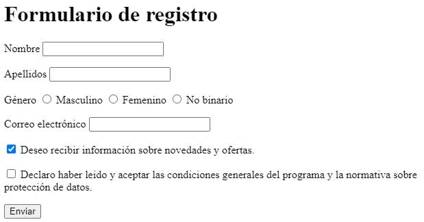
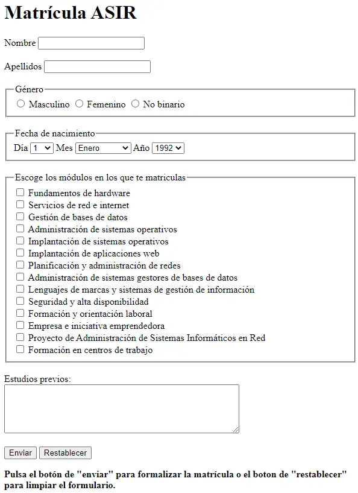
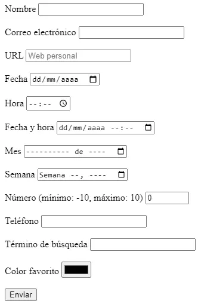

# Activitat 207

  

    🏆 <strong>Progrés d'aquesta secció:</strong> 0 de 4 superats (0%)
    ⭐ <strong>0 punts</strong>
  

  

    

  

> **📌 Lliurament**
> 

> - El lliurament serà un **fitxer pdf** que continga la resposta a les preguntes de l'activitat.

> - El nom del fitxer ha de ser `207_NombreApellidos.pdf`.

> - S'haurà de lliurar en la tasca corresponent d'Aules en temps i forma.

> **📌 Es valorarà**
> 

> Es valorarà:

> - La claredat de la resposta.

> - La correcta maquetació del document.

> - Resposta correcta o aproximació a aquesta.

> Aquesta activitat servirà per a qualificar:

> - RA2: Utilitza llenguatges de marques per a la transmissió i presentació d'informació a través de la web analitzant l'estructura dels documents i identificant els seus elements.

>   - CA2. c) Es ha reconegut la funcionalitat de les principals etiquetes i atributs del llenguatge HTML. (2%)

## **Exercici 1**

**Camps bàsics**

Llegix l'apartat 2.4.4 Formularis i crea un formulari que continga:

1. Un camp de text amb `placeholder` i `required`.

1. Un camp de contrasenya.

1. Un camp de correu electrònic amb `required`.

1. Un camp numèric amb `min="0"`, `max="100"` i `step="10"`.

1. Un botó d'enviament i un d'anulació.

## **Exercici 2**

**GET i POST**

Respon:

1. Què diferència hi ha entre el mètode `GET` i el mètode `POST`?

1. Amb què mètode es veuen els valors en la URL?

1. Què mètode s'ha d'utilitzar per a enviar arxius al servidor?

1. Escriu un formulari amb `method="POST"` que tinga un camp `name="direccion"` i un botó d'enviament.

## **Exercici 3**

**Llista desplegable**

Crea un formulari amb una llista desplegable de sistemes operatius (Linux, Windows, Mac US, Android, iOS) on Mac US aparega **seleccionat per defecte**, i asóciale un `<label>`.

## **Exercici 4**

**Organització amb fieldset**

Crea un formulari amb un `<fieldset>` i un `<legend>` que agrupe un camp d'usuari i un camp de contrasenya, cada un amb el seu `<label>` associat mitjançant l'atribut `for` i el `id` corresponent.

## **Exercici 5**

**Formulari de registre**

Crea una **pàgina web** que tinga el mateix aspecte que la següent imatge:

El formulari ha de contindre els següents **camps**:

- Nom d'usuari: control de tipus text obligatori.

- Contrasenya: control de tipus contrasenya obligatori.

- Correu electrònic: un control de tipus email obligatori.

- Web personal: control de tipus URL.

- Sexo: control de tipus ràdio amb les opcions hombre i mujer.

- Comentaris: un control de tipus textarea.

A més, has de tindre en compte els següents **requisits**:

- El títol de la pàgina ha de ser `Formulario de registro`.

- El mètode d'enviament del formulari ha de ser `GET`.

- El destí de l'enviament del formulari ha de ser `registro.php`.

## **Exercici 6**

**Matrícula ASIR**

Crea una **pàgina web** que tinga el mateix aspecte que la següent imatge:

El formulari ha de contindre els següents **camps**:

- Nom i cognoms: control de tipus text obligatori i amb autofoco.

- Data de naixement: control de tipus date.

- Horari: dos opcions, de 8:00 a 14:00 i de 14:00 a 20:00.

- Assignatures: les opcions de la matrícula són LMSGI, FOL, Sistemes Informàtics, BBDD i Programació.

- Observacions: un control de tipus textarea.

A més, has de tindre en compte els següents **requisits**:

- El títol de la pàgina ha de ser `Matrícula ASIR`.

- El mètode d'enviament del formulari ha de ser `GET`.

- El destí de l'enviament del formulari ha de ser `matricula.php`.

- El formulari ha d'estar organitzat amb `fieldset` i `legend`.

## **Exercici 7**

**Formulari HTML5**

Crea una **pàgina web** que tinga el mateix aspecte que la següent imatge:

El formulari ha de contindre els següents **camps**:

- Nom: control de tipus text obligatori i amb autofoco.

- Correu electrònic: un control de tipus email obligatori.

- URL: control de tipus URL que mostre l'ajuda `Web personal`.

- Data: control de tipus date.

- Hora: control de tipus time.

- Data i hora: control de tipus datetime.

- Mes: control de tipus month.

- Setmana: control de tipus week.

- Número: control de tipus number que limite l'entrada a un valor entre `-10` i `10`.

- Telèfon: control de tipus tel.

- Terme de cerca: control de tipus search.

- Color favorito: control de tipus color.

- Un botó d'enviament.

A més, has de tindre en compte els següents **requisits**:

- El títol de la pàgina ha de ser `Formulario HTML5`.

- El mètode d'enviament del formulari ha de ser `GET`.

- El destí de l'enviament del formulari ha de ser `html5.php`.

---

## 🎮 Reptes Interactius d'Autoavaluació (+100 XP)

Comprova el teu domini sobre **Activitat 207** superant aquests 4 reptes gamificats (+25 punts cadascun):

  
🎯 <strong>Repte 1 (+25 pts):</strong> En una taula HTML, quin atribut permet fusionar diverses columnes en una mateixa cel·la horitzontalment?

  

    <button type="button" class="btn-mcq-opt" data-opt="A">A) rowspan</button>
    <button type="button" class="btn-mcq-opt" data-opt="B">B) colspan</button>
    <button type="button" class="btn-mcq-opt" data-opt="C">C) cellpadding</button>
    <button type="button" class="btn-mcq-opt" data-opt="D">D) border</button>
  

  

  
🎯 <strong>Repte 2 (+25 pts):</strong> Quin atribut d'un camp <code>&lt;input&gt;</code> d'HTML5 impedeix que el formulari s'envie si l'usuari el deixa buit?

  

    <button type="button" class="btn-mcq-opt" data-opt="A">A) readonly</button>
    <button type="button" class="btn-mcq-opt" data-opt="B">B) required</button>
    <button type="button" class="btn-mcq-opt" data-opt="C">C) placeholder</button>
    <button type="button" class="btn-mcq-opt" data-opt="D">D) disabled</button>
  

  

.">
  
✅ <strong>Repte 3 (Vertader o Fals · +25 pts):</strong> L'etiqueta <code>&lt;head&gt;</code> d'un document HTML conté les metadades (<code>&lt;meta&gt;</code>, <code>&lt;title&gt;</code>, <code>&lt;link&gt;</code>) que no es renderitzen directament com a contingut visible de la pàgina.

  

    <button type="button" class="btn-vf" data-opt="V">Vertader (V)</button>
    <button type="button" class="btn-vf" data-opt="F">Fals (F)</button>
  

  

" data-hint="És l'etiqueta <a> (anchor).">
  
⌨️ <strong>Repte 4 (+25 pts):</strong> Quina etiqueta HTML s'utilitza per a crear un hipervincle o enllaç mitjançant l'atribut <code>href</code>?

  

    <input type="text" class="quiz-input" placeholder="Escriu la resposta..." />
    <button type="button" class="btn-quiz-check">Comprovar</button>
  

  

### 📋 Llista de Comprovació i Rúbrica d'Assoliment

Marca cada criteri a mesura que completes l'estudi o la resolució pràctica d'aquesta pàgina (**Activitat 207**):

- [ ] He llegit detingudament la teoria o l'enunciat d'aquesta secció i he anotat els conceptes clau.
- [ ] He revisat els esquemes, taules o blocs de codi i he verificat que sé aplicar-los a l'entorn de treball.
- [ ] He resolt correctament els **4 reptes interactius** superiors obtenint els **100 punts XP**.
- [ ] He descarregat el comprovant oficial en PDF per a adjuntar-lo a la tasca d'**Aules**.

  <h3>📤 Comprovant de Lliurament per a Aules</h3>
  
Quan hages completat els reptes interactius i la llista d'autoavaluació d'aquesta pàgina, introdueix el teu nom i descarrega el teu certificat oficial en PDF per a adjuntar-lo a la tasca d'<strong>Aules</strong>.

  

    <label for="aules-student-name">👤 Nom i Cognoms de l'Alumne/a:</label>
    <input type="text" id="aules-student-name" class="aules-student-name" placeholder="Ex: Joan Garcia Pérez" />
  

  

    0/4 reptes completats (0%) · 0 punts · 0/4 criteris d'autoavaluació
  

  

    <button type="button" class="btn-aules-dl" data-module="LMSGI" data-unit="UD02" data-activity="act207">📥 Descarregar Comprovant PDF</button>
    <button type="button" class="btn-aules-copy">📋 Copiar Resum al Porta-retalls</button>
  

  

