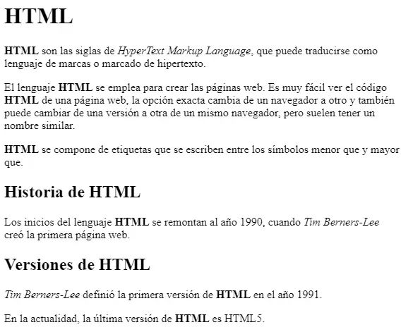
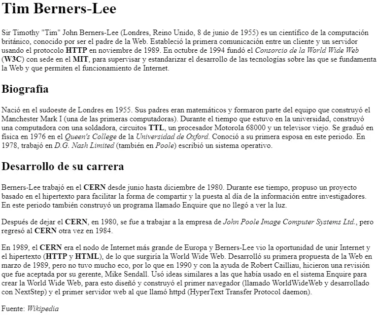

# Actividad 205

> **📌 Entrega**
> 

> - La entrega será un **fichero pdf** que contenga la respuesta a las preguntas de la actividad.

> - El nombre del fichero debe ser `205_NombreApellidos.pdf`.

> - Se deberá entregar en la tarea correspondiente de Aules en tiempo y forma.

> **📌 Se valorará**
> 

> Se valorará:

> - La claridad de la respuesta.

> - La correcta maquetación del documento.

> - Respuesta correcta o aproximación a la misma.

> Esta actividad servirá para calificar:

> - RA2: Utiliza lenguajes de marcas para la transmisión y presentación de información a través de la web analizando la estructura de los documentos e identificando sus elementos.

>   - CA2. c) Se ha reconocido la funcionalidad de las principales etiquetas y atributos del lenguaje HTML. (2%)

## **Ejercicio 1**

**Encabezados y párrafos**

Lee el apartado 2.4.3 Texto y crea un documento HTML que muestre:

1. Un `h1` con el título "Ciclos formativos de la familia de IFC".

1. Dos `h2` con "Ciclos medios (CM)" y "Ciclos superiores (CS)".

1. Bajo el primero, un `h3` con "SMR" y dos párrafos.

1. Bajo el segundo, tres `h3` con "ASIR", "DAM" y "DAW", cada uno con un párrafo.

## **Ejercicio 2**

**Saltos de línea y espacios**

Crea un documento HTML que:

1. Muestre un párrafo con varios espacios consecutivos usando `&nbsp;`.

1. Introduzca un salto de línea con `<br>`.

1. Muestre un bloque de código con `<pre>` conservando los saltos de línea.

## **Ejercicio 3**

**Formato de texto**

Crea un documento HTML que contenga un párrafo que utilice los elementos `b`, `i`, `u`, `sub`, `sup` y `strong`, con anidamiento de al menos negrita y subrayado simultáneos.

## **Ejercicio 4**

**Hipervínculos y semántica**

Crea un documento HTML que contenga:

1. Un enlace a la página del [W3C](https://www.w3.org/) que se abra en una pestaña nueva (`target="_blank"`).

1. Un enlace con `target="_self"`.

1. Una abreviatura usando `<abbr>` con su `title`.

1. Texto con `<em>` y `<small>`.

## **Ejercicio 5**

Dado el siguiente documento HTML:

Modifica el código para cumplir con los siguientes requisitos:

- Las **siglas HTML** deben aparecer como texto **destacado** en toda la página.

- `Tim Berners-Lee` debe aparecer como texto **enfatizado** en toda la página.

- Cada **párrafo** se debe marcar como tal.

- Se debe añadir un **encabezado** de nivel 1 con el texto `HTML` antes de `HTML son las siglas de...`

- Se debe añadir un **encabezado** de nivel 2 con el texto `Historia de HTML` antes de `Los inicios del lenguaje HTML...`

- Se debe añadir un **encabezado** de nivel 2 con el texto `Versiones de HTML` antes `Tim Berners-Lee definió....`

El resultado final debe ser una página web que tenga el mismo aspecto que la siguiente imagen:



## **Ejercicio 6**

**Página web sobre Tim Berners-Lee**

A partir del texto proporcionado, crea una **página web** que tenga el mismo aspecto que la siguiente imagen:



Además, tienes que tener en cuenta los siguientes requisitos:

- El **título** de la página (el que aparece en la pestaña del navegador) debe ser `Tim Berners-Lee`.

- El texto `Tim Berners-Lee` como **encabezado** de nivel 1.

- El texto `Biografía` como **encabezado** de nivel 2.

- Todas las **siglas** (como HTTP, W3C o MIT) deben aparecer como texto **destacado** y, al poner el ratón encima, debe mostrar el **significado de las siglas**.

- Los **nombres** de las instituciones o empresas, como Consorcio de la World Wide Web o Universidad de Oxford, deben aparecer como texto **enfatizado**.

El texto base es el siguiente:

```html
Tim Berners-Lee

Sir Timothy "Tim" John Berners-Lee (Londres, Reino Unido, 8 de junio de 1955) es un
científico de la computación británico, conocido por ser el padre de la Web. Estableció
la primera comunicación entre un cliente y un servidor usando el protocolo HTTP en
noviembre de 1989. En octubre de 1994 fundó el Consorcio de la World Wide Web (W3C) con
sede en el MIT, para supervisar y estandarizar el desarrollo de las tecnologías sobre
las que se fundamenta la Web y que permiten el funcionamiento de Internet.

Biografía

Nació en el sudoeste de Londres en 1955. Sus padres eran matemáticos y formaron parte
del equipo que construyó el Manchester Mark I (una de las primeras computadoras).
Durante el tiempo que estuvo en la universidad, construyó una computadora con una
soldadora, circuitos TTL, un procesador Motorola 68000 y un televisor viejo. Se graduó
en física en 1976 en el Queen's College de la Universidad de Oxford. Conoció a su
primera esposa en este periodo. En 1978, trabajó en D.G. Nash Limited (también en Poole)
escribió un sistema operativo.

Desarrollo de su carrera

Berners-Lee trabajó en el CERN desde junio hasta diciembre de 1980. Durante ese tiempo,
propuso un proyecto basado en el hipertexto para facilitar la forma de compartir y la
puesta al día de la información entre investigadores. En este periodo también construyó
un programa llamado Enquire que no llegó a ver la luz.

Después de dejar el CERN, en 1980, se fue a trabajar a la empresa de John Poole Image
Computer Systems Ltd., pero regresó al CERN otra vez en 1984.

En 1989, el CERN era el nodo de Internet más grande de Europa y Berners-Lee vio la
oportunidad de unir Internet y el hipertexto (HTTP y HTML), de lo que surgiría la World
Wide Web. Desarrolló su primera propuesta de la Web en marzo de 1989, pero no tuvo mucho
eco, por lo que en 1990 y con la ayuda de Robert Cailliau, hicieron una revisión que fue
aceptada por su gerente, Mike Sendall. Usó ideas similares a las que había usado en el
sistema Enquire para crear la World Wide Web, para esto diseñó y construyó el primer
navegador (llamado WorldWideWeb y desarrollado con NextStep) y el primer servidor web
al que llamó httpd (HyperText Transfer Protocol daemon).

Fuente: Wikipedia
```
