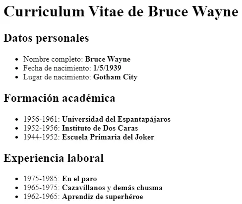
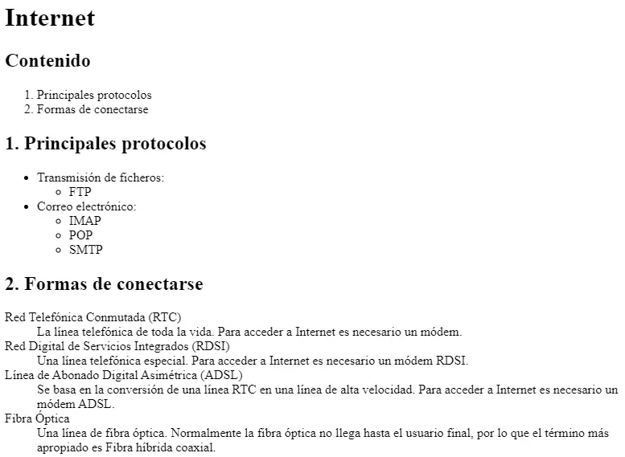
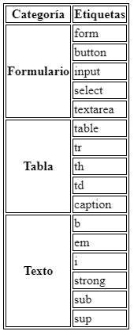
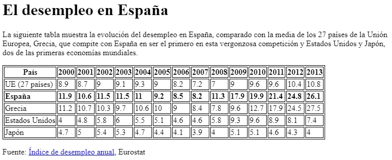

# Actividad 206

> **📌 Entrega**
> 

> - La entrega será un **fichero pdf** que contenga la respuesta a las preguntas de la actividad.

> - El nombre del fichero debe ser `206_NombreApellidos.pdf`.

> - Se deberá entregar en la tarea correspondiente de Aules en tiempo y forma.

> **📌 Se valorará**
> 

> Se valorará:

> - La claridad de la respuesta.

> - La correcta maquetación del documento.

> - Respuesta correcta o aproximación a la misma.

> Esta actividad servirá para calificar:

> - RA2: Utiliza lenguajes de marcas para la transmisión y presentación de información a través de la web analizando la estructura de los documentos e identificando sus elementos.

>   - CA2. c) Se ha reconocido la funcionalidad de las principales etiquetas y atributos del lenguaje HTML. (2%)

## **Ejercicio 1**

**Listas**

Lee los apartados 2.4.2 Listas y 2.4.3 Tablas y crea un documento HTML que incluya:

1. Una lista desordenada con los módulos de 1º de DAW.

1. Una lista ordenada con los mismos módulos comenzando en 1.

1. Una lista ordenada que comience en 4 usando el atributo `start`.

1. Una lista de definiciones con los términos "LLMMSGI" y "Bases de Datos" y sus definiciones.

## **Ejercicio 2**

**Currículum de Bruce Wayne**

Crea una **página web** que tenga el mismo aspecto que la siguiente imagen:



El texto que debe contener es el siguiente:

```html
Datos personales
 Nombre completo: Bruce Wayne
 Fecha de nacimiento: 1/5/1939
 Lugar de nacimiento: Gotham City

Formación académica
 1956-1961: Universidad del Espantapájaros
 1952-1956: Instituto de Dos Caras
 1944-1952: Escuela Primaria del Joker

Experiencia laboral
 1975-1985: En el paro
 1965-1975: Cazavillanos y demás chusma
 1962-1965: Aprendiz de superhéroe
```

## **Ejercicio 3**

**Listas de Internet**

Crea una **página web** que tenga el mismo aspecto que la siguiente imagen:



## **Ejercicio 4**

**Tabla de socios**

Crea un documento HTML con una tabla que cumpla lo siguiente:

1. Título con `<caption>`: "Tabla de socios".

1. Cabecera con `<thead>` y celdas `<th>` para "Nombre" y "Apellido".

1. Cuerpo con `<tbody>` y dos filas de socios.

1. Pie con `<tfoot>` mostrando el total.

## **Ejercicio 5**

**Tabla de horario**

Crea una tabla que represente un horario semanal sencillo con las filas "Lunes", "Miércoles" y "Viernes" y las columnas "1.ª hora", "2.ª hora" y "3.ª hora", rellenando las celdas con asignaturas ficticias.

## **Ejercicio 6**

**Colapsar Columnas y Filas**



Replica la misma tabla a partir del documento base:

<details markdown="1">

<summary>💡 Html</summary>

```html
<!DOCTYPE html>
<html>
<head>
<title>Tabla compleja</title>
<style>
table, tr, th, td {
  border: 1px solid black;
}
</style>
</head>
<body>
Categoría   Etiquetas

Formulario
form
button
input
select
textarea

Tabla
table
tr
th
td
caption

Texto
b
em
i
strong
sub
sup
</body>
</html>
```

</details>

## **Ejercicio 7**

Crea una página web que tenga el mismo aspecto que la siguiente imagen:



El destino del enlace Índice de desempleo anual es la página web:
[https://ec.europa.eu/eurostat/statistics-explained/index.php?oldid=220991](https://ec.europa.eu/eurostat/statistics-explained/index.php?oldid=220991)

El documento HTML base es el siguiente:

<details markdown="1">

<summary>💡 Html</summary>

```html
<!DOCTYPE html>
<html>
  <head>
    <title>Desempleo</title>
    <style>
    table, tr, th, td {
      border: 1px solid black;
    }
    </style>
  </head>
  <body>

    El desempleo en España

    La siguiente tabla muestra la evolución del desempleo en España, comparado con la
    media de los 27 países de la Unión Europea, Grecia, que compite con España en ser
    el primero en esta vergonzosa competición y Estados Unidos y Japón, dos de las
    primeras economías mundiales.

    País
    2000
    2001
    2002
    2003
    2004
    2005
    2006
    2007
    2008
    2009
    2010
    2011
    2012
    2013

    UE (27 países)
    8.9
    8.7
    9
    9.1
    9.3
    9
    8.2
    7.2
    7
    9
    9.6
    9.6
    10.4
    10.8

    España
    11.9
    10.6
    11.5
    11.5
    11
    9.2
    8.5
    8.2
    11.3
    17.9
    19.9
    21.4
    24.8
    26.1

    Grecia
    11.2
    10.7
    10.3
    9.7
    10.6
    10
    9
    8.4
    7.8
    9.6
    12.7
    17.9
    24.5
    27.5

    Estados Unidos
    4
    4.8
    5.8
    6
    5.5
    5.1
    4.6
    4.6
    5.8
    9.3
    9.6
    8.9
    8.1
    7.4

    Japón
    4.7
    5
    5.4
    5.3
    4.7
    4.4
    4.1
    3.9
    4
    5.1
    5.1
    4.6
    4.3
    4

    Fuente: Índice de desempleo anual, Eurostat

  </body>
</html>
```

</details>
