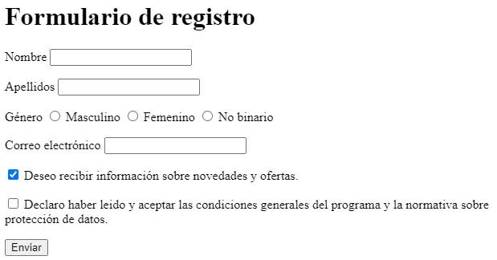
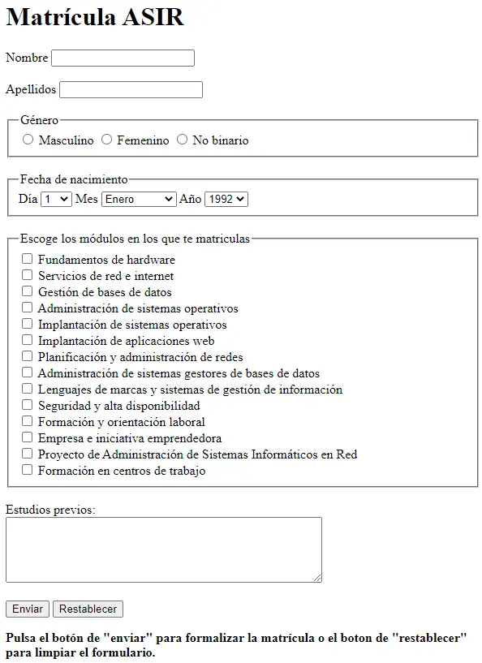
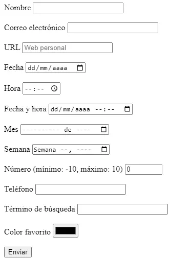

# Actividad 207

> **📌 Entrega**
> 

> - La entrega será un **fichero pdf** que contenga la respuesta a las preguntas de la actividad.

> - El nombre del fichero debe ser `207_NombreApellidos.pdf`.

> - Se deberá entregar en la tarea correspondiente de Aules en tiempo y forma.

> **📌 Se valorará**
> 

> Se valorará:

> - La claridad de la respuesta.

> - La correcta maquetación del documento.

> - Respuesta correcta o aproximación a la misma.

> Esta actividad servirá para calificar:

> - RA2: Utiliza lenguajes de marcas para la transmisión y presentación de información a través de la web analizando la estructura de los documentos e identificando sus elementos.

>   - CA2. c) Se ha reconocido la funcionalidad de las principales etiquetas y atributos del lenguaje HTML. (2%)

## **Ejercicio 1**

**Campos básicos**

Lee el apartado 2.4.4 Formularios y crea un formulario que contenga:

1. Un campo de texto con `placeholder` y `required`.

1. Un campo de contraseña.

1. Un campo de correo electrónico con `required`.

1. Un campo numérico con `min="0"`, `max="100"` y `step="10"`.

1. Un botón de envío y uno de anulación.

## **Ejercicio 2**

**GET y POST**

Responde:

1. ¿Qué diferencia hay entre el método `GET` y el método `POST`?

1. ¿Con qué método se ven los valores en la URL?

1. ¿Qué método se debe utilizar para enviar archivos al servidor?

1. Escribe un formulario con `method="POST"` que tenga un campo `name="direccion"` y un botón de envío.

## **Ejercicio 3**

**Lista desplegable**

Crea un formulario con una lista desplegable de sistemas operativos (Linux, Windows, Mac OS, Android, iOS) donde Mac OS aparezca **seleccionado por defecto**, y asóciale un `<label>`.

## **Ejercicio 4**

**Organización con fieldset**

Crea un formulario con un `<fieldset>` y un `<legend>` que agrupe un campo de usuario y un campo de contraseña, cada uno con su `<label>` asociado mediante el atributo `for` y el `id` correspondiente.

## **Ejercicio 5**

**Formulario de registro**

Crea una **página web** que tenga el mismo aspecto que la siguiente imagen:

El formulario debe contener los siguientes **campos**:

- Nombre de usuario: control de tipo texto obligatorio.

- Contraseña: control de tipo contraseña obligatorio.

- Correo electrónico: un control de tipo email obligatorio.

- Web personal: control de tipo URL.

- Sexo: control de tipo radio con las opciones hombre y mujer.

- Comentarios: un control de tipo textarea.

Además, tienes que tener en cuenta los siguientes **requisitos**:

- El título de la página debe ser `Formulario de registro`.

- El método de envío del formulario debe ser `GET`.

- El destino del envío del formulario debe ser `registro.php`.

## **Ejercicio 6**

**Matrícula ASIR**

Crea una **página web** que tenga el mismo aspecto que la siguiente imagen:

El formulario debe contener los siguientes **campos**:

- Nombre y apellidos: control de tipo texto obligatorio y con autofoco.

- Fecha de nacimiento: control de tipo date.

- Horario: dos opciones, de 8:00 a 14:00 y de 14:00 a 20:00.

- Asignaturas: las opciones de la matrícula son LMSGI, FOL, Sistemas Informáticos, BBDD y Programación.

- Observaciones: un control de tipo textarea.

Además, tienes que tener en cuenta los siguientes **requisitos**:

- El título de la página debe ser `Matrícula ASIR`.

- El método de envío del formulario debe ser `GET`.

- El destino del envío del formulario debe ser `matricula.php`.

- El formulario debe estar organizado con `fieldset` y `legend`.

## **Ejercicio 7**

**Formulario HTML5**

Crea una **página web** que tenga el mismo aspecto que la siguiente imagen:

El formulario debe contener los siguientes **campos**:

- Nombre: control de tipo texto obligatorio y con autofoco.

- Correo electrónico: un control de tipo email obligatorio.

- URL: control de tipo URL que muestre la ayuda `Web personal`.

- Fecha: control de tipo date.

- Hora: control de tipo time.

- Fecha y hora: control de tipo datetime.

- Mes: control de tipo month.

- Semana: control de tipo week.

- Número: control de tipo number que limite la entrada a un valor entre `-10` y `10`.

- Teléfono: control de tipo tel.

- Término de búsqueda: control de tipo search.

- Color favorito: control de tipo color.

- Un botón de envío.

Además, tienes que tener en cuenta los siguientes **requisitos**:

- El título de la página debe ser `Formulario HTML5`.

- El método de envío del formulario debe ser `GET`.

- El destino del envío del formulario debe ser `html5.php`.
