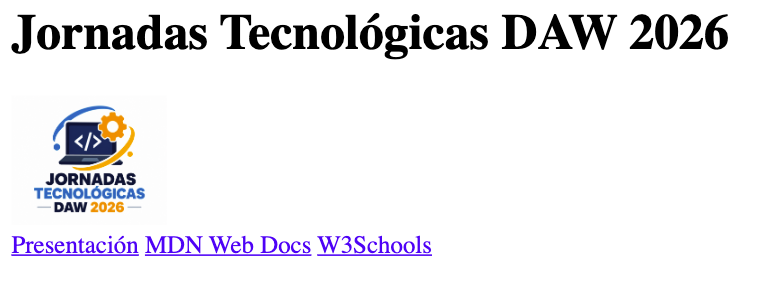
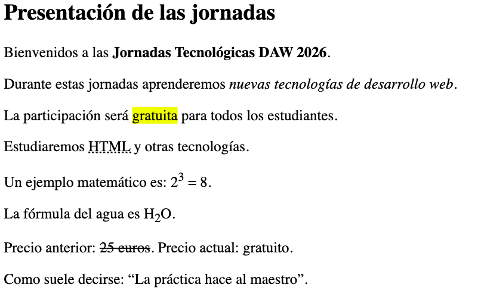
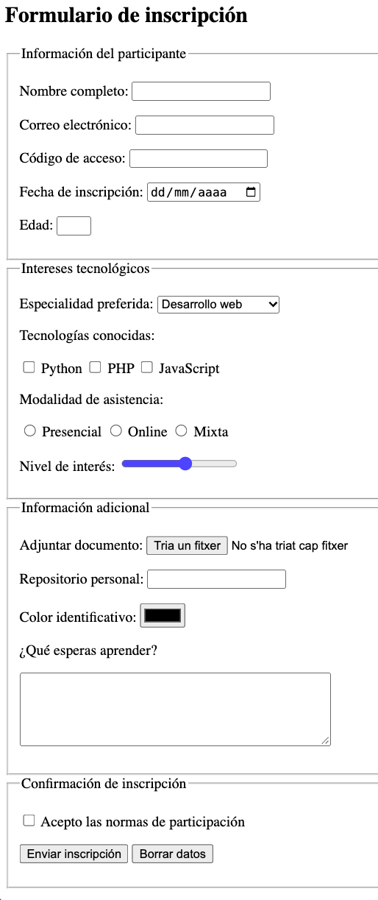
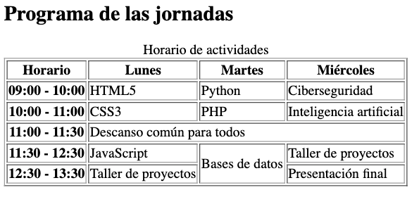
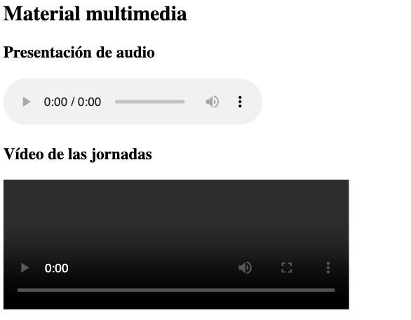
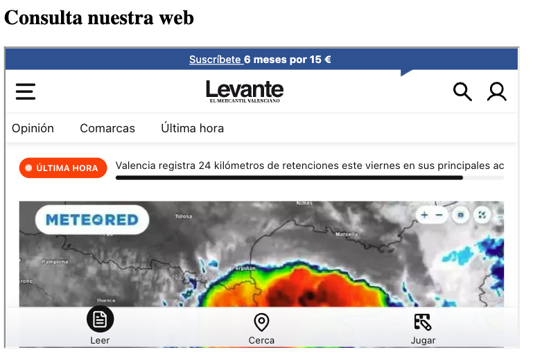
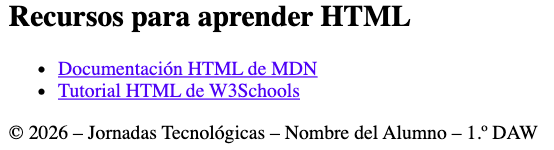

# SIMULACRO DE EXAMEN HTML

## 1.º Desarrollo de Aplicaciones Web

**Actividad:** Inscripción a las Jornadas Tecnológicas DAW 2026
**Puntuación total:** 10 puntos

## Objetivo

Desarrollar una página web utilizando exclusivamente HTML5 que permita presentar unas jornadas tecnológicas y gestionar la inscripción de sus participantes.

La página deberá incorporar una estructura semántica, elementos de formato de texto, formularios, tablas, contenido multimedia, enlaces y contenido externo.

**No se permite utilizar CSS ni JavaScript.**

## 1. Estructura general (1 punto)

Crea un documento HTML5 con la siguiente estructura semántica:

- `<header>`

- `<main>`

- `<footer>`

En la cabecera debes incluir:

- Un título principal con el texto **«Jornadas Tecnológicas DAW 2026»**.

- Una imagen representativa de HTML5 con un texto alternativo adecuado. Link Imagen

- Un menú de navegación que contenga los siguientes enlaces:

- Presentación (enlace interno al apartado de presentación).

- MDN Web Docs (enlace externo a https://developer.mozilla.org/es/).

- W3Schools (enlace externo a https://www.w3schools.com/).

Uno de los enlaces externos deberá abrirse en una nueva pestaña.

En el pie de página debes incluir tu nombre completo y el siguiente texto:

© 2026 – Jornadas Tecnológicas – Nombre del Alumno – 1.º DAW

<details markdown="1">

<summary>💡 Imatge Referència</summary>



</details>

## 2. Formato de texto (1 punto)

Dentro del elemento principal, crea una sección con el título **«Presentación de las jornadas»**.

En esta sección debes escribir un texto de presentación que incluya obligatoriamente:

1. Un párrafo con una palabra en **negrita**.

1. Una expresión en *cursiva*.

1. Una palabra resaltada con un marcador.

1. Una abreviatura con su significado completo.

1. Una expresión que contenga un superíndice.

1. Una fórmula que contenga un subíndice.

1. Un texto que aparezca tachado.

1. Una cita breve utilizando una etiqueta HTML específica para citas.

Puedes inventar el contenido, siempre que tenga relación con las jornadas tecnológicas.

<details markdown="1">

<summary>💡 Imatge Referència</summary>



</details>

## 3. Formulario de inscripción (4 puntos)

Crea un formulario de inscripción a las jornadas dentro del elemento principal.

El formulario deberá utilizar el método `post` y organizarse en **cuatro grupos de campos**, cada uno con su correspondiente título.

### A. Información del participante

Incluye los siguientes campos:

- **Nombre completo:** campo de texto obligatorio con un mínimo de 4 caracteres.

- **Correo electrónico:** campo obligatorio con validación de correo.

- **Código de acceso:** campo de contraseña con un mínimo de 8 caracteres.

- **Fecha de inscripción:** selector de fecha.

- **Edad:** campo numérico que permita introducir valores entre 16 y 65.

### B. Intereses tecnológicos

Incluye:

- Un desplegable para seleccionar la especialidad preferida:

- Desarrollo web.

- Ciberseguridad.

- Inteligencia artificial.

- Tres casillas de verificación para indicar las tecnologías conocidas:

- Python.

- PHP.

- JavaScript.

- Botones de selección para elegir la modalidad de asistencia:

- Presencial.

- Online.

- Mixta.

- Un control deslizante para valorar el interés por las jornadas, con valores entre 1 y 10.

### C. Información adicional

Incluye:

- Un campo para adjuntar un documento.

- Un campo para introducir la dirección de un repositorio web personal.

- Un selector para elegir el color identificativo del participante.

- Un área de texto para explicar qué espera aprender durante las jornadas.

### D. Confirmación de inscripción

Incluye:

- Una casilla obligatoria para aceptar las normas de participación.

- Un botón para enviar la inscripción.

- Un botón para borrar todos los datos del formulario.

**Requisitos adicionales:**

- Todos los campos deberán tener una etiqueta descriptiva asociada correctamente.

- Los controles relacionados deberán compartir el mismo nombre cuando corresponda.

<details markdown="1">

<summary>💡 Imatge Referència</summary>



</details>

## 4. Tabla de actividades (2 puntos)

Crea una tabla con borde que muestre el programa de las jornadas.

La tabla deberá incluir:

- Un título descriptivo.

- Un encabezado.

- Un cuerpo.

- Al menos una combinación horizontal de celdas.

- Al menos una combinación vertical de celdas.

La tabla tendrá la siguiente información:

| Horario | Lunes | Martes | Miércoles |
| --- | --- | --- | --- |
| 09:00 - 10:00 | HTML5 | Python | Ciberseguridad |
| 10:00 - 11:00 | CSS3 | PHP | Inteligencia artificial |
| 11:00 - 11:30 | Descanso común para todos los participantes |  |  |
| 11:30 - 12:30 | JavaScript | Bases de datos | Taller de proyectos |
| 12:30 - 13:30 | Taller de proyectos | Bases de datos | Presentación final |

**Condiciones:**

1. El descanso deberá ocupar las tres columnas correspondientes a los días.

1. La actividad «Bases de datos» deberá ocupar verticalmente las dos últimas franjas horarias del martes.

1. Deben utilizarse correctamente las etiquetas de encabezado y de datos.

**Nota:** La tabla anterior representa los datos. En el HTML se deberán aplicar las combinaciones de celdas indicadas.

<details markdown="1">

<summary>💡 Imatge Referència</summary>



</details>

## 5. Contenido multimedia (1 punto)

Debajo de la tabla, crea una sección titulada **«Material multimedia»**.

Incluye:

- Un reproductor de audio que utilice el archivo `presentacion.mp3`. Link Audio

- Un reproductor de vídeo que utilice el archivo `jornadas.mp4`. Link Video

- El vídeo deberá tener una anchura de **400 píxeles**.

- Ambos reproductores deberán mostrar sus controles de reproducción.

<details markdown="1">

<summary>💡 Imatge Referència</summary>



</details>

## 6. Contenido externo (0,5 puntos)

Crea una sección titulada **«Consulta nuestra web»**.

Inserta un elemento que permita visualizar una página web externa dentro de tu documento.

Utiliza la siguiente dirección:

https://www.levante-emv.com/

El elemento deberá tener:

- Una anchura de **600 píxeles**.

- Una altura de **350 píxeles**.

- Un título descriptivo para mejorar la accesibilidad.

<details markdown="1">

<summary>💡 Imatge Referència</summary>



</details>

## 7. Recursos recomendados (0,5 puntos)

Crea un bloque lateral con el título **«Recursos para aprender HTML»**.

Este bloque deberá contener una lista con enlaces a:

- Documentación HTML de MDN: https://developer.mozilla.org/es/docs/Web/HTML

- Tutorial HTML de W3Schools: https://www.w3schools.com/html/

Los enlaces deberán dirigir a sus correspondientes páginas externas.

<details markdown="1">

<summary>💡 Imatge Referència</summary>



</details>

## Instrucciones de entrega

1. El archivo principal deberá llamarse `index.html`.

1. Utiliza HTML5 y una estructura correctamente anidada.

1. Todas las imágenes deberán incluir texto alternativo.

1. Los campos del formulario deberán tener etiquetas correctamente asociadas.

1. Utiliza las etiquetas semánticas adecuadas.

1. Comprueba el funcionamiento de los enlaces y controles.

1. Entrega el archivo HTML y los recursos locales necesarios.

**Puntuación total: 10 puntos.**

<details markdown="1">

<summary>💡 Text</summary>

TEXTOS PARA EL SIMULACRO DE HTML

Jornadas Tecnológicas DAW 2026

1. Cabecera

Título principal:

Jornadas Tecnológicas DAW 2026

Menú de navegación:

- Presentación

- MDN Web Docs

- 

W3Schools

- 

Presentación de las jornadas

Título de la sección:

Presentación de las jornadas

Párrafo 1:

Bienvenidos a las Jornadas Tecnológicas DAW 2026.

Párrafo 2:

Durante estas jornadas aprenderemos nuevas tecnologías de desarrollo web.

Párrafo 3:

La participación será gratuita para todos los estudiantes.

Párrafo 4:

Estudiaremos HTML y otras tecnologías.

Párrafo 5:

Un ejemplo matemático es: 2³ = 8.

Párrafo 6:

La fórmula del agua es H₂O.

Párrafo 7:

Precio anterior: 25 euros. Precio actual: gratuito.

Párrafo 8:

Como suele decirse: «La práctica hace al maestro».

1. Formulario de inscripción

Título:

Formulario de inscripción

Grupo A: Información del participante

- Nombre completo:

- Correo electrónico:

- Código de acceso:

- Fecha de inscripción:

- Edad:

Grupo B: Intereses tecnológicos

Especialidad preferida:

- Desarrollo web

- Ciberseguridad

- Inteligencia artificial

Tecnologías conocidas:

- Python

- PHP

- JavaScript

Modalidad de asistencia:

- Presencial

- Online

- Mixta

Nivel de interés:

Grupo C: Información adicional

- Adjuntar documento:

- Repositorio personal:

- Color identificativo:

- ¿Qué esperas aprender?

Grupo D: Confirmación de inscripción

- Acepto las normas de participación.

- Enviar inscripción

- 

Borrar datos

- 

Programa de las jornadas

Título de la sección:

Programa de las jornadas

Título de la tabla:

Horario de actividades

Horario Lunes   Martes  Miércoles
09:00 - 10:00   HTML5   Python  Ciberseguridad
10:00 - 11:00   CSS3    PHP Inteligencia artificial
11:00 - 11:30   Descanso común para todos   Descanso común para todos   Descanso común para todos
11:30 - 12:30   JavaScript  Bases de datos  Taller de proyectos
12:30 - 13:30   Taller de proyectos Bases de datos  Presentación final

1. Material multimedia

Título de la sección:

Material multimedia

Subtítulos:

- Presentación de audio

- Vídeo de las jornadas

Archivos:

- presentacion.mp3

- 

jornadas.mp4

- 

Contenido externo

Título de la sección:

Consulta nuestra web

Título del contenido externo:

Página web del IES Mestre Ramon Esteve

Dirección:

https://portal.edu.gva.es/iesmestreramonesteve/

1. Recursos recomendados

Título:

Recursos para aprender HTML

Enlaces:

- Documentación HTML de MDN

- 

Tutorial HTML de W3Schools

- 

Pie de página

© 2026 – Jornadas Tecnológicas – Nombre del Alumno – 1.º DAW

</details>

<details markdown="1">

<summary>💡 Solució</summary>

```html
<!DOCTYPE html>
    <html lang="es">
    <head>
        <meta charset="UTF-8">
        <meta name="viewport" content="width=device-width, initial-scale=1.0">
        <title>Jornadas Tecnológicas DAW 2026</title>
    </head>
    <body>
        <!-- 1. ESTRUCTURA GENERAL -->
        <header>
            <h1>Jornadas Tecnológicas DAW 2026</h1>
            
            <nav>
                <a href="#presentacion">Presentación</a>
                <a href="https://developer.mozilla.org/es/" target="_blank">MDN Web Docs</a>
                <a href="https://www.w3schools.com/">W3Schools</a>
            </nav>
        </header>
        <main>
            <!-- 2. FORMATO DE TEXTO -->
            <section id="presentacion">
                <h2>Presentación de las jornadas</h2>
                <p>Bienvenidos a las <strong>Jornadas Tecnológicas DAW 2026</strong>.</p>
                <p>Durante estas jornadas aprenderemos <em>nuevas tecnologías de desarrollo web</em>.</p>
                <p>La participación será <mark>gratuita</mark> para todos los estudiantes.</p>
                <p>Estudiaremos <abbr title="HyperText Markup Language">HTML</abbr> y otras tecnologías.</p>
                <p>Un ejemplo matemático es: 2<sup>3</sup> = 8.</p>
                <p>La fórmula del agua es H<sub>2</sub>O.</p>
                <p>Precio anterior: <del>25 euros</del>. Precio actual: gratuito.</p>
                <p>Como suele decirse:<q>La práctica hace al maestro</q>.</p>
            </section>
            <!-- 3. FORMULARIO -->
            <section>
                <h2>Formulario de inscripción</h2>
                <form action="#" method="post">
                    <!-- A. DATOS PERSONALES -->
                    <fieldset>
                        <legend>Información del participante</legend>
                        <p>
                            <label for="nombre">Nombre completo:</label>
                            <input type="text" id="nombre" name="nombre" minlength="4" required>
                        </p>
                        <p>
                            <label for="correo">Correo electrónico:</label>
                            <input type="email" id="correo" name="correo" required>
                        </p>
                        <p>
                            <label for="codigo">Código de acceso:</label>
                            <input type="password" id="codigo" name="codigo" minlength="8">
                        </p>
                        <p>
                            <label for="fecha">Fecha de inscripción:</label>
                            <input type="date" id="fecha" name="fecha">
                        </p>
                        <p>
                            <label for="edad">Edad:</label>
                            <input type="number" id="edad" name="edad" min="16" max="65">
                        </p>
                    </fieldset>
                    <!-- B. INTERESES -->
                    <fieldset>
                        <legend>Intereses tecnológicos</legend>
                        <p>
                            <label for="especialidad">
                                Especialidad preferida:
                            </label>
                            <select id="especialidad" name="especialidad">
                                <option value="web">Desarrollo web</option>
                                <option value="seguridad">Ciberseguridad</option>
                                <option value="ia">Inteligencia artificial</option>
                            </select>
                        </p>
                        <p>Tecnologías conocidas:</p>
                        <p>
                            <input type="checkbox" id="python" name="tecnologias" value="python">
                            <label for="python">Python</label>
                            <input type="checkbox" id="php" name="tecnologias" value="php">
                            <label for="php">PHP</label>
                            <input type="checkbox" id="javascript" name="tecnologias" value="javascript">
                            <label for="javascript">JavaScript</label>
                        </p>
                        <p>Modalidad de asistencia:</p>
                        <p>
                            <input type="radio" id="presencial" name="modalidad" value="presencial">
                            <label for="presencial">Presencial</label>
                            <input type="radio" id="online" name="modalidad" value="online">
                            <label for="online">Online</label>
                            <input type="radio" id="mixta" name="modalidad" value="mixta">
                            <label for="mixta">Mixta</label>
                        </p>
                        <p>
                            <label for="interes">Nivel de interés:</label>
                            <input type="range" id="interes" name="interes" min="1" max="10">
                        </p>
                    </fieldset>
                    <!-- C. INFORMACIÓN ADICIONAL -->
                    <fieldset>
                        <legend>Información adicional</legend>
                        <p>
                            <label for="documento">Adjuntar documento:</label>
                            <input type="file" id="documento" name="documento">
                        </p>
                        <p>
                            <label for="repositorio">Repositorio personal:</label>
                            <input type="url" id="repositorio" name="repositorio">
                        </p>
                        <p>
                            <label for="color">Color identificativo:</label>
                            <input type="color" id="color" name="color">
                        </p>
                        <p>
                            <label for="comentarios">¿Qué esperas aprender?</label>
                        </p>
                        <p>
                            <textarea id="comentarios" name="comentarios" rows="5" cols="40"></textarea>
                        </p>
                    </fieldset>
                    <!-- D. CONFIRMACIÓN -->
                    <fieldset>
                        <legend>Confirmación de inscripción</legend>
                        <p>
                            <input type="checkbox" id="condiciones" name="condiciones" required>
                            <label for="condiciones">Acepto las normas de participación</label>
                        </p>
                        <p>
                            <button type="submit">
                                Enviar inscripción
                            </button>
                            <button type="reset">
                                Borrar datos
                            </button>
                        </p>
                    </fieldset>
                </form>
            </section>
            <!-- 4. TABLA -->
            <section>
                <h2>Programa de las jornadas</h2>
                <table border="1">
                    <caption>
                        Horario de actividades
                    </caption>
                    <thead>
                        <tr>
                            <th scope="col">Horario</th>
                            <th scope="col">Lunes</th>
                            <th scope="col">Martes</th>
                            <th scope="col">Miércoles</th>
                        </tr>
                    </thead>
                    <tbody>
                        <tr>
                            <th scope="row">09:00 - 10:00</th>
                            <td>HTML5</td>
                            <td>Python</td>
                            <td>Ciberseguridad</td>
                        </tr>
                        <tr>
                            <th scope="row">10:00 - 11:00</th>
                            <td>CSS3</td>
                            <td>PHP</td>
                            <td>Inteligencia artificial</td>
                        </tr>
                        <tr>
                            <th scope="row">11:00 - 11:30</th>
                            <td colspan="3">
                                Descanso común para todos
                            </td>
                        </tr>
                        <tr>
                            <th scope="row">11:30 - 12:30</th>
                            <td>JavaScript</td>
                            <td rowspan="2">
                                Bases de datos
                            </td>
                            <td>Taller de proyectos</td>
                        </tr>
                        <tr>
                            <th scope="row">12:30 - 13:30</th>
                            <td>Taller de proyectos</td>
                            <td>Presentación final</td>
                        </tr>
                    </tbody>
                </table>
            </section>
            <!-- 5. MULTIMEDIA -->
            <section>
                <h2>Material multimedia</h2>
                <h3>Presentación de audio</h3>
                <audio controls>
                    <source src="presentacion.mp3"
                            type="audio/mpeg">
                    Tu navegador no soporta audio HTML5.
                </audio>
                <h3>Vídeo de las jornadas</h3>
                <video width="400" controls>
                    <source src="jornadas.mp4"
                            type="video/mp4">
                    Tu navegador no soporta vídeo HTML5.
                </video>
            </section>
            <!-- 6. IFRAME -->
            <section>
                <h2>Consulta nuestra web</h2>
                <iframe
                    src="https://www.levante-emv.com/"
                    width="600"
                    height="350"
                    title="Página web del Levanete EMV">
                </iframe>
            </section>
            <!-- 7. ASIDE -->
            <aside>
                <h2>Recursos para aprender HTML</h2>
                <ul>
                    <li>
                        <a href="https://developer.mozilla.org/es/docs/Web/HTML">Documentación HTML de MDN</a>
                    </li>
                    <li>
                        <a href="https://www.w3schools.com/html/">Tutorial HTML de W3Schools</a>
                    </li>
                </ul>
            </aside>
        </main>
        <!-- PIE DE PÁGINA -->
        <footer>
            <p>© 2026 – Jornadas Tecnológicas – Nombre del Alumno – 1.º DAW</p>
        </footer>
    </body>
    </html>
```

> **📌 CodeSandbox**
> 

> [Simulacro HTML](https://codesandbox.io/p/sandbox/z4qx36)

</details>
