# Cuaderno Práctico de Actividades — UD2: Utilització de Lenguajes de Marcas en Entorns Web — HTML5

<div class="interactive-progress-tracker">
  <div class="tracker-header">
    <span>🏆 <strong>Progreso de esta sección:</strong> <span class="tracker-count">0 de 4 superados (0%)</span></span>
    <span class="tracker-pts">⭐ <strong>0 puntos</strong></span>
  </div>
  <div class="tracker-bar">
    <div class="tracker-fill" style="width: 0%;"></div>
  </div>
</div>

En esta sección tienes acceso directo a todas las actividades prácticas, fichas de trabajo y retos evaluables de esta unidad didáctica. Puedes acceder a cada actividad individualmente o consultar la recopilación completa a continuación:

## 🗂️ Índice de Actividades de la Unidad

- **[⚡ Activitat 201](act201.html)**
- **[⚡ Activitat 202](act202.html)**
- **[⚡ Activitat 203](act203.html)**
- **[⚡ Activitat 204](act204.html)**
- **[⚡ Activitat 205](act205.html)**
- **[⚡ Activitat 206](act206.html)**
- **[⚡ Activitat 207](act207.html)**
- **[⚡ Activitat 208](act208.html)**
- **[⚡ Activitat 209](act209.html)**
- **[⚡ Activitat 210](act210.html)**
- **[⚡ Activitat 211](act211.html)**
- **[🏆 Simulacre d'Examen UD2](simulacre_examen.html)**

---

## Actividad 201

👉 *[Obrir aquesta activitat en pàgina individual](act201.html)*

# Actividad 201

> **📌 Entrega**
> 

> - La entrega será un **fichero pdf** que contenga la respuesta a las preguntas de la actividad.

> - El nombre del fichero debe ser `201_NombreApellidos.pdf`.

> - Se deberá entregar en la tarea correspondiente de Aules en tiempo y forma.

> **📌 Se valorará:**
> 

> Es valorarà:

> - La claridad de la respuesta.

> - La correcta maquetación del documento.

> - Respuesta correcta o aproximación a esta.

> Esta actividad servirá para calificar:

> - RA2: Utilitza llenguatges de marques per a la transmissió i presentació d'informació a través de la web analitzant l'estructura dels documents i identificant els seus elements.

>   - CA2. a) S'han identificat i classificat els llenguatges de marques relacionats amb la web i els seus diferents versions i estàndards. (5%)

## **Ejercicio 1**

**Investigació sobre Markdown**

Realitza un treball d'investigació sobre el llenguatge de marques Markdown. Per a realizar-lo hauràs de seguir la següent estructura:

1. **Introducció**: Explicar orígenes i usos actuals d'aquest llenguatge de marques.

1. **Estructura i sintaxi**: Explicar l'estructura del document i la sintaxi més comú.

1. **Editors**: Editors més comuns de Markdown.

1. **Publicació**: Com publicar els arxius Markdown.

---

## Actividad 202

👉 *[Obrir aquesta activitat en pàgina individual](act202.html)*

# Actividad 202

> **📌 Entrega**
> 

> - La entrega será un **fichero pdf** que contenga la respuesta a las preguntas de la actividad.

> - El nombre del fichero debe ser `202_NombreApellidos.pdf`.

> - Se deberá entregar en la tarea correspondiente de Aules en tiempo y forma.

> **📌 Se valorará:**
> 

> Es valorarà:

> - La claridad de la respuesta.

> - La correcta maquetación del documento.

> - Respuesta correcta o aproximación a esta.

> Esta actividad servirá para calificar:

> - RA2: Utilitza llenguatges de marques per a la transmissió i presentació d'informació a través de la web analitzant l'estructura dels documents i identificant els seus elements.

>   - CA2. b) S'ha analitzat l'estructura d'un document HTML i les seccions que el componen. (5%)

>   - CA2. d)   S'han establit les semejanzas i diferències entre les diferents versions de HTML. (5%)

## **Ejercicio 1**

**XHTML vs HTML**

Llegix l'apartat 2.2.4 XHTML i respon:

1. Què és XHTML?

1. Què problemes del HTML resol XHTML?

1. Escriu les **cinc normes** que ha de complir un document per a ser XML bé format i, per tant, XHTML.

1. Què diferència hi ha en el comportament dels navegadors entre un document HTML amb errors i un XHTML amb errors?

## **Ejercicio 2**

**Escriure en XHTML**

El següent codi HTML no és vàlid com XHTML. Corregeix els errors perquè siga un document **XHTML bé format**:

```html
<!DOCTYPE html>
<HTML>
  <HEAD>
    <meta charset=UTF-8>
    <title>Mi página</title>
  </HEAD>
  <BODY>
    <p>Primer párrafo
    <p>Segundo párrafo<br>
    
  </BODY>
</HTML>
```

---

## Actividad 203

👉 *[Obrir aquesta activitat en pàgina individual](act203.html)*

# Actividad 203

> **📌 Entrega**
> 

> - La entrega será un **fichero pdf** que contenga la respuesta a las preguntas de la actividad.

> - El nombre del fichero debe ser `203_NombreApellidos.pdf`.

> - Se deberá entregar en la tarea correspondiente de Aules en tiempo y forma.

> **📌 Se valorará:**
> 

> Es valorarà:

> - La claridad de la respuesta.

> - La correcta maquetación del documento.

> - Respuesta correcta o aproximación a esta.

> Esta actividad servirá para calificar:

> - RA2: Utilitza llenguatges de marques per a la transmissió i presentació d'informació a través de la web analitzant l'estructura dels documents i identificant els seus elements.

>   - CA2. b) S'ha analitzat l'estructura d'un document HTML i les seccions que el componen. (5%)

## **Ejercicio 1**

**Parts del document**

Llegix l'apartat 2.2.5 Estructura d'un document HTML i respon:

1. Què és el pròleg i què indica en el cas de HTML5?

1. Què elements formen l'estructura bàsica d'un document?

1. Què informació conté la capçalera `<head>` i quin és l'element obligatori dins d'ella?

1. En què es diferencia la informació de la capçalera de la del cos?

1. On s'han d'escriure els comentaris i per a què serveixen?

## **Ejercicio 2**

**Capçalera completa**

Crea un document HTML que incloga en la capçalera els següents elements:

1. Joc de caràcters UTF-8.

1. Un títol obligatori.

1. Un `meta` amb el *viewport*.

1. Un `link` a una full d'estils externa.

1. Un bloc `style` intern.

1. Un `script` extern.

1. En el cos, un únic paràgraf amb el text "Hola, LLMSGI".

## **Ejercicio 3**

**Etiquetes i atributs**

Llegix l'apartat 2.3.1 Sintaxi: etiquetes i atributs i respon:

1. Què és una etiqueta d'obertura i què és una etiqueta de tancament?

1. Què és un element buit? Posa un exemple.

1. Per a què serveixen els atributs en HTML?

1. Què ocorre si el valor d'un atribut no és vàlid?

## **Ejercicio 4**

**Document bàsic**

Crear una pàgina HTML amb la **estructura bàsica** (elements `<html>`, `<head>` indicant el joc de caràcters i el títol, i `<body>` contenent un text pla). Utilitzar un programa d'edició de text pla. Guardar el document en l'ordinador fins a finalitzar la classe.

## **Ejercicio 5**

**Tipus d'atributs**

Llegix l'apartat 2.3.2 Tipus d'atributs i crea un document HTML que:

1. Tinga un `<div>` amb un `id` únic.

1. Tinga un element amb una classe definida en una full d'estils interna.

1. Un enllaç amb `title` i l'atribut `lang="es"`.

1. Un camp de text amb `autofocus`.

## **Ejercicio 6**

**Corregir errors d'estructura HTML**

Crea una **pàgina web** que tinga el mateix aspecte que la següent imatge:

El document HTML base és el següent:

> **📌 Html**
> 

```html
<html lang=es>
  <head>
    <title>World Wide Web</title>
  </head>
  <body>

    <h1>World Wide Web</h1>

    <p>
    En informática, la <strong><em>World Wide Web</strong></em> (WWW) o Red informática
    mundial comúnmente conocida como la web, es un sistema de distribución de documentos
    de hipertexto o hipermedios interconectados y accesibles vía Internet. Con un
    navegador web, un usuario visualiza sitios web compuestos de páginas web que pueden
    contener texto, imágenes, vídeos u otros contenidos multimedia, y navega a través de
    esas páginas usando hiperenlaces.

    <h2>Historia</h2>

    <p>
    La web se desarrolló entre marzo de 1989 y diciembre de 1990 por el inglés Tim Berners-Lee
    con la ayuda del belga Robert Cailliau mientras trabajaban en el CERN en Ginebra,
    Suiza, y publicado en 1992.
    </p>

    <p>
    Desde entonces, Berners-Lee ha jugado un papel activo guiando el desarrollo de estándares
    web (como los lenguajes de marcado con los que se crean las páginas web), y en los últimos
    años ha abogado por su visión de una web semántica.
    </p>

    <p>Fuente: <em>Wikipedia</p></em>

</html>
```

## **Ejercicio 7**

**Corregir errors i millorar**

El document HTML base és el següent:

> **📌 Html**
> 

```html
<html>
  <head>
    <title>World Wide Web</title>
  </head>
  <body>
    <h1>World Wide Web</h1>
    <p>
    En inform&aacute;tica, la <strong><em>World Wide Web</em></strong> (WWW) o
    Red inform&aacute;tica mundial com&uacute;nmente conocida como la web, es
    un sistema de distribuci&oacute;n de documentos de hipertexto o hipermedios
    interconectados y accesibles v&iacute;a Internet. Con un navegador web, un
    usuario visualiza sitios web compuestos de p&aacute;ginas web que pueden
    contener texto, im&aacute;genes, v&iacute;deos u otros contenidos multimedia,
    y navega a trav&eacute;s de esas p&aacute;ginas usando hiperenlaces.
    </p>

    <h3>Historia</h3>

    <p>
    La web se desarrolló entre marzo de 1989 y diciembre de 1990 por el inglés
    Tim Berners-Lee con la ayuda del belga Robert Cailliau mientras trabajaban
    en el CERN en Ginebra, Suiza, y publicado en 1992.
    </p>

    <p>
    Desde entonces, Berners-Lee ha jugado un papel activo guiando el desarrollo
    de estándares web (como los lenguajes de marcado con los que se crean las
    páginas web), y en los últimos años ha abogado por su visión de una web
    semántica.
    </p>

    <p>
    Una frase famosa de Tim Berners-Lee es:
    </p>

    <blockquote>
    <p>
    There is only one web.
    </p>
    </blockquote>
    <p>Fuente: <em>Wikipedia</em></p>
</html>
```

---

## Actividad 204

👉 *[Obrir aquesta activitat en pàgina individual](act204.html)*

# Actividad 204

> **📌 Entrega**
> 

> - La entrega será un **fichero pdf** que contenga la respuesta a las preguntas de la actividad.

> - El nombre del fichero debe ser `204_NombreApellidos.pdf`.

> - Se deberá entregar en la tarea correspondiente de Aules en tiempo y forma.

> **📌 Se valorará:**
> 

> Es valorarà:

> - La claridad de la respuesta.

> - La correcta maquetación del documento.

> - Respuesta correcta o aproximación a esta.

> Esta actividad servirá para calificar:

> - RA2: Utilitza llenguatges de marques per a la transmissió i presentació d'informació a través de la web analitzant l'estructura dels documents i identificant els seus elements.

>   - CA2. c) Es ha reconegut la funcionalitat de les principals etiquetes i atributs del llenguatge HTML. (2%)

## **Ejercicio 1**

**Elements inline i block**

Llegix els apartats 2.4.1 Elements HTML i 2.4.2 Seccions i respon:

1. Què diferència hi ha entre un element en línia (*inline*) i un element de bloc (*block*)?

1. Classifica els següents elements com *inline* o *block*: `<h1>`, `<a>`, `<p>`, `<strong>`, `<div>`.

1. Quan s'ha d'usar `<div>` i quan una etiqueta semàntica?

1. Què representa l'element `<article>`?

## **Ejercicio 2**

**Maquetació amb etiquetes semàntiques**

Crea un document HTML amb la següent estructura semàntica:

- Un `<header>` amb un `<nav>` amb dos enllaços.

- Un `<main>` amb una `<section>` que continga un `<article>` amb un paràgraf.

- Un `<aside>` amb un altre paràgraf.

- Un `<footer>` amb un paràgraf.

---

## Actividad 205

👉 *[Obrir aquesta activitat en pàgina individual](act205.html)*

# Actividad 205

> **📌 Entrega**
> 

> - La entrega será un **fichero pdf** que contenga la respuesta a las preguntas de la actividad.

> - El nombre del fichero debe ser `205_NombreApellidos.pdf`.

> - Se deberá entregar en la tarea correspondiente de Aules en tiempo y forma.

> **📌 Se valorará:**
> 

> Es valorarà:

> - La claridad de la respuesta.

> - La correcta maquetación del documento.

> - Respuesta correcta o aproximación a esta.

> Esta actividad servirá para calificar:

> - RA2: Utilitza llenguatges de marques per a la transmissió i presentació d'informació a través de la web analitzant l'estructura dels documents i identificant els seus elements.

>   - CA2. c) Es ha reconegut la funcionalitat de les principals etiquetes i atributs del llenguatge HTML. (2%)

## **Ejercicio 1**

**Encapçalaments i paràgrafs**

Llegix l'apartat 2.4.3 Text i crea un document HTML que mostre:

1. Un `h1` amb el títol "Cicles formativos de la família de IFC".

1. Dos `h2` amb "Cicles mitjans (CM)" i "Cicles superiors (CS)".

1. Sota el primer, un `h3` amb "SMR" i dos paràgrafs.

1. Sota el segon, tres `h3` amb "ASIR", "DAM" i "DAW", cada un amb un paràgraf.

## **Ejercicio 2**

**Salts de línia i espais**

Crea un document HTML que:

1. Mostre un paràgraf amb diversos espais consecutius usant `&nbsp;`.

1. Introduzca un salt de línia amb `<br>`.

1. Mostre un bloc de codi amb `<pre>` conservant els salts de línia.

## **Ejercicio 3**

**Format de text**

Crea un document HTML que continga un paràgraf que utilitze els elements `b`, `i`, `u`, `sub`, `sup` i `strong`, amb anidament d'almenys negreta i subratllat simultáneos.

## **Ejercicio 4**

**Hipervínculos i semàntica**

Crea un document HTML que continga:

1. Un enllaç a la pàgina del [W3C](https://www.w3.org/) que es abra en una pestanya nova (`target="_blank"`).

1. Un enllaç amb `target="_self"`.

1. Una abreviatura usant `<abbr>` amb el seu `title`.

1. Text amb `<em>` i `<small>`.

## **Ejercicio 5**

Donat el següent document HTML:

Modifica el codi per a complir amb els següents requisits:

- Les **sigles HTML** han d'aparèixer com text **destacat** en tota la pàgina.

- `Tim Berners-Lee` ha d'aparèixer com text **enfatitzat** en tota la pàgina.

- Cada **paràgraf** s'ha de marcar com tal.

- S'ha d'afegir un **encapçalament** de nivell 1 amb el text `HTML` abans de `HTML son las siglas de...`

- S'ha d'afegir un **encapçalament** de nivell 2 amb el text `Historia de HTML` abans de `Los inicios del lenguaje HTML...`

- S'ha d'afegir un **encapçalament** de nivell 2 amb el text `Versiones de HTML` abans `Tim Berners-Lee definió....`

El resultat final ha de ser una pàgina web que tinga el mateix aspecte que la següent imatge:

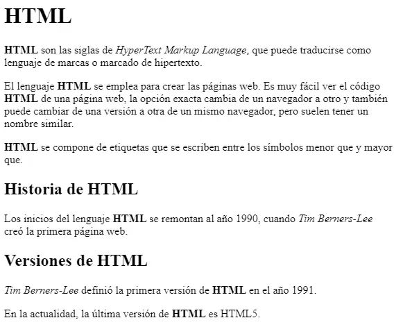

## **Ejercicio 6**

**Pàgina web sobre Tim Berners-Llegix**

A partir del text proporcionat, crea una **pàgina web** que tinga el mateix aspecte que la següent imatge:

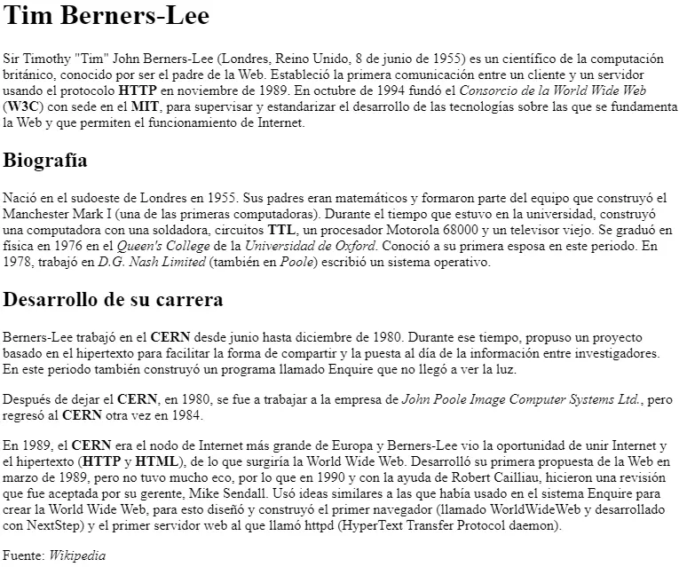

A més, has de tindre en compte els següents requisits:

- El **títol** de la pàgina (el que apareix en la pestanya del navegador) ha de ser `Tim Berners-Lee`.

- El text `Tim Berners-Lee` com **encapçalament** de nivell 1.

- El text `Biografía` com **encapçalament** de nivell 2.

- Totes les **sigles** (com HTTP, W3C o MIT) han d'aparèixer com text **destacat** i, al posar el ratolí damunt, ha de mostrar el **significat de les sigles**.

- Els **noms** de les institucions o empreses, com Consorcio de la World Wide Web o Universitat de Oxford, han d'aparèixer com text **enfatitzat**.

El text base és el següent:

```html
Tim Berners-Lee

Sir Timothy "Tim" John Berners-Lee (Londres, Reino Unido, 8 de junio de 1955) es un
científico de la computación británico, conocido por ser el padre de la Web. Estableció
la primera comunicación entre un cliente y un servidor usando el protocolo HTTP en
noviembre de 1989. En octubre de 1994 fundó el Consorcio de la World Wide Web (W3C) con
sede en el MIT, para supervisar y estandarizar el desarrollo de las tecnologías sobre
las que se fundamenta la Web y que permiten el funcionamiento de Internet.

Biografía

Nació en el sudoeste de Londres en 1955. Sus padres eran matemáticos y formaron parte
del equipo que construyó el Manchester Mark I (una de las primeras computadoras).
Durante el tiempo que estuvo en la universidad, construyó una computadora con una
soldadora, circuitos TTL, un procesador Motorola 68000 y un televisor viejo. Se graduó
en física en 1976 en el Queen's College de la Universidad de Oxford. Conoció a su
primera esposa en este periodo. En 1978, trabajó en D.G. Nash Limited (también en Poole)
escribió un sistema operativo.

Desarrollo de su carrera

Berners-Lee trabajó en el CERN desde junio hasta diciembre de 1980. Durante ese tiempo,
propuso un proyecto basado en el hipertexto para facilitar la forma de compartir y la
puesta al día de la información entre investigadores. En este periodo también construyó
un programa llamado Enquire que no llegó a ver la luz.

Después de dejar el CERN, en 1980, se fue a trabajar a la empresa de John Poole Image
Computer Systems Ltd., pero regresó al CERN otra vez en 1984.

En 1989, el CERN era el nodo de Internet más grande de Europa y Berners-Lee vio la
oportunidad de unir Internet y el hipertexto (HTTP y HTML), de lo que surgiría la World
Wide Web. Desarrolló su primera propuesta de la Web en marzo de 1989, pero no tuvo mucho
eco, por lo que en 1990 y con la ayuda de Robert Cailliau, hicieron una revisión que fue
aceptada por su gerente, Mike Sendall. Usó ideas similares a las que había usado en el
sistema Enquire para crear la World Wide Web, para esto diseñó y construyó el primer
navegador (llamado WorldWideWeb y desarrollado con NextStep) y el primer servidor web
al que llamó httpd (HyperText Transfer Protocol daemon).

Fuente: Wikipedia
```

---

## Actividad 206

👉 *[Obrir aquesta activitat en pàgina individual](act206.html)*

# Actividad 206

> **📌 Entrega**
> 

> - La entrega será un **fichero pdf** que contenga la respuesta a las preguntas de la actividad.

> - El nombre del fichero debe ser `206_NombreApellidos.pdf`.

> - Se deberá entregar en la tarea correspondiente de Aules en tiempo y forma.

> **📌 Se valorará:**
> 

> Es valorarà:

> - La claridad de la respuesta.

> - La correcta maquetación del documento.

> - Respuesta correcta o aproximación a esta.

> Esta actividad servirá para calificar:

> - RA2: Utilitza llenguatges de marques per a la transmissió i presentació d'informació a través de la web analitzant l'estructura dels documents i identificant els seus elements.

>   - CA2. c) Es ha reconegut la funcionalitat de les principals etiquetes i atributs del llenguatge HTML. (2%)

## **Ejercicio 1**

**Llistes**

Llegix els apartats 2.4.2 Llistes i 2.4.3 Taules i crea un document HTML que incloga:

1. Una llista desordenada amb els mòduls de 1º de DAW.

1. Una llista ordenada amb els mateixos mòduls començant en 1.

1. Una llista ordenada que comience en 4 usant l'atribut `start`.

1. Una llista de definicions amb els termes "LLMMSGI" i "Bases de dades" i les seues definicions.

## **Ejercicio 2**

**Currículum de Bruce Wayne**

Crea una **pàgina web** que tinga el mateix aspecte que la següent imatge:

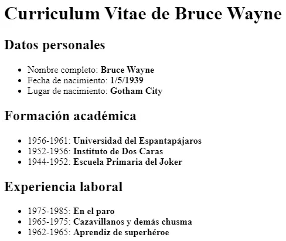

El text que ha de contindre és el següent:

```html
Datos personales
 Nombre completo: Bruce Wayne
 Fecha de nacimiento: 1/5/1939
 Lugar de nacimiento: Gotham City

Formación académica
 1956-1961: Universidad del Espantapájaros
 1952-1956: Instituto de Dos Caras
 1944-1952: Escuela Primaria del Joker

Experiencia laboral
 1975-1985: En el paro
 1965-1975: Cazavillanos y demás chusma
 1962-1965: Aprendiz de superhéroe
```

## **Ejercicio 3**

**Llistes de Internet**

Crea una **pàgina web** que tinga el mateix aspecte que la següent imatge:

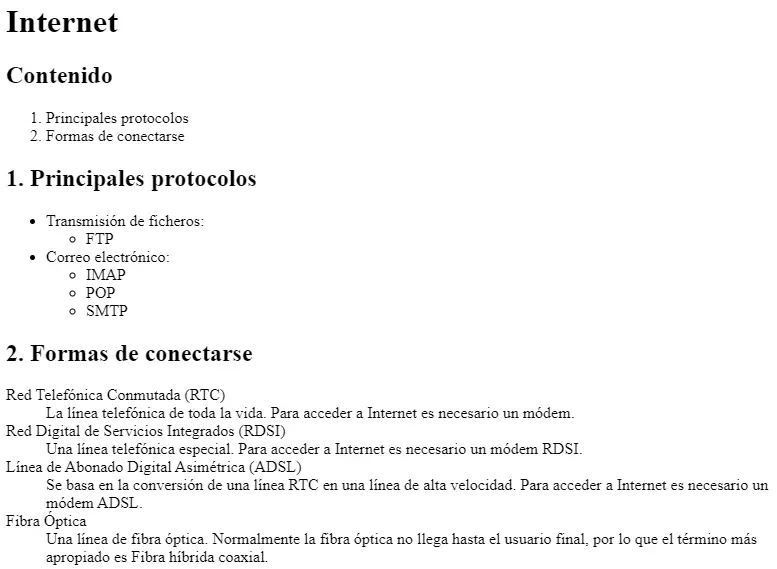

## **Ejercicio 4**

**Taula de socios**

Crea un document HTML amb una taula que complisca el següent:

1. Títol amb `<caption>`: "Taula de socios".

1. Capçalera amb `<thead>` i cel·les `<th>` per a "Nom" i "Cognom".

1. Cos amb `<tbody>` i dos files de socios.

1. Peu amb `<tfoot>` mostrant el total.

## **Ejercicio 5**

**Taula d'horari**

Crea una taula que represente un horari semanal senzill amb les files "Dilluns", "Dimecres" i "Divendres" i les columnes "1.ª hora", "2.ª hora" i "3.ª hora", emplenant les cel·les amb assignatures ficticias.

## **Ejercicio 6**

**Colapsar Columnes i Files**

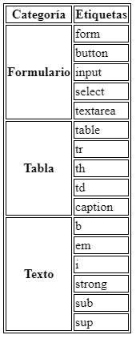

Replica la mateixa taula a partir del document base:

<details markdown="1">

<summary>💡 Html</summary>

```html
<!DOCTYPE html>
<html>
<head>
<title>Tabla compleja</title>
<style>
table, tr, th, td {
  border: 1px solid black;
}
</style>
</head>
<body>
Categoría   Etiquetas

Formulario
form
button
input
select
textarea

Tabla
table
tr
th
td
caption

Texto
b
em
i
strong
sub
sup
</body>
</html>
```

</details>

## **Ejercicio 7**

Crea una pàgina web que tinga el mateix aspecte que la següent imatge:

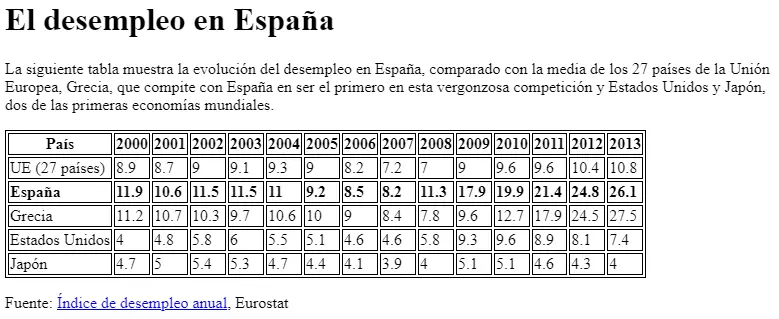

El destí de l'enllaç Índex de desempleo anual és la pàgina web:
[https://ec.europa.eu/eurostat/statistics-explained/index.php?oldid=220991](https://ec.europa.eu/eurostat/statistics-explained/index.php?oldid=220991)

El document HTML base és el següent:

<details markdown="1">

<summary>💡 Html</summary>

```html
<!DOCTYPE html>
<html>
  <head>
    <title>Desempleo</title>
    <style>
    table, tr, th, td {
      border: 1px solid black;
    }
    </style>
  </head>
  <body>

    El desempleo en España

    La siguiente tabla muestra la evolución del desempleo en España, comparado con la
    media de los 27 países de la Unión Europea, Grecia, que compite con España en ser
    el primero en esta vergonzosa competición y Estados Unidos y Japón, dos de las
    primeras economías mundiales.

    País
    2000
    2001
    2002
    2003
    2004
    2005
    2006
    2007
    2008
    2009
    2010
    2011
    2012
    2013

    UE (27 países)
    8.9
    8.7
    9
    9.1
    9.3
    9
    8.2
    7.2
    7
    9
    9.6
    9.6
    10.4
    10.8

    España
    11.9
    10.6
    11.5
    11.5
    11
    9.2
    8.5
    8.2
    11.3
    17.9
    19.9
    21.4
    24.8
    26.1

    Grecia
    11.2
    10.7
    10.3
    9.7
    10.6
    10
    9
    8.4
    7.8
    9.6
    12.7
    17.9
    24.5
    27.5

    Estados Unidos
    4
    4.8
    5.8
    6
    5.5
    5.1
    4.6
    4.6
    5.8
    9.3
    9.6
    8.9
    8.1
    7.4

    Japón
    4.7
    5
    5.4
    5.3
    4.7
    4.4
    4.1
    3.9
    4
    5.1
    5.1
    4.6
    4.3
    4

    Fuente: Índice de desempleo anual, Eurostat

  </body>
</html>
```

</details>

---

## Actividad 207

👉 *[Obrir aquesta activitat en pàgina individual](act207.html)*

# Actividad 207

> **📌 Entrega**
> 

> - La entrega será un **fichero pdf** que contenga la respuesta a las preguntas de la actividad.

> - El nombre del fichero debe ser `207_NombreApellidos.pdf`.

> - Se deberá entregar en la tarea correspondiente de Aules en tiempo y forma.

> **📌 Se valorará:**
> 

> Es valorarà:

> - La claridad de la respuesta.

> - La correcta maquetación del documento.

> - Respuesta correcta o aproximación a esta.

> Esta actividad servirá para calificar:

> - RA2: Utilitza llenguatges de marques per a la transmissió i presentació d'informació a través de la web analitzant l'estructura dels documents i identificant els seus elements.

>   - CA2. c) Es ha reconegut la funcionalitat de les principals etiquetes i atributs del llenguatge HTML. (2%)

## **Ejercicio 1**

**Camps bàsics**

Llegix l'apartat 2.4.4 Formularis i crea un formulari que continga:

1. Un camp de text amb `placeholder` i `required`.

1. Un camp de contrasenya.

1. Un camp de correu electrònic amb `required`.

1. Un camp numèric amb `min="0"`, `max="100"` i `step="10"`.

1. Un botó d'enviament i un d'anulació.

## **Ejercicio 2**

**GET i POST**

Respon:

1. Què diferència hi ha entre el mètode `GET` i el mètode `POST`?

1. Amb què mètode es veuen els valors en la URL?

1. Què mètode s'ha d'utilitzar per a enviar arxius al servidor?

1. Escriu un formulari amb `method="POST"` que tinga un camp `name="direccion"` i un botó d'enviament.

## **Ejercicio 3**

**Llista desplegable**

Crea un formulari amb una llista desplegable de sistemes operatius (Linux, Windows, Mac US, Android, iOS) on Mac US aparega **seleccionat per defecte**, i asóciale un `<label>`.

## **Ejercicio 4**

**Organització amb fieldset**

Crea un formulari amb un `<fieldset>` i un `<legend>` que agrupe un camp d'usuari i un camp de contrasenya, cada un amb el seu `<label>` associat mitjançant l'atribut `for` i el `id` corresponent.

## **Ejercicio 5**

**Formulari de registre**

Crea una **pàgina web** que tinga el mateix aspecte que la següent imatge:

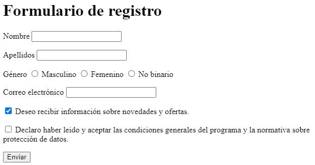

El formulari ha de contindre els següents **camps**:

- Nom d'usuari: control de tipus text obligatori.

- Contrasenya: control de tipus contrasenya obligatori.

- Correu electrònic: un control de tipus email obligatori.

- Web personal: control de tipus URL.

- Sexo: control de tipus ràdio amb les opcions hombre i mujer.

- Comentaris: un control de tipus textarea.

A més, has de tindre en compte els següents **requisits**:

- El títol de la pàgina ha de ser `Formulario de registro`.

- El mètode d'enviament del formulari ha de ser `GET`.

- El destí de l'enviament del formulari ha de ser `registro.php`.

## **Ejercicio 6**

**Matrícula ASIR**

Crea una **pàgina web** que tinga el mateix aspecte que la següent imatge:

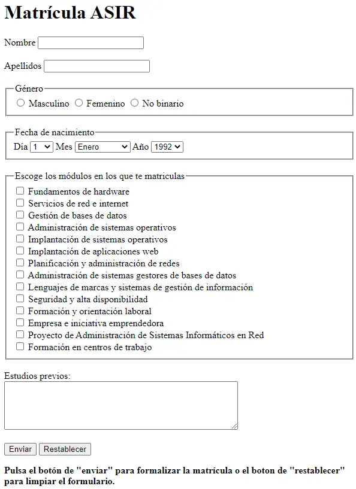

El formulari ha de contindre els següents **camps**:

- Nom i cognoms: control de tipus text obligatori i amb autofoco.

- Data de naixement: control de tipus date.

- Horari: dos opcions, de 8:00 a 14:00 i de 14:00 a 20:00.

- Assignatures: les opcions de la matrícula són LMSGI, FOL, Sistemes Informàtics, BBDD i Programació.

- Observacions: un control de tipus textarea.

A més, has de tindre en compte els següents **requisits**:

- El títol de la pàgina ha de ser `Matrícula ASIR`.

- El mètode d'enviament del formulari ha de ser `GET`.

- El destí de l'enviament del formulari ha de ser `matricula.php`.

- El formulari ha d'estar organitzat amb `fieldset` i `legend`.

## **Ejercicio 7**

**Formulari HTML5**

Crea una **pàgina web** que tinga el mateix aspecte que la següent imatge:

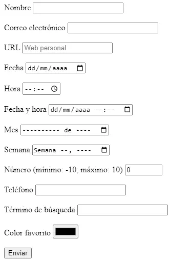

El formulari ha de contindre els següents **camps**:

- Nom: control de tipus text obligatori i amb autofoco.

- Correu electrònic: un control de tipus email obligatori.

- URL: control de tipus URL que mostre l'ajuda `Web personal`.

- Data: control de tipus date.

- Hora: control de tipus time.

- Data i hora: control de tipus datetime.

- Mes: control de tipus month.

- Setmana: control de tipus week.

- Número: control de tipus number que limite l'entrada a un valor entre `-10` i `10`.

- Telèfon: control de tipus tel.

- Terme de cerca: control de tipus search.

- Color favorito: control de tipus color.

- Un botó d'enviament.

A més, has de tindre en compte els següents **requisits**:

- El títol de la pàgina ha de ser `Formulario HTML5`.

- El mètode d'enviament del formulari ha de ser `GET`.

- El destí de l'enviament del formulari ha de ser `html5.php`.

---

## Actividad 208

👉 *[Obrir aquesta activitat en pàgina individual](act208.html)*

# Actividad 208

> **📌 Entrega**
> 

> - La entrega será un **fichero pdf** que contenga la respuesta a las preguntas de la actividad.

> - El nombre del fichero debe ser `208_NombreApellidos.pdf`.

> - Se deberá entregar en la tarea correspondiente de Aules en tiempo y forma.

> **📌 Se valorará:**
> 

> Es valorarà:

> - La claridad de la respuesta.

> - La correcta maquetación del documento.

> - Respuesta correcta o aproximación a esta.

> Esta actividad servirá para calificar:

> - RA2: Utilitza llenguatges de marques per a la transmissió i presentació d'informació a través de la web analitzant l'estructura dels documents i identificant els seus elements.

>   - CA2. c) Es ha reconegut la funcionalitat de les principals etiquetes i atributs del llenguatge HTML. (2%)

## **Ejercicio 1**

**Imatges**

Llegix l'apartat 2.4.5 Multimèdia i iframe i respon:

1. Què atributs obligatoris ha de tindre un element ``?

1. Per a què serveix l'atribut `alt`?

1. Què ocorre si no es especifican `height` i `width`?

## **Ejercicio 2**

**Multimèdia**

Crea un document HTML que incloga:

1. Una imatge amb `src`, `alt` i un `width` de 300 píxels.

1. Un element `<audio>` amb controls.

1. Un element `<video>` amb controls i un ample de 500.

1. Un `<object>` que incruste un PDF.

## **Ejercicio 3**

**iframe**

Crea un document HTML amb un `<iframe name="contenido">` que inicialment cargue la pàgina de l'institut, i dos enllaços amb `target="contenido"` per a canviar el contingut de l'iframe a dos pàgines diferents.

---

## Actividad 209

👉 *[Obrir aquesta activitat en pàgina individual](act209.html)*

# Actividad 209

> **📌 Entrega**
> 

> - La entrega será un **fichero pdf** que contenga la respuesta a las preguntas de la actividad.

> - El nombre del fichero debe ser `209_NombreApellidos.pdf`.

> - Se deberá entregar en la tarea correspondiente de Aules en tiempo y forma.

> **📌 Se valorará:**
> 

> Es valorarà:

> - La claridad de la respuesta.

> - La correcta maquetación del documento.

> - Respuesta correcta o aproximación a esta.

> Esta actividad servirá para calificar:

> - RA2: Utilitza llenguatges de marques per a la transmissió i presentació d'informació a través de la web analitzant l'estructura dels documents i identificant els seus elements.

>   - CA2. e) S'han utilitzat eines en la creació de documents web. (100%)

>   - CA2. h) Es han validat documents HTML. (2,5%)

## **Ejercicio 1**

**Eines**

Llegix l'apartat 2.5 Eines per a la creació i edició i respon:

1. Què diferència hi ha entre un editor de text i un editor visual (WYSIWYG)?

1. Què és EMMET i com funciona?

1. Cita tres editors de text i tres editors online.

1. Què pestanyes del navegador (devtools) s'utilitzen per a consultar l'estructura del document HTML?

## **Ejercicio 2**

**Validació**

Llegix l'apartat 2.6 Validació de documents HTML i respon:

1. Per què són els navegadors més permisivos amb HTML que amb altres llenguatges de marques?

1. Enumera i descriu els cinc tipus de problemes que podem trobar en el codi HTML.

1. Què validador podem utilitzar per a comprovar un document HTML?

## **Ejercicio 3**

**Validar un document real**

1. Crea un document HTML bàsic amb un error de sintaxi (per exemple, una etiqueta sense tancar).

1. Valídalo amb el [validador del W3C](https://validator.w3.org/) (opció "Validate by direct input").

1. Corregeix els errors que indique el validador i torna a validar-lo fins a que no apareguen errors.

1. Documenta en el teu cuaderno els errors encontrats i com els has corregit.

---

## Actividad 210

👉 *[Obrir aquesta activitat en pàgina individual](act210.html)*

# Actividad 210

> **📌 Entrega**
> 

> - La entrega será un **fichero pdf** que contenga la respuesta a las preguntas de la actividad.

> - El nombre del fichero debe ser `210_NombreApellidos.pdf`.

> - Se deberá entregar en la tarea correspondiente de Aules en tiempo y forma.

> **📌 Se valorará:**
> 

> Es valorarà:

> - La claridad de la respuesta.

> - La correcta maquetación del documento.

> - Respuesta correcta o aproximación a esta.

> Esta actividad servirá para calificar:

> - RA2: Utilitza llenguatges de marques per a la transmissió i presentació d'informació a través de la web analitzant l'estructura dels documents i identificant els seus elements.

>   - CA2. i) S'han identificat les tecnologies en les que es basa la sindicació de continguts. (25%)

>   - CA2. j) S'han reconegut els àmbits d'aplicació de la sindicació de continguts. (25%)

## **Ejercicio 1**

**Conceptes**

Llegix els apartats 2.7.1 Introducció i avantatges i 2.7.2 Estàndards i respon:

1. Què és la redifusió o sindicació de continguts?

1. Què és un *feed* o canal de continguts?

1. Què és un agregador i per a què s'utilitza?

1. En què llenguatge es solen codificar les fonts i mitjançant què protocol es transportan?

1. Cita almenys **tres avantatges** de la sindicació de continguts.

## **Ejercicio 2**

**Estàndards**

1. Què estàndards de sindicació de continguts coneixes?

1. Què llenguatge utilitza cada un?

1. Quin és l'estàndard més popular i quin el més modern?

## **Ejercicio 3**

**Àmbits d'aplicació**

Llegix l'apartat 2.7.3 Publicació i àmbits d'aplicació i respon:

1. Què cal incloure en la capçalera d'una pàgina web perquè es convertisca en suministradora d'un canal?

1. Què atributs canvien si utilitzem Atom en lloc de RSS?

1. Cita almenys **tres àmbits o tipus de contingut** als que es pot aplicar la redifusió web.

---

## Actividad 211

👉 *[Obrir aquesta activitat en pàgina individual](act211.html)*

# Actividad 211

> **📌 Entrega**
> 

> - La entrega será un **fichero pdf** que contenga la respuesta a las preguntas de la actividad.

> - El nombre del fichero debe ser `211_NombreApellidos.pdf`.

> - Se deberá entregar en la tarea correspondiente de Aules en tiempo y forma.

> **📌 Se valorará:**
> 

> Es valorarà:

> - La claridad de la respuesta.

> - La correcta maquetación del documento.

> - Respuesta correcta o aproximación a esta.

> Esta actividad servirá para calificar:

> - RA2: Utilitza llenguatges de marques per a la transmissió i presentació d'informació a través de la web analitzant l'estructura dels documents i identificant els seus elements.

>   - CA2. i) S'han identificat les tecnologies en les que es basa la sindicació de continguts. (25%)

>   - CA2. j) S'han reconegut els àmbits d'aplicació de la sindicació de continguts. (25%)

## **Ejercicio 1**

**Estructura d'un document RSS**

Llegix l'apartat 2.7.4 Estructura d'un document RSS i respon:

1. Quins són els tres elements bàsics que formen part d'un document RSS?

1. Què elements fills **obligatoris** té el canal `<channel>`?

1. Què elements fills **obligatoris** té cada secció `<item>`?

1. Què extensió té el fitxer d'un canal de continguts?

## **Ejercicio 2**

**Crear un canal RSS**

Crea un canal RSS 2.0 complet per a un blog ficticio de tecnologia amb les següents condicions:

1. Capçalera amb codificació UTF-8.

1. Un canal amb títol, descripció, enllaç i idioma `es`.

1. Almenys **dos seccions** (`<item>`), cada una amb el seu títol, descripció, enllaç i autor.

## **Ejercicio 3**

**Publicar el canal**

1. Afegeix a una pàgina HTML l'enllaç al canal RSS que has creat en l'activitat anterior.

1. Utilitza un validador de canals (per exemple, el de W3C) per a comprovar que el canal és vàlid.

1. Respon: què opcions solen oferir els validadors quan el canal és vàlid?

## **Ejercicio 4**

**Agregadors**

Llegix l'apartat 2.7.5 Validació i agregadors i respon:

1. Què és un agregador o lector de fonts?

1. Cita els tres tipus d'agregadors i un exemple de cada un.

1. Què cal indicar en l'agregador per a suscribir-se a una font?

---

## Simulacre d'Examen — SIMULACRO DE EXAMEN HTML

👉 *[Obrir aquesta activitat en pàgina individual](simulacre_examen.html)*

# SIMULACRO DE EXAMEN HTML

## 1.º Desenvolupament de Aplicacions Web

**Activitat:** Inscripció a les Jornades Tecnològiques DAW 2026
**Puntuació total:** 10 puntos

## Objectiu

Desenvolupar una pàgina web utilitzant exclusivament HTML5 que permeta presentar unes jornades tecnològiques i gestionar la inscripció dels seus participantes.

La pàgina haurà d'incorporar una estructura semàntica, elements de format de text, formularis, taules, contingut multimèdia, enllaços i contingut extern.

**No es permet utilitzar CSS ni JavaScript.**

## 1. Estructura general (1 punt)

Crea un document HTML5 amb la següent estructura semàntica:

- `<header>`

- `<main>`

- `<footer>`

En la capçalera has d'incloure:

- Un títol principal amb el text **«Jornades Tecnològiques DAW 2026»**.

- Una imatge representativa de HTML5 amb un text alternatiu adequat. Link Imatge

- Un menú de navegació que continga els següents enllaços:

- Presentació (enllaç intern a l'apartat de presentació).

- MDN Web Docs (enllaç extern a https://developer.mozilla.org/es/).

- W3Schools (enllaç extern a https://www.w3schools.com/).

Un dels enllaços externs haurà d'abrir-se en una nova pestanya.

En el peu de pàgina has d'incloure el teu nom complet i el següent text:

© 2026 – Jornades Tecnològiques – Nom del Alumne – 1.º DAW

<details markdown="1">

<summary>💡 Imatge Referència</summary>

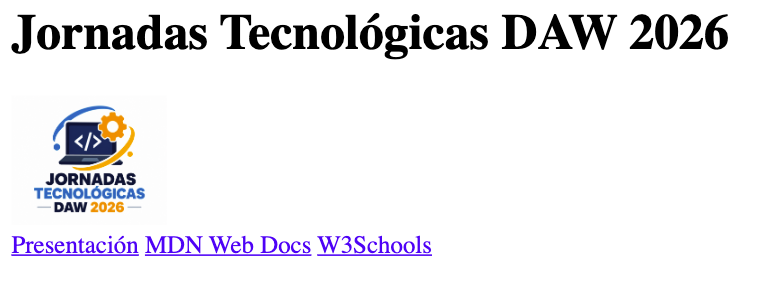

</details>

## 2. Format de text (1 punt)

Dins de l'element principal, crea una secció amb el títol **«Presentació de les jornades»**.

En aquesta secció has d'escriure un text de presentació que incloga obligatòriament:

1. Un paràgraf amb una paraula en **negreta**.

1. Una expressió en *cursiva*.

1. Una paraula resaltada amb un marcador.

1. Una abreviatura amb el seu significat complet.

1. Una expressió que continga un superíndice.

1. Una fórmula que continga un subíndice.

1. Un text que aparega tachado.

1. Una cita breve utilitzant una etiqueta HTML específica per a citas.

Pots inventar el contingut, sempre que tinga relació amb les jornades tecnològiques.

<details markdown="1">

<summary>💡 Imatge Referència</summary>

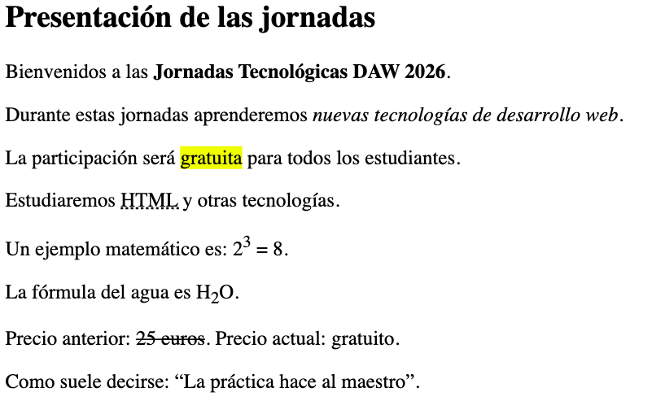

</details>

## 3. Formulari d'inscripció (4 puntos)

Crea un formulari d'inscripció a les jornades dins de l'element principal.

El formulari haurà d'utilitzar el mètode `post` i organizar-se en **quatre grups de camps**, cada un amb el seu corresponent títol.

### A. Informació del participante

Inclou els següents camps:

- **Nom complet:** camp de text obligatori amb un mínim de 4 caràcters.

- **Correu electrònic:** camp obligatori amb validació de correu.

- **Codi d'accés:** camp de contrasenya amb un mínim de 8 caràcters.

- **Data d'inscripció:** selector de data.

- **Edat:** camp numèric que permeta introduir valors entre 16 i 65.

### B. Intereses tecnològics

Inclou:

- Un desplegable per a seleccionar l'especialitat preferida:

- Desenvolupament web.

- Ciberseguritat.

- Intel·ligència artificial.

- Tres caselles de verificació per a indicar les tecnologies conegudes:

- Python.

- PHP.

- JavaScript.

- Botons de selecció per a triar la modalitat d'asistencia:

- Presencial.

- Online.

- Mixta.

- Un control deslizante per a valorar l'interès per les jornades, amb valors entre 1 i 10.

### C. Informació addicional

Inclou:

- Un camp per a adjuntar un document.

- Un camp per a introduir l'adreça d'un repositorio web personal.

- Un selector per a triar el color identificatiu del participante.

- Un àrea de text per a explicar què espera aprendre durant les jornades.

### D. Confirmació d'inscripció

Inclou:

- Una casella obligatòria per a acceptar les normes de participació.

- Un botó per a enviar la inscripció.

- Un botó per a esborrar totes les dades del formulari.

**Requisits addicionals:**

- Tots els camps hauran de tindre una etiqueta descriptiva associada correctament.

- Els controls relacionats hauran de compartir el mateix nom quan corresponda.

<details markdown="1">

<summary>💡 Imatge Referència</summary>

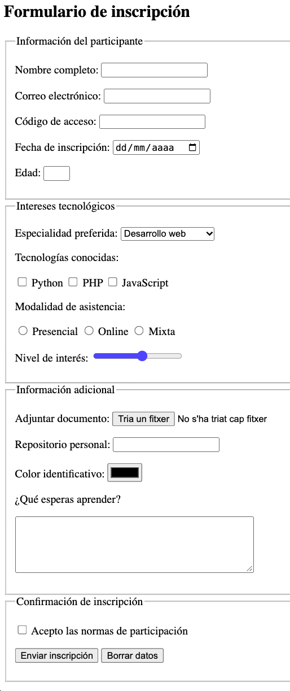

</details>

## 4. Taula d'activitats (2 puntos)

Crea una taula amb vora que mostre el programa de les jornades.

La taula haurà d'incloure:

- Un títol descriptivo.

- Un encapçalament.

- Un cos.

- Almenys una combinació horitzontal de cel·les.

- Almenys una combinació vertical de cel·les.

La taula tindrà la següent informació:

| Horari | Dilluns | Dimarts | Dimecres |
| --- | --- | --- | --- |
| 09:00 - 10:00 | HTML5 | Python | Ciberseguritat |
| 10:00 - 11:00 | CSS3 | PHP | Intel·ligència artificial |
| 11:00 - 11:30 | Descanso comú per a tots els participantes |  |  |
| 11:30 - 12:30 | JavaScript | Bases de dades | Taller de projectes |
| 12:30 - 13:30 | Taller de projectes | Bases de dades | Presentació final |

**Condicions:**

1. El descanso haurà d'ocupar les tres columnes corresponents als dies.

1. L'activitat «Bases de dades» haurà d'ocupar verticalment les dos últimes franjas horarias del dimarts.

1. Han d'utilitzar-se correctament les etiquetes d'encapçalament i de dades.

**Nota:** La taula anterior representa les dades. En el HTML es hauran d'aplicar les combinacions de cel·les indicades.

<details markdown="1">

<summary>💡 Imatge Referència</summary>

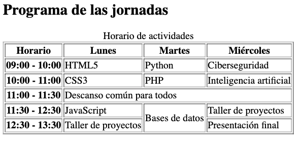

</details>

## 5. Contingut multimèdia (1 punt)

Davall de la taula, crea una secció titulada **«Material multimèdia»**.

Inclou:

- Un reproductor d'àudio que utilitze l'arxiu `presentacion.mp3`. Link Àudio

- Un reproductor de vídeo que utilitze l'arxiu `jornadas.mp4`. Link Video

- El vídeo haurà de tindre una amplària de **400 píxels**.

- Tots dos reproductors hauran de mostrar els seus controls de reproducció.

<details markdown="1">

<summary>💡 Imatge Referència</summary>

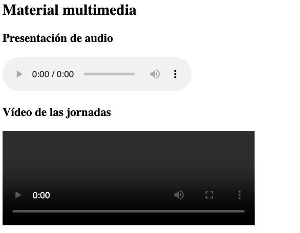

</details>

## 6. Contingut extern (0,5 puntos)

Crea una secció titulada **«Consulta la nostra web»**.

Insereix un element que permeta visualitzar una pàgina web externa dins del teu document.

Utilitza la següent adreça:

https://www.levante-emv.com/

L'element haurà de tindre:

- Una amplària de **600 píxels**.

- Una alçària de **350 píxels**.

- Un títol descriptivo per a millorar l'accessibilitat.

<details markdown="1">

<summary>💡 Imatge Referència</summary>

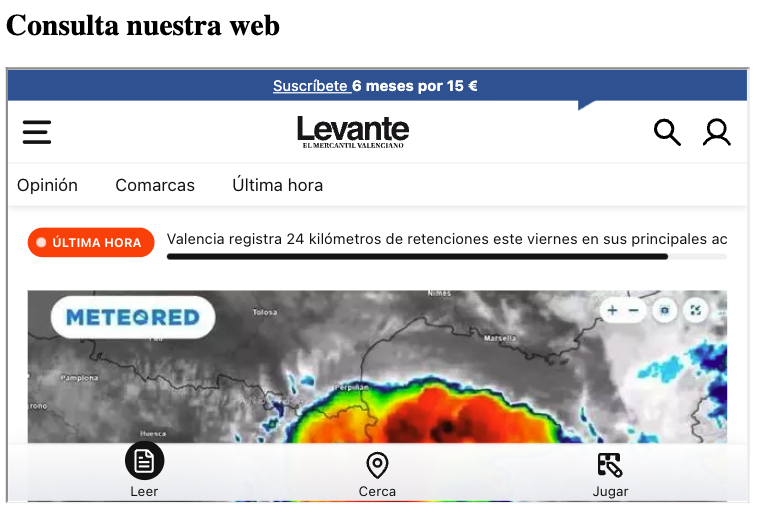

</details>

## 7. Recursos recomendats (0,5 puntos)

Crea un bloc lateral amb el títol **«Recursos per a aprendre HTML»**.

Aquest bloc haurà de contindre una llista amb enllaços a:

- Documentació HTML de MDN: https://developer.mozilla.org/es/docs/Web/HTML

- Tutorial HTML de W3Schools: https://www.w3schools.com/html/

Els enllaços hauran de dirigir als seus corresponents pàgines externes.

<details markdown="1">

<summary>💡 Imatge Referència</summary>

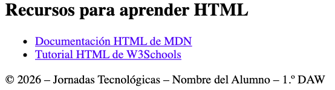

</details>

## Instruccions de lliurament

1. L'arxiu principal haurà de llamar-se `index.html`.

1. Utilitza HTML5 i una estructura correctament imbricada.

1. Totes les imatges hauran d'incloure text alternatiu.

1. Els camps del formulari hauran de tindre etiquetes correctament associades.

1. Utilitza les etiquetes semàntiques adequades.

1. Comprova el funcionament dels enllaços i controls.

1. Lliurament l'arxiu HTML i els recursos locals necessaris.

**Puntuació total: 10 puntos.**

<details markdown="1">

<summary>💡 Text</summary>

TEXTOS PER AL SIMULACRO DE HTML

Jornades Tecnològiques DAW 2026

1. Capçalera

Títol principal:

Jornades Tecnològiques DAW 2026

Menú de navegació:

- Presentació

- MDN Web Docs

- 

W3Schools

- 

Presentació de les jornades

Títol de la secció:

Presentació de les jornades

Paràgraf 1:

Bienvenits a les Jornades Tecnològiques DAW 2026.

Paràgraf 2:

Durant aquestes jornades aprendrem noves tecnologies de desenvolupament web.

Paràgraf 3:

La participació serà gratuïta per a tots els estudiants.

Paràgraf 4:

Estudiarem HTML i altres tecnologies.

Paràgraf 5:

Un exemple matemátic és: 2³ = 8.

Paràgraf 6:

La fórmula de l'agua és H₂O.

Paràgraf 7:

Preu anterior: 25 euros. Preu actual: gratuït.

Paràgraf 8:

Com sol decir-se: «La pràctica fa al maestro».

1. Formulari d'inscripció

Títol:

Formulari d'inscripció

Grup A: Informació del participante

- Nom complet:

- Correu electrònic:

- Codi d'accés:

- Data d'inscripció:

- Edat:

Grup B: Intereses tecnològics

Especialitat preferida:

- Desenvolupament web

- Ciberseguritat

- Intel·ligència artificial

Tecnologies conegudes:

- Python

- PHP

- JavaScript

Modalitat d'asistencia:

- Presencial

- Online

- Mixta

Nivell d'interès:

Grup C: Informació addicional

- Adjuntar document:

- Repositorio personal:

- Color identificatiu:

- Què esperas aprendre?

Grup D: Confirmació d'inscripció

- Acepto les normes de participació.

- Enviar inscripció

- 

Esborrar dades

- 

Programa de les jornades

Títol de la secció:

Programa de les jornades

Títol de la taula:

Horari d'activitats

Horari Dilluns   Dimarts  Dimecres
09:00 - 10:00   HTML5   Python  Ciberseguritat
10:00 - 11:00   CSS3    PHP Intel·ligència artificial
11:00 - 11:30   Descanso comú per a tots   Descanso comú per a tots   Descanso comú per a tots
11:30 - 12:30   JavaScript  Bases de dades  Taller de projectes
12:30 - 13:30   Taller de projectes Bases de dades  Presentació final

1. Material multimèdia

Títol de la secció:

Material multimèdia

Subtítulos:

- Presentació d'àudio

- Vídeo de les jornades

Arxius:

- presentacion.mp3

- 

jornades.mp4

- 

Contingut extern

Títol de la secció:

Consulta la nostra web

Títol del contingut extern:

Pàgina web del IES Mestre Ramon Esteve

Adreça:

https://portal.edu.gva.es/iesmestreramonesteve/

1. Recursos recomendats

Títol:

Recursos per a aprendre HTML

Enllaços:

- Documentació HTML de MDN

- 

Tutorial HTML de W3Schools

- 

Peu de pàgina

© 2026 – Jornades Tecnològiques – Nom del Alumne – 1.º DAW

</details>

<details markdown="1">

<summary>💡 Solució</summary>

```html
<!DOCTYPE html>
    <html lang="es">
    <head>
        <meta charset="UTF-8">
        <meta name="viewport" content="width=device-width, initial-scale=1.0">
        <title>Jornadas Tecnológicas DAW 2026</title>
    </head>
    <body>
        <!-- 1. ESTRUCTURA GENERAL -->
        <header>
            <h1>Jornadas Tecnológicas DAW 2026</h1>
            
            <nav>
                <a href="#presentacion">Presentación</a>
                <a href="https://developer.mozilla.org/es/" target="_blank">MDN Web Docs</a>
                <a href="https://www.w3schools.com/">W3Schools</a>
            </nav>
        </header>
        <main>
            <!-- 2. FORMATO DE TEXTO -->
            <section id="presentacion">
                <h2>Presentación de las jornadas</h2>
                <p>Bienvenidos a las <strong>Jornadas Tecnológicas DAW 2026</strong>.</p>
                <p>Durante estas jornadas aprenderemos <em>nuevas tecnologías de desarrollo web</em>.</p>
                <p>La participación será <mark>gratuita</mark> para todos los estudiantes.</p>
                <p>Estudiaremos <abbr title="HyperText Markup Language">HTML</abbr> y otras tecnologías.</p>
                <p>Un ejemplo matemático es: 2<sup>3</sup> = 8.</p>
                <p>La fórmula del agua es H<sub>2</sub>O.</p>
                <p>Precio anterior: <del>25 euros</del>. Precio actual: gratuito.</p>
                <p>Como suele decirse:<q>La práctica hace al maestro</q>.</p>
            </section>
            <!-- 3. FORMULARIO -->
            <section>
                <h2>Formulario de inscripción</h2>
                <form action="#" method="post">
                    <!-- A. DATOS PERSONALES -->
                    <fieldset>
                        <legend>Información del participante</legend>
                        <p>
                            <label for="nombre">Nombre completo:</label>
                            <input type="text" id="nombre" name="nombre" minlength="4" required>
                        </p>
                        <p>
                            <label for="correo">Correo electrónico:</label>
                            <input type="email" id="correo" name="correo" required>
                        </p>
                        <p>
                            <label for="codigo">Código de acceso:</label>
                            <input type="password" id="codigo" name="codigo" minlength="8">
                        </p>
                        <p>
                            <label for="fecha">Fecha de inscripción:</label>
                            <input type="date" id="fecha" name="fecha">
                        </p>
                        <p>
                            <label for="edad">Edad:</label>
                            <input type="number" id="edad" name="edad" min="16" max="65">
                        </p>
                    </fieldset>
                    <!-- B. INTERESES -->
                    <fieldset>
                        <legend>Intereses tecnológicos</legend>
                        <p>
                            <label for="especialidad">
                                Especialidad preferida:
                            </label>
                            <select id="especialidad" name="especialidad">
                                <option value="web">Desarrollo web</option>
                                <option value="seguridad">Ciberseguridad</option>
                                <option value="ia">Inteligencia artificial</option>
                            </select>
                        </p>
                        <p>Tecnologías conocidas:</p>
                        <p>
                            <input type="checkbox" id="python" name="tecnologias" value="python">
                            <label for="python">Python</label>
                            <input type="checkbox" id="php" name="tecnologias" value="php">
                            <label for="php">PHP</label>
                            <input type="checkbox" id="javascript" name="tecnologias" value="javascript">
                            <label for="javascript">JavaScript</label>
                        </p>
                        <p>Modalidad de asistencia:</p>
                        <p>
                            <input type="radio" id="presencial" name="modalidad" value="presencial">
                            <label for="presencial">Presencial</label>
                            <input type="radio" id="online" name="modalidad" value="online">
                            <label for="online">Online</label>
                            <input type="radio" id="mixta" name="modalidad" value="mixta">
                            <label for="mixta">Mixta</label>
                        </p>
                        <p>
                            <label for="interes">Nivel de interés:</label>
                            <input type="range" id="interes" name="interes" min="1" max="10">
                        </p>
                    </fieldset>
                    <!-- C. INFORMACIÓN ADICIONAL -->
                    <fieldset>
                        <legend>Información adicional</legend>
                        <p>
                            <label for="documento">Adjuntar documento:</label>
                            <input type="file" id="documento" name="documento">
                        </p>
                        <p>
                            <label for="repositorio">Repositorio personal:</label>
                            <input type="url" id="repositorio" name="repositorio">
                        </p>
                        <p>
                            <label for="color">Color identificativo:</label>
                            <input type="color" id="color" name="color">
                        </p>
                        <p>
                            <label for="comentarios">¿Qué esperas aprender?</label>
                        </p>
                        <p>
                            <textarea id="comentarios" name="comentarios" rows="5" cols="40"></textarea>
                        </p>
                    </fieldset>
                    <!-- D. CONFIRMACIÓN -->
                    <fieldset>
                        <legend>Confirmación de inscripción</legend>
                        <p>
                            <input type="checkbox" id="condiciones" name="condiciones" required>
                            <label for="condiciones">Acepto las normas de participación</label>
                        </p>
                        <p>
                            <button type="submit">
                                Enviar inscripción
                            </button>
                            <button type="reset">
                                Borrar datos
                            </button>
                        </p>
                    </fieldset>
                </form>
            </section>
            <!-- 4. TABLA -->
            <section>
                <h2>Programa de las jornadas</h2>
                <table border="1">
                    <caption>
                        Horario de actividades
                    </caption>
                    <thead>
                        <tr>
                            <th scope="col">Horario</th>
                            <th scope="col">Lunes</th>
                            <th scope="col">Martes</th>
                            <th scope="col">Miércoles</th>
                        </tr>
                    </thead>
                    <tbody>
                        <tr>
                            <th scope="row">09:00 - 10:00</th>
                            <td>HTML5</td>
                            <td>Python</td>
                            <td>Ciberseguridad</td>
                        </tr>
                        <tr>
                            <th scope="row">10:00 - 11:00</th>
                            <td>CSS3</td>
                            <td>PHP</td>
                            <td>Inteligencia artificial</td>
                        </tr>
                        <tr>
                            <th scope="row">11:00 - 11:30</th>
                            <td colspan="3">
                                Descanso común para todos
                            </td>
                        </tr>
                        <tr>
                            <th scope="row">11:30 - 12:30</th>
                            <td>JavaScript</td>
                            <td rowspan="2">
                                Bases de datos
                            </td>
                            <td>Taller de proyectos</td>
                        </tr>
                        <tr>
                            <th scope="row">12:30 - 13:30</th>
                            <td>Taller de proyectos</td>
                            <td>Presentación final</td>
                        </tr>
                    </tbody>
                </table>
            </section>
            <!-- 5. MULTIMEDIA -->
            <section>
                <h2>Material multimedia</h2>
                <h3>Presentación de audio</h3>
                <audio controls>
                    <source src="presentacion.mp3"
                            type="audio/mpeg">
                    Tu navegador no soporta audio HTML5.
                </audio>
                <h3>Vídeo de las jornadas</h3>
                <video width="400" controls>
                    <source src="jornadas.mp4"
                            type="video/mp4">
                    Tu navegador no soporta vídeo HTML5.
                </video>
            </section>
            <!-- 6. IFRAME -->
            <section>
                <h2>Consulta nuestra web</h2>
                <iframe
                    src="https://www.levante-emv.com/"
                    width="600"
                    height="350"
                    title="Página web del Levanete EMV">
                </iframe>
            </section>
            <!-- 7. ASIDE -->
            <aside>
                <h2>Recursos para aprender HTML</h2>
                <ul>
                    <li>
                        <a href="https://developer.mozilla.org/es/docs/Web/HTML">Documentación HTML de MDN</a>
                    </li>
                    <li>
                        <a href="https://www.w3schools.com/html/">Tutorial HTML de W3Schools</a>
                    </li>
                </ul>
            </aside>
        </main>
        <!-- PIE DE PÁGINA -->
        <footer>
            <p>© 2026 – Jornadas Tecnológicas – Nombre del Alumno – 1.º DAW</p>
        </footer>
    </body>
    </html>
```

> **📌 CodeSandbox**
> 

> [Simulacro HTML](https://codesandbox.io/p/sandbox/z4qx36)

</details>

---


---

## 🎮 Retos Interactivos de Autoevaluación (+100 XP)

Comprueba tu dominio sobre **Cuaderno Completo de Actividades — UD2** superando estos 4 retos gamificados (+25 puntos cada uno):

<div class="interactive-mcq" data-answer="B" data-hint="L'element semàntic <nav> representa una secció amb enllaços de navegació principal.">
  <div class="mcq-question">🎯 <strong>Reto 1 (+25 pts):</strong> Quina etiqueta semàntica d'HTML5 és la més adequada per a encapsular el bloc de navegació principal d'un lloc web?</div>
  <div class="mcq-options">
    <button type="button" class="btn-mcq-opt" data-opt="A">A) &lt;div class='menu'&gt;</button>
    <button type="button" class="btn-mcq-opt" data-opt="B">B) &lt;nav&gt;</button>
    <button type="button" class="btn-mcq-opt" data-opt="C">C) &lt;aside&gt;</button>
    <button type="button" class="btn-mcq-opt" data-opt="D">D) &lt;footer&gt;</button>
  </div>
  <div class="quiz-feedback"></div>
</div>

<div class="interactive-mcq" data-answer="B" data-hint="L'atribut 'method' indica el verb HTTP (GET o POST), mentre que 'action' indica l'URL de destinació.">
  <div class="mcq-question">🎯 <strong>Reto 2 (+25 pts):</strong> En un formulari HTML5, quin atribut de l'etiqueta <code>&lt;form&gt;</code> defineix com s'envien les dades al servidor (<code>GET</code> o <code>POST</code>)?</div>
  <div class="mcq-options">
    <button type="button" class="btn-mcq-opt" data-opt="A">A) action</button>
    <button type="button" class="btn-mcq-opt" data-opt="B">B) method</button>
    <button type="button" class="btn-mcq-opt" data-opt="C">C) target</button>
    <button type="button" class="btn-mcq-opt" data-opt="D">D) enctype</button>
  </div>
  <div class="quiz-feedback"></div>
</div>

<div class="interactive-vf" data-answer="V" data-hint="L'atribut 'alt' aporta el text alternatiu descriptiu exigit per les pautes d'accessibilitat WCAG.">
  <div class="vf-statement">✅ <strong>Repte 3 (Vertader o Fals · +25 pts):</strong> En una imatge HTML (<code>&lt;img&gt;</code>), l'atribut <code>alt</code> és fonamental per a l'accessibilitat web (lectors de pantalla) i es mostra si la imatge no es pot carregar.</div>
  <div class="vf-buttons">
    <button type="button" class="btn-vf" data-opt="V">Vertader (V)</button>
    <button type="button" class="btn-vf" data-opt="F">Fals (F)</button>
  </div>
  <div class="quiz-feedback" style="width: 100%;"></div>
</div>

<div class="interactive-quiz" data-answer="tr|<tr>" data-hint="És l'etiqueta <tr> (Table Row).">
  <div class="quiz-question">⌨️ <strong>Repte 4 (+25 pts):</strong> Quina etiqueta HTML s'utilitza per a definir cada fila horitzontal dins d'una taula (<code>&lt;table&gt;</code>)?</div>
  <div class="quiz-controls">
    <input type="text" class="quiz-input" placeholder="Escriu la resposta..." />
    <button type="button" class="btn-quiz-check">Comprovar</button>
  </div>
  <div class="quiz-feedback"></div>
</div>

### 📋 Llista de Comprovació i Rúbrica d'Assoliment

Marca cada criteri a mesura que completes l'estudi o la resolució pràctica d'aquesta pàgina (**Cuaderno Completo de Actividades — UD2**):

- [ ] He llegit detingudament la teoria o l'enunciat d'aquesta secció i he anotat els conceptes clau.
- [ ] He revisat els esquemes, taules o blocs de codi i he verificat que sé aplicar-los a l'entorn de treball.
- [ ] He resolt correctament els **4 reptes interactius** superiors obtenint els **100 puntos XP**.
- [ ] He descarregat el comprovant oficial en PDF per a adjuntar-lo a la tasca d'**Aules**.

<div class="aules-delivery-card">
  <h3>📤 Comprovant de Lliurament per a Aules</h3>
  <p>Quan hages completat els reptes interactius i la llista d'autoavaluació d'aquesta pàgina, introdueix el teu nom i descarrega el teu certificat oficial en PDF per a adjuntar-lo a la tasca d'<strong>Aules</strong>.</p>
  <div class="aules-student-field">
    <label for="aules-student-name">👤 Nom i Cognoms de l'Alumne/a:</label>
    <input type="text" id="aules-student-name" class="aules-student-name" placeholder="Ex: Joan Garcia Pérez" />
  </div>
  <div class="aules-score-badge">
    <span class="aules-score-count">0/4 reptes completats (0%) · 0 puntos · 0/4 criteris d'autoavaluació</span>
  </div>
  <div class="aules-actions">
    <button type="button" class="btn-aules-dl" data-module="LMSGI" data-unit="UD02" data-activity="activitats">📥 Descarregar Comprovant PDF</button>
    <button type="button" class="btn-aules-copy">📋 Copiar Resum al Porta-retalls</button>
  </div>
  <div class="aules-toast"></div>
</div>
