# UD2: Utilización de Lenguajes de Marcas en Entornos Web — HTML5

Bienvenido/a a la **UD2: Utilización de Lenguajes de Marcas en Entornos Web — HTML5** del módulo profesional de **Lenguajes de Marcas y Sistemas de Gestión de Información** (1º DAW / DAM / ASIX · Lenguajes de Marcas (LMSGI)).

En esta unidad encontrarás los contenidos teóricos, ejemplos prácticos, ejercicios resueltos y actividades de evaluación curricular desarrollados por el profesor **Manuel Alonso Argente**.

---

### 📑 Índice de Apartados y Actividades de la Unidad

- [**📋 2.0 Propuesta Didáctica: HTML y Sindicación de Contenido.**](./ut0200.html)
- [**2.1.1 Introducción a los lenguajes web**](./ut0211.html)
- [**2.1.2 Versiones de HTML**](./ut0212.html)
- [**2.2.1 Estructura y sintaxis de documentos HTML**](./ut0221.html)
- [**2.2.2 Sintaxis: etiquetas y atributos**](./ut0222.html)
- [**2.2.3 Tipos de atributos**](./ut0223.html)
- [**2.2.4 XHTML**](./ut0224.html)
- [**2.2.5 Estructura de un documento HTML**](./ut0225.html)
- [**2.3.1 Elementos HTML**](./ut0231.html)
- [**2.3.2 Secciones**](./ut0232.html)
- [**2.4.1 Texto**](./ut0241.html)
- [**2.4.2 Listas**](./ut0242.html)
- [**2.4.3 Tablas**](./ut0243.html)
- [**2.4.4 Formularios**](./ut0244.html)
- [**2.4.5 Multimedia e iframe**](./ut0245.html)
- [**2.5 Herramientas para la creación y edición**](./ut0250.html)
- [**2.6 Validación de documentos HTML**](./ut0260.html)
- [**2.7.1 Introducción y ventajas de la sindicación de contenidos**](./ut0271.html)
- [**2.7.2 Estándares RSS, Atom y JSON Feed**](./ut0272.html)
- [**2.7.3 Publicación y ámbitos de aplicación**](./ut0273.html)
- [**2.7.4 Estructura de un documento RSS**](./ut0274.html)
- [**2.7.5 Validación y agregadores**](./ut0275.html)

**Actividades Prácticas y Fichas de Trabajo:**

- [**✏️ ACT201 201**](./act_act201.html)
- [**✏️ ACT202 202**](./act_act202.html)
- [**✏️ ACT203 203**](./act_act203.html)
- [**✏️ ACT204 204**](./act_act204.html)
- [**✏️ ACT205 205**](./act_act205.html)
- [**✏️ ACT206 206**](./act_act206.html)
- [**✏️ ACT207 207**](./act_act207.html)
- [**✏️ ACT208 208**](./act_act208.html)
- [**✏️ ACT209 209**](./act_act209.html)
- [**✏️ ACT210 210**](./act_act210.html)
- [**✏️ ACT211 211**](./act_act211.html)
- [**✏️ SIMULACRO_EXAMEN SIMULACRO DE EXAMEN HTML**](./act_simulacro_examen.html)

---

# 📖 Vista Completa de la Unidad

## 2.0 Propuesta Didáctica — HTML y Sindicación de Contenido.

# **HTML y Sindicación de Contenido.**

## **Propuesta didáctica**

En esta unidad vamos a trabajar el RA2: **Utiliza lenguajes de marcas para la transmisión y presentación de información a través de la web analizando la estructura de los documentos e identificando sus elementos.**

## **Criterios de evaluación**

### **Respecto al RA2:**

| Código | Descripción | Peso (%) | Herramientas Evaluación |
| --- | --- | --- | --- |
| **CE2a** | Se han identificado y clasificado los lenguajes de marcas relacionados con la web y sus diferentes versiones y estándares. | 3% | ACT201 (5%) -- EXA201 (95%) |
| **CE2b** | Se ha analizado la estructura de un documento HTML y las secciones que lo componen. | 15% | ACT202 (5%) -- ACT203 (5%) -- EXA201 (90%) |
| **CE2c** | Se ha reconocido la funcionalidad de las principales etiquetas y atributos del lenguaje HTML. | 28% | ACT204 – ACT208 (10%) -- EXA201 (90%) |
| **CE2d** | Se han establecido las semejanzas y diferencias entre las diferentes versiones de HTML. | 5% | ACT202 (5%) -- EXA201 (95%) |
| **CE2e** | Se han utilizado herramientas en la creación de documentos web. | 3% | ACT209 (100%) |
| **CE2h** | Se han validado documentos HTML. | 5% | ACT209 (2,5%) -- EXA201 (47,5%) |
| **CE2i** | Se han identificado las tecnologías en las que se basa la sindicación de contenidos. | 5% | ACT210 – ACT211 (50%) -- EXA201 (50%) |
| **CE2j** | Se han reconocido los ámbitos de aplicación de la sindicación de contenidos. | 5% | ACT210 – ACT211 (50%) -- EXA201 (50%) |

## **Contenidos**

### **HTML y Sindicación de Contenidos:**

- Introducción a los lenguajes web. (CE2.a)

- Versiones de HTML. (CE2.a, CE2.d)

- Sintaxis y estructura de un documento HTML. (CE2.b)

- Principales etiquetas y atributos: secciones, texto, listas, tablas, formularios, multimedia e iframe. (CE2.c)

- Herramientas para la creación y edición. (CE2.e)

- Validación de documentos HTML. (CE2.h)

- Sindicación de contenidos: RSS, Atom y JSON Feed. (CE2.i, CE2.j)

**Cuestionario inicial**

1. ¿Qué es HTML y para qué se utiliza?

1. ¿Qué versiones y estándares de HTML conoces?

1. ¿Qué es una etiqueta y qué es un atributo?

1. ¿Qué diferencia existe entre HTML y XHTML?

1. ¿Qué secciones componen la estructura de un documento HTML?

1. ¿Qué herramientas conoces para crear y editar documentos web?

1. ¿Qué es la sindicación de contenidos y para qué se utiliza?

## **Programación de Aula (14h)**

Esta unidad se imparte en la primera evaluación, a continuación de la UP01 (Introducción a los lenguajes de marcas). La unidad tiene una duración estimada de 14 horas lectivas repartidas en 14 sesiones, durante los días que se indican en el calendario (los días de clase son lunes, con una sesión, y jueves, con dos sesiones). Los festivos del 9 y 12 de octubre no se imparten clase.

### **Calendario**

#### **Septiembre 2026**

| Lunes | Martes | Miércoles | Jueves | Viernes | Sábado | Domingo |
| --- | --- | --- | --- | --- | --- | --- |
|  | 1 | 2 | 3 | 4 | **5 🛑** | **6 🛑** |
| 7 | 8 | 9 | 10 | 11 | **12 🛑** | **13 🛑** |
| 14 | 15 | 16 | 17 | 18 | **19 🛑** | **20 🛑** |
| **21 📚** | 22 | 23 | **24 📚** | 25 | **26 🛑** | **27 🛑** |
| **28 📚** | 29 | 30 |  |  |  |  |

#### **Octubre 2026**

| Lunes | Martes | Miércoles | Jueves | Viernes | Sábado | Domingo |
| --- | --- | --- | --- | --- | --- | --- |
|  |  |  | **1 📚** | 2 | **3 🛑** | **4 🛑** |
| **5 📚** | 6 | 7 | **8 📚** | **9 🛑** | **10 🛑** | **11 🛑** |
| **12 🛑** | 13 | 14 | **15 📚** | 16 | **17 🛑** | **18 🛑** |
| **19 📚** | 20 | 21 | **22 📚** | 23 | **24 🛑** | **25 🛑** |
| 26 | 27 | 28 | 29 | 30 | **31 🛑** |  |

### **Sesiones**

| Sesión | Contenidos | Actividades | Criterios trabajados |
| --- | --- | --- | --- |
| 1 | 2.1 Introducción a los lenguajes web | -- | CE2.a |
| 2 | 2.2 Estructura y sintaxis de documentos HTML | -- | CE2.d |
| 3 | 2.2 Estructura y sintaxis de documentos HTML | ACT201 | CE2.b |
| 4 | 2.2 Estructura y sintaxis de documentos HTML | ACT202 | CE2.b |
| 5 | 2.2 Estructura y sintaxis de documentos HTML | ACT203 | CE2.b |
| 6 | 2.3 Etiquetas de estructuración de texto | -- | CE2.c |
| 7 | 2.4 Etiquetas y atributos principales | ACT204 | CE2.c |
| 8 | 2.4 Etiquetas y atributos principales | ACT206 | CE2.c |
| 9 | 2.4 Etiquetas y atributos principales | ACT207 | CE2.c |
| 10 | 2.4 Etiquetas y atributos principales | ACT208 | CE2.c |
| 11 | 2.5 Herramientas para la creación y edición -- 2.6 Validación de documentos HTML | ACT209 | CE2.e - CE2.h |
| 12 | 2.7 Sindicación de contenido | ACT210 | CE2.i - CE2.j |
| 13 | 2.7 Sindicación de contenido | ACT211 | CE2.i - CE2.j |
| 14 | Actividades | EXA201 | CE2.a - CE2.b - CE2.c - CE2.i - CE2.h - CE2.j |

### **Seguimiento**

| Sesión | Contenidos | Actividades | Descripción | Fecha |
| --- | --- | --- | --- | --- |
| 1 | 2.1 Introducción a los lenguajes web - 2.2 Estructura y sintaxis de documentos HTML |  | Vemos la introducción a la unidad de HTML y revisamos todo el apartado 2.2 de la estructura y sintaxis del documento. | 28/09/2026 |
| 2 | 2.3 Etiquetas de estructuración de texto - 2.4 Etiquetas y atributos principales |  | Clase on-line, la alerta roja por tormentas ha hecho que se suspendan las clases y se activa protocolo de clases online. Hemos realizado 1 sesión en lugar de dos. Hemos visto el apartado 2.3 Etiquetas de estructura de texto y del apartado 2.4 de etiquetas y atributos principales hemos visto los textos, las listas y las tablas | 01/10/2026 |
| 3 | 2.5 Herramientas para la creación y edición - 2.6 Validación de documentos HTML | Actividades | Se termina la primera parte de teoria y se empiezan con las actividades | 05/10/2026 |
| 4 | Actividades | Actividades | Se realizan actividades | 15/10/2026 |
| 5 | Actividades | Actividades | Se realizan actividades | 15/10/2026 |
| 6 | Actividades | Actividades | Se realizan el ejercicio 6 de la actividad 207 (clase online) | 19/10/2026 |
| 7 | Actividades | Actividades | Se realiza un simulacor corregido con la clase | 22/10/2026 |
| 8 | Actividades | Actividades | Se realiza un simulacor corregido con la clase | 22/10/2026 |
| 9 | Actividades | Actividades | Se realizan actividades | 28/10/2026 |
| 10 | Actividades | Actividades | Se realiza un simulacor corregido con la clase | 29/10/2026 |
| 11 | Actividades | Actividades | Se realiza un simulacor corregido con la clase | 29/10/2026 |
| 12 | 2.7 Sindicación de contenido |  | Se revisa el punto 2.7 de sindicación de contenido | 02/11/2026 |

---

## 2.1.1 Introducción a los lenguajes web

# **Introducción a los lenguajes web**

HTML (*HyperText Markup Language*) es el **lenguaje de marcas** utilizado para crear la mayor parte de las páginas web. Es un **estándar** reconocido en todos los navegadores, por lo tanto, todos ellos visualizan una página HTML de forma muy similar, independientemente del sistema operativo sobre el que se ejecutan.

Un documento HTML está formado por texto plano marcado con etiquetas y tiene un aspecto como el siguiente:

> **📌 Documento HTML**
> 

```html
<!DOCTYPE html>
<html>
  <head>
    <meta charset="utf-8" />
    <title>Título del documento</title>
  </head>
  <body>
    <p>LMSXI</p>
  </body>
</html>
```

El origen de HTML fue un sistema de **hipertexto** para compartir documentos electrónicos en **1990**. La primera propuesta oficial para convertir HTML en un estándar se realizó en **1993**. Ninguna de las dos primeras propuestas de estándar que se hicieron (HTML y HTML+) consiguieron convertirse en estándares oficiales.

A lo largo de los años se fueron publicando diferentes versiones del estándar, que estudiaremos en el siguiente apartado.

HTML es un lenguaje de marcas perteneciente a la familia de los **lenguajes de marcas de presentación en web**, que tienen como objetivo la presentación y transmisión de información a través de la web.

> **📌 HTML como lenguaje de marcas**
> 

> HTML es un **lenguaje de marcas de presentación en web**: se utiliza para presentar y transmitir información a través de la web y es un estándar reconocido por todos los navegadores.

---

## 2.1.2 Versiones de HTML

# **Versiones de HTML**

A lo largo de los años se fueron publicando diferentes versiones del estándar HTML:

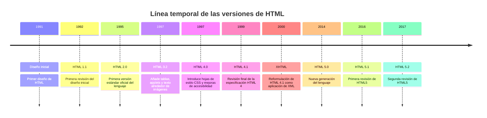

## **HTML5**

[**HTML5**](https://es.wikipedia.org/wiki/HTML5) es la versión más avanzada y la que se considera **estándar actual**, aunque ha ido evolucionando por diferentes especificaciones (HTML 5.1, HTML 5.2 y HTML 5.3). Su lanzamiento inicial fue el **28 de octubre de 2014**, pero es una versión viva en la que se sigue trabajando. Puedes encontrar las especificaciones de la última versión de HTML en la web del [**WHATWG**](https://whatwg.org/).

Las principales características de HTML5 son:

- **Nuevos elementos y atributos** que reflejan usos típicos de componentes en los sitios web modernos.

- **Elementos con significado semántico**: las nuevas etiquetas permiten describir cuál es el significado del elemento. Por ejemplo, `<header>` se utiliza para cabeceras de webs y `<footer>` para pies de página.

- **Nuevas funcionalidades (HTML5 APIs)**, como almacenamiento *offline* de información, funcionalidad *Drag&Drop*, uso de la geolocalización, etc.

- **Desacopla el contenido de la presentación**: los estilos se definen en las hojas de estilo **CSS**. El HTML se encarga de la información que se quiere mostrar, su estructura y su semántica. Quedan obsoletos elementos y atributos como `<font>`, `<center>`, `align`, etc.

> **📌 HTML5 es una versión viva**
> 

> HTML5 no es una versión cerrada: desde 2014 se sigue trabajando en ella. Las especificaciones de la última versión se consultan en la web del [WHATWG](https://whatwg.org/).

---

## 2.2.1 Estructura y sintaxis de documentos HTML

# **Estructura y sintaxis de documentos HTML**

En este apartado estudiaremos la **sintaxis** del lenguaje HTML, es decir, las reglas que debemos seguir al escribir un documento.

HTML se basa en la utilización de **etiquetas** que marcan el contenido del documento. Una etiqueta es un texto rodeado por los caracteres `<` y `>` que indica al navegador cómo debe interpretar la información que encierra.

Veremos:

1. La **sintaxis de una etiqueta**: etiquetas de apertura, cierre y vacías, y los atributos.

1. Los **tipos de atributos**: básicos, globales, de internacionalización, de foco y de eventos.

1. Las diferencias entre **HTML y XHTML**, y las reglas que debe cumplir un documento XHTML.

1. La **estructura de un documento HTML**: prólogo, cabecera y cuerpo.

---

## 2.2.2 Sintaxis: etiquetas y atributos

# **Sintaxis: etiquetas y atributos**

Un documento HTML está formado por **etiquetas** y **atributos**.

## **Etiquetas**

Las etiquetas permiten **estructurar el contenido** en un documento HTML. Al igual que en XML, las etiquetas pueden ser:

- **De apertura**: `<etiqueta>`

- **De cierre**: `</etiqueta>`

También existen **elementos vacíos**, que se cierran en la propia etiqueta de apertura:

```html
<input />
```

> **📌 Diferencia con XML**
> 

> A diferencia de XML, la cantidad de etiquetas de HTML está **limitada** a aquellas que están definidas por el lenguaje.

## **Atributos**

Aunque HTML define una gran cantidad de etiquetas, éstas no son suficientes para crear páginas complejas, ya que la definición completa de ciertos elementos, como las imágenes y los enlaces, requiere **información adicional**. Como no es posible crear una etiqueta para cada elemento diferente, se añade la información adicional a las etiquetas mediante los **atributos**.

- Para cada uno de los atributos hay definido un conjunto de **valores** que se le puede asignar. Si el valor de un atributo no es válido, el navegador lo **ignora**.

- Cada una de las etiquetas HTML define los atributos que puede utilizar, aunque algunos de ellos son **comunes** a muchas etiquetas.

```html
<input name="password" />
<a title="Título de etiqueta"></a>
```

---

## 2.2.3 Tipos de atributos

# **Tipos de atributos**

Los atributos se pueden clasificar según su funcionalidad.

## **Atributos básicos o globales**

Se pueden usar en casi todas las etiquetas HTML.

- 

`name`: permite asignar un nombre a un objeto HTML.

```html
<input name="password" />
```

- 

`title`: asigna un título a un elemento HTML, mejorando así la **accesibilidad**. Dicho título es mostrado por los navegadores cuando el usuario pasa el ratón por encima del elemento. Es especialmente útil con los elementos `a`, `link`, `img`, `object`, `abbr` y `acronym`.

```html
<a title="Título de etiqueta"></a>
```

- 

`id`: permite identificar al elemento HTML sobre el que se aplica de forma **única** mediante un identificador. Sólo es útil cuando se trabaja con CSS y con JavaScript. Los identificadores:

  - Pueden empezar por números.

  - Sólo pueden contener letras, números, guiones medios (`-`) y/o guiones bajos (`_`).

```html
<div id="principal"></div>
```

- 

`style`: permite aplicar a un elemento HTML un estilo CSS directamente.

```html
<span style="color: red;"></span>
```

- 

`class`: permite aplicar a un elemento HTML los estilos de una clase definida en una hoja de estilos CSS. Los nombres de las clases siguen las mismas reglas que los identificadores.

```html
<div class="rojo"></div>
```

```html
.rojo {
  color: red;
}
```

> **📌 `id` y `class`**
> 

> Mientras que `id` identifica un elemento de forma **única** en el documento, `class` puede aplicarse a **varios** elementos a la vez para compartir los mismos estilos.

## **Atributos para internacionalización**

Estos atributos se utilizan en las páginas que muestran sus contenidos en varios idiomas, o aquellas que quieren indicar de forma explícita el idioma de sus contenidos.

- 

`dir`: indica la dirección de escritura del texto. Sólo puede tomar dos valores:

  - `ltr` (*left to right*): de izquierda a derecha. Es el valor por defecto.

  - `rtl` (*right to left*): de derecha a izquierda.

- 

`lang`: especifica el idioma del elemento mediante un código predefinido. Los posibles valores se definen en el RFC 1766, el cual hace referencia a la norma ISO 639.

| Código | Idioma |
| --- | --- |
| `en` | Inglés |
| `es` | Español |
| `ja` | Japonés |
| `fr` | Francés |

```html
<html lang="es"></html>
```

- 

`xml:lang`: al igual que el atributo `lang`, especifica el idioma del elemento mediante un código definido según el RFC 1766. En las páginas XHTML, el atributo `xml:lang` tiene más prioridad que `lang` y es **obligatorio** incluirlo siempre que se incluya el atributo `lang`.

```html
<html xml:lang="it"></html>
```

> **📌 Indicar el idioma**
> 

> Declarar el idioma con `lang` (y `xml:lang` en XHTML) mejora la **accesibilidad** y ayuda a los buscadores a mostrar correctamente la página.

## **Atributos para obtener el foco**

Permite definir el foco en elementos como formularios.

- 

`autofocus`: pone el foco de forma automática en el elemento que lo tenga definido.

```html
<input autofocus />
```

## **Atributos de eventos**

Se entiende por **evento** aquello que ocurre cuando un usuario interactúa con la página web (hacer clic, hacer doble clic, pasar el ratón por encima de un elemento, etc.). Estos atributos sólo se utilizan en las páginas web dinámicas, para las cuales se utiliza el lenguaje de programación **JavaScript**. Como no es objetivo de la materia, no se va a contemplar.

> **📌 Atributos de eventos**
> 

> Los atributos de eventos (`onclick`, `onmouseover`, etc.) se estudiarán en las unidades dedicadas a **JavaScript**, donde se trabaja con páginas web dinámicas.

---

## 2.2.4 XHTML

# **XHTML**

El lenguaje **XHTML** (*eXtensible HyperText Markup Language*) es una adaptación de HTML al lenguaje XML.

El lenguaje HTML tiene una sintaxis muy **permisiva**, por lo que es posible escribir sus etiquetas y atributos de muchas formas diferentes: las etiquetas pueden escribirse en mayúsculas, minúsculas e incluso combinando ambas; el valor de los atributos se puede indicar con o sin comillas; y el orden en el que se abrían y cerraban las etiquetas no era importante. La flexibilidad de HTML da lugar a páginas con un código desordenado, difícil de mantener y muy poco profesional.

**XHTML soluciona estos problemas** añadiendo ciertas normas en la forma de escribir las etiquetas y atributos. Las normas son las mismas que para un documento XML común bien formado. De esta forma, se consigue:

- **Sencillez** a la hora de editar y mantener el código.

- Al ser más regular, es más fácil escribir código que lo procese.

- Como es XML, se pueden utilizar fácilmente herramientas creadas para procesar documentos XML genéricos (editores, XSLT, etc.).

## **XHTML vs HTML**

Para que el código HTML se pueda considerar XML bien formado, y por tanto XHTML, tiene que cumplir:

- Toda la página debe estar contenida en un **elemento raíz** `<html>`.

- Los **nombres** de las etiquetas y atributos siempre se escriben en **minúsculas**.

- El **valor de los atributos**, incluso los numéricos, siempre se encierra **entre comillas**.

- En los atributos en los que el nombre coincide con su valor, no puede darse el valor por entendido, es decir, **no se pueden comprimir**. Por ejemplo, `<div value="value"></div>` no se puede convertir a `<div value></div>`.

- **Todas las etiquetas deben cerrarse siempre**. XHTML permite que, en lugar de abrir y cerrar de forma consecutiva la etiqueta (`<br></br>`), se utilice la sintaxis `<br />` para indicar que es una etiqueta vacía que se abre y se cierra en ese mismo punto.

> **📌 Comportamiento de los navegadores**
> 

> Los navegadores no procesan HTML y XHTML exactamente igual:
* Si un documento **HTML** contiene errores, el navegador intentará mostrar el mayor contenido posible.
* Si un documento **XHTML** contiene algún error, el navegador **no mostrará** el documento.

---

## 2.2.5 Estructura de un documento HTML

# **Estructura de un documento HTML**

La estructura de una página HTML debe seguir la misma que la de cualquier documento XML. Por ello, tendrá:

- Un **prólogo**.

- Un **ejemplar**.

Un ejemplo completo de un documento HTML5 es el siguiente:

> **📌 Documento HTML5 completo**
> 

```html
<!DOCTYPE html>            <!-- prólogo -->
<html>
  <head>
    <meta charset="utf-8" />
    <title>Título del documento</title>
  </head>
  <body>
    <p>LMSXI</p>
  </body>
</html>                    <!-- ejemplar -->
```

## **Prólogo**

Todo documento HTML ha de tener una **declaración del tipo de documento** para su correcta interpretación por el navegador web. En esa declaración se indica:

- El **tipo de documento**.

- En versiones antiguas de HTML, la **versión de HTML** utilizada para la codificación del mismo.

En el caso de HTML5, la declaración se define de la siguiente forma:

```html
<!DOCTYPE html>
```

## **Ejemplar**

El ejemplar está delimitado por el elemento `<html>`, el cual define el **inicio y el final** de un documento HTML. Un documento HTML puede dividirse, a su vez, en dos partes:

- **Cabecera**

- **Cuerpo**

Los elementos que definen la estructura básica de un documento son `<html>`, `<head>` y `<body>`.

### **Cabecera (`<head>`)**

El elemento `<head>` define la cabecera de un documento HTML. Contiene la información sobre el título de la página, el autor, palabras clave, etc. La información de la cabecera **no se presentará en la ventana del navegador**, salvo el título, que aparecerá en la barra de título de la parte superior. El resto de cabeceras habitualmente se utilizan para dar información a buscadores, redes sociales, etc.

Dentro de esta sección es **obligatorio** definir el título del documento, usando las etiquetas `<title></title>`. Es muy común, también, incluir el *charset* utilizado para la codificación. Generalmente, se utiliza `utf-8`.

```html
<head>
  <meta charset="utf-8">
  <title>HTML document</title>
</head>
```

> **📌 El título es obligatorio**
> 

> El elemento `<title>` es el único elemento **obligatorio** dentro de la cabecera: es el que se muestra en la barra de título del navegador y en las pestañas.

Los elementos que pueden ir dentro del elemento `<head>` se clasifican en dos tipos:

- 

**Elementos contenedores**: contienen texto y/u otras etiquetas.

| Elemento | Descripción |
| --- | --- |
| `title` | Título del documento. Elemento obligatorio. |
| `script` | Script incrustado. Su contenido ha de ir situado entre las marcas de comentarios, ya que no ha de ser interpretado. |
| `style` | Estilo aplicado al documento utilizando CSS. Su contenido ha de ir situado entre las marcas de comentarios, ya que no ha de ser interpretado. |

- 

**Elementos no contenedores**: son etiquetas vacías, sin contenido.

| Elemento | Descripción |
| --- | --- |
| `base` | URI base del documento. |
| `link` | Enlaces a documentos externos de librerías (JavaScript). Este elemento también puede ir dentro del `<body>`. |
| `meta` | Metadatos sobre la página, como la codificación de caracteres, descripción o autores. |

> **📌 Cabecera completa**
> 

```html
<!DOCTYPE html>
<html>
  <head>
    <meta charset="utf-8" />
    <title>El título es obligatorio</title>
    <base href="https://codesandbox.io/" />
    <meta name="viewport" content="width=device-width, initial-scale=1.0" />
    <link href="https://cdn.jsdelivr.net/npm/bootstrap@5.2.1/dist/css/bootstrap.min.css" rel="stylesheet" />
    <style>
      .rojo {
        color: red;
      }
    </style>
    <script src="https://unpkg.com/react@18/umd/react.development.js"></script>
  </head>
  <body>
    <div class="rojo">Texto de color rojo</div>
  </body>
</html>
```

### **Cuerpo (`<body>`)**

El cuerpo contiene la **información que se va a presentar en la pantalla**. El elemento `<body>` permite definir formatos que se aplican a los elementos de la página de manera global, como, por ejemplo, el color de fondo del texto o la anchura de los márgenes.

```html
<html>
  <head></head>
  <body></body>
</html>
```

### **Comentarios**

Existe la posibilidad de introducir comentarios en los ficheros HTML, que también pueden ser multilínea:

```html
<!-- comentario -->
```

```html
<!-- comentario
  de varias
  líneas -->
```

Los comentarios **no son procesados** por los navegadores. Sólo sirven para documentar el código. Los comentarios sólo se deben escribir en el **ejemplar** y nunca en el prólogo.

> **📌 Documentar el código**
> 

> Aprovecha los comentarios para explicar secciones de tu código: facilitan el mantenimiento y la colaboración entre desarrolladores.

---

## 2.3.1 Elementos HTML

# **Elementos HTML**

Un elemento HTML está formado por:

- Una **etiqueta de apertura**.

- Cero o más **atributos**.

- Opcionalmente, un **texto**, encerrado entre las etiquetas de apertura y cierre. No todas las etiquetas pueden encerrar texto.

- Una **etiqueta de cierre**. Para algunos elementos no hay etiqueta de cierre o es opcional.

## **Elementos en línea y de bloque**

Según el modo en que ocupan el espacio disponible en la página, los elementos pueden ser de dos tipos:

- 

**Elementos en línea (*inline*) o lineales**: sólo ocupan el espacio necesario para mostrar sus contenidos. Su contenido puede ser texto u otros elementos *inline*.

- 

**Elementos de bloque (*block*)**: siempre empiezan en una **nueva línea** y ocupan todo el espacio disponible hasta el final de la línea, aunque sus contenidos no ocupen todo el ancho. Su contenido puede ser texto, elementos *inline* u otros elementos de bloque.

> **📌 ¿Inline o block?**
> 

> Un truco para distinguirlos: un elemento **block** empieza en una nueva línea y ocupa todo el ancho disponible, mientras que un elemento **inline** se muestra a continuación del contenido anterior ocupando sólo el espacio necesario.

> **📌 Ejemplo**
> 

```html
<!DOCTYPE html>
<html>
  <head>
    <meta charset="utf-8" />
    <title>Ejemplo de la diferencia entre los elementos inline y los elementos block</title>
  </head>
  <body>
    <h1>Los encabezados son elementos block.</h1>
    <p>Y los párrafos también.</p>
    <a href="#">Los enlaces son elementos inline</a>
    <p>Incluso si está definido dentro de un párrafo, <strong>un texto resaltado</strong> sigue siendo un elemento inline.</p>
  </body>
</html>
```

---

## 2.3.2 Secciones

# **Secciones**

## **Elemento `<div>`**

El elemento `<div>` se usa para **marcar divisiones** y agrupar otros elementos en secciones, tanto para organizar el contenido como para posicionarlo mediante hojas de estilo CSS.

```html
<div>
  <div>Sección 1</div>
  <div>Sección 2</div>
</div>
```

## **Etiquetas semánticas**

En HTML5 aparecieron varias **etiquetas semánticas** para estructurar el contenido de la página y, por tanto, sólo se debería usar `<div>` cuando no haya una etiqueta más apropiada.

> **📌 ¿`<div>` o etiqueta semántica?**
> 

> En HTML5, usa `<div>` únicamente cuando no exista una etiqueta semántica más adecuada. Las etiquetas semánticas mejoran la **accesibilidad** y el **posicionamiento SEO**.

> **📌 Estructura semántica HTML5**
> 

```html
<!DOCTYPE html>
<html>
  <head>
    <meta charset="UTF-8" />
    <title>HTML5</title>
  </head>
  <body>
    <header>
      <nav></nav>
    </header>
    <main>
      <section>
        <article></article>
      </section>
      <aside></aside>
    </main>
    <footer></footer>
  </body>
</html>
```

Las principales etiquetas semánticas son:

- 

**`<header>`**: contiene la cabecera con contenido introductorio para la sección de la página en la que aparece. Representa un grupo de ayudas introductorias o de navegación. Puede contener elementos de encabezado (`<h1>`...`<h6>`), un logo, un formulario de búsqueda, etc.

- 

**`<nav>`**: representa una sección de una página cuyo propósito es proporcionar **enlaces de navegación**, ya sea dentro del documento actual o a otros documentos. Ejemplos comunes son menús, tablas de contenido e índices.

- 

**`<main>`**: representa el **contenido principal** del documento, único y central para esa página.

- 

**`<section>`**: representa una **sección genérica** de un documento. Sirve para determinar qué contenido corresponde a qué parte de un esquema. No se debe usar como un mero contenedor genérico (para eso existe `<div>`).

- 

**`<article>`**: representa una **composición autocontenida** que se destina a distribuir de forma independiente o reutilizable. Puede ser un mensaje de foro, un artículo de una revista, una entrada de blog, un comentario de usuario, etc.

- 

**`<aside>`**: se utiliza para contenido **parcialmente relacionado** con el contenido principal. Se representa a menudo como barras laterales o inserciones: definiciones de glosario, publicidad, biografía del autor, etc. No tiene por qué mostrarse en un lateral.

- 

**`<footer>`**: representa un **pie de página** para el contenido de sección más cercano o el elemento raíz de sección. Típicamente contiene información del autor, datos de derechos de autor o enlaces a documentos relacionados. No tiene por qué mostrarse al final.

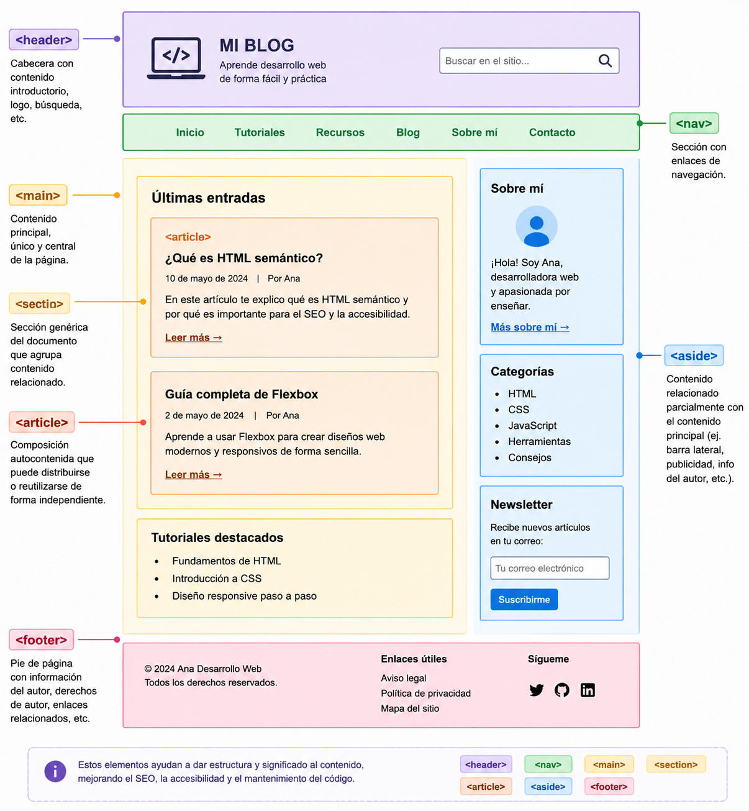

> **📌 Probar en el navegador**
> 

> [Ejemplo en web de las partes de una web](https://codesandbox.io/p/sandbox/hzcfqw)

---

## 2.4.1 Texto

# **Texto**

## **Encabezados y párrafos**

Para agrupar el texto en párrafos se usa el elemento `<p>`. Es un elemento de bloque (*block*).

Para los encabezados, en HTML se definen **6 elementos (6 niveles)**. Cuanto menor es el número, mayor es la importancia del encabezado: el `<h1>` es el de mayor relevancia. Los encabezados se pueden utilizar para organizar jerárquicamente el contenido de la página.

```html
<h1>Encabezado de nivel 1</h1>
<h2>Encabezado de nivel 2</h2>
<h3>Encabezado de nivel 3</h3>
<h4>Encabezado de nivel 4</h4>
<h5>Encabezado de nivel 5</h5>
<h6>Encabezado de nivel 6</h6>
<p>Texto del párrafo</p>
```

<details markdown="1">

<summary>💡 **Exemple complet**</summary>

**HTML**Resultado

```html
<!DOCTYPE html>
<html>
    <head>
        <meta charset="UTF-8">
        <title>Párrafos y encabezadaos</title>
    </head>
    <body>
        <h1>Ciclos formativos de la familia de IFC</h1>
        <h2>Ciclos medios (CM)</h2>
        <h3>SMR</h3>
        <p>Párrafo 1</p>
        <p>Párrafo 2</p>
        <h2>Ciclos superiores (CS)</h2>
        <h3>ASIR</h3>
        <p>Párrafo</p>
        <h3>DAM</h3>
        <p>Párrafo</p>
        <h3>DAW</h3>
        <p>Párrafo</p>
    </body>
</html>
```

    
        
        Párrafos y encabezadaos
    
    
        

# Ciclos formativos de la familia de IFC

        

## Ciclos medios (CM)

        

### SMR

        

Párrafo 1

        

Párrafo 2

        

## Ciclos superiores (CS)

        

### ASIR

        

Párrafo

        

### DAM

        

Párrafo

        

### DAW

        

Párrafo

    

> **📌 Probar en el navegador**
> 

> [En este link podrás practicar sobre el ejemplo](https://codesandbox.io/p/sandbox/d2trfg)

</details>

## **Saltos de línea y espacios en blanco**

Los navegadores, al procesar código HTML, **ignoran los saltos de línea** y, si encuentran varios espacios consecutivos, los reducen a uno solo (**colapsar espacios**).

> **📌 Colapso de espacios**
> 

> Los navegadores **ignoran los saltos de línea** y reducen los espacios consecutivos a uno solo. Para forzarlos se utilizan `<br>`, la entidad `&nbsp;` o el elemento `<pre>`.

- 

Si es necesario introducir un **salto de línea**, se utiliza el elemento `<br>`:

```html
Esto <br> introduce un salto de línea
```

- 

Para introducir múltiples espacios, se puede utilizar la **entidad** `&nbsp;` (non-breaking space):

```html
<p>Aquí hay &nbsp;&nbsp;&nbsp;&nbsp;&nbsp; espacios</p>
```

- 

Para conservar los saltos de línea y los espacios tal cual se escriben, se usa el elemento `<pre>`:

```html
<pre>Esto es un bloque de código
con saltos de línea
y espacios en blanco</pre>
```

<details markdown="1">

<summary>💡 **Exemple complet**</summary>

**HTML**Resultado

```html
<!DOCTYPE html>
<html>
    <head>
        <meta charset="UTF-8">
        <title>Saltos de línea</title>
    </head>
    <body>
        Esto
        se ve en
        una línea sin espacios de más
        <p>Aquí hay &nbsp;&nbsp;&nbsp;&nbsp;&nbsp; espacios</p>
        Esto <br> introduce un salto de línea
        <p>Esto es un párrafo Salto de Línea antes y después</p>
        <pre>Esto es un bloque de código
        con saltos de línea
        y espacios en blanco</pre>
    </body>
</html>
```

    
        
        Saltos de línea
    
    
        Esto
        se ve en
        una línea sin espacios de más
        

Aquí hay       espacios

        Esto   
 introduce un salto de línea
        

Esto es un párrafo Salto de Línea antes y después

        

```html
Esto es un bloque de código
        con saltos de línea
        y espacios en blanco
```

    

> **📌 Probar en el navegador**
> 

> [En este link podrás practicar sobre el ejemplo](https://codesandbox.io/p/sandbox/rtnz5q)

</details>

## **Elementos que dan formato al texto de un párrafo**

| Elemento | Descripción |
| --- | --- |
| `<b>` | Indica que el texto se pondrá en **negrita**. |
| `<i>` | Indica que el texto se pondrá en **itálica o cursiva**. |
| `<u>` | Indica que el texto se pondrá en **subrayado**. |
| `<sup>` | Indica que el texto es un **supraíndice**. |
| `<sub>` | Indica que el texto es un **subíndice**. |
| `<strong>` | Indica que el texto estará **resaltado**. Habitualmente los navegadores lo resaltan poniéndolo en negrita. |

<details markdown="1">

<summary>💡 **Exemple complet**</summary>

**HTML**Resultado

```html
<!DOCTYPE html>
<html>
    <head>
        <title>SElementos de formato de p&aacute;rrafo</title>
    </head>
    <body>
        <h1>Este es un encabezado de nivel 1</h1>
        <h6>Este es un encabezado de nivel 6</h6>
        <p>Ahora voy a definir un p&aacute;rrafo. Dentro del que        pondremos texto en <b>negrita</b>, <i>cursiva</i>,          <u>subrayado</u> e incluso <b><u>negrita y          subrayado</u></b> simultaneamente y
        <b><i><u>negrita, cursiva y subrayado</u></i></b> mediante      el anidamiento de etiquetas. Además vamos a mostrar el uso      de <sub>sub&iacute;ndices</sub> y de                <sup>supra&iacute;ndices</sup>, as&iacute; como
        <strong>texto resaltado, que no es negrita</strong>.</p>
    </body>
</html>
```

    
        SElementos de formato de párrafo
    
    
        

# Este es un encabezado de nivel 1

        Este es un encabezado de nivel 6
        

Ahora voy a definir un párrafo. Dentro del que        pondremos texto en **negrita**, *cursiva*,          subrayado e incluso **negrita y          subrayado** simultaneamente y
        ***negrita, cursiva y subrayado*** mediante      el anidamiento de etiquetas. Además vamos a mostrar el uso      de subíndices y de                supraíndices, así como
        **texto resaltado, que no es negrita**.

    

> **📌 Probar en el navegador**
> 

> [En este link podrás practicar sobre el ejemplo](https://codesandbox.io/p/sandbox/rk5zcp)

</details>

## **Elementos en el texto de un párrafo**

| Elemento | Descripción |
| --- | --- |
| `<a>` | Hace que el texto encerrado entre las etiquetas se convierta en un **hipervínculo**. |
| `<em>` | Permite indicar **énfasis** (texto en cursiva). |
| `<small>` | Permite insertar comentarios accesorios (letra pequeña). |
| `<abbr>` | Permite indicar el significado de una **abreviatura o sigla**. |

### **El hipervínculo `<a>`**

El atributo más importante del elemento `<a>` es **`href`**, que indica la URL del vínculo. A veces se usa `href="#"` para referirse a la propia página en la que aparece el vínculo.

El atributo **`target`** permite elegir dónde se abrirá el vínculo. Los valores más usados son:

| Valor | Descripción |
| --- | --- |
| `_blank` | El enlace se abre en una ventana/pestaña nueva. |
| `_self` | El enlace se abre en la misma. Es el valor por defecto. |

```html
<a href="https://es.wikipedia.org/" target="_blank">Wikipedia</a>
<a href="https://es.wikipedia.org/" target="_self">Wikipedia</a>
```

<details markdown="1">

<summary>💡 **Exemple complet**</summary>

**HTML**Resultado

```html
<!DOCTYPE html>
<html>
<head>
    <meta charset="UTF-8">
    <title>Semántica a nivel de texto</title>
</head>
<body>
    Texto marcado como <strong>importante</strong>.
    <br>
    Texto con <em>énfasis</em>
    <br>
    Texto marcado <small>con el elemento small</small>
    <br>
    Pulsa <a href="https://www.w3.org/">aquí</a> para ir a la página del
    <abbr title="World Wide Web Consortium">W3C</abbr>.
</body>
</html>
```

    
    Semántica a nivel de texto

    Texto marcado como **importante**.
      

    Texto con *énfasis*
      

    Texto marcado con el elemento small
      

    Pulsa [aquí](https://www.w3.org/) para ir a la página del
    W3C
      

    [Wikipedia con target="_blank"](https://es.wikipedia.org/)
      

    [Wikipedia con target="_self"](https://es.wikipedia.org/)

> **📌 Probar en el navegador**
> 

> [En este link podrás practicar sobre el ejemplo](https://codesandbox.io/p/sandbox/8khl4q)

</details>

---

## 2.4.2 Listas

# **Listas**

Las listas se clasifican en tres grupos:

- **Ordenadas**.

- **Desordenadas**.

- **De definición**.

## **Listas ordenadas**

- En una lista ordenada, los elementos de la lista van identificados por un **número** (1, 2, 3, 4...) o **letra** (a, b, c, d...).

- El elemento `<ol>` delimita los elementos que forman una lista ordenada. Tiene varios atributos, como `start` para indicar el número por el que se comienza.

- Cada punto de la lista va encerrado en un elemento `<li>`.

> **📌 Atributo `start`**
> 

> La numeración de una lista ordenada puede comenzar en cualquier valor con el atributo `start`, por ejemplo `<ol start="4">`.

```html
<ol>
  <li>Elemento 1 de una lista ordenada</li>
  <li>Elemento 2 de una lista ordenada</li>
  <li>Elemento 3 de una lista ordenada</li>
</ol>
```

## **Listas desordenadas**

- En una lista desordenada, cada entrada se identifica por un **símbolo** (punto, línea, etc.) que es el mismo para todos.

- El elemento `<ul>` delimita los elementos que forman una lista desordenada.

- Al igual que en las listas ordenadas, se utiliza el elemento `<li>` para encerrar los diferentes puntos de la lista.

```html
<ul>
  <li>Elemento de una lista desordenada</li>
  <li>Elemento de una lista desordenada</li>
  <li>Elemento de una lista desordenada</li>
</ul>
```

## **Listas de definiciones**

En una lista de definiciones, los elementos van por **parejas**: elemento a definir y definición (o definiciones), al igual que ocurre con un diccionario. Los elementos HTML utilizados son:

- **`<dl>`**: delimita los elementos que forman una lista de definiciones.

- **`<dt>`**: contiene el término a definir.

- **`<dd>`**: contiene una definición.

```html
<dl>
  <dt>Coche</dt>
  <dd>Automóvil destinado al transporte de personas.</dd>
  <dt>Ordenador</dt>
  <dd>Máquina electrónica que permite almacenar y tratar información.</dd>
</dl>
```

<details markdown="1">

<summary>💡 **Exemple complet**</summary>

HTMLResultado

```html
<!DOCTYPE html>
<html>
  <head>
    <meta charset="UTF-8" />
    <title>Listas</title>
  </head>
  <body>
    <h1>Lista desordenada: Módulos de 1º de DAW</h1>
    <ul>
      <li>LLMMSGI</li>
      <li>Bases de Datos</li>
    </ul>
    <h1>Lista ordenada: Módulos de 1º de DAW</h1>
    Comenzando en 1
    <ol>
      <li>LLMMSGI</li>
      <li>Bases de Datos</li>
    </ol>
    Comenzando en 4
    <ol start="4">
      <li>LLMMSGI</li>
      <li>Bases de Datos</li>
    </ol>
    <h1>Lista de definición: Módulos de 1º de DAW</h1>
    <dl>
      <dt>LLMMSGI</dt>
      <dd>Lenguajes de marcas</dd>
      <dt>Bases de Datos</dt>
      <dd>Diseño y manipulación de bases de datos</dd>
    </dl>
  </body>
</html>
```

  
    
    Listas
  
  
    

# Lista desordenada: Módulos de 1º de DAW

    

      
- LLMMSGI
      
- Bases de Datos
    

    

# Lista ordenada: Módulos de 1º de DAW

    Comenzando en 1
    

      
1. LLMMSGI
      
1. Bases de Datos
    

    Comenzando en 4
    

      
1. LLMMSGI
      
1. Bases de Datos
    

    

# Lista de definición: Módulos de 1º de DAW

    
      LLMMSGI
      Lenguajes de marcas
      Bases de Datos
      Diseño y manipulación de bases de datos
    
  

> **📌 Probar en el navegador**
> 

> [En este link podrás practicar sobre el ejemplo](https://codesandbox.io/p/sandbox/w6xxz5)

</details>

---

## 2.4.3 Tablas

# **Tablas**

Las tablas sirven para mostrar una serie de **datos (columnas)** comunes para varios elementos (filas). Algunos ejemplos son: un horario, una tabla comparativa de varios productos, un registro de temperaturas, etc.

Los elementos para definir una tabla son los siguientes (no es necesario usar todos):

| Elemento | Descripción |
| --- | --- |
| `<table>` | Delimita el contenido de una tabla. |
| `<tr>` | Delimita cada una de las líneas de la tabla. |
| `<td>` | Delimita el contenido de cada celda de la tabla. |
| `<colgroup>` | Permite agrupar columnas. |
| `<tbody>` | Permite agrupar líneas de la tabla. |
| `<thead>` | Define la línea cabecera de la tabla. |
| `<th>` | Delimita cada una de las celdas de la cabecera. |
| `<tfoot>` | Define la fila pie de la tabla. |
| `<caption>` | Para añadir una leyenda a la tabla. |

## **Características de una tabla en HTML**

- El elemento `<table>` contiene al resto de elementos.

- Las tablas están formadas por **filas** (`<tr>`) y éstas, a su vez, por **celdas**. Una fila se divide en columnas.

- Las celdas pueden ser de **datos** (elemento `<td>`) o de **cabecera** (elemento `<th>`).

- Por cada fila de la tabla habrá un elemento `<tr>`. Este elemento contiene una serie de elementos `<td>` o `<th>` (uno por columna).

- Si la tabla tiene cabecera, las celdas de la primera fila son elementos `<th>`. El resto de filas, `<td>`.

> **📌 Tablas para datos, no para maquetar**
> 

> Las tablas deben utilizarse para mostrar **datos**, nunca para maquetar la página. Para la disposición del contenido se usan las etiquetas semánticas y CSS.

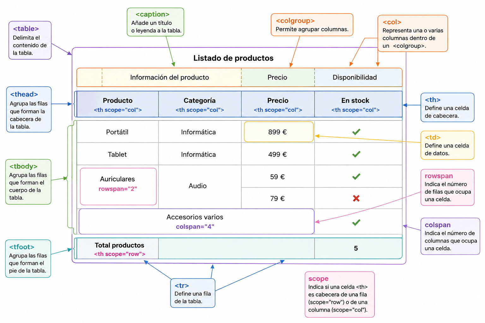

<details markdown="1">

<summary>💡 **Exemple complet**</summary>

**HTML**Resultado

```html
<!DOCTYPE html>
<html>
<head>
  <meta charset="UTF-8">
  <title>Ejemplo completo de tabla HTML</title>
</head>
<body>
  <table>
    <!-- Título o leyenda de la tabla -->
    <caption>Listado de productos</caption>
    <!-- Agrupación de columnas -->
    <colgroup>
      <col class="producto">
      <col class="categoria">
      <col class="precio">
      <col class="stock">
    </colgroup>
    <!-- Cabecera -->
    <thead>
      <tr>
        <th scope="col">Producto</th>
        <th scope="col">Categoría</th>
        <th scope="col">Precio</th>
        <th scope="col">En stock</th>
      </tr>
    </thead>
    <!-- Cuerpo -->
    <tbody>
      <tr>
        <td>Portátil</td>
        <td>Informática</td>
        <td>899 €</td>
        <td>Sí</td>
      </tr>
      <tr>
        <td>Tablet</td>
        <td>Informática</td>
        <td>499 €</td>
        <td>Sí</td>
      </tr>
      <tr>
        <!-- Esta celda ocupa dos filas -->
        <td rowspan="2">Auriculares</td>
        <!-- Esta celda también ocupa dos filas -->
        <td rowspan="2">Audio</td>
        <td>59 €</td>
        <td>Sí</td>
      </tr>
      <tr>
        <td>79 €</td>
        <td>No</td>
      </tr>
      <tr>
        <!-- Esta celda ocupa las cuatro columnas -->
        <td colspan="4">
          Accesorios varios
        </td>
      </tr>
    </tbody>
    <!-- Pie -->
    <tfoot>
      <tr>
        <th scope="row">Total productos</th>
        <!-- Ocupa dos columnas -->
        <td colspan="2"></td>
        <td>5</td>
      </tr>
    </tfoot>
  </table>
</body>
</html>
```

  
  Ejemplo completo de tabla HTML

  

| Producto | Categoría | Precio | En stock |
| --- | --- | --- | --- |
| Portátil | Informática | 899 € | Sí |
| Tablet | Informática | 499 € | Sí |
| Auriculares | Audio | 59 € | Sí |
| 79 € | No |  |  |
| Accesorios varios |  |  |  |
| Total productos |  | 5 |  |

> **📌 Probar en el navegador**
> 

> [En este link podrás practicar sobre el ejemplo](https://codesandbox.io/p/sandbox/lvc6yn)

</details>

---

## 2.4.4 Formularios

# **Formularios**

Los **formularios** permiten recoger información que el usuario introduce en el navegador para un posterior tratamiento.

Es importante **validar los datos** introducidos para detectar los posibles errores cometidos por un usuario. La validación consiste en revisar que los datos introducidos se ajustan a unos requisitos. Preferiblemente, la validación se debe realizar en **local** (en el propio equipo, sin enviar los datos al servidor). Normalmente se combinan los formularios con código **JavaScript**, aunque HTML5 incluye algunos atributos que permiten realizar algunos tipos de validaciones sin programar código.

## **Declaración de un formulario**

La apertura y cierre de un formulario se hace mediante el elemento `<form>`:

```html
<form name="mi-formulario" action="accion.php" method="GET"></form>
```

### **Atributos de `<form>`**

| Atributo | Descripción |
| --- | --- |
| `name` | Nombre del formulario. |
| `action` | Acción que se ejecuta cuando se pulsa el botón de enviar formulario. |
| `enctype` | Formato en el que se envían los valores del formulario. |
| `method` | Método de envío del protocolo HTTP. Se puede elegir entre el método `GET` y `POST`. |

### **Métodos GET y POST**

| GET | POST |
| --- | --- |
| Permite pasar valores en ASCII con un límite de 100 caracteres. | Permite pasar valores de variables y otros elementos como archivos. |
| Los valores de las variables se pueden ver en la URL (después de un `?`, separados por `&`). | Carece de restricciones de longitud como el método GET. |
| `https://web.com/index.php?variable1=valor1&variable2=valor2` | Las variables y sus valores no son visibles en la URL. |

> **📌 Datos sensibles con GET**
> 

> Con el método `GET` los valores son **visibles en la URL**. Para datos sensibles (contraseñas) o el envío de archivos se debe utilizar `POST`.

## **Campos de formulario**

Dentro de un formulario puede haber varios tipos de controles: campos de texto, campos para contraseñas, selector de fecha, botones de opción múltiple (*radio*), etc.

### **Atributo `name`**

Para que el servidor pueda identificar todos los campos de un formulario se usa el atributo **`name`**. El valor indicado será el identificador que se deberá usar para obtener la información introducida por el usuario.

Con el método `GET`, la información se envía a través de la URL:

```html
<form action="" method="GET">
  <input type="text" name="direccion" />
  <input type="submit" value="Enviar" />
</form>
```

```html
https://ejemplo.com/?direccion=Santiago
```

Con el método `POST`, la información se envía a través del *payload* de la petición HTTP. Este método es el único que podemos utilizar para enviar imágenes al servidor:

```html
<form action="" method="POST">
  <input type="text" name="direccion" />
  <input type="submit" value="Enviar" />
</form>
```

### **Campo de texto `<input>`**

El elemento `<input>` se puede usar para varios tipos de control. No tiene etiqueta de cierre. El tipo de control viene dado por el valor del atributo `type`.

```html
<input type="text" />
```

Sus atributos principales son:

| Atributo | Descripción |
| --- | --- |
| `name` | Nombre del campo. |
| `size` | Número de caracteres visibles en el campo. Por defecto, 20. |
| `maxlength` | Número máximo de caracteres que el usuario podrá introducir. |
| `value` | Valor por defecto del campo de texto. |
| `placeholder` | Valor sugerido; se presenta en color gris y desaparece al hacer foco en el campo. |
| `readonly` | El valor del campo no puede ser modificado por el usuario. |
| `autofocus` | Sitúa el cursor del ratón en el campo una vez cargada la página. |
| `required` | No se podrá enviar el formulario hasta que el campo esté cubierto. |

### **Área de texto `<textarea>`**

Permite recoger información abierta del usuario permitiendo un mayor número de caracteres. Para especificar un valor previo en el campo debe escribirse entre las etiquetas de apertura y cierre.

Sus atributos principales son: `name`, `rows` (número de filas), `cols` (número de columnas), `wrap` (`soft` o `hard`), `placeholder`, `readonly`, `autofocus`, `required` y `maxlength`.

```html
Describa a continuación sus intereses: <br />
<textarea
  name="area"
  rows="5"
  cols="50"
  wrap="hard"
  placeholder="Escriba aquí sus intereses..."
  maxlength="200"
  required
></textarea>
```

### **Lista desplegable `<select>`**

El elemento `<select>` permite crear una lista desplegable donde el usuario seleccione un valor entre diferentes opciones. Para definir cada opción se utiliza el elemento `<option>`.

| Atributos de `<select>` | Descripción |
| --- | --- |
| `name` | Nombre del elemento. |
| `size` | Número de elementos de la lista desplegable que se mostrarán. |
| `multiple` | Permite seleccionar varias opciones manteniendo pulsada la tecla Ctrl. |

| Atributos de `<option>` | Descripción |
| --- | --- |
| `selected` | Campo que aparece seleccionado por defecto. |
| `value` | Valor que se transmite cuando se envía el formulario. |

<details markdown="1">

<summary>💡 Llista desplegable</summary>

**HTML**Resultado

```html
<!DOCTYPE html>
<html>
  <head>
    <meta charset="UTF-8" />
    <title>Ejemplo de Formulario</title>
  </head>
  <body>
    <h2>Selecciona el sistema operativo</h2>
    <select name="os">
      <option value="linux">Linux</option>
      <option value="windows">Windows</option>
      <option value="macos" selected>Mac OS</option>
      <option value="android">Android</option>
      <option value="ios">iOS</option>
    </select>
  </body>
</html>
```

  
    
    Ejemplo de Formulario
  
  
    

## Selecciona el sistema operativo

    
      Linux
      Windows
      Mac OS
      Android
      iOS
    
  

> **📌 Probar en el navegador**
> 

> [En este link podrás practicar sobre el ejemplo](https://codesandbox.io/p/sandbox/gj58r6)

</details>

### **Botones de formulario**

- 

**Botón de envío**: permite enviar el formulario a un destinatario, que depende del valor del atributo `action` de la etiqueta `<form>`.

```html
<input type="submit" value="Enviar formulario">
```

- 

**Botón de anulación**: borra el contenido de los campos cubiertos en el formulario.

```html
<input type="reset" value="Vaciar formulario">
```

### **Otros tipos de `<input>`**

- 

**Checkbox**: permite que el usuario indique si está conforme con una o varias opciones.

```html
<input type="checkbox" name="terminos" checked value="aceptar" /> Acepto las condiciones
```

- 

**Oculto**: campo no visible que transmite información adicional.

```html
<input type="hidden" name="formulario_enviado" value="true">
```

- 

**Contraseña**: el texto introducido se muestra oculto.

```html
<input type="password" name="contrasena" placeholder="Introduce tu contraseña" />
```

- 

**Ficheros**: requiere formulario definido con `POST` y `enctype="multipart/form-data"`.

```html
<input type="file" name="archivo"/>
```

- 

**Correo electrónico**, **URL** y **números enteros**:

```html
<input type="email" name="email" placeholder="Introduce tu email" required />
<input type="url" name="url" placeholder="Introduce una URL"/>
<input type="number" min="0" max="100" step="10">
```

- 

**Fechas** (día, mes y año; mes y año; semana; hora; día, mes, año y hora):

```html
<input type="datetime-local">
<input type="date">
<input type="month">
<input type="week">
<input type="time">
```

- 

**Rangos**: permite seleccionar un valor dentro de un rango.

```html
<input type="range" min="0" max="100" value="25"/>
```

## **Organización de formularios**

### **Elemento `<label>`**

Permite asociar a cada campo del formulario una etiqueta con su nombre. Se asocia al campo mediante el atributo `for`, que contiene el valor del identificador (`id`) del campo.

```html
<label for="conforme">Acepto el acuerdo de licencia</label>
<input type="checkbox" name="licencia" id="conforme" value="ok">
```

### **Elemento `<fieldset>`**

Agrupa los campos de formulario que estén entre la etiqueta de apertura y cierre, rodeándolos con un borde. El elemento `<legend>` agrega un texto relacionado con los campos agrupados.

```html
<fieldset>
  <legend>Introduzca su nombre de usuario y contraseña</legend>
  <div>
    <label for="username">Usuario</label>
    <input type="text" id="username" name="user" required />
  </div>
  <br />
  <div>
    <label for="password">Contraseña</label>
    <input type="password" id="password" name="pass" required />
  </div>
</fieldset>
```

<details markdown="1">

<summary>💡 **Exemple complet**</summary>

**HTML**Resultado

```html
<!DOCTYPE html>
<html lang="es">
  <head>
    <meta charset="UTF-8" />
    <title>Ejemplo completo de formulario</title>
  </head>
  <body>
    <form
      name="formulario-completo"
      action="accion.php"
      method="POST"
      enctype="multipart/form-data"
    >
      <fieldset>
        <legend>Datos personales</legend>
        <div>
          <label for="nombre">Nombre</label>
          <input
            type="text"
            id="nombre"
            name="nombre"
            size="30"
            maxlength="50"
            placeholder="Introduce tu nombre"
            autofocus
            required
          />
        </div>
        <br />
        <div>
          <label for="usuario">Usuario (no modificable)</label>
          <input type="text" id="usuario" name="usuario" value="alu1234" readonly />
        </div>
        <br />
        <div>
          <label for="contrasena">Contraseña</label>
          <input
            type="password"
            id="contrasena"
            name="contrasena"
            placeholder="Introduce tu contraseña"
            required
          />
        </div>
        <br />
        <div>
          <label for="email">Correo electrónico</label>
          <input type="email" id="email" name="email" placeholder="Introduce tu email" required />
        </div>
        <br />
        <div>
          <label for="web">Página web</label>
          <input type="url" id="web" name="web" placeholder="Introduce una URL" />
        </div>
        <br />
        <div>
          <label for="edad">Edad</label>
          <input type="number" id="edad" name="edad" min="0" max="100" step="1" />
        </div>
      </fieldset>
      <br />
      <fieldset>
        <legend>Preferencias</legend>
        <div>
          <label for="comentario">Comentarios</label><br />
          <textarea
            id="comentario"
            name="comentario"
            rows="5"
            cols="50"
            wrap="hard"
            maxlength="200"
            placeholder="Escribe aquí tus comentarios..."
          ></textarea>
        </div>
        <br />
        <div>
          <label for="so">Sistema operativo</label>
          <select id="so" name="so">
            <option value="linux">Linux</option>
            <option value="windows">Windows</option>
            <option value="macos" selected>Mac OS</option>
          </select>
        </div>
        <br />
        <div>
          <label for="lenguajes">Lenguajes conocidos (mantén Ctrl para elegir varios)</label><br />
          <select id="lenguajes" name="lenguajes" size="3" multiple>
            <option value="html" selected>HTML</option>
            <option value="css">CSS</option>
            <option value="js">JavaScript</option>
          </select>
        </div>
        <br />
        <div>
          <input type="checkbox" id="terminos" name="terminos" value="aceptar" checked />
          <label for="terminos">Acepto las condiciones</label>
        </div>
        <br />
        <div>
          <label for="experiencia">Nivel de experiencia</label>
          <input type="range" id="experiencia" name="experiencia" min="0" max="100" value="25" />
        </div>
      </fieldset>
      <br />
      <fieldset>
        <legend>Fechas y archivos</legend>
        <div>
          <label for="nacimiento">Fecha de nacimiento</label>
          <input type="date" id="nacimiento" name="nacimiento" />
        </div>
        <br />
        <div>
          <label for="cita">Fecha y hora de la cita</label>
          <input type="datetime-local" id="cita" name="cita" />
        </div>
        <br />
        <div>
          <label for="mes">Mes de inicio</label>
          <input type="month" id="mes" name="mes" />
        </div>
        <br />
        <div>
          <label for="semana">Semana de entrega</label>
          <input type="week" id="semana" name="semana" />
        </div>
        <br />
        <div>
          <label for="hora">Hora preferida</label>
          <input type="time" id="hora" name="hora" />
        </div>
        <br />
        <div>
          <label for="archivo">Adjuntar un archivo</label>
          <input type="file" id="archivo" name="archivo" />
        </div>
        <input type="hidden" name="formulario_enviado" value="true" />
      </fieldset>
      <br />
      <div>
        <input type="submit" value="Enviar formulario" />
        <input type="reset" value="Vaciar formulario" />
      </div>
    </form>
  </body>
</html>
```

  
    
    Ejemplo completo de formulario
  
  
    
      
        Datos personales
        
          Nombre
          
        
          

        
          Usuario (no modificable)
          
        
          

        
          Contraseña
          
        
          

        
          Correo electrónico
          
        
          

        
          Página web
          
        
          

        
          Edad
          
        
      
        

      
        Preferencias
        
          Comentarios  

          
        
          

        
          Sistema operativo
          
            Linux
            Windows
            Mac OS
          
        
          

        
          Lenguajes conocidos (mantén Ctrl para elegir varios)  

          
            HTML
            CSS
            JavaScript
          
        
          

        
          
          Acepto las condiciones
        
          

        
          Nivel de experiencia
          
        
      
        

      
        Fechas y archivos
        
          Fecha de nacimiento
          
        
          

        
          Fecha y hora de la cita
          
        
          

        
          Mes de inicio
          
        
          

        
          Semana de entrega
          
        
          

        
          Hora preferida
          
        
          

        
          Adjuntar un archivo
          
        
        
      
        

      
        
        
      
    
  

> **📌 Probar en el navegador**
> 

> [En este link podrás practicar sobre el ejemplo](https://codesandbox.io/p/sandbox/d2rp8k)

</details>

> **📌 Accesibilidad de los formularios**
> 

> Asocia siempre cada campo con su `<label>` mediante `for` e `id`: mejora la **accesibilidad** y permite enfocar el campo al hacer clic en la etiqueta.

---

## 2.4.5 Multimedia e iframe

# **Multimedia e iframe**

## **Imágenes**

El elemento `` se utiliza para insertar una imagen. Es un elemento vacío.

```html

```

Sus atributos principales son:

| Atributo | Descripción |
| --- | --- |
| `src` | Especifica la ruta de la imagen. Puede ser local o una URL. Los formatos soportados dependen de cada navegador, pero en general se pueden utilizar JPG, PNG, WEBP y GIF, entre otros. |
| `alt` | Texto alternativo. Se usa si no se puede cargar la imagen o para los lectores de pantalla. Es obligatorio. |
| `height` | Altura. Si no se especifica, se escoge el tamaño original. Si se especifica, se escala. Es de los pocos casos en HTML5 en que un atributo tiene información de representación. |
| `width` | Anchura de la imagen. El funcionamiento es el mismo que el del atributo `height`. |

> **📌 Atributo `alt`**
> 

> El atributo `alt` es **obligatorio** en ``: se muestra si la imagen no puede cargarse y es utilizado por los **lectores de pantalla**.

## **Audio**

El elemento `<audio>` permite insertar una o varias fuentes de audio en un documento HTML.

```html
<audio controls src="t-rex-roar.mp3"></audio>
```

En el atributo `src` se indica que utilice como fuente un archivo `t-rex-roar.mp3`, el cual está en el mismo directorio que el documento HTML.

## **Vídeo**

El elemento `<video>` permite insertar una o varias fuentes audiovisuales en un documento HTML.

```html
<video controls src="flower.webm" width="500"></video>
```

En el atributo `src` se indica que utilice como fuente el vídeo `flower.webm`, el cual está en el mismo directorio que el documento HTML.

## **Objetos**

El elemento `<object>` permite incrustar contenido multimedia (audio, vídeo, ficheros PDF, applets, etc.).

```html
<object type="application/pdf" data="partitura.pdf" width="400" height="500"></object>
```

En el atributo `data` se indica que utilice como fuente el archivo `partitura.pdf`, el cual está en el mismo directorio que el documento HTML.

## **Elemento `<iframe>`**

El elemento `<iframe>` permite **integrar una página web dentro de otra**.

Sus atributos principales son:

| Atributo | Descripción |
| --- | --- |
| `height` | Altura, por defecto en píxeles. Si no cabe todo el contenido, se usa una barra de desplazamiento. También se puede fijar con CSS. |
| `width` | Anchura, como el anterior. |
| `src` | La ruta al contenido inicial del `<iframe>`. |
| `name` | Nombre, para referirse al `<iframe>` desde un vínculo. |

El contenido del `<iframe>` cambia al seguir los vínculos. Para conseguirlo, en los vínculos hay que poner como valor del atributo `target` el valor del atributo `name` del `<iframe>` en el que queramos que se cargue:

```html
<a href="..." target="contenido">...</a>
```

> **📌 Probar en el navegador**
> 

> [En este link podrás practicar con las propiedades](https://codesandbox.io/p/sandbox/wfkl33)

---

## 2.5 Herramientas para la creación y edición

# **Herramientas para la creación y edición**

Los lenguajes de marcas se escriben en **texto plano**, lo cual es una ventaja respecto al procesamiento. En este apartado veremos algunas herramientas para visualizar y crear documentos HTML desde el ordenador.

## **Navegadores**

La opción "**Ver código fuente**" de la página aparece en los navegadores Chrome, Firefox y Microsoft Edge. En Opera la opción equivalente se llama *Origen de la página*, mientras que en Safari la opción es *Mostrar código fuente de la página*. En cualquier caso, el resultado es el mismo: el navegador muestra el código HTML descargado del servidor.

Además de la posibilidad de consultar el código fuente, la mayoría de los navegadores modernos disponen de una serie de herramientas conocidas como **herramientas para desarrolladores** (también denominadas informalmente *devtools*).

Entre las herramientas para desarrolladores, tomando Google Chrome como referencia, se encuentran las siguientes pestañas relativas a HTML:

- **Elementos**: permite consultar la estructura del documento HTML y el estilo CSS aplicado a cada elemento. Se puede modificar los elementos HTML y los estilos y ver en tiempo real el resultado de las modificaciones.

- **Sources**: se muestran todos los recursos descargados relativos a la página HTML: el propio documento, imágenes, hojas de estilo CSS, ficheros JavaScript externos, etc. Permite consultar el código HTML.

> **📌 Probar en el navegador**
> 

> Abre cualquier página web y pulsa F12 (o botón derecho → *Inspeccionar*). En la pestaña **Elementos** verás el árbol HTML y podrás modificarlo en tiempo real.

## **Editores de texto**

Ejemplos: Visual Studio Code, Atom, Brackets, Sublime Text, UltraEdit, Notepad++.

Vale la pena hacer referencia en este punto al complemento **EMMET** ([https://emmet.io/](https://emmet.io/)), disponible en la mayoría de los editores modernos y que proporciona una serie de atajos para la creación automática de código. Funciona escribiendo los atajos y pulsando **Tab**.

> **📌 Ejemplo con EMMET**
> 

> Escribe el atajo `ul>li*3` y pulsa **Tab** para generar automáticamente una lista desordenada con tres elementos `<li>`.

## **Editores visuales (WYSIWYG)**

Un nivel por encima de los editores de texto se encuentran los editores visuales, también denominados **WYSIWYG** (acrónimo de *What You See Is What You Get*, "lo que ves es lo que tienes").

Algunas de estas herramientas son Adobe Dreamweaver (comercial), BlueGriffon (gratuito con algunos componentes comerciales) y HTML Notepad (gratuito).

## **Editores online**

Ejemplos: JSFiddle, CodePen, CodeSandbox o Liveweave.

Estos sitios web ofrecen editores en línea que permiten introducir código HTML, CSS y JavaScript y comprobar en la misma página y en tiempo real el resultado.

---

## 2.6 Validación de documentos HTML

# **Validación de documentos HTML**

## **¿Por qué necesitamos validarlo?**

En los lenguajes de marcas como HTML, los navegadores son más **permisivos**: en el caso de encontrar un error, intentan «deducir» lo que realmente se quería indicar y continúan con la carga del documento. De esta forma tenemos un método más flexible a errores, pero también es un arma de doble filo donde podemos experimentar problemas derivados.

> **📌 Que se vea no significa que sea correcto**
> 

> Que el navegador muestre la página no garantiza que el código sea correcto. Por eso es importante **validar** siempre los documentos.

## **Tipos de problemas**

En nuestro código HTML podemos tener varios tipos de problemas:

| Tipo de error | Descripción |
| --- | --- |
| **Sintaxis** | El código está mal escrito y es incorrecto. El navegador podría no mostrar correctamente ciertos detalles. |
| **Accesibilidad** | El código no tiene por qué estar mal escrito o ser incorrecto; sin embargo, tiene problemas que harán que no se vea bien en determinados dispositivos o que un usuario invidente o similar no pueda utilizarla. |
| **Posicionamiento (SEO)** | El código no tiene por qué estar mal escrito o ser incorrecto; sin embargo, los buscadores como Google no aceptarán favorablemente la página y podría tener un rendimiento menor de posicionamiento SEO. |
| **Rendimiento** | El código no tiene por qué estar mal escrito o ser incorrecto; sin embargo, el navegador puede ser lento a la hora de cargarlo o tardar en realizar sus tareas. |
| **Usabilidad** | El código no tiene por qué estar mal escrito o ser incorrecto; sin embargo, la forma en la que se disponen los elementos o está pensado puede frustrar al usuario final que utiliza la web. |

Los errores de los que vamos a hablar en este artículo, pertenecen al primer apartado. Es importante tener en cuenta que no tener errores del primer tipo no implica que no los haya de los siguientes apartados, aún teniendo nuestro código HTML 100% correcto.

## **Validar errores de sintaxis HTML**

Para asegurarnos de que nuestro código está correctamente escrito, podemos utilizar un **Validador HTML**, que no es más que un sistema que analiza nuestro código y nos dice el número de errores que tenemos, junto a una breve descripción del mismo para facilitar su corrección.

Este proceso de validación se puede realizar mediante la herramienta oficial [HTML Validator de W3C](https://validator.w3.org/), un validador de código HTML5, donde podemos validar nuestra página de **tres formas diferentes**:

- **By URI**: Indicando la URL de la página que se quiere validar. Obviamente, la página debe estar publicada en Internet.

- **By File upload**: Seleccionando el archivo `.html` a analizar y subiéndolo al validador.

- **By Direct Input**: Pegando directamente el código HTML que se quiere analizar en una casilla de texto.

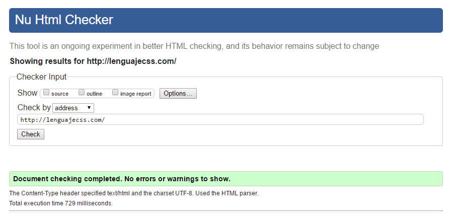

Además, si nos fijamos en la parte superior de la herramienta de validación, veremos que hay tres casillas disponibles para marcar, con las que podemos agregar nuevas características que se mostrarán tras la validación. Dichas características son las siguientes:

- **Source**: Nos muestra el código fuente, numerado por líneas. Útil para corregir problemas sobre la marcha o comprobar los errores en las líneas especificadas.

- **Outline**: Nos muestra una especie de árbol o esquema de la página.

- **Image report**: Genera un informe de las imágenes del sitio web, con una miniatura y sus características asociadas.
Es una muy buena práctica acostumbrarse a utilizar el validador para crear código HTML de calidad y sin errores, ya que si tenemos documentos sin errores de validación, es mucho más probable que se vean correctamente en cualquier tipo de dispositivo.

## **Otras vías de validación**

Existen otros mecanismos de validación al margen de esta herramienta oficial de W3C. Con ellos encontrarás formas alternativas para validar tus documentos desde Visual Studio Code, desde una terminal de texto o desde scripts de NodeJS:

| Herramienta | Descripción |
| --- | --- |
| [W3C Validation](https://marketplace.visualstudio.com/items?itemName=Umoxfo.vscode-w3cvalidation) | Extensión de VSCode para validar documentos mediante el Nu HTML Validator. |
| [W3C Web Validator](https://marketplace.visualstudio.com/items?itemName=CelianRiboulet.webvalidator) | Extensión de VSCode para validar problemas en tu código HTML. |
| [HTML W3C Validator](https://github.com/theoludwig/html-w3c-validator) | Paquete de NPM para validar desde una terminal. |
| [HTML Validate](https://gitlab.com/html-validate/html-validate) | Paquete de NPM para validar offline una página HTML. |
| [W3C Link Validator](https://github.com/99x/w3c-link-validator) | Paquete de NPM para validar HTML o buscar links rotos desde terminal. |
| [HTMLHint](https://htmlhint.com/) | Herramienta de análisis estático de código HTML. |

---

## 2.7.1 Introducción y ventajas de la sindicación de contenidos

# **Introducción y ventajas de la sindicación de contenidos**

La **redifusión o sindicación de contenidos** permite a un sitio utilizar los servicios o contenidos ofertados por otro sitio diferente.

La redifusión web consiste en **ofrecer un contenido desde una fuente web**, cuyo origen está en otra página web. Se proporciona a los usuarios la actualización del mismo. Los servicios que ofrece el sitio web original, junto con los metadatos que tiene asociados en el sitio original, forman los **feed o canales de contenidos**.

- Para leer una fuente, o canal, hay que **suscribirse** a ella utilizando un **agregador**. También se conoce como recopilador de contenidos, agregador de noticias o lector de RSS.

- La redifusión de contenidos web suele realizarse bajo una **licencia de normas de uso**, o mediante un contrato que regule los derechos de los contenidos.

- Las fuentes suelen codificarse en lenguaje **XML**, aunque es válido hacerlo en cualquier lenguaje que se pueda transportar mediante el protocolo **HTTP** (*HyperText Transfer Protocol*).

> **📌 Suscribirse a un canal**
> 

> Para leer una fuente o canal de contenidos hay que **suscribirse** mediante un agregador, también llamado lector de RSS.

## **Ventajas**

Las ventajas de utilizar los canales de contenidos de otros propietarios son:

- Aumentar el **tráfico** de nuestro sitio web.

- Ayudar a que los usuarios y usuarias visiten **frecuentemente** un sitio web.

- Favorecer el **posicionamiento** del sitio en buscadores.

- Ayudar a establecer **relaciones** entre distintos sitios web dentro de la comunidad.

- Permitir a otras personas añadir características a los servicios del sitio web (por ejemplo, notificaciones de actualizaciones mediante mensajes instantáneos, aunque se requieran tecnologías adicionales).

- **Enriquecer Internet** impulsando la tecnología semántica y fomentando la reutilización.

## **Flujo de la información**

Publicar en la web puede ser visto como un flujo de información que va desde un origen hasta un destino:

- **Origen**: la página web.

- **Destino**: los usuarios y usuarias que leerán la información. Podrán hacerlo a través de su navegador, accediendo a una página web disponible en Internet.

Supongamos que el flujo de información de una publicación tiene su origen en unos ficheros localizados en un ordenador local, codificados en un documento HTML. Para que los lectores y lectoras puedan acceder a los documentos, previamente se deben **subir a un servidor web** que sea accesible desde Internet.

---

## 2.7.2 Estándares RSS, Atom y JSON Feed

# **Estándares RSS, Atom y JSON Feed**

Existen varios estándares para la creación de un canal. Todos ellos, en esencia, son **ficheros de texto plano** con la información estructurada mediante un lenguaje de marcas (como XML o JSON) y que siguen unas reglas definidas en un estándar para la estructuración de la información.

> **📌 Elegir estándar**
> 

> **RSS** es el más popular, **Atom** se desarrolló como alternativa para evitar la fragmentación de estándares y **JSON Feed** es el más moderno al utilizar JSON.

## **RSS**

**RSS** (*Really Simple Syndication*) es el estándar más popular. Utiliza el lenguaje **XML** para estructurar la información.

> **📌 Documento RSS**
> 

```html
<?xml version="1.0" encoding="UTF-8" ?>
<rss version="2.0">
  <channel>
    <title>RSS Title</title>
    <description>This is an example of an RSS feed</description>
    <link>http://www.example.com/main.html</link>
    <copyright>2020 Example.com All rights reserved</copyright>
    <lastBuildDate>Mon, 6 September 2010 00:01:00 +0000</lastBuildDate>
    <pubDate>Sun, 6 September 2009 16:20:00 +0000</pubDate>
    <ttl>1800</ttl>
    <item>
      <title>Example entry</title>
      <description>Here is some text containing an interesting description.</description>
      <link>http://www.example.com/blog/post/1</link>
      <guid isPermaLink="false">7bd204c6-1655-4c27-aeee-53f933c5395f</guid>
      <pubDate>Sun, 6 September 2009 16:20:00 +0000</pubDate>
    </item>
  </channel>
</rss>
```

## **Atom**

**Atom** es un estándar que se desarrolló como una alternativa a RSS. El objetivo era evitar la confusión creada por la existencia de estándares similares para la sindicación de contenidos.

> **📌 Documento Atom**
> 

```html
<?xml version="1.0" encoding="utf-8"?>
<feed xmlns="http://www.w3.org/2005/Atom">
  <title>Example Feed</title>
  <subtitle>A subtitle.</subtitle>
  <link href="http://example.org/feed/" rel="self" />
  <link href="http://example.org/" />
  <id>urn:uuid:60a76c80-d399-11d9-b91c-0003939e0af6</id>
  <updated>2003-12-13T18:30:02Z</updated>
  <entry>
    <title>Atom-Powered Robots Run Amok</title>
    <link href="http://example.org/2003/12/13/atom03" />
    <id>urn:uuid:1225c695-cfb8-4ebb-aaaa-80da344efa6a</id>
    <published>2003-11-09T17:23:02Z</published>
    <updated>2003-12-13T18:30:02Z</updated>
    <summary>Some text.</summary>
    <content type="xhtml">
      <div xmlns="http://www.w3.org/1999/xhtml">
        <p>This is the entry content.</p>
      </div>
    </content>
    <author>
      <name>John Doe</name>
      <email>johndoe@example.com</email>
    </author>
  </entry>
</feed>
```

## **JSON Feed**

**JSON Feed** es un estándar que utiliza **JSON** (*JavaScript Object Notation*) para la publicación de contenidos. Es el estándar más moderno.

> **📌 Documento JSON Feed**
> 

```html
{
  "version": "https://jsonfeed.org/version/1.1",
  "title": "My Example Feed",
  "home_page_url": "https://example.org/",
  "feed_url": "https://example.org/feed.json",
  "items": [
    {
      "id": "2",
      "content_text": "This is a second item.",
      "url": "https://example.org/second-item"
    },
    {
      "id": "1",
      "content_html": "<p>Hello, world!</p>",
      "url": "https://example.org/initial-post"
    }
  ]
}
```

---

## 2.7.3 Publicación y ámbitos de aplicación

# **Publicación y ámbitos de aplicación**

## **Publicación**

Podemos hacer que cualquier web se convierta en **suministradora (origen)** de un canal de información, de modo que esta información pueda ser sindicada. Para lograrlo, en la cabecera de la página web (`<head>`) hay que incluir un **enlace al canal de contenidos**.

Para lograrlo, hay que añadir una línea como la siguiente:

> **📌 Enlace al canal en la cabecera**
> 

```html
<!DOCTYPE html>
<html>
  <head>
    <meta charset="UTF-8">
    <title>Feed RSS</title>
    <link rel="alternate" type="application/rss+xml" title="Canal BOE" href="https://www.boe.es/rss/boe.php"/>
  </head>
  <body>
  </body>
</html>
```

Si utilizamos otra tecnología, cambiaríamos el valor del atributo `type`, además de `title` y `href`:

```html
<link rel="alternate" type="application/atom+xml" title="Atom" href="http://www.misitio.com/fichero.atom" />
```

> **📌 Cambiar de tecnología**
> 

> Si usamos Atom en lugar de RSS, sólo cambia el atributo `type` (`application/atom+xml`), además de `title` y `href`.

## **Ámbitos de aplicación**

La redifusión web no es sólo un fenómeno vinculado a los blogs o webs de periódicos, aunque ha ayudado mucho a su popularización. Siempre se han sindicado contenidos y se ha compartido todo tipo de información en formato XML.

De esta forma, podemos **ofrecer contenidos propios** para que sean mostrados en otras páginas web de forma integrada, lo que aumenta el valor de la página que muestra el contenido y también nos genera más valor, ya que normalmente la redifusión web siempre enlaza con los contenidos originales.

La redifusión de contenidos web puede aplicarse a **todo tipo de contenidos**: texto, audio, vídeos, imágenes, etc.

---

## 2.7.4 Estructura de un documento RSS

# **Estructura de un documento RSS**

**RSS** (*Really Simple Syndication*) es parte de la familia de los formatos XML, desarrollado para compartir la información que se actualiza con frecuencia entre sitios web. Además se utiliza para:

- Conectar con sistemas de mensajería instantánea.

- Conversión RSS en mensajes de correo electrónico.

- Transformar los enlaces favoritos del navegador en RSS.

## **Versiones de RSS**

RSS ha sido desarrollado por tres organizaciones diferentes, lo que ha dado lugar a múltiples versiones de RSS:

| Versión | Origen | Características |
| --- | --- | --- |
| **RSS 0.90** | Creado por Netscape en 1999. | Se basa en la especificación RDF de metadatos, con la intención de que su proyecto My Netscape estuviese formado por titulares de otras webs. |
| **RSS 0.91** | Versión simplificada de RSS 0.90 que Netscape lanzó posteriormente. | El desarrollo de este formato se detuvo por falta de éxito, aunque la empresa UserLand Software decidió usar esta versión para desarrollar blogs. |
| **RSS 1.0** | Creado por el RSS-DEV Working Group a partir del estándar RSS 0.90. | Es más estable y permite definir una cantidad mayor de datos que el resto de versiones de RSS. |
| **RSS 0.92 - 0.94** | UserLand Software rechazó el estándar RSS 1.0 por considerarlo complejo y continuó el desarrollo del formato RSS 0.91. | Su sintaxis está incompleta y no cumplen todas las normas de XML. |
| **RSS 2.0** | Publicado para subsanar los problemas de las versiones 0.9x. | Uno de los mayores cambios es la creación de un mecanismo de **extensiones** mediante el uso de *namespaces* de XML. Una extensión, por ejemplo, es **Media RSS**. |

## **Documento RSS**

Para construir un canal de contenido es necesario crear un fichero basado en **XML**. Este fichero, que tendrá extensión `.rss`, se publicará en uno de los directorios del sitio web desde el que se oferta.

Los elementos básicos que forman parte de un documento RSS son:

- **Cabecera** del documento.

- **Canal** o canales.

- **Secciones**.

### **Cabecera**

La cabecera es la primera línea del documento, que consiste en una **declaración XML**. Para la codificación se utilizará preferentemente **UTF-8**.

```html
<?xml version="1.0" encoding="UTF-8" ?>
```

### **Canal**

A continuación aparece la etiqueta `<rss>`. La declaración RSS indica que es un documento RSS y la versión empleada. El elemento `<rss>` es el **elemento raíz** de un documento RSS.

Dentro de ella aparece un **canal** (etiqueta `<channel>`), que se encarga de describir el feed RSS propiamente dicho. El canal es el que determina el sitio web asociado a la fuente web a la que hace referencia el fichero. No existe ninguna restricción respecto a la cantidad de canales de contenidos que se pueden ofrecer desde un sitio web.

```html
<rss version="2.0">
```

El canal tiene **3 elementos hijos obligatorios**:

| Elemento | Descripción |
| --- | --- |
| `<title>` | Título del canal. |
| `<description>` | Descripción del canal. |
| `<link>` | Enlace del canal. |

También hay varios elementos **opcionales**. Algunos de ellos son:

| Elemento | Descripción |
| --- | --- |
| `<language>` | Define el idioma del canal. |
| `<category>` | Define una o más categorías a las que pertenece la fuente. |
| `<copyright>` | Indica quién posee los derechos de autor. |

> **📌 Elementos obligatorios**
> 

> Tanto el canal `<channel>` como cada sección `<item>` deben incluir **obligatoriamente** `title`, `description` y `link`.

### **Secciones**

Un canal está formado por **secciones o artículos**. Cada una de las secciones es una referencia a la web que contiene uno de los servicios que se van a ofrecer. En un canal pueden incluirse tantas secciones como se quiera, lo que hace que un canal de contenido pueda tener un tamaño enorme si contiene un gran número de enlaces independientes.

Una sección se define con el elemento **`<item>`** y tiene **3 elementos hijos obligatorios**:

| Elemento | Descripción |
| --- | --- |
| `<title>` | Título del artículo. |
| `<description>` | Descripción del artículo. |
| `<link>` | Enlace del artículo. |

También hay varios elementos **opcionales**. Algunos de ellos son:

| Elemento | Descripción |
| --- | --- |
| `<author>` | Define el autor o autora del artículo. |
| `<category>` | Define una o más categorías a las que pertenece la fuente. |
| `<guid>` | Define un identificador único para el elemento. |

### **Ejemplo completo**

> **📌 Ejemplo de documento RSS**
> 

```html
<?xml version="1.0" encoding="UTF-8" ?>
<rss version="2.0">
  <channel>
    <title>Mi canal RSS</title>
    <description>Canal de ejemplo del módulo LLMSGI</description>
    <link>http://www.ejemplo.com/</link>
    <language>es</language>
    <item>
      <title>Primer artículo</title>
      <description>Descripción del primer artículo</description>
      <link>http://www.ejemplo.com/articulo1</link>
      <author>alumno@ejemplo.com</author>
    </item>
  </channel>
</rss>
```

---

## 2.7.5 Validación y agregadores

# **Validación y agregadores**

## **Validación de canales**

En Internet podemos encontrar múltiples sitios web que ofrecen este servicio:

- **RSS Advisory Board Validator**

- **FeedValidator**

- **W3C Feed Validation Service** mediante URI.

- **W3C Feed Validation Service** mediante código.

Para validar un documento RSS con uno de estos validadores, se le da la **dirección del fichero** donde se encuentra alojado y comprueba que lo pueden encontrar (que la URI es válida) y que no contiene errores.

Una vez validado, suelen ofrecer una **imagen del tipo "XML" o "RSS"**, de color naranja por lo general, que se puede incluir en la página principal para enlazar a la dirección del fichero alojado en su dominio. Así, cuando un visitante pulse sobre este pequeño icono, accederá directamente al contenido actual de la fuente y podrá navegar a través de él a las páginas que más le interesen.

> **📌 Icono del canal**
> 

> Cuando el canal sea válido, el validador suele ofrecer una imagen del tipo "XML" o "RSS" (de color naranja) que se puede incluir en la página para enlazar al fichero de la fuente.

## **Agregadores**

Un **agregador o lector de fuentes** es una aplicación de software para **suscribirse a fuentes** en formatos RSS y Atom. El agregador avisa al usuario o usuaria de qué páginas web han incorporado contenido nuevo desde nuestra última lectura y cuál es ese contenido.

En el agregador hay que indicar la **dirección web** de cada archivo fuente para que pueda acceder a sus contenidos, los interprete y los muestre.

Existen varios tipos de agregadores:

- 

**Aplicaciones web** (agregadores en línea): residen en determinados sitios web y se ejecutan a través de la propia web. Son recomendables cuando el usuario o usuaria no accede siempre a Internet desde el mismo dispositivo. Ejemplos: **Feedly**, **Inoreader** o **NewsBlur**.

- 

**Aplicaciones nativas**: se instalan en el PC o dispositivo móvil. Su uso es aconsejable para quienes accedan a Internet siempre desde el mismo equipo. Su interfaz gráfica suele ser parecida a la de los programas de cliente de correo electrónico, con un panel donde se agrupan las suscripciones y otro donde se accede a las entradas individuales para su lectura. Ejemplos: **RSSOwl** o **QuiteRSS**.

- 

**Complementos de navegador**: desde que se ha dejado de dar soporte nativo en los navegadores, la única alternativa sería utilizar un complemento o extensión. Ejemplos: **Feedbro**, **Awesome RSS** o **Livemarks**.

---

## ✏️ Actividades y Prácticas de la Unidad


---

### Actividad Práctica ACT201 — 201

# Actividad 201

> **📌 Entrega**
> 

> - La entrega será un **fichero pdf** que contenga la respuesta a las preguntas de la actividad.

> - El nombre del fichero debe ser `201_NombreApellidos.pdf`.

> - Se deberá entregar en la tarea correspondiente de Aules en tiempo y forma.

> **📌 Se valorará**
> 

> Se valorará:

> - La claridad de la respuesta.

> - La correcta maquetación del documento.

> - Respuesta correcta o aproximación a la misma.

> Esta actividad servirá para calificar:

> - RA2: Utiliza lenguajes de marcas para la transmisión y presentación de información a través de la web analizando la estructura de los documentos e identificando sus elementos.

>   - CA2. a) Se han identificado y clasificado los lenguajes de marcas relacionados con la web y sus diferentes versiones y estándares. (5%)

## **Ejercicio 1**

**Investigación sobre Markdown**

Realiza un trabajo de investigación sobre el lenguaje de marcas Markdown. Para realizarlo deberás seguir la siguiente estructura:

1. **Introducción**: Explicar orígenes y usos actuales de este lenguaje de marcas.

1. **Estructura y sintaxis**: Explicar la estructura del documento y la sintaxis más común.

1. **Editores**: Editores más comunes de Markdown.

1. **Publicación**: Cómo publicar los archivos Markdown.

---

### Actividad Práctica ACT202 — 202

# Actividad 202

> **📌 Entrega**
> 

> - La entrega será un **fichero pdf** que contenga la respuesta a las preguntas de la actividad.

> - El nombre del fichero debe ser `202_NombreApellidos.pdf`.

> - Se deberá entregar en la tarea correspondiente de Aules en tiempo y forma.

> **📌 Se valorará**
> 

> Se valorará:

> - La claridad de la respuesta.

> - La correcta maquetación del documento.

> - Respuesta correcta o aproximación a la misma.

> Esta actividad servirá para calificar:

> - RA2: Utiliza lenguajes de marcas para la transmisión y presentación de información a través de la web analizando la estructura de los documentos e identificando sus elementos.

>   - CA2. b) Se ha analizado la estructura de un documento HTML y las secciones que lo componen. (5%)

>   - CA2. d)   Se han establecido las semejanzas y diferencias entre las diferentes versiones de HTML. (5%)

## **Ejercicio 1**

**XHTML vs HTML**

Lee el apartado 2.2.4 XHTML y responde:

1. ¿Qué es XHTML?

1. ¿Qué problemas del HTML resuelve XHTML?

1. Escribe las **cinco normas** que debe cumplir un documento para ser XML bien formado y, por tanto, XHTML.

1. ¿Qué diferencia hay en el comportamiento de los navegadores entre un documento HTML con errores y uno XHTML con errores?

## **Ejercicio 2**

**Escribir en XHTML**

El siguiente código HTML no es válido como XHTML. Corrige los errores para que sea un documento **XHTML bien formado**:

```html
<!DOCTYPE html>
<HTML>
  <HEAD>
    <meta charset=UTF-8>
    <title>Mi página</title>
  </HEAD>
  <BODY>
    <p>Primer párrafo
    <p>Segundo párrafo<br>
    
  </BODY>
</HTML>
```

---

### Actividad Práctica ACT203 — 203

# Actividad 203

> **📌 Entrega**
> 

> - La entrega será un **fichero pdf** que contenga la respuesta a las preguntas de la actividad.

> - El nombre del fichero debe ser `203_NombreApellidos.pdf`.

> - Se deberá entregar en la tarea correspondiente de Aules en tiempo y forma.

> **📌 Se valorará**
> 

> Se valorará:

> - La claridad de la respuesta.

> - La correcta maquetación del documento.

> - Respuesta correcta o aproximación a la misma.

> Esta actividad servirá para calificar:

> - RA2: Utiliza lenguajes de marcas para la transmisión y presentación de información a través de la web analizando la estructura de los documentos e identificando sus elementos.

>   - CA2. b) Se ha analizado la estructura de un documento HTML y las secciones que lo componen. (5%)

## **Ejercicio 1**

**Partes del documento**

Lee el apartado 2.2.5 Estructura de un documento HTML y responde:

1. ¿Qué es el prólogo y qué indica en el caso de HTML5?

1. ¿Qué elementos forman la estructura básica de un documento?

1. ¿Qué información contiene la cabecera `<head>` y cuál es el elemento obligatorio dentro de ella?

1. ¿En qué se diferencia la información de la cabecera de la del cuerpo?

1. ¿Dónde se deben escribir los comentarios y para qué sirven?

## **Ejercicio 2**

**Cabecera completa**

Crea un documento HTML que incluya en la cabecera los siguientes elementos:

1. Juego de caracteres UTF-8.

1. Un título obligatorio.

1. Un `meta` con el *viewport*.

1. Un `link` a una hoja de estilos externa.

1. Un bloque `style` interno.

1. Un `script` externo.

1. En el cuerpo, un único párrafo con el texto "Hola, LLMSGI".

## **Ejercicio 3**

**Etiquetas y atributos**

Lee el apartado 2.3.1 Sintaxis: etiquetas y atributos y responde:

1. ¿Qué es una etiqueta de apertura y qué es una etiqueta de cierre?

1. ¿Qué es un elemento vacío? Pon un ejemplo.

1. ¿Para qué sirven los atributos en HTML?

1. ¿Qué ocurre si el valor de un atributo no es válido?

## **Ejercicio 4**

**Documento básico**

Crear una página HTML con la **estructura básica** (elementos `<html>`, `<head>` indicando el juego de caracteres y el título, y `<body>` conteniendo un texto plano). Utilizar un programa de edición de texto plano. Guardar el documento en el ordenador hasta finalizar la clase.

## **Ejercicio 5**

**Tipos de atributos**

Lee el apartado 2.3.2 Tipos de atributos y crea un documento HTML que:

1. Tenga un `<div>` con un `id` único.

1. Tenga un elemento con una clase definida en una hoja de estilos interna.

1. Un enlace con `title` y el atributo `lang="es"`.

1. Un campo de texto con `autofocus`.

## **Ejercicio 6**

**Corregir errores de estructura HTML**

Crea una **página web** que tenga el mismo aspecto que la siguiente imagen:

El documento HTML base es el siguiente:

> **📌 Html**
> 

```html
<html lang=es>
  <head>
    <title>World Wide Web</title>
  </head>
  <body>

    <h1>World Wide Web</h1>

    <p>
    En informática, la <strong><em>World Wide Web</strong></em> (WWW) o Red informática
    mundial comúnmente conocida como la web, es un sistema de distribución de documentos
    de hipertexto o hipermedios interconectados y accesibles vía Internet. Con un
    navegador web, un usuario visualiza sitios web compuestos de páginas web que pueden
    contener texto, imágenes, vídeos u otros contenidos multimedia, y navega a través de
    esas páginas usando hiperenlaces.

    <h2>Historia</h2>

    <p>
    La web se desarrolló entre marzo de 1989 y diciembre de 1990 por el inglés Tim Berners-Lee
    con la ayuda del belga Robert Cailliau mientras trabajaban en el CERN en Ginebra,
    Suiza, y publicado en 1992.
    </p>

    <p>
    Desde entonces, Berners-Lee ha jugado un papel activo guiando el desarrollo de estándares
    web (como los lenguajes de marcado con los que se crean las páginas web), y en los últimos
    años ha abogado por su visión de una web semántica.
    </p>

    <p>Fuente: <em>Wikipedia</p></em>

</html>
```

## **Ejercicio 7**

**Corregir errores y mejorar**

El documento HTML base es el siguiente:

> **📌 Html**
> 

```html
<html>
  <head>
    <title>World Wide Web</title>
  </head>
  <body>
    <h1>World Wide Web</h1>
    <p>
    En inform&aacute;tica, la <strong><em>World Wide Web</em></strong> (WWW) o
    Red inform&aacute;tica mundial com&uacute;nmente conocida como la web, es
    un sistema de distribuci&oacute;n de documentos de hipertexto o hipermedios
    interconectados y accesibles v&iacute;a Internet. Con un navegador web, un
    usuario visualiza sitios web compuestos de p&aacute;ginas web que pueden
    contener texto, im&aacute;genes, v&iacute;deos u otros contenidos multimedia,
    y navega a trav&eacute;s de esas p&aacute;ginas usando hiperenlaces.
    </p>

    <h3>Historia</h3>

    <p>
    La web se desarrolló entre marzo de 1989 y diciembre de 1990 por el inglés
    Tim Berners-Lee con la ayuda del belga Robert Cailliau mientras trabajaban
    en el CERN en Ginebra, Suiza, y publicado en 1992.
    </p>

    <p>
    Desde entonces, Berners-Lee ha jugado un papel activo guiando el desarrollo
    de estándares web (como los lenguajes de marcado con los que se crean las
    páginas web), y en los últimos años ha abogado por su visión de una web
    semántica.
    </p>

    <p>
    Una frase famosa de Tim Berners-Lee es:
    </p>

    <blockquote>
    <p>
    There is only one web.
    </p>
    </blockquote>
    <p>Fuente: <em>Wikipedia</em></p>
</html>
```

---

### Actividad Práctica ACT204 — 204

# Actividad 204

> **📌 Entrega**
> 

> - La entrega será un **fichero pdf** que contenga la respuesta a las preguntas de la actividad.

> - El nombre del fichero debe ser `204_NombreApellidos.pdf`.

> - Se deberá entregar en la tarea correspondiente de Aules en tiempo y forma.

> **📌 Se valorará**
> 

> Se valorará:

> - La claridad de la respuesta.

> - La correcta maquetación del documento.

> - Respuesta correcta o aproximación a la misma.

> Esta actividad servirá para calificar:

> - RA2: Utiliza lenguajes de marcas para la transmisión y presentación de información a través de la web analizando la estructura de los documentos e identificando sus elementos.

>   - CA2. c) Se ha reconocido la funcionalidad de las principales etiquetas y atributos del lenguaje HTML. (2%)

## **Ejercicio 1**

**Elementos inline y block**

Lee los apartados 2.4.1 Elementos HTML y 2.4.2 Secciones y responde:

1. ¿Qué diferencia hay entre un elemento en línea (*inline*) y un elemento de bloque (*block*)?

1. Clasifica los siguientes elementos como *inline* o *block*: `<h1>`, `<a>`, `<p>`, `<strong>`, `<div>`.

1. ¿Cuándo se debe usar `<div>` y cuándo una etiqueta semántica?

1. ¿Qué representa el elemento `<article>`?

## **Ejercicio 2**

**Maquetación con etiquetas semánticas**

Crea un documento HTML con la siguiente estructura semántica:

- Un `<header>` con un `<nav>` con dos enlaces.

- Un `<main>` con una `<section>` que contenga un `<article>` con un párrafo.

- Un `<aside>` con otro párrafo.

- Un `<footer>` con un párrafo.

---

### Actividad Práctica ACT205 — 205

# Actividad 205

> **📌 Entrega**
> 

> - La entrega será un **fichero pdf** que contenga la respuesta a las preguntas de la actividad.

> - El nombre del fichero debe ser `205_NombreApellidos.pdf`.

> - Se deberá entregar en la tarea correspondiente de Aules en tiempo y forma.

> **📌 Se valorará**
> 

> Se valorará:

> - La claridad de la respuesta.

> - La correcta maquetación del documento.

> - Respuesta correcta o aproximación a la misma.

> Esta actividad servirá para calificar:

> - RA2: Utiliza lenguajes de marcas para la transmisión y presentación de información a través de la web analizando la estructura de los documentos e identificando sus elementos.

>   - CA2. c) Se ha reconocido la funcionalidad de las principales etiquetas y atributos del lenguaje HTML. (2%)

## **Ejercicio 1**

**Encabezados y párrafos**

Lee el apartado 2.4.3 Texto y crea un documento HTML que muestre:

1. Un `h1` con el título "Ciclos formativos de la familia de IFC".

1. Dos `h2` con "Ciclos medios (CM)" y "Ciclos superiores (CS)".

1. Bajo el primero, un `h3` con "SMR" y dos párrafos.

1. Bajo el segundo, tres `h3` con "ASIR", "DAM" y "DAW", cada uno con un párrafo.

## **Ejercicio 2**

**Saltos de línea y espacios**

Crea un documento HTML que:

1. Muestre un párrafo con varios espacios consecutivos usando `&nbsp;`.

1. Introduzca un salto de línea con `<br>`.

1. Muestre un bloque de código con `<pre>` conservando los saltos de línea.

## **Ejercicio 3**

**Formato de texto**

Crea un documento HTML que contenga un párrafo que utilice los elementos `b`, `i`, `u`, `sub`, `sup` y `strong`, con anidamiento de al menos negrita y subrayado simultáneos.

## **Ejercicio 4**

**Hipervínculos y semántica**

Crea un documento HTML que contenga:

1. Un enlace a la página del [W3C](https://www.w3.org/) que se abra en una pestaña nueva (`target="_blank"`).

1. Un enlace con `target="_self"`.

1. Una abreviatura usando `<abbr>` con su `title`.

1. Texto con `<em>` y `<small>`.

## **Ejercicio 5**

Dado el siguiente documento HTML:

Modifica el código para cumplir con los siguientes requisitos:

- Las **siglas HTML** deben aparecer como texto **destacado** en toda la página.

- `Tim Berners-Lee` debe aparecer como texto **enfatizado** en toda la página.

- Cada **párrafo** se debe marcar como tal.

- Se debe añadir un **encabezado** de nivel 1 con el texto `HTML` antes de `HTML son las siglas de...`

- Se debe añadir un **encabezado** de nivel 2 con el texto `Historia de HTML` antes de `Los inicios del lenguaje HTML...`

- Se debe añadir un **encabezado** de nivel 2 con el texto `Versiones de HTML` antes `Tim Berners-Lee definió....`

El resultado final debe ser una página web que tenga el mismo aspecto que la siguiente imagen:

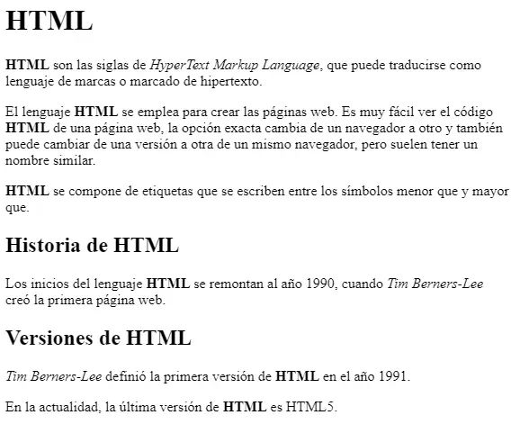

## **Ejercicio 6**

**Página web sobre Tim Berners-Lee**

A partir del texto proporcionado, crea una **página web** que tenga el mismo aspecto que la siguiente imagen:

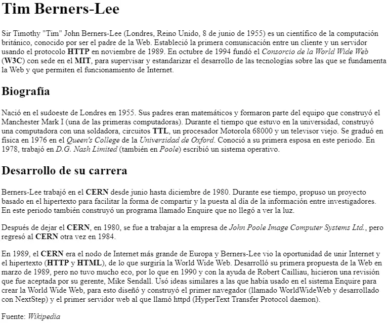

Además, tienes que tener en cuenta los siguientes requisitos:

- El **título** de la página (el que aparece en la pestaña del navegador) debe ser `Tim Berners-Lee`.

- El texto `Tim Berners-Lee` como **encabezado** de nivel 1.

- El texto `Biografía` como **encabezado** de nivel 2.

- Todas las **siglas** (como HTTP, W3C o MIT) deben aparecer como texto **destacado** y, al poner el ratón encima, debe mostrar el **significado de las siglas**.

- Los **nombres** de las instituciones o empresas, como Consorcio de la World Wide Web o Universidad de Oxford, deben aparecer como texto **enfatizado**.

El texto base es el siguiente:

```html
Tim Berners-Lee

Sir Timothy "Tim" John Berners-Lee (Londres, Reino Unido, 8 de junio de 1955) es un
científico de la computación británico, conocido por ser el padre de la Web. Estableció
la primera comunicación entre un cliente y un servidor usando el protocolo HTTP en
noviembre de 1989. En octubre de 1994 fundó el Consorcio de la World Wide Web (W3C) con
sede en el MIT, para supervisar y estandarizar el desarrollo de las tecnologías sobre
las que se fundamenta la Web y que permiten el funcionamiento de Internet.

Biografía

Nació en el sudoeste de Londres en 1955. Sus padres eran matemáticos y formaron parte
del equipo que construyó el Manchester Mark I (una de las primeras computadoras).
Durante el tiempo que estuvo en la universidad, construyó una computadora con una
soldadora, circuitos TTL, un procesador Motorola 68000 y un televisor viejo. Se graduó
en física en 1976 en el Queen's College de la Universidad de Oxford. Conoció a su
primera esposa en este periodo. En 1978, trabajó en D.G. Nash Limited (también en Poole)
escribió un sistema operativo.

Desarrollo de su carrera

Berners-Lee trabajó en el CERN desde junio hasta diciembre de 1980. Durante ese tiempo,
propuso un proyecto basado en el hipertexto para facilitar la forma de compartir y la
puesta al día de la información entre investigadores. En este periodo también construyó
un programa llamado Enquire que no llegó a ver la luz.

Después de dejar el CERN, en 1980, se fue a trabajar a la empresa de John Poole Image
Computer Systems Ltd., pero regresó al CERN otra vez en 1984.

En 1989, el CERN era el nodo de Internet más grande de Europa y Berners-Lee vio la
oportunidad de unir Internet y el hipertexto (HTTP y HTML), de lo que surgiría la World
Wide Web. Desarrolló su primera propuesta de la Web en marzo de 1989, pero no tuvo mucho
eco, por lo que en 1990 y con la ayuda de Robert Cailliau, hicieron una revisión que fue
aceptada por su gerente, Mike Sendall. Usó ideas similares a las que había usado en el
sistema Enquire para crear la World Wide Web, para esto diseñó y construyó el primer
navegador (llamado WorldWideWeb y desarrollado con NextStep) y el primer servidor web
al que llamó httpd (HyperText Transfer Protocol daemon).

Fuente: Wikipedia
```

---

### Actividad Práctica ACT206 — 206

# Actividad 206

> **📌 Entrega**
> 

> - La entrega será un **fichero pdf** que contenga la respuesta a las preguntas de la actividad.

> - El nombre del fichero debe ser `206_NombreApellidos.pdf`.

> - Se deberá entregar en la tarea correspondiente de Aules en tiempo y forma.

> **📌 Se valorará**
> 

> Se valorará:

> - La claridad de la respuesta.

> - La correcta maquetación del documento.

> - Respuesta correcta o aproximación a la misma.

> Esta actividad servirá para calificar:

> - RA2: Utiliza lenguajes de marcas para la transmisión y presentación de información a través de la web analizando la estructura de los documentos e identificando sus elementos.

>   - CA2. c) Se ha reconocido la funcionalidad de las principales etiquetas y atributos del lenguaje HTML. (2%)

## **Ejercicio 1**

**Listas**

Lee los apartados 2.4.2 Listas y 2.4.3 Tablas y crea un documento HTML que incluya:

1. Una lista desordenada con los módulos de 1º de DAW.

1. Una lista ordenada con los mismos módulos comenzando en 1.

1. Una lista ordenada que comience en 4 usando el atributo `start`.

1. Una lista de definiciones con los términos "LLMMSGI" y "Bases de Datos" y sus definiciones.

## **Ejercicio 2**

**Currículum de Bruce Wayne**

Crea una **página web** que tenga el mismo aspecto que la siguiente imagen:

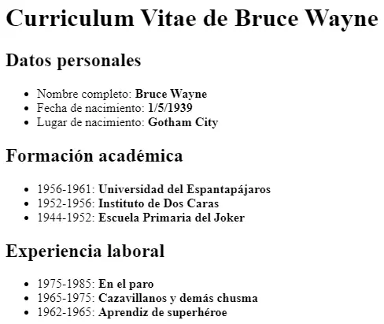

El texto que debe contener es el siguiente:

```html
Datos personales
 Nombre completo: Bruce Wayne
 Fecha de nacimiento: 1/5/1939
 Lugar de nacimiento: Gotham City

Formación académica
 1956-1961: Universidad del Espantapájaros
 1952-1956: Instituto de Dos Caras
 1944-1952: Escuela Primaria del Joker

Experiencia laboral
 1975-1985: En el paro
 1965-1975: Cazavillanos y demás chusma
 1962-1965: Aprendiz de superhéroe
```

## **Ejercicio 3**

**Listas de Internet**

Crea una **página web** que tenga el mismo aspecto que la siguiente imagen:

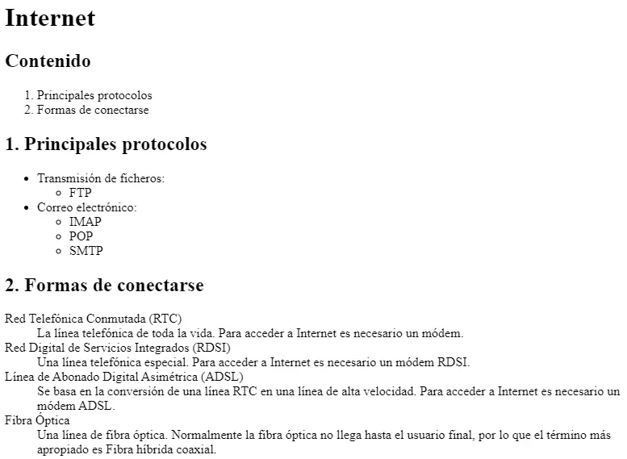

## **Ejercicio 4**

**Tabla de socios**

Crea un documento HTML con una tabla que cumpla lo siguiente:

1. Título con `<caption>`: "Tabla de socios".

1. Cabecera con `<thead>` y celdas `<th>` para "Nombre" y "Apellido".

1. Cuerpo con `<tbody>` y dos filas de socios.

1. Pie con `<tfoot>` mostrando el total.

## **Ejercicio 5**

**Tabla de horario**

Crea una tabla que represente un horario semanal sencillo con las filas "Lunes", "Miércoles" y "Viernes" y las columnas "1.ª hora", "2.ª hora" y "3.ª hora", rellenando las celdas con asignaturas ficticias.

## **Ejercicio 6**

**Colapsar Columnas y Filas**

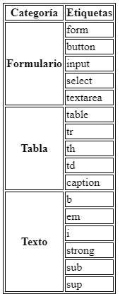

Replica la misma tabla a partir del documento base:

<details markdown="1">

<summary>💡 Html</summary>

```html
<!DOCTYPE html>
<html>
<head>
<title>Tabla compleja</title>
<style>
table, tr, th, td {
  border: 1px solid black;
}
</style>
</head>
<body>
Categoría   Etiquetas

Formulario
form
button
input
select
textarea

Tabla
table
tr
th
td
caption

Texto
b
em
i
strong
sub
sup
</body>
</html>
```

</details>

## **Ejercicio 7**

Crea una página web que tenga el mismo aspecto que la siguiente imagen:

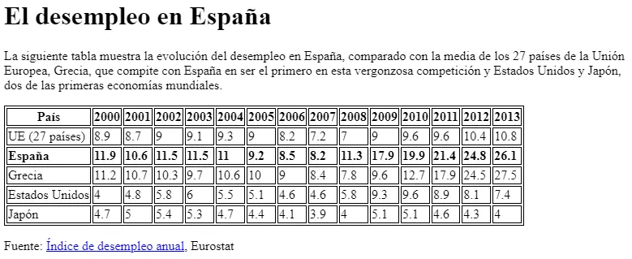

El destino del enlace Índice de desempleo anual es la página web:
[https://ec.europa.eu/eurostat/statistics-explained/index.php?oldid=220991](https://ec.europa.eu/eurostat/statistics-explained/index.php?oldid=220991)

El documento HTML base es el siguiente:

<details markdown="1">

<summary>💡 Html</summary>

```html
<!DOCTYPE html>
<html>
  <head>
    <title>Desempleo</title>
    <style>
    table, tr, th, td {
      border: 1px solid black;
    }
    </style>
  </head>
  <body>

    El desempleo en España

    La siguiente tabla muestra la evolución del desempleo en España, comparado con la
    media de los 27 países de la Unión Europea, Grecia, que compite con España en ser
    el primero en esta vergonzosa competición y Estados Unidos y Japón, dos de las
    primeras economías mundiales.

    País
    2000
    2001
    2002
    2003
    2004
    2005
    2006
    2007
    2008
    2009
    2010
    2011
    2012
    2013

    UE (27 países)
    8.9
    8.7
    9
    9.1
    9.3
    9
    8.2
    7.2
    7
    9
    9.6
    9.6
    10.4
    10.8

    España
    11.9
    10.6
    11.5
    11.5
    11
    9.2
    8.5
    8.2
    11.3
    17.9
    19.9
    21.4
    24.8
    26.1

    Grecia
    11.2
    10.7
    10.3
    9.7
    10.6
    10
    9
    8.4
    7.8
    9.6
    12.7
    17.9
    24.5
    27.5

    Estados Unidos
    4
    4.8
    5.8
    6
    5.5
    5.1
    4.6
    4.6
    5.8
    9.3
    9.6
    8.9
    8.1
    7.4

    Japón
    4.7
    5
    5.4
    5.3
    4.7
    4.4
    4.1
    3.9
    4
    5.1
    5.1
    4.6
    4.3
    4

    Fuente: Índice de desempleo anual, Eurostat

  </body>
</html>
```

</details>

---

### Actividad Práctica ACT207 — 207

# Actividad 207

> **📌 Entrega**
> 

> - La entrega será un **fichero pdf** que contenga la respuesta a las preguntas de la actividad.

> - El nombre del fichero debe ser `207_NombreApellidos.pdf`.

> - Se deberá entregar en la tarea correspondiente de Aules en tiempo y forma.

> **📌 Se valorará**
> 

> Se valorará:

> - La claridad de la respuesta.

> - La correcta maquetación del documento.

> - Respuesta correcta o aproximación a la misma.

> Esta actividad servirá para calificar:

> - RA2: Utiliza lenguajes de marcas para la transmisión y presentación de información a través de la web analizando la estructura de los documentos e identificando sus elementos.

>   - CA2. c) Se ha reconocido la funcionalidad de las principales etiquetas y atributos del lenguaje HTML. (2%)

## **Ejercicio 1**

**Campos básicos**

Lee el apartado 2.4.4 Formularios y crea un formulario que contenga:

1. Un campo de texto con `placeholder` y `required`.

1. Un campo de contraseña.

1. Un campo de correo electrónico con `required`.

1. Un campo numérico con `min="0"`, `max="100"` y `step="10"`.

1. Un botón de envío y uno de anulación.

## **Ejercicio 2**

**GET y POST**

Responde:

1. ¿Qué diferencia hay entre el método `GET` y el método `POST`?

1. ¿Con qué método se ven los valores en la URL?

1. ¿Qué método se debe utilizar para enviar archivos al servidor?

1. Escribe un formulario con `method="POST"` que tenga un campo `name="direccion"` y un botón de envío.

## **Ejercicio 3**

**Lista desplegable**

Crea un formulario con una lista desplegable de sistemas operativos (Linux, Windows, Mac OS, Android, iOS) donde Mac OS aparezca **seleccionado por defecto**, y asóciale un `<label>`.

## **Ejercicio 4**

**Organización con fieldset**

Crea un formulario con un `<fieldset>` y un `<legend>` que agrupe un campo de usuario y un campo de contraseña, cada uno con su `<label>` asociado mediante el atributo `for` y el `id` correspondiente.

## **Ejercicio 5**

**Formulario de registro**

Crea una **página web** que tenga el mismo aspecto que la siguiente imagen:

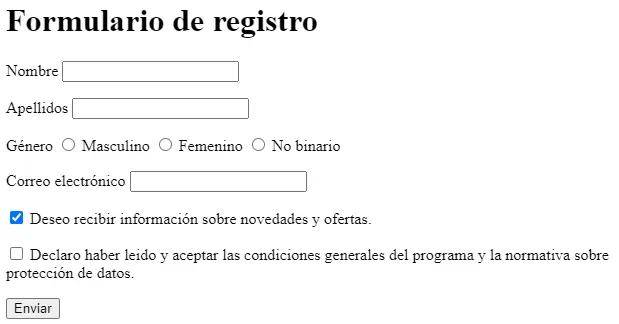

El formulario debe contener los siguientes **campos**:

- Nombre de usuario: control de tipo texto obligatorio.

- Contraseña: control de tipo contraseña obligatorio.

- Correo electrónico: un control de tipo email obligatorio.

- Web personal: control de tipo URL.

- Sexo: control de tipo radio con las opciones hombre y mujer.

- Comentarios: un control de tipo textarea.

Además, tienes que tener en cuenta los siguientes **requisitos**:

- El título de la página debe ser `Formulario de registro`.

- El método de envío del formulario debe ser `GET`.

- El destino del envío del formulario debe ser `registro.php`.

## **Ejercicio 6**

**Matrícula ASIR**

Crea una **página web** que tenga el mismo aspecto que la siguiente imagen:

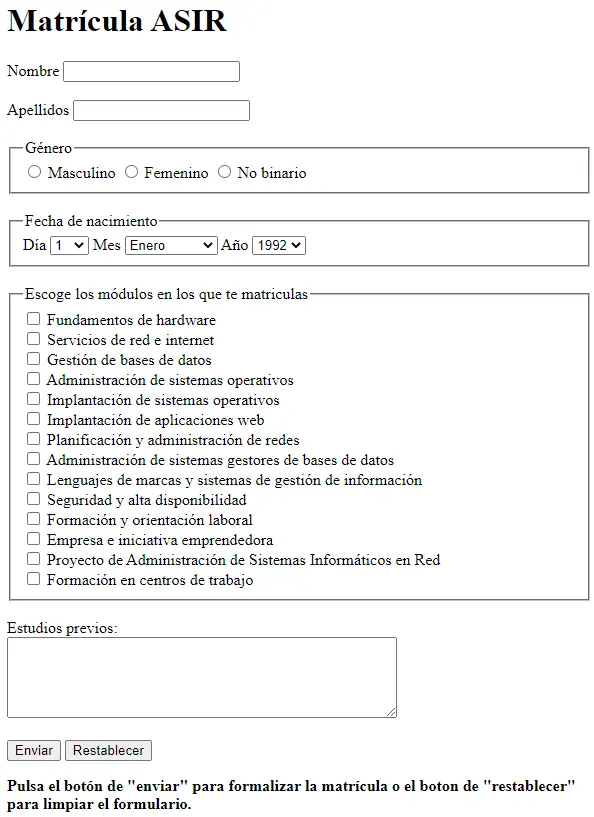

El formulario debe contener los siguientes **campos**:

- Nombre y apellidos: control de tipo texto obligatorio y con autofoco.

- Fecha de nacimiento: control de tipo date.

- Horario: dos opciones, de 8:00 a 14:00 y de 14:00 a 20:00.

- Asignaturas: las opciones de la matrícula son LMSGI, FOL, Sistemas Informáticos, BBDD y Programación.

- Observaciones: un control de tipo textarea.

Además, tienes que tener en cuenta los siguientes **requisitos**:

- El título de la página debe ser `Matrícula ASIR`.

- El método de envío del formulario debe ser `GET`.

- El destino del envío del formulario debe ser `matricula.php`.

- El formulario debe estar organizado con `fieldset` y `legend`.

## **Ejercicio 7**

**Formulario HTML5**

Crea una **página web** que tenga el mismo aspecto que la siguiente imagen:

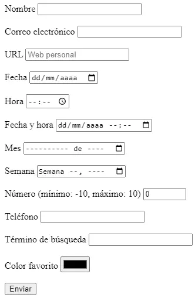

El formulario debe contener los siguientes **campos**:

- Nombre: control de tipo texto obligatorio y con autofoco.

- Correo electrónico: un control de tipo email obligatorio.

- URL: control de tipo URL que muestre la ayuda `Web personal`.

- Fecha: control de tipo date.

- Hora: control de tipo time.

- Fecha y hora: control de tipo datetime.

- Mes: control de tipo month.

- Semana: control de tipo week.

- Número: control de tipo number que limite la entrada a un valor entre `-10` y `10`.

- Teléfono: control de tipo tel.

- Término de búsqueda: control de tipo search.

- Color favorito: control de tipo color.

- Un botón de envío.

Además, tienes que tener en cuenta los siguientes **requisitos**:

- El título de la página debe ser `Formulario HTML5`.

- El método de envío del formulario debe ser `GET`.

- El destino del envío del formulario debe ser `html5.php`.

---

### Actividad Práctica ACT208 — 208

# Actividad 208

> **📌 Entrega**
> 

> - La entrega será un **fichero pdf** que contenga la respuesta a las preguntas de la actividad.

> - El nombre del fichero debe ser `208_NombreApellidos.pdf`.

> - Se deberá entregar en la tarea correspondiente de Aules en tiempo y forma.

> **📌 Se valorará**
> 

> Se valorará:

> - La claridad de la respuesta.

> - La correcta maquetación del documento.

> - Respuesta correcta o aproximación a la misma.

> Esta actividad servirá para calificar:

> - RA2: Utiliza lenguajes de marcas para la transmisión y presentación de información a través de la web analizando la estructura de los documentos e identificando sus elementos.

>   - CA2. c) Se ha reconocido la funcionalidad de las principales etiquetas y atributos del lenguaje HTML. (2%)

## **Ejercicio 1**

**Imágenes**

Lee el apartado 2.4.5 Multimedia e iframe y responde:

1. ¿Qué atributos obligatorios debe tener un elemento ``?

1. ¿Para qué sirve el atributo `alt`?

1. ¿Qué ocurre si no se especifican `height` y `width`?

## **Ejercicio 2**

**Multimedia**

Crea un documento HTML que incluya:

1. Una imagen con `src`, `alt` y un `width` de 300 píxeles.

1. Un elemento `<audio>` con controles.

1. Un elemento `<video>` con controles y un ancho de 500.

1. Un `<object>` que incruste un PDF.

## **Ejercicio 3**

**iframe**

Crea un documento HTML con un `<iframe name="contenido">` que inicialmente cargue la página del instituto, y dos enlaces con `target="contenido"` para cambiar el contenido del iframe a dos páginas diferentes.

---

### Actividad Práctica ACT209 — 209

# Actividad 209

> **📌 Entrega**
> 

> - La entrega será un **fichero pdf** que contenga la respuesta a las preguntas de la actividad.

> - El nombre del fichero debe ser `209_NombreApellidos.pdf`.

> - Se deberá entregar en la tarea correspondiente de Aules en tiempo y forma.

> **📌 Se valorará**
> 

> Se valorará:

> - La claridad de la respuesta.

> - La correcta maquetación del documento.

> - Respuesta correcta o aproximación a la misma.

> Esta actividad servirá para calificar:

> - RA2: Utiliza lenguajes de marcas para la transmisión y presentación de información a través de la web analizando la estructura de los documentos e identificando sus elementos.

>   - CA2. e) Se han utilizado herramientas en la creación de documentos web. (100%)

>   - CA2. h) Se han validado documentos HTML. (2,5%)

## **Ejercicio 1**

**Herramientas**

Lee el apartado 2.5 Herramientas para la creación y edición y responde:

1. ¿Qué diferencia hay entre un editor de texto y un editor visual (WYSIWYG)?

1. ¿Qué es EMMET y cómo funciona?

1. Cita tres editores de texto y tres editores online.

1. ¿Qué pestañas del navegador (devtools) se utilizan para consultar la estructura del documento HTML?

## **Ejercicio 2**

**Validación**

Lee el apartado 2.6 Validación de documentos HTML y responde:

1. ¿Por qué son los navegadores más permisivos con HTML que con otros lenguajes de marcas?

1. Enumera y describe los cinco tipos de problemas que podemos encontrar en el código HTML.

1. ¿Qué validador podemos utilizar para comprobar un documento HTML?

## **Ejercicio 3**

**Validar un documento real**

1. Crea un documento HTML básico con un error de sintaxis (por ejemplo, una etiqueta sin cerrar).

1. Valídalo con el [validador del W3C](https://validator.w3.org/) (opción "Validate by direct input").

1. Corrige los errores que indique el validador y vuelve a validarlo hasta que no aparezcan errores.

1. Documenta en tu cuaderno los errores encontrados y cómo los has corregido.

---

### Actividad Práctica ACT210 — 210

# Actividad 210

> **📌 Entrega**
> 

> - La entrega será un **fichero pdf** que contenga la respuesta a las preguntas de la actividad.

> - El nombre del fichero debe ser `210_NombreApellidos.pdf`.

> - Se deberá entregar en la tarea correspondiente de Aules en tiempo y forma.

> **📌 Se valorará**
> 

> Se valorará:

> - La claridad de la respuesta.

> - La correcta maquetación del documento.

> - Respuesta correcta o aproximación a la misma.

> Esta actividad servirá para calificar:

> - RA2: Utiliza lenguajes de marcas para la transmisión y presentación de información a través de la web analizando la estructura de los documentos e identificando sus elementos.

>   - CA2. i) Se han identificado las tecnologías en las que se basa la sindicación de contenidos. (25%)

>   - CA2. j) Se han reconocido los ámbitos de aplicación de la sindicación de contenidos. (25%)

## **Ejercicio 1**

**Conceptos**

Lee los apartados 2.7.1 Introducción y ventajas y 2.7.2 Estándares y responde:

1. ¿Qué es la redifusión o sindicación de contenidos?

1. ¿Qué es un *feed* o canal de contenidos?

1. ¿Qué es un agregador y para qué se utiliza?

1. ¿En qué lenguaje se suelen codificar las fuentes y mediante qué protocolo se transportan?

1. Cita al menos **tres ventajas** de la sindicación de contenidos.

## **Ejercicio 2**

**Estándares**

1. ¿Qué estándares de sindicación de contenidos conoces?

1. ¿Qué lenguaje utiliza cada uno?

1. ¿Cuál es el estándar más popular y cuál el más moderno?

## **Ejercicio 3**

**Ámbitos de aplicación**

Lee el apartado 2.7.3 Publicación y ámbitos de aplicación y responde:

1. ¿Qué hay que incluir en la cabecera de una página web para que se convierta en suministradora de un canal?

1. ¿Qué atributos cambian si utilizamos Atom en lugar de RSS?

1. Cita al menos **tres ámbitos o tipos de contenido** a los que se puede aplicar la redifusión web.

---

### Actividad Práctica ACT211 — 211

# Actividad 211

> **📌 Entrega**
> 

> - La entrega será un **fichero pdf** que contenga la respuesta a las preguntas de la actividad.

> - El nombre del fichero debe ser `211_NombreApellidos.pdf`.

> - Se deberá entregar en la tarea correspondiente de Aules en tiempo y forma.

> **📌 Se valorará**
> 

> Se valorará:

> - La claridad de la respuesta.

> - La correcta maquetación del documento.

> - Respuesta correcta o aproximación a la misma.

> Esta actividad servirá para calificar:

> - RA2: Utiliza lenguajes de marcas para la transmisión y presentación de información a través de la web analizando la estructura de los documentos e identificando sus elementos.

>   - CA2. i) Se han identificado las tecnologías en las que se basa la sindicación de contenidos. (25%)

>   - CA2. j) Se han reconocido los ámbitos de aplicación de la sindicación de contenidos. (25%)

## **Ejercicio 1**

**Estructura de un documento RSS**

Lee el apartado 2.7.4 Estructura de un documento RSS y responde:

1. ¿Cuáles son los tres elementos básicos que forman parte de un documento RSS?

1. ¿Qué elementos hijos **obligatorios** tiene el canal `<channel>`?

1. ¿Qué elementos hijos **obligatorios** tiene cada sección `<item>`?

1. ¿Qué extensión tiene el fichero de un canal de contenidos?

## **Ejercicio 2**

**Crear un canal RSS**

Crea un canal RSS 2.0 completo para un blog ficticio de tecnología con las siguientes condiciones:

1. Cabecera con codificación UTF-8.

1. Un canal con título, descripción, enlace e idioma `es`.

1. Al menos **dos secciones** (`<item>`), cada una con su título, descripción, enlace y autor.

## **Ejercicio 3**

**Publicar el canal**

1. Añade a una página HTML el enlace al canal RSS que has creado en la actividad anterior.

1. Utiliza un validador de canales (por ejemplo, el de W3C) para comprobar que el canal es válido.

1. Responde: ¿qué opciones suelen ofrecer los validadores cuando el canal es válido?

## **Ejercicio 4**

**Agregadores**

Lee el apartado 2.7.5 Validación y agregadores y responde:

1. ¿Qué es un agregador o lector de fuentes?

1. Cita los tres tipos de agregadores y un ejemplo de cada uno.

1. ¿Qué hay que indicar en el agregador para suscribirse a una fuente?

---

### Actividad Práctica SIMULACRO_EXAMEN — SIMULACRO DE EXAMEN HTML

# SIMULACRO DE EXAMEN HTML

## 1.º Desarrollo de Aplicaciones Web

**Actividad:** Inscripción a las Jornadas Tecnológicas DAW 2026
**Puntuación total:** 10 puntos

## Objetivo

Desarrollar una página web utilizando exclusivamente HTML5 que permita presentar unas jornadas tecnológicas y gestionar la inscripción de sus participantes.

La página deberá incorporar una estructura semántica, elementos de formato de texto, formularios, tablas, contenido multimedia, enlaces y contenido externo.

**No se permite utilizar CSS ni JavaScript.**

## 1. Estructura general (1 punto)

Crea un documento HTML5 con la siguiente estructura semántica:

- `<header>`

- `<main>`

- `<footer>`

En la cabecera debes incluir:

- Un título principal con el texto **«Jornadas Tecnológicas DAW 2026»**.

- Una imagen representativa de HTML5 con un texto alternativo adecuado. Link Imagen

- Un menú de navegación que contenga los siguientes enlaces:

- Presentación (enlace interno al apartado de presentación).

- MDN Web Docs (enlace externo a https://developer.mozilla.org/es/).

- W3Schools (enlace externo a https://www.w3schools.com/).

Uno de los enlaces externos deberá abrirse en una nueva pestaña.

En el pie de página debes incluir tu nombre completo y el siguiente texto:

© 2026 – Jornadas Tecnológicas – Nombre del Alumno – 1.º DAW

<details markdown="1">

<summary>💡 Imatge Referència</summary>

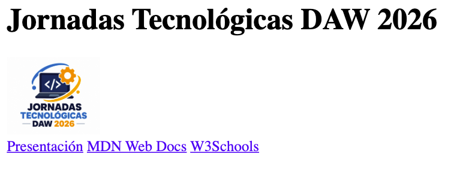

</details>

## 2. Formato de texto (1 punto)

Dentro del elemento principal, crea una sección con el título **«Presentación de las jornadas»**.

En esta sección debes escribir un texto de presentación que incluya obligatoriamente:

1. Un párrafo con una palabra en **negrita**.

1. Una expresión en *cursiva*.

1. Una palabra resaltada con un marcador.

1. Una abreviatura con su significado completo.

1. Una expresión que contenga un superíndice.

1. Una fórmula que contenga un subíndice.

1. Un texto que aparezca tachado.

1. Una cita breve utilizando una etiqueta HTML específica para citas.

Puedes inventar el contenido, siempre que tenga relación con las jornadas tecnológicas.

<details markdown="1">

<summary>💡 Imatge Referència</summary>

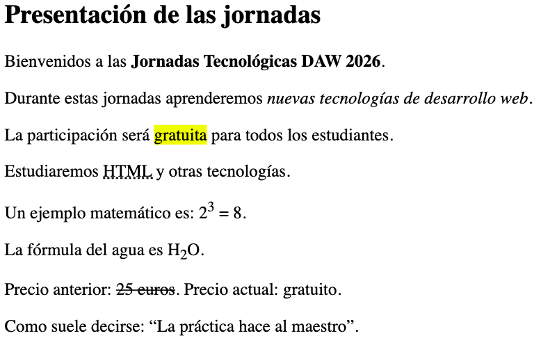

</details>

## 3. Formulario de inscripción (4 puntos)

Crea un formulario de inscripción a las jornadas dentro del elemento principal.

El formulario deberá utilizar el método `post` y organizarse en **cuatro grupos de campos**, cada uno con su correspondiente título.

### A. Información del participante

Incluye los siguientes campos:

- **Nombre completo:** campo de texto obligatorio con un mínimo de 4 caracteres.

- **Correo electrónico:** campo obligatorio con validación de correo.

- **Código de acceso:** campo de contraseña con un mínimo de 8 caracteres.

- **Fecha de inscripción:** selector de fecha.

- **Edad:** campo numérico que permita introducir valores entre 16 y 65.

### B. Intereses tecnológicos

Incluye:

- Un desplegable para seleccionar la especialidad preferida:

- Desarrollo web.

- Ciberseguridad.

- Inteligencia artificial.

- Tres casillas de verificación para indicar las tecnologías conocidas:

- Python.

- PHP.

- JavaScript.

- Botones de selección para elegir la modalidad de asistencia:

- Presencial.

- Online.

- Mixta.

- Un control deslizante para valorar el interés por las jornadas, con valores entre 1 y 10.

### C. Información adicional

Incluye:

- Un campo para adjuntar un documento.

- Un campo para introducir la dirección de un repositorio web personal.

- Un selector para elegir el color identificativo del participante.

- Un área de texto para explicar qué espera aprender durante las jornadas.

### D. Confirmación de inscripción

Incluye:

- Una casilla obligatoria para aceptar las normas de participación.

- Un botón para enviar la inscripción.

- Un botón para borrar todos los datos del formulario.

**Requisitos adicionales:**

- Todos los campos deberán tener una etiqueta descriptiva asociada correctamente.

- Los controles relacionados deberán compartir el mismo nombre cuando corresponda.

<details markdown="1">

<summary>💡 Imatge Referència</summary>

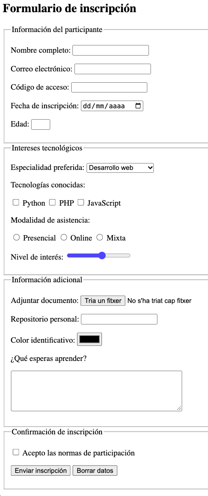

</details>

## 4. Tabla de actividades (2 puntos)

Crea una tabla con borde que muestre el programa de las jornadas.

La tabla deberá incluir:

- Un título descriptivo.

- Un encabezado.

- Un cuerpo.

- Al menos una combinación horizontal de celdas.

- Al menos una combinación vertical de celdas.

La tabla tendrá la siguiente información:

| Horario | Lunes | Martes | Miércoles |
| --- | --- | --- | --- |
| 09:00 - 10:00 | HTML5 | Python | Ciberseguridad |
| 10:00 - 11:00 | CSS3 | PHP | Inteligencia artificial |
| 11:00 - 11:30 | Descanso común para todos los participantes |  |  |
| 11:30 - 12:30 | JavaScript | Bases de datos | Taller de proyectos |
| 12:30 - 13:30 | Taller de proyectos | Bases de datos | Presentación final |

**Condiciones:**

1. El descanso deberá ocupar las tres columnas correspondientes a los días.

1. La actividad «Bases de datos» deberá ocupar verticalmente las dos últimas franjas horarias del martes.

1. Deben utilizarse correctamente las etiquetas de encabezado y de datos.

**Nota:** La tabla anterior representa los datos. En el HTML se deberán aplicar las combinaciones de celdas indicadas.

<details markdown="1">

<summary>💡 Imatge Referència</summary>

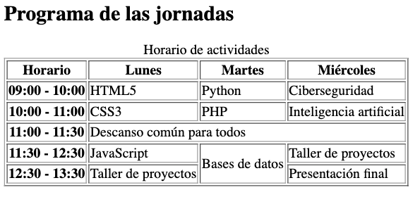

</details>

## 5. Contenido multimedia (1 punto)

Debajo de la tabla, crea una sección titulada **«Material multimedia»**.

Incluye:

- Un reproductor de audio que utilice el archivo `presentacion.mp3`. Link Audio

- Un reproductor de vídeo que utilice el archivo `jornadas.mp4`. Link Video

- El vídeo deberá tener una anchura de **400 píxeles**.

- Ambos reproductores deberán mostrar sus controles de reproducción.

<details markdown="1">

<summary>💡 Imatge Referència</summary>

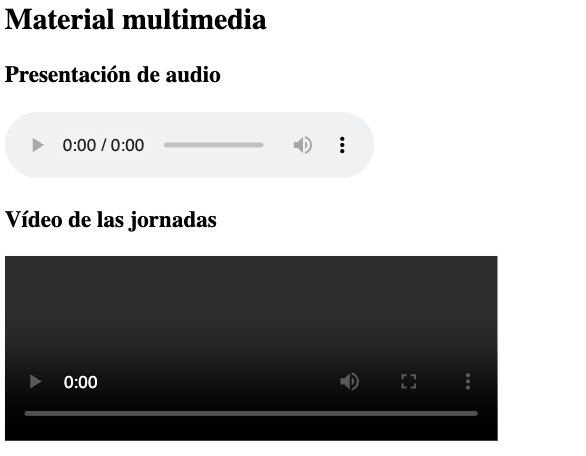

</details>

## 6. Contenido externo (0,5 puntos)

Crea una sección titulada **«Consulta nuestra web»**.

Inserta un elemento que permita visualizar una página web externa dentro de tu documento.

Utiliza la siguiente dirección:

https://www.levante-emv.com/

El elemento deberá tener:

- Una anchura de **600 píxeles**.

- Una altura de **350 píxeles**.

- Un título descriptivo para mejorar la accesibilidad.

<details markdown="1">

<summary>💡 Imatge Referència</summary>

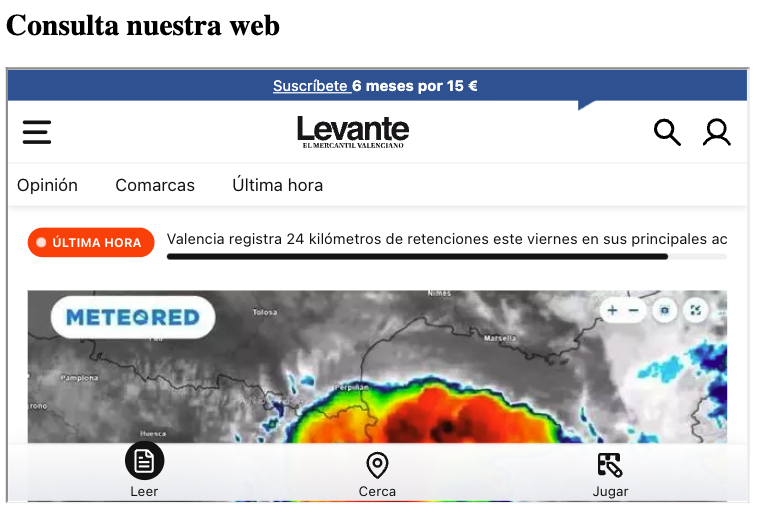

</details>

## 7. Recursos recomendados (0,5 puntos)

Crea un bloque lateral con el título **«Recursos para aprender HTML»**.

Este bloque deberá contener una lista con enlaces a:

- Documentación HTML de MDN: https://developer.mozilla.org/es/docs/Web/HTML

- Tutorial HTML de W3Schools: https://www.w3schools.com/html/

Los enlaces deberán dirigir a sus correspondientes páginas externas.

<details markdown="1">

<summary>💡 Imatge Referència</summary>

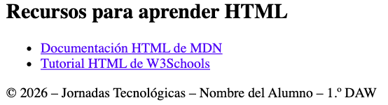

</details>

## Instrucciones de entrega

1. El archivo principal deberá llamarse `index.html`.

1. Utiliza HTML5 y una estructura correctamente anidada.

1. Todas las imágenes deberán incluir texto alternativo.

1. Los campos del formulario deberán tener etiquetas correctamente asociadas.

1. Utiliza las etiquetas semánticas adecuadas.

1. Comprueba el funcionamiento de los enlaces y controles.

1. Entrega el archivo HTML y los recursos locales necesarios.

**Puntuación total: 10 puntos.**

<details markdown="1">

<summary>💡 Text</summary>

TEXTOS PARA EL SIMULACRO DE HTML

Jornadas Tecnológicas DAW 2026

1. Cabecera

Título principal:

Jornadas Tecnológicas DAW 2026

Menú de navegación:

- Presentación

- MDN Web Docs

- 

W3Schools

- 

Presentación de las jornadas

Título de la sección:

Presentación de las jornadas

Párrafo 1:

Bienvenidos a las Jornadas Tecnológicas DAW 2026.

Párrafo 2:

Durante estas jornadas aprenderemos nuevas tecnologías de desarrollo web.

Párrafo 3:

La participación será gratuita para todos los estudiantes.

Párrafo 4:

Estudiaremos HTML y otras tecnologías.

Párrafo 5:

Un ejemplo matemático es: 2³ = 8.

Párrafo 6:

La fórmula del agua es H₂O.

Párrafo 7:

Precio anterior: 25 euros. Precio actual: gratuito.

Párrafo 8:

Como suele decirse: «La práctica hace al maestro».

1. Formulario de inscripción

Título:

Formulario de inscripción

Grupo A: Información del participante

- Nombre completo:

- Correo electrónico:

- Código de acceso:

- Fecha de inscripción:

- Edad:

Grupo B: Intereses tecnológicos

Especialidad preferida:

- Desarrollo web

- Ciberseguridad

- Inteligencia artificial

Tecnologías conocidas:

- Python

- PHP

- JavaScript

Modalidad de asistencia:

- Presencial

- Online

- Mixta

Nivel de interés:

Grupo C: Información adicional

- Adjuntar documento:

- Repositorio personal:

- Color identificativo:

- ¿Qué esperas aprender?

Grupo D: Confirmación de inscripción

- Acepto las normas de participación.

- Enviar inscripción

- 

Borrar datos

- 

Programa de las jornadas

Título de la sección:

Programa de las jornadas

Título de la tabla:

Horario de actividades

Horario Lunes   Martes  Miércoles
09:00 - 10:00   HTML5   Python  Ciberseguridad
10:00 - 11:00   CSS3    PHP Inteligencia artificial
11:00 - 11:30   Descanso común para todos   Descanso común para todos   Descanso común para todos
11:30 - 12:30   JavaScript  Bases de datos  Taller de proyectos
12:30 - 13:30   Taller de proyectos Bases de datos  Presentación final

1. Material multimedia

Título de la sección:

Material multimedia

Subtítulos:

- Presentación de audio

- Vídeo de las jornadas

Archivos:

- presentacion.mp3

- 

jornadas.mp4

- 

Contenido externo

Título de la sección:

Consulta nuestra web

Título del contenido externo:

Página web del IES Mestre Ramon Esteve

Dirección:

https://portal.edu.gva.es/iesmestreramonesteve/

1. Recursos recomendados

Título:

Recursos para aprender HTML

Enlaces:

- Documentación HTML de MDN

- 

Tutorial HTML de W3Schools

- 

Pie de página

© 2026 – Jornadas Tecnológicas – Nombre del Alumno – 1.º DAW

</details>

<details markdown="1">

<summary>💡 Solució</summary>

```html
<!DOCTYPE html>
    <html lang="es">
    <head>
        <meta charset="UTF-8">
        <meta name="viewport" content="width=device-width, initial-scale=1.0">
        <title>Jornadas Tecnológicas DAW 2026</title>
    </head>
    <body>
        <!-- 1. ESTRUCTURA GENERAL -->
        <header>
            <h1>Jornadas Tecnológicas DAW 2026</h1>
            
            <nav>
                <a href="#presentacion">Presentación</a>
                <a href="https://developer.mozilla.org/es/" target="_blank">MDN Web Docs</a>
                <a href="https://www.w3schools.com/">W3Schools</a>
            </nav>
        </header>
        <main>
            <!-- 2. FORMATO DE TEXTO -->
            <section id="presentacion">
                <h2>Presentación de las jornadas</h2>
                <p>Bienvenidos a las <strong>Jornadas Tecnológicas DAW 2026</strong>.</p>
                <p>Durante estas jornadas aprenderemos <em>nuevas tecnologías de desarrollo web</em>.</p>
                <p>La participación será <mark>gratuita</mark> para todos los estudiantes.</p>
                <p>Estudiaremos <abbr title="HyperText Markup Language">HTML</abbr> y otras tecnologías.</p>
                <p>Un ejemplo matemático es: 2<sup>3</sup> = 8.</p>
                <p>La fórmula del agua es H<sub>2</sub>O.</p>
                <p>Precio anterior: <del>25 euros</del>. Precio actual: gratuito.</p>
                <p>Como suele decirse:<q>La práctica hace al maestro</q>.</p>
            </section>
            <!-- 3. FORMULARIO -->
            <section>
                <h2>Formulario de inscripción</h2>
                <form action="#" method="post">
                    <!-- A. DATOS PERSONALES -->
                    <fieldset>
                        <legend>Información del participante</legend>
                        <p>
                            <label for="nombre">Nombre completo:</label>
                            <input type="text" id="nombre" name="nombre" minlength="4" required>
                        </p>
                        <p>
                            <label for="correo">Correo electrónico:</label>
                            <input type="email" id="correo" name="correo" required>
                        </p>
                        <p>
                            <label for="codigo">Código de acceso:</label>
                            <input type="password" id="codigo" name="codigo" minlength="8">
                        </p>
                        <p>
                            <label for="fecha">Fecha de inscripción:</label>
                            <input type="date" id="fecha" name="fecha">
                        </p>
                        <p>
                            <label for="edad">Edad:</label>
                            <input type="number" id="edad" name="edad" min="16" max="65">
                        </p>
                    </fieldset>
                    <!-- B. INTERESES -->
                    <fieldset>
                        <legend>Intereses tecnológicos</legend>
                        <p>
                            <label for="especialidad">
                                Especialidad preferida:
                            </label>
                            <select id="especialidad" name="especialidad">
                                <option value="web">Desarrollo web</option>
                                <option value="seguridad">Ciberseguridad</option>
                                <option value="ia">Inteligencia artificial</option>
                            </select>
                        </p>
                        <p>Tecnologías conocidas:</p>
                        <p>
                            <input type="checkbox" id="python" name="tecnologias" value="python">
                            <label for="python">Python</label>
                            <input type="checkbox" id="php" name="tecnologias" value="php">
                            <label for="php">PHP</label>
                            <input type="checkbox" id="javascript" name="tecnologias" value="javascript">
                            <label for="javascript">JavaScript</label>
                        </p>
                        <p>Modalidad de asistencia:</p>
                        <p>
                            <input type="radio" id="presencial" name="modalidad" value="presencial">
                            <label for="presencial">Presencial</label>
                            <input type="radio" id="online" name="modalidad" value="online">
                            <label for="online">Online</label>
                            <input type="radio" id="mixta" name="modalidad" value="mixta">
                            <label for="mixta">Mixta</label>
                        </p>
                        <p>
                            <label for="interes">Nivel de interés:</label>
                            <input type="range" id="interes" name="interes" min="1" max="10">
                        </p>
                    </fieldset>
                    <!-- C. INFORMACIÓN ADICIONAL -->
                    <fieldset>
                        <legend>Información adicional</legend>
                        <p>
                            <label for="documento">Adjuntar documento:</label>
                            <input type="file" id="documento" name="documento">
                        </p>
                        <p>
                            <label for="repositorio">Repositorio personal:</label>
                            <input type="url" id="repositorio" name="repositorio">
                        </p>
                        <p>
                            <label for="color">Color identificativo:</label>
                            <input type="color" id="color" name="color">
                        </p>
                        <p>
                            <label for="comentarios">¿Qué esperas aprender?</label>
                        </p>
                        <p>
                            <textarea id="comentarios" name="comentarios" rows="5" cols="40"></textarea>
                        </p>
                    </fieldset>
                    <!-- D. CONFIRMACIÓN -->
                    <fieldset>
                        <legend>Confirmación de inscripción</legend>
                        <p>
                            <input type="checkbox" id="condiciones" name="condiciones" required>
                            <label for="condiciones">Acepto las normas de participación</label>
                        </p>
                        <p>
                            <button type="submit">
                                Enviar inscripción
                            </button>
                            <button type="reset">
                                Borrar datos
                            </button>
                        </p>
                    </fieldset>
                </form>
            </section>
            <!-- 4. TABLA -->
            <section>
                <h2>Programa de las jornadas</h2>
                <table border="1">
                    <caption>
                        Horario de actividades
                    </caption>
                    <thead>
                        <tr>
                            <th scope="col">Horario</th>
                            <th scope="col">Lunes</th>
                            <th scope="col">Martes</th>
                            <th scope="col">Miércoles</th>
                        </tr>
                    </thead>
                    <tbody>
                        <tr>
                            <th scope="row">09:00 - 10:00</th>
                            <td>HTML5</td>
                            <td>Python</td>
                            <td>Ciberseguridad</td>
                        </tr>
                        <tr>
                            <th scope="row">10:00 - 11:00</th>
                            <td>CSS3</td>
                            <td>PHP</td>
                            <td>Inteligencia artificial</td>
                        </tr>
                        <tr>
                            <th scope="row">11:00 - 11:30</th>
                            <td colspan="3">
                                Descanso común para todos
                            </td>
                        </tr>
                        <tr>
                            <th scope="row">11:30 - 12:30</th>
                            <td>JavaScript</td>
                            <td rowspan="2">
                                Bases de datos
                            </td>
                            <td>Taller de proyectos</td>
                        </tr>
                        <tr>
                            <th scope="row">12:30 - 13:30</th>
                            <td>Taller de proyectos</td>
                            <td>Presentación final</td>
                        </tr>
                    </tbody>
                </table>
            </section>
            <!-- 5. MULTIMEDIA -->
            <section>
                <h2>Material multimedia</h2>
                <h3>Presentación de audio</h3>
                <audio controls>
                    <source src="presentacion.mp3"
                            type="audio/mpeg">
                    Tu navegador no soporta audio HTML5.
                </audio>
                <h3>Vídeo de las jornadas</h3>
                <video width="400" controls>
                    <source src="jornadas.mp4"
                            type="video/mp4">
                    Tu navegador no soporta vídeo HTML5.
                </video>
            </section>
            <!-- 6. IFRAME -->
            <section>
                <h2>Consulta nuestra web</h2>
                <iframe
                    src="https://www.levante-emv.com/"
                    width="600"
                    height="350"
                    title="Página web del Levanete EMV">
                </iframe>
            </section>
            <!-- 7. ASIDE -->
            <aside>
                <h2>Recursos para aprender HTML</h2>
                <ul>
                    <li>
                        <a href="https://developer.mozilla.org/es/docs/Web/HTML">Documentación HTML de MDN</a>
                    </li>
                    <li>
                        <a href="https://www.w3schools.com/html/">Tutorial HTML de W3Schools</a>
                    </li>
                </ul>
            </aside>
        </main>
        <!-- PIE DE PÁGINA -->
        <footer>
            <p>© 2026 – Jornadas Tecnológicas – Nombre del Alumno – 1.º DAW</p>
        </footer>
    </body>
    </html>
```

> **📌 CodeSandbox**
> 

> [Simulacro HTML](https://codesandbox.io/p/sandbox/z4qx36)

</details>
