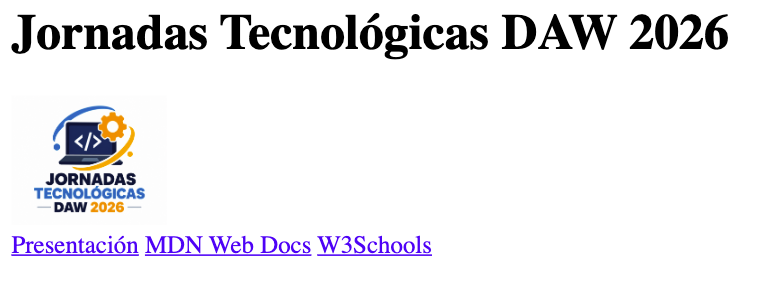
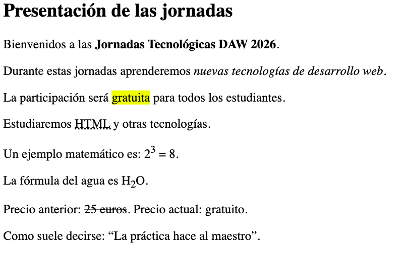
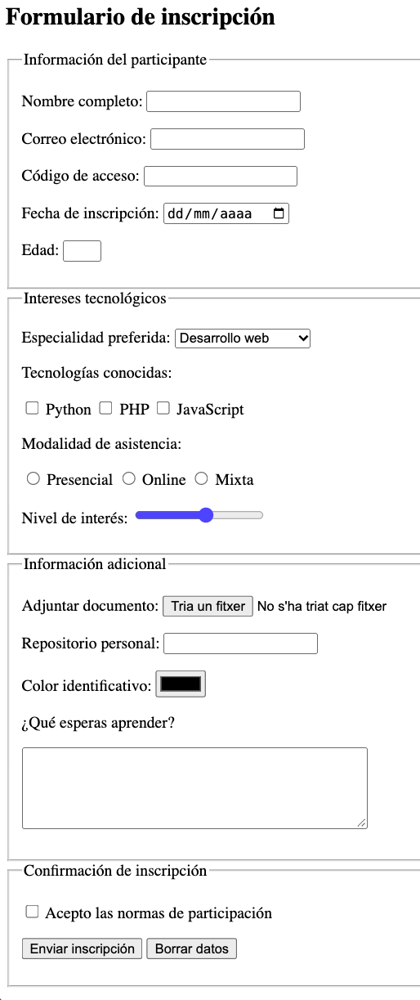
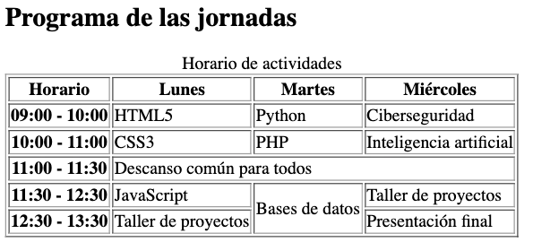
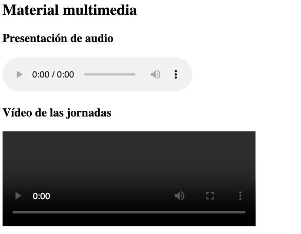
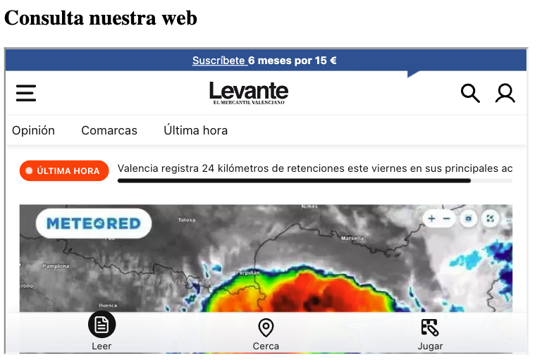
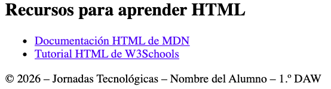

# SIMULACRO DE EXAMEN HTML

<div class="interactive-progress-tracker">
  <div class="tracker-header">
    <span>🏆 <strong>Progrés d'aquesta secció:</strong> <span class="tracker-count">0 de 4 superats (0%)</span></span>
    <span class="tracker-pts">⭐ <strong>0 punts</strong></span>
  </div>
  <div class="tracker-bar">
    <div class="tracker-fill" style="width: 0%;"></div>
  </div>
</div>

## 1.º Desenvolupament de Aplicacions Web

**Activitat:** Inscripció a les Jornades Tecnològiques DAW 2026
**Puntuació total:** 10 punts

## Objectiu

Desenvolupar una pàgina web utilitzant exclusivament HTML5 que permeta presentar unes jornades tecnològiques i gestionar la inscripció dels seus participantes.

La pàgina haurà d'incorporar una estructura semàntica, elements de format de text, formularis, taules, contingut multimèdia, enllaços i contingut extern.

**No es permet utilitzar CSS ni JavaScript.**

## 1. Estructura general (1 punt)

Crea un document HTML5 amb la següent estructura semàntica:

- `<header>`

- `<main>`

- `<footer>`

En la capçalera has d'incloure:

- Un títol principal amb el text **«Jornades Tecnològiques DAW 2026»**.

- Una imatge representativa de HTML5 amb un text alternatiu adequat. Link Imatge

- Un menú de navegació que continga els següents enllaços:

- Presentació (enllaç intern a l'apartat de presentació).

- MDN Web Docs (enllaç extern a https://developer.mozilla.org/es/).

- W3Schools (enllaç extern a https://www.w3schools.com/).

Un dels enllaços externs haurà d'abrir-se en una nova pestanya.

En el peu de pàgina has d'incloure el teu nom complet i el següent text:

© 2026 – Jornades Tecnològiques – Nom del Alumne – 1.º DAW

<details markdown="1">

<summary>💡 Imatge Referència</summary>



</details>

## 2. Format de text (1 punt)

Dins de l'element principal, crea una secció amb el títol **«Presentació de les jornades»**.

En aquesta secció has d'escriure un text de presentació que incloga obligatòriament:

1. Un paràgraf amb una paraula en **negreta**.

1. Una expressió en *cursiva*.

1. Una paraula resaltada amb un marcador.

1. Una abreviatura amb el seu significat complet.

1. Una expressió que continga un superíndice.

1. Una fórmula que continga un subíndice.

1. Un text que aparega tachado.

1. Una cita breve utilitzant una etiqueta HTML específica per a citas.

Pots inventar el contingut, sempre que tinga relació amb les jornades tecnològiques.

<details markdown="1">

<summary>💡 Imatge Referència</summary>



</details>

## 3. Formulari d'inscripció (4 punts)

Crea un formulari d'inscripció a les jornades dins de l'element principal.

El formulari haurà d'utilitzar el mètode `post` i organizar-se en **quatre grups de camps**, cada un amb el seu corresponent títol.

### A. Informació del participante

Inclou els següents camps:

- **Nom complet:** camp de text obligatori amb un mínim de 4 caràcters.

- **Correu electrònic:** camp obligatori amb validació de correu.

- **Codi d'accés:** camp de contrasenya amb un mínim de 8 caràcters.

- **Data d'inscripció:** selector de data.

- **Edat:** camp numèric que permeta introduir valors entre 16 i 65.

### B. Intereses tecnològics

Inclou:

- Un desplegable per a seleccionar l'especialitat preferida:

- Desenvolupament web.

- Ciberseguritat.

- Intel·ligència artificial.

- Tres caselles de verificació per a indicar les tecnologies conegudes:

- Python.

- PHP.

- JavaScript.

- Botons de selecció per a triar la modalitat d'asistencia:

- Presencial.

- Online.

- Mixta.

- Un control deslizante per a valorar l'interès per les jornades, amb valors entre 1 i 10.

### C. Informació addicional

Inclou:

- Un camp per a adjuntar un document.

- Un camp per a introduir l'adreça d'un repositorio web personal.

- Un selector per a triar el color identificatiu del participante.

- Un àrea de text per a explicar què espera aprendre durant les jornades.

### D. Confirmació d'inscripció

Inclou:

- Una casella obligatòria per a acceptar les normes de participació.

- Un botó per a enviar la inscripció.

- Un botó per a esborrar totes les dades del formulari.

**Requisits addicionals:**

- Tots els camps hauran de tindre una etiqueta descriptiva associada correctament.

- Els controls relacionats hauran de compartir el mateix nom quan corresponda.

<details markdown="1">

<summary>💡 Imatge Referència</summary>



</details>

## 4. Taula d'activitats (2 punts)

Crea una taula amb vora que mostre el programa de les jornades.

La taula haurà d'incloure:

- Un títol descriptivo.

- Un encapçalament.

- Un cos.

- Almenys una combinació horitzontal de cel·les.

- Almenys una combinació vertical de cel·les.

La taula tindrà la següent informació:

| Horari | Dilluns | Dimarts | Dimecres |
| --- | --- | --- | --- |
| 09:00 - 10:00 | HTML5 | Python | Ciberseguritat |
| 10:00 - 11:00 | CSS3 | PHP | Intel·ligència artificial |
| 11:00 - 11:30 | Descanso comú per a tots els participantes |  |  |
| 11:30 - 12:30 | JavaScript | Bases de dades | Taller de projectes |
| 12:30 - 13:30 | Taller de projectes | Bases de dades | Presentació final |

**Condicions:**

1. El descanso haurà d'ocupar les tres columnes corresponents als dies.

1. L'activitat «Bases de dades» haurà d'ocupar verticalment les dos últimes franjas horarias del dimarts.

1. Han d'utilitzar-se correctament les etiquetes d'encapçalament i de dades.

**Nota:** La taula anterior representa les dades. En el HTML es hauran d'aplicar les combinacions de cel·les indicades.

<details markdown="1">

<summary>💡 Imatge Referència</summary>



</details>

## 5. Contingut multimèdia (1 punt)

Davall de la taula, crea una secció titulada **«Material multimèdia»**.

Inclou:

- Un reproductor d'àudio que utilitze l'arxiu `presentacion.mp3`. Link Àudio

- Un reproductor de vídeo que utilitze l'arxiu `jornadas.mp4`. Link Video

- El vídeo haurà de tindre una amplària de **400 píxels**.

- Tots dos reproductors hauran de mostrar els seus controls de reproducció.

<details markdown="1">

<summary>💡 Imatge Referència</summary>



</details>

## 6. Contingut extern (0,5 punts)

Crea una secció titulada **«Consulta la nostra web»**.

Insereix un element que permeta visualitzar una pàgina web externa dins del teu document.

Utilitza la següent adreça:

https://www.levante-emv.com/

L'element haurà de tindre:

- Una amplària de **600 píxels**.

- Una alçària de **350 píxels**.

- Un títol descriptivo per a millorar l'accessibilitat.

<details markdown="1">

<summary>💡 Imatge Referència</summary>



</details>

## 7. Recursos recomendats (0,5 punts)

Crea un bloc lateral amb el títol **«Recursos per a aprendre HTML»**.

Aquest bloc haurà de contindre una llista amb enllaços a:

- Documentació HTML de MDN: https://developer.mozilla.org/es/docs/Web/HTML

- Tutorial HTML de W3Schools: https://www.w3schools.com/html/

Els enllaços hauran de dirigir als seus corresponents pàgines externes.

<details markdown="1">

<summary>💡 Imatge Referència</summary>



</details>

## Instruccions de lliurament

1. L'arxiu principal haurà de llamar-se `index.html`.

1. Utilitza HTML5 i una estructura correctament imbricada.

1. Totes les imatges hauran d'incloure text alternatiu.

1. Els camps del formulari hauran de tindre etiquetes correctament associades.

1. Utilitza les etiquetes semàntiques adequades.

1. Comprova el funcionament dels enllaços i controls.

1. Lliurament l'arxiu HTML i els recursos locals necessaris.

**Puntuació total: 10 punts.**

<details markdown="1">

<summary>💡 Text</summary>

TEXTOS PER AL SIMULACRO DE HTML

Jornades Tecnològiques DAW 2026

1. Capçalera

Títol principal:

Jornades Tecnològiques DAW 2026

Menú de navegació:

- Presentació

- MDN Web Docs

- 

W3Schools

- 

Presentació de les jornades

Títol de la secció:

Presentació de les jornades

Paràgraf 1:

Bienvenits a les Jornades Tecnològiques DAW 2026.

Paràgraf 2:

Durant aquestes jornades aprendrem noves tecnologies de desenvolupament web.

Paràgraf 3:

La participació serà gratuïta per a tots els estudiants.

Paràgraf 4:

Estudiarem HTML i altres tecnologies.

Paràgraf 5:

Un exemple matemátic és: 2³ = 8.

Paràgraf 6:

La fórmula de l'agua és H₂O.

Paràgraf 7:

Preu anterior: 25 euros. Preu actual: gratuït.

Paràgraf 8:

Com sol decir-se: «La pràctica fa al maestro».

1. Formulari d'inscripció

Títol:

Formulari d'inscripció

Grup A: Informació del participante

- Nom complet:

- Correu electrònic:

- Codi d'accés:

- Data d'inscripció:

- Edat:

Grup B: Intereses tecnològics

Especialitat preferida:

- Desenvolupament web

- Ciberseguritat

- Intel·ligència artificial

Tecnologies conegudes:

- Python

- PHP

- JavaScript

Modalitat d'asistencia:

- Presencial

- Online

- Mixta

Nivell d'interès:

Grup C: Informació addicional

- Adjuntar document:

- Repositorio personal:

- Color identificatiu:

- Què esperas aprendre?

Grup D: Confirmació d'inscripció

- Acepto les normes de participació.

- Enviar inscripció

- 

Esborrar dades

- 

Programa de les jornades

Títol de la secció:

Programa de les jornades

Títol de la taula:

Horari d'activitats

Horari Dilluns   Dimarts  Dimecres
09:00 - 10:00   HTML5   Python  Ciberseguritat
10:00 - 11:00   CSS3    PHP Intel·ligència artificial
11:00 - 11:30   Descanso comú per a tots   Descanso comú per a tots   Descanso comú per a tots
11:30 - 12:30   JavaScript  Bases de dades  Taller de projectes
12:30 - 13:30   Taller de projectes Bases de dades  Presentació final

1. Material multimèdia

Títol de la secció:

Material multimèdia

Subtítulos:

- Presentació d'àudio

- Vídeo de les jornades

Arxius:

- presentacion.mp3

- 

jornades.mp4

- 

Contingut extern

Títol de la secció:

Consulta la nostra web

Títol del contingut extern:

Pàgina web del IES Mestre Ramon Esteve

Adreça:

https://portal.edu.gva.es/iesmestreramonesteve/

1. Recursos recomendats

Títol:

Recursos per a aprendre HTML

Enllaços:

- Documentació HTML de MDN

- 

Tutorial HTML de W3Schools

- 

Peu de pàgina

© 2026 – Jornades Tecnològiques – Nom del Alumne – 1.º DAW

</details>

<details markdown="1">

<summary>💡 Solució</summary>

```html
<!DOCTYPE html>
    <html lang="es">
    <head>
        <meta charset="UTF-8">
        <meta name="viewport" content="width=device-width, initial-scale=1.0">
        <title>Jornadas Tecnológicas DAW 2026</title>
    </head>
    <body>
        <!-- 1. ESTRUCTURA GENERAL -->
        <header>
            <h1>Jornadas Tecnológicas DAW 2026</h1>
            
            <nav>
                <a href="#presentacion">Presentación</a>
                <a href="https://developer.mozilla.org/es/" target="_blank">MDN Web Docs</a>
                <a href="https://www.w3schools.com/">W3Schools</a>
            </nav>
        </header>
        <main>
            <!-- 2. FORMATO DE TEXTO -->
            <section id="presentacion">
                <h2>Presentación de las jornadas</h2>
                <p>Bienvenidos a las <strong>Jornadas Tecnológicas DAW 2026</strong>.</p>
                <p>Durante estas jornadas aprenderemos <em>nuevas tecnologías de desarrollo web</em>.</p>
                <p>La participación será <mark>gratuita</mark> para todos los estudiantes.</p>
                <p>Estudiaremos <abbr title="HyperText Markup Language">HTML</abbr> y otras tecnologías.</p>
                <p>Un ejemplo matemático es: 2<sup>3</sup> = 8.</p>
                <p>La fórmula del agua es H<sub>2</sub>O.</p>
                <p>Precio anterior: <del>25 euros</del>. Precio actual: gratuito.</p>
                <p>Como suele decirse:<q>La práctica hace al maestro</q>.</p>
            </section>
            <!-- 3. FORMULARIO -->
            <section>
                <h2>Formulario de inscripción</h2>
                <form action="#" method="post">
                    <!-- A. DATOS PERSONALES -->
                    <fieldset>
                        <legend>Información del participante</legend>
                        <p>
                            <label for="nombre">Nombre completo:</label>
                            <input type="text" id="nombre" name="nombre" minlength="4" required>
                        </p>
                        <p>
                            <label for="correo">Correo electrónico:</label>
                            <input type="email" id="correo" name="correo" required>
                        </p>
                        <p>
                            <label for="codigo">Código de acceso:</label>
                            <input type="password" id="codigo" name="codigo" minlength="8">
                        </p>
                        <p>
                            <label for="fecha">Fecha de inscripción:</label>
                            <input type="date" id="fecha" name="fecha">
                        </p>
                        <p>
                            <label for="edad">Edad:</label>
                            <input type="number" id="edad" name="edad" min="16" max="65">
                        </p>
                    </fieldset>
                    <!-- B. INTERESES -->
                    <fieldset>
                        <legend>Intereses tecnológicos</legend>
                        <p>
                            <label for="especialidad">
                                Especialidad preferida:
                            </label>
                            <select id="especialidad" name="especialidad">
                                <option value="web">Desarrollo web</option>
                                <option value="seguridad">Ciberseguridad</option>
                                <option value="ia">Inteligencia artificial</option>
                            </select>
                        </p>
                        <p>Tecnologías conocidas:</p>
                        <p>
                            <input type="checkbox" id="python" name="tecnologias" value="python">
                            <label for="python">Python</label>
                            <input type="checkbox" id="php" name="tecnologias" value="php">
                            <label for="php">PHP</label>
                            <input type="checkbox" id="javascript" name="tecnologias" value="javascript">
                            <label for="javascript">JavaScript</label>
                        </p>
                        <p>Modalidad de asistencia:</p>
                        <p>
                            <input type="radio" id="presencial" name="modalidad" value="presencial">
                            <label for="presencial">Presencial</label>
                            <input type="radio" id="online" name="modalidad" value="online">
                            <label for="online">Online</label>
                            <input type="radio" id="mixta" name="modalidad" value="mixta">
                            <label for="mixta">Mixta</label>
                        </p>
                        <p>
                            <label for="interes">Nivel de interés:</label>
                            <input type="range" id="interes" name="interes" min="1" max="10">
                        </p>
                    </fieldset>
                    <!-- C. INFORMACIÓN ADICIONAL -->
                    <fieldset>
                        <legend>Información adicional</legend>
                        <p>
                            <label for="documento">Adjuntar documento:</label>
                            <input type="file" id="documento" name="documento">
                        </p>
                        <p>
                            <label for="repositorio">Repositorio personal:</label>
                            <input type="url" id="repositorio" name="repositorio">
                        </p>
                        <p>
                            <label for="color">Color identificativo:</label>
                            <input type="color" id="color" name="color">
                        </p>
                        <p>
                            <label for="comentarios">¿Qué esperas aprender?</label>
                        </p>
                        <p>
                            <textarea id="comentarios" name="comentarios" rows="5" cols="40"></textarea>
                        </p>
                    </fieldset>
                    <!-- D. CONFIRMACIÓN -->
                    <fieldset>
                        <legend>Confirmación de inscripción</legend>
                        <p>
                            <input type="checkbox" id="condiciones" name="condiciones" required>
                            <label for="condiciones">Acepto las normas de participación</label>
                        </p>
                        <p>
                            <button type="submit">
                                Enviar inscripción
                            </button>
                            <button type="reset">
                                Borrar datos
                            </button>
                        </p>
                    </fieldset>
                </form>
            </section>
            <!-- 4. TABLA -->
            <section>
                <h2>Programa de las jornadas</h2>
                <table border="1">
                    <caption>
                        Horario de actividades
                    </caption>
                    <thead>
                        <tr>
                            <th scope="col">Horario</th>
                            <th scope="col">Lunes</th>
                            <th scope="col">Martes</th>
                            <th scope="col">Miércoles</th>
                        </tr>
                    </thead>
                    <tbody>
                        <tr>
                            <th scope="row">09:00 - 10:00</th>
                            <td>HTML5</td>
                            <td>Python</td>
                            <td>Ciberseguridad</td>
                        </tr>
                        <tr>
                            <th scope="row">10:00 - 11:00</th>
                            <td>CSS3</td>
                            <td>PHP</td>
                            <td>Inteligencia artificial</td>
                        </tr>
                        <tr>
                            <th scope="row">11:00 - 11:30</th>
                            <td colspan="3">
                                Descanso común para todos
                            </td>
                        </tr>
                        <tr>
                            <th scope="row">11:30 - 12:30</th>
                            <td>JavaScript</td>
                            <td rowspan="2">
                                Bases de datos
                            </td>
                            <td>Taller de proyectos</td>
                        </tr>
                        <tr>
                            <th scope="row">12:30 - 13:30</th>
                            <td>Taller de proyectos</td>
                            <td>Presentación final</td>
                        </tr>
                    </tbody>
                </table>
            </section>
            <!-- 5. MULTIMEDIA -->
            <section>
                <h2>Material multimedia</h2>
                <h3>Presentación de audio</h3>
                <audio controls>
                    <source src="presentacion.mp3"
                            type="audio/mpeg">
                    Tu navegador no soporta audio HTML5.
                </audio>
                <h3>Vídeo de las jornadas</h3>
                <video width="400" controls>
                    <source src="jornadas.mp4"
                            type="video/mp4">
                    Tu navegador no soporta vídeo HTML5.
                </video>
            </section>
            <!-- 6. IFRAME -->
            <section>
                <h2>Consulta nuestra web</h2>
                <iframe
                    src="https://www.levante-emv.com/"
                    width="600"
                    height="350"
                    title="Página web del Levanete EMV">
                </iframe>
            </section>
            <!-- 7. ASIDE -->
            <aside>
                <h2>Recursos para aprender HTML</h2>
                <ul>
                    <li>
                        <a href="https://developer.mozilla.org/es/docs/Web/HTML">Documentación HTML de MDN</a>
                    </li>
                    <li>
                        <a href="https://www.w3schools.com/html/">Tutorial HTML de W3Schools</a>
                    </li>
                </ul>
            </aside>
        </main>
        <!-- PIE DE PÁGINA -->
        <footer>
            <p>© 2026 – Jornadas Tecnológicas – Nombre del Alumno – 1.º DAW</p>
        </footer>
    </body>
    </html>
```

> **📌 CodeSandbox**
> 

> [Simulacro HTML](https://codesandbox.io/p/sandbox/z4qx36)

</details>


---

## 🎮 Reptes Interactius d'Autoavaluació (+100 XP)

Comprova el teu domini sobre **Simulacre d'Examen — SIMULACRO DE EXAMEN HTML** superant aquests 4 reptes gamificats (+25 punts cadascun):

<div class="interactive-mcq" data-answer="B" data-hint="L'element semàntic <nav> representa una secció amb enllaços de navegació principal.">
  <div class="mcq-question">🎯 <strong>Repte 1 (+25 pts):</strong> Quina etiqueta semàntica d'HTML5 és la més adequada per a encapsular el bloc de navegació principal d'un lloc web?</div>
  <div class="mcq-options">
    <button type="button" class="btn-mcq-opt" data-opt="A">A) &lt;div class='menu'&gt;</button>
    <button type="button" class="btn-mcq-opt" data-opt="B">B) &lt;nav&gt;</button>
    <button type="button" class="btn-mcq-opt" data-opt="C">C) &lt;aside&gt;</button>
    <button type="button" class="btn-mcq-opt" data-opt="D">D) &lt;footer&gt;</button>
  </div>
  <div class="quiz-feedback"></div>
</div>

<div class="interactive-mcq" data-answer="B" data-hint="L'atribut 'method' indica el verb HTTP (GET o POST), mentre que 'action' indica l'URL de destinació.">
  <div class="mcq-question">🎯 <strong>Repte 2 (+25 pts):</strong> En un formulari HTML5, quin atribut de l'etiqueta <code>&lt;form&gt;</code> defineix com s'envien les dades al servidor (<code>GET</code> o <code>POST</code>)?</div>
  <div class="mcq-options">
    <button type="button" class="btn-mcq-opt" data-opt="A">A) action</button>
    <button type="button" class="btn-mcq-opt" data-opt="B">B) method</button>
    <button type="button" class="btn-mcq-opt" data-opt="C">C) target</button>
    <button type="button" class="btn-mcq-opt" data-opt="D">D) enctype</button>
  </div>
  <div class="quiz-feedback"></div>
</div>

<div class="interactive-vf" data-answer="V" data-hint="L'atribut 'alt' aporta el text alternatiu descriptiu exigit per les pautes d'accessibilitat WCAG.">
  <div class="vf-statement">✅ <strong>Repte 3 (Vertader o Fals · +25 pts):</strong> En una imatge HTML (<code>&lt;img&gt;</code>), l'atribut <code>alt</code> és fonamental per a l'accessibilitat web (lectors de pantalla) i es mostra si la imatge no es pot carregar.</div>
  <div class="vf-buttons">
    <button type="button" class="btn-vf" data-opt="V">Vertader (V)</button>
    <button type="button" class="btn-vf" data-opt="F">Fals (F)</button>
  </div>
  <div class="quiz-feedback" style="width: 100%;"></div>
</div>

<div class="interactive-quiz" data-answer="tr|<tr>" data-hint="És l'etiqueta <tr> (Table Row).">
  <div class="quiz-question">⌨️ <strong>Repte 4 (+25 pts):</strong> Quina etiqueta HTML s'utilitza per a definir cada fila horitzontal dins d'una taula (<code>&lt;table&gt;</code>)?</div>
  <div class="quiz-controls">
    <input type="text" class="quiz-input" placeholder="Escriu la resposta..." />
    <button type="button" class="btn-quiz-check">Comprovar</button>
  </div>
  <div class="quiz-feedback"></div>
</div>

### 📋 Llista de Comprovació i Rúbrica d'Assoliment

Marca cada criteri a mesura que completes l'estudi o la resolució pràctica d'aquesta pàgina (**Simulacre d'Examen — SIMULACRO DE EXAMEN HTML**):

- [ ] He llegit detingudament la teoria o l'enunciat d'aquesta secció i he anotat els conceptes clau.
- [ ] He revisat els esquemes, taules o blocs de codi i he verificat que sé aplicar-los a l'entorn de treball.
- [ ] He resolt correctament els **4 reptes interactius** superiors obtenint els **100 punts XP**.
- [ ] He descarregat el comprovant oficial en PDF per a adjuntar-lo a la tasca d'**Aules**.

<div class="aules-delivery-card">
  <h3>📤 Comprovant de Lliurament per a Aules</h3>
  <p>Quan hages completat els reptes interactius i la llista d'autoavaluació d'aquesta pàgina, introdueix el teu nom i descarrega el teu certificat oficial en PDF per a adjuntar-lo a la tasca d'<strong>Aules</strong>.</p>
  <div class="aules-student-field">
    <label for="aules-student-name">👤 Nom i Cognoms de l'Alumne/a:</label>
    <input type="text" id="aules-student-name" class="aules-student-name" placeholder="Ex: Joan Garcia Pérez" />
  </div>
  <div class="aules-score-badge">
    <span class="aules-score-count">0/4 reptes completats (0%) · 0 punts · 0/4 criteris d'autoavaluació</span>
  </div>
  <div class="aules-actions">
    <button type="button" class="btn-aules-dl" data-module="LMSGI" data-unit="UD02" data-activity="simulacre_examen">📥 Descarregar Comprovant PDF</button>
    <button type="button" class="btn-aules-copy">📋 Copiar Resum al Porta-retalls</button>
  </div>
  <div class="aules-toast"></div>
</div>
