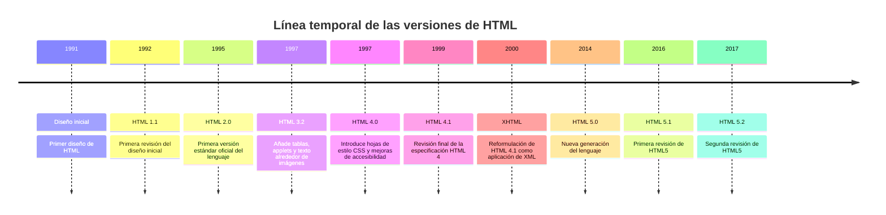

# **Versions de HTML**

  

    🏆 <strong>Progrés d'aquesta secció:</strong> 0 de 4 superats (0%)
    ⭐ <strong>0 punts</strong>
  

  

    

  

Al llarg dels anys es van ser publicant diferents versions de l'estàndard HTML:

## **HTML5**

[**HTML5**](https://es.wikipedia.org/wiki/HTML5) és la versió més avançada i la que es considera **estàndard actual**, encara que ha anat evolucionant per diferents especificacions (HTML 5.1, HTML 5.2 i HTML 5.3). El seu lanzament inicial va ser el **28 d'octubre de 2014**, però és una versió viva en la que es segueix treballant. Pots trobar les especificacions de la última versió de HTML en la web del [**WHATWG**](https://whatwg.org/).

Les principals característiques de HTML5 són:

- **Nous elements i atributs** que reflejan usos típics de components en els llocs web moderns.

- **Elements amb significat semàntic**: les noves etiquetes permeten descriure quin és el significat de l'element. Per exemple, `<header>` s'utilitza per a capçaleres de webs i `<footer>` per a pies de pàgina.

- **Noves funcionalitats (HTML5 APIs)**, com emmagatzematge *offline* d'informació, funcionalitat *Drag&Drop*, ús de la geolocalizació, etc.

- **Desacopla el contingut de la presentació**: els estils es defineixen en les fulls d'estil **CSS**. El HTML s'encarrega de la informació que es vol mostrar, la seua estructura i la seua semàntica. Queden obsoletos elements i atributs com ``, `
`, `align`, etc.

> **📌 HTML5 és una versió viva**
> 

> HTML5 no és una versió tancada: des de 2014 es segueix treballant en ella. Les especificacions de la última versió es consulten en la web del [WHATWG](https://whatwg.org/).

---

## 🎮 Reptes Interactius d'Autoavaluació (+100 XP)

Comprova el teu domini sobre **2.1.2 Versions de HTML** superant aquests 4 reptes gamificats (+25 punts cadascun):

  
🎯 <strong>Repte 1 (+25 pts):</strong> En una taula HTML, quin atribut permet fusionar diverses columnes en una mateixa cel·la horitzontalment?

  

    <button type="button" class="btn-mcq-opt" data-opt="A">A) rowspan</button>
    <button type="button" class="btn-mcq-opt" data-opt="B">B) colspan</button>
    <button type="button" class="btn-mcq-opt" data-opt="C">C) cellpadding</button>
    <button type="button" class="btn-mcq-opt" data-opt="D">D) border</button>
  

  

  
🎯 <strong>Repte 2 (+25 pts):</strong> Quin atribut d'un camp <code>&lt;input&gt;</code> d'HTML5 impedeix que el formulari s'envie si l'usuari el deixa buit?

  

    <button type="button" class="btn-mcq-opt" data-opt="A">A) readonly</button>
    <button type="button" class="btn-mcq-opt" data-opt="B">B) required</button>
    <button type="button" class="btn-mcq-opt" data-opt="C">C) placeholder</button>
    <button type="button" class="btn-mcq-opt" data-opt="D">D) disabled</button>
  

  

.">
  
✅ <strong>Repte 3 (Vertader o Fals · +25 pts):</strong> L'etiqueta <code>&lt;head&gt;</code> d'un document HTML conté les metadades (<code>&lt;meta&gt;</code>, <code>&lt;title&gt;</code>, <code>&lt;link&gt;</code>) que no es renderitzen directament com a contingut visible de la pàgina.

  

    <button type="button" class="btn-vf" data-opt="V">Vertader (V)</button>
    <button type="button" class="btn-vf" data-opt="F">Fals (F)</button>
  

  

" data-hint="És l'etiqueta <a> (anchor).">
  
⌨️ <strong>Repte 4 (+25 pts):</strong> Quina etiqueta HTML s'utilitza per a crear un hipervincle o enllaç mitjançant l'atribut <code>href</code>?

  

    <input type="text" class="quiz-input" placeholder="Escriu la resposta..." />
    <button type="button" class="btn-quiz-check">Comprovar</button>
  

  

### 📋 Llista de Comprovació i Rúbrica d'Assoliment

Marca cada criteri a mesura que completes l'estudi o la resolució pràctica d'aquesta pàgina (**2.1.2 Versions de HTML**):

- [ ] He llegit detingudament la teoria o l'enunciat d'aquesta secció i he anotat els conceptes clau.
- [ ] He revisat els esquemes, taules o blocs de codi i he verificat que sé aplicar-los a l'entorn de treball.
- [ ] He resolt correctament els **4 reptes interactius** superiors obtenint els **100 punts XP**.
- [ ] He descarregat el comprovant oficial en PDF per a adjuntar-lo a la tasca d'**Aules**.

  <h3>📤 Comprovant de Lliurament per a Aules</h3>
  
Quan hages completat els reptes interactius i la llista d'autoavaluació d'aquesta pàgina, introdueix el teu nom i descarrega el teu certificat oficial en PDF per a adjuntar-lo a la tasca d'<strong>Aules</strong>.

  

    <label for="aules-student-name">👤 Nom i Cognoms de l'Alumne/a:</label>
    <input type="text" id="aules-student-name" class="aules-student-name" placeholder="Ex: Joan Garcia Pérez" />
  

  

    0/4 reptes completats (0%) · 0 punts · 0/4 criteris d'autoavaluació
  

  

    <button type="button" class="btn-aules-dl" data-module="LMSGI" data-unit="UD02" data-activity="ut0212">📥 Descarregar Comprovant PDF</button>
    <button type="button" class="btn-aules-copy">📋 Copiar Resum al Porta-retalls</button>
  

  

