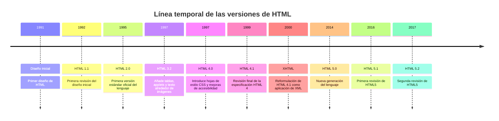

# **Versiones de HTML**

A lo largo de los años se fueron publicando diferentes versiones del estándar HTML:

## **HTML5**

[**HTML5**](https://es.wikipedia.org/wiki/HTML5) es la versión más avanzada y la que se considera **estándar actual**, aunque ha ido evolucionando por diferentes especificaciones (HTML 5.1, HTML 5.2 y HTML 5.3). Su lanzamiento inicial fue el **28 de octubre de 2014**, pero es una versión viva en la que se sigue trabajando. Puedes encontrar las especificaciones de la última versión de HTML en la web del [**WHATWG**](https://whatwg.org/).

Las principales características de HTML5 son:

- **Nuevos elementos y atributos** que reflejan usos típicos de componentes en los sitios web modernos.

- **Elementos con significado semántico**: las nuevas etiquetas permiten describir cuál es el significado del elemento. Por ejemplo, `<header>` se utiliza para cabeceras de webs y `<footer>` para pies de página.

- **Nuevas funcionalidades (HTML5 APIs)**, como almacenamiento *offline* de información, funcionalidad *Drag&Drop*, uso de la geolocalización, etc.

- **Desacopla el contenido de la presentación**: los estilos se definen en las hojas de estilo **CSS**. El HTML se encarga de la información que se quiere mostrar, su estructura y su semántica. Quedan obsoletos elementos y atributos como ``, `
`, `align`, etc.

> **📌 HTML5 es una versión viva**
> 

> HTML5 no es una versión cerrada: desde 2014 se sigue trabajando en ella. Las especificaciones de la última versión se consultan en la web del [WHATWG](https://whatwg.org/).
