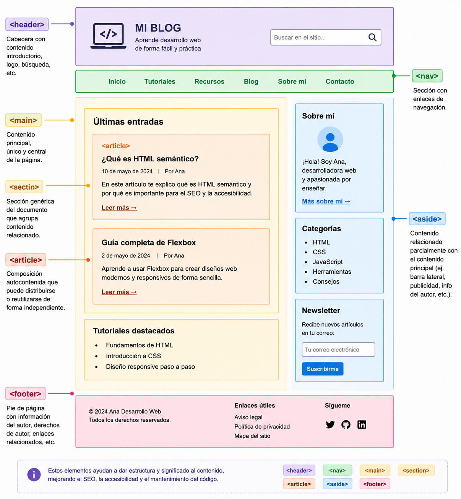

# **Secciones**

## **Elemento `<div>`**

El elemento `<div>` se usa para **marcar divisiones** y agrupar otros elementos en secciones, tanto para organizar el contenido como para posicionarlo mediante hojas de estilo CSS.

```html
<div>
  <div>Sección 1</div>
  <div>Sección 2</div>
</div>
```

## **Etiquetas semánticas**

En HTML5 aparecieron varias **etiquetas semánticas** para estructurar el contenido de la página y, por tanto, sólo se debería usar `<div>` cuando no haya una etiqueta más apropiada.

> **📌 ¿`<div>` o etiqueta semántica?**
> 

> En HTML5, usa `<div>` únicamente cuando no exista una etiqueta semántica más adecuada. Las etiquetas semánticas mejoran la **accesibilidad** y el **posicionamiento SEO**.

> **📌 Estructura semántica HTML5**
> 

```html
<!DOCTYPE html>
<html>
  <head>
    <meta charset="UTF-8" />
    <title>HTML5</title>
  </head>
  <body>
    <header>
      <nav></nav>
    </header>
    <main>
      <section>
        <article></article>
      </section>
      <aside></aside>
    </main>
    <footer></footer>
  </body>
</html>
```

Las principales etiquetas semánticas son:

- 

**`<header>`**: contiene la cabecera con contenido introductorio para la sección de la página en la que aparece. Representa un grupo de ayudas introductorias o de navegación. Puede contener elementos de encabezado (`<h1>`...`<h6>`), un logo, un formulario de búsqueda, etc.

- 

**`<nav>`**: representa una sección de una página cuyo propósito es proporcionar **enlaces de navegación**, ya sea dentro del documento actual o a otros documentos. Ejemplos comunes son menús, tablas de contenido e índices.

- 

**`<main>`**: representa el **contenido principal** del documento, único y central para esa página.

- 

**`<section>`**: representa una **sección genérica** de un documento. Sirve para determinar qué contenido corresponde a qué parte de un esquema. No se debe usar como un mero contenedor genérico (para eso existe `<div>`).

- 

**`<article>`**: representa una **composición autocontenida** que se destina a distribuir de forma independiente o reutilizable. Puede ser un mensaje de foro, un artículo de una revista, una entrada de blog, un comentario de usuario, etc.

- 

**`<aside>`**: se utiliza para contenido **parcialmente relacionado** con el contenido principal. Se representa a menudo como barras laterales o inserciones: definiciones de glosario, publicidad, biografía del autor, etc. No tiene por qué mostrarse en un lateral.

- 

**`<footer>`**: representa un **pie de página** para el contenido de sección más cercano o el elemento raíz de sección. Típicamente contiene información del autor, datos de derechos de autor o enlaces a documentos relacionados. No tiene por qué mostrarse al final.



> **📌 Probar en el navegador**
> 

> [Ejemplo en web de las partes de una web](https://codesandbox.io/p/sandbox/hzcfqw)
