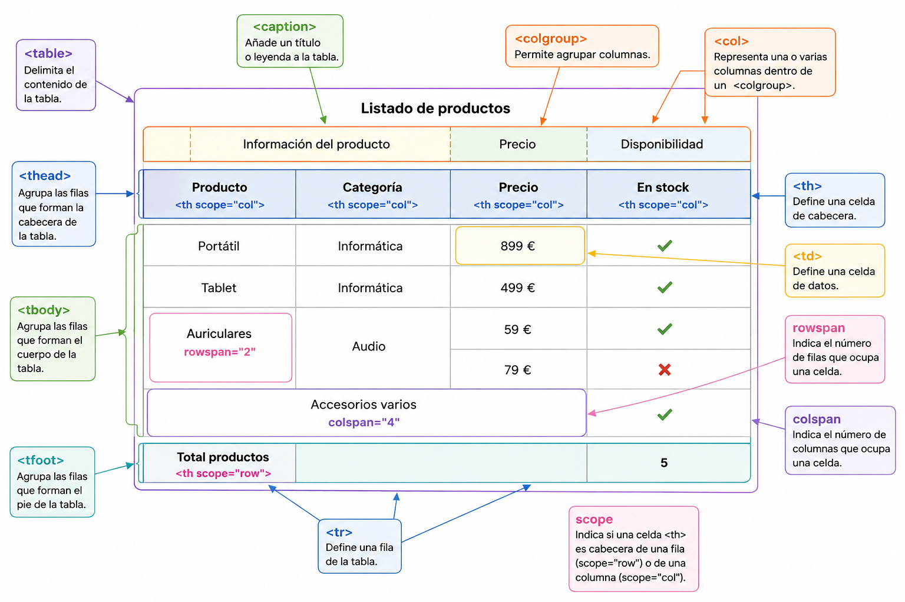

# **Tablas**

Las tablas sirven para mostrar una serie de **datos (columnas)** comunes para varios elementos (filas). Algunos ejemplos son: un horario, una tabla comparativa de varios productos, un registro de temperaturas, etc.

Los elementos para definir una tabla son los siguientes (no es necesario usar todos):

| Elemento | Descripción |
| --- | --- |
| `<table>` | Delimita el contenido de una tabla. |
| `<tr>` | Delimita cada una de las líneas de la tabla. |
| `<td>` | Delimita el contenido de cada celda de la tabla. |
| `<colgroup>` | Permite agrupar columnas. |
| `<tbody>` | Permite agrupar líneas de la tabla. |
| `<thead>` | Define la línea cabecera de la tabla. |
| `<th>` | Delimita cada una de las celdas de la cabecera. |
| `<tfoot>` | Define la fila pie de la tabla. |
| `<caption>` | Para añadir una leyenda a la tabla. |

## **Características de una tabla en HTML**

- El elemento `<table>` contiene al resto de elementos.

- Las tablas están formadas por **filas** (`<tr>`) y éstas, a su vez, por **celdas**. Una fila se divide en columnas.

- Las celdas pueden ser de **datos** (elemento `<td>`) o de **cabecera** (elemento `<th>`).

- Por cada fila de la tabla habrá un elemento `<tr>`. Este elemento contiene una serie de elementos `<td>` o `<th>` (uno por columna).

- Si la tabla tiene cabecera, las celdas de la primera fila son elementos `<th>`. El resto de filas, `<td>`.

> **📌 Tablas para datos, no para maquetar**
> 

> Las tablas deben utilizarse para mostrar **datos**, nunca para maquetar la página. Para la disposición del contenido se usan las etiquetas semánticas y CSS.



<details markdown="1">

<summary>💡 **Exemple complet**</summary>

**HTML**Resultado

```html
<!DOCTYPE html>
<html>
<head>
  <meta charset="UTF-8">
  <title>Ejemplo completo de tabla HTML</title>
</head>
<body>
  <table>
    <!-- Título o leyenda de la tabla -->
    <caption>Listado de productos</caption>
    <!-- Agrupación de columnas -->
    <colgroup>
      <col class="producto">
      <col class="categoria">
      <col class="precio">
      <col class="stock">
    </colgroup>
    <!-- Cabecera -->
    <thead>
      <tr>
        <th scope="col">Producto</th>
        <th scope="col">Categoría</th>
        <th scope="col">Precio</th>
        <th scope="col">En stock</th>
      </tr>
    </thead>
    <!-- Cuerpo -->
    <tbody>
      <tr>
        <td>Portátil</td>
        <td>Informática</td>
        <td>899 €</td>
        <td>Sí</td>
      </tr>
      <tr>
        <td>Tablet</td>
        <td>Informática</td>
        <td>499 €</td>
        <td>Sí</td>
      </tr>
      <tr>
        <!-- Esta celda ocupa dos filas -->
        <td rowspan="2">Auriculares</td>
        <!-- Esta celda también ocupa dos filas -->
        <td rowspan="2">Audio</td>
        <td>59 €</td>
        <td>Sí</td>
      </tr>
      <tr>
        <td>79 €</td>
        <td>No</td>
      </tr>
      <tr>
        <!-- Esta celda ocupa las cuatro columnas -->
        <td colspan="4">
          Accesorios varios
        </td>
      </tr>
    </tbody>
    <!-- Pie -->
    <tfoot>
      <tr>
        <th scope="row">Total productos</th>
        <!-- Ocupa dos columnas -->
        <td colspan="2"></td>
        <td>5</td>
      </tr>
    </tfoot>
  </table>
</body>
</html>
```

  
  Ejemplo completo de tabla HTML

  

| Producto | Categoría | Precio | En stock |
| --- | --- | --- | --- |
| Portátil | Informática | 899 € | Sí |
| Tablet | Informática | 499 € | Sí |
| Auriculares | Audio | 59 € | Sí |
| 79 € | No |  |  |
| Accesorios varios |  |  |  |
| Total productos |  | 5 |  |

> **📌 Probar en el navegador**
> 

> [En este link podrás practicar sobre el ejemplo](https://codesandbox.io/p/sandbox/lvc6yn)

</details>
