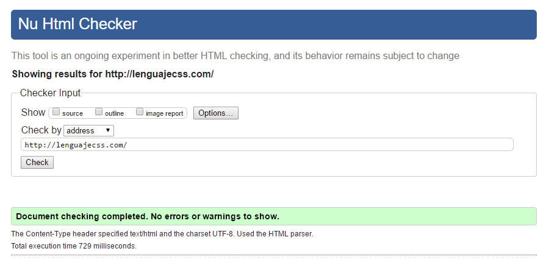

# **Validació de documents HTML**

  

    🏆 <strong>Progrés d'aquesta secció:</strong> 0 de 4 superats (0%)
    ⭐ <strong>0 punts</strong>
  

  

    

  

## **Per què necessitem validar-lo?**

En els llenguatges de marques com HTML, els navegadors són més **permisivos**: en el cas de trobar un error, intentan «deducir» el que realment es quería indicar i continúan amb la carrega del document. D'aquesta forma tenim un mètode més flexible a errors, però també és un arma de doble filo on podem experimentar problemes derivats.

> **📌 Que es vea no significa que siga correcte**
> 

> Que el navegador mostre la pàgina no garanteix que el codi siga correcte. Per això és important **validar** sempre els documents.

## **Tipus de problemes**

En el nostre codi HTML podem tindre diversos tipus de problemes:

| Tipus d'error | Descripció |
| --- | --- |
| **Sintaxi** | El codi està malament escrit i és incorrecte. El navegador podria no mostrar correctament certs detalls. |
| **Accessibilitat** | El codi no té per què estar malament escrit o ser incorrecte; no obstant això, té problemes que harán que no es vea bé en determinats dispositius o que un usuari invidente o similar no puga utilitzar-la. |
| **Posicionament (SEO)** | El codi no té per què estar malament escrit o ser incorrecte; no obstant això, els buscadors com Google no aceptarán favorablement la pàgina i podria tindre un rendiment menor de posicionament SEO. |
| **Rendiment** | El codi no té per què estar malament escrit o ser incorrecte; no obstant això, el navegador pot ser lent a l'hora de cargar-lo o tardar en realitzar les seues tasques. |
| **Usabilitat** | El codi no té per què estar malament escrit o ser incorrecte; no obstant això, la forma en la que es disposen els elements o està pensat pot frustrar a l'usuari final que utilitza la web. |

Els errors dels que anem a parlar en aquest article, pertanyen al primer apartat. És important tindre en compte que no tindre errors del primer tipus no implica que no els haja dels següents apartats, encara tenint el nostre codi HTML 100% correcte.

## **Validar errors de sintaxi HTML**

Per a asegurarnos de que el nostre codi està correctament escrit, podem utilitzar un **Validador HTML**, que no és més que un sistema que analitza el nostre codi i ens diu el número d'errors que tenim, al costat d'una breve descripció del mateix per a facilitar la seua correcció.

Aquest procés de validació es pot realitzar mitjançant l'eina oficial [HTML Validator de W3C](https://validator.w3.org/), un validador de codi HTML5, on podem validar la nostra pàgina de **tres formes diferents**:

- **By URI**: Indicant la URL de la pàgina que es vol validar. Obviament, la pàgina ha d'estar publicada en Internet.

- **By File upload**: Seleccionant l'arxiu `.html` a analitzar i subiéndolo al validador.

- **By Direct Input**: Pegant directament el codi HTML que es vol analitzar en una casella de text.

A més, si ens fijamos en la part superior de l'eina de validació, veurem que hi ha tres caselles disponibles per a marcar, amb les que podem agregar noves característiques que es mostraran després de la validació. Aquestes característiques són les següents:

- **Source**: Ens mostra el codi font, numerado per línies. Útil per a corregir problemes sobre la marxa o comprovar els errors en les línies especificades.

- **Outline**: Ens mostra una espècie d'arbre o esquema de la pàgina.

- **Image report**: Genera un informe de les imatges del lloc web, amb una miniatura i les seues característiques associades.
És una molt bona pràctica acostumbrar-se a utilitzar el validador per a crear codi HTML de qualitat i sense errors, ja que si tenim documents sense errors de validació, és molt més probable que es vean correctament en qualsevol tipus de dispositiu.

## **Altres vías de validació**

Existeixen altres mecanismes de validació al marge d'aquesta eina oficial de W3C. Amb ells encontrarás formes alternatives per a validar els teus documents des de Visual Studio Code, des d'una terminal de text o des de scripts de NodeJS:

| Eina | Descripció |
| --- | --- |
| [W3C Validation](https://marketplace.visualstudio.com/items?itemName=Umoxfo.vscode-w3cvalidation) | Extensió de VSCode per a validar documents mitjançant el Nu HTML Validator. |
| [W3C Web Validator](https://marketplace.visualstudio.com/items?itemName=CelianRiboulet.webvalidator) | Extensió de VSCode per a validar problemes en el teu codi HTML. |
| [HTML W3C Validator](https://github.com/theoludwig/html-w3c-validator) | Paquet de NPM per a validar des d'una terminal. |
| [HTML Validate](https://gitlab.com/html-validate/html-validate) | Paquet de NPM per a validar offline una pàgina HTML. |
| [W3C Link Validator](https://github.com/99x/w3c-link-validator) | Paquet de NPM per a validar HTML o cercar links rotos des de terminal. |
| [HTMLHint](https://htmlhint.com/) | Eina d'anàlisi estàtic de codi HTML. |

---

## 🎮 Reptes Interactius d'Autoavaluació (+100 XP)

Comprova el teu domini sobre **2.6 Validació de documents HTML** superant aquests 4 reptes gamificats (+25 punts cadascun):

 representa una secció amb enllaços de navegació principal.">
  
🎯 <strong>Repte 1 (+25 pts):</strong> Quina etiqueta semàntica d'HTML5 és la més adequada per a encapsular el bloc de navegació principal d'un lloc web?

  

    <button type="button" class="btn-mcq-opt" data-opt="A">A) &lt;div class='menu'&gt;</button>
    <button type="button" class="btn-mcq-opt" data-opt="B">B) &lt;nav&gt;</button>
    <button type="button" class="btn-mcq-opt" data-opt="C">C) &lt;aside&gt;</button>
    <button type="button" class="btn-mcq-opt" data-opt="D">D) &lt;footer&gt;</button>
  

  

  
🎯 <strong>Repte 2 (+25 pts):</strong> En un formulari HTML5, quin atribut de l'etiqueta <code>&lt;form&gt;</code> defineix com s'envien les dades al servidor (<code>GET</code> o <code>POST</code>)?

  

    <button type="button" class="btn-mcq-opt" data-opt="A">A) action</button>
    <button type="button" class="btn-mcq-opt" data-opt="B">B) method</button>
    <button type="button" class="btn-mcq-opt" data-opt="C">C) target</button>
    <button type="button" class="btn-mcq-opt" data-opt="D">D) enctype</button>
  

  

  
✅ <strong>Repte 3 (Vertader o Fals · +25 pts):</strong> En una imatge HTML (<code>&lt;img&gt;</code>), l'atribut <code>alt</code> és fonamental per a l'accessibilitat web (lectors de pantalla) i es mostra si la imatge no es pot carregar.

  

    <button type="button" class="btn-vf" data-opt="V">Vertader (V)</button>
    <button type="button" class="btn-vf" data-opt="F">Fals (F)</button>
  

  

" data-hint="És l'etiqueta <tr> (Table Row).">
  
⌨️ <strong>Repte 4 (+25 pts):</strong> Quina etiqueta HTML s'utilitza per a definir cada fila horitzontal dins d'una taula (<code>&lt;table&gt;</code>)?

  

    <input type="text" class="quiz-input" placeholder="Escriu la resposta..." />
    <button type="button" class="btn-quiz-check">Comprovar</button>
  

  

### 📋 Llista de Comprovació i Rúbrica d'Assoliment

Marca cada criteri a mesura que completes l'estudi o la resolució pràctica d'aquesta pàgina (**2.6 Validació de documents HTML**):

- [ ] He llegit detingudament la teoria o l'enunciat d'aquesta secció i he anotat els conceptes clau.
- [ ] He revisat els esquemes, taules o blocs de codi i he verificat que sé aplicar-los a l'entorn de treball.
- [ ] He resolt correctament els **4 reptes interactius** superiors obtenint els **100 punts XP**.
- [ ] He descarregat el comprovant oficial en PDF per a adjuntar-lo a la tasca d'**Aules**.

  <h3>📤 Comprovant de Lliurament per a Aules</h3>
  
Quan hages completat els reptes interactius i la llista d'autoavaluació d'aquesta pàgina, introdueix el teu nom i descarrega el teu certificat oficial en PDF per a adjuntar-lo a la tasca d'<strong>Aules</strong>.

  

    <label for="aules-student-name">👤 Nom i Cognoms de l'Alumne/a:</label>
    <input type="text" id="aules-student-name" class="aules-student-name" placeholder="Ex: Joan Garcia Pérez" />
  

  

    0/4 reptes completats (0%) · 0 punts · 0/4 criteris d'autoavaluació
  

  

    <button type="button" class="btn-aules-dl" data-module="LMSGI" data-unit="UD02" data-activity="ut0260">📥 Descarregar Comprovant PDF</button>
    <button type="button" class="btn-aules-copy">📋 Copiar Resum al Porta-retalls</button>
  

  

