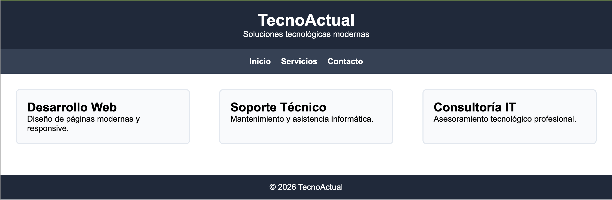

# Pràctica Clase

## Objetivo

Aplicar distintas propiedades de **Flexbox** sobre una misma página web para comprender cómo afectan a la distribución, alineación y comportamiento responsive de los elementos.

## Punto 0 — Creación de la web base “TecnoActual”

Antes de aplicar Flexbox, debes crear la versión base de la página web **TecnoActual**, que servirá como punto de partida para todos los ejercicios posteriores.

Esta versión inicial debe ser **funcional, limpia y clara**, ya que sobre ella se realizarán todas las modificaciones de Flexbox en los siguientes puntos.

### Requisitos de la web

#### Estructura HTML obligatoria

La página debe contener, al menos, los siguientes bloques:

1. **Encabezado**

1. Título principal: `TecnoActual`

1. 

Subtítulo descriptivo: “Soluciones tecnológicas modernas”

1. 

**Menú de navegación**

1. Enlaces: Inicio, Servicios, Contacto

1. Enlaces sin funcionalidad real (pueden apuntar a `#`)

1. 

Hay que utilizar flex y un justify-content centrado.

1. 

**Contenido principal**

1. Sección “Servicios”

1. 

Tres tarjetas de servicio:

  - Desarrollo Web

  - Soporte Técnico

  - Consultoría IT

  - Hay que colocarlos en display flex y un justify-content space-between.

1. 

**Pie de página**

1. Texto de copyright: `© 2026 TecnoActual`

### Requisitos de diseño (CSS)

- Usar un único fichero `styles.css`.

- Tipografía base: `Arial` o similar.

- Paleta de colores sobria (tonos oscuros para cabecera y pie).

- Separación clara entre secciones mediante `padding` y `margin`.

- Las tarjetas deben estar visibles y diferenciadas (bordes o fondo).

- encabezado y pie color de fondo: #1e293b;

- menu color de fondo: #334155;

- tarjeta-servicio color borde #e2e8f0 y color de fondo #f8fafc;



<details markdown="1">

<summary>💡 Solució</summary>

<details markdown="1">

<summary>💡 HTML</summary>

```html
<!DOCTYPE html>
<html lang="es">
<head>
    <meta charset="UTF-8" />
    <meta name="viewport" content="width=device-width, initial-scale=1.0" />
    <title>TecnoActual</title>
    <link rel="stylesheet" href="styles.css" />
</head>
<body>
    <header class="encabezado">
    <h1>TecnoActual</h1>
    <p>Soluciones tecnológicas modernas</p>
    </header>
    <nav class="menu">
    <a href="#">Inicio</a>
    <a href="#">Servicios</a>
    <a href="#">Contacto</a>
    </nav>
    <main class="contenido-principal">
    <section class="servicios">
        <article class="tarjeta-servicio">
        <h2>Desarrollo Web</h2>
        <p>Diseño de páginas modernas y responsive.</p>
        </article>
        <article class="tarjeta-servicio">
        <h2>Soporte Técnico</h2>
        <p>Mantenimiento y asistencia informática.</p>
        </article>
        <article class="tarjeta-servicio">
        <h2>Consultoría IT</h2>
        <p>Asesoramiento tecnológico profesional.</p>
        </article>
    </section>
    </main>
    <footer class="pie">
    <p>© 2026 TecnoActual</p>
    </footer>
</body>
</html>
```

</details>

<details markdown="1">

<summary>💡 CSS</summary>

```html
/* Configuración general */
* {
box-sizing: border-box;
margin: 0;
padding: 0;
font-family: Arial, sans-serif;
}

/* Encabezado */
.encabezado {
background-color: #1e293b;
color: white;
padding: 20px;
text-align: center;
}

/* Menú de navegación */
.menu {
display: flex;
justify-content: center;
gap: 20px;
background-color: #334155;
padding: 15px;
}

.menu a {
color: white;
text-decoration: none;
font-weight: bold;
}

/* Contenido principal */
.contenido-principal {
padding: 30px;
}

/* Servicios */
.servicios {
display: flex;
justify-content: space-between;
gap: 20px;
}

/* Tarjetas */
.tarjeta-servicio {
border: 2px solid #e2e8f0;
padding: 20px;
width: 30%;
border-radius: 8px;
background-color: #f8fafc;
}

/* Pie de página */
.pie {
background-color: #1e293b;
color: white;
text-align: center;
padding: 15px;
margin-top: 30px;
}

/* Responsive */
@media (max-width: 768px) {
.menu {
    flex-direction: column;
    align-items: center;
}

.servicios {
    flex-direction: column;
}

.tarjeta-servicio {
    width: 100%;
}
}
```

</details>

</details>

## Punto 1 — Tarjetas fluidas con `flex-wrap`

### Enunciado

Configura el contenedor de las tarjetas de servicios para que:

- Las tarjetas se distribuyan en varias filas automáticamente.

- El número de tarjetas por fila se adapte al tamaño de la pantalla.

- No dependa exclusivamente de media queries.

### Conceptos a trabajar

- `display: flex`

- `flex-wrap`

- `flex-basis`

- `flex-grow`

> **📌 Solución**
> 

<details markdown="1">

<summary>💡 CSS</summary>

```html
/* Servicios */
.servicios {
    display: flex;
    flex-wrap: wrap;
    gap: 20px;
}
/* Tarjetas */
.tarjeta-servicio {
    border: 2px solid #e2e8f0;
    padding: 20px;
    border-radius: 8px;
    background-color: #f8fafc;
    flex: 1 1 260px;
}
/* Quitar Responsive */
```

</details>

## Punto 2 — Reparto del espacio horizontal

### Enunciado

Distribuye las tarjetas horizontalmente utilizando distintos valores de `justify-content`.

Debes probar y comparar al menos:
- `space-between`
- `space-around`
- `space-evenly`
- `center`

### Conceptos a trabajar

- `justify-content`

- comportamiento del espacio libre en Flexbox

> **📌 Solución**
> 

<details markdown="1">

<summary>💡 CSS</summary>

```html
/* Servicios */
.servicios {
    display: flex;
    justify-content: space-evenly; /*space-between/space-around/space-evenly/center*/
    gap: 20px;
}
/* Tarjetas */
.tarjeta-servicio {
    border: 2px solid #1e293b;
    border-radius:8px;
    background-color: #f8fafc;
    padding:20px;
    margin-bottom:30px;
    width: 240px;
}
```

</details>

## Punto 3 — Alineación vertical: `align-items` vs `align-content`

### Enunciado

Fuerza varias filas de tarjetas y ajusta su alineación vertical dentro del contenedor.

Debes comprobar:
- Cómo actúa `align-items` sobre los elementos de una fila.
- Cómo actúa `align-content` sobre el conjunto de filas.

### Conceptos a trabajar

- `align-items`

- `align-content`

- diferencia entre alineación de elementos y de filas

> **📌 Solución**
> 

<details markdown="1">

<summary>💡 CSS</summary>

```html
/* Servicios */
.servicios {
    display: flex;
    flex-wrap: wrap;
    gap: 20px;

    align-content: space-between;
    border:  1px dashed #cbd5e1;
    padding: 10px;
}
/* Tarjetas */
.tarjeta-servicio {
    border: 2px solid #1e293b;
    border-radius:8px;
    background-color: #f8fafc;
    padding:20px;
    margin-bottom:30px;
    flex: 1 1 260px;
}
```

</details>

## Punto 4 — Cambio de orden visual con `order`

### Enunciado

Sin modificar el HTML:

- Haz que la tarjeta **“Consultoría IT”** aparezca visualmente en primer lugar.

- Haz que la tarjeta **“Soporte Técnico”** aparezca en último lugar.

### Conceptos a trabajar

- `order`

- diferencia entre orden visual y orden del HTML

> **📌 Solución**
> 

<details markdown="1">

<summary>💡 CSS</summary>

```html
/* Servicios */
.servicios {
    display: flex;
    gap: 20px;
}
/* Tarjetas */
.tarjeta-servicio{
    border: 2px solid #1e293b;
    border-radius:8px;
    background-color: #f8fafc;
    padding:20px;
    margin-bottom:30px;
    flex: 1;
}

.tarjeta-servicio:nth-child(3){ order: -1; }
.tarjeta-servicio:nth-child(2){ order: 2; }
```

</details>

## Punto 5 — Empuje de elementos con `margin-left: auto`

### Enunciado

Convierte el enlace **“Contacto”** del menú en un botón destacado alineado a la derecha, mientras el resto de enlaces permanecen a la izquierda.

### Conceptos a trabajar

- `margin-left: auto`

- alineación de elementos dentro de un contenedor flex

> **📌 Solución**
> 

<details markdown="1">

<summary>💡 HTML</summary>

```html
<nav class="menu">
    <a href="#">Inicio</a>
    <a href="#">Servicios</a>
    <a class="cta" href="#">Contacto</a>
</nav>
```

</details>

<details markdown="1">

<summary>💡 CSS</summary>

```html
/* Menú de navegación */
.menu{
    display: flex;
    align-items: center;
    gap: 20px;
    background-color: #334155;
    padding: 15px 20px;
}
.menu .cta{
    margin-left: auto;
    background: #0ea5e9;
    padding: 8px 12px;
    border-radius: 8px;
}
```

</details>

## Punto 6 — Layout con menú lateral (sidebar)

### Enunciado

Reestructura la página para que:

- El menú aparezca en vertical a la izquierda.

- El contenido principal aparezca a la derecha ocupando el resto del espacio.

### Conceptos a trabajar

- `flex-direction`

- `flex`

- uso de Flexbox para layouts completos

> **📌 Solución**
> 

<details markdown="1">

<summary>💡 HTML</summary>

```html
<div class="layout">
<nav class="menu">
    <a href="#">Inicio</a>
    <a href="#">Servicios</a>
    <a class="cta" href="#">Contacto</a>
</nav>
<main class="contenido-principal">
    <section class="servicios">
    <article class="tarjeta-servicio">
        <h2>Desarrollo Web</h2>
        <p>Diseño de páginas modernas y responsive.</p>
    </article>

    <article class="tarjeta-servicio">
        <h2>Soporte Técnico</h2>
        <p>Mantenimiento y asistencia informática.</p>
    </article>

    <article class="tarjeta-servicio">
        <h2>Consultoría IT</h2>
        <p>Asesoramiento tecnológico profesional.</p>
    </article>
    </section>
</main>
</div>
```

</details>

<details markdown="1">

<summary>💡 CSS</summary>

```html
/* Menú de navegación */
.layout{
    display: flex;
    min-height: 60vh;
}

.menu{
    display: flex;
    flex-direction: column;
    gap: 12px;
    width: 220px;
    padding: 20px;
    background-color: #334155;
}

.contenido-principal{
    flex: 1;
}
```

</details>
