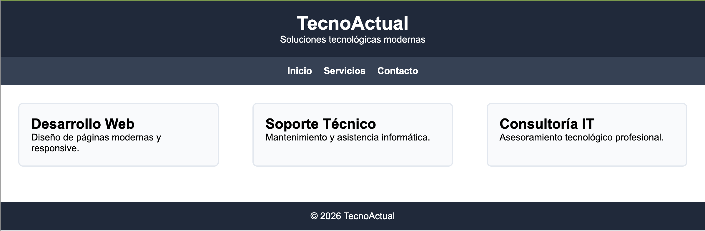

# Cuaderno Práctico de Actividades — UD3: Fulls d'Estil en Cascada — CSS3, Flexbox, Grid i Responsive Design

<div class="interactive-progress-tracker">
  <div class="tracker-header">
    <span>🏆 <strong>Progreso de esta sección:</strong> <span class="tracker-count">0 de 4 superados (0%)</span></span>
    <span class="tracker-pts">⭐ <strong>0 puntos</strong></span>
  </div>
  <div class="tracker-bar">
    <div class="tracker-fill" style="width: 0%;"></div>
  </div>
</div>

En esta sección tienes acceso directo a todas las actividades prácticas, fichas de trabajo y retos evaluables de esta unidad didáctica. Puedes acceder a cada actividad individualmente o consultar la recopilación completa a continuación:

## 🗂️ Índice de Actividades de la Unidad

- **[⚡ Activitat 301](act301.html)**
- **[⚡ Activitat 302](act302.html)**
- **[⚡ Activitat 303](act303.html)**
- **[⚡ Activitat 304](act304.html)**
- **[⚡ Activitat 305](act305.html)**
- **[⚡ Activitat 306](act306.html)**
- **[⚡ Activitat 307](act307.html)**
- **[⚡ Activitat 308](act308.html)**
- **[⚡ Activitat 309](act309.html)**
- **[⚡ Activitat 310](act310.html)**
- **[⚡ Activitat 311](act311.html)**
- **[⚡ Activitat 312](act312.html)**
- **[⚡ Activitat 313](act313.html)**
- **[⚡ Activitat 314](act314.html)**
- **[⚡ Activitat 315](act315.html)**
- **[⚡ Activitat 316](act316.html)**
- **[⚡ Activitat 317](act317.html)**
- **[⚡ Activitat 318](act318.html)**
- **[⚡ Activitat 319](act319.html)**
- **[💻 Pràctica de Classe UD3](pract_classe.html)**

---

## Actividad 301

👉 *[Obrir aquesta activitat en pàgina individual](act301.html)*

# Exercici 301

A partir del document HTML proporcionat, escriu els **estils CSS** necessaris perquè la web tinga el mateix aspecte que la següent imatge:


Empra una full style.css per a definir els estils CSS als diferents elements. Acuérdate de "linkar" la full d'estils amb l'html.

> **📌 Modificació del document HTML**
> 

> Quan empleamos estils CSS, no hem de modificar el document HTML.
Si no és necessari perquè no existeix una altra possibilitat d'aconseguir un estil determinat,
l'hem de fer en la menor mesura possible.

> En aquest cas, només modificarem el document HTML per als següents casos:

> - Per a afegir els atributs `style` que es piden.

> - Afegir elements `<span>` per a aplicar estils a determinats segmentos del text.

A més, has de tindre en compte els següents **requisits**:

- El text principal:

  - El color del text és blau: `#00F`.

  - El color de fons del text és verd clar: `#CFC`.

  - El tipus de lletra és la seqüència: `Georgia, Cambria, serif`.

  - El mida del text: `16px`.

- L'encapçalament de nivell 1:

  - El color del text és roig clar: `#F00`.

  - El tipus de lletra és la seqüència: `Verdana, Calibri, sans-serif`.

  - El mida del text: `32px`.

- L'encapçalament de nivell 2:

  - El color del text és roig clar: `#A00`.

  - El tipus de lletra és la seqüència: `Verdana, Calibri, sans-serif`.

  - El mida del text: `24px`.

- El color dels camps de les dades del llibre és verd fosc: `#060`.

- El text `Internet` i `Web` (quan actuen com sustantivos):

  - El mida del text: `20px`.

  - Text en negreta.

- El text `Hypertext Markup Language`, `Cascading Style Sheets` i els acrónimos `HTML` i `CSS`:

  - El color del text és blanc: #FFF.

  - El color de fons del text és negre: #000.

  - Text en cursiva.

<details markdown="1">

<summary>💡 Document HTML Base</summary>

```html
<!DOCTYPE html>
<html>
  <head>
    <meta charset="utf-8" />
    <title>HTML & CSS: Curso práctico avanzado</title>
  </head>
  <body>
    <h1>HTML & CSS: Curso práctico avanzado</h1>

    <h2>Datos del libro</h2>

    <ul>
      <li>Título: HTML & CSS: Curso práctico avanzado</li>
      <li>Autor: Sergio Luján Mora</li>
      <li>Editorial: Publicaciones Altaria</li>
      <li>Año de publicación: 2015</li>
      <li>ISBN: 978-84-944049-4-8</li>
    </ul>

    <h2>Descripción del libro</h2>

    <p>
      Aunque los inicios de Internet se remontan a los años sesenta, no ha sido
      hasta los años noventa cuando, gracias a la Web, se ha extendido su uso
      por todo el mundo. En pocos años, la Web ha evolucionado enormemente: se
      ha pasado de páginas sencillas, con pocas imágenes y contenidos estáticos
      que eran visitadas por unos pocos usuarios a páginas complejas, con
      contenidos dinámicos que provienen de bases de datos y que son visitadas
      por miles de usuarios al mismo tiempo.
    </p>

    <p>
      Todas las páginas están internamente construidas con la misma tecnología,
      con el Lenguaje de marcas de hipertexto (Hypertext Markup Language, HTML)
      y con las Hojas de estilo en cascada (Cascading Style Sheets, CSS).
    </p>

    <p>
      Este libro es adecuado para cualquiera que tenga interés en aprender a
      desarrollar sus propias páginas web. No son necesarios conocimientos
      previos para aprender con este libro, lo único que es necesario es saber
      utilizar un ordenador y saber navegar por la Web.
    </p>

    <h2>Contenido del libro</h2>

    <p>
      El contenido de este libro se estructura en tres apartados bien
      diferenciados:
    </p>

    <ul>
      <li>
        En la primera parte del libro se trabajan conceptos generales que son
        necesarios para poder desarrollar páginas web; se explican conceptos de
        estructura física y estructura lógica (o estructura de navegación) de un
        sitio web. Se detalla cómo influye la estructura física en las URL o
        direcciones que se emplean a la hora de crear los enlaces de un sitio
        web. Pasando por el concepto de "estándar web", un término general que
        se emplea para refererirse a los estándares que define su funcionamiento
        como HTML y CSS, empleados para el desarrollo de las páginas web en el
        lado del cliente.
      </li>

      <li>
        En la segunda parte se trabaja HTML. Partiendo de la estructura básica
        de una página web, se explican las etiquetas de HTML que se utilizan
        para definir el texto, los enlaces, las listas, las tablas, los
        formularios y los elementos multimedia.
      </li>

      <li>
        En la tercera y última parte se explica CSS, el lenguaje que se emplea
        para definir el formato y la presentación de una página web. Se explica
        cómo utilizar el color, cómo definir la presentación del texto, de las
        tablas y de los formularios; cómo realizar transformaciones y
        transiciones con el fin de diseñar una página web.
      </li>
    </ul>
  </body>
</html>
```

</details>

<details markdown="1">

<summary>💡 Solució</summary>

<details markdown="1">

<summary>💡 HTML</summary>

```html
<!DOCTYPE html>
<html>
  <head>
    <meta charset="utf-8" />
    <title>HTML &amp; CSS: Curso práctico avanzado</title>
    <link href="estilos.css" rel="stylesheet" />
  </head>
  <body>
    <h1>HTML &amp; CSS: Curso práctico avanzado</h1>
    <h2>Datos del libro</h2>
    <ul>
      <li>Título: HTML &amp; CSS: Curso práctico avanzado</li>
      <li>Autor: Sergio Luján Mora</li>
      <li>Editorial: Publicaciones Altaria</li>
      <li>Año de publicación: 2015</li>
      <li>ISBN: 978-84-944049-4-8</li>
    </ul>
    <h2>Descripción del libro</h2>
    <p>
      Aunque los inicios de Internet se remontan a los años sesenta, no ha sido
      hasta los años noventa cuando, gracias a la Web, se ha extendido su uso
      por todo el mundo. En pocos años, la Web ha evolucionado enormemente: se
      ha pasado de páginas sencillas, con pocas imágenes y contenidos estáticos
      que eran visitadas por unos pocos usuarios a páginas complejas, con
      contenidos dinámicos que provienen de bases de datos y que son visitadas
      por miles de usuarios al mismo tiempo.
    </p>
    <p>
      Todas las páginas están internamente construidas con la misma tecnología,
      con el Lenguaje de marcas de hipertexto (Hypertext Markup Language, HTML)
      y con las Hojas de estilo en cascada (Cascading Style Sheets, CSS).
    </p>
    <p>
      Este libro es adecuado para cualquiera que tenga interés en aprender a
      desarrollar sus propias páginas web. No son necesarios conocimientos
      previos para aprender con este libro, lo único que es necesario es saber
      utilizar un ordenador y saber navegar por la Web.
    </p>
    <h2>Contenido del libro</h2>
    <p>
      El contenido de este libro se estructura en tres apartados bien
      diferenciados:
    </p>
    <ul>
      <li>
        En la primera parte del libro se trabajan conceptos generales que son
        necesarios para poder desarrollar páginas web; se explican conceptos de
        estructura física y estructura lógica (o estructura de navegación) de un
        sitio web. Se detalla cómo influye la estructura física en las URL o
        direcciones que se emplean a la hora de crear los enlaces de un sitio
        web. Pasando por el concepto de "estándar web", un término general que
        se emplea para refererirse a los estándares que define su funcionamiento
        como HTML y CSS, empleados para el desarrollo de las páginas web en el
        lado del cliente.
      </li>
      <li>
        En la segunda parte se trabaja HTML. Partiendo de la estructura básica
        de una página web, se explican las etiquetas de HTML que se utilizan
        para definir el texto, los enlaces, las listas, las tablas, los
        formularios y los elementos multimedia.
      </li>
      <li>
        En la tercera y última parte se explica CSS, el lenguaje que se emplea
        para definir el formato y la presentación de una página web. Se explica
        cómo utilizar el color, cómo definir la presentación del texto, de las
        tablas y de los formularios; cómo realizar transformaciones y
        transiciones con el fin de diseñar una página web.
      </li>
    </ul>
  </body>
</html>
```

</details>

<details markdown="1">

<summary>💡 CSS</summary>

```html
body {
color: #00f;
background-color: #cfc;
font-family: Georgia, Cambria, serif;
font-size: 16px;
}
h1 {
  color: #f00;
  font-family: Verdana, Calibri, sans-serif;
  font-size: 32px;
}
h2 {
  color: #a00;
  font-family: Verdana, Calibri, sans-serif;
  font-size: 24px;
}
span {
  color: #060;
}
strong {
  font-size: 20px;
}
em {
  color: #fff;
  background-color: #000;
}
```

</details>

</details>

---

## Actividad 302

👉 *[Obrir aquesta activitat en pàgina individual](act302.html)*

# Exercici 302

A partir del document HTML proporcionat, escriu els **estils CSS** necessaris perquè la web tinga el mateix aspecte que la següent imatge:


Empra el **element `<link>`** per a aplicar els estils CSS als diferents elements.

> **📌 Modificació del document HTML**
> 

> Només es podrà afegir un element `<link>` en el document HTML i no es podrà modificar el resta.

A més, has de tindre en compte els següents **requisits**:

- El text principal:

  - El color del text és `#0096c7`.

  - El color de fons és `#caf0f8`.

  - El tipus de lletra és `Georgia, Cambria, serif`.

  - El mida del text: `16px`.

- L'encapçalament de nivell 1:

  - El color del text és `#023e8a`.

  - El tipus de lletra és `Verdana, Calibri, sans-serif`.

  - El mida del text: `32px`.

- L'encapçalament de nivell 2:

  - El color del text és `#0077b6`.

  - El tipus de lletra és `Verdana, Calibri, sans-serif`.

  - El mida del text: `24px`.

- El color dels camps de les dades del llibre és `#03045e`.

- El text `Internet` i `Web` (quan actuen com sustantivos):

  - El mida del text: `20px`.

  - Text en negreta.

- El text `Hypertext Markup Language`, `Cascading Style Sheets` i els acrónimos `HTML` i `CSS`:

  - El color del text és `#90e0ef`.

  - El color de fons del text és `#023e8a`.

  - Text en cursiva.

<details markdown="1">

<summary>💡 Document HTML Base</summary>

```html
<!DOCTYPE html>
<html>
  <head>
    <meta charset="utf-8" />
    <title>HTML &amp; CSS: Curso práctico avanzado</title>
  </head>
  <body>
    <h1>HTML &amp; CSS: Curso práctico avanzado</h1>

    <h2>Datos del libro</h2>

    <ul>
      <li><span>Título:</span> HTML &amp; CSS: Curso práctico avanzado</li>
      <li><span>Autor:</span> Sergio Luján Mora</li>
      <li><span>Editorial:</span> Publicaciones Altaria</li>
      <li><span>Año de publicación:</span> 2015</li>
      <li><span>ISBN:</span> 978-84-944049-4-8</li>
    </ul>

    <h2>Descripción del libro</h2>

    <p>
      Aunque los inicios de <strong>Internet</strong> se remontan a los años
      sesenta, no ha sido hasta los años noventa cuando, gracias a la
      <strong>Web</strong>, se ha extendido su uso por todo el mundo. En pocos
      años, la <strong>Web</strong> ha evolucionado enormemente: se ha pasado de
      páginas sencillas, con pocas imágenes y contenidos estáticos que eran
      visitadas por unos pocos usuarios a páginas complejas, con contenidos
      dinámicos que provienen de bases de datos y que son visitadas por miles de
      usuarios al mismo tiempo.
    </p>

    <p>
      Todas las páginas están internamente construidas con la misma tecnología,
      con el Lenguaje de marcas de hipertexto (<em>Hypertext Markup Language, HTML</em>)
      y con las Hojas de estilo en cascada (<em>Cascading Style Sheets, CSS</em>).
    </p>

    <p>
      Este libro es adecuado para cualquiera que tenga interés en aprender a
      desarrollar sus propias páginas web. No son necesarios conocimientos
      previos para aprender con este libro, lo único que es necesario es saber
      utilizar un ordenador y saber navegar por la <strong>Web</strong>.
    </p>

    <h2>Contenido del libro</h2>

    <p>
      El contenido de este libro se estructura en tres apartados bien
      diferenciados:
    </p>

    <ul>
      <li>
        En la primera parte del libro se trabajan conceptos generales que son
        necesarios para poder desarrollar páginas web; se explican conceptos de
        estructura física y estructura lógica (o estructura de navegación) de un
        sitio web. Se detalla cómo influye la estructura física en las
        <em>URL</em> o direcciones que se emplean a la hora de crear los enlaces
        de un sitio web. Pasando por el concepto de "estándar web", un término
        general que se emplea para refererirse a los estándares que define su
        funcionamiento como <em>HTML</em> y <em>CSS</em>, empleados para el
        desarrollo de las páginas web en el lado del cliente.
      </li>

      <li>
        En la segunda parte se trabaja <em>HTML</em>. Partiendo de la estructura
        básica de una página web, se explican las etiquetas de <em>HTML</em> que
        se utilizan para definir el texto, los enlaces, las listas, las tablas,
        los formularios y los elementos multimedia.
      </li>

      <li>
        En la tercera y última parte se explica <em>CSS</em>, el lenguaje que se
        emplea para definir el formato y la presentación de una página web. Se
        explica cómo utilizar el color, cómo definir la presentación del texto,
        de las tablas y de los formularios; cómo realizar transformaciones y
        transiciones con el fin de diseñar una página web.
      </li>
    </ul>
  </body>
</html>
```

</details>

<details markdown="1">

<summary>💡 Solució</summary>

<details markdown="1">

<summary>💡 HTML</summary>

```html
<!DOCTYPE html>
<html>
  <head>
    <meta charset="utf-8" />
    <title>HTML &amp; CSS: Curso práctico avanzado</title>
    <link href="estilos.css" rel="stylesheet" />
  </head>
  <body>
    <h1>HTML &amp; CSS: Curso práctico avanzado</h1>
    <h2>Datos del libro</h2>
    <ul>
      <li><span>Título:</span> HTML &amp; CSS: Curso práctico avanzado</li>
      <li><span>Autor:</span> Sergio Luján Mora</li>
      <li><span>Editorial:</span> Publicaciones Altaria</li>
      <li><span>Año de publicación:</span> 2015</li>
      <li><span>ISBN:</span> 978-84-944049-4-8</li>
    </ul>
    <h2>Descripción del libro</h2>
    <p>
      Aunque los inicios de <strong>Internet</strong> se remontan a los años
      sesenta, no ha sido hasta los años noventa cuando, gracias a la
      <strong>Web</strong>, se ha extendido su uso por todo el mundo. En pocos
      años, la <strong>Web</strong> ha evolucionado enormemente: se ha pasado de
      páginas sencillas, con pocas imágenes y contenidos estáticos que eran
      visitadas por unos pocos usuarios a páginas complejas, con contenidos
      dinámicos que provienen de bases de datos y que son visitadas por miles de
      usuarios al mismo tiempo.
    </p>
    <p>
      Todas las páginas están internamente construidas con la misma tecnología,
      con el Lenguaje de marcas de hipertexto (<em>Hypertext Markup Language, HTML</em>) y con las Hojas de estilo en cascada (<em>Cascading Style Sheets, CSS</em>).
    </p>
    <p>
      Este libro es adecuado para cualquiera que tenga interés en aprender a
      desarrollar sus propias páginas web. No son necesarios conocimientos
      previos para aprender con este libro, lo único que es necesario es saber
      utilizar un ordenador y saber navegar por la <strong>Web</strong>.
    </p>
    <h2>Contenido del libro</h2>
    <p>
      El contenido de este libro se estructura en tres apartados bien
      diferenciados:
    </p>
    <ul>
      <li>
        En la primera parte del libro se trabajan conceptos generales que son
        necesarios para poder desarrollar páginas web; se explican conceptos de
        estructura física y estructura lógica (o estructura de navegación) de un
        sitio web. Se detalla cómo influye la estructura física en las
        <em>URL</em> o direcciones que se emplean a la hora de crear los enlaces
        de un sitio web. Pasando por el concepto de "estándar web", un término
        general que se emplea para refererirse a los estándares que define su
        funcionamiento como <em>HTML</em> y <em>CSS</em>, empleados para el
        desarrollo de las páginas web en el lado del cliente.
      </li>
      <li>
        En la segunda parte se trabaja <em>HTML</em>. Partiendo de la estructura
        básica de una página web, se explican las etiquetas de <em>HTML</em> que
        se utilizan para definir el texto, los enlaces, las listas, las tablas,
        los formularios y los elementos multimedia.
      </li>
      <li>
        En la tercera y última parte se explica <em>CSS</em>, el lenguaje que se
        emplea para definir el formato y la presentación de una página web. Se
        explica cómo utilizar el color, cómo definir la presentación del texto,
        de las tablas y de los formularios; cómo realizar transformaciones y
        transiciones con el fin de diseñar una página web.
      </li>
    </ul>
  </body>
</html>
```

</details>

<details markdown="1">

<summary>💡 CSS</summary>

```html
body {
  color: #0096c7;
  background-color: #caf0f8;
  font-family: Georgia, Cambria, serif;
  font-size: 16px;
}
h1 {
  color: #023e8a;
  font-family: Verdana, Calibri, sans-serif;
  font-size: 32px;
}
h2 {
  color: #0077b6;
  font-family: Verdana, Calibri, sans-serif;
  font-size: 24px;
}
span {
  color: #03045e;
}
strong {
  font-size: 20px;
}
em {
  color: #023e8a;
  background-color: #90e0ef;
}
```

</details>

</details>

---

## Actividad 303

👉 *[Obrir aquesta activitat en pàgina individual](act303.html)*

# Exercici 303

A partir dels documents HTML i CSS proporcionats, modifica el **fitxer CSS** perquè la web tinga el mateix aspecte que la següent imatge:


<details markdown="1">

<summary>💡 Document HTML Base</summary>

```html
<!DOCTYPE html>
<html>
  <head>
    <meta charset="UTF-8" />
    <meta name="viewport" content="width=device-width, initial-scale=1.0" />
    <title>Ejercicio de selectores</title>
    <link rel="stylesheet" href="estilos.css" />
  </head>

  <body>
    <div id="primero">
      <h1>HTML &amp; CSS: Curso práctico avanzado</h1>

      <p>
        Aunque los inicios de
        <a href="https://es.wikipedia.org/wiki/Internet">Internet</a> se
        remontan a los años sesenta, no ha sido hasta los años noventa cuando,
        gracias a la Web, se ha extendido su uso por todo el mundo. En pocos
        años, la Web ha evolucionado enormemente: se ha pasado de páginas
        sencillas, con pocas imágenes y contenidos estáticos que eran visitadas
        por unos pocos usuarios a
        <em
          >páginas complejas, con contenidos dinámicos que provienen de bases de
          datos y que son visitadas por miles de usuarios al mismo tiempo</em
        >.
      </p>
    </div>

    <div id="segundo" class="normal">
      <p>
        Todas las páginas están internamente construidas con la misma
        tecnología, con el
        <em class="especial">Lenguaje de marcas de hipertexto</em> (<span
          >Hypertext Markup Language</span
        >, <a href="https://es.wikipedia.org/wiki/HTML">HTML</a>) y con las
        <em class="especial">Hojas de estilo en cascada</em> (<span
          >Cascading Style Sheets</span
        >, <a href="https://es.wikipedia.org/wiki/CSS">CSS</a>).
      </p>

      <p>
        Este libro es
        <em
          >adecuado para cualquiera que tenga interés en aprender a desarrollar
          sus propias páginas web</em
        >. No son necesarios conocimientos previos para aprender con este libro,
        lo único que es necesario es saber utilizar un ordenador y saber navegar
        por la Web.
      </p>
    </div>
  </body>
</html>
```

</details>

<details markdown="1">

<summary>💡 Document CSS Base</summary>

```html
/* Todos los elementos de la pagina */
{
  font-size: 16px;
  font-family: Arial, Helvetica, sans-serif;
}

/* Todos los parrafos de la pagina */
{
  color: #555;
}

/* Todos los párrafos contenidos en #primero */
{
  color: #369;
}

/* Todos los enlaces la pagina */
{
  color: #c30;
}

/* Los elementos <em> contenidos en #primero */
{
  color: #0000bb;
  background-color: #ffffcc;
}

/* Todos los elementos <em> con la clase "especial" en toda la pagina */
{
  color: #ffff00;
  background: #000000;
}

/* Todos los elementos <span> contenidos en la clase "normal" */
{
  font-weight: bold;
}
```

Cada regla CSS inclou un comentari en el que es explica els elements als que ha d'aplicar-se.

</details>

<details markdown="1">

<summary>💡 Solució</summary>

<details markdown="1">

<summary>💡 CSS</summary>

```html
/* Todos los elementos de la pagina */
* {
  font-size: 16px;
  font-family: Arial, Helvetica, sans-serif;
}

/* Todos los parrafos de la pagina */
p {
  color: #555;
}

/* Todos los párrafos contenidos en #primero */
#primero p {
  color: #369;
}

/* Todos los enlaces la pagina */
a {
  color: #c30;
}

/* Los elementos <em> contenidos en #primero */
#primero em {
  color: #0000bb;
  background-color: #ffffcc;
}

/* Todos los elementos <em> con la clase "especial" en toda la pagina */
em.especial {
  color: #ffff00;
  background: #000000;
}

/* Todos los elementos <span> contenidos en la clase "normal" */
.normal span {
  font-weight: bold;
}
```

</details>

</details>

---

## Actividad 304

👉 *[Obrir aquesta activitat en pàgina individual](act304.html)*

# Exercici 304

A partir del document HTML proporcionat, escriu les regles CSS necessàries per a aconseguir una pàgina web que tinga el mateix aspecte que la següent imatge:


<details markdown="1">

<summary>💡 Document HTML Base</summary>

```html
<!DOCTYPE html>
<html>
  <head>
    <meta charset="UTF-8" />
    <meta name="viewport" content="width=device-width, initial-scale=1.0" />
    <title>Tabla HTML</title>
    <link rel="stylesheet" href="estilos.css" />
  </head>
  <body>
    <table>
      <tr>
        <td>teal</td>
        <td>teal</td>
        <td>teal</td>
      </tr>
      <tr>
        <td>red</td>
        <td>red</td>
        <td>red</td>
      </tr>
      <tr>
        <td>blue</td>
        <td>blue</td>
        <td>blue</td>
      </tr>
      <tr>
        <td>orange</td>
        <td>orange</td>
        <td>orange</td>
      </tr>
      <tr>
        <td>purple</td>
        <td>purple</td>
        <td>purple</td>
      </tr>
      <tr>
        <td>olive</td>
        <td>olive</td>
        <td>olive</td>
      </tr>
      <tr>
        <td>fuchsia</td>
        <td>fuchsia</td>
        <td>fuchsia</td>
      </tr>
      <tr>
        <td>green</td>
        <td>green</td>
        <td>green</td>
      </tr>
    </table>
  </body>
</html>
```

</details>

Consideracions:

- Pots modificar el document HTML proporcionat per a afegir els identificadors i classes necessàries.

- En la taula es indiquen els noms dels colors que has d'emprar.

- Utilitza la mínima quantitat possible de regles i selectors de CSS.

<details markdown="1">

<summary>💡 Solució</summary>

<details markdown="1">

<summary>💡 HTML</summary>

```html
<!DOCTYPE html>
<html>
  <head>
    <meta charset="UTF-8" />
    <meta name="viewport" content="width=device-width, initial-scale=1.0" />
    <title>Tabla HTML</title>
    <link rel="stylesheet" href="estilos.css" />
  </head>
  <body>
    <table>
      <tr id="fila1">
        <td>teal</td>
        <td>teal</td>
        <td>teal</td>
        <td>teal</td>
      </tr>
      <tr id="fila2">
        <td>red</td>
        <td>red</td>
        <td>red</td>
        <td>red</td>
      </tr>
      <tr id="fila3">
        <td>blue</td>
        <td>blue</td>
        <td>blue</td>
        <td>blue</td>
      </tr>
      <tr id="fila4">
        <td>orange</td>
        <td>orange</td>
        <td>orange</td>
        <td>orange</td>
      </tr>
      <tr id="fila5">
        <td>purple</td>
        <td>purple</td>
        <td>purple</td>
        <td>purple</td>
      </tr>
      <tr id="fila6">
        <td>olive</td>
        <td>olive</td>
        <td>olive</td>
        <td>olive</td>
      </tr>
      <tr id="fila7">
        <td>fuchsia</td>
        <td>fuchsia</td>
        <td>fuchsia</td>
        <td>fuchsia</td>
      </tr>
      <tr id="fila8">
        <td>green</td>
        <td>green</td>
        <td>green</td>
        <td>green</td>
      </tr>
    </table>
  </body>
</html>
```

</details>

<details markdown="1">

<summary>💡 CSS</summary>

```html
/* Borde negro */
table,
td {
  border: solid 1px black;
}

/* También se podría haber hecho con clases */
#fila1 {
  color: teal;
}
#fila2 {
  color: red;
}
#fila3 {
  color: blue;
}
#fila4 {
  color: orange;
}
#fila5 {
  color: purple;
}
#fila6 {
  color: olive;
}
#fila7 {
  color: fuchsia;
}
#fila8 {
  color: green;
}

/* Segunda columna */
td + td {
  background-color: red;
}

/* Tercera columna */
td + td + td {
  background-color: green;
}

/* Cuarta columna */
td + td + td + td {
  background-color: blue;
}
```

</details>

</details>

---

## Actividad 305

👉 *[Obrir aquesta activitat en pàgina individual](act305.html)*

# Exercici 305

A partir del document HTML proporcionat, escriu les regles CSS necessàries per a aconseguir una pàgina web que tinga el següent funcionament:

- En la seua estat normal, un enllaç es mostra de color roig i sense subratllat (propietat `text-decoration`).

- Quan l'usuari o usuaria sitúa el cursor del ratolí sobre un enllaç, es invierten els colors (el text de l'enllaç es mostra amb color blanc sobre un fons roig) i es mostra el subratllat.

- Quan un enllaç està activo, es mostra de color taronja i sense subratllat.

- Quan un enllaç ha sigut visitado, es mostra de color verd fosc i sense subratllat.

- Quan un enllaç té el focus del teclat, es mostra de color blau i en negreta.

<details markdown="1">

<summary>💡 Document HTML Base</summary>

```html
<!DOCTYPE html>
<html>
  <head>
    <meta charset="UTF-8" />
    <title>Ejercicio de selectores</title>
    <link rel="stylesheet" href="estilos.css" />
  </head>
  <body>
    <ul>
      <li><a href="presentacion.html">Presentación</a></li>
      <li><a href="estudios.html">Estudios</a></li>
      <li><a href="alumnos.html">Alumnos</a></li>
      <li><a href="deportes.html">Deportes</a></li>
      <li><a href="servicios.html">Servicios</a></li>
    </ul>
  </body>
</html>
```

</details>

> **📌 NOTA**
> 

> L'ordre d'escriptura de les regles influye en el resultat final, ja que un enllaç pot estar en diversos estats al mateix temps.

<details markdown="1">

<summary>💡 Solució</summary>

<details markdown="1">

<summary>💡 CSS</summary>

```html
a {
  color: #f00;
  text-decoration: none;
}

a:visited {
  color: #0a0;
}

a:hover {
  color: #fff;
  background-color: #f00;
  text-decoration: underline;
}

a:focus {
  color: #00f;
  font-weight: bold;
}

a:active {
  color: #f60;
  background-color: #fff;
  text-decoration: none;
}
```

</details>

</details>

---

## Actividad 306

👉 *[Obrir aquesta activitat en pàgina individual](act306.html)*

# Exercici 306

A partir del document HTML proporcionat, escriu les regles CSS necessàries per a aconseguir una pàgina web que tinga el mateix aspecte que la següent imatge:


<details markdown="1">

<summary>💡 Document HTML Base</summary>

```html
<!DOCTYPE html>
<html>
  <head>
    <meta charset="UTF-8" />
    <title>Ejemplo de listas</title>
    <link rel="stylesheet" href="estilos.css" />
  </head>
  <body>
    <p>Lista sin elemento gráfico:</p>
    <ul>
      <li>Elemento 1</li>
      <li>Elemento 2</li>
      <li>Elemento 3</li>
    </ul>

    <p>Lista con círculos:</p>
    <ul>
      <li>Elemento 1</li>
      <li>Elemento 2</li>
      <li>Elemento 3</li>
    </ul>

    <p>Lista con cuadrados:</p>
    <ul>
      <li>Elemento 1</li>
      <li>Elemento 2</li>
      <li>Elemento 3</li>
    </ul>

    <p>Lista con números romanos:</p>
    <ol>
      <li>Elemento 1</li>
      <li>Elemento 2</li>
      <li>Elemento 3</li>
    </ol>

    <p>Lista con letras griegas:</p>
    <ol>
      <li>Elemento 1</li>
      <li>Elemento 2</li>
      <li>Elemento 3</li>
    </ol>
  </body>
</html>
```

</details>

Es pot modificar el codi HTML proporcionat per a afegir els identificadors i classes que es necesiten.

<details markdown="1">

<summary>💡 Solució</summary>

<details markdown="1">

<summary>💡 HTML</summary>

```html
<!DOCTYPE html>
<html>
  <head>
    <meta charset="utf-8" />
    <title>Ejemplo de listas</title>
    <link rel="stylesheet" href="estilos.css" />
  </head>
  <body>
    <p>Lista sin elemento gráfico:</p>
    <ul class="lista-sin">
      <li>Elemento 1</li>
      <li>Elemento 2</li>
      <li>Elemento 3</li>
    </ul>

    <p>Lista con círculos:</p>
    <ul class="lista-circulos">
      <li>Elemento 1</li>
      <li>Elemento 2</li>
      <li>Elemento 3</li>
    </ul>

    <p>Lista con cuadrados:</p>
    <ul class="lista-cuadrados">
      <li>Elemento 1</li>
      <li>Elemento 2</li>
      <li>Elemento 3</li>
    </ul>

    <p>Lista con números romanos:</p>
    <ol class="lista-romanos">
      <li>Elemento 1</li>
      <li>Elemento 2</li>
      <li>Elemento 3</li>
    </ol>

    <p>Lista con letras griegas:</p>
    <ol class="lista-griegos">
      <li>Elemento 1</li>
      <li>Elemento 2</li>
      <li>Elemento 3</li>
    </ol>
  </body>
</html>
```

</details>

<details markdown="1">

<summary>💡 CSS</summary>

```html
.lista-sin {
  list-style-type: none;
}

.lista-circulos {
  list-style-type: circle;
}

.lista-cuadrados {
  list-style-type: square;
}

.lista-romanos {
  list-style-type: lower-roman;
}

.lista-griegos {
  list-style-type: lower-greek;
}
```

</details>

</details>

---

## Actividad 307

👉 *[Obrir aquesta activitat en pàgina individual](act307.html)*

# Exercici 307

Crea una pàgina web que tinga el mateix aspecte que la següent imatge:

S'ha de mostrar un vora sólido de color roig quan el cursor del ratolí es sitúe damunt d'un element de la llista o quan un element de la llista reba el focus del teclat. En la següent imatge es mostra el resultat de l'efecte:

Provar en el navegador

[Pàgina web](https://qhqshf.csb.app/)

<details markdown="1">

<summary>💡 Document HTML Base</summary>

```html
<!DOCTYPE html>
<html>
  <head>
    <meta charset="utf-8" />
    <title>Página web con menú</title>
    <link rel="stylesheet" href="estilos.css" />
  </head>
  <body>
    <ul>
      <li><a href="#">Presentación</a></li>
      <li><a href="#">Estudios</a></li>
      <li><a href="#">Alumnos</a></li>
      <li><a href="#">Deportes</a></li>
      <li><a href="#">Servicios</a></li>
    </ul>
  </body>
</html>
```

</details>

<details markdown="1">

<summary>💡 Solució</summary>

<details markdown="1">

<summary>💡 CSS</summary>

```html
ul {
  list-style-type: none;
  text-align: center;
  /* Suficiente anchura para que quepa "Presentación" */
  width: 120px;
  padding: 0;
}

li {
  background-color: #00f;
  color: #fff;
  /* El borde blanco separa los elementos */
  border: 2px solid #fff;
}

li a {
  color: #fff;
  text-decoration: none;
  /* Necesario para que el enlace ocupe todo el ancho del elemento  de la lista */
  display: block;
  width: 100%;
}

/* Efecto cuando se situa el ratón encima de un elemento de la lista o cuando recibe el foco del teclado */
li a:hover,
li a:focus {
  /* ¿Qué pasa si se utiliza la propiedad border? */
  outline: 2px solid #f00;
}
```

</details>

</details>

---

## Actividad 308

👉 *[Obrir aquesta activitat en pàgina individual](act308.html)*

# Exercici 308

A partir del document HTML proporcionat, escriu les regles CSS necessàries per a aconseguir una pàgina web que tinga el mateix aspecte que la següent imatge:


Els vores a definir són:

- Encapçalament nivell 1: vora inferior amb una amplària de `2px`, sólido i de color blau (`#00F`).

- Encapçalament nivell 2: vora complet amb una amplària de `2px`, sólido i de color gris (`#AAA`).

- Llista amb les dades del llibre: vora superior i inferior amb una amplària de `4px`, punteado i de color roig (`#F00`).

- Llista amb el contingut del llibre: vora complet amb una amplària de `2px`, amb guions i de color verd (`#0F0`).

Pots modificar el codi HTML proporcionat per a afegir els identificadors i classes que necesites.

<details markdown="1">

<summary>💡 Document HTML Base</summary>

```html
<!DOCTYPE html>
<html>
  <head>
    <meta charset="utf-8" />
    <title>HTML &amp; CSS: Curso práctico</title>
    <link rel="stylesheet" href="estilos.css" />
  </head>
  <body>
    <h1>HTML &amp; CSS: Curso práctico avanzado</h1>

    <h2>Datos del libro</h2>

    <ul>
      <li>Título: CSS Web Design For Dummies</li>
      <li>Autor: Richard Mansfield</li>
      <li>Editorial: Wiley</li>
      <li>Año de publicación: 2005</li>
      <li>ISBN: 9780764597541</li>
    </ul>

    <h2>Descripción del libro</h2>

    <ul>
      <li>
        Cascading Style Sheets (CSS) is a Web markup standard that allows Web
        designers to define the appearance and position of a Web page using
        special dynamic effects.
      </li>
      <li>
        This book is the perfect beginner reference, showing those new to CSS
        how to design Web pages and implement numerous useful CSS effects
        available.
      </li>
      <li>
        Seasoned For Dummies author Richard Mansfield explains how CSS can
        streamline and speed up Web development.
      </li>
      <li>
        Explains how to take control of the many elements in a Web page,
        integrate CSS into new or existing sites, choose the best coding
        techniques, and execute advanced visual effects such as transitions
      </li>
      <li>
        Features a special discussion on browser incompatibility issues
        involving CSS and how to solve potential problems.
      </li>
    </ul>

    <h2>Contenido del libro</h2>

    <p>
      El contenido de este libro se estructura en tres apartados bien
      diferenciados:
    </p>

    <ul>
      <li>
        En la primera parte del libro se trabajan conceptos generales que son
        necesarios para poder desarrollar páginas web; se explican conceptos de
        estructura física y estructura lógica (o estructura de navegación) de un
        sitio web. Se detalla cómo influye la estructura física en las URL o
        direcciones que se emplean a la hora de crear los enlaces de un sitio
        web. Pasando por el concepto de "estándar web", un término general que
        se emplea para refererirse a los estándares que define su funcionamiento
        como HTML y CSS, empleados para el desarrollo de las páginas web en el
        lado del cliente.
      </li>

      <li>
        En la segunda parte se trabaja HTML. Partiendo de la estructura básica
        de una página web, se explican las etiquetas de HTML que se utilizan
        para definir el texto, los enlaces, las listas, las tablas, los
        formularios y los elementos multimedia.
      </li>
    </ul>
  </body>
</html>
```

</details>

<details markdown="1">

<summary>💡 Solució</summary>

<details markdown="1">

<summary>💡 CSS</summary>

```html
h1 {
  border-bottom: 2px solid #00f;
}

h2 {
  border: 2px solid #aaa;
}

#datos {
  border-top: 4px dotted #f00;
  border-bottom: 4px dotted #f00;
}

#contenido {
  border: 2px dashed #0f0;
}
```

</details>

</details>

---

## Actividad 309

👉 *[Obrir aquesta activitat en pàgina individual](act309.html)*

# Exercici 309

A partir del document HTML proporcionat, escriu les regles CSS necessàries per a aconseguir una pàgina web que tinga el mateix aspecte que la següent imatge:

<details markdown="1">

<summary>💡 Document HTML base:</summary>

```html
<!DOCTYPE html>
<html>
  <head>
    <meta charset="UTF-8" />
    <title>Box model</title>
  </head>
  <body>
    <div>
      <p>I am a paragraph. A short one.</p>
      <ul>
        <li>Item One</li>
        <li>Item Two</li>
        <li>Item Three</li>
      </ul>
      <p>
        I am another paragraph. Some of the words have been wrapped in a span element.
      </p>
    </div>
  </body>
</html>
```

</details>

<details markdown="1">

<summary>💡 Solució</summary>

<details markdown="1">

<summary>💡 HTML</summary>

```html
<!DOCTYPE html>
<html>
  <head>
    <meta charset="UTF-8" />
    <title>Box model</title>
    <link rel="stylesheet" href="estilos.css" />
  </head>
  <body>
    <div>
      <p>I am a paragraph. A short one.</p>
      <ul>
        <li>Item One</li>
        <li>Item Two</li>
        <li>Item Three</li>
      </ul>
      <p>
        I am another paragraph. Some of the
        <span class="block">words</span> have been wrapped in a span element.
      </p>
    </div>
  </body>
</html>
```

</details>

<details markdown="1">

<summary>💡 CSS</summary>

```html
div {
  border: 1px solid black;
  padding: 1em;
}

p,
ul {
  border: 2px solid rebeccapurple;
  padding: 0.5em;
}

.block,
li {
  border: 2px solid blue;
  padding: 0.5em;
}

ul {
  display: flex;
  list-style: none;
}

.block {
  display: block;
}
```

</details>

</details>

---

## Actividad 310

👉 *[Obrir aquesta activitat en pàgina individual](act310.html)*

# Exercici 310

Crea una **pàgina web** que tinga el mateix aspecte que la següent imatge:


> **📌 Chrome**
> 

> [Pàgina web](https://cz60q9.csb.app/)

Consideracions:

- El tipus de lletra del document és la seqüència: `Arial, Helvetica, sans-serif`.

- El tipus de lletra de la capçalera de nivell 1 és la seqüència: `Georgia, serif`.

- En el document HTML, el text dels elements `<legend>` s'ha d'escriure en minúscules i s'ha de convertir a majúscules mitjançant CSS.

A més, quan es col·loca el cursor damunt d'un camp, s'ha de posar de color roig:

I si l'element té el focus, s'ha de posar de color groc:

<details markdown="1">

<summary>💡 Solució</summary>

<details markdown="1">

<summary>💡 HTML</summary>

```html
<!DOCTYPE html>
<html lang="en">
<head>
    <meta charset="UTF-8" />
    <meta name="viewport" content="width=device-width, initial-scale=1.0" />
    <meta http-equiv="X-UA-Compatible" content="ie=edge" />
    <link rel="stylesheet" href="estilos.css" />
    <title>Formulario de registro</title>
</head>
<body>
    <header>
    <h1>Formulario de registro</h1>
    </header>

    <form action="" method="post">
    <fieldset>
        <legend>Datos personales</legend>
        <p>
        <label for="nombre">Nombre</label>
        <input type="text" name="nombre" id="nombre" />
        </p>

        <p>
        <label for="apellidos">Apellidos</label>
        <input type="text" name="apellidos" id="apellidos" />
        </p>

        <p>
        <label for="nombre">Correo electrónico</label>
        <input type="text" name="correo" id="correo" />
        </p>

        <p>
        <label for="dia">Fecha de nacimiento</label>
        <select name="dia" id="dia">
            <option>Día</option>
        </select>

        <select name="mes" id="mes">
            <option>Mes</option>
        </select>

        <select name="ano" id="ano">
            <option>Año</option>
        </select>
        </p>
    </fieldset>

    <fieldset>
        <legend>Dirección postal</legend>
        <p>
        <label for="ciudad">Ciudad</label>
        <input type="text" name="ciudad" id="ciudad" />
        </p>

        <p>
        <label for="cp">Código postal</label>
        <input type="text" name="cp" id="cp" />
        </p>

        <p>
        <label for="pais">País</label>
        <select name="pais" id="pais">
            <option>País</option>
        </select>
        </p>
    </fieldset>

    <fieldset>
        <legend>Datos de usuario</legend>
        <p>
        <label for="user">Nombre de usuario</label>
        <input type="text" name="user" id="user" />
        </p>

        <p>
        <label for="pass">Contraseña</label>
        <input type="password" name="pass" id="pass" />
        </p>

        <p>
        <label for="pass-repeat">Vuelve a escribir la contraseña</label>
        <input type="password" name="pass-repeat" id="pass-repeat" />
        </p>
    </fieldset>

    <fieldset>
        <legend>Condiciones de registro</legend>
        <p>
        <label>Deseo recibir ofertas</label>
        <input type="radio" name="ofertas" id="ofertas1" value="1" />
        <label for="ofertas1" class="inline">Una vez al día</label>
        <input type="radio" name="ofertas" id="ofertas2" value="2" />
        <label for="ofertas2" class="inline">Una vez a la semana</label>
        <input type="radio" name="ofertas" id="ofertas3" value="3" />
        <label for="ofertas3" class="inline">Una vez al mes</label>
        </p>

        <p>
        <input type="checkbox" name="acepto" id="acepto" />
        <label for="acepto" class="inline"
            >Acepto las condiciones del servicio y la política de
            privacidad.</label
        >
        </p>
    </fieldset>

    <p class="centrado">
        <input type="submit" value="Crear cuenta" id="boton-crear" />
    </p>
    </form>
</body>
</html>
```

</details>

<details markdown="1">

<summary>💡 CSS</summary>

```html
body {
font-family: Arial, Helvetica, sans-serif;
width: 90%;
margin: 0 auto;
}

header {
text-align: center;
}

h1 {
font-family: Georgia, serif;
font-size: 3em;
}

fieldset {
margin: 1em auto;
}

legend {
font-size: 1.2em;
font-weight: bold;
text-transform: uppercase;
}

label {
font-weight: bold;
display: block;
}

input:focus,
select:focus {
background-color: yellow;
}

input:hover,
select:hover {
background-color: red;
}

#boton-crear {
font-size: 2em;
padding: 0.5em;
}

.inline {
display: inline;
}

.centrado {
text-align: center;
}
```

</details>

</details>

---

## Actividad 311

👉 *[Obrir aquesta activitat en pàgina individual](act311.html)*

# Exercici 311

Crea una **pàgina web** que tinga el mateix aspecte que la següent imatge:


> **📌 Provar en el navegador**
> 

> [Pàgina web](https://1swspb.csb.app/)

Consideracions:

- Quan es té el focus en algun camp del formulari, s'ha de mostrar un vora negre.

- Hem d'utilitzar l'element `<fieldset>` per a agrupar camps de formulari. En total hem de tindre quatre:

  - *Nom i cognoms*

  - *Adreça*

  - *Email*

  - *Telèfon*

- Quan es passa el cursor per damunt d'algunha de les quatre seccions en les quals es divideix el formulari, el fons s'ha de tornar groc.

<details markdown="1">

<summary>💡 Solució</summary>

<details markdown="1">

<summary>💡 HTML</summary>

ç

```html
<!DOCTYPE html>
<html>
<head>
    <meta charset="UTF-8" />
    <meta name="viewport" content="width=device-width, initial-scale=1.0" />
    <title>Formulario de registro</title>
    <link rel="stylesheet" href="estilos.css" />
</head>
<body>
    <div id="contenedor">
    <h1>Formulario de registro</h1>

    <form method="post" action="#">
        <fieldset>
        <legend>Nombre y apellidos</legend>

        <div class="inputs">
            <div class="w100">
            <input id="nombre" name="nombre" value="" />
            <label for="nombre">Nombre</label>
            </div>

            <div class="w100">
            <input id="apellido1" name="apellido1" value="" />
            <label for="apellido1">Primer apellido</label>
            </div>

            <div class="w100">
            <input id="apellido2" name="apellido2" value="" />
            <label for="apellido2">Segundo apellido</label>
            </div>
        </div>
        </fieldset>

        <fieldset>
        <legend>Dirección</legend>

        <div class="inputs">
            <div class="w100">
            <input id="direccion" name="direccion" value="" />
            <label for="direccion">Calle, número, piso, puerta</label>
            </div>

            <div class="w50">
            <input id="codigopostal" name="codigopostal" value="" />
            <label for="codigopostal">Código postal</label>
            </div>

            <div class="w50">
            <input id="municipio" name="municipio" value="" />
            <label for="municipio">Municipio</label>
            </div>

            <div class="w50">
            <select id="provincia" name="provincia">
                <option value=""></option>
                <option value="co">A Coruña</option>
                <option value="lu">Lugo</option>
                <option value="ou">Ourense</option>
                <option value="po">Pontevedra</option>
            </select>
            <label for="provincia">Provincia</label>
            </div>

            <div class="w50">
            <select id="pais" name="pais">
                <option value=""></option>
                <option value="es">España</option>
                <option value="pt">Portugal</option>
                <option value="fr">Francia</option>
            </select>
            <label for="pais">País</label>
            </div>
        </div>
        </fieldset>

        <fieldset>
        <legend>Email</legend>
        <div class="inputs">
            <div class="w100">
            <input id="email" name="email" value="" />
            </div>
        </div>
        </fieldset>

        <fieldset>
        <legend>Teléfono</legend>

        <div class="inputs">
            <div class="w50">
            <input id="telefonofijo" name="telefonofijo" value="" />
            <label for="telefonofijo">Fijo</label>
            </div>

            <div class="w50">
            <input id="telefonomovil" name="telefonomovil" value="" />
            <label for="telefonomovil">Móvil</label>
            </div>
        </div>
        </fieldset>

        <div class="envio">
        <input id="alta" type="submit" value="Registrarse" />
        </div>
    </form>
    </div>
</body>
</html>
```

</details>

<details markdown="1">

<summary>💡 CSS</summary>

```html
* {
box-sizing: border-box;
}

body {
font-size: 14px;
font-family: Arial, sans-serif;
background: #aaa;
padding: 2em 1em;
}

#contenedor {
background: #fff;
padding: 1em;
width: 100%;
}

fieldset {
border: 0;
margin: 1em 0;
display: flex;
padding: 2em;
}

fieldset:hover {
background-color: #ff9;
}

legend {
font-weight: bold;
width: 180px;
float: left;
text-align: right;
padding-right: 10px;
}

fieldset input,
fieldset select {
border: 2px solid transparent;
border-bottom: 2px solid black;
}

label {
display: block;
font-size: 12px;
color: #333;
margin-bottom: 1em;
}

.inputs {
width: 100%;
display: flex;
flex-wrap: wrap;
}

.w100 {
width: 100%;
}

.w50 {
width: 50%;
}

input#apellido1,
input#apellido2,
input#direccion,
input#email {
width: 260px;
}

input#codigopostal {
width: 80px;
}

select#provincia {
width: 90px;
}

select#pais {
width: 150px;
}

input#telefonofijo,
input#telefonomovil {
width: 135px;
}

.envio {
text-align: right;
}

#alta {
font-size: 18px;
}
```

</details>

</details>

---

## Actividad 312

👉 *[Obrir aquesta activitat en pàgina individual](act312.html)*

# Exercici 312

> **📌 Nota**
> 

> Aquest exercici té una **dificultat alta** i necessita d'algunes característiques de CSS que no es tracten en els continguts:

> - Atribut [`fill`](https://developer.mozilla.org/en-US/docs/Web/SVG/Attribute/fill)

> - Pseudo-element [`::before`](https://developer.mozilla.org/en-US/docs/Web/CSS/::before)

> - Pseudo-classe [`:first-child`](https://developer.mozilla.org/en-US/docs/Web/CSS/:first-child)

Crea una **pàgina web** que tinga el mateix aspecte que la següent imatge:


> **📌 Provar en el navegador**
> 

> [Pàgina web](https://gq2k8f.csb.app/)

Consideracions:

- Utilitza **etiquetes semàntiques** per a estructurar el contingut.

- La web es divideix en diverses parts:

  - Capçalera: inclou un logo.

  - Migas de pan (*breadcrumbs*): sitúan a l'usuari o usuaria en què part de la web està. Les diferents entrades són enllaços.

  - Article principal: inclou el contingut de l'article principal.

  - Taula de continguts (*table of contents*): situada en el lateral dret. Les diferents entrades són enllaços.

- El logo:

  - Es proporciona en format SVG i ha de ser inclòs directament en el codi HTML.

  - La part blau s'ha de colorear amb CSS.

  - L'ample és de 200 píxels.

- En els *breadcrumbs*, s'ha d'utilitzar el caracter `>` com separador entre elements, però no es pot incloure en el HTML, sinó que s'ha de realitzar des de CSS.

- Els enllaços han d'enllaçar a `#`.

- L'ample de l'article és del 70% i l'ample de la taula de continguts és un 305.

- L'ample total (article i taula de continguts) és de 600 píxels.

- La família de fonts utilitzada és la cadena`"Segoe UI", "Roboto", "Oxygen", "Ubuntu", "Cantarell", "Fira Sans", "Droid Sans", "Helvetica Neue", sans-serif;`.

- Els colors utilitzats són:

  - Color predeterminat del text: `#343a40`

  - Enllaços i logo: `#0068c2`

  - Fons (migas de pan): `#e9ecef`

  - Vora (migas de pan): `#adb5bd`

  - Caràcter `>` (migas de pan): `#adb5bd`

  - Enllaços (migas de pan): `#495057`

  - Cursor damunt de l'enllaç (migas de pan): `#212529`

  - Títol de l'article: `#212529`

  - Vora esquerre (taula de continguts): `#dee2e6`

  - Enllaç (taula de continguts): `#6c757d`

  - Cursos damunt de l'enllaç (taula de continguts): `#0068c2`

Quan passem el cursor per damunt dels enllaços, es mostren de la següent manera:

El logo és el següent:

```html
<svg id="mdn-docs-logo" xmlns="http://www.w3.org/2000/svg" x="0" y="0" viewBox="0 0 694.9 104.4" xml:space="preserve" role="img"><title>MDN Web Docs</title><style>.logo-m{fill:var(--text-link)}</style><g class="logo-m"><path d="M40.3 0 11.7 92.1H0L28.5 0h11.8zM50.7 0v92.1H40.3V0h10.4zM91 0 62.5 92.1H50.8L79.3 0H91zM101.4 0v92.1H91V0h10.4z"></path></g><path class="logo-m" d="M627.9 95.6h67v8.8h-67v-8.8z"></path><g style="fill: var(--text-primary);"><path d="M367 42h-4l-10.7 30.8h-5.5l-10.8-26h-.4l-10.5 26h-5.2L308.7 42h-3.8v-5.6H323V42h-6.5l6.8 20.4h.4l10.3-26h4.7l11.2 26h.5l5.7-20.3h-6.2v-5.6H367V42zM401.9 62c-.4 3.2-2 5.9-4.7 8.2-2.8 2.3-6.5 3.4-11.3 3.4-5.4 0-9.7-1.6-13.1-4.7-3.3-3.2-5-7.7-5-13.7 0-5.7 1.6-10.3 4.7-14s7.4-5.5 12.9-5.5c5.1 0 9.1 1.6 11.9 4.7s4.3 6.9 4.3 11.3c0 1.5-.2 3-.5 4.7h-25.6c.3 7.7 4 11.6 10.9 11.6 2.9 0 5.1-.7 6.5-2 1.5-1.4 2.5-3 3-4.9l6 .9zM394 51.3c.2-2.4-.4-4.7-1.8-6.9s-3.8-3.3-7-3.3c-3.1 0-5.3 1-6.9 3-1.5 2-2.5 4.4-2.8 7.2H394zM445 53.7c0 5-1.3 9.5-4 13.7s-6.9 6.2-12.7 6.2c-6 0-10.3-2.2-12.7-6.7-.1.4-.2 1.4-.4 2.9s-.3 2.5-.4 2.9h-7.3c.3-1.7.6-3.5.8-5.3.3-1.8.4-3.7.4-5.5V22.3h-6v-5.6H416v27c1.1-2.2 2.7-4.1 4.7-5.7 2-1.6 4.8-2.4 8.4-2.4 4.6 0 8.4 1.6 11.4 4.7 3 3.2 4.5 7.6 4.5 13.4zm-7.7.6c0-4.2-1-7.4-3-9.5-2-2.2-4.4-3.3-7.4-3.3-3.4 0-6 1.2-8 3.7-1.9 2.4-2.9 5-3 7.7V57c0 3 1 5.6 3 7.7s4.5 3.1 7.6 3.1c3.6 0 6.3-1.3 8.1-3.9 1.8-2.7 2.7-5.9 2.7-9.6zM506.5 72.8h-13.2v-7.2c-1.2 2.2-2.8 4.1-4.9 5.6-2.1 1.6-4.8 2.4-8.3 2.4-4.8 0-8.7-1.6-11.6-4.9-2.9-3.2-4.3-7.7-4.3-13.3 0-5 1.3-9.6 4-13.7 2.6-4.1 6.9-6.2 12.8-6.2 5.7 0 9.8 2.2 12.3 6.5V22.3h-8.6v-5.6h15.8v50.6h6v5.5zM493.2 56v-4.4c-.1-3-1.2-5.5-3.2-7.3s-4.4-2.8-7.2-2.8c-3.6 0-6.3 1.3-8.2 3.9-1.9 2.6-2.8 5.8-2.8 9.6 0 4.1 1 7.3 3 9.5s4.5 3.3 7.4 3.3c3.2 0 5.8-1.3 7.8-3.8 2.1-2.6 3.1-5.3 3.2-8zM546.3 54.6c0 5.6-1.8 10.2-5.3 13.7s-8.2 5.3-13.9 5.3-10.1-1.7-13.4-5.1c-3.3-3.4-5-7.9-5-13.5 0-5.3 1.6-9.9 4.7-13.7 3.2-3.8 7.9-5.7 14.2-5.7s11 1.9 14.1 5.7c3 3.7 4.6 8.1 4.6 13.3zm-7.7-.2c0-4-1-7.2-3-9.5s-4.8-3.5-8.2-3.5c-3.6 0-6.4 1.2-8.3 3.7s-2.9 5.6-2.9 9.5c0 3.7.9 6.8 2.8 9.4 1.9 2.6 4.6 3.9 8.3 3.9 3.6 0 6.4-1.3 8.4-3.8 1.9-2.6 2.9-5.8 2.9-9.7zM583.6 60.2c-.4 3.2-1.9 6.3-4.4 9.1-2.5 2.9-6.4 4.3-11.8 4.3-5.2 0-9.4-1.6-12.6-4.8-3.2-3.2-4.8-7.7-4.8-13.7 0-5.5 1.6-10.1 4.7-13.9 3.2-3.8 7.6-5.7 13.2-5.7 2.3 0 4.6.3 6.7.8 2.2.5 4.2 1.5 6.2 2.9l1.5 9.5-5.9.7-1.3-6.1c-2.1-1.2-4.5-1.8-7.2-1.8-3.5 0-6.1 1.2-7.7 3.7-1.7 2.5-2.5 5.7-2.5 9.6 0 4.1.9 7.3 2.7 9.5 1.8 2.3 4.4 3.4 7.8 3.4 5.2 0 8.2-2.9 9.2-8.8l6.2 1.3zM618.3 62.1c0 3.6-1.5 6.5-4.6 8.5s-7 3-11.7 3c-5.7 0-10.6-1.2-14.6-3.6l1.2-8.8 5.7.6-.2 4.7c1.1.5 2.3.9 3.6 1.1s2.6.3 3.9.3c2.4 0 4.5-.4 6.5-1.3 1.9-.9 2.9-2.2 2.9-4.1 0-1.8-.8-3.1-2.3-3.8s-3.5-1.3-5.8-1.7-4.6-.9-6.9-1.4c-2.3-.6-4.2-1.6-5.7-2.9-1.6-1.4-2.3-3.5-2.3-6.3 0-4.1 1.5-6.9 4.6-8.5s6.4-2.4 9.9-2.4c2.6 0 5 .3 7.2.9 2.2.6 4.3 1.4 6.1 2.4l.8 8.8-5.8.7-.8-5.7c-2.3-1-4.7-1.6-7.2-1.6-2.1 0-3.7.4-5.1 1.1-1.3.8-2 2-2 3.8 0 1.7.8 2.9 2.3 3.6 1.5.7 3.4 1.2 5.7 1.6 2.2.4 4.5.8 6.7 1.4 2.2.6 4.1 1.6 5.7 3 1.4 1.6 2.2 3.7 2.2 6.6zM197.6 73.2h-17.1v-5.5h3.8V51.9c0-3.7-.7-6.3-2.1-7.9-1.4-1.6-3.3-2.3-5.7-2.3-3.2 0-5.6 1.1-7.2 3.4s-2.4 4.6-2.5 6.9v15.6h6v5.5h-17.1v-5.5h3.8V51.9c0-3.8-.7-6.4-2.1-7.9-1.4-1.5-3.3-2.3-5.6-2.3-3.2 0-5.5 1.1-7.2 3.3-1.6 2.2-2.4 4.5-2.5 6.9v15.8h6.9v5.5h-20.2v-5.5h6V42.4h-6.1v-5.6h13.4v6.4c1.2-2.1 2.7-3.8 4.7-5.2 2-1.3 4.4-2 7.3-2s5.3.7 7.5 2.1c2.2 1.4 3.7 3.5 4.5 6.4 1.1-2.5 2.7-4.5 4.9-6.1s4.8-2.4 7.9-2.4c3.5 0 6.5 1.1 8.9 3.3s3.7 5.6 3.7 10.2v18.2h6.1v5.5zm42.5 0h-13.2V66c-1.2 2.2-2.8 4.1-4.9 5.6-2.1 1.6-4.8 2.4-8.3 2.4-4.8 0-8.7-1.6-11.6-4.9-2.9-3.2-4.3-7.7-4.3-13.3 0-5 1.3-9.6 4-13.7 2.6-4.1 6.9-6.2 12.8-6.2s9.8 2.2 12.3 6.5V22.7h-8.6v-5.6h15.8v50.6h6v5.5zm-13.3-16.8V52c-.1-3-1.2-5.5-3.2-7.3s-4.4-2.8-7.2-2.8c-3.6 0-6.3 1.3-8.2 3.9-1.9 2.6-2.8 5.8-2.8 9.6 0 4.1 1 7.3 3 9.5s4.5 3.3 7.4 3.3c3.2 0 5.8-1.3 7.8-3.8 2.1-2.6 3.1-5.3 3.2-8zm61.5 16.8H269v-5.5h6V51.9c0-3.7-.7-6.3-2.2-7.9-1.4-1.6-3.4-2.3-5.7-2.3-3.1 0-5.6 1-7.4 3s-2.8 4.4-2.9 7v15.9h6v5.5h-19.3v-5.5h6V42.4h-6.2v-5.6h13.6V43c2.6-4.6 6.8-6.9 12.7-6.9 3.6 0 6.7 1.1 9.2 3.3s3.7 5.6 3.7 10.2v18.2h6v5.4h-.2z"></path></g></svg>
```

A l'incluir-lo en el HTML, es mostrarà així:

El contingut per al document HTML és el següent:

```html
References
HTML
```

```html
HTML: HyperText Markup Language

HTML (HyperText Markup Language) is the most basic building block of the Web. It defines the meaning and structure of web content. Other technologies besides HTML are generally used to describe a web page's appearance/presentation (CSS) or functionality/behavior (JavaScript).

"Hypertext" refers to links that connect web pages to one another, either within a single website or between websites. Links are a fundamental aspect of the Web. By uploading content to the Internet and linking it to pages created by other people, you become an active participant in the World Wide Web.
```

```html
In this article
Key resources
Beginner's tutorials
Advanced topics
```

<details markdown="1">

<summary>💡 Solució</summary>

<details markdown="1">

<summary>💡 HTML</summary>

```html
<!DOCTYPE html>
<html>
<head>
    <meta charset="UTF-8" />
    <meta name="viewport" content="width=device-width, initial-scale=1.0" />
    <meta http-equiv="X-UA-Compatible" content="ie=edge" />
    <title>Maquetación estática</title>
    <link rel="stylesheet" href="estilos.css" />
</head>
<body>
    <header>
        <svg id="mdn-docs-logo" xmlns="http://www.w3.org/2000/svg" x="0" y="0" viewBox="0 0 694.9 104.4" xml:space="preserve" role="img"><title>MDN Web Docs</title><style>.logo-m{fill:var(--text-link)}</style><g class="logo-m"><path d="M40.3 0 11.7 92.1H0L28.5 0h11.8zM50.7 0v92.1H40.3V0h10.4zM91 0 62.5 92.1H50.8L79.3 0H91zM101.4 0v92.1H91V0h10.4z"></path></g><path class="logo-m" d="M627.9 95.6h67v8.8h-67v-8.8z"></path><g style="fill: var(--text-primary);"><path d="M367 42h-4l-10.7 30.8h-5.5l-10.8-26h-.4l-10.5 26h-5.2L308.7 42h-3.8v-5.6H323V42h-6.5l6.8 20.4h.4l10.3-26h4.7l11.2 26h.5l5.7-20.3h-6.2v-5.6H367V42zM401.9 62c-.4 3.2-2 5.9-4.7 8.2-2.8 2.3-6.5 3.4-11.3 3.4-5.4 0-9.7-1.6-13.1-4.7-3.3-3.2-5-7.7-5-13.7 0-5.7 1.6-10.3 4.7-14s7.4-5.5 12.9-5.5c5.1 0 9.1 1.6 11.9 4.7s4.3 6.9 4.3 11.3c0 1.5-.2 3-.5 4.7h-25.6c.3 7.7 4 11.6 10.9 11.6 2.9 0 5.1-.7 6.5-2 1.5-1.4 2.5-3 3-4.9l6 .9zM394 51.3c.2-2.4-.4-4.7-1.8-6.9s-3.8-3.3-7-3.3c-3.1 0-5.3 1-6.9 3-1.5 2-2.5 4.4-2.8 7.2H394zM445 53.7c0 5-1.3 9.5-4 13.7s-6.9 6.2-12.7 6.2c-6 0-10.3-2.2-12.7-6.7-.1.4-.2 1.4-.4 2.9s-.3 2.5-.4 2.9h-7.3c.3-1.7.6-3.5.8-5.3.3-1.8.4-3.7.4-5.5V22.3h-6v-5.6H416v27c1.1-2.2 2.7-4.1 4.7-5.7 2-1.6 4.8-2.4 8.4-2.4 4.6 0 8.4 1.6 11.4 4.7 3 3.2 4.5 7.6 4.5 13.4zm-7.7.6c0-4.2-1-7.4-3-9.5-2-2.2-4.4-3.3-7.4-3.3-3.4 0-6 1.2-8 3.7-1.9 2.4-2.9 5-3 7.7V57c0 3 1 5.6 3 7.7s4.5 3.1 7.6 3.1c3.6 0 6.3-1.3 8.1-3.9 1.8-2.7 2.7-5.9 2.7-9.6zM506.5 72.8h-13.2v-7.2c-1.2 2.2-2.8 4.1-4.9 5.6-2.1 1.6-4.8 2.4-8.3 2.4-4.8 0-8.7-1.6-11.6-4.9-2.9-3.2-4.3-7.7-4.3-13.3 0-5 1.3-9.6 4-13.7 2.6-4.1 6.9-6.2 12.8-6.2 5.7 0 9.8 2.2 12.3 6.5V22.3h-8.6v-5.6h15.8v50.6h6v5.5zM493.2 56v-4.4c-.1-3-1.2-5.5-3.2-7.3s-4.4-2.8-7.2-2.8c-3.6 0-6.3 1.3-8.2 3.9-1.9 2.6-2.8 5.8-2.8 9.6 0 4.1 1 7.3 3 9.5s4.5 3.3 7.4 3.3c3.2 0 5.8-1.3 7.8-3.8 2.1-2.6 3.1-5.3 3.2-8zM546.3 54.6c0 5.6-1.8 10.2-5.3 13.7s-8.2 5.3-13.9 5.3-10.1-1.7-13.4-5.1c-3.3-3.4-5-7.9-5-13.5 0-5.3 1.6-9.9 4.7-13.7 3.2-3.8 7.9-5.7 14.2-5.7s11 1.9 14.1 5.7c3 3.7 4.6 8.1 4.6 13.3zm-7.7-.2c0-4-1-7.2-3-9.5s-4.8-3.5-8.2-3.5c-3.6 0-6.4 1.2-8.3 3.7s-2.9 5.6-2.9 9.5c0 3.7.9 6.8 2.8 9.4 1.9 2.6 4.6 3.9 8.3 3.9 3.6 0 6.4-1.3 8.4-3.8 1.9-2.6 2.9-5.8 2.9-9.7zM583.6 60.2c-.4 3.2-1.9 6.3-4.4 9.1-2.5 2.9-6.4 4.3-11.8 4.3-5.2 0-9.4-1.6-12.6-4.8-3.2-3.2-4.8-7.7-4.8-13.7 0-5.5 1.6-10.1 4.7-13.9 3.2-3.8 7.6-5.7 13.2-5.7 2.3 0 4.6.3 6.7.8 2.2.5 4.2 1.5 6.2 2.9l1.5 9.5-5.9.7-1.3-6.1c-2.1-1.2-4.5-1.8-7.2-1.8-3.5 0-6.1 1.2-7.7 3.7-1.7 2.5-2.5 5.7-2.5 9.6 0 4.1.9 7.3 2.7 9.5 1.8 2.3 4.4 3.4 7.8 3.4 5.2 0 8.2-2.9 9.2-8.8l6.2 1.3zM618.3 62.1c0 3.6-1.5 6.5-4.6 8.5s-7 3-11.7 3c-5.7 0-10.6-1.2-14.6-3.6l1.2-8.8 5.7.6-.2 4.7c1.1.5 2.3.9 3.6 1.1s2.6.3 3.9.3c2.4 0 4.5-.4 6.5-1.3 1.9-.9 2.9-2.2 2.9-4.1 0-1.8-.8-3.1-2.3-3.8s-3.5-1.3-5.8-1.7-4.6-.9-6.9-1.4c-2.3-.6-4.2-1.6-5.7-2.9-1.6-1.4-2.3-3.5-2.3-6.3 0-4.1 1.5-6.9 4.6-8.5s6.4-2.4 9.9-2.4c2.6 0 5 .3 7.2.9 2.2.6 4.3 1.4 6.1 2.4l.8 8.8-5.8.7-.8-5.7c-2.3-1-4.7-1.6-7.2-1.6-2.1 0-3.7.4-5.1 1.1-1.3.8-2 2-2 3.8 0 1.7.8 2.9 2.3 3.6 1.5.7 3.4 1.2 5.7 1.6 2.2.4 4.5.8 6.7 1.4 2.2.6 4.1 1.6 5.7 3 1.4 1.6 2.2 3.7 2.2 6.6zM197.6 73.2h-17.1v-5.5h3.8V51.9c0-3.7-.7-6.3-2.1-7.9-1.4-1.6-3.3-2.3-5.7-2.3-3.2 0-5.6 1.1-7.2 3.4s-2.4 4.6-2.5 6.9v15.6h6v5.5h-17.1v-5.5h3.8V51.9c0-3.8-.7-6.4-2.1-7.9-1.4-1.5-3.3-2.3-5.6-2.3-3.2 0-5.5 1.1-7.2 3.3-1.6 2.2-2.4 4.5-2.5 6.9v15.8h6.9v5.5h-20.2v-5.5h6V42.4h-6.1v-5.6h13.4v6.4c1.2-2.1 2.7-3.8 4.7-5.2 2-1.3 4.4-2 7.3-2s5.3.7 7.5 2.1c2.2 1.4 3.7 3.5 4.5 6.4 1.1-2.5 2.7-4.5 4.9-6.1s4.8-2.4 7.9-2.4c3.5 0 6.5 1.1 8.9 3.3s3.7 5.6 3.7 10.2v18.2h6.1v5.5zm42.5 0h-13.2V66c-1.2 2.2-2.8 4.1-4.9 5.6-2.1 1.6-4.8 2.4-8.3 2.4-4.8 0-8.7-1.6-11.6-4.9-2.9-3.2-4.3-7.7-4.3-13.3 0-5 1.3-9.6 4-13.7 2.6-4.1 6.9-6.2 12.8-6.2s9.8 2.2 12.3 6.5V22.7h-8.6v-5.6h15.8v50.6h6v5.5zm-13.3-16.8V52c-.1-3-1.2-5.5-3.2-7.3s-4.4-2.8-7.2-2.8c-3.6 0-6.3 1.3-8.2 3.9-1.9 2.6-2.8 5.8-2.8 9.6 0 4.1 1 7.3 3 9.5s4.5 3.3 7.4 3.3c3.2 0 5.8-1.3 7.8-3.8 2.1-2.6 3.1-5.3 3.2-8zm61.5 16.8H269v-5.5h6V51.9c0-3.7-.7-6.3-2.2-7.9-1.4-1.6-3.4-2.3-5.7-2.3-3.1 0-5.6 1-7.4 3s-2.8 4.4-2.9 7v15.9h6v5.5h-19.3v-5.5h6V42.4h-6.2v-5.6h13.6V43c2.6-4.6 6.8-6.9 12.7-6.9 3.6 0 6.7 1.1 9.2 3.3s3.7 5.6 3.7 10.2v18.2h6v5.4h-.2z"></path></g></svg>
    </header>
    <nav class="breadcrumbs">
        <div class="container">
        <ol>
            <li><a href="#">References</a></li>
            <li><a href="#">HTML</a></li>
        </ol>
        </div>
    </nav>
    <main class="container">
        <article class="w70">
        <h1>HTML: HyperText Markup Language</h1>
        <p>
            <strong>HTML</strong> (HyperText Markup Language) is the most basic
            building block of the Web. It defines the meaning and structure of
            web content. Other technologies besides HTML are generally used to
            describe a web page's appearance/presentation (<a href="#">CSS</a>)
            or functionality/behavior (<a href="#">JavaScript</a>).
        </p>
        <p>
            "Hypertext" refers to links that connect web pages to one another,
            either within a single website or between websites. Links are a
            fundamental aspect of the Web. By uploading content to the Internet
            and linking it to pages created by other people, you become an
            active participant in the World Wide Web.
        </p>
        </article>
        <aside class="w30 toc">
        <h2>In this article</h2>
        <ul>
            <li><a href="#">Key resources</a></li>
            <li><a href="#">Beginner's tutorials</a></li>
            <li><a href="#">Advanced topics</a></li>
        </ul>
        </aside>
    </main>
    </div>
</body>
</html>
```

</details>

<details markdown="1">

<summary>💡 CSS</summary>

```html
* {
box-sizing: border-box;
}

body {
color: #343a40;
margin: 0;
padding: 0;
font-family: "Segoe UI", "Roboto", "Oxygen", "Ubuntu", "Cantarell",
    "Fira Sans", "Droid Sans", "Helvetica Neue", sans-serif;
}

header {
padding: 16px 0;
text-align: center;
}

header svg {
width: 200px;
}

header svg .logo-m {
fill: #0068c2;
}

.container {
width: 600px;
margin: 0 auto;
display: flex;
}

.breadcrumbs {
padding: 4px 0;
background-color: #e9ecef;
border-top: 1px solid #adb5bd;
border-bottom: 1px solid #adb5bd;
}

.breadcrumbs ol {
margin: 0;
padding: 0;
list-style: none;
display: flex;
}

.breadcrumbs li::before {
content: ">";
padding-right: 10px;
color: #adb5bd;
}

.breadcrumbs li:first-child::before {
content: "";
padding: 0;
}

.breadcrumbs li:first-child {
margin: 0 12px 0 0;
}

.breadcrumbs a {
color: #495057;
text-decoration: none;
}

.breadcrumbs a:hover {
color: #212529;
text-decoration: underline;
}

h1 {
font-weight: bold;
font-size: 30px;
color: #212529;
}

h2 {
font-weight: 200;
}

.toc ul {
border-left: 3px solid #dee2e6;
list-style: none;
padding: 0;
margin: 0;
}

.toc li {
padding: 6px 12px;
}

.toc a {
color: #6c757d;
text-decoration: none;
}

.toc a:hover {
color: #0068c2;
}

article a {
color: #0068c2;
}

.w70 {
width: 70%;
}

.w30 {
width: 30%;
}
```

</details>

</details>

---

## Actividad 313

👉 *[Obrir aquesta activitat en pàgina individual](act313.html)*

# Exercici 313

> **📌 Nota**
> 

> Aquest exercici té una **dificultat alta**. En ell es combinen moltes de les característiques de CSS, encara que en la solució es tracten algunes que no es recogen en els continguts:

> - Propietat [`background-size`](https://developer.mozilla.org/en-US/docs/Web/CSS/background-size)

> - Funció [`linear-gradient()`](https://developer.mozilla.org/en-US/docs/Web/CSS/gradient/linear-gradient)

Crea una **pàgina web** que tinga el mateix aspecte que la següent imatge:


> **📌 Provar en el navegador**
> 

> [Pàgina web](https://wmoj8f.csb.app/)

Consideracions:

- S'ha d'utilitzar **flexbox** per a realitzar la maquetació.

- No és necessari ser estricte **semánticament** per a estructurar el contingut.

- No s'ha d'implementar cap tipus d'interactivitat.

- Són necessàries **dos imatges** per a l'elaboració del projecte.

- Els **colors** utilitzats són:

  - Negre: `#000000`

  - Gris (text): `#ffffff`

  - Gris (vores): `rgb(211, 214, 221)`

  - Blanc: `rgb(107, 114, 128)`

- La **font** utilitzada és [Montserrat](https://fonts.google.com/specimen/Montserrat) (normal i negreta).

Per a obtindre el fons, hem d'utilitzar el següent codi CSS:

> **📌 Css**
> 

```html
body {
  background-color: #e5e5f7;
  background-image: linear-gradient(#dbdbdb 2px, transparent 2px),
    linear-gradient(90deg, #dbdbdb 2px, transparent 2px),
    linear-gradient(#dbdbdb 1px, transparent 1px),
    linear-gradient(90deg, #dbdbdb 1px, #e5e5f7 1px);
  background-size: 50px 50px, 50px 50px, 10px 10px, 10px 10px;
}
```

<details markdown="1">

<summary>💡 Solució</summary>

<details markdown="1">

<summary>💡 HTML</summary>

```html
<!DOCTYPE html>
<html lang="en">
<head>
    <meta charset="UTF-8" />
    <meta name="viewport" content="width=device-width, initial-scale=1.0" />
    <meta http-equiv="X-UA-Compatible" content="ie=edge" />
    <title>Card</title>
    <link rel="stylesheet" href="estilos.css" />
    <link rel="preconnect" href="https://fonts.googleapis.com" />
    <link rel="preconnect" href="https://fonts.gstatic.com" crossorigin />
    <link rel="preconnect" href="https://fonts.googleapis.com" />
    <link rel="preconnect" href="https://fonts.gstatic.com" crossorigin />
    <link
    href="https://fonts.googleapis.com/css2?family=Montserrat:wght@400;700&display=swap"
    rel="stylesheet"
    />
</head>
<body>
    <div class="card">
    <div class="card-image">

        

    </div>
    <div class="card-info">
        <div class="header">
        <div class="title">
            <h1>Classic Utility Jacket</h1>
        </div>
        <div class="price">
            $110.00
        </div>
        </div>
        <div class="stock">In stock</div>
        <div class="sizes">
        <ul>
            <li class="selected">XS</li>
            <li>S</li>
            <li>M</li>
            <li>L</li>
            <li>XL</li>
        </ul>
        </div>
        <div class="order">
        <a href="#" class="primary">Buy now</a>
        <a href="#">Add to bag</a>
        <a href="#" class="right"></a>
        </div>
        <div class="shipping">
        Free shipping on all continental US orders.
        </div>
    </div>
    </div>
</body>
</html>
```

</details>

<details markdown="1">

<summary>💡 CSS</summary>

```html
* {
box-sizing: border-box;
}
html,
body {
width: 100%;
height: 100%;
}
body {
margin: 0;
font-family: "Montserrat", sans-serif;
background-color: #e5e5f7;
background-image: linear-gradient(#dbdbdb 2px, transparent 2px),
    linear-gradient(90deg, #dbdbdb 2px, transparent 2px),
    linear-gradient(#dbdbdb 1px, transparent 1px),
    linear-gradient(90deg, #dbdbdb 1px, #e5e5f7 1px);
background-size: 50px 50px, 50px 50px, 10px 10px, 10px 10px;
display: flex;
justify-content: center;
align-items: center;
}
.card {
background-color: #ffffff;
width: 600px;
height: 300px;
display: flex;
border-radius: 10px;
overflow: hidden;
}
.card-image {
width: 200px;
background-image: url("./img/classic-utility-jacket.webp");
background-position: center;
background-size: cover;
}
.card-info {
flex: 1 0 400px;
padding: 0 20px;
}
.card-info .header {
height: 50px;
font-weight: 700;
display: flex;
justify-content: space-between;
align-items: flex-end;
}
.card-info .price {
color: rgb(107, 114, 128);
}
.card-info h1 {
font-size: 18px;
margin: 0;
}
.card-info .stock {
padding: 10px 0 20px 0;
font-size: 12px;
font-weight: 700;
color: rgb(107, 114, 128);
}
.card-info .sizes {
padding-bottom: 20px;
}
.card-info .sizes ul {
margin: 0;
padding: 0;
list-style: none;
display: flex;
}
.card-info .sizes ul li {
font-size: 12px;
padding: 8px;
border-radius: 8px;
margin-right: 14px;
}
.card-info .sizes ul li.selected {
background-color: #000000;
color: #ffffff;
font-weight: bold;
}
.card-info .order {
display: flex;
border-top: 1px solid rgb(211, 214, 221);
padding: 20px 0;
}
.card-info .order a {
font-size: 13px;
border: 1px solid rgb(211, 214, 221);
border-radius: 8px;
padding: 10px 16px;
margin-right: 14px;
text-decoration: none;
font-weight: bold;
color: #000000;
}
.card-info .order a.primary {
background-color: #000000;
color: #ffffff;
}
.card-info .order a.right {
margin: 0 0 0 auto;
padding: 0 10px;
display: flex;
justify-content: center;
align-items: center;
}
.card-info .shipping {
font-size: 13px;
color: rgb(107, 114, 128);
}
```

</details>

</details>

---

## Actividad 314

👉 *[Obrir aquesta activitat en pàgina individual](act314.html)*

# Exercici 314

> **📌 Nota**
> 

> Aquest exercici té una **dificultat alta**. En ell es combinen moltes de les característiques de CSS, encara que en la solució es tracten algunes que no es recogen en els continguts:

> - Propietat [`background-size`](https://developer.mozilla.org/en-US/docs/Web/CSS/background-size)

> - Funció [`linear-gradient()`](https://developer.mozilla.org/en-US/docs/Web/CSS/gradient/linear-gradient)

Crea una **pàgina web** que tinga el mateix aspecte que la següent imatge:


> **📌 Provar en el navegador**
> 

> [Pàgina web](https://1dkdwy.csb.app/)

Consideracions:

- S'ha d'utilitzar **flexbox** per a realitzar la maquetació.

- No és necessari ser estricte **semánticament** per a estructurar el contingut.

- No s'ha d'implementar cap tipus d'interactivitat.

- Els **colors** utilitzats són:

  - Fons de la targeta: `#ffffff`

  - Vores: `#d1d1d1`

  - Text dels títols: `#94a3b8`

  - Vora inferior dels títols: `#cbd5e1`

  - Text: `#0f172a`

  - Paleta de colors primaris: `#eff6ff`, `#dbeafe`, `#bfdbfe`, `#93c5fd`, `#60a5fa`, `#3b82f6`, `#2563eb`, `#1d4ed8`, `#1e40af`, `#1e3a8a`

  - Paleta de colors secundarios: `#f8fafc`, `#f1f5f9`, `#e2e8f0`, `#cbd5e1`, `#94a3b8`, `#64748b`, `#475569`, `#334155`, `#1e293b`, `#0f172a`

- La **font** utilitzada és [Ubuntu](https://fonts.google.com/specimen/Ubuntu) (normal i negreta).

Per a obtindre el fons, hem d'utilitzar el següent codi CSS:

> **📌 Css**
> 

```html
body {
  background-color: #e5e5f7;
  background-image: linear-gradient(#dbdbdb 2px, transparent 2px),
    linear-gradient(90deg, #dbdbdb 2px, transparent 2px),
    linear-gradient(#dbdbdb 1px, transparent 1px),
    linear-gradient(90deg, #dbdbdb 1px, #e5e5f7 1px);
  background-size: 50px 50px, 50px 50px, 10px 10px, 10px 10px;
}
```

<details markdown="1">

<summary>💡 Solució</summary>

<details markdown="1">

<summary>💡 HTML</summary>

```html
<!DOCTYPE html>
<html lang="en">
<head>
    <meta charset="UTF-8" />
    <meta name="viewport" content="width=device-width, initial-scale=1.0" />
    <meta http-equiv="X-UA-Compatible" content="ie=edge" />
    <title>Palette</title>
    <link rel="stylesheet" href="estilos.css" />
    <link rel="stylesheet" href="bg-primary.css" />
    <link rel="stylesheet" href="bg-secondary.css" />
    <link rel="stylesheet" href="estilos.css" />
    <link rel="preconnect" href="https://fonts.googleapis.com" />
    <link rel="preconnect" href="https://fonts.gstatic.com" crossorigin />
    <link href="https://fonts.googleapis.com/css2?family=Ubuntu:wght@400;700&display=swap" rel="stylesheet" />
</head>
<body>
    <div class="palette">
    <div class="font-info">
        <div class="font-card">
        <div class="font-card-title">
            <h2>font-display</h2>
            <p>Inter</p>
        </div>
        <p class="font-display-sample">AaBbCc</p>
        </div>
        <div class="font-card">
        <div class="font-card-title">
            <h2>font-body</h2>
            <p>14 pt</p>
        </div>
        <p>
            Lorem ipsum dolor sit amet, consectetur adipiscing elit, sed do
            eiusmod tempor incididunt ut labore et dolore magna aliqua. Quam
            nulla porttitor massa id neque aliquam vestibulum.
        </p>
        </div>
    </div>
    <div class="bg-info">
        <div class="bg-card">
        <div class="bg-card-title">
            <h2>bg-primary</h2>
            <p>50-900</p>
        </div>
        <ul class="bg-card-palette">
            <li class="primary-1"></li>
            <li class="primary-2"></li>
            <li class="primary-3"></li>
            <li class="primary-4"></li>
            <li class="primary-5"></li>
            <li class="primary-6"></li>
            <li class="primary-7"></li>
            <li class="primary-8"></li>
            <li class="primary-9"></li>
            <li class="primary-10"></li>
        </ul>
        </div>
        <div class="bg-card">
        <div class="bg-card-title">
            <h2>bg-secondary</h2>
            <p>50-900</p>
        </div>
        <ul class="bg-card-palette">
            <li class="secondary-1"></li>
            <li class="secondary-2"></li>
            <li class="secondary-3"></li>
            <li class="secondary-4"></li>
            <li class="secondary-5"></li>
            <li class="secondary-6"></li>
            <li class="secondary-7"></li>
            <li class="secondary-8"></li>
            <li class="secondary-9"></li>
            <li class="secondary-10"></li>
        </ul>
        </div>
    </div>
    </div>
</body>
</html>
```

</details>

<details markdown="1">

<summary>💡 CSS</summary>

```html
* {
box-sizing: border-box;
}
html,
body {
width: 100%;
height: 100%;
}
body {
margin: 0;
font-family: "Ubuntu", sans-serif;
background-color: #e5e5f7;
background-image: linear-gradient(#dbdbdb 2px, transparent 2px),
    linear-gradient(90deg, #dbdbdb 2px, transparent 2px),
    linear-gradient(#dbdbdb 1px, transparent 1px),
    linear-gradient(90deg, #dbdbdb 1px, #e5e5f7 1px);
background-size: 50px 50px, 50px 50px, 10px 10px, 10px 10px;
display: flex;
justify-content: center;
align-items: center;
}
.palette {
background-color: #ffffff;
width: 600px;
display: flex;
border: 1px solid #d1d1d1;
border-radius: 10px;
overflow: hidden;
padding: 30px 20px;
}
.font-info {
flex-grow: 1;
padding: 0 20px;
height: 270px;
display: flex;
flex-direction: column;
justify-content: space-between;
}
.bg-info {
flex: 1 0 250px;
padding: 0 20px;
height: 270px;
display: flex;
flex-direction: column;
justify-content: space-between;
}
.font-card-title {
border-bottom: 1px solid #cbd5e1;
display: flex;
justify-content: space-between;
margin-bottom: 16px;
}
h2,
p {
margin: 0;
color: #0f172a;
}
.font-card-title h2,
.font-card-title p,
.bg-card-title h2,
.bg-card-title p {
font-family: "Source Code Pro", monospace;
padding-bottom: 8px;
font-size: 12px;
color: #94a3b8;
font-weight: normal;
}
.font-display-sample {
font-size: 40px;
font-weight: bold;
margin: 0;
}
.bg-card {
border: 1px solid #d1d1d1;
border-radius: 6px;
padding: 10px;
}
.bg-card-title {
display: flex;
justify-content: space-between;
padding-bottom: 4px;
}
.bg-card-palette {
margin: 0;
padding: 0;
height: 78px;
list-style: none;
display: flex;
flex-wrap: wrap;
justify-content: space-between;
}
.bg-card-palette li {
width: 32px;
height: 32px;
border: 1px solid #d1d1d1;
border-radius: 4px;
}
```

</details>

</details>

---

## Actividad 315

👉 *[Obrir aquesta activitat en pàgina individual](act315.html)*

# Exercici 315

> **📌 Nota**
> 

> Aquest exercici té una **dificultat alta**. En ell es combinen moltes de les característiques de CSS, encara que en la solució es tracten algunes que no es recogen en els continguts:

> - Propietat [`background-size`](https://developer.mozilla.org/en-US/docs/Web/CSS/background-size)

> - Funció [`linear-gradient()`](https://developer.mozilla.org/en-US/docs/Web/CSS/gradient/linear-gradient)

Crea una **pàgina web** que tinga el mateix aspecte que la següent imatge:


> **📌 Provar en el navegador**
> 

> [Pàgina web](https://3rnm04.csb.app/)

Consideracions:

- S'ha d'utilitzar **flexbox** per a realitzar la maquetació.

- No és necessari ser estricte **semánticament** per a estructurar el contingut.

- No s'ha d'implementar cap tipus d'interactivitat.

- Són necessàries **quatre imatges** per a l'elaboració del projecte.

- Els **colors** utilitzats són:

  - Fons: `#ffffff`

  - Vora: `#d1d1d1`

  - Fons botó (primari): `#0da2e8`

  - Fons botons (secundarios): `#e2e8f0`

  - Text botons (secundarios): `#64748b`

  - Títols: `#000000`

  - Text (any, gènere, etc.): `#334155`

  - Vora text classificació d'edat: `#cbd5e1`

  - Text (actors/actrices) i puntuació numèrica: `#64748b`

- La **font** utilitzada és [Quicksand](https://fonts.google.com/specimen/Quicksand) (400, 600 i 700).

Per a obtindre el fons, hem d'utilitzar el següent codi CSS:

> **📌 Css**
> 

```html
body {
  background-color: #e5e5f7;
  background-image: linear-gradient(#dbdbdb 2px, transparent 2px),
    linear-gradient(90deg, #dbdbdb 2px, transparent 2px),
    linear-gradient(#dbdbdb 1px, transparent 1px),
    linear-gradient(90deg, #dbdbdb 1px, #e5e5f7 1px);
  background-size: 50px 50px, 50px 50px, 10px 10px, 10px 10px;
}
```

<details markdown="1">

<summary>💡 Solució</summary>

<details markdown="1">

<summary>💡 HTML</summary>

```html
<!DOCTYPE html>
<html lang="en">
<head>
    <meta charset="UTF-8" />
    <meta name="viewport" content="width=device-width, initial-scale=1.0" />
    <meta http-equiv="X-UA-Compatible" content="ie=edge" />
    <title>Movies</title>
    <link rel="stylesheet" href="estilos.css" />
    <link rel="preconnect" href="https://fonts.googleapis.com" />
    <link rel="preconnect" href="https://fonts.gstatic.com" crossorigin />
    <link
    href="https://fonts.googleapis.com/css2?family=Quicksand:wght@400;600;700&display=swap"
    rel="stylesheet"
    />
</head>
<body>
    <main class="movies">
    <nav class="nav-menu">
        <a href="#" class="button button-primary">New Releases</a>
        <a href="#" class="button">Top Rated</a>
        <a href="#" class="button">Vicent's Pick</a>
    </nav>
    <article class="movie">
        <div class="movie-cover">
        
        </div>
        <div class="movie-info">
        <h2>Prognosis Negative</h2>
        <div class="movie-rating">
            
            2.66
        </div>
        <ul class="movie-meta">
            <li class="movie-pegy">PG-13</li>
            <li>2021</li>
            <li>Comedy</li>
            <li>1h 46m</li>
        </ul>
        <div class="movie-actors">Simon Pegg, Zach Galifianakis</div>
        </div>
    </article>
    <article class="movie">
        <div class="movie-cover">
        
        </div>
        <div class="movie-info">
        <h2>Rochelle, Rochelle</h2>
        <div class="movie-rating">
            
            3.25
        </div>
        <ul class="movie-meta">
            <li class="movie-pegy">R</li>
            <li>2020</li>
            <li>Romance</li>
            <li>1h 56m</li>
        </ul>
        <div class="movie-actors">Emilia Clarke</div>
        </div>
    </article>
    <article class="movie">
        <div class="movie-cover">
        
        </div>
        <div class="movie-info">
        <h2>Death Blow</h2>
        <div class="movie-rating">
            
            4.95
        </div>
        <ul class="movie-meta">
            <li class="movie-pegy">18A</li>
            <li>2020</li>
            <li>Action</li>
            <li>2h 5m</li>
        </ul>
        <div class="movie-actors">Idris Elba, John Cena, Thandiwe Newton</div>
        </div>
    </article>
    </main>
</body>
</html>
```

</details>

<details markdown="1">

<summary>💡 CSS</summary>

```html
* {
box-sizing: border-box;
}
html,
body {
width: 100%;
height: 100%;
}
body {
margin: 0;
font-family: "Quicksand", sans-serif;
background-color: #e5e5f7;
background-image: linear-gradient(#dbdbdb 2px, transparent 2px),
    linear-gradient(90deg, #dbdbdb 2px, transparent 2px),
    linear-gradient(#dbdbdb 1px, transparent 1px),
    linear-gradient(90deg, #dbdbdb 1px, #e5e5f7 1px);
background-size: 50px 50px, 50px 50px, 10px 10px, 10px 10px;
display: flex;
justify-content: center;
align-items: center;
}
.movies {
background-color: #ffffff;
width: 600px;
display: flex;
flex-direction: column;
border: 1px solid #d1d1d1;
border-radius: 10px;
overflow: hidden;
}
.nav-menu {
display: flex;
align-items: center;
height: 68px;
padding: 16px 24px;
}
.button {
text-decoration: none;
font-weight: bold;
font-size: 12px;
color: #64748b;
background-color: #e2e8f0;
padding: 8px 12px;
border-radius: 6px;
margin-right: 8px;
}
.button-primary {
background-color: #0da2e8;
color: #f8fafc;
}
.movie {
padding: 16px 24px;
display: flex;
}
.movie-info {
display: flex;
flex-wrap: wrap;
align-content: space-between;
padding-left: 24px;
font-size: 13px;
}
.movie-info h2 {
flex: 1 0 auto;
margin: 0;
padding-top: 4px;
font-size: 16px;
}
.movie-rating {
display: flex;
justify-content: flex-end;
align-items: center;
width: 80px;
height: 24px;
font-size: 14px;
color: #64748b;
font-weight: 600;
}
.movie-rating img {
margin-right: 6px;
}
.movie-cover {
flex: 0 0 60px;
}
.movie-cover img {
width: 60px;
border-radius: 6px;
}
.movie-meta {
font-weight: 600;
flex: 1 0 100%;
display: flex;
align-items: center;
margin: 0;
padding: 0;
list-style: none;
color: #334155;
}
.movie-meta li {
padding: 0 6px;
}
.movie-pegy {
border: 1px solid #cbd5e1;
border-radius: 6px;
}
.movie-actors {
color: #64748b;
padding-bottom: 10px;
}
```

</details>

</details>

---

## Actividad 316

👉 *[Obrir aquesta activitat en pàgina individual](act316.html)*

# Exercici 316

> **📌 Nota**
> 

> Aquest exercici té una **dificultat alta**. En ell es combinen moltes de les característiques de CSS, encara que en la solució es tracten algunes que no es recogen en els continguts:

> - Propietat [`background-size`](https://developer.mozilla.org/en-US/docs/Web/CSS/background-size)

> - Funció [`linear-gradient()`](https://developer.mozilla.org/en-US/docs/Web/CSS/gradient/linear-gradient)

Crea una **pàgina web** que tinga el mateix aspecte que la següent imatge:


En dispositius que tenen un ample entre 401 i 600 píxels, s'ha de veure de la següent forma:

En dispositius que tenen un ample de fins a 400 píxels, s'ha de veure de la següent forma:

> **📌 Provar en el navegador**
> 

> [Pàgina web](https://gtnspx.csb.app/)

Consideracions:

- S'ha d'utilitzar **flexbox** i **responsive design** per a realitzar la maquetació.

- No és necessari ser estricte **semánticament** per a estructurar el contingut.

- No s'ha d'implementar cap tipus d'interactivitat.

- Els **colors** utilitzats són:

  - Fons blanc: `#ffffff`

  - Gris de fons: `f2f3f4`

  - Text: `#000000`

  - Fons de botó: `#5043e7`

- La **font** utilitzada és [Roboto](https://fonts.google.com/specimen/Roboto) (400, 500 i 900).

Per a obtindre el fons, hem d'utilitzar el següent codi CSS:

> **📌 Css**
> 

```html
body {
  background-color: #e5e5f7;
  background-image: linear-gradient(#dbdbdb 2px, transparent 2px),
    linear-gradient(90deg, #dbdbdb 2px, transparent 2px),
    linear-gradient(#dbdbdb 1px, transparent 1px),
    linear-gradient(90deg, #dbdbdb 1px, #e5e5f7 1px);
  background-size: 50px 50px, 50px 50px, 10px 10px, 10px 10px;
}
```

<details markdown="1">

<summary>💡 Solució</summary>

<details markdown="1">

<summary>💡 HTML</summary>

```html
<!DOCTYPE html>
<html lang="en">
<head>
    <meta charset="UTF-8" />
    <meta name="viewport" content="width=device-width, initial-scale=1.0" />
    <meta http-equiv="X-UA-Compatible" content="ie=edge" />
    <title>Calendar</title>
    <link rel="stylesheet" href="estilos.css" />
    <link rel="preconnect" href="https://fonts.googleapis.com" />
    <link rel="preconnect" href="https://fonts.gstatic.com" crossorigin />
    <link
    href="https://fonts.googleapis.com/css2?family=Roboto:wght@400;500;700;900&display=swap"
    rel="stylesheet"
    />
</head>
<body>
    <div class="calendar">
    <header class="calendar-header">
        <h1>January 2022</h1>
        <a href="#" class="button button-primary">Add event</a>
    </header>
    <section class="month">
        <div class="month-header">
        <div class="header-day">Mon</div>
        <div class="header-day">Tue</div>
        <div class="header-day">Wed</div>
        <div class="header-day">Thu</div>
        <div class="header-day">Fri</div>
        <div class="header-day">Sat</div>
        <div class="header-day">Sun</div>
        </div>
        <div class="month-body">
        <div class="body-day previous-month">27</div>
        <div class="body-day previous-month">28</div>
        <div class="body-day previous-month">29</div>
        <div class="body-day previous-month">30</div>
        <div class="body-day previous-month">31</div>
        <div class="body-day">
            <div class="day">1</div>
        </div>
        <div class="body-day">
            <div class="day">2</div>
        </div>
        <div class="body-day">
            <div class="day">3</div>
            <ul>
            <li>Design review</li>
            <li>Sales meeting</li>
            </ul>
        </div>
        <div class="body-day">
            <div class="day">4</div>
        </div>
        <div class="body-day">
            <div class="day">5</div>
        </div>
        <div class="body-day">
            <div class="day">6</div>
        </div>
        <div class="body-day">
            <div class="day">7</div>
            <ul>
            <li>Date night</li>
            </ul>
        </div>
        <div class="body-day">
            <div class="day">8</div>
        </div>
        <div class="body-day">
            <div class="day">9</div>
        </div>
        <div class="body-day">
            <div class="day">10</div>
        </div>
        <div class="body-day">
            <div class="day">11</div>
        </div>
        <div class="body-day">
            <div class="day today">12</div>
            <ul>
            <li>Sam's birthday</li>
            </ul>
        </div>
        <div class="body-day">
            <div class="day">13</div>
        </div>
        <div class="body-day">
            <div class="day">14</div>
        </div>
        <div class="body-day">
            <div class="day">15</div>
        </div>
        <div class="body-day">
            <div class="day">16</div>
        </div>
        <div class="body-day">
            <div class="day">17</div>
        </div>
        <div class="body-day">
            <div class="day">18</div>
        </div>
        <div class="body-day">
            <div class="day">19</div>
        </div>
        <div class="body-day">
            <div class="day">20</div>
        </div>
        <div class="body-day">
            <div class="day">21</div>
        </div>
        <div class="body-day">
            <div class="day">22</div>
            <ul>
            <li>Museum</li>
            <li>Hockey game</li>
            </ul>
        </div>
        <div class="body-day">
            <div class="day">23</div>
        </div>
        <div class="body-day">
            <div class="day">24</div>
        </div>
        <div class="body-day">
            <div class="day">25</div>
        </div>
        <div class="body-day">
            <div class="day">26</div>
        </div>
        <div class="body-day">
            <div class="day">27</div>
        </div>
        <div class="body-day">
            <div class="day">28</div>
        </div>
        <div class="body-day">
            <div class="day">29</div>
        </div>
        <div class="body-day">
            <div class="day">30</div>
        </div>
        <div class="body-day">
            <div class="day">31</div>
        </div>
        <div class="body-day next-month">
            <div class="day">1</div>
        </div>
        <div class="body-day next-month">
            <div class="day">2</div>
        </div>
        <div class="body-day next-month">
            <div class="day">3</div>
        </div>
        <div class="body-day next-month">
            <div class="day">4</div>
            <ul>
            <li>Cinema with friends</li>
            </ul>
        </div>
        <div class="body-day next-month">
            <div class="day">5</div>
        </div>
        <div class="body-day next-month">
            <div class="day">6</div>
        </div>
        </div>
    </section>
    </div>
</body>
</html>
```

</details>

<details markdown="1">

<summary>💡 CSS</summary>

```html
* {
box-sizing: border-box;
}
html,
body {
width: 100%;
height: 100%;
}
body {
margin: 0;
font-family: "Roboto", sans-serif;
background-color: #e5e5f7;
background-image: linear-gradient(#dbdbdb 2px, transparent 2px),
    linear-gradient(90deg, #dbdbdb 2px, transparent 2px),
    linear-gradient(#dbdbdb 1px, transparent 1px),
    linear-gradient(90deg, #dbdbdb 1px, #e5e5f7 1px);
background-size: 50px 50px, 50px 50px, 10px 10px, 10px 10px;
display: flex;
justify-content: center;
align-items: center;
}
.calendar {
width: 100%;
max-width: 700px;
background-color: #e8e8e8;
margin: 0 20px;
border-radius: 10px;
overflow: hidden;
}
.calendar-header {
display: flex;
align-items: center;
padding: 16px 24px;
background-color: #f2f3f4;
}
.calendar-header h1 {
font-weight: 900;
flex: 1 0 auto;
margin: 0;
font-size: 14px;
}
.button {
background-color: #ffffff;
}
.button-primary {
background-color: #5043e7;
font-weight: 500;
color: #ffffff;
text-decoration: none;
font-size: 12px;
padding: 8px 16px;
border-radius: 4px;
}
.month {
font-size: 10px;
}
.month-header {
display: flex;
font-weight: bold;
margin: 1px 0;
}
.header-day {
flex: 1 0 14%;
text-align: center;
padding: 8px 0;
margin-right: 1px;
background-color: rgb(255, 255, 255);
}
.month-body {
display: flex;
flex-wrap: wrap;
}
.body-day {
flex: 1 0 14%;
height: 70px;
padding: 6px 10px;
margin: 0 1px 1px 0;
background-color: #ffffff;
}
.body-day ul {
padding: 2px 0 0 0;
margin: 0;
list-style: none;
}
.previous-month,
.next-month {
background-color: #f2f3f4;
}
.day {
font-size: 11px;
display: flex;
width: 20px;
height: 20px;
}
.today {
justify-content: center;
align-items: center;
background-color: #5043e7;
border-radius: 50%;
font-weight: bold;
color: #ffffff;
}
@media (min-width: 401px) and (max-width: 600px) {
.body-day ul {
    display: flex;
}
.body-day ul li {
    flex: 0 0 6px;
    width: 6px;
    height: 6px;
    margin-right: 2px;
    overflow: hidden;
    background-color: #5043e7;
    color: #5043e7;
    border-radius: 50%;
}
}
@media (max-width: 400px) {
body {
    display: block;
}
.calendar {
    margin: 0;
}
.month-header {
    display: none;
}
.body-day {
    flex: 1 0 100%;
    height: 70px;
}
.previous-month,
.next-month {
    display: none;
}
}
```

</details>

<details markdown="1">

<summary>💡 Provar en el navegador</summary>

[**navegador**](https://codesandbox.io/p/sandbox/ydc6sh)

</details>

</details>

---

## Actividad 317

👉 *[Obrir aquesta activitat en pàgina individual](act317.html)*

# Pràctica 317

> **📌 Entrega**
> 

> - El lliurament serà un **fitxer ZIP** que continga els fitxers necessaris per a visualitzar la pàgina web (HTML, CSS i imatges).

> - El nombre del fichero debe ser `317.zip`.

> **📌 Se valorará:**
> 

> Per a la valoració d'aquest exercici, es tindran en compta els següents aspectes:

> - Utilitzar la notació adequada.

> - Definir i utilitzar els elements adequats.

> - Usar adequadament les fulls d'estil.

> - Realitzar una distribució coherent dels elements i ús de formats.

**Dissenya** una **pàgina web** per a la presentació de les recetas de cocina d'un restaurant i aplicar-lo a receta de cocina presentada a continuació. Afegeix algunes imatges apropiades.

> **📌 Proposta**
> 

> Pots guiarte per aquesta imatge:


> I obtindre de **ací** les imatges.

***Sopa de cebolla (4 persones)***

Ingredientes:

- 1 kg de cebollas.

- 2 l de caldo de carne.

- 100 g mantequilla.

- 1 cucharada d'harina.

- 100 g de queso emmental suizo o gruyére rallado.

- Pan tostado en rebanades.

- Tomillo.

- 1 full de laurel.

- Pimienta.

Procés:

- Pelar i partir les cebollas en rodajas finas.

- Rehogar-les amb la mantequilla, sal i pimienta a fuego lent fins a que estiguen transparentes sense dorar-se.

- Afegir l'harina sense deixar de remover.

- Poner-lo en una cazuela amb el caldo, el tomillo i el laurel.

- Deixar cocer a fuego lent durant uns 15 minuts.

- Posar les rebanades de pan damunt, espolvorear el queso i gratinar a l'horno.

<details markdown="1">

<summary>💡 Solució</summary>

<details markdown="1">

<summary>💡 HTML</summary>

```html
<!DOCTYPE html>
<html lang="es">
<head>
    <meta charset="UTF-8" />
    <meta name="viewport" content="width=device-width, initial-scale=1.0" />
    <meta http-equiv="X-UA-Compatible" content="ie=edge" />
    <title>201</title>
    <link rel="stylesheet" href="estilos.css" />
    <link rel="preconnect" href="https://fonts.googleapis.com" />
    <link rel="preconnect" href="https://fonts.gstatic.com" crossorigin />
    <link
    href="https://fonts.googleapis.com/css2?family=Gochi+Hand&display=swap"
    rel="stylesheet"
    />
</head>
<body>
    <main>
    <h1>Sopa de cebolla</h1>
    <p class="comensales">4 personas</p>

    <div class="portada">
        
    </div>

    <div class="ingredientes">
        <h2>Ingredientes</h2>
        <ul>
        <li><span class="cantidad">1 kg</span> de cebollas.</li>
        <li><span class="cantidad">2 l</span> de caldo de carne.</li>
        <li><span class="cantidad">100 g</span> mantequilla.</li>
        <li><span class="cantidad">1 cucharada</span> de harina.</li>
        <li>
            <span class="cantidad">100 g</span> de queso emmental suizo o
            gruyére rallado.
        </li>
        <li>Pan tostado en rebanadas.</li>
        <li>Tomillo.</li>
        <li><span class="cantidad">1 hoja</span> de laurel.</li>
        <li>Pimienta.</li>
        </ul>
    </div>

    <div class="pasos">
        <h2>Proceso</h2>
        <ol>
        <li>Pelar y partir las cebollas en rodajas finas.</li>
        <li>
            Rehogarlas con la mantequilla, sal y pimienta a fuego lento hasta
            que estén transparentes sin dorarse.
        </li>
        <li>Añadir la harina sin dejar de remover.</li>
        <li>Ponerlo en una cazuela con el caldo, el tomillo y el laurel.</li>
        <li>Dejar cocer a fuego lento durante unos 15 minutos.</li>
        <li>
            Poner las rebanadas de pan encima, espolvorear el queso y gratinar
            al horno.
        </li>
        </ol>
    </div>
    </main>
</body>
</html>
```

</details>

<details markdown="1">

<summary>💡 CSS</summary>

```html
* {
box-sizing: border-box;
}
html,
body {
width: 100%;
min-height: 100%;
}
body {
margin: 0;
background-image: url("img/bg.webp");
background-position: center;
background-size: cover;
display: flex;
justify-content: center;
font-family: "Gochi Hand", cursive;
}
main {
background-color: #ebebeb;
padding: 30px 50px;
margin: 30px;
border-radius: 30px;
max-width: 600px;
display: flex;
flex-wrap: wrap;
}
h1 {
flex: 1 0 100%;
margin: 0;
text-align: center;
text-transform: uppercase;
color: #2b2b2b;
font-size: 50px;
}
.comensales {
margin: 0;
padding: 10px 0 20px 0;
font-size: 20px;
flex: 1 0 100%;
text-align: center;
color: #c55c32;
}
h2 {
text-align: center;
text-decoration: underline;
}
.portada {
flex: 0 0 100%;
overflow: hidden;
display: flex;
justify-content: center;
padding-bottom: 20px;
}
.portada img {
height: 180px;
overflow: hidden;
border-radius: 50%;
}
.ingredientes,
.pasos {
flex: 1 0 50%;
}
.cantidad {
font-weight: bold;
color: #c55c32;
}
```

</details>

</details>

---

## Actividad 318

👉 *[Obrir aquesta activitat en pàgina individual](act318.html)*

# Actividad 318

> **📌 Entrega**
> 

> - El lliurament serà un **fitxer ZIP** que continga els fitxers necessaris per a visualitzar la pàgina web (HTML i CSS).

> - El nombre del fichero debe ser `318.zip`.

> **📌 Se valorará:**
> 

> Per a la valoració d'aquest exercici, es tindran en compta els següents aspectes:

> - Utilitzar la notació adequada.

> - Definir i utilitzar els elements adequats.

> - Usar adequadament les fulls d'estil.

> - Realitzar una distribució coherent dels elements i ús de formats.

**Dissenya** una **pàgina web** que continga un **formulari** que realitze una petició de reserva d'un hotel amb les següents característiques:

- Un camp per a introduir cada un dels següents dades:

  - Nom

  - Cognoms

  - Telèfon de contacte

  - Correu electrònic

  - Número de nits

- Tres menús desplegables per a recoger la data d'entrada (un per al dia, un altre per al mes i un altre per a any).

- Un botó de ràdio per a triar el tipus d'habitació: simple, doble o matrimonio.

- Un camp de selecció (*checkbox*) que permeta a l'usuari indicar si desitja cama supletoria.

- Un camp de selecció múltiple (*checkbox*) que permeta a l'usuari indicar si desitja desayuno, comida i/o cena.

- Una caixa de text on es puguen deixar comentaris.

- Un botó per a limpiar el formulari i un altre per a enviar-lo.

> **📌 Proposta**
> 

> Pots guiarte per aquesta imatge:


> I obtindre de **ací** les imatges.

Aplica **estils** al formulari.

<details markdown="1">

<summary>💡 Solució</summary>

<details markdown="1">

<summary>💡 HTML</summary>

```html
<!DOCTYPE html>
<html lang="es">
<head>
    <meta charset="UTF-8" />
    <meta name="viewport" content="width=device-width, initial-scale=1.0" />
    <meta http-equiv="X-UA-Compatible" content="ie=edge" />
    <title>202</title>
    <link rel="stylesheet" href="css/style.css" />
    <link rel="preconnect" href="https://fonts.googleapis.com" />
    <link rel="preconnect" href="https://fonts.gstatic.com" crossorigin />
    <link
    href="https://fonts.googleapis.com/css2?family=Inter:wght@300;400;700&display=swap"
    rel="stylesheet"
    />
</head>
<body>
    <main>
    <h1>Reserva</h1>
    <form class="formulario" action="#" method="POST">
        <fieldset class="personal">
        <legend>Datos personales</legend>
        <div>
            <label for="nombre">Nombre</label>
            <input type="text" id="nombre" name="nombre" />
        </div>
        <div>
            <label for="apelldios">Apellidos</label>
            <input type="text" id="nombre" name="apellidos" />
        </div>
        <div>
            <label for="telefono">Teléfono de contacto</label>
            <input type="text" id="telefono" name="telefono" />
        </div>
        <div>
            <label for="email">Correo electrónico</label>
            <input type="email" id="email" name="email" />
        </div>
        </fieldset>

        <fieldset class="reserva">
        <legend>Reserva</legend>
        <label for="">Número de noches</label>
        <input type="number" min="1" step="1" name="numero-noches" />

        <fieldset class="fecha-entrada">
            <legend>Fecha de entrada</legend>
            <label for="dia">Día</label>
            <select id="dia" name="dia">
            <option disabled selected>Día</option>
            <option value="1">1</option>
            <option value="2">2</option>
            <option value="3">3</option>
            <option value="4">4</option>
            <option value="5">5</option>
            <option value="6">6</option>
            <option value="7">7</option>
            <option value="8">8</option>
            <option value="9">9</option>
            <option value="10">10</option>
            <option value="11">11</option>
            <option value="12">12</option>
            <option value="13">13</option>
            <option value="14">14</option>
            <option value="15">15</option>
            <option value="16">16</option>
            <option value="17">17</option>
            <option value="18">18</option>
            <option value="19">19</option>
            <option value="20">20</option>
            <option value="21">21</option>
            <option value="22">22</option>
            <option value="23">23</option>
            <option value="24">24</option>
            <option value="25">25</option>
            <option value="26">26</option>
            <option value="27">27</option>
            <option value="28">28</option>
            <option value="29">29</option>
            <option value="30">30</option>
            <option value="31">31</option>
            </select>
            <label for="mes">Mes</label>
            <select id="mes" name="mes">
            <option disabled selected>Mes</option>
            <option value="1">Enero</option>
            <option value="2">Febrero</option>
            <option value="3">Marzo</option>
            <option value="4">Abril</option>
            <option value="5">Mayo</option>
            <option value="6">Junio</option>
            <option value="7">Julio</option>
            <option value="8">Agosto</option>
            <option value="9">Septiembre</option>
            <option value="10">Octubre</option>
            <option value="11">Noviembre</option>
            <option value="12">Diciembre</option>
            </select>
            <label for="ano">Año</label>
            <select id="ano" name="ano">
            <option disabled selected>Año</option>
            <option value="2022">2022</option>
            <option value="2023">2023</option>
            <option value="2024">2024</option>
            </select>
        </fieldset>

        <fieldset class="habitacion">
            <legend>Habitación</legend>

            <div class="lista-opciones">
            <div class="opcion">
                <input type="radio" name="tipo-habitacion" id="" />
                <label for="">
                
                <span>Simple</span>
                </label>
            </div>
            <div class="opcion">
                <input type="radio" name="tipo-habitacion" id="" />
                <label for="">
                
                
                <span>Doble</span>
                </label>
            </div>
            <div class="opcion">
                <input type="radio" name="tipo-habitacion" id="" />
                <label for="">
                
                <span>Matrimonio</span>
                </label>
            </div>
            </div>

            <div class="cama-supletoria">
            <input type="checkbox" name="" id="" />
            <label for="">Cama supletoria</label>
            </div>
        </fieldset>

        <fieldset class="comidas">
            <legend>Comidas</legend>

            <div class="lista-opciones">
            <div class="opcion">
                <input type="checkbox" name="" id="" />
                <label for="">
                
                <span>Desayuno</span>
                </label>
            </div>
            <div class="opcion">
                <input type="checkbox" name="" id="" />
                <label for="">
                
                <span>Comida</span>
                </label>
            </div>
            <div class="opcion">
                <input type="checkbox" name="" id="" />
                <label for="">
                
                <span>Cena</span>
                </label>
            </div>
            </div>
        </fieldset>

        <label for="">Comentarios</label>
        <textarea
            class="comentarios"
            name=""
            id=""
            cols="30"
            rows="10"
        ></textarea>
        </fieldset>

        <input class="boton-primario" type="submit" value="Reservar" />
        <input
        class="boton-secundario"
        type="reset"
        value="Vaciar formulario"
        />
    </form>
    </main>
</body>
</html>
```

</details>

<details markdown="1">

<summary>💡 CSS</summary>

```html
* {
font-family: "Montserrat", sans-serif;
box-sizing: border-box;
}
body {
margin: 0;
display: flex;
justify-content: center;
background-color: #b6ad90;
}
main {
flex: 0 0 640px;
}
h1 {
color: #582f0e;
font-size: 40px;
font-weight: 300;
text-align: center;
text-transform: uppercase;
letter-spacing: 26px;
padding-left: 26px;
}

.formulario {
background-color: #fefefe;
padding: 300px 20px 20px 20px;
border-radius: 4px;
background-image: url("../img/cover.webp");
background-repeat: no-repeat;
background-size: contain;
display: flex;
flex-wrap: wrap;
}
.formulario > fieldset {
border: none;
padding: 10px;
margin: 0;
}
.formulario > fieldset > legend {
display: none;
}
.boton-primario {
order: 2;
width: 300px;
font-size: 16px;
font-weight: bold;
color: #ffffff;
background-color: #7f4f24;
padding: 10px 18px;
border: none;
border-radius: 8px;
cursor: pointer;
margin-right: 10px;
}
.boton-primario:hover {
background-color: #936639;
}
.boton-secundario {
order: 1;
border: none;
background: transparent;
color: #ce4257;
cursor: pointer;
flex-grow: 1;
text-align: left;
}
.boton-secundario:hover {
text-decoration: underline;
}

.personal {
flex: 0 0 280px;
}
.personal input {
width: 100%;
padding: 6px 8px;
margin-bottom: 10px;
}
.personal label {
display: block;
font-weight: bold;
padding: 0 0 4px 0;
}

.reserva {
flex: 0 0 320px;
}
.reserva > label,
.reserva > div > label {
font-weight: bold;
padding: 0 0 4px 0;
display: block;
}
.reserva > input,
.reserva > div > input {
width: 100%;
padding: 6px 8px;
margin-bottom: 10px;
}
.reserva textarea {
width: 100%;
padding: 6px 8px;
}
.fecha-entrada {
border: none;
padding: 0;
margin: 0 0 10px 0;
display: flex;
}
.fecha-entrada legend {
font-weight: bold;
padding: 0 0 4px 0;
}
.fecha-entrada select {
padding: 6px 8px;
flex-grow: 1;
}
.fecha-entrada label {
display: none;
}
.habitacion {
border: none;
padding: 0;
margin: 0;
margin: 0 0 10px 0;
}
.habitacion legend {
font-weight: bold;
padding: 0 0 4px 0;
}
.cama-supletoria {
border: 1px solid #343a40;
padding: 10px;
border-radius: 3px;
margin: 10px 0 0 0;
}
.comidas {
border: none;
padding: 0;
margin: 0;
margin: 0 0 10px 0;
}
.comidas legend {
font-weight: bold;
padding: 0 0 4px 0;
}
#comentarios {
height: 100px;
}

.lista-opciones {
display: flex;
justify-content: space-between;
}
.opcion {
color: #212529;
font-weight: bold;
font-size: 10px;
text-transform: uppercase;
border: 1px solid #343a40;
border-radius: 3px;
padding: 10px;
flex: 0 0 30%;
display: flex;
flex-direction: column;
text-align: center;
}
.opcion img {
order: 1;
height: 20px;
}
.opcion span {
order: 2;
display: block;
}
.opcion input {
order: 3;
}
```

</details>

</details>

---

## Actividad 319

👉 *[Obrir aquesta activitat en pàgina individual](act319.html)*

# Actividad 319

> **📌 Entrega**
> 

> - El lliurament serà un **fitxer ZIP** que continga els fitxers necessaris per a visualitzar la pàgina web (HTML, CSS i imatges).

> - El nombre del fichero debe ser `319.zip`.

> **📌 Se valorará:**
> 

> Per a la valoració d'aquest exercici, es tindran en compta els següents aspectes:

> - Utilitzar la notació adequada.

> - Definir i utilitzar els elements adequats.

> - Usar adequadament les fulls d'estil.

> - Utilitzar flexbox i mitjana queries.

> - Realitzar una distribució coherent dels elements i ús de formats.

**Dissenya** una **pàgina web** que tinga el següent aspecte:


En pantalles de dispositius mòbils, s'ha de veure de la següent forma:

Utilitza flexbox i mitjana queries durant la codificació de CSS.

Recursos

Has de descarregar el següent **fitxer ZIP** amb les imatges necessàries per a realitzar l'activitat.

<details markdown="1">

<summary>💡 Solució</summary>

<details markdown="1">

<summary>💡 HTML</summary>

```html
<!DOCTYPE html>
<html lang="en">
<head>
    <meta charset="UTF-8" />
    <meta name="viewport" content="width=device-width, initial-scale=1.0" />
    <meta http-equiv="X-UA-Compatible" content="ie=edge" />
    <title>203</title>
    <link rel="stylesheet" href="css/style.css" />
</head>
<body>
    <div class="panel">
    <div class="search">
        <div class="search-icon">
        
        </div>
        <input type="text" name="search" placeholder="Search..." value="se" />
    </div>
    <div class="recent">
        <ul>
        <li>
            
            <span class="name">Emily Selman</span>
        </li>
        <li class="hover">
            
            <span class="name">Emma Dorsey</span>
            
        </li>
        <li>
            
            <span class="name">Benjamin Russel</span>
        </li>
        <li>
            
            <span class="name">Chelsea Hagon</span>
        </li>
        </ul>
    </div>
    <div class="card">
        <div class="card-head">
        
        <h2>Emma Dorsey</h2>
        <p>Senior Front-end Developer</p>
        </div>
        <div class="card-data">
        <dl>
            <dt>Phone</dt>
            <dd>(861) 305-6606</dd>
            <dt>URL</dt>
            <dd><a href="#">https://example.com</a></dd>
            <dt>Email</dt>
            <dd><a href="#">emmadorsey@example.com</a></dd>
        </dl>
        <a class="button" href="#">Send message</a>
        </div>
    </div>
    </div>
</body>
</html>
```

</details>

<details markdown="1">

<summary>💡 CSS</summary>

```html
* {
box-sizing: border-box;
font-family: system-ui, Arial, sans-serif;
}
html,
body {
width: 100%;
height: 100%;
}
body {
margin: 0;
background-image: url("../img/bg.webp");
background-size: cover;
background-position: center;
display: flex;
justify-content: center;
align-items: center;
}
.panel {
background-color: #ffffff;
width: 770px;
border-radius: 12px;
margin: 0 20px;
overflow: hidden;
display: flex;
flex-wrap: wrap;
}

.search {
width: 100%;
height: 48px;
display: flex;
border-bottom: 1px solid #f5f5f5;
}
.search-icon {
width: 36px;
display: flex;
align-items: center;
justify-content: flex-end;
}
.search-icon img {
width: 20px;
height: 20px;
}
.search input {
flex-grow: 1;
padding: 8px 16px 8px 10px;
border: none;
outline: none;
}

.recent {
width: 50%;
padding: 18px 14px;
color: #1f2937;
}
@media (max-width: 640px) {
.recent {
    width: 100%;
}
}
.recent h2 {
font-size: 12px;
font-weight: 600;
}
.recent ul {
margin: 0;
padding: 0;
list-style: none;
font-size: 14px;
}
.recent li {
margin: 0;
padding: 8px 12px;
border-radius: 6px;
display: flex;
align-items: center;
cursor: pointer;
}
.recent li.hover {
background-color: #eeeef0;
}
.recent img {
width: 24px;
height: 24px;
border-radius: 50%;
}
.recent .name {
margin-left: 12px;
flex-grow: 1;
}

.card {
width: 50%;
color: #6b7280;
}
@media (max-width: 640px) {
.card {
    display: none;
}
}
.card-head {
text-align: center;
padding: 24px;
}
.card-head img {
width: 64px;
height: 64px;
border-radius: 50%;
margin-bottom: 12px;
}
.card-head h2 {
font-size: 16px;
margin: 0;
padding: 0;
color: #383838;
}
.card-head p {
margin: 0;
padding: 0;
font-size: 14px;
}
.card-data {
font-size: 14px;
padding: 24px;
}
.card-data dl {
display: flex;
flex-wrap: wrap;
padding-bottom: 24px;
}
.card-data dt {
width: 30%;
font-weight: bold;
color: #383838;
padding: 8px 0;
}
.card-data dd {
width: 70%;
margin: 0;
padding: 8px 0;
}
.card-data a {
color: #4e46e6;
}
.card-data .button {
background-color: #5044e3;
width: 100%;
display: block;
color: #ffffff;
text-decoration: none;
border-radius: 6px;
text-align: center;
font-size: 14px;
font-weight: 500;
padding: 8px 16px;
}
```

</details>

</details>

---

## Pràctica de Classe — Pràctica Classe

👉 *[Obrir aquesta activitat en pàgina individual](pract_classe.html)*

# Pràctica Classe

## Objectiu

Aplicar distintes propietats de **Flexbox** sobre una mateixa pàgina web per a comprendre com afecten a la distribució, alineació i comportament responsive dels elements.

## Punt 0 — Creació de la web base “TecnoActual”

Abans d'aplicar Flexbox, has de crear la versió base de la pàgina web **TecnoActual**, que servirà com punt de partida per a tots els exercicis posteriors.

Aquesta versió inicial ha de ser **funcional, limpia i clara**, ja que sobre ella es realizarán totes les modificacions de Flexbox en els següents puntos.

### Requisits de la web

#### Estructura HTML obligatòria

La pàgina ha de contindre, almenys, els següents blocs:

1. **Encapçalament**

1. Títol principal: `TecnoActual`

1. 

Subtítulo descriptivo: “Solucions tecnològiques modernes”

1. 

**Menú de navegació**

1. Enllaços: Inici, Serveis, Contacte

1. Enllaços sense funcionalitat real (poden apuntar a `#`)

1. 

Cal utilitzar flex i un justify-content centrado.

1. 

**Contingut principal**

1. Secció “Serveis”

1. 

Tres targetes de servei:

  - Desenvolupament Web

  - Suport Tècnic

  - Consultoría IT

  - Cal colocar-los en display flex i un justify-content space-between.

1. 

**Peu de pàgina**

1. Text de copyright: `© 2026 TecnoActual`

### Requisits de disseny (CSS)

- Usar un únic fitxer `styles.css`.

- Tipografía base: `Arial` o similar.

- Paleta de colors sobria (tonos oscuros per a capçalera i peu).

- Separació clara entre seccions mitjançant `padding` i `margin`.

- Les targetes han d'estar visibles i diferenciades (vores o fons).

- encapçalament i peu color de fons: #1e293b;

- menu color de fons: #334155;

- targeta-servei color vora #e2e8f0 i color de fons #f8fafc;



<details markdown="1">

<summary>💡 Solució</summary>

<details markdown="1">

<summary>💡 HTML</summary>

```html
<!DOCTYPE html>
<html lang="es">
<head>
    <meta charset="UTF-8" />
    <meta name="viewport" content="width=device-width, initial-scale=1.0" />
    <title>TecnoActual</title>
    <link rel="stylesheet" href="styles.css" />
</head>
<body>
    <header class="encabezado">
    <h1>TecnoActual</h1>
    <p>Soluciones tecnológicas modernas</p>
    </header>
    <nav class="menu">
    <a href="#">Inicio</a>
    <a href="#">Servicios</a>
    <a href="#">Contacto</a>
    </nav>
    <main class="contenido-principal">
    <section class="servicios">
        <article class="tarjeta-servicio">
        <h2>Desarrollo Web</h2>
        <p>Diseño de páginas modernas y responsive.</p>
        </article>
        <article class="tarjeta-servicio">
        <h2>Soporte Técnico</h2>
        <p>Mantenimiento y asistencia informática.</p>
        </article>
        <article class="tarjeta-servicio">
        <h2>Consultoría IT</h2>
        <p>Asesoramiento tecnológico profesional.</p>
        </article>
    </section>
    </main>
    <footer class="pie">
    <p>© 2026 TecnoActual</p>
    </footer>
</body>
</html>
```

</details>

<details markdown="1">

<summary>💡 CSS</summary>

```html
/* Configuración general */
* {
box-sizing: border-box;
margin: 0;
padding: 0;
font-family: Arial, sans-serif;
}

/* Encabezado */
.encabezado {
background-color: #1e293b;
color: white;
padding: 20px;
text-align: center;
}

/* Menú de navegación */
.menu {
display: flex;
justify-content: center;
gap: 20px;
background-color: #334155;
padding: 15px;
}

.menu a {
color: white;
text-decoration: none;
font-weight: bold;
}

/* Contenido principal */
.contenido-principal {
padding: 30px;
}

/* Servicios */
.servicios {
display: flex;
justify-content: space-between;
gap: 20px;
}

/* Tarjetas */
.tarjeta-servicio {
border: 2px solid #e2e8f0;
padding: 20px;
width: 30%;
border-radius: 8px;
background-color: #f8fafc;
}

/* Pie de página */
.pie {
background-color: #1e293b;
color: white;
text-align: center;
padding: 15px;
margin-top: 30px;
}

/* Responsive */
@media (max-width: 768px) {
.menu {
    flex-direction: column;
    align-items: center;
}

.servicios {
    flex-direction: column;
}

.tarjeta-servicio {
    width: 100%;
}
}
```

</details>

</details>

## Punt 1 — Targetes fluides amb `flex-wrap`

### Enunciat

Configura el contenidor de les targetes de serveis perquè:

- Les targetes es distribuyan en diverses files automàticament.

- El número de targetes per fila es adapte al mida de la pantalla.

- No dependa exclusivament de mitjana queries.

### Conceptes a treballar

- `display: flex`

- `flex-wrap`

- `flex-basis`

- `flex-grow`

> **📌 Solució**
> 

<details markdown="1">

<summary>💡 CSS</summary>

```html
/* Servicios */
.servicios {
    display: flex;
    flex-wrap: wrap;
    gap: 20px;
}
/* Tarjetas */
.tarjeta-servicio {
    border: 2px solid #e2e8f0;
    padding: 20px;
    border-radius: 8px;
    background-color: #f8fafc;
    flex: 1 1 260px;
}
/* Quitar Responsive */
```

</details>

## Punt 2 — Reparto de l'espai horitzontal

### Enunciat

Distribueix les targetes horizontalment utilitzant distints valors de `justify-content`.

Has de provar i comparar almenys:
- `space-between`
- `space-around`
- `space-evenly`
- `center`

### Conceptes a treballar

- `justify-content`

- comportament de l'espai lliure en Flexbox

> **📌 Solució**
> 

<details markdown="1">

<summary>💡 CSS</summary>

```html
/* Servicios */
.servicios {
    display: flex;
    justify-content: space-evenly; /*space-between/space-around/space-evenly/center*/
    gap: 20px;
}
/* Tarjetas */
.tarjeta-servicio {
    border: 2px solid #1e293b;
    border-radius:8px;
    background-color: #f8fafc;
    padding:20px;
    margin-bottom:30px;
    width: 240px;
}
```

</details>

## Punt 3 — Alineació vertical: `align-items` vs `align-content`

### Enunciat

Fuerza diverses files de targetes i ajusta la seua alineació vertical dins del contenidor.

Has de comprovar:
- Com actua `align-items` sobre els elements d'una fila.
- Com actua `align-content` sobre el conjunt de files.

### Conceptes a treballar

- `align-items`

- `align-content`

- diferència entre alineació d'elements i de files

> **📌 Solució**
> 

<details markdown="1">

<summary>💡 CSS</summary>

```html
/* Servicios */
.servicios {
    display: flex;
    flex-wrap: wrap;
    gap: 20px;

    align-content: space-between;
    border:  1px dashed #cbd5e1;
    padding: 10px;
}
/* Tarjetas */
.tarjeta-servicio {
    border: 2px solid #1e293b;
    border-radius:8px;
    background-color: #f8fafc;
    padding:20px;
    margin-bottom:30px;
    flex: 1 1 260px;
}
```

</details>

## Punt 4 — Canvi d'ordre visual amb `order`

### Enunciat

Sense modificar el HTML:

- Fes que la targeta **“Consultoría IT”** aparega visualment en primer lloc.

- Fes que la targeta **“Suport Tècnic”** aparega en últim lloc.

### Conceptes a treballar

- `order`

- diferència entre ordre visual i ordre del HTML

> **📌 Solució**
> 

<details markdown="1">

<summary>💡 CSS</summary>

```html
/* Servicios */
.servicios {
    display: flex;
    gap: 20px;
}
/* Tarjetas */
.tarjeta-servicio{
    border: 2px solid #1e293b;
    border-radius:8px;
    background-color: #f8fafc;
    padding:20px;
    margin-bottom:30px;
    flex: 1;
}

.tarjeta-servicio:nth-child(3){ order: -1; }
.tarjeta-servicio:nth-child(2){ order: 2; }
```

</details>

## Punt 5 — Empuje d'elements amb `margin-left: auto`

### Enunciat

Converteix l'enllaç **“Contacte”** del menú en un botó destacat alineat a la dreta, mentre el resta d'enllaços permanecen a l'esquerra.

### Conceptes a treballar

- `margin-left: auto`

- alineació d'elements dins d'un contenidor flex

> **📌 Solució**
> 

<details markdown="1">

<summary>💡 HTML</summary>

```html
<nav class="menu">
    <a href="#">Inicio</a>
    <a href="#">Servicios</a>
    <a class="cta" href="#">Contacto</a>
</nav>
```

</details>

<details markdown="1">

<summary>💡 CSS</summary>

```html
/* Menú de navegación */
.menu{
    display: flex;
    align-items: center;
    gap: 20px;
    background-color: #334155;
    padding: 15px 20px;
}
.menu .cta{
    margin-left: auto;
    background: #0ea5e9;
    padding: 8px 12px;
    border-radius: 8px;
}
```

</details>

## Punt 6 — Layout amb menú lateral (sidebar)

### Enunciat

Reestructura la pàgina perquè:

- El menú aparega en vertical a l'esquerra.

- El contingut principal aparega a la dreta ocupant el resta de l'espai.

### Conceptes a treballar

- `flex-direction`

- `flex`

- ús de Flexbox per a layouts complets

> **📌 Solució**
> 

<details markdown="1">

<summary>💡 HTML</summary>

```html
<div class="layout">
<nav class="menu">
    <a href="#">Inicio</a>
    <a href="#">Servicios</a>
    <a class="cta" href="#">Contacto</a>
</nav>
<main class="contenido-principal">
    <section class="servicios">
    <article class="tarjeta-servicio">
        <h2>Desarrollo Web</h2>
        <p>Diseño de páginas modernas y responsive.</p>
    </article>

    <article class="tarjeta-servicio">
        <h2>Soporte Técnico</h2>
        <p>Mantenimiento y asistencia informática.</p>
    </article>

    <article class="tarjeta-servicio">
        <h2>Consultoría IT</h2>
        <p>Asesoramiento tecnológico profesional.</p>
    </article>
    </section>
</main>
</div>
```

</details>

<details markdown="1">

<summary>💡 CSS</summary>

```html
/* Menú de navegación */
.layout{
    display: flex;
    min-height: 60vh;
}

.menu{
    display: flex;
    flex-direction: column;
    gap: 12px;
    width: 220px;
    padding: 20px;
    background-color: #334155;
}

.contenido-principal{
    flex: 1;
}
```

</details>

---


---

## 🎮 Retos Interactivos de Autoevaluación (+100 XP)

Comprueba tu dominio sobre **Cuaderno Completo de Actividades — UD3** superando estos 4 retos gamificados (+25 puntos cada uno):

<div class="interactive-mcq" data-answer="B" data-hint="El 'padding' és el farciment interior (entre contingut i border); el 'margin' és l'espai exterior.">
  <div class="mcq-question">🎯 <strong>Reto 1 (+25 pts):</strong> En el model de caixes (Box Model) de CSS, quina propietat controla l'espai interior entre el contingut de l'element i la seua vora (<code>border</code>)?</div>
  <div class="mcq-options">
    <button type="button" class="btn-mcq-opt" data-opt="A">A) margin</button>
    <button type="button" class="btn-mcq-opt" data-opt="B">B) padding</button>
    <button type="button" class="btn-mcq-opt" data-opt="C">C) outline</button>
    <button type="button" class="btn-mcq-opt" data-opt="D">D) gap</button>
  </div>
  <div class="quiz-feedback"></div>
</div>

<div class="interactive-mcq" data-answer="B" data-hint="justify-content distribueix els ítems en l'eix principal; align-items ho fa en l'eix transversal (cross axis).">
  <div class="mcq-question">🎯 <strong>Reto 2 (+25 pts):</strong> En CSS Flexbox (<code>display: flex</code>), quina propietat alinea els elements al llarg de l'eix principal (main axis)?</div>
  <div class="mcq-options">
    <button type="button" class="btn-mcq-opt" data-opt="A">A) align-items</button>
    <button type="button" class="btn-mcq-opt" data-opt="B">B) justify-content</button>
    <button type="button" class="btn-mcq-opt" data-opt="C">C) flex-wrap</button>
    <button type="button" class="btn-mcq-opt" data-opt="D">D) z-index</button>
  </div>
  <div class="quiz-feedback"></div>
</div>

<div class="interactive-vf" data-answer="V" data-hint="L'especificitat d'un ID (#id) és (0,1,0,0), superior a la d'una classe (.class) que és (0,0,1,0).">
  <div class="vf-statement">✅ <strong>Repte 3 (Vertader o Fals · +25 pts):</strong> En la cascada d'especificitat de CSS, un selector d'identificador (<code>#menu</code>) té més especificitat que un selector de classe (<code>.item</code>).</div>
  <div class="vf-buttons">
    <button type="button" class="btn-vf" data-opt="V">Vertader (V)</button>
    <button type="button" class="btn-vf" data-opt="F">Fals (F)</button>
  </div>
  <div class="quiz-feedback" style="width: 100%;"></div>
</div>

<div class="interactive-quiz" data-answer="media|@media|media query" data-hint="És la regla @media (Media Queries).">
  <div class="quiz-question">⌨️ <strong>Repte 4 (+25 pts):</strong> Quina regla CSS (<code>@_____</code>) permet aplicar estils condicionals segons l'amplària de la pantalla per a crear un disseny web adaptatiu (Responsive Web Design)?</div>
  <div class="quiz-controls">
    <input type="text" class="quiz-input" placeholder="Escriu la resposta..." />
    <button type="button" class="btn-quiz-check">Comprovar</button>
  </div>
  <div class="quiz-feedback"></div>
</div>

### 📋 Llista de Comprovació i Rúbrica d'Assoliment

Marca cada criteri a mesura que completes l'estudi o la resolució pràctica d'aquesta pàgina (**Cuaderno Completo de Actividades — UD3**):

- [ ] He llegit detingudament la teoria o l'enunciat d'aquesta secció i he anotat els conceptes clau.
- [ ] He revisat els esquemes, taules o blocs de codi i he verificat que sé aplicar-los a l'entorn de treball.
- [ ] He resolt correctament els **4 reptes interactius** superiors obtenint els **100 puntos XP**.
- [ ] He descarregat el comprovant oficial en PDF per a adjuntar-lo a la tasca d'**Aules**.

<div class="aules-delivery-card">
  <h3>📤 Comprovant de Lliurament per a Aules</h3>
  <p>Quan hages completat els reptes interactius i la llista d'autoavaluació d'aquesta pàgina, introdueix el teu nom i descarrega el teu certificat oficial en PDF per a adjuntar-lo a la tasca d'<strong>Aules</strong>.</p>
  <div class="aules-student-field">
    <label for="aules-student-name">👤 Nom i Cognoms de l'Alumne/a:</label>
    <input type="text" id="aules-student-name" class="aules-student-name" placeholder="Ex: Joan Garcia Pérez" />
  </div>
  <div class="aules-score-badge">
    <span class="aules-score-count">0/4 reptes completats (0%) · 0 puntos · 0/4 criteris d'autoavaluació</span>
  </div>
  <div class="aules-actions">
    <button type="button" class="btn-aules-dl" data-module="LMSGI" data-unit="UD03" data-activity="activitats">📥 Descarregar Comprovant PDF</button>
    <button type="button" class="btn-aules-copy">📋 Copiar Resum al Porta-retalls</button>
  </div>
  <div class="aules-toast"></div>
</div>
