# UD3: Hojas de Estilo en Cascada — CSS3, Flexbox, Grid y Responsive Design

Bienvenido/a a la **UD3: Hojas de Estilo en Cascada — CSS3, Flexbox, Grid y Responsive Design** del módulo profesional de **Lenguajes de Marcas y Sistemas de Gestión de Información** (1º DAW / DAM / ASIX · Lenguajes de Marcas (LMSGI)).

En esta unidad encontrarás los contenidos teóricos, ejemplos prácticos, ejercicios resueltos y actividades de evaluación curricular desarrollados por el profesor **Manuel Alonso Argente**.

---

### 📑 Índice de Apartados y Actividades de la Unidad

- [**📋 3.0 Propuesta Didáctica: Apariencia y diseño de los documentos WEB - CSS.**](./ut0300.html)
- [**3.1.1 Introducción**](./ut0311.html)
- [**3.1.2 Versiones**](./ut0312.html)
- [**3.1.3 Cómo aplicar estilos CSS**](./ut0313.html)
- [**3.1.4 Hoja de estilos**](./ut0314.html)
- [**3.1.5 Sintaxis de una hoja de estilos.**](./ut0315.html)
- [**3.2 Tipos de selectores.**](./ut0320.html)
- [**3.3 Pseudo-clases y pseudo elements**](./ut0330.html)
- [**3.4 Estilos en Cascada**](./ut0340.html)
- [**3.5.1 Propiedades Principales**](./ut0351.html)
- [**3.5.2 Propiedades de color y fondo**](./ut0352.html)
- [**3.5.3 Propiedades de fuente**](./ut0353.html)
- [**3.5.4 Propiedades de texto**](./ut0354.html)
- [**3.5.5 Propiedades de lista**](./ut0355.html)
- [**3.5.6 Propiedad display**](./ut0356.html)
- [**3.5.7 Propiedad overflow**](./ut0357.html)
- [**3.6.1 Introducción**](./ut0361.html)
- [**3.6.2 Partes de una caja**](./ut0362.html)
- [**3.6.3 Unidades de tamaño**](./ut0363.html)
- [**3.6.4 Tamaño de caja**](./ut0364.html)
- [**3.6.5 Ejemplos del box model**](./ut0365.html)
- [**3.6.6 Posicionamiento**](./ut0366.html)
- [**3.7.1 ¿Qué es Responsive Design?**](./ut0371.html)
- [**3.7.2 Bases del Responsive Design**](./ut0372.html)
- [**3.7.3 CSS Media Queries**](./ut0373.html)
- [**3.8.1 Flexbox**](./ut0381.html)
- [**3.8.2 Propiedades Flexbox**](./ut0382.html)

**Actividades Prácticas y Fichas de Trabajo:**

- [**✏️ ACT301 Ejercicio 301**](./act_act301.html)
- [**✏️ ACT302 Ejercicio 302**](./act_act302.html)
- [**✏️ ACT303 Ejercicio 303**](./act_act303.html)
- [**✏️ ACT304 Ejercicio 304**](./act_act304.html)
- [**✏️ ACT305 Ejercicio 305**](./act_act305.html)
- [**✏️ ACT306 Ejercicio 306**](./act_act306.html)
- [**✏️ ACT307 Ejercicio 307**](./act_act307.html)
- [**✏️ ACT308 Ejercicio 308**](./act_act308.html)
- [**✏️ ACT309 Ejercicio 309**](./act_act309.html)
- [**✏️ ACT310 Ejercicio 310**](./act_act310.html)
- [**✏️ ACT311 Ejercicio 311**](./act_act311.html)
- [**✏️ ACT312 Ejercicio 312**](./act_act312.html)
- [**✏️ ACT313 Ejercicio 313**](./act_act313.html)
- [**✏️ ACT314 Ejercicio 314**](./act_act314.html)
- [**✏️ ACT315 Ejercicio 315**](./act_act315.html)
- [**✏️ ACT316 Ejercicio 316**](./act_act316.html)
- [**✏️ ACT317 317**](./act_act317.html)
- [**✏️ ACT318 318**](./act_act318.html)
- [**✏️ ACT319 319**](./act_act319.html)
- [**✏️ PRACTCLASE Clase**](./act_practclase.html)

---

# 📖 Vista Completa de la Unidad

## 3.0 Propuesta Didáctica — Apariencia y diseño de los documentos WEB - CSS.

# **Apariencia y diseño de los documentos WEB - CSS.**

## **Propuesta didáctica**

En esta unidad vamos a trabajar el **RA2**: Utiliza lenguajes de marcas para la transmisión y presentación de información a través de la web analizando la estructura de los documentos e identificando sus elementos.

## **Criterios de evaluación**

### **Respecto al RA2:**

| Código | Descripción | Peso (%) | Herramientas Evaluación |
| --- | --- | --- | --- |
| **CE2f** | Se han identificado las ventajas que aporta la utilización de hojas de estilo. | 20% | EXA301 (100%) |
| **CE2g** | Se han aplicado hojas de estilo. | 60% | ACT301 – ACT319 (5%) -- EXA301 (95%) |
| **CE2h** | Se han validado documentos HTML y CSS. | 20% | EXA301 (100%) |

## **Contenidos**

### **Apariencia y diseño de los documentos web:**

- Estructura y sintaxis de CSS. (CE2.f, CE2.g)

- Selectores. (CE2.g)

- Pseudo-clases y pseudo-elementos. (CE2.g)

- Estilos en cascada. (CE2.g)

- Propiedades Principales. (CE2.g)

- Box Model. (CE2.g)

- Responsive Design. (CE2.g, CE2.h)

- Flexbox. (CE2.g)

- Guía de estilo de hojas de estilo. (CE2.g)

- Validación. (CE2.h)

**Cuestionario inicial**

1. ¿Qué es CSS y para qué se utiliza?

1. ¿Qué diferencia existe entre HTML y CSS?

1. ¿De cuántas formas se puede aplicar CSS a un documento HTML?

1. ¿Qué es un selector y qué tipos de selectores conoces?

1. ¿Qué son las pseudo-clases y los pseudo-elementos?

1. ¿Qué es el modelo de cajas (box model)?

1. ¿Qué es el diseño responsive y cómo se consigue?

## **Programación de Aula (16h)**

Esta unidad se imparte en la segunda evaluación. La unidad tiene una duración estimada de 16 horas lectivas repartidas en 16 sesiones de una hora, durante los días que se indican en el calendario (los días de clase son lunes, con una sesión, y jueves, con dos sesiones). La sesión de evaluación del lunes 30 de noviembre se cuenta dentro de esta unidad.

### **Calendario**

#### **Octubre 2026**

| Lunes | Martes | Miércoles | Jueves | Viernes | Sábado | Domingo |
| --- | --- | --- | --- | --- | --- | --- |
|  |  |  | 1 | 2 | **3 🛑** | **4 🛑** |
| 5 | 6 | 7 | 8 | **9 🛑** | **10 🛑** | **11 🛑** |
| **12 🛑** | 13 | 14 | 15 | 16 | **17 🛑** | **18 🛑** |
| 19 | 20 | 21 | 22 | 23 | **24 🛑** | **25 🛑** |
| **26 🎒** | 27 | 28 | **29 📚** | 30 | **31 🛑** |  |

#### **Noviembre 2026**

| Lunes | Martes | Miércoles | Jueves | Viernes | Sábado | Domingo |
| --- | --- | --- | --- | --- | --- | --- |
|  |  |  |  |  |  | **1 🛑** |
| **2 📚** | 3 | 4 | **5 📚** | 6 | **7 🛑** | **8 🛑** |
| **9 📚** | 10 | 11 | **12 📚** | 13 | **14 🛑** | **15 🛑** |
| **16 📚** | 17 | 18 | **19 📚** | 20 | **21 🛑** | **22 🛑** |
| **23 📚** | 24 | 25 | **26 📚** | 27 | **28 🛑** | **29 🛑** |
| **30 📚** |  |  |  |  |  |  |

### **Sesiones**

| Sesión | Contenidos | Actividades | Criterios trabajados |
| --- | --- | --- | --- |
| 1 | 3.1 Estructura y sintaxis de CSS | ACT301 | CE2.f - CE2.g |
| 2 | 3.1 Estructura y sintaxis de CSS | ACT302 | CE2.g |
| 3 | 3.2 Selectores - Tipos | ACT303 -- ACT304 | CE2.g |
| 4 | 3.2 Selectores - Tipos | ACT305 | CE2.g |
| 5 | 3.3 Pseudo-clases y pseudo-elementos | ACT306 | CE2.g |
| 6 | 3.3 Pseudo-clases y pseudo-elementos | ACT307 -- ACT312 | CE2.g |
| 7 | 3.4 Estilos en cascada | ACT308 | CE2.g |
| 8 | 3.5 Propiedades Principales | ACT309 | CE2.g |
| 9 | 3.5 Propiedades Principales | ACT310 -- ACT311 | CE2.g |
| 10 | 3.5 Propiedades Principales | ACT316 | CE2.g |
| 11 | 3.6 Box Model | ACT317 | CE2.g |
| 12 | 3.6 Box Model | ACT318 | CE2.g |
| 13 | 3.7 Responsive Design | ACT319 | CE2.g - CE2.h |
| 14 | 3.8 Flexbox | ACT313 -- ACT314 | CE2.g |
| 15 | 3.8 Flexbox | ACT315 -- Pràctica Clase | CE2.g |
| 16 | Actividades | EXA301 | CE2.f - CE2.g - CE2.h |

---

## 3.1.1 Introducción

# **Introducción**

[**CSS**](https://developer.mozilla.org/en-US/docs/Learn/CSS/First_steps/What_is_CSS) (*Cascading Style Sheets*) permite a los desarrolladores web **maquetar una web**, es decir, controlar el estilo y el formato.

Las hojas de estilos aparecieron poco después que el lenguaje de etiquetas SGML, alrededor del año 1970. Desde la creación de SGML, se observó la necesidad de definir un mecanismo que permitiera aplicar estilos a los documentos electrónicos. La guerra de navegadores y la falta de un estándar para la definición de los estilos dificultaban la creación de documentos que tuvieran igual apariencia en distintos navegadores.

Antes del uso de CSS, los diseñadores de páginas web debían definir el aspecto de cada elemento dentro de las etiquetas HTML de la página. El principal problema de esta forma de definir el aspecto de los elementos es que hay que definir el formato de cada uno de los elementos que formen la página, lo cual hace que sea muy difícil de actualizar.

CSS permite **separar** los **contenidos** de la página y su **aspecto**. Para ello, se define en una zona reservada el formato de cada uno de los elementos de la web. Cualquier cambio en el estilo marcado para un elemento en la hoja de estilos CSS afectará a todas las páginas vinculadas a ella en las que aparezca ese elemento. Las hojas de estilo están compuestas por una o más reglas de estilo aplicadas a un documento HTML o XML.

Al crear una página web, se utiliza en primer lugar el lenguaje HTML/XHTML para marcar los contenidos, es decir, para designar la función de cada elemento dentro de la página: párrafo, cabecera, texto destacado, etc. Una vez creados los contenidos, se utiliza el lenguaje CSS para definir el formato de cada elemento.

Entre las ventajas de CSS están:

- Obliga a crear documentos semánticos HTML/XHTML.

- Mejora la accesibilidad del documento

- Reduce la complejidad de su mantenimiento

- Permite visualizar el mismo documento en infinidad de dispositivos diferentes.

---

## 3.1.2 Versiones

# **Versiones**

En 1995, el W3C añadió a su grupo de trabajo de HTML el desarrollo y estandarización de CSS.

## **CSS 1**​

Se publicó en 1996, es la primera recomendación oficial.

## **CSS 2**​

Publicada en 1998, es la segunda recomendación oficial.

## **CSS 3**​

Empezó a desarrollarse en 1998, sus primeros borradores se publicaron en junio de 1999. A diferencia de las versiones anteriores, la [**especificación**](https://www.w3.org/Style/CSS/current-work) se divide en varios documentos separados llamados módulos. Esto permite que diferentes módulos se encuentren en diferentes estados de desarrollo y no todos pasen a ser recomendaciones oficiales del W3C. Un módulo debe primero pasar por la fase de «recomendación candidata» (*Candidate Recommendation*) antes de ser aprobado.

## **CSS 4**​

Última versión sobre la que **no existe** una especificación integrada, ya que al igual que CSS 3 se encuentra dividido en diferentes módulos. A partir de la división en módulos que se hizo en CSS 3, la evolución de cada uno de ellos es independiente lo que provoca que actualmente la mayoría de módulos estén es especificación de **nivel 3**, mientras que otros (por ejemplo, selectores) se encuentre en **nivel 4**.

La web del W3C recoge [el soporte que cada uno de los navegadores](https://www.w3schools.com/cssref/css3_browsersupport.asp) tienen sobre las etiquetas CSS.

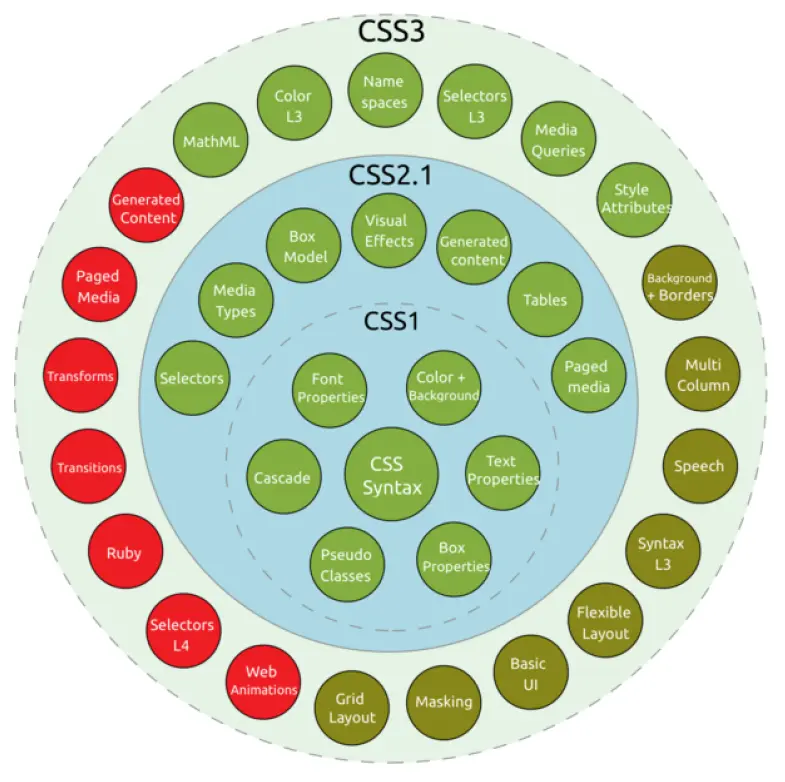

---

## 3.1.3 Cómo aplicar estilos CSS

# **Cómo aplicar estilos CSS**

Existen tres formas de incluir CSS en un documento HTML/XHTML:

- **Declaración en línea**: se declara el estilo en la misma línea en que se va a aplicar. Esta opción está desaconsejada.

- **Declaración interna**: se declaran los estilos a emplear en la página, en el encabezado de dicha página, mediante la etiqueta `<style>`.

- **Declaración externa**: se declara la hoja de estilo que se va a emplear en la página mediante la etiqueta `<link>`. Esta etiqueta se declara dentro de `<head>`. Es la opción más **recomendada**.

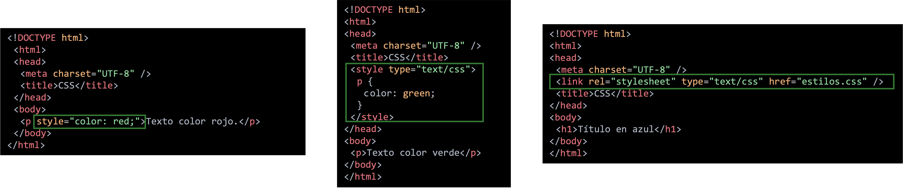

## **Declaración en línea**

Dentro de la propia etiqueta HTML mediante el atributo `style`.

Este modo **debe evitarse** para preservar el principio de separación de contenidos y formato.

> **📌 Html**
> 

```html
<!DOCTYPE html>
<html>
  <head>
    <meta charset="UTF-8" />
    <title>CSS</title>
  </head>
  <body>
    <p style="color: red;">Texto en color rojo.</p>
  </body>
</html>
```

> **📌 Probar en el navegador**
> 

> [Documento HTML](https://codesandbox.io/s/kind-booth-rbx4nz?file=/index.html)

## **Declaración interna**

En el encabezado del documento dentro del elemento `<style>` incluido en `<head>`.

> **📌 Html**
> 

```html
<!DOCTYPE html>
<html>
  <head>
    <meta charset="UTF-8" />
    <title>CSS</title>
    <style type="text/css">
      p {
        color: green;
      }
    </style>
  </head>
  <body>
    <p>Texto en color verde</p>
  </body>
</html>
```

Dentro de la etiqueta `<style>` se declarará el código CSS.

En el ejemplo, el texto de los elementos `<p>` se mostrará en verde.

> **📌 Probar en el navegador**
> 

> [Documento HTML](https://codesandbox.io/s/crazy-kowalevski-lrj46c?file=/index.html)

## **Declaración en archivo externo**

En el encabezado, mediante la etiqueta `<link>` dentro del elemento `<head>`.

> **📌 Html**
> 

```html
<!DOCTYPE html>
<html>
  <head>
    <meta charset="UTF-8" />
    <link rel="stylesheet" type="text/css" href="estilos.css" />
    <title>CSS</title>
  </head>
  <body>
    <h1>Título en azul</h1>
  </body>
</html>
```

El atributo `href` apuntará a la **ruta del fichero CSS**, el cual tendrá extensión `.css`.

El contenido del fichero CSS será **únicamente código CSS** y no tendrá ningunha etiqueta HTML. Por ejemplo, el contenido de un archivo CSS puede ser el siguiente:

> **📌 Css**
> 

```html
h1 {
    color: blue;
}
```

> **📌 Probar en el navegador**
> 

> [Documento HTML](https://codesandbox.io/s/icy-shadow-nrfh3e?file=/index.html)

Otra forma de usar hojas de estilo externas es mediante la etiqueta `@import`. Es una directiva CSS, no HTML.

> **📌 Html**
> 

```html
<!DOCTYPE html>
<html>
  <head>
    <meta charset="UTF-8" />
    <title>CSS</title>
    <style type="text/css">
      @import url("formato.css");
    </style>
  </head>
  <body>
    <p>Texto en verde.</p>
  </body>
</html>
```

Supongamos que el contenido del fichero `formato.css` es el siguiente:

> **📌 Css**
> 

```html
p {
    color: green;
}
```

De esta manera, el texto de los elementos `<p>` se mostrará en verde.

> **📌 Probar en el navegador**
> 

> [Documento HTML](https://codesandbox.io/s/vibrant-ritchie-4n60lb?file=/index.html)

> **📌 Warning**
> 

> Si el fichero está en el mismo directorio que el documento HTML, solo habrá que indica el nombre del fichero CSS:

> **📌 Html**
> 

```html
@import url("formato.css");
```

Si está dentro de un directorio, debemos indicar la ruta relativa. Por ejemplo:

> **📌 Html**
> 

```html
@import url("./directorio/formato.css");
```

## **Elemento `<span>`**

Este elemento se utiliza habitualmente para dar estilo a texto no marcado.

> **📌 Html**
> 

```html
<p>Parte de este párrafo <span style="color:red">está en rojo</span></p>
```

El navegador lo muestra de la siguiente manera:

> **📌 Probar en el navegador**
> 

> [Documento HTML](https://codesandbox.io/s/lucid-sun-x9tfj1?file=/index.html)

Se pueden enlazar dos o más hojas de estilo, con lo que el código fuente contendrá tantas etiquetas `<link>` como hojas enlazadas:

> **📌 Html**
> 

```html
<link rel="stylesheet" href="estilo1.css">
<link rel="stylesheet" href="estilo2.css">
```

En este caso, el navegador aplica las dos hojas de estilo en la página web, uno después del otro. Si un elemento está definido en las dos hojas, el navegador hará lo que diga la última hoja de estilo de la lista.

---

## 3.1.4 Hoja de estilos

# **Hoja de estilos**

El funcionamiento de las hojas de estilo es el siguiente: 
En la página web (archivo.html) se escriben las etiquetas que definen categorías o elementos. 
En la hoja de estilo (archivo.css) se escribe cómo queremos que siga el estilo de presentación de las etiquetas (color, tamaño, fuente, bordes, márgenes, posición, etc). 
En la página web se escribe qué hoja de estilo queremos utilizar.

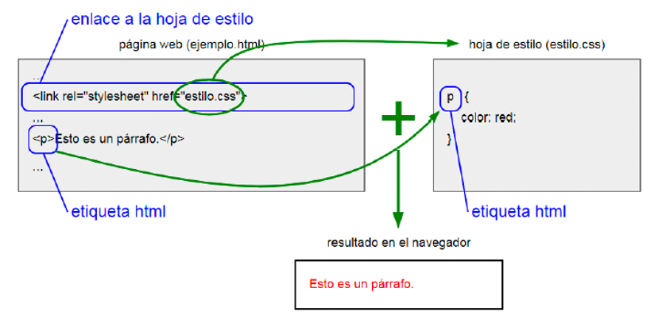

> **📌 Ventajas**
> 

> Permiten hacer un diseño consistente y fácil de modificar. Si varias páginas web hacen referencia a la misma hoja de estilo, solo tienes que hacer los cambios en un único lugar.

---

## 3.1.5 Sintaxis de una hoja de estilos.

# **Sintaxis de una hoja de estilos.**

Una hoja de estilo es un fichero de texto plano (sin formato) en el que se define el aspecto de las etiquetas de una página web y está formada por una o varias sentencias:

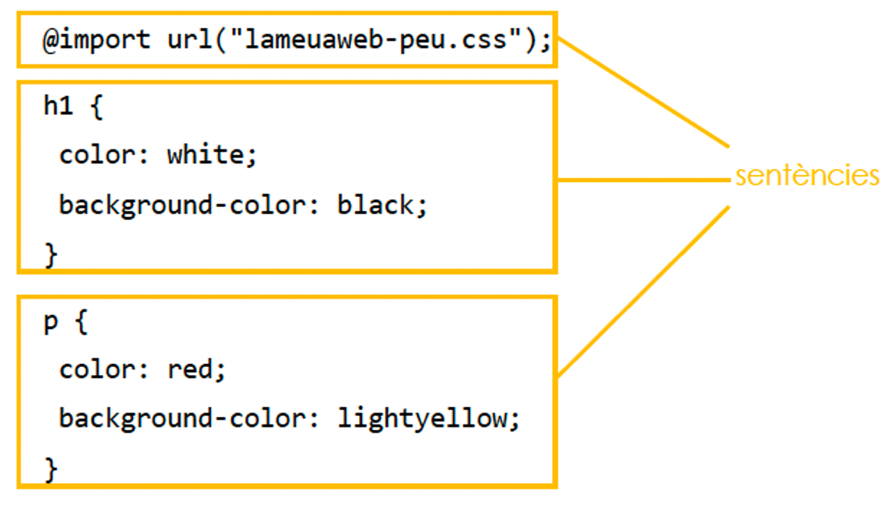

## **reglas-arroba**

Existen dos tipos de sentencias: Las reglas-arroba y las reglas:


Las reglas-arroba empiezan por el símbolo de arroba (@) pegado a un identificador y acaban por un punto y coma (;):

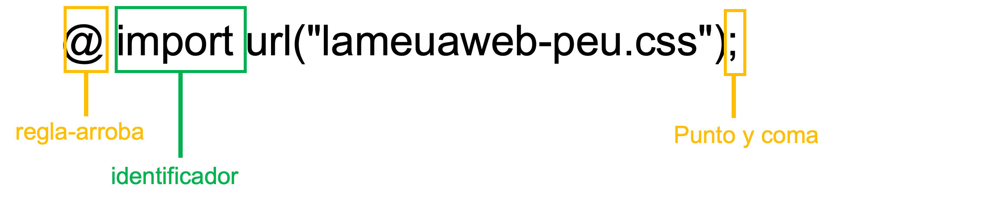

Son declaraciones CSS que encapsulan un grupo de reglas, pero no están directamente relacionadas a elementos HTML/XML. Controlan la forma en que se aplican los estilos extendiendo la capacidad de CSS y cada una tiene su propia sintaxis.

### **Reglas generales**

Se aplican a todo el CSS

- `@charset` Define el conjunto de caracteres usado en el CSS.

- `@import` Permite incluir otro CSS.

- `@namespace` Establece el XML a ser utilizado.

### **Reglas anidadas**

Pueden estar como declaración de estilo y como condicional.

- `@media` Establece reglas condicionales de acuerdo con las características de los dispositivos de salida (tamaño de pantalla, tipo de impresora, dispositivos braille, etc.)

- `@supports` Establece reglas condicionales según el navegador utilizado.

- `@document` Restringe las reglas contenidas según la URL.

- `@page` Restringe las reglas contenidas para cuando se quiere imprimir (en impresora) el documento.

- `@font-face` Incluye fuentes (tipográficas) externas.

- `@keyframes`  Controla los pasos intermedios en una secuencia de animación.

- `@viewport` Restringe las reglas según el tamaño y orientación de la ventana, especialmente útiles en smartphones.

- `@counter-style` Define estilos de contador específicos.

- `@font-feature-values`, `@swash`, `@ornaments`, `@annotation`, `@stylistic`, `@styleset` y `@character-variant` Define nombres comunes para la propiedad fuente-variante-alternatas.

## **reglas**

Las reglas están formadas por un selector y un bloque de declaración. El bloque de declaración empieza y acaba con llaves { }.

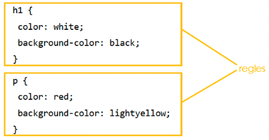

Cada declaración está formada por una o varias propiedades y sus valores correspondientes.

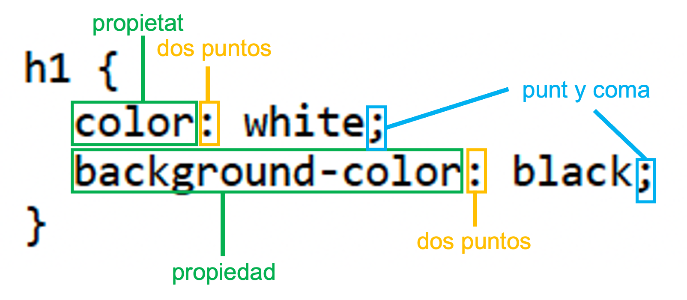

 

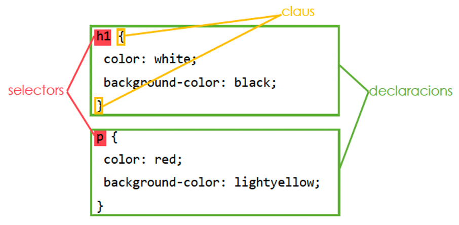

En general, si una propiedad necesita varios valores, los valores van separados por espacios en blanco. En general, si una propiedad admite varios valores alternativos, los valores van separados por comas.

## **Error más común**

Un error bastante habitual es escribir los caracteres `<p>` en la hoja de estilo.

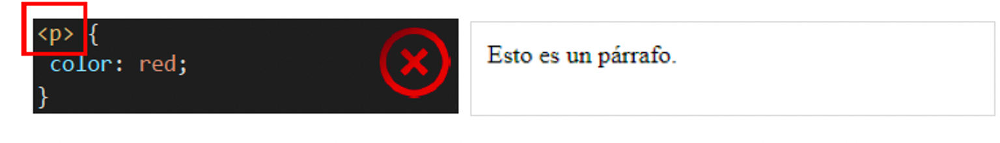

## **Estilos en cascada.**

El formato final de cualquier elemento depende de la combinación de todas las propiedades que afectan al elemento. La denominación de hojas de estilo en cascada hace referencia precisamente a este hecho.
Por ejemplo, una de estas reglas es que a un elemento le afectan todas las propiedades de los elementos en los que está incluido. Ejemplo: el color de texto del párrafo `<p>` viene determinado por la propiedad establecida para el elemento `<body>`:

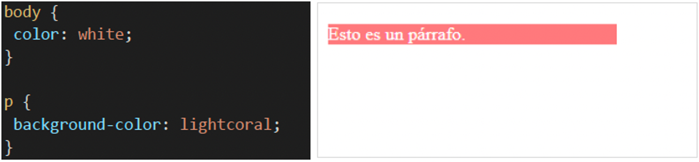

## **Selectores simultáneos**

Se pueden definir varios selectores simultáneamente escribiendo los selectores separados por comas, como muestran los siguientes ejemplos:

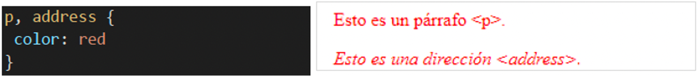

Lo que no es correcto es definir varias propiedades simultáneamente, como muestran los siguientes ejemplos:

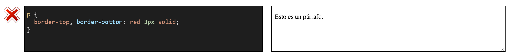

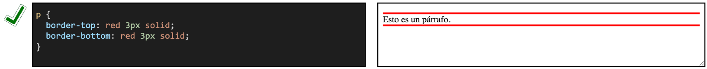

## **Repetir selectores**

Aunque no es incorrecto, no se aconseja repetir selectores, ya que distribuye la información en diversos lugares de la hoja de estilo y eso dificulta la lectura e interpretación de la hoja de estilo a los lectores humanos. 
Si se repiten las propiedades, el navegador aplica la propiedad que aparece en último lugar, como muestra el siguiente ejemplo:

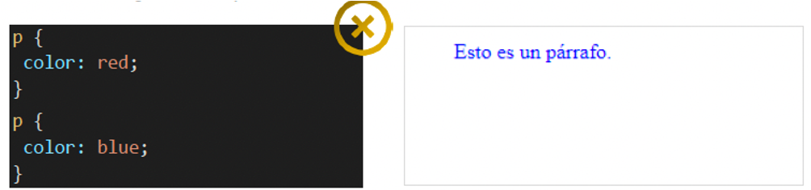

Si no se repiten las propiedades, el navegador aplica todas las propiedades, como muestra el siguiente ejemplo:

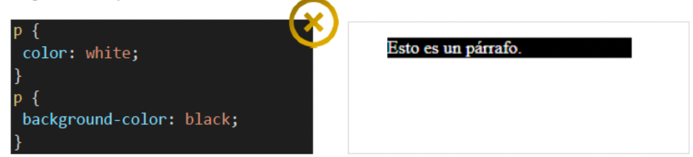

## **Comentarios**

Una hoja de estilos puede contener comentarios. Los delimitadores del comentario són `/* ... */` (como en el lenguaje de programación C). Los comentarios pueden estenderse en diversas líneas.

> **📌 Css**
> 

```html
/*
 Autor: MAA
 Fecha: 10 de octubre del 2025
*/

h1{
    background-color: black;    /*fondo negro*/
    color: white;               /*texto blanco*/
}
```

---

## 3.2 Tipos de selectores.

# **Tipos de selectores.**

Los selectores son la parte de las reglas que indican en el navegador a qué elementos se aplicarán las propiedades incluidas en las declaraciones. 
En este apartado se comentan únicamente los selectores simples y sus combinaciones.

## **Selector de tipo: E.**

Si se escribe un selector (E), las propiedades afectan a todos los elementos con etiqueta **E**. 
Ejemplo: todos los párrafos `<p>` se ven de color rojo.

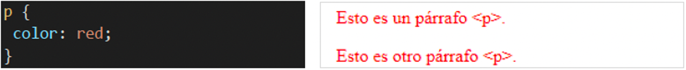

Si se escribe un asterisco (*), las propiedades afectan a todos los elementos de la página. Ejemplo: tanto el párrafo `<p>` como la dirección `<address>` se ven de color rojo. 

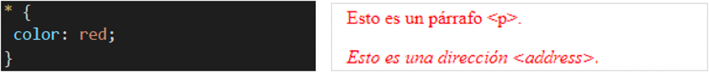

## **Selector de clase: E.c**

Si se escribe una etiqueta seguida de un punto y un nombre de clase (E.c),las propiedades afectan a todos los elementos con etiqueta **E** cuyo atributo class tenga el valor **c**. 
Ejemplo: sólo el párrafo `<p>` de clase ”aviso" se ven de color rojo.

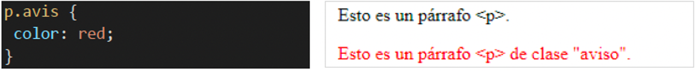

Para definir una clase que se pueda aplicar a cualquier etiqueta, se puede escribir como selector un punto y el nombre de la clase (.nombre-clase) o el selector universal *.nombre-clase.
Ejemplos: cualquier elemento de clase ”aviso" se ve de color rojo.

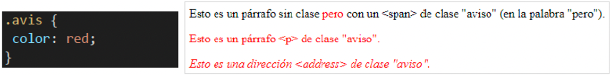

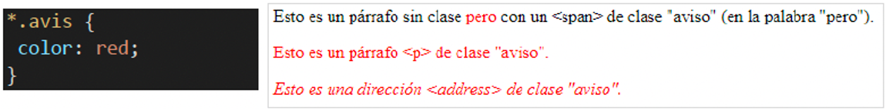

## **Selector de ID: E#i**

Si se escribe una etiqueta seguida de un cojinete y un nombre de **id** (**E#i**), las propiedades afectan al elemento con etiqueta **E** cuyo atributo **id** tenga el valor **i**.
En el ejemplo, sólo el párrafo `<p>` de id avis se ve de color rojo.

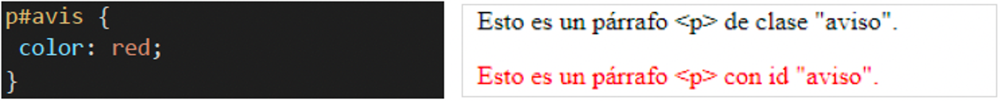

Hay que tener en cuenta que el atributo id no se puede repetir, es decir, no puede haber dos elementos con el mismo valor del atributo id (independientemente de que los elementos tengan etiquetas iguales o diferentes).

Para definir un **id** que se pueda aplicar a cualquier etiqueta, se puede escribir como selector un almoadilla y el nombre del **id** (**#nom-id**) o el selector universal ***#nom-id**.
En los dos ejemplos, cualquier elemento con id ”avisos" se ve de color rojo. 

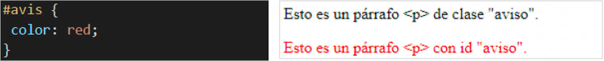

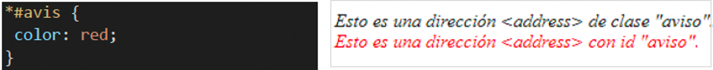

Aunque en una página web no puede haber dos elementos con el mismo valor del atributo id, en páginas diferentes sí puede haber dos elementos con el mismo valor del atributo id. Si la misma hoja de estilo se enlaza desde varias páginas web, el selector universal afectará en cada página a los elementos con el id correspondiente.

## **Selector descendiente: E F**

Si se escriben dos etiquetas seguidas (E F), las propiedades afectan a los elementos con la segunda etiqueta (F) contenidos dentro de la primera etiqueta (E), aunque haya etiquetas intermedias.
En el siguiente ejemplo, todos los párrafos `<p>` dentro de una división `<div>` se ven de color rojo.

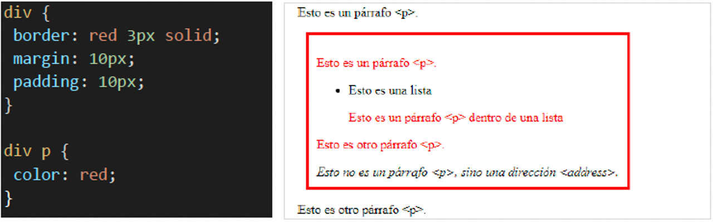

En general, si se escriben varias etiquetas seguidas (E F G ...), las propiedades afectan a los elementos con la última etiqueta contenidos dentro de la etiqueta anterior, contenidos a su vez dentro de etiqueta anterior y así sucesivamente, aunque haya etiquetas intermedias.
En el siguiente ejemplo, únicamente los párrafos `<p>` dentro de un elemento de lista `<li>` dentro de una división `<div>` se ven de color rojo.

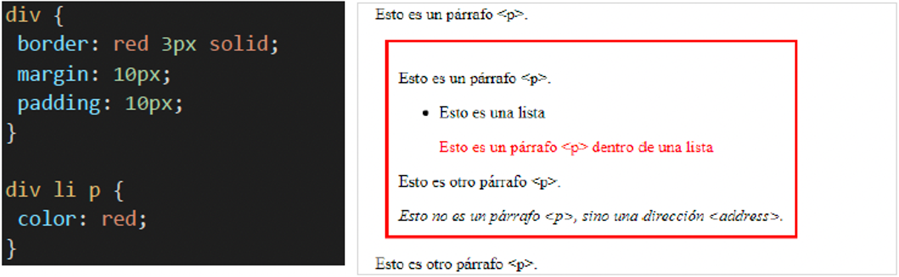

## **Selector hijos: E > F**

Si se escriben dos etiquetas seguidas separadas por un signo "mayor que" (**E > F**), las propiedades afectan a los elementos con la segunda etiqueta (**F**) contenidos dentro de la primera etiqueta (**E**), pero no afecta si hay etiquetas intermedias entre ellos. 
En el ejemplo, únicamente los párrafos `<p>`dentro de una división `<div>` sin elementos intermedios se ven de color rojo.

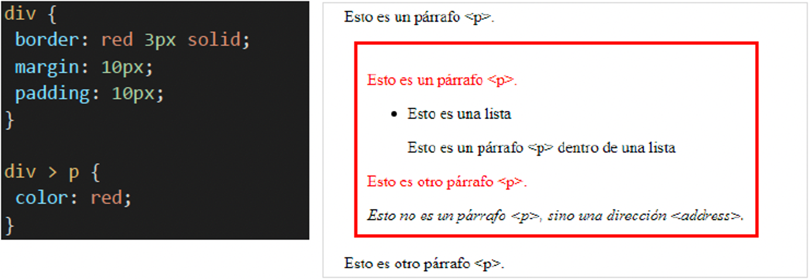

## **Selector consecutivos: E + F**

Si se escriben dos etiquetas seguidas separadas por un signo "más" (**E+F**), las propiedades afectan únicamente a los elementos con la segunda etiqueta (**F**) que van justo después de un elemento con la primera etiqueta (**E**). 
En el ejemplo, únicamente el párrafo `<p>` inmediatamente posterior a la división `<div>` se ven de color rojo.

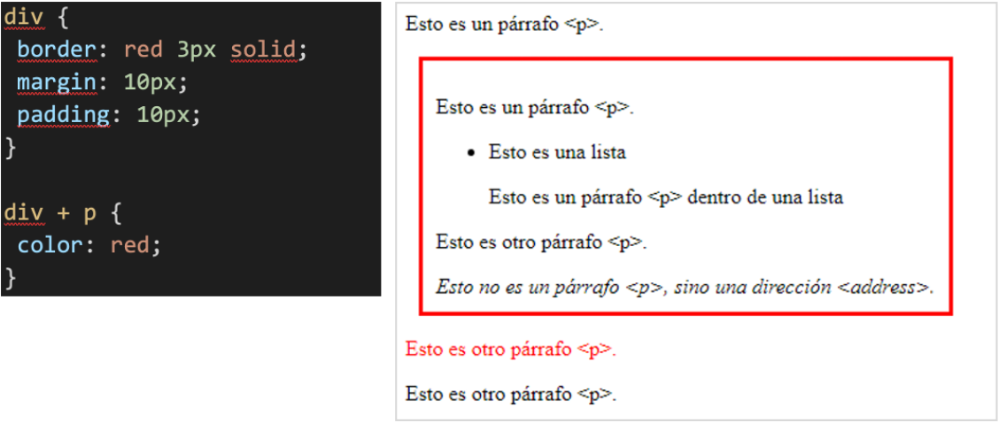

## **Selector hermanos: E ~ F**

Si se escriben dos etiquetas seguidas separadas por un signo "titlle" (**E ~ F**), las propiedades afectan únicamente a los elementos con la segunda etiqueta (**F**) que van después de un elemento con la primera etiqueta (**E**), siendo ambos elementos hermanos, es decir, hijos del mismo padre. 
En el ejemplo, la primera línea tiene una etiqueta `<span>`; la segunda línea uno `<p>` y la tercera línea tiene una etiqueta `<code>` y una etiqueta `<span>`.

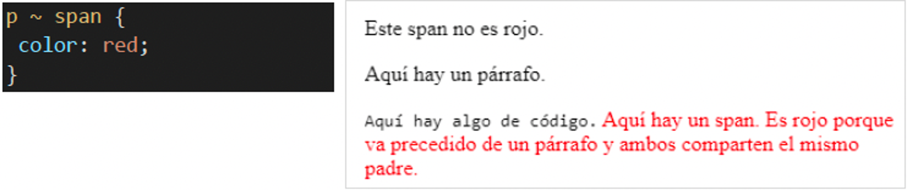

## **Selector atributo:**

Hay cuatro maneras de seleccionar elementos con determinados atributos:
**E[atribut] - E[atribut="valor"] - E[atribut~="valor"] - E[atribut|="valor"]**
  

Si se escribe una etiqueta seguida del nombre de un atributo entre corchetes, **E[atributo]**, las propiedades afectan a todos los elementos que tengan establecidos este atributo. 

En el ejemplo, los párrafos con clase, independientemente de la clase asignada, se muestran en mayúsculas.

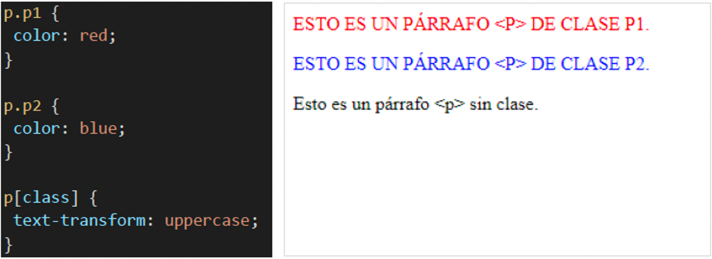

Si se escribe una etiqueta seguida del nombre de un atributo igual a un valor entre corchetes, **E[atributo="valor"]**, las propiedades afectan a todos los elementos que tengan establecidos este atributo exactamente con este valor.

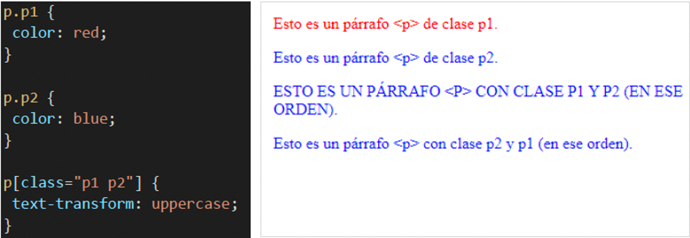

> **📌 Probar en el navegador - "Selectores"**
> 

> [Documento HTML](https://codesandbox.io/p/sandbox/f2pddc)

---

## 3.3 Pseudo-clases y pseudo elements

# **Pseudo-clases y pseudo elements**

## **¿Que son?**

- Las hojas de estilos asocian características de estilo a los elementos basándose en las etiquetas de los elementos y en su posición relativa (en el árbol del documento).

- Las pseudo-clases y los pseudo-elementos permiten hacer referencia a determinados elementos sin basarse en la información contenida en el árbol del documento.

- La diferencia entre pseudo-clases y pseudo-elementos es sutil. En general, los pseudo-elementos suelen hacer referencia a determinadas partes de un elemento, mientras que las pseudo-clases suelen hacer referencia al estado del elemento.

- Otra diferencia importante es que un pseudo-elemento sólo puede aparecer al final de un selector, mientras que una pseudo-clase puede aparecer en cualquier elemento del selector.

- La notación de los pseudo-elementos es etiqueta::p seudo-elemento.

## **Pseudo clases. First Child**

La pseudo-clase `:first-child` hace referencia al primer elemento de un tipo contenido dentro de otro. 
El ejemplo muestra cómo identificar al primer párrafo dentro de una división sin necesidad de asignar ninguna clase al párrafo.

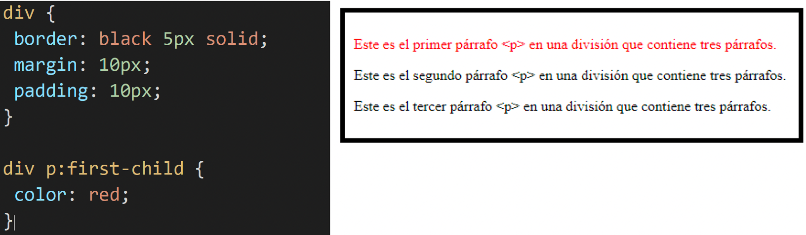

Es necesario que el tipo del primer elemento hijo en la página web sea el indicado en la hoja de estilo. En el ejemplo, el primer elemento dentro de la división no es un `<p>`, sino uno `<pre>`, así que no se le aplica el estilo indicado en la hoja de estilo.

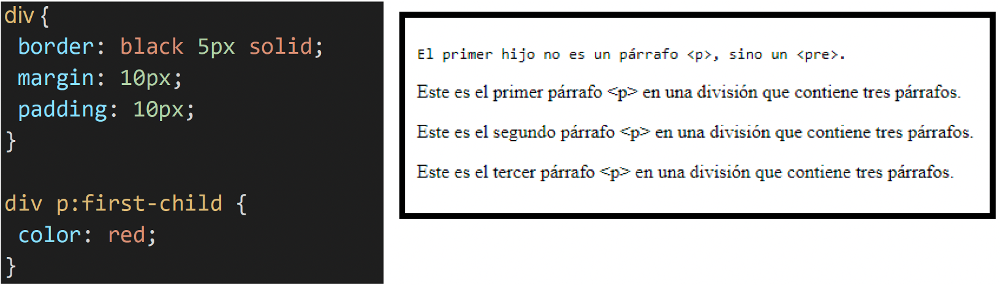

En el ejemplo, la pseudo-clase `:first-child` se aplica al primer elemento dentro de la división, sea como sea el elemento, ya que en la hoja de estilo no se especifica el elemento.

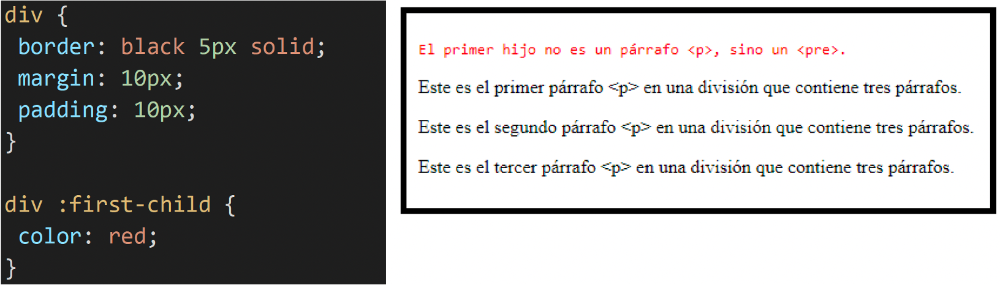

## **Pseudo clases de enlace.**

La pseudo clase `:link` (o `a:link`) permite especificar el aspecto de los enlaces que aún no han sido visitados.

La pseudo clase `:visited` (o `a:visited`) permite especificar el aspecto de los enlaces que sí han sido visitados.

### **Pseudo-classe: :link**

La pseudo-clase `:link` establece el aspecto de los enlaces no visitados, pero si solo se incluye en la hoja de estilo la pseudo-clase `:link`, el aspecto no cambiará al hacer clic en los enlaces:

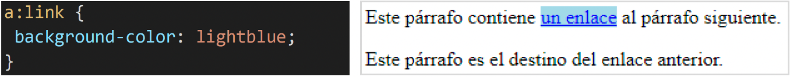

### **Pseudo-classe: :visited**

Es necesario incluir las dos pseudo-clases `:link` y `:visited` para que el aspecto del enlace cambie al hacer clic en él.

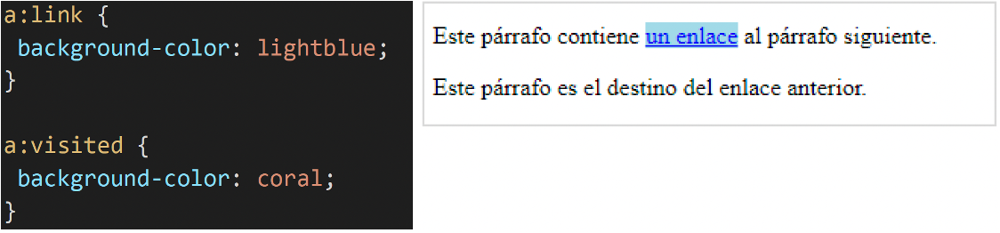

El ejemplo prueba estas cuatro propiedades. En el ejemplo se establecen antes las propiedades en la etiqueta `<a>` porque si no Firefox y Chrome no la modifican.

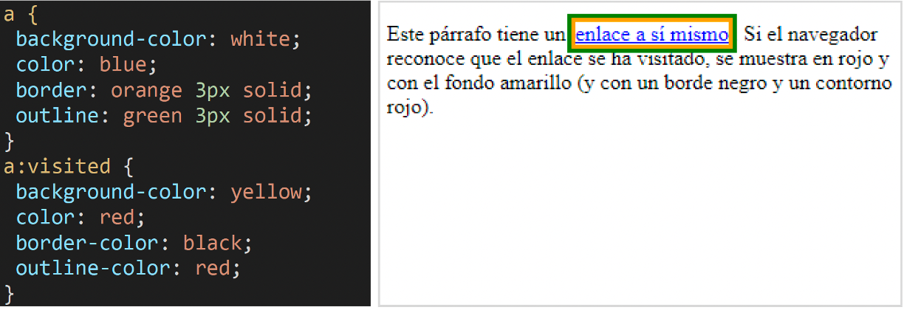

Si queremos cambiar el aspecto de un enlace, pero sin distinguir que el enlace se haya visitado o no, tenemos entonces tres opciones:

- Definir simultáneamente las dos pseudo-clases:

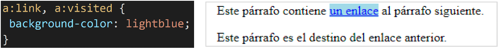

- Definir únicamente los enlaces no visitados:

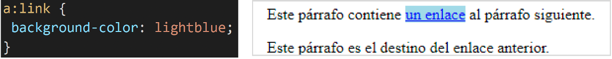

- Definir los enlaces en general:

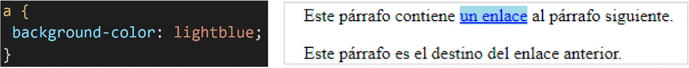

## **Pseudo clases dinámicas.**

### **Pseudo-clase dinámica: :hover**

La pseudo-clase `:hover` permite especificar el aspecto del elemento sobre el que se encuentra el ratón.

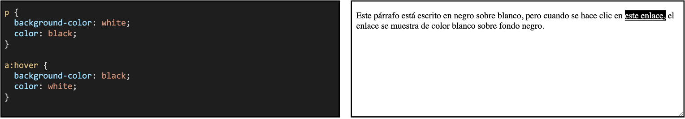

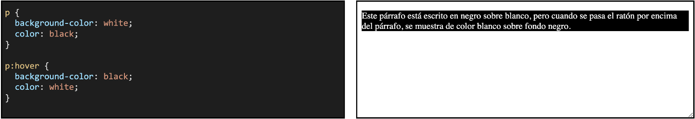

### **Pseudo-clase dinámica: :active**

La pseudo-clase `:active` permite especificar el aspecto de un elemento cuando se hace clic sobre él (y mientras se mantiene el botón del ratón pulsado).

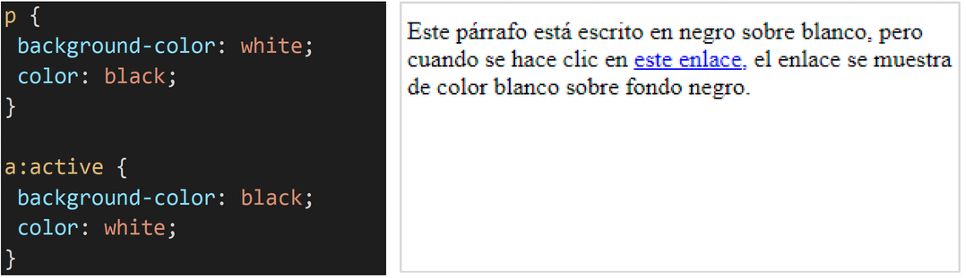

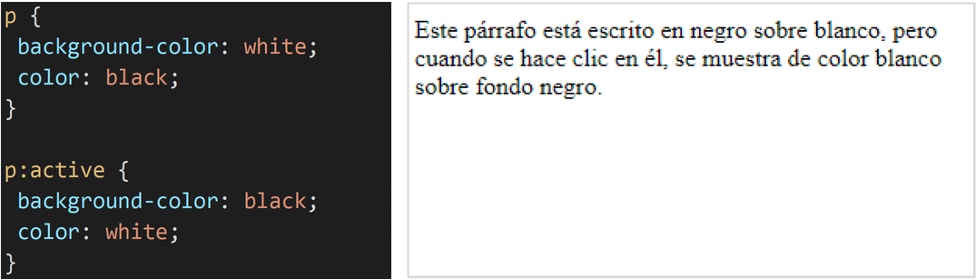

### **Pseudo-clase dinámica: :focus**

La pseudo-clase `:focus` permite especificar el aspecto de un elemento cuando éste tiene el foco. Los elementos que admiten el foco en una página web son aquellos que reaccionan a entrada por teclado (por ejemplo, los elementos de los formularios o los enlaces). 
En el ejemplo, al hacer clic en un campo de texto (o cambiar de campo con el tabulador), el campo seleccionado se resalta con un borde rojo.

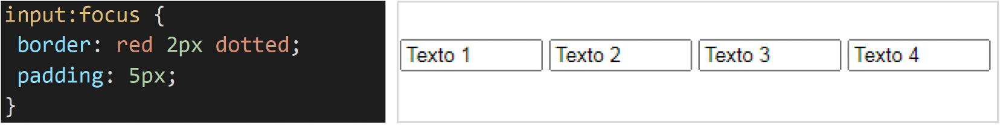

## **Pseudo clases de idiomas.**

### **Pseudo-clase de idiomas: :lang()**

La pseudo-clase de idioma `:lang()` permite especificar el aspecto de los elementos de un idioma determinado. 
En el siguiente ejemplo se cambia las comillas utilizadas en una cita `<q>` según el idioma indicado en el atributo lang.

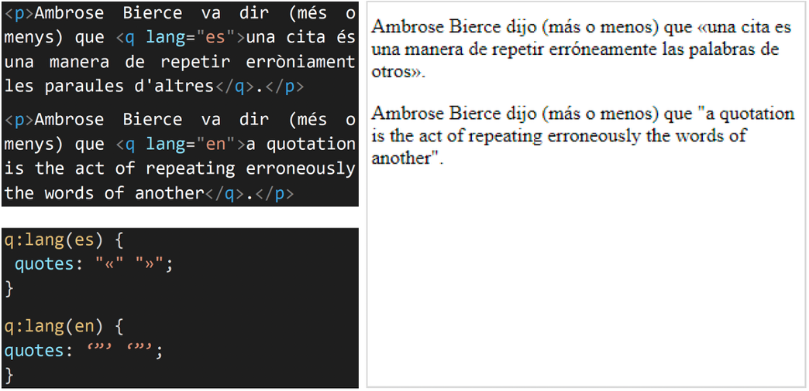

## **Pseudo elementos.**

### **Pseudo-elementos dinámicos ::first-line()**

El pseudo-elemento `::first-line` permite especificar el aspecto de la primera línea de texto.

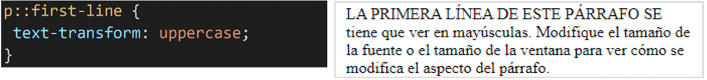

### **Pseudo-elementos dinámicos ::first-letter()**

El pseudo-elemento `::first-letter` permite especificar el aspecto de la primera letra de texto.

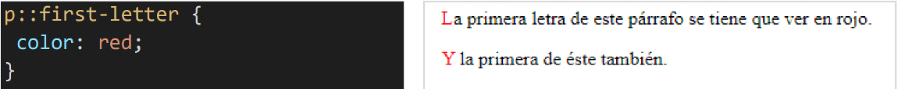

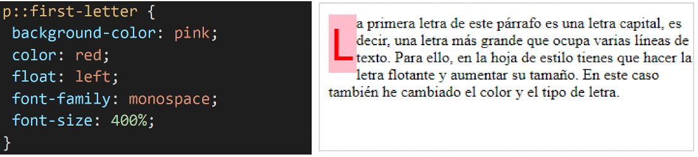

### **Pseudo-elementos ::before ::after**

Los pseudo-elementos `::before` y `::after` permiten añadir contenido a un elemento desde la hoja de estilo, al principio o al final del elemento. 
El contenido generado no puede seleccionarse con el ratón (para copiarlo y pegarlo en otro documento, por ejemplo). 
El contenido generado mediante la propiedad contento puede incluir texto:

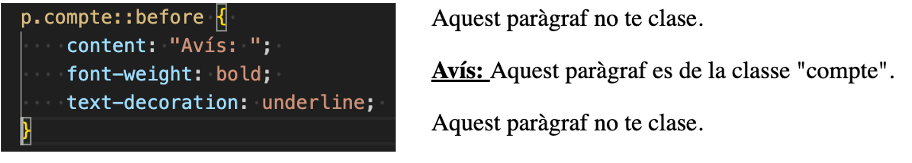

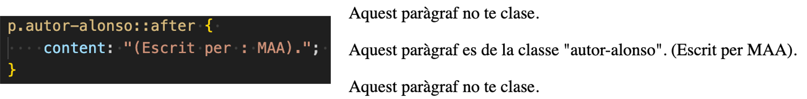

Se pueden generar contadores en los pseudo-elementos `::after` y `::before` mediante la propiedad **content** y el valor **counter**(nom_de_comptador). El contador debe ponerse a cero con la propiedad `counter-reset` y aumentarse con la propiedad `counter-increment`. 
En los siguientes ejemplos se ha definido un contador que se llama **conta-paragrafs**. Este contador se genera al principio de cada párrafo, se pone a cero con el elemento `<pre>` y se incrementa en cada párrafo.


El contador puede incrementarse en cualquier cantidad entera, como muestra el siguiente ejemplo:


Junto con el contador se puede generar texto, como muestra el siguiente ejemplo:


El contador predeterminado muestra números enteros, pero se puede utilizar cualquiera de los estilos de listas como estilo de contador. El estilo se indica en la propiedad **content** mediante el valor counter(nom_de_comptador, estil_de_llista), como muestra el siguiente ejemplo:


Se pueden utilizar varios contadores simultáneamente, como muestra el siguiente ejemplo:


> **📌 Probar en el navegador - "Pseudo clases y pseudo elementos"**
> 

> [Documento HTML](https://codesandbox.io/p/sandbox/up03-css-pseudoclases-y-elements-gtzvy7)

---

## 3.4 Estilos en Cascada

# **Estilos en Cascada**

## **Porque decimos estilos en cascada**

- Las propiedades de estilo pueden estar escritas en diversos lugares (en varios lugares de la página web o de la hoja de estilo) y dependiendo del sitio, afectan a más o menos elementos. 

- Cuando un elemento está contenido en otro (por ejemplo, un párrafo `<p>` dentro de una división `<div>`), al elemento de dentro se le aplican también las propiedades definidas para el elemento de fuera (en el párrafo `<p>` se le aplicarían las propiedades definidas para la división `<div>`). 

- Dos reglas diferentes pueden ser aplicable a un mismo elemento (por ejemplo, a un párrafo `<p>` con clase nombre, aplicará tanto el selector .nombre como el selector p). 

Si las propiedades (escritas en diferentes lugares o para diferentes elementos) no entran en conflicto, el navegador aplica todas las propiedades. Por ejemplo, si el color de fondo de un elemento está definido en un lugar y el tamaño de letra en otro lugar, el navegador aplicará ambas propiedades al elemento. 
Pero si las propiedades entran en conflicto (por ejemplo, el color del fondo del elemento está definido en varios lugares con colores diferentes), existen reglas para decidir qué propiedad tiene preferencia.

> **📌 Recordatorio. Donde pueden aparecer propiedades de estilos.**
> 

> - Existen tres formas de incluir CSS en un documento HTML/XHTML:

>   - Declaración en línea: se declara el estilo en la misma línea en que se va a aplicar. Esta opción está desaconsejada.

>   - Declaración interna: se declaran los estilos a emplear en la página, en el encabezado de dicha página, mediante la etiqueta `<style>`.

>   - Declaración externa: se declara la hoja de estilo que se va a emplear en la página mediante la etiqueta `<link>`. Esta etiqueta se declara dentro de `<head>`. Es la opción más recomendada.

> 


## **Reglas de aplicación de estilos.**

Si se define la misma propiedad para la misma etiqueta con el mismo selector en dos lugares diferentes, las reglas de precedencia son las siguientes: 

- Las propiedades definidas en un atributo style se imponen a las propiedades definidas en la etiqueta `<style>`.

- Las propiedades definidas en la etiqueta `<style>` se imponen a las propiedades definidas en una hoja de estilo enlazada. 

- Las propiedades definidas en un atributo style se imponen a las propiedades definidas en una hoja de estilo enlazada. 

Además de estas propiedades definidas por el creador de la página web, hay que tener en cuenta que también se aplican las propiedades definidas en la hoja de estilo por defecto del navegador. 
Si las propiedades se encuentran definidas en diferentes hojas de estilo, el navegador aplica el valor definido en la última hoja de estilo enlazada (es decir, en el último enlace `<link>` del `<head>`).

## **Elementos dentro de otros.**

Cuando un elemento está contenido en otro (por ejemplo, un párrafo `<p>` dentro de una división `<div>`), al elemento de dentro se le aplican también las propiedades definidas para el elemento de fuera. 
En el siguiente ejemplo, el párrafo incluido dentro de la división se muestra de color rojo porque el párrafo está incluido dentro de la división.


## **Reglas diferentes que se aplican al mismo elemento.**

Dos reglas diferentes se aplican a un mismo elemento cuando el elemento coincide con los selectores de las dos reglas. La regla que se aplica es la del selector de mayor especificidad. La especificidad de un selector se calcula atendiendo a los siguientes criterios:

- Número de atributos id en el selector. 

- Número de otros atributos y pseudo-clases en el selector (los pseudo-elementos se ignoran). 

- Número de elementos en el selector. 

- Posición en la hoja de estilo.

Estos criterios se aplican en orden, es decir, primero se comparan el número de atributos id de cada selector. Si un selector tiene más que el otro, se aplica esta regla, si el número es el mismo, entonces se calcula el segundo criterio (número de otros atributos y pseudo-clases). Y así sucesivamente.

### **Número de atributos id en el selector.**

El siguiente ejemplo muestra dos selectores con un número de atributos id diferente (1 o 0).
Puede comprobarse que se aplica siempre el selector con atributo id, independientemente del orden en que aparecieran en la hoja de estilo.


El siguiente ejemplo muestra también dos selectores con un número de atributos id diferente (2 o 1). Puede comprobarse que se aplica siempre el selector con más atributos id, independientemente del orden en que aparecieran en la hoja de estilo.


### **Número de otros atributos y pseudo-clases en el selector.**

El siguiente ejemplo muestra dos selectores con el mismo número de atributos id (0), pero con un número diferente de atributos class (1 o 0). Puede comprobarse que se aplica siempre el selector con más atributos class, independientemente del orden en que aparecieran en la hoja de estilo.


### **Número de elementos en el selector.**

El siguiente ejemplo muestra dos selectores con un número diferente de elementos (2 o 1). Puede comprobarse que se aplica siempre el selector con más elementos, independientemente del orden en que aparecieran en la hoja de estilo.


### **Posición en la hoja de estilo**

Si a un elemento le afectan dos selectores con la misma especificidad, el navegador aplica la propiedad que aparece después en la hoja de estilo. 
El siguiente ejemplo muestra dos selectores idénticos. Puede comprobarse que se aplica siempre el selector que aparece después en la hoja de estilo. En este caso, la penúltima regla es superflua y puede eliminarse sin afectar al resultado.


> **📌 Probar en el navegador - "Estilos en Cascada"**
> 

> [Documento HTML](https://codesandbox.io/p/sandbox/glyvrv)

---

## 3.5.1 Propiedades Principales

# **Propiedades Principales**

## **Introducción**

Se revisarán las propiedades principales que se usan en CSS como son:

- Propiedades de color y fondo.

- Propiedades de fuente.

- Propiedades de texto.

- Propiedades de lista.

- Propiedad `display`.

El abanico de propiedades es muy extenso y lo más aconsejable es revisar [**MDN Web Docs**](https://developer.mozilla.org/es/docs/Web/CSS) para conocer el funcionamiento de cada una de ellas e ir probándolas con un editor de texto y un navegador.

---

## 3.5.2 Propiedades de color y fondo

# **Propiedades de color y fondo**

En este apartado se revisarán las [propiedades de color](https://www.w3schools.com/colors/default.asp) y fondo.

## **color**

La propiedad [`color`](https://developer.mozilla.org/es/docs/Web/CSS/color) define el **color del texto**. Lo admiten casi todas las etiquetas de HTML.

El valor de este atributo es:

- El nombre de un color.

- El valor RGB (hexadecimal) de un color.


> **📌 CSS**
> 

```html
h1 {
    color: blue;
}
```

```html
h1 {
    color: #2d98da;
}
```

> **📌 Valor RGB**
> 

> Las herramientas de diseño, por lo general, incluyen una utilidad de selección de color, de donde se puede extraer el **código hexadecimal** correspondiente a un color. Este tipo de utilidad se denomina [**color picker**](https://colorpicker.me/).

> 


## **background-color**

Indica el **color de fondo** del elemento. El valor de este atributo es un color.

El valor de este atributo es:

- El nombre de un color.

- El valor RGB (hexadecimal) de un color.

> **📌 CSS**
> 

```html
div {
    background-color: blue;
}
```

```html
div {
    background-color: #2d98da;
}
```

## **background-image**

Permite colocar una **imagen de fondo** del elemento. El valor que toma es el nombre de la imagen con su ruta relativa o absoluta.

> **📌 CSS**
> 

```html
div {
    background-image: url(/images/logoIESMRE.png);
}
```

```html
div {
    background-image: linear-gradient(rgb(149, 146, 0), rgba(235, 235, 181, 0.255));
}
```

## **background-repeat**

Indica si ha de **repetirse** la imagen de fondo y, en ese caso, si debe ser horizontal o verticalmente.

Los valores que puede tomar son:

- `repeat-x`

- `repeat-y`

- `no-repeat`

> **📌 CSS**
> 

```html
div {
  padding: 200px;
  background-image: url(/images/logoIESMRE.png);
  background-repeat: no-repeat; /*repeat-x, repeat-y, no-repeat, space, round*/
}
```

## **background-attachment**

Especifica si la imagen ha de **permanecer fija** o realizar un scroll.

Los valores que pueden tomar son:

- `scroll`

- `fixed`

## **background-position**

Es una medida, porcentaje o el posicionamiento (vertical u horizontal) con los valores establecidos que sirve para posicionar una imagen.

Los valores que puede tomar son:

- 

Un porcentaje.

- 

Un tamaño.

Los valores:

- 

`top`, `center`, `bottom`

- 

`left`, `center`, `rigth`

> **📌 CSS**
> 

```html
div {
    background-position: top right;
}
```

## **background**

Establece (en un solo paso) cualquiera de las propiedades de background anteriores.

Los valores que puede tomar son:

- `background-color`

- `background-image`

- `background-repeat`

- `background-attachment`

- `background-position`

Dado que no todos los nombres de colores son admitidos en el estándar, es aconsejable utilizar el valor RGB.

> **📌 Ejemplo background**
> 
HTMLCSSNavegador

```html
<!DOCTYPE html>
<html lang="en">
  <head>
    <meta charset="UTF-8" />
    <meta name="viewport" content="width=device-width, initial-scale=1.0" />
    <meta http-equiv="X-UA-Compatible" content="ie=edge" />
    <title>HTML + CSS</title>
    <link rel="stylesheet" href="styles.css" />
  </head>
  <body>
    <h1>Propiedades Principales</h1>
    <section class="background">
      <h2>Propiedades de Color y Fondo.</h2>
      <div></div>
    </section>
    <section class="background-all">
      <h2>Propiedades de Color y Fondo.</h2>
      <div></div>
    </section>
  </body>
</html>
```

```html
section.background div {
  padding: 200px;
  background-color: rgb(189, 223, 189);
  background-image: url(/md/assets/images/ut03/logoIESMRE.png),
    linear-gradient(rgb(149, 146, 0), rgba(235, 235, 181, 0.255));
  background-position: center; /*top, center, bottom / left, center, rigth*/
  background-repeat: no-repeat; /*repeat-x, repeat-y, no-repeat, space, round*/
  background-attachment: scroll;
}
```


## **Transparencia**

La propiedad [`opacity`](https://developer.mozilla.org/es/docs/Web/CSS/Reference/Properties/opacity) permite hacer que un elemento sea parcialmente transparente. El valor de esta propiedad debe ser un valor decimal entre 0 y 1 (el valor 0 hace que el elemento sea completamente transparente y el valor 1 hace que el elemento sea completamente opaco).
Si un elemento parcialmente transparente se superpone a otro elemento de otro color, el navegador mezcla los colores de los elementos.

> **📌 Ejemplo opacity**
> 
HTMLCSSNavegador

```html
<!DOCTYPE html>
<html lang="en">
  <head>
    <meta charset="UTF-8" />
    <meta name="viewport" content="width=device-width, initial-scale=1.0" />
    <meta http-equiv="X-UA-Compatible" content="ie=edge" />
    <title>HTML + CSS</title>
    <link rel="stylesheet" href="styles.css" />
  </head>
  <body>
    <section class="transparente">
      <h2>Transparencia</h2>
      <div class="box" id="two">
        Este texto se encuentra situado a la izquierda, a la izquierda, a la
        izquierda, a la izquierda, a la izquierda, a la izquierda, a la
        izquierda, a la izquierda, a la izquierda
      </div>
      <div class="box" id="three">
        Este texto se encuentra situado a la derecha, a la derecha, a la
        derecha, a la derecha, a la derecha, a la derecha, a la derecha, a la
        derecha, a la derecha
      </div>
    </section>
  </body>
</html>
```

```html
.box {
  display: inline-block;
  max-width: 300px;

  background: yellow;
}

#two {
  position: relative;
  top: 20px;
  left: 100px;
  background: red;
  color: white;
  opacity: 0.5;
}
```


> **📌 Probar en el navegador - "Propiedades de color y fondo"**
> 

> [Documento HTML](https://codesandbox.io/p/sandbox/8xfwv5)

---

## 3.5.3 Propiedades de fuente

# **Propiedades de fuente**

En este apartado vamos a ver las distintas propiedades que podemos utilizar referentes a las **fuentes tipográficas** de nuestro documento.

## **font-size**

Indica el **tamaño** de la fuente.

Puede ser un tamaño absoluto, relativo o en porcentaje.

Toma valores de unidades de CSS.

> **📌 CSS**
> 

```html
p {
    font-size: 16px;
}
```

## **font-family**

Establece la **familia** a la que pertenece la fuente.

Si el nombre de una fuente contiene espacios, se deben utilizar comillas para encerrar su nombre.

El valor es el nombre de la familia fuente.

## **font-weight**

Define el grosor de los caracteres.

Los valores que puede tomar son: `normal`, `bold`, `bolder`, `lighter`, `100`, `200`, `300`, `400`, `500`, `600`, `700`, `800` o `900`.

> **📌 CSS**
> 

```html
p {
    font-weight: bold;
}
```

## **font-style**

Determina si la fuente es normal o cursiva.

Los valores posibles son:

- `normal`

- `italic`

- `oblique`

El estilo `oblique` es similar al cursiva.

> **📌 CSS**
> 

```html
p {
    font-style: italic;
}
```

## **font-variant**

Determina si la fuente es normal o mayúsculas pequeñas.

Los valores que puede tomar son:

- `normal`

- `small-caps`

## **line-height**

El alto de una línea y por tanto, el espaciado entre líneas.

Es una de esas características que no se podían modificar utilizando HTML.

## **font**

Permite establecer todas las propiedades anteriores en el orden que se indica a continuación:

- `font-style`

- `font-variant`

- `font-weight`

- `font-size`

- `line-height`

- `font family`

Los valores han de estar separados por **espacios**. No es obligatorio el uso de todos los valores.

> **📌 CSS**
> 

```html
p {
    font: italic normal bold 20px 1em Verdana;
}
```

> **📌 Ejemplo font**
> 
HTMLCSSNavegador

```html
<!DOCTYPE html>
<html lang="es">
  <head>
    <meta charset="UTF-8" />
    <meta name="viewport" content="width=device-width, initial-scale=1.0" />
    <meta http-equiv="X-UA-Compatible" content="ie=edge" />
    <title>Propiedades de fuente</title>
    <link rel="stylesheet" href="styles.css" />
  </head>

  <body>
    <h1>Propiedades de fuente</h1>

    <p class="individual">
      Este párrafo utiliza todas las propiedades de la fuente de manera
      individual: tamaño 18px, estilo cursiva, grosor 700, mayúsculas pequeñas,
      espaciado de línea 1.6 y la familia "Times New Roman".
    </p>

    <p class="abreviada">
      Este párrafo usa la propiedad abreviada <code>font</code> para establecer
      todas las características en una sola línea, incluyendo el estilo oblique,
      small-caps, negrita, tamaño 20px, line-height 1.4 y la familia Verdana.
    </p>
  </body>
</html>
```

```html
h1 {
  text-decoration: underline;
}

.individual {
  font-size: 18px;
  font-family: "Times New Roman", serif;
  font-weight: 700;
  font-style: italic;
  font-variant: small-caps;
  line-height: 1.6;
  color: lightgreen;
  background-color: black;
}

.abreviada {
  font: oblique small-caps bold 20px/1.4 "Verdana";
  color: skyblue;
  background-color: black;
}
```


> **📌 Probar en el navegador - "Propiedades de color y fondo"**
> 

> [Documento HTML](https://codesandbox.io/p/sandbox/up03-css-propiedadesfuente-vkmym5)

---

## 3.5.4 Propiedades de texto

# **Propiedades de texto**

En este apartado se centra en las propiedades relacionadas con el texto.

## **text-decoration**

Establece si el texto está subrayado, sobrerayado o tachado.

Los valores que puede tomar son:

- `none`

- `underline`

- `overline`

- `line-through`

> **📌 Ejemplo text-decoration**
> 
CSSNavegador

```html
.p1 {
  text-decoration: underline red dotted;
}
.p2 {
  text-decoration: overline green;
}
.p3 {
  text-decoration: line-through yellow;
}

.p4 {
  text-decoration: blue wavy underline;
}
.p5 {
  text-decoration: underline overline red;
}
```


## **text-align**

Indica la **alineación** del texto. Aunque las hojas de estilo permiten el justificado de texto, no funciona en todos los sistemas.

Los valores que puede tomar son:

- `left`

- `right`

- `center`

- `justify`

> **📌 Ejemplo text-align**
> 
CSSNavegador

```html
.p1 {
  text-align: center;
}
.p2 {
  text-align: left;
}
.p3 {
  text-align: right;
}
.p4 {
  text-align: justify;
}
```


## **text-indent**

Determina la **tabulación** del texto. Los valores que puede tomar son:

- Una longitud (en unidades CSS).

- Un porcentaje.

> **📌 Ejemplo text-indent**
> 
CSSNavegador

```html
.p1 {
  text-indent: 10%;
}
.p2 {
  text-indent: 0%;
}
.p3 {
  padding: 30px;
  text-indent: -5%;
}
```


## **text-transform**

Nos permite **transformar** el texto, haciendo que tenga la primera letra en mayúsculas de todas las palabras, todo en mayúsculas o minúsculas.

Los valores que puede tomar son:

- `capitalize`

- `uppercase`

- `lowercase`

- `none`

> **📌 Ejemplo text-transform**
> 
CSSNavegador

```html
.p1 {
  text-transform: capitalize;
}
.p2 {
  text-transform: lowercase;
}
.p3 {
  text-transform: uppercase;
}
```


## **word-spacing**

Determina el **espaciado entre las palabras**. Los valores que puede tomar es un tamaño.

> **📌 Ejemplo word-spacing**
> 
CSSNavegador

```html
.p1 {
  word-spacing: 2em;
  color: green;
}
.p2 {
  word-spacing: 10px;
  color: blue;
}
```


## **letter-spacing**

Determina el **espaciado entre letras**. Los valores que puede tomar es un tamaño.

> **📌 Ejemplo letter-spacing**
> 
CSSNavegador

```html
.p1 {
  letter-spacing: 2em;
  color: green;
}
.p2 {
  letter-spacing: 10px;
  color: blue;
}
```


## **vertical-align**

Establece la **alineación vertical** del texto. Sus valores posibles son:

- `baseline`

- `sub`

- `super`

- `top`

- `text-top`

- `middle`

- `bottom`

- `text-bottom`

- Un porcentaje

> **📌 Ejemplo vertical-align**
> 
CSSNavegador

```html
table {
  margin-left: auto;
  margin-right: auto;
  width: 80%;
}

table,
th,
td {
  border: 1px solid black;
}

td {
  padding: 0.5em;
  font-family: monospace;
}

.bottom {
  vertical-align: bottom;
  color: blue;
}

.baseline {
  vertical-align: baseline;
  color: green;
}

.top {
  vertical-align: top;
  color: red;
}

.middle {
  vertical-align: middle;
  color: darkgoldenrod;
}
```


## **line-height**

Altura de la línea. Puede establecerse mediante un tamaño o un porcentaje

> **📌 Ejemplo line-height**
> 
CSSNavegador

```html
.p1 {
  line-height: 0.5;
  color: green;
}
.p2 {
  line-height: 3em;
  color: blue;
}
```


> **📌 Probar en el navegador - "Propiedades de color y fondo"**
> 

> [Documento HTML](https://codesandbox.io/p/sandbox/2zxc46)

---

## 3.5.5 Propiedades de lista

# Propiedades de lista

Hay cuatro propiedades de estilo para listas.

> **📌 Propiedades de estilo para listas**
> 
**list-style-type**list-style-image**list-style-position**list-style**

Con [`list-style-type`](https://developer.mozilla.org/es/docs/Web/CSS/Reference/Properties/list-style-type) se indica cual es el símbolo que se utiliza como marcador en las listas. Valores que puede tomar son:

- `disc`

- `circle`

- `square`

- `decimal`

- `lower-roman`

- `upper-roman`

- `lower-alpha`

- `upper-alpha`

- `none`

> **📌 Ejemplo list-style-type**
> 
CSSNavegador

```html
ul.ul1 {
list-style-type: disc;
}

ul.ul2 {
list-style-type: circle;
}

ul.ul3 {
list-style-type: decimal;
}

ul.ul4 {
list-style-type: lower-greek;
}

ul.ul5 {
list-style-type: lower-roman;
}
```


Para poder utilizar imágenes como marcadores en una lista se utiliza [`list-style-image`](https://developer.mozilla.org/es/docs/Web/CSS/Reference/Properties/list-style-image). El valor que toma es la ruta (relativa, absoluta o URL) del fichero imagen.

> **📌 Ejemplo list-style-image**
> 
CSSNavegador

```html
ul.ul1 {
list-style-image: url("squirrel-24.svg");
}

ul.ul2 {
list-style-image: url("mark-github-24.svg");
}
```


[`list-style-position`](https://developer.mozilla.org/es/docs/Web/CSS/Reference/Properties/list-style-position) determinan la posición del marcador en una lista. Puede tomar los valores:

- `outside`

- `inside`.

> **📌 Ejemplo list-style-position**
> 
CSSNavegador

```html
ul.ul1 {
list-style-position: inside;
}

ul.ul2 {
list-style-position: outside;
}
```


La propiedad [`list-style`](https://developer.mozilla.org/es/docs/Web/CSS/Reference/Properties/list-style) permite establecer de una única vez todas las características de una lista. Hay que seguir el orden siguiente:

- `list-style-type`

- `list-style-position`

- `list-style-image`

> **📌 Probar en el navegador - "Propiedades de lista"**
> 

> [Documento HTML](https://codesandbox.io/p/sandbox/74q2nn)

---

## 3.5.6 Propiedad display

# Propiedad display

## Conceptos fundamentales de maquetación

Probablemente, una de las partes más complejas de CSS sea la creación de **layouts**, **colocación** y **distribución** de los elementos a lo largo de una página, y sin duda el que más le cuesta a los desarrolladores que están comenzando. Sin embargo, es una parte fundamental dentro de CSS, y es necesario entenderla correctamente para que resulte más fácil de trabajar y crear nuestros diseños.

Para establecer estos mecanismos básicos de layout se utiliza una propiedad llamada [`display`](https://developer.mozilla.org/es/docs/Web/CSS/Reference/Properties/display) que, aunque no la estemos utilizando explícitamente, está actuando por omisión. Vamos a aprender de que se trata.

## La propiedad `display`

Por defecto todos los elementos HTML tienen una forma de comportarse a la hora de renderizarse (**dibujarse**) en el navegador. Algunos elementos HTML como `<div>` o `<p>` actúan de una forma, y otros elementos como `<a>` o `<span>` de otra forma diferente. Esto tiene una razón de ser, y la explicaremos un poco más adelante.

Como hemos mencionado, aunque no lo hagamos explícitamente, todos los elementos HTML tienen una forma de representarse. Pero esa forma puede cambiarse a través de la propiedad CSS `display`, indicándole un tipo de representación concreta:

> **📌 CSS**
> 

```html
div {
display: block;   /* Valor por defecto en los <div> */
}
```

Cambiando ese tipo de representación o utilizando el valor `none`, se indicar al navegador que debe renderizarse de una forma concreta o no tiene ningún tipo de representación y debe ocultarse (**en el caso de `none`**).

Estos son los tipos de representación que existen en CSS:

| Tipo | Descripción |
| --- | --- |
| `inline` | Se coloca a continuación del otro (en horizontal). Ignora dimensiones. |
| `block` | Se coloca encima de otro (en vertical). |
| `inline-block` | Híbrido en línea-bloque. Actúa como un elemento en línea, pero obedece dimensiones. |
| `flex` | Utiliza el modelo de **cajas flexibles** de CSS. Ideal para estructuras de 1 dimensión. |
| `inline-flex` | Versión en línea (ocupa sólo su contenido) del modelo de cajas flexibles de CSS. |
| `grid` | Utiliza cuadrículas o rejillas con el modelo de cajas Grid CSS. |
| `inline-grid` | La versión en línea (ocupa sólo su contenido) del modelo de cajas Grid CSS. |
| `list-item` | Actúa como un ítem de una lista. Es el comportamiento de etiquetas como `&LTli>`. |
| `table` | Actúa como una tabla. Es el comportamiento de etiquetas como `&LTtable>`. |
| `table-cell` | Actúa como la celda de una tabla. Es el comportamiento de etiquetas como `&LTth>` o `&LTtd>`. |
| `table-row` | Actúa como la fila de una tabla. Es el comportamiento de etiquetas como `&LTtr>`. |
| `contents` | Ignora la caja del elemento. Útil para mantener Grid/Flex aún teniendo un wrapper intermedio. |
| `none` | No dibuja en el navegador el contenido del elemento ni sus hijos. |

> **📌 Anotación a los tipos de representación**
> 

> Las representaciones como flex o grid lo veremos más adelante en esta misma unidad. Ahora nos vamos a centrar en las propiedades de `inline`, `block`, `inline-block`, `list-item`, `table`, `contents` y `none`.

> **📌 Tipos de representación**
> 
**¿Qué es inline?**¿Qué es block?**¿Qué es inline-block?**¿Qué es list-item?**¿Qué es table?**El valor contents**El valor none**

Como norma general (*con excepciones*) los elementos que se utilizan dentro de un párrafo, son de tipo `inline`. Este tipo se caracteriza por varias cosas:

- Los elementos se alinean uno detrás de otro (*en horizontal*).

- Su tamaño o dimensiones se adaptan al de su contenido.

- Aunque uses `width` o `height`, se ignora y no cambia tamaño.

Por ejemplo, todos los elementos `<span>` o `<strong>` se comportan como elementos en línea (*inline*), mientras que los elementos `<div>` por defecto se comportan como elementos en bloque (*lo explicaremos en el siguiente apartado*):

> **📌 Ejemplo inline**
> 
HTMLCSSNavegador

```html
<div>Ejemplo de bloque</div>
<div>Ejemplo de bloque</div>
<span>Ejemplo de span</span>
<span>Ejemplo de span</span>
```

```html
div {
background: darkblue;
color: white;
}

span {
background: darkred;
color: white;
}
```


Observa, que aún sin haberlo indicado, los elementos `<div>` se comportan como si tuvieran un `display: block` y los elementos `<span>` se comportan como si tuvieran un `display: inline`.

No obstante, nosotros podemos forzar y cambiar su tipo:

> **📌 Ejemplo inline**
> 
HTMLCSSNavegador

```html
<div>Ejemplo de bloque</div>
<div>Ejemplo de bloque</div>
<span>Ejemplo de span</span>
<span>Ejemplo de span</span>
```

```html
div {
background: darkblue;
color: white;
display: inline;
}

span {
background: darkred;
color: white;
}
```


Observa que ahora, tanto `<div>` como `<span>` se comportan de la misma forma: como un elemento en línea. Normalmente, este tipo de representación de elementos se usa para agrupar fragmentos de texto.

Por su parte, los elementos que se utilizan para agrupar otros elementos HTML, por norma general, son de tipo `block`. Este tipo de elementos se caracteriza por lo siguiente:

- Los elementos se apilan uno encima de otro (*en vertical*).

- Por defecto, usa todo el ancho (*en horizontal*) disponible.

- Si usas `width` o `height`, obedece y cambia el tamaño del elemento.

Por ejemplo, todos los elementos `&LTdiv>` se comportan como elementos de bloque (*block*). En este ejemplo, además, aunque los elementos `&LTspan>` se comportan como elementos en línea, vamos a cambiarlos con `display` para que se comporten como elementos en bloque, apilándose unos encima de otros:

> **📌 Ejemplo inline**
> 
HTMLCSSNavegador

```html
<div>Ejemplo de bloque</div>
<div>Ejemplo de bloque</div>
<span>Ejemplo de span</span>
<span>Ejemplo de span</span>
```

```html
div {
background: darkblue;
color: white;
}

span {
background: darkred;
color: white;
display: block;
}
```


Normalmente, este tipo de representación de elementos se usa para agrupar múltiples elementos HTML y organizarlos.

Si utilizamos la propiedad `display` con el valor `inline-block`, conseguiremos un elemento que funcionará como si fuera un elemento `inline`, pero obedeciendo a las propiedades `width` y `height`, las cuales se ignoran si estamos utilizando un `display: inline`.

Se trata de una especie de híbrido entre `inline` y `block`:

> **📌 Ejemplo inline-block**
> 
HTMLCSSNavegador

```html
<div>Ejemplo de bloque</div>
<div>Ejemplo de bloque</div>
<span>Ejemplo de span</span>
<span>Ejemplo de span</span>
<span class="inline-block">Ejemplo de inline-block</span>
<span class="inline-block">Ejemplo de inline-block</span>
```

```html
div {
background: darkblue;
color: white;
}

span {
background: darkred;
color: white;
width: 200px;
}

.inline-block {
background: green;
color: white;
display: inline-block;
width: 300px;
}
```


Observa que en el caso del elemento `<span>` (*inline*), el navegador ignora las dimensiones de ancho que le hemos indicado, al contrario que en los `<Tdiv>` (*block*) o en el elemento `inline-block`. El valor `inline-block` nos puede venir muy bien cuando necesitamos una mezcla de ambos: donde se comporte como un `inline` pero que haga caso a las medidas de dimensión como los `block`.

Aunque no es muy utilizado hoy en día, el valor `list-item` se puede utilizar para que un elemento se represente visualmente como los ítems de una lista:

> **📌 Ejemplo inline-block**
> 
HTMLCSSNavegador

```html
<ul>
<li>Item 1</li>
<li>Item 2</li>
<li>Item 3</li>
</ul>

<div class="list">
<div>Item 1</div>
<div>Item 2</div>
<div>Item 3</div>
</div>
```

```html
.list {
margin: 2.5rem;

& div {
    background: green;
    display: list-item;
}
}
```


De esta forma, podemos renderizar como elementos de una lista a elementos HTML que no lo sean realmente. Ten en cuenta que aunque se pueda hacer esto, se recomienda utilizar el HTML de una lista, salvo en casos donde no tengas más remedio.

Tampoco es demasiado utilizado hoy en día, pero mediante el valor `table` en la propiedad `display` podemos obligar a un elemento cualquiera a renderizarse como si fuera una tabla. De la misma forma, tenemos los valores `table-cell` y `table-row` para renderizar elementos como celdas de una tabla o filas de una tabla, respectivamente:

> **📌 Ejemplo table**
> 
HTMLCSSNavegador

```html
<table>
<tr>
    <td>Item 1</td>
    <td>Item 2</td>
</tr>
<tr>
    <td>Item 3</td>
    <td>Item 4</td>
</tr>
</table>

<div class="table">
<div class="row">
    <div class="cell">Item 1</div>
    <div class="cell">Item 2</div>
</div>
<div class="row">
    <div class="cell">Item 3</div>
    <div class="cell">Item 4</div>
</div>
</div>
```

```html
table {
border: 3px solid #555;
margin-bottom: 1rem;
}

.table {
display: table;
border: 3px solid green;

& .row {
    display: table-row;
}
& .cell {
    display: table-cell;
    padding: 0.25rem;
}
}
```


De la misma forma que con las listas, se recomienda utilizar HTML basado en `&LTtable>` si tenemos la oportunidad. Sólo utilizar esto si no tenemos más remedio.

Para este ejemplo, necesitaremos conocer previamente `flex` o `grid`. Utilizando `display` se puede conseguir un comportamiento muy especial, que puede ser realmente útil en algunas ocasiones, sobre todo cuando trabajamos con librerías de terceros, WebComponents o con Javascript (*o ciertos frameworks*).

Hay situaciones donde se puede arruinar el diseño de maquetaciones **Grid** o **Flex**, porque son sistemas que funcionan relacionando un elemento padre con su hijo, por lo que si se cambia el marcado HTML de forma que se rompa esa relación, el diseño deja de ser efectivo.

Imaginemos la siguiente situación, donde tenemos un layout creado con **Grid**:

> **📌 Ejemplo contents**
> 
HTMLCSSNavegador

```html
<div class="grid">
<div class="item item-1"></div>
<div class="item item-2"></div>
<div class="item item-3"></div>
<div class="item item-4"></div>
<div class="item item-5"></div>
<div class="item item-6"></div>
</div>
```

```html
.grid {
display: grid;
grid-template-columns: repeat(3, 200px);
grid-template-rows: repeat(2, 100px);
gap: 10px;
}

.item {
background: deeppink;
}
```


Si introducimos un elemento con clase `.middle` dentro del `.grid`, que envuelva a todos los `.item`, el **grid** dejaría de funcionar porque se ha eliminado la relación padre-hijo entre `.grid` y los elementos `.item`. Sin embargo, si añadimos un `.middle` con un CSS asociado `.middle { display: contents }`, el navegador ignorará ese elemento intermedio que insertamos por razones de funcionalidad (*normalmente en situaciones de sólo diseño no ocurre*) y hará como que no existe:

> **📌 Ejemplo contents**
> 
HTMLCSSNavegador

```html
<div class="grid">
<div class="middle">
    <div class="item item-1"></div>
    <div class="item item-2"></div>
    <div class="item item-3"></div>
    <div class="item item-4"></div>
    <div class="item item-5"></div>
    <div class="item item-6"></div>
</div>
</div>
```

```html
.grid {
display: grid;
grid-template-columns: repeat(3, 200px);
grid-template-rows: repeat(2, 100px);
gap: 10px;
}

.item {
background: deeppink;
}

.middle {
display: contents;
}
```


Observa que a pesar de que existe el `&LTdiv>` con clase `middle` entre `.grid` y los `.items`, sigue funcionando la relación entre ambos y conservando el estilo del grid.

Mediante el valor especial `none` podemos indicar a la propiedad `display` que el navegador no debe renderizar (*dibujar*) el elemento ni sus hijos y, aunque exista en el HTML, no se mostrará.

> **📌 Probar en el navegador - "Propiedad display"**
> 

> [Documento HTML](https://codesandbox.io/p/sandbox/44tplk)

---

## 3.5.7 Propiedad overflow

# Propiedad overflow

La propiedad [`overflow`](https://developer.mozilla.org/en-US/docs/Web/CSS/overflow) permite decidir al diseñador qué hacer con el contenido que se sale por fuera de los límites de un elemento.

Supongamos que tenemos una caja de 300 píxeles de ancho y 100 píxeles alto y que, al introducir un texto, nos puede quedar de las siguientes formas:

> **📌 Las distintas formas**
> 
visiblehiddenclipscrollauto

  Amic del cor, de l'ànima, del fetge, jo no sé fer rellotges, jo
  voldria anar plorant pel boulevard, la boira, i preguntar-li a
  Brassens si has dinat. Enamorats que es palpen en el metro, pàtries
  del neon, sonets greixosos, el baf de col bullida, la nostàlgia, la
  llarga escala d'escalons de fusta. Que estic trist, que et recorde,
  que no puc, un ofegat en el bocoi del vi, músiques de Vivaldi per
  l'estora. Torne a la vida miserablement ple de papers, desistiments,
  silenci, amb calcetins de llana tots els dies.

  Amic del cor, de l'ànima, del fetge, jo no sé fer rellotges, jo
  voldria anar plorant pel boulevard, la boira, i preguntar-li a
  Brassens si has dinat. Enamorats que es palpen en el metro, pàtries
  del neon, sonets greixosos, el baf de col bullida, la nostàlgia, la
  llarga escala d'escalons de fusta. Que estic trist, que et recorde,
  que no puc, un ofegat en el bocoi del vi, músiques de Vivaldi per
  l'estora. Torne a la vida miserablement ple de papers, desistiments,
  silenci, amb calcetins de llana tots els dies.

  Amic del cor, de l'ànima, del fetge, jo no sé fer rellotges, jo
  voldria anar plorant pel boulevard, la boira, i preguntar-li a
  Brassens si has dinat. Enamorats que es palpen en el metro, pàtries
  del neon, sonets greixosos, el baf de col bullida, la nostàlgia, la
  llarga escala d'escalons de fusta. Que estic trist, que et recorde,
  que no puc, un ofegat en el bocoi del vi, músiques de Vivaldi per
  l'estora. Torne a la vida miserablement ple de papers, desistiments,
  silenci, amb calcetins de llana tots els dies.

  Amic del cor, de l'ànima, del fetge, jo no sé fer rellotges, jo
  voldria anar plorant pel boulevard, la boira, i preguntar-li a
  Brassens si has dinat. Enamorats que es palpen en el metro, pàtries
  del neon, sonets greixosos, el baf de col bullida, la nostàlgia, la
  llarga escala d'escalons de fusta. Que estic trist, que et recorde,
  que no puc, un ofegat en el bocoi del vi, músiques de Vivaldi per
  l'estora. Torne a la vida miserablement ple de papers, desistiments,
  silenci, amb calcetins de llana tots els dies.

  Amic del cor, de l'ànima, del fetge, jo no sé fer rellotges, jo
  voldria anar plorant pel boulevard, la boira, i preguntar-li a
  Brassens si has dinat. Enamorats que es palpen en el metro, pàtries
  del neon, sonets greixosos, el baf de col bullida, la nostàlgia, la
  llarga escala d'escalons de fusta. Que estic trist, que et recorde,
  que no puc, un ofegat en el bocoi del vi, músiques de Vivaldi per
  l'estora. Torne a la vida miserablement ple de papers, desistiments,
  silenci, amb calcetins de llana tots els dies.

Se observa como se aplica cada uno de los valores que puede tomar la propiedad `overflow`.

Esta propiedad la podemos encontrar esta propiedad en tres formas distintas:

- `overflow-x`: Establece el desbordamiento del eje X (en horizontal).

- `overflow-y`: Establece el desbordamiento del eje Y (en vertical).

- `overflow`:   Propiedad de atajo que establece desbordamiento de ambos ejes.

Algunos posibles valores posibles son:

- `visible`: Se muestra el contenido que sobresale (comportamiento por defecto). (**con desbordamiento**)

- `hidden`: Se oculta el contenido que sobresale. (**sin desbordamiento**)

- `clip`: Idem a hidden, pero no permite desplazamiento (horizontales y verticales). (**sin desbordamiento**)

- `scroll`: Se colocan barras de desplazamiento (horizontales y verticales). (**sin desbordamiento**)

- `auto`: Se colocan barras de desplazamiento (sólo las necesarias). (**sin desbordamiento**)

> **📌 Probar en el navegador - "Propiedad overflow"**
> 

> [Documento HTML](https://codesandbox.io/p/sandbox/52p8gl)

---

## 3.6.1 Introducción

# Introducción

La W3C define lo que se denomina [**box model**](https://codepen.io/TrevorWelch/pen/deLoMK) (modelo de caja), que no es más que una zona rectangular como la siguiente que rodea cada uno de los elementos de nuestra página web.

> **📌 Modelo caja**
> 

> 

    MARGEN EXTERNO
    
        BORDE
        
            MARGEN INTERNO
            
                CONTENIDO
            

        
    

    MARGIN
    
        BORDER
        
            PADDING
            
                CONTENIDO
            
        
    

Cada etiqueta HTML aplica ese modelo y por lo tanto tiene:

- **Contenido**. Contenido que está en el interior de la etiqueta.

- **Margen interior**. Distancia desde el contenido al borde del elemento. Propiedad HTML `padding`.

- **Borde**. El borde del elemento. Propiedad HTML `border`.

- **Margen exterior**. Distancia desde el borde del elemento a los elementos adyacentes. Propiedad HTML `margin`.

Cada uno de esos elementos puede definirse mediante propiedades CSS.

> **📌 Probar en el navegador - "Propiedades caja"**
> 

> Con la aplicación [**Box Model Demo**](https://codepen.io/TrevorWelch/pen/deLoMK), puedes experimentar de forma instantánea los cambios sobre las propiedades relacionadas con el modelo de cajas.

---

## 3.6.2 Partes de una caja

# Partes de una caja

## Contenido

Para definir las dimensiones del contenido se utilizan las siguientes propiedades:

- `width`

- `height`

Los valores que pueden tomar son:

- `auto`

- Longitud en píxeles o equivalente

> **📌 CSS**
> 

```html
div {
    width: 400px;
    height: 100px;
}
```

Tanto `width` como `height` especifican las dimensiones del contenido **sin tener en cuenta borde y márgenes**.

## Margen interior

Con la propiedad `padding` podemos definir el ancho del margen interno.

> **📌 CSS**
> 

```html
p {
    padding: 20px;
}
```

Los valores que permiten son:

- `auto`

- Longitud

- Porcentaje

> **📌 Variantes y Multiples Valores**
> 
VariantesMultiples Valores

Existen cuatro variantes de la propiedad:

```html
p {
    padding-top: 10px;
    padding-bottom: 20px;
    padding-right: 30px;
    padding-left: 40px;
}
```

La propiedad `padding` tiene diferentes comportamientos según los valores que le indiquemos:

1 Valor2 Valores3 Valores4 Valores

- Con 1 valor: se aplica a los cuatro lados.

```html
.e1 {
    padding: 10px;
    /*
        Todos los lados: 10px
    */
}
```

- Con 2 valores: el primero se aplica a superior e inferior y, el segundo, a los lados izquierdo y derecho.

```html
.e2 {
    padding: 10px 20px;
    /*
        Arriba/abajo: 10px
        Izquierda/derecha: 20px
    */
}
```

- Con 3 valores: se aplica el primero, al superior; el segundo, a los laterales; y el tercero al inferior.

```html
.e3 {
    padding: 10px 20px 30px;
    /*
        Arriba: 10px
        Izquierda/derecha: 20px
        Abajo: 30px
    */
}
```

- Con 4 valores: se aplica a superior, derecho, inferior, izquierdo.

```html
.e4 {
    padding: 10px 20px 30px 40px;
    /*
        Arriba: 10px
        Derecha: 20px
        Abajo: 30px
        Izquierda: 40px
    */
}
```

> **📌 Probar en el navegador - "PADDING"**
> 

> [Documento HTML](https://codesandbox.io/p/sandbox/yw9mk6)

## Borde

Al borde se le pueden aplicar varias propiedades como el color, el estilo, el ancho y la posibilidad de redondear las esquinas.

### border-color

Aplica un color de borde. Los valores permitidos son:

- Color en alguna de las notaciones permitidas.

- `transparent`

> **📌 Variantes y Multiples Valores**
> 
VariantesMultiples Valores

Existen cuatro variantes de la propiedad:

```html
p {
    border-top-color: red;
    border-bottom-color: blue;
    border-right-color: green;
    border-left-color: yellow;
}
```

La propiedad `border-color` tiene diferentes comportamientos según los valores que le indiquemos:

1 Valor2 Valores3 Valores4 Valores

- Con 1 valor: se aplica a los cuatro lados.

```html
.p1 { border-color: red;
/*
    Todos los lados: red
*/
}
```

- Con 2 valores: el primero se aplica a superior e inferior y, el segundo, a los lados izquierdo y derecho.

```html
.p2 { border-color: red blue;
/*
    Arriba/abajo: red
    Izquierda/derecha: blue
*/
}
```

- Con 3 valores: se aplica el primero, al superior; el segundo, a los laterales; y el tercero al inferior.

```html
.p3 { border-color: red blue green;
/*
    Arriba: red
    Izquierda/derecha: blue
    Abajo: green
*/
}
```

- Con 4 valores: se aplica a superior, derecho, inferior, izquierdo.

```html
.p4 { border-color: red blue green yellow;
/*
    Arriba: red
    Derecha: blue
    Abajo: green
    Izquierda: yellow
*/
 }
```

> **📌 Probar en el navegador - "BORDER-COLOR"**
> 

> [Documento HTML](https://codesandbox.io/p/sandbox/h6sqd4)

### border-width

Define el ancho del borde. Los valores permitidos son:

- Una longitud.

- `thin`

- `medium`

- `thick`

> **📌 Variantes y Multiples Valores**
> 
VariantesMultiples Valores

Existen cuatro variantes de la propiedad:

```html
p {
    border-top-width: 1px;
    border-bottom-width: 2px;
    border-right-width: 3px;
    border-left-width: 4px;
}
```

La propiedad `border-width` tiene diferentes comportamientos según los valores que le indiquemos:

1 Valor2 Valores3 Valores4 Valores

- Con 1 valor: se aplica a los cuatro lados.

```html
.p1 { border-width: 1px;
/*
    Todos los lados: 1px
*/
}
```

- Con 2 valores: el primero se aplica a superior e inferior y, el segundo, a los lados izquierdo y derecho.

```html
.p2 { border-width: 1px 2px;
/*
    Arriba/abajo: 1px
    Izquierda/derecha: 2px
*/
}
```

- Con 3 valores: se aplica el primero, al superior; el segundo, a los laterales; y el tercero al inferior.

```html
.p3 { border-width: 1px 2px 3px;
/*
    Arriba: 1px
    Izquierda/derecha: 2px
    Abajo: 3px
*/
}
```

- Con 4 valores: se aplica a superior, derecho, inferior, izquierdo.

```html
.p4 { border-width: 1px 2px 3px 4px;
/*
    Arriba: 1px
    Derecha: 2px
    Abajo: 3px
    Izquierda: 4px
*/
}
```

> **📌 Probar en el navegador - "BORDER-WIDTH"**
> 

> [Documento HTML](https://codesandbox.io/p/sandbox/vvp66l)

### border-style

Define el estilo de la línea que delimita el borde. Los valores permitidos son:

- `solid`

- `dashed`

- `dotted`

- `double`

- `ridge`

- `groove`

- `inset`

- `outset`

- `hidden`

- `none`

> **📌 Variantes y Multiples Valores**
> 
VariantesMultiples Valores

Existen cuatro variantes de la propiedad:

```html
p {
    border-top-style: solid;
    border-bottom-style: dashed;
    border-right-style: dotted;
    border-left-style: double;
}
```

La propiedad `border-style` tiene diferentes comportamientos según los valores que le indiquemos:

1 Valor2 Valores3 Valores4 Valores

- Con 1 valor: se aplica a los cuatro lados.

```html
.p1 { border-style: solid;
/*
    Todos los bordes: solid
*/
}
```

- Con 2 valores: el primero se aplica a superior e inferior y, el segundo, a los lados izquierdo y derecho.

```html
.p2 { border-style: solid dashed;
/*
    Arriba/abajo: solid
    Izquierda/derecha: dashed
*/
}
```

- Con 3 valores: se aplica el primero, al superior; el segundo, a los laterales; y el tercero al inferior.

```html
.p3 { border-style: solid dashed dotted;
/*
    Arriba: solid
    Izquierda/derecha: dashed
    Abajo: dotted
*/
}
```

- Con 4 valores: se aplica a superior, derecho, inferior, izquierdo.

```html
.p4 { border-style: solid dashed dotted double;
/*
    Arriba: solid
    Derecha: dashed
    Abajo: dotted
    Izquierda: double
*/
 }
```

> **📌 Probar en el navegador - "BORDER-STYLE"**
> 

> [Documento HTML](https://codesandbox.io/p/sandbox/jh69fj)

### border-radius

Aplica un borde redondeado.

> **📌 CSS**
> 

```html
div {
    border-radius: 50%;
}
```

Los valores permitidos son:

- Una longitud.

- Un porcentaje.

> **📌 Variantes y Multiples Valores**
> 
VariantesMultiples Valores

Existen cuatro variantes de la propiedad:

```html
p {
    border-top-left-radius: 10px;
    border-top-right-radius: 20px;
    border-bottom-right-radius: 30px;
    border-bottom-left-radius: 40px;
}
```

La propiedad `border-radius` tiene diferentes comportamientos según los valores que le indiquemos:

1 Valor2 Valores3 Valores4 Valores

- Con 1 valor: se aplica a los cuatro lados.

```html
.p1 { border-radius: 10px;
/*
    Todos los bordes: 10px
*/
}
```

- Con 2 valores: el primero se aplica a superior e inferior y, el segundo, a los lados izquierdo y derecho.

```html
.p2 { border-radius: 10px 20px;
/*
    Arriba Izquierda/Abajo Derecha: 10px
    Arriba Derecha/Abajo Izquierda: 20px
*/
}
```

- Con 3 valores: se aplica el primero, al superior; el segundo, a los laterales; y el tercero al inferior.

```html
.p3 { border-radius: 10px 20px 30px;
/*
    Arriba Izquierda: 10px
    Arriba Derecha/ Abajo Izquierda: 20px
    Abajo Derecha : 30px
*/
}
```

- Con 4 valores: se aplica a superior, derecho, inferior, izquierdo.

```html
.p4 { border-radius: 10px 20px 30px 40px;
/*
    Arriba Izquierda: 10px
    Arriba Derecha: 20px
    Abajo Derecha: 30px
    Abajo Izquierda: 40px
*/
 }
```

> **📌 Probar en el navegador - "BORDER-RADIUS"**
> 

> [Documento HTML](https://codesandbox.io/p/sandbox/7l9lyl)

## Margen exterior

Con la propiedad `margin` podemos definir el ancho del margen externo.

> **📌 CSS**
> 

```html
p {
    margin: 20px;
}
```

Los valores que permiten son:

- `auto`

- Longitud

- Porcentaje

> **📌 Variantes y Multiples Valores**
> 
VariantesMultiples Valores

Existen cuatro variantes de la propiedad:

```html
p {
    margin-top: 10px;
    margin-bottom: 20px;
    margin-right: 30px;
    margin-left: 40px;
}
```

La propiedad `margin` tiene diferentes comportamientos según los valores que le indiquemos:

1 Valor2 Valores3 Valores4 Valores

- Con 1 valor: se aplica a los cuatro lados.

```html
.e1 {
    margin: 10px;
    /*
        Todos los lados: 10px
    */
}
```

- Con 2 valores: el primero se aplica a superior e inferior y, el segundo, a los lados izquierdo y derecho.

```html
.e2 {
    margin: 10px 20px;
    /*
        Arriba/abajo: 10px
        Izquierda/derecha: 20px
    */
}
```

- Con 3 valores: se aplica el primero, al superior; el segundo, a los laterales; y el tercero al inferior.

```html
.e3 {
    margin: 10px 20px 30px;
    /*
        Arriba: 10px
        Izquierda/derecha: 20px
        Abajo: 30px
    */
}
```

- Con 4 valores: se aplica a superior, derecho, inferior, izquierdo.

```html
.e4 {
    margin: 10px 20px 30px 40px;
    /*
        Arriba: 10px
        Derecha: 20px
        Abajo: 30px
        Izquierda: 40px
    */
}
```

> **📌 Probar en el navegador - "MARGIN"**
> 

> [Documento HTML](https://codesandbox.io/p/sandbox/ltmndx)

---

## 3.6.3 Unidades de tamaño

# Unidades de tamaño

## Introducción

A la hora de especificar tamaños, CSS nos permite usar diferentes tipos de unidades.

Podemos realizar una clasificación global de todas las unidades en dos grupos:

- Unidades absolutas.

- Unidades relativas.

## Unidades absolutas

Cualquier longitud expresada en una de estas unidades siempre se mostrará del mismo tamaño.

Las unidades absolutas disponible son las siguientes:

| Unidad | Descripción |
| --- | --- |
| `cm` | Centímetros |
| `mm` | Milímetros |
| `in` | Pulgadas (*inches*) |
| `px` | Píxeles |
| `pt` | Puntos |
| `pc` | Picas |

Normalmente, se utilizan unidades absolutas para la secciones y la estructura de la página web, porque se adaptan mejor a diferentes tamaños de pantalla.

Para las dimensiones de imágenes y vídeos se suelen utilizar **píxeles**.

> **📌 CSS**
> 

```html
.video {
    width: 1920px;
    height: 1080px;
}
```

> **📌 Uso real**
> 

> El píxel (px) es la única unidad absoluta que se utiliza habitualmente.

> **📌 Tamaño de los píxeles**
> 

> Se debe tener presente que el tamaño de un píxel varía entre un monitor y otro. Es decir, en 1 pulgada, podemos tener diferente cantidad de píxeles. La **densidad de píxeles** (cantidad de píxeles en un área determinada) varía en función de la resolución y la diagonal del monitor. La unidad habitual de densidad de píxeles es **ppp** (píxel por pulgada), es decir, representa la cantidad de píxeles en una pulgada.

Por ejemplo, podemos tener una resolución de 1920x1080 en un monitor de 27 pulgadas o en un teléfono móvil con una pantalla de 5 pulgadas. La cantidad de píxeles es la misma en ambos casos (la resolución es la misma), pero la densidad de píxeles varía, ya que en el teléfono móvil van a estar mucho más juntos.

## Unidades relativas

Estas unidades define que el tamaño de un elemento dependa del tamaño de otro elemento.

| Unidad | Descripción |
| --- | --- |
| `em` | Relativa al tamaño del tipo de letra por defecto. |
| `ex` | Relativa al valor de `x-height` de la fuente actual. |
| `ch` | Relativa al ancho del cero `0`. |
| `rem` | Relativa al tamaño de letra del elemento raíz. |
| porcentajes (%) | Relativos a las dimensiones del elemento contenedor. |

> **📌 CSS**
> 

```html
div {
    width: 50%;
    height: 4em;
}
```

> **📌 Uso real**
> 

> Las unidades más habituales son los porcentajes y la unidad `em`.

## Ejemplos de unidades

> **📌 Ejemplos de unidad**
> 
Ejemplo 1Ejemplo 2Ejemplo 3

En esta página se crean tres secciones:

- La primera tiene fondo verde y su anchura es el **100% del elemento** contenedor. El elemento contenedor es `<body>`, que al ser un elemento de bloque, ocupa todo la anchura disponible.

- La segunda ocupa la **mitad** del elemento contenedor.

- La tercera ocupa la **cuarta parte** del elemento contenedor.

Si no fuese por el CSS, todas las secciones ocuparían toda la anchura.

HTMLCSSNavegador

```html
<body>
  <section class="s1">Contenido sección 1</section>
  <section class="s2">Contenido sección 2</section>
  <section class="s3">Contenido sección 3</section>
</body>
```

```html
.s1 {
  background-color: #7bed9f; /* verde */
  width: 100%;
}
.s2 {
  background-color: #70a1ff; /* azul */
  width: 50%;
}
.s3 {
  background-color: #eccc68; /* amarillo */
  width: 25%;
}
```

  Contenido sección 1
  Contenido sección 2
  Contenido sección 3

> **📌 Probar en el navegador - "Ejemplo 1"**
> 

> [Documento HTML](https://codesandbox.io/p/sandbox/xenodochial-firefly-95k9tf)

Con la altura (`height`) ocurre lo mismo que el caso de la anchura (`witdh`), pero hay que tener en cuenta que depende del contenido que haya en la página. A no ser que se fije un valor para el elemento como en este ejemplo. Los elementos `<html>` y `<body>` tienen una altura fijada del 100%.

Las tres secciones tienen la altura y anchura expresadas en porcentajes relativos a los del elemento `<body>`.

HTMLCSSNavegador

```html
<body>
  <section class="s1">Contenido sección 1</section>
  <section class="s2">Contenido sección 2</section>
  <section class="s3">Contenido sección 3</section>
</body>
```

```html
.s1 {
  background-color: #7bed9f; /* verde */
  width: 100%;
  height: 50%;
}
.s2 {
  background-color: #70a1ff; /* azul */
  width: 50%;
  height: 25%;
}
.s3 {
  background-color: #eccc68; /* amarillo */
  width: 25%;
  height: 25%;
}
```

    Contenido sección 1
    Contenido sección 2
    Contenido sección 3
  

> **📌 Probar en el navegador - "Ejemplo 2"**
> 

> [Documento HTML](https://codesandbox.io/p/sandbox/quizzical-field-npvrh9)

Para las fuentes es habitual utilizar la unidad `em`, que hace referencia al tamaño base de la fuente del documento HTML.

En este caso se está indicando que:

- Al contenido de la clase `grande` se le **duplica** el tamaño de la fuente.

- Al contenido de la clase `muy-grande` se le **cuadriplica** el tamaño de la fuente.

HTMLCSSNavegador

```html
<body>
  <p>Normal</p>
  <p class="grande">Grande</p>
  <p class="muy-grande">Muy grande</p>
</body>
```

```html
.grande {
  font-size: 2em;
}
.muy-grande {
  font-size: 4em;
}
```

Normal

Grande

Muy grande

> **📌 Probar en el navegador - "Ejemplo 3"**
> 

> [Documento HTML](https://codesandbox.io/p/sandbox/charming-waterfall-zdy4tt)

## Unidades recomendadas en estas anotaciones

La elección de unidades es algo muy personal, pero en estas anotaciones se intentará utilizar siempre las siguientes unidades.: 

- **px** para distancias pequeñas (anchos de bordes, márgenes, etc.). 

- **rem** para tamaños de fuente, a menos que se pueda aprovechar en el diseño la composición de tamaños, y en este caso se usarán porcentajes%. 

- **vw**, **vh** y **porcentajes** **%** para tamaños de elementos grandes y distribución de elementos para la pantalla.

---

## 3.6.4 Tamaño de caja

# Tamaño de caja

Cuando definimos un tamaño a un elemento y, a continuación, le añadimos un margen interior (`padding`), un borde (`border`) y un margen exterior (`margin`), su tamaño se va a ver modificado con respecto al tamaño original. El comportamiento sobre cómo afectan estas propiedades (`padding`, `border` y `margin`) al tamaño final de la caja, se pueden configurar con la propiedad [`box-sizing`](https://developer.mozilla.org/es/docs/Web/CSS/Reference/Properties/box-sizing).

Por defecto, cuando se define un **ancho** o **alto** a un **elemento** (con las propiedades `width` o `height`, respectivamente), estamos definiendo el ancho o alto del **contenido** de un elemento.

> **📌 CSS**
> 

```html
.hijo {
    box-sizing: content-box;
    width: 100%;
}
```

> **📌 Ejemplo box-sizing**
> 

> 

  padre
  
    hijo
  

> **📌 Probar en el navegador - "box-sizing**
> 

> [Documento HTML](https://codesandbox.io/p/sandbox/up03-css-tamano-caja-97lfkp)

En el ejemplo anterior, el hijo tiene un ancho del 100%, por lo tanto, ocupará el 100% del ancho del padre. El padre, al tener un ancho de 200 píxeles (sin contar el borde), el hijo tendrá un ancho de 200 píxeles.

Ahora, vamos a añadir un borde y margen interno al hijo:

> **📌 CSS**
> 

```html
.hijo {
    box-sizing: content-box;
    width: 100%;
    border: solid #5B6DCD 10px;
    padding: 5px;
}
```

> **📌 Ejemplo box-sizing con content-box**
> 

> 

  padre
  
    hijo
  

> **📌 Probar en el navegador - "box-sizing con content-box**
> 

> [Documento HTML](https://codesandbox.io/p/sandbox/up03-css-boxmodel-2-gkv4t3)

Vemos que el *child container* desborda el *parent container*, ya que conserva el ancho que tenía anteriormente (el 100% de ancho es respecto al contenido) y añade 10 píxeles de borde y 5 píxeles de margen interno. Por lo tanto, el ancho total sería del 100% + 10*2 + 5*2, es decir, se aumentan 30 píxeles de ancho, de ahí ese desbordamiento.

Si queremos cambiar esta funcionalidad y que, una vez añadido el borde y el margen interior, encaje en el contenedor padre, debemos modificar el valor de la propiedade `box-sizing` a `border-box`:

> **📌 CSS**
> 

```html
.hijo {
    box-sizing: border-box;
    width: 100%;
    border: solid #5B6DCD 10px;
    padding: 5px;
}
```

> **📌 Ejemplo box-sizing con border-box**
> 

> 

  padre
  
    hijo
  

> **📌 Probar en el navegador - "box-sizing con border-box**
> 

> [Documento HTML](https://codesandbox.io/p/sandbox/hc3jgs)

---

## 3.6.5 Ejemplos del box model

# Ejemplos del box model

> **📌 Ejemplos de box model**
> 
Ejemplo 1Ejemplo 2

HTMLCSSNavegador

```html
<section id="relleno">Sección con relleno (todos los lados)</section>
<section>Sección sin relleno</section>
<section id="rellenoMargen">Sección sin relleno, pero con margen inferior</section>
<section id="rellenoIzq">Sección con relleno solo a la izquierda</section>
```

```html
#relleno {
  background-color: #eccc68; /* amarillo */
  padding: 2em; /*se aplica a izquierda, derecha arriba y abajo */
}
#rellenoIzq {
  background-color: #ff7f50; /* naranja */
  padding-left: 2em; /*se aplica a izquierda */
}
#rellenoMargen {
  background-color: #70a1ff; /* azul */
  margin-bottom: 2em; /*se aplica abajo*/
}
```

Sección con relleno (todos los lados)
Sección sin relleno
Sección sin relleno, pero con margen inferior
Sección con relleno solo a la izquierda

El espacio en blanco (que es el color de fondo predeterminado de `<body>`) entre las secciones azul y naranja se debe al margen inferior de la sección azul (`#rellenoIzq`).

> **📌 Probar en el navegador - "Box Model Ejemplo 1**
> 

> [Documento HTML](https://codesandbox.io/p/sandbox/zzrf5j)

HTMLCSSNavegador

```html
<section id="borde1">Sección con borde1</section>
<section id="borde2">Sección con borde2</section>
```

```html
#borde1 {
  background-color: #ffa502; /* naranja */
  border-color: #2f3542; /* negro */
  border-style: solid;
  margin-bottom: 18px;
}
#borde2 {
  background-color: #ced6e0; /* gris */
  border-width: 4px;
  border-left-color: #ff4757; /* rojo */
  border-top-color: #ff4757; /* rojo */
  border-left-style: dashed;
  border-top-style: dashed;
}
```

Sección con borde1
Sección con borde2

El espacio en blanco (que es el color de fondo predeterminado de `<body>`) entre las dos secciones se debe al margen inferior aplicado en la primera sección (`#borde1`).

> **📌 Probar en el navegador - "Box Model Ejemplo 2**
> 

> [Documento HTML](https://codesandbox.io/p/sandbox/3s99kz)

---

## 3.6.6 Posicionamiento

# Posicionamiento

En los ejemplos vistos hasta ahora, el navegador representa los elementos en el orden en el que aparecen, atendiendo a si son elementos *block* o *inline*, entre otras cosas.

Utilizando CSS, es posible modificar el posicionamiento por defecto de los elementos. Las propiedades implicadas son:

- `position`

- `float`

## float

Con la propiedad `float`, los elementos «flotan» hacia la izquierda o derecha. Todos los elementos flotados se van situando uno junto a otro. Si no hay espacio disponible, se pasan a una nueva línea. Se adapta bastante bien a diferentes tamaños de pantalla.

> **📌 Ejemplo posicionamiento**
> 
HTMLCSSNavegador

```html
<body>
  <header>Encabezado</header>
  <nav>Vínculos</nav>
  <section>Contenido principal del página</section>
  <footer>Página creada por...</footer>
</body>
```

```html
body {
  background-color: pink;
}
header {
  background-color: blue;
}
nav {
  background-color: red;
  width: 10%;
}
section {
  background-color: green;
  width: 90%;
}
footer {
  background-color: yellow;
}
nav,
section {
  height: 300px;
  float: left;
}
```

  
    
    Etiquetas semánticas y float
    
      .body {
        background-color: pink;
        width: 800px;
        height: 500px;
        color: white;
        margin: 5px;
      }
      .separador{
        margin: 40px;
      }
      .header {
        background-color: blue;
      }
      .nav {
        background-color: red;
        width: 10%;
      }
      .section {
        background-color: green;
        width: 90%;
      }
      .footer {
        background-color: yellow;
        color: black;
      }
      .nav,
      .section {
        height: 300px;
        float: left;
      }
    
  
  
  
    Encabezado
    Vínculos
    Contenido principal del página
    Página creada por...
  
  

En este ejemplo, se utiliza la propiedad `float` para maquetar una página sencilla, junto a las etiquetas semánticas.
Los elementos `<nav>` y `<section>` están flotados a la izquierda y se reparten la anchura disponible.
Es necesario fijar la altura porque en la página apenas hay contenido.

> **📌 Probar en el navegador - "Posicionamiento**
> 

> [Documento HTML](https://codesandbox.io/p/sandbox/thqxq9)

---

## 3.7.1 ¿Qué es Responsive Design?

# ¿Qué es Responsive Design?

Hoy en día, el uso de **dispositivos móviles** se ha disparado, no sólo de «smartphones» vive la persona, sino también de tablets, «smartwatchs», lectores de ebooks y múltiples tipos de dispositivos con capacidad de conexión a Internet.

Estos dispositivos tiene **diferentes pantallas y resoluciones**, con distintos tamaños y formas, esto hace que la apariencia de las páginas webs sea distinta en cada uno de los dispositivos y, por lo tanto, diferentes necesidades, problemas y soluciones.


Por este motivo, cuando se diseña una web deberá ser pensada para verse correctamente en diferentes resoluciones. La estrategia que se empezó a llevar a cabo era la de diseñar una web diferente dependiendo del dispositivo o navegador. Por suerte se descarto esta metodología para poder pasar al diseño adaptable y **diseñar una sola web, que se adapte visualmente al dispositivo utilizado**.

Así pues,se denomina **Responsive Web Design** (**o RWD**) a los diseños web que tienen la capacidad de adaptarse al tamaño y formato de la pantalla en la que se visualiza el contenido. Este concepto es sencillo de comprender, no tanto de aplicar. Puede resultar la parte más complicada del diseño de las web y por este motivo hay que entenderlo, conocer bien las bases y adquirir experiencia con la práctica (la práctica hace al maestro).

## Conceptos básicos

En el artículo [9 basic principles of responsive web design, de Froont](https://blog.froont.com/9-basic-principles-of-responsive-web-design/). En el podemos ver una explicación visual de algunos conceptos básicos necesarios para entender correctamente el **Responsive Web Design**, junto a unas animaciones muy representativas.

### Responsive vs Adaptative

Puede parecer lo mismo, pero no lo es. Ambos enfoques se complementan, así que no hay una forma correcta o incorrecta de hacerlo. Deja que el contenido decida. Como se puede ver en la imagen a continuación, un diseño **responsive** responde en todo momento a las dimensiones del dispositivo, mientras que un diseño adaptable es aquel que se adapta, pero no necesariamente responde en todo momento:


> **📌 Importante**
> 

> Esto puede ser la diferencia entre aplicar correctamente conceptos como media queries, porcentajes y propiedades de ancho máximo y mínimo, que veremos más adelante.

> **📌 Probar en el navegador - Responsive Design**
> 

> [Documento HTML](https://codesandbox.io/p/sandbox/95mrgp)

> **📌 Probar en el navegador - Adaptive Design**
> 

> [Documento HTML](https://codesandbox.io/p/sandbox/3ldsp2)

### Unidades relativas vs estáticas

El lienzo puede ser una pantalla de escritorio, una pantalla de móvil o cualquier otra. La densidad de píxeles también puede variar, por lo que necesitamos unidades flexibles y que funcionen en cualquier lugar. Aquí es donde las unidades relativas, como los porcentajes, resultan útiles. Por lo tanto, si un objeto tiene un ancho del 50 %, siempre ocupará la mitad de la pantalla (o viewport, que es el tamaño de la ventana del navegador abierta).


> **📌 Probar en el navegador - Unidades Relativas**
> 

> [Documento HTML](https://codesandbox.io/p/sandbox/q3sjvg)

> **📌 Probar en el navegador - Unidades Estáticas**
> 

> [Documento HTML](https://codesandbox.io/p/sandbox/sgwwm8)

### Con máximos y sin máximos

A veces es genial que el contenido ocupe todo el ancho de la pantalla, como en un dispositivo móvil, pero tener el mismo contenido extendiéndose por todo el ancho de la pantalla del monitor suele tener menos sentido. Por eso, los valores **Min/Max** son útiles. Por ejemplo, tener un "width" del 100 % y un "width" máximo de 1000 px significaría que el contenido ocupará toda la pantalla, pero no superará los 1000 px.

Con las propiedades `min-width` o `max-width`, se podrá configurar para que se adapte.


> **📌 Probar en el navegador - Con máximos y sin máximos**
> 

> [Documento HTML](https://codesandbox.io/p/sandbox/zt27m4)

### Flujo vs Estático

A medida que las pantallas se reducen, el contenido empieza a ocupar más espacio vertical y todo lo que esté debajo se desplaza hacia abajo; esto se llama "flow". Esto puede ser difícil de entender si estás acostumbrado a diseñar con píxeles y puntos, pero cobra sentido una vez que te acostumbras.


> **📌 Probar en el navegador - Fluido - Estático**
> 

> [Documento HTML](https://codesandbox.io/p/sandbox/jptnq8)

> **📌 Probar en el navegador - Estático**
> 

> [Documento HTML](https://codesandbox.io/p/sandbox/zt27m4)

> **📌 Probar en el navegador - Fluido - Flow**
> 

> [Documento HTML](https://codesandbox.io/p/sandbox/93f3cm)

### Con breakpoints vs sin breakpoints

Los puntos de interrupción permiten cambiar el diseño en puntos predefinidos, por ejemplo, tener 3 columnas en una pantalla d ordenador, pero solo una en un dispositivo móvil. La mayoría de las propiedades CSS se pueden cambiar de un "breakpoint" a otro. Normalmente, la ubicación de uno depende del contenido. Si una oración se interrumpe, podría ser necesario agregar un punto de interrupción. Hay que usarlos con precaución; puede complicarse rápidamente cuando es difícil comprender qué influye en qué.

Por ejemplo, se suele pensar que en una resolución de escritorio queremos mostrar la información dentro de una cuadrícula (grid) de 4 ó 5 celdas de ancho, mientras que en la versión de tablet será sólo de 3 celdas de ancho (el resto se desplazará a la siguiente fila) y en móviles será una sola celda de ancho, mostrándose el resto de celdas haciendo scroll hacia abajo:


Esta forma de trabajar nos proporciona múltiples ventajas:

- Es mucho más sencillo mostrar la misma información desde diseños de pantalla grande.

- Ayuda a evitar la mala práctica de ocultar bloques de información en dispositivos móviles.

- Incentiva a diseñar siguiendo buenas prácticas para facilitar la creación responsive.

> **📌 Probar en el navegador - Con breakpoints vs sin breakpoints**
> 

> [Documento HTML](https://codesandbox.io/p/sandbox/qy7fxx)

## Estrategias de diseño

Por último, es aconsejable decidirse por una estrategia de diseño antes de comenzar. Aunque existen otras estrategias, las dos vertientes principales más populares son las siguientes:


| Estrategia | Descripción |
| --- | --- |
| **Mobile first** | Primero nos enfocamos en dispositivos móviles y luego pensamos en otros. |
| **Desktop first** | Primero nos enfocamos en dispositivos de escritorio, y luego pensamos en otros. |

### Mobile-first

La estrategia **Mobile-first** es la que utilizan los diseñadores de sitios webs en las que su público objetivo es mayoritariamente usuario de móvil. Ejemplos como una web para comprar billetes de transporte, la web de un juego o aplicación móvil o una web para pedir cita en un restaurante podrían ser, a priori, una buena elección para utilizar **Mobile-first**.

> **📌 Importante**
> 

> Esta estrategia hace que el desarrollo en escritorio sea muy sencillo, ya que se reduce a tener un diseño de móvil en escritorio e ir añadiendo nuevas secciones o partes para «completar» el diseño en resoluciones grandes.

### Desktop-first

Por otro lado, la estrategia **Desktop-first** suele interesar más a los diseñadores de sitios webs en las que el público objetivo son usuarios de escritorio. Por ejemplo, una página de una aplicación para PC/Mac o similares, podría ser una buena opción para la estrategia **Desktop-first**.

En ella, hacemos justo lo contrario que en la anterior, lo primero que diseñamos es la versión de escritorio, y luego vamos descargando detalles o recolocando información hasta tener la versión para dispositivos móviles.

---

## 3.7.2 Bases del Responsive Design

# Bases del Responsive Design

## Diseño con porcentajes

El primer paso para crear un diseño que se adapte correctamente, es comenzar a familiarizarse con un tipo de unidades: [los porcentajes](https://manaloarg.github.io/LLMSGI/ut03/ut0362/#unidades-relativas). Recordemos que los porcentajes son relativos al contenedor padre, por lo que si especificamos un porcentaje a un elemento, el navegador va a tomar dicho porcentaje del contenedor.

Empecemos usando porcentajes con las propiedades `width` en un ejemplo sencillo. Vamos a establecer:

- Un ancho de `100%` a `header`, `.page` y `footer`

- Un ancho de `30%` a `.menu`

- Un ancho de `70%` a `.content`

> **📌 Como quedaría!!**
> 
HTMLCSSNavagador

```html
<section>
<div class="pantalla">
  <header>header</header>
  <div class="page"><p class="textPage">page</p>
    <div class="main">
      <div class="menu">.menu</div>
      <div class="content">.content</div>
    </div>
  </div>
  <footer>footer</footer>
  </div>
  </section>
```

```html
.pantalla{
  text-align: center;
  font-size: 28px;
  font-weight: bold;
  height: 400px ;
  background: #8d8fa5;
}

header,
.page,
footer {
  background: #8d8fa5;
}

header{
  border-bottom: 4px black solid;
  padding: 30px;
}

footer{
  border-top: 4px black solid;
  padding: 30px;

}

.textpage{
  padding: 30px;
  margin: 30px;
}
.main {
  display: flex;
  margin: 30px;
}

.menu {
  display: inline-block;
  background: blue;
  width: 30%;
  margin:5px;
  padding: 40px;
  color: white;
}

.content {
  display: inline-block;
  background: lightgrey;
  width: 70%;
  margin:5px;
  padding: 40px;
}
```

  
    header
    

page

      
        .menu
        .content
      
    
    footer
  
  

> **📌 Nota**
> 

> Nótese que los elementos `.menu` y `.content` se encuentran dentro de `.page`.

Sin embargo, utilizar porcentajes no nos garantiza un diseño adaptativo de calidad, hay que comprender bien varios detalles. El primer problema que encontraremos será que si sumamos el tamaño de los elementos `70%` + `30%`, junto a los bordes de cada uno, `2px` por cada lado, la suma es superior al `100%` del contenedor padre, por lo que **no cabe en su interior**. El segundo elemento se desplaza a la zona inferior, descuadrando todo el diseño. Lo mismo puede ocurrir si intentamos añadir `margin` o `padding`.

> **📌 Ojo**
> 

> Esto es algo muy habitual en CSS. Y frustrante al principio cuando no se comprende que ocurre.

Hay varias formas de solucionarlo:

- Eliminar los bordes y reducir los porcentajes manualmente hasta que quepan en el `100%` del padre.

- Entender la propiedad [`box-sizing`](https://manaloarg.github.io/LLMSGI/ut03/ut0363/) y cambiar el modo en el que se gestiona el modelo de cajas.

- **Opción ideal**: Utilizar un sistema moderno como [Flexbox](https://manaloarg.github.io/LLMSGI/ut03/ut0380/) o [Grid](https://manaloarg.github.io/LLMSGI/ut03/ut0381/).

### Solución recomendada

Como comentamos antes, una forma simple y recomendada de solucionar el problema del ejemplo anterior, es aprender a utilizar Flex o Grid. Hagamos el siguiente cambio en el código CSS del ejemplo anterior:

> **📌 CSS**
> 

```html
.page {
  display: flex;
}
```

De esta forma, establecemos que el padre `.page` sea un elemento flexible, por lo tanto, conseguimos que nuestro diseño se adapte de forma adecuada a la página, sin necesidad de tener que ajustar los márgenes, rellenos, bordes o tamaño de los contenidos.

## Tamaños máximos y mínimos

Si buscamos un cierto grado de control aún mayor, una opción recomendable sería recurrir a las propiedades `max-width` y `min-width`, con las que podemos indicar el ancho de un elemento como máximo y el ancho de un elemento como mínimo respectivamente, consiguiendo así garantizar cierto grado de control del diseño:

> **📌 Ejemplo Tamaños máximos y mínimos**
> 
CSSNavegadorCodeSandbox

```html
.picture {
  min-height: 200px;    /* Por defecto, height es 0 */
  background: red;     /* Simplemente, para verlo visualmente */
  max-width: 800px;
  min-width: 600px;
}
```

    
    Tamaño de la ventana
    
        #size {
            position: fixed;
            top: 10px;
            left: 10px;
            background: rgba(69, 68, 68, 0.7);
            color: #fff;
            padding: 8px 12px;
            border-radius: 6px;
            font-family: monospace;
            margin:0px;
        }
        .box {
            min-width: 600px;
            max-width: 800px;
            height: 200px;
            background: crimson;
            margin: 3rem;
            border-radius: 12px;
        }
    

  
  
      function updateSize() {
          const width = window.innerWidth;
          document.getElementById("size").textContent =<code>Ancho: ${width}px</code>;
      }
      // Mostrar al cargar
      updateSize();
      // Actualizar al redimensionar
      window.addEventListener("resize", updateSize);
  

[Documento HTML](https://codesandbox.io/p/sandbox/zqkl9d)

En este caso, el elemento tiene un tamaño máximo de `800px`, y un tamaño mínimo de `600px`, por lo que si ajustamos el ancho de la ventana del navegador, dicho elemento iría variando en un rango de `600` a `800` píxeles, y nunca saldría de estos rangos.

> **📌 Importante**
> 

> Es importante darse cuenta de que este ejemplo funciona porque no hay definido un `width` (*por omisión, es igual a `width: 100%`*). Desde que exista un `width`, las otras propiedades pierden efecto porque se está obligando a que tenga un tamaño fijo concreto.

Con las imágenes, videos y contenidos multimedia, podemos hacer lo mismo, consiguiendo así que las imágenes se escalen y adapten al formato especificado o incluso al tamaño de pantalla de los diferentes dispositivos utilizados:

> **📌 CSS**
> 

```html
img,
video,
object,
embed {
  max-width: 100%;
  height: auto;
}
```

## El viewport del navegador

En muchos casos puede que oigas hablar del **viewport** del navegador. Esa palabra hace referencia a la **región visible del navegador**, o sea, la parte de la página que está visualizándose actualmente en el navegador. Los usuarios podemos redimensionar la ventana del navegador para reducir el tamaño del viewport y simular que se trata de una pantalla y dispositivo más pequeño.

Si queremos editar ciertos comportamientos del viewport del navegador, podemos editar el documento HTML para especificar el siguiente campo meta, antes de la parte del `</head>`:

> **📌 HTML**
> 

```html
<meta name="viewport" content="initial-scale=1, width=device-width">
```

Con esta etiqueta `<meta>`, estamos estableciendo unos parámetros de comportamiento para el **viewport** del navegador. Veamos que significan y cuales más existen:

| Parámetro | Valor | Significado |
| --- | --- | --- |
| `width` | `device-width` | Indica un ancho para el viewport. |
| `height` | `device-height` | Indica un alto para el viewport. |
| `initial-scale` | `1` | Escala inicial con la que se visualiza la página web. |
| `minimum-scale` | `0.1` | Escala mínima a la que se puede reducir al hacer zoom. |
| `maximum-scale` | `10` | Escala máxima a la que se puede aumentar al hacer zoom. |
| `user-scalable` | `no` o `fixed` | **yes** o **zoom** |

Las propiedades `initial-scale` , `minimum-scale` y `maximum-scale` permiten valores desde el `0.1` al `10` , aunque ciertos valores se traducen automáticamente a ciertos números determinados:

- `yes` = `1`

- `no` = `0.1`

- `device-width` = `10`

- `device-height` = `10`

Por otra parte, `user-scalable` permite definir si es posible que el usuario pueda «pellizcar» la pantalla para ampliar o reducir el zoom.

> **📌 Important**
> 

> Aunque es posible utilizar algunos de estos parámetros, es aconsejable revisar detalladamente sus consecuencias. Lo recomendable es utilizar sólo los que se mencionan en el fragmento de código superior, para evitar problemas de accesibilidad que impidan ciertas acciones.

---

## 3.7.3 CSS Media Queries

# CSS Media Queries

Una vez nos adentramos en el mundo del **Responsive Design**, nos damos cuenta en que hay situaciones en las que determinados aspectos o componentes visuales deben aparecer con ciertas diferencias dependiendo del dispositivo donde se están visualizando, ya que no todos los dispositivos tienen los mismos tamaños o características.

> **📌 Importante**
> 

> Por ejemplo, una zona donde se encuentra el **buscador de la página** puede estar colocada en un sitio concreto en la versión de escritorio, pero en móvil quizás nos interese que ocupe otra zona (*o que tenga otro tamaño o forma*) para aprovechar mejor el espacio de la versión del dispositivo móvil.

Existe un concepto denominado **media queries**, mediante el cuál podemos hacer excepciones para que unos determinados estilos de diseño sólo se apliquen si se cumplen una serie de condiciones, generalmente relacionadas con el dispositivo o navegador mediante el cuál se está viendo la página.

A fin de cuentas, se trata de una especie de condicionales de diseño, en las que si se cumple la condición se aplicarán unos estilos, y en caso contrario, se aplicarán otros.

## La regla `@media`

Las reglas **media queries** (abreviadas como **MQ**) se indican en el código mediante la regla `@media`, indicando la condición en cuestión entre paréntesis. La sintaxis sería la siguiente:

| Regla | Descripción |
| --- | --- |
| `@media` (<*condición*>) | Si se cumple la condición, se aplican los estilos de su interior. |
| `@media` `not` (<*condición*>) | Si no se cumple la condición, se aplican los estilos de su interior. |
| `@media` `only` (<*condición*>) | Si se cumple la condición y es un navegador moderno, se aplican los estilos. |
| `@media` (<*condición*>) `and` (<*condición*>) | Se se cumplen ambas condiciones, se aplican los estilos. |

Observa que, de utilizar la palabra clave `not` antes de los paréntesis, invertimos la condición. Así pues, veamos un pequeño ejemplo donde escribimos las dos opciones anteriores, pero sin entrar en detalles aún en la condición:

> **📌 CSS**
> 

```html
@media (*condición*) {
      .container {
        background: green;
      }
    }

    @media not (*condición*) {
      .container {
        background: red;
      }
    }
```

En el ejemplo anterior, si se cumple la condición establecida, se aplicará un color verde. Sin embargo, si no se cumple, se aplicará un color rojo. Recuerda que es similar al funcionamiento de un `if` / `else` en programación.

No olvides que al escribir una regla `@media` podrías estar sobreescribiendo los estilos CSS en otro fragmento posterior. Una buena forma de empezar a escribir **MQ** sería escribir las reglas `@media` siempre al final, como excepciones al código anterior.

> **📌 Importante**
> 

> El número de bloques de reglas `@media` a utilizar depende del desarrollador web, ya que no hay una obligación o norma de utilizar un número concreto. Se pueden utilizar desde un sólo media query, hasta múltiples de ellos a lo largo de todo el documento CSS.

Si lo deseas, es posible establecer múltiples condiciones en las reglas `@media`. De esta forma, se pueden conseguir situaciones mucho más específicas y flexibles. Ten mucho cuidado si aplicas el `not` en las condiciones, no sea que niegues de forma incorrecta los casos deseados:

> **📌 CSS**
> 

```html
@media (*condición*) and (*condición) {
      .container {
        background: orangered;
      }
    }
```

> **📌 Tip**
> 

> Al igual que `not`, también existe la palabra clave `only`. Suele usarse a modo de **hack**. El comportamiento por defecto ya incluye los dispositivos que encajan con la condición, así que con `only` conseguimos que navegadores antiguos (*no la entienden*) no procesen la información de esta regla, consiguiendo una forma de dar estilo sólo en navegadores modernos.

## Media Queries (range syntax)

Aunque existen otras formas, hoy en día la forma preferida de escribir **Media Queries** es utilizando la modalidad de **rangos de condiciones** (*Media Query Range Syntax*), mucho más versátiles que las sintaxis anteriores, y mucho menos tediosas.

Para ello, vamos a escribir las condiciones utilizando operadores de comparación como `<`, `<=`, `>` o `>=`:

> **📌 CSS**
> 

```html
.container {
      background: var(--color, grey);
      min-height: 200px;
      padding: 1rem 2rem;
    }

    @media (width <= 550px) {
      .container {
        --color: indigo;
      }
    }

    @media (width >= 750px) {
      .container {
        --color: green;
      }
    }
```

> **📌 HTML**
> 

```html
<div class="container">
      <p>Redimensiona el navegador o mueve abajo a la derecha.</p>
      <ul>
        <li>Dispositivos <= 550px -> Lila</li>
        <li>Dispositivos entre 551px y 749px -> Gris</li>
        <li>Dispositivos >= 750px -> Verde</li>
      </ul>
      <p>¡No te olvides de seguir a Manz en sus redes sociales!</p>
    </div>
```

Observa que en el caso de que la ventana del navegador del dispositivo sea igual o más pequeña que `550px`, se verá el fondo de color lila, y en el caso de que sea mayor o igual que `750px` se verá verde.

Si la ventana tuviera entre `551px` y `749px`, no se aplicaría ninguna media query (*no cumplen las condiciones*) y se quedaría de color gris, que es el valor que tiene indicado por defecto.

Ahora, hagamos una pequeña variación del CSS anterior, y aprovechemos el **CSS Nesting nativo** y la anidación de reglas `@media`:

> **📌 CSS**
> 

```html
.container {
        background: var(--color, grey);
        min-height: 200px;
        padding: 1rem 2rem;

        @media (width <= 550px) { --color: indigo; }
        @media (width >= 750px) { --color: green; }
    }
```

> **📌 HTML**
> 

```html
<div class="container">
      <p>Redimensiona el navegador o mueve abajo a la derecha.</p>
      <ul>
        <li>Dispositivos <= 550px -> Lila</li>
        <li>Dispositivos entre 551px y 749px -> Gris</li>
        <li>Dispositivos >= 750px -> Verde</li>
      </ul>
      <p>¡No te olvides de seguir a Manz en sus redes sociales!</p>
    </div>
```

Como puedes ver, exactamente equivalente al código anterior, pero más compacto y legible. Ten en cuenta que con la sintaxis de rangos también puedes hacer condiciones múltiples de este estilo, en el que el código CSS se aplica sólo si el navegador tiene un ancho de pantalla entre `400px` y `800px`:

> **📌 CSS**
> 

```html
@media (400px <= width <= 800px) {
      /* Código CSS */
    }
```

Esta serie de características de sintaxis junto a poder utilizar los operadores `>`, `>=`, `<`, `<=` en las condiciones de los media queries, hace mucho más intuitivo el escribir MQ CSS.

## Tipos de medios

En algunas ocasiones, queremos indicar que las reglas `@media` sólo se pongan en funcionamiento en determinados tipos de dispositivos. Son los llamados **tipos de medios**, que pueden utilizarse en las condiciones de los media queries. Existen los siguientes:

| Tipo de medio | Significado |
| --- | --- |
| **all** | Todos los dispositivos o medios. El que se utiliza **por defecto**. |
| `screen` | Monitores o pantallas de ordenador. |
| `print` | Documentos de **medios impresos** o pantallas de previsualización de impresión. |
| `speech` | Lectores de texto para invidentes (Antes `aural`, el cuál ya está obsoleto). |

Estos tipos de medios se pueden indicar como una condición más, de modo que podría quedar de la siguiente forma:

> **📌 CSS**
> 

```html
/* Pantallas menores de 600px */
    @media screen and (width <= 600px) {
      /* ... */
    }

    /* Previsualizaciones y formatos de impresión */
    @media print {
      /* ... */
    }
```

> **📌 Importante**
> 

> Quizás encuentres referencias a medios como `braille`, `embossed`, `handheld`, `projection`, `tty` o `tv`. Aunque aún pueden servir, están marcados como obsoletos a favor de los de la lista anterior.

## Viewport (Región visible)

Cuando hablamos de **Responsive Design** muchas veces haremos referencia al **viewport** (*región visible del navegador*). Recordemos que con el siguiente fragmento de código HTML estamos indicando que hay que preparar el navegador para el **Responsive** y que el nuevo ancho de la pantalla será **el ancho del dispositivo**, por lo que el aspecto del viewport se va a adaptar consecuentemente:

> **📌 Html**
> 

```html
<meta name="viewport" content="initial-scale=1, width=device-width">
```


Con esto conseguiremos preparar nuestra web para dispositivos móviles y prepararnos para la introducción de reglas **media query** en el documento CSS. Es importante no olvidar este paso.

## Media Queries desde HTML

Por último, hay que tener en cuenta que los **media queries** también es posible indicarlos desde HTML, utilizando la etiqueta `<link>` y el atributo `media` para establecer la condición:

> **📌 HTML**
> 

```html
<link rel="stylesheet"
          href="mobile.css"
          media="(max-width: 640px)">

    <link rel="stylesheet"
          href="tablet.css"
          media="(min-width: 640px) and (max-width: 1280px)">

    <link rel="stylesheet"
          href="desktop.css"
          media="(min-width: 1280px)">
```

Observa, sin embargo, que en este caso, el código CSS de las diferentes condiciones queda en un archivo `.css` diferente, sin embargo, el navegador al cargar la página los descargará todos y los aplicará cuando sea necesario, al igual que lo hace en los ficheros `.css`.

## Media Queries (legacy syntax)

Lo que veremos a continuación es un ejemplo clásico de **media queries** en el que se utiliza una sintaxis antigua. Hoy en día se recomienda utilizar la **Media Query Range Syntax**, pero es posible encontrarse con una sintaxis similar a la siguiente:

> **📌 CSS**
> 

```html
.menu {
      height: 100px;
    }

    @media (max-width: 400px) {
      .menu {
        background: blue;
      }
    }

    @media (min-width: 400px) and (max-width: 800px) {
      .menu {
        background: red;
      }
    }

    @media (min-width: 800px) {
      .menu {
        background: green;
      }
    }
```

> **📌 HTML**
> 

```html
<div class="menu"></div>
```

El ejemplo anterior muestra un elemento (*con clase `menu`*) con un color de fondo concreto, dependiendo del tipo de medio con el que se visualice la página. Los resultados podrían ser los siguientes (*los valores son sólo ejemplos, habría que adaptarlos al caso deseado*):

- **Azul** para resoluciones menores a **400 píxeles** de ancho (*móviles*).

- **Rojo** para resoluciones entre **400 píxeles** y **800 píxeles** de ancho (*tablets*).

- **Verde** para resoluciones mayores a **800 píxeles** (*desktop*).

## Orientación del viewport

Mediante la feature `orientation` podemos aplicar estilos dependiendo de la orientación del viewport (*región visible*) del navegador del usuario. Ten en cuenta que orientación no se refiere a la **orientación de la pantalla**, sino a la orientación del viewport. En móviles, esto suele coincidir con la situación donde el usuario tiene el móvil en vertical (`portrait`) o en apaisado (`landscape`).

| Característica | Valores | ¿Cuándo se aplica? |
| --- | --- | --- |
| `orientation` | `landscape` / `portrait` | Si el dispositivo está en posición **vertical o apaisado**. |

Observa el siguiente ejemplo. En navegadores de escritorio, generalmente nos encontraremos con que el texto tiene estilo y aparece en fondo verde. En dispositivos móviles o tablets, dependerá indirectamente de la orientación del dispositivo.

> **📌 Ejemplo**
> 
HTMLCSSNavegador

```html
<div>Box 1</div>
    <div>Box 2</div>
    <div>Box 3</div>
```

```html
body {
      display: flex;
    }

    div {
      background: yellow;
      width: 200px;
      height: 200px;
      margin: 0.5rem;
      padding: 0.5rem;
    }

    @media (orientation: landscape) {
      body {
        flex-direction: row;
      }
    }

    @media (orientation: portrait) {
      body {
        flex-direction: column;
      }
    }
```

[CodeSandBox](https://codesandbox.io/p/sandbox/hxyjhy)

> **📌 Tip**
> 

> Recuerda que esta media query no identifica la **orientación de la pantalla**.

---

## 3.8.1 Flexbox

# Flexbox

[Flexbox](https://developer.mozilla.org/es/docs/Learn_web_development/Core/CSS_layout/Flexbox) nos permite crear layouts flexibles y responsivos organizando elementos automáticamente. Los dos **conceptos principales** con los que trabaja flexbox son: contenedor e items.
El **contenedor** contiene una serie de elementos (items) y se encarga de decidir cómo se van a mostrar los items que tiene dentro.
Los **items** son cada uno de los elementos que queremos que distribuya el container (están dentro del mismo).

> **📌 Cosas a tener en cuenta**
> 

> Un contenedor flexbox no se encarga de decir que tamaño tiene, se ajusta al flujo normal del documento.
Los elementos que tenemos dentro si se encarga flexbox de decir como lo organizamos.


---

## 3.8.2 Propiedades Flexbox

# **Propiedades Flexbox**

## **Display**

Para indicar que un elemento es contenedor flexbox, debemos utilizar la propiedad [display](https://developer.mozilla.org/es/docs/Web/CSS/Reference/Properties/display). En el contexto de flexbox, esta propiedad puede tener dos valores:

- 

Con **flex**, el elemento ocupa el 100% del ancho, como si fuera block.


- 

Con **inline-flex**: el elemento toma el espacio mínimo para representar los elementos, como si fuera un inline.


Por tanto, lo primero que debemos hacer para trabajar con flexbox es definir un valor para la propiedad display:

> **📌 flex**
> 
HTMLCSSNavegador

```html
<div class="container-flex">
    <div class="item">1</div>
    <div class="item">2</div>
    <div class="item">3</div>
</div>
```

```html
div.container-flex {
    display: flex;
    column-gap: 1rem;
    padding: 1rem 1.5rem;
    background: #111;
}
```

1
2
3

> **📌 inline-flex**
> 
HTMLCSSNavegador

```html
<div class="container-inlineflex">
    <div class="item">1</div>
    <div class="item">2</div>
    <div class="item">3</div>
</div>
```

```html
div.container-inlineflex {
    display: inline-flex;
    column-gap: 1rem;
    padding: 1rem 1.5rem;
    background: #111;
}
```

1
2
3

> **📌 CodeSandBox - "Display"**
> 

> [CodeSandBox](https://codesandbox.io/p/sandbox/w8q49h)

## **Dirección**

Flexbox trabaja con dos ejes:

- El **eje principal** (main axis) definido por la propiedad flex-direction.

- El **eje cruzado** (cross axis), que es perpendicular a este.


A flexbox le podemos indicar cuál es el eje principal y, con ello, deduce cuál es el cruzado, ya que éste es perpendicular al principal.
Tenemos dos configuraciones posibles de ejes:

- El eje principal es el eje horizontal (eje x). En este caso, el eje cruzado es el vertical (eje y). Es el valor predeterminado.

- El eje principal es el eje vertical (eje y). En este caso, el eje cruzado es el horizontal (eje x).

- Para elegir entre una configuración u otra, utilizamos la propiedad flex-direction.

### **Elementos organizados en filas**

La opción por defecto es `flex-direction: row;`, con esta opción definimos que el eje principal va a ser el de las filas (eje x) y el eje cruzado va a ser el eje vertical (eje y). Los elementos se irán organizando de izquierda a derecha.


Una variante es `flex-direction: row-reverse;`, con los ejes son los mismos, pero los elementos se organizan de derecha a izquierda (en el orden inverso).


> **📌 row**
> 
HTMLCSSNavegador

```html
<div class="container-row">
    <div class="item">1</div>
    <div class="item">2</div>
    <div class="item">3</div>
</div>
```

```html
div.container-row {
    display: inline-flex;
    flex-direction: row;
    column-gap: 1rem;
    padding: 1rem 1.5rem;
    background: #111;
}
```

1
2
3

> **📌 row-reverse**
> 
HTMLCSSNavegador

```html
<div class="container-rowreverse">
    <div class="item">1</div>
    <div class="item">2</div>
    <div class="item">3</div>
</div>
```

```html
div.container-rowreverse {
    display: inline-flex;
    flex-direction: row-reverse;
    column-gap: 1rem;
    padding: 1rem 1.5rem;
    background: #111;
}
```

1
2
3

> **📌 CodeSandBox - "Dirección Filas"**
> 

> [CodeSandBox](https://codesandbox.io/p/sandbox/ptrrs3)

### **Elementos organizados en columnas**

La opción por defecto es `flex-direction: column;`
Con esta opción definimos que:

- El eje principal va a ser el de las vertical (eje y).

- El eje cruzado va a ser el horizontal (eje x).

Los elementos se irán organizando de arriba a abajo.


Una variante es `flex-direction: column-reverse;`
Los ejes son los mismos, pero los elementos se organizan de abajo a arriba (en el orden inverso).


> **📌 column**
> 
HTMLCSSNavegador

```html
<div class="container-column">
    <div class="item">1</div>
    <div class="item">2</div>
    <div class="item">3</div>
</div>
```

```html
div.container-column {
    display: inline-flex;
    flex-direction: column;
    row-gap: 1rem;
    padding: 1rem 1.5rem;
    background: #111;
}
```

1
2
3

> **📌 column-reverse**
> 
HTMLCSSNavegador

```html
<div class="container-columnreverse">
    <div class="item">1</div>
    <div class="item">2</div>
    <div class="item">3</div>
</div>
```

```html
div.container-columnreverse {
    display: inline-flex;
    flex-direction: column-reverse;
    row-gap: 1rem;
    padding: 1rem 1.5rem;
    background: #111;
}
```

1
2
3

> **📌 CodeSandBox - "Dirección columnas"**
> 

> [CodeSandBox](https://codesandbox.io/p/sandbox/6dlg3m)

## wrap

Cuando creamos un contenedor y le añadimos ítems, nos podemos encontrar que no tengamos espacio suficiente para todos. Para estas situaciones, tenemos que decidir qué comportamiento seguir. Con flexbox, podemos utilizar la propiedad [flex-wrap](https://developer.mozilla.org/es/docs/Web/CSS/Reference/Properties/flex-wrap):

La propiedad acepta los siguientes valores:

- **nowrap**: indicamos al navegador que no cree nuevas filas. El texto se saldrá del contenedor. Como diseñadores decidimos si después queremos ocultar el texto que se sale.

- **wrap**: si no entran los elementos, el contenedor va creando nuevas filas.

- **wrap-reverse**: igual que wrap, pero igual que crearse en orden lógico (se añaden filas abajo), los elementos wrapeados pasarían a estar arriba.


> **📌 nowrap**
> 
HTMLCSSNavegadorCodeSandBox

```html
<div class="container-nowrap">
    <div class="item">1</div>
    <div class="item">2</div>
    <div class="item">3</div>
    <div class="item">4</div>
    <div class="item">5</div>
    <div class="item">6</div>
    <div class="item">7</div>
    <div class="item">8</div>
    <div class="item">9</div>
    <div class="item">10</div>
    <div class="item">11</div>
    <div class="item">12</div>
    <div class="item">13</div>
    <div class="item">14</div>
    <div class="item">15</div>
</div>
```

```html
div.container-nowrap {
    display: flex;
    flex-wrap: nowrap;
    column-gap: 1rem;
    padding: 1rem 1.5rem;
    background: #111;
}
```

1
2
3
4
5
6
7
8
9
10
11
12
13
14
15

[Ejemplo CodeSandBox](https://codesandbox.io/p/sandbox/7swtnz)

> **📌 wrap**
> 
HTMLCSSNavegadorCodeSandBox

```html
<div class="container-wrap">
    <div class="item">1</div>
    <div class="item">2</div>
    <div class="item">3</div>
    <div class="item">4</div>
    <div class="item">5</div>
    <div class="item">6</div>
    <div class="item">7</div>
    <div class="item">8</div>
    <div class="item">9</div>
    <div class="item">10</div>
    <div class="item">11</div>
    <div class="item">12</div>
    <div class="item">13</div>
    <div class="item">14</div>
    <div class="item">15</div>
</div>
```

```html
div.container-wrap {
    display: inline-flex;
    flex-wrap: wrap;
    column-gap: 1rem;
    row-gap: 1rem;
    padding: 1rem 1.5rem;
    background: #111;
}
```

1
2
3
4
5
6
7
8
9
10
11
12
13
14
15

[Ejemplo CodeSandBox](https://codesandbox.io/p/sandbox/7swtnz)

> **📌 wrap-reverse**
> 
HTMLCSSNavegadorCodeSandBox

```html
<div class="container-wrapreverse">
    <div class="item">1</div>
    <div class="item">2</div>
    <div class="item">3</div>
    <div class="item">4</div>
    <div class="item">5</div>
    <div class="item">6</div>
    <div class="item">7</div>
    <div class="item">8</div>
    <div class="item">9</div>
    <div class="item">10</div>
    <div class="item">11</div>
    <div class="item">12</div>
    <div class="item">13</div>
    <div class="item">14</div>
    <div class="item">15</div>
</div>
```

```html
div.container-wrapreverse {
    display: inline-flex;
    flex-wrap: wrap-reverse;
    column-gap: 1rem;
    row-gap: 1rem;
    padding: 1rem 1.5rem;
    background: #111;
}
```

1
2
3
4
5
6
7
8
9
10
11
12
13
14
15

[Ejemplo CodeSandBox](https://codesandbox.io/p/sandbox/7swtnz)

## **gaps**

Existen dos propiedades muy interesantes llamadas: `row-gap` y `column-gap`. Dichas propiedades, permiten establecer el tamaño de los «huecos» entre ítems de un contenedor flex. Esto evita la necesidad de estar utilizando `padding` o `margin` en los elementos hijos, que suele traer muchas complicaciones.

- **row-gap**: Espacio entre filas (sólo funciona con flex-direction: column)

- **column-gap**: Espacio entre columnas (sólo funciona con flex-direction: row)

Como flex es un sistema que trabaja en una sola dimensión, sólo una de las dos propiedades tendrá efecto:

- Si flex-direction: column, podrás utilizar row-gap.

- Si flex-direction: row, podrás utilizar column-gap.

Eso sí, es posible usar ambas si tenemos la propiedad flex-wrap definida a wrap y, por lo tanto, disponemos de multicolumnas flexbox, ya que en este caso si podemos separar elementos por filas y por columnas. En este caso se puede utilizar la propiedad gap, si se indica un valor los dos ejes toman el mismo valor, si se indica dos, una para las x y otro para las y.

> **📌 column-gap**
> 
HTMLCSSNavegadorCodeSandBox

```html
<div class="container-row">
    <div class="item">1</div>
    <div class="item">2</div>
    <div class="item">3</div>
</div>
```

```html
div.container-row {
    display: inline-flex;
    flex-direction: row;
    column-gap: 1rem;
    padding: 1rem 1.5rem;
    background: #111;
}
```

1
2
3

[Ejemplo CodeSandBox](https://codesandbox.io/p/sandbox/ptrrs3)

> **📌 row-gap**
> 
HTMLCSSNavegadorCodeSandBox

```html
<div class="container-column">
    <div class="item">1</div>
    <div class="item">2</div>
    <div class="item">3</div>
</div>
```

```html
div.container-column {
    display: inline-flex;
    flex-direction: column;
    row-gap: 1rem;
    padding: 1rem 1.5rem;
    background: #111;
}
```

1
2
3

[Ejemplo CodeSandBox](https://codesandbox.io/p/sandbox/6dlg3m)

## **Justificación**

Para ordenar los ítems situados dentro de un contenedor, tenemos la propiedad [justify-content](https://developer.mozilla.org/en-US/docs/Web/CSS/Reference/Properties/justify-content)

Esta propiedad afecta al eje principal del contenedor. Podemos repartir y organizar nuestros ítems dentro del contenedor en el eje principal.
La siguiente imagen muestran cómo se organizarían los elementos si eje principal fuese el predeterminado.


- **flex-start**: se organizan todos al principio. Es la opción por defecto.

- **flex-end**: los ítems se organizan al final del eje principal.

- **center**: se organizan en el centro de eje principal:

- **space-between**: en este caso, el primero y el último caen al principio y al final del contenedor, sin dejar ningún espacio ni margen, y el resto a una distancia equidistante entre ellos, y reparte el espacio que sobre entre los demás elementos que tenga.

- **space-around**: en este caso, todos los elementos van a tener un espacio igual alrededor de ellos, el espacio que sobra lo reparte entre todos los elementos, de forma que cada elemento tiene el mismo espacio a la izquierda y derecha, el efecto: el primero y el último elemento tienen un espacio que es como la mitad de separación entre los que hay en medio.

- **space-evenly**: desaparece el efecto del caso anterior, el espacio entre el principio y el final son iguales, reparte ese espacio.

> **📌 flex-start**
> 
HTMLCSSNavegadorCodeSandBox

```html
<div class="flex-start">
    <div class="item">1</div>
    <div class="item">2</div>
    <div class="item">3</div>
</div>
```

```html
div.flex-strat {
    display: flex;
    flex-direction: row;
    justify-content: flex-strat;
    column-gap: 1rem;
    padding: 1rem 1.5rem;
    background: #111;
}
```

    
        div.flex-strat {
            display: flex;
            flex-direction: row;
            justify-content: flex-strat;
            column-gap: 1rem;
            padding: 1rem 1.5rem;
            background: #111;
        }
        .item {
            width: 100px;
            height: 100px;
            background: rgb(0, 130, 26);
            border-radius: 10px;
            display: grid;
            place-items: center;
            font-size: 2rem;
            position: relative;
            color: white;
        }
    

    
    1
    2
    3
    

[Ejemplo CodeSandBox](https://codesandbox.io/p/sandbox/2pzjdl)

> **📌 flex-end**
> 
HTMLCSSNavegadorCodeSandBox

```html
<div class="flex-end">
    <div class="item">1</div>
    <div class="item">2</div>
    <div class="item">3</div>
</div>
```

```html
div.flex-end {
    display: flex;
    flex-direction: row;
    justify-content: flex-end;
    column-gap: 1rem;
    padding: 1rem 1.5rem;
    background: #111;
}
```

    
        div.flex-end {
            display: flex;
            flex-direction: row;
            justify-content: flex-end;
            column-gap: 1rem;
            padding: 1rem 1.5rem;
            background: #111;
        }
        .item {
            width: 100px;
            height: 100px;
            background: rgb(0, 130, 26);
            border-radius: 10px;
            display: grid;
            place-items: center;
            font-size: 2rem;
            position: relative;
            color: white;
        }
    

    
    1
    2
    3
    

[Ejemplo CodeSandBox](https://codesandbox.io/p/sandbox/2pzjdl)

> **📌 center**
> 
HTMLCSSNavegadorCodeSandBox

```html
<div class="center">
    <div class="item">1</div>
    <div class="item">2</div>
    <div class="item">3</div>
</div>
```

```html
div.center {
    display: flex;
    flex-direction: row;
    justify-content: center;
    column-gap: 1rem;
    padding: 1rem 1.5rem;
    background: #111;
}
```

    
        div.center {
            display: flex;
            flex-direction: row;
            justify-content: center;
            column-gap: 1rem;
            padding: 1rem 1.5rem;
            background: #111;
        }
        .item {
            width: 100px;
            height: 100px;
            background: rgb(0, 130, 26);
            border-radius: 10px;
            display: grid;
            place-items: center;
            font-size: 2rem;
            position: relative;
            color: white;
        }
    

    
    1
    2
    3
    

[Ejemplo CodeSandBox](https://codesandbox.io/p/sandbox/2pzjdl)

> **📌 space-between**
> 
HTMLCSSNavegadorCodeSandBox

```html
<div class="space-between">
    <div class="item">1</div>
    <div class="item">2</div>
    <div class="item">3</div>
</div>
```

```html
div.space-between {
    display: flex;
    flex-direction: row;
    justify-content: space-between;
    column-gap: 1rem;
    padding: 1rem 1.5rem;
    background: #111;
}
```

    
        div.space-between {
            display: flex;
            flex-direction: row;
            justify-content: space-between;
            column-gap: 1rem;
            padding: 1rem 1.5rem;
            background: #111;
        }
        .item {
            width: 100px;
            height: 100px;
            background: rgb(0, 130, 26);
            border-radius: 10px;
            display: grid;
            place-items: center;
            font-size: 2rem;
            position: relative;
            color: white;
        }
    

    
    1
    2
    3
    

[Ejemplo CodeSandBox](https://codesandbox.io/p/sandbox/2pzjdl)

> **📌 space-around**
> 
HTMLCSSNavegadorCodeSandBox

```html
<div class="space-around">
    <div class="item">1</div>
    <div class="item">2</div>
    <div class="item">3</div>
</div>
```

```html
div.space-around {
    display: flex;
    flex-direction: row;
    justify-content: space-around;
    column-gap: 1rem;
    padding: 1rem 1.5rem;
    background: #111;
}
```

    
        div.space-around {
            display: flex;
            flex-direction: row;
            justify-content: space-around;
            column-gap: 1rem;
            padding: 1rem 1.5rem;
            background: #111;
        }
        .item {
            width: 100px;
            height: 100px;
            background: rgb(0, 130, 26);
            border-radius: 10px;
            display: grid;
            place-items: center;
            font-size: 2rem;
            position: relative;
            color: white;
        }
    

    
    1
    2
    3
    

[Ejemplo CodeSandBox](https://codesandbox.io/p/sandbox/2pzjdl)

> **📌 space-evenly**
> 
HTMLCSSNavegadorCodeSandBox

```html
<div class="space-evenly">
    <div class="item">1</div>
    <div class="item">2</div>
    <div class="item">3</div>
</div>
```

```html
div.space-evenly {
    display: flex;
    flex-direction: row;
    justify-content: space-evenly;
    column-gap: 1rem;
    padding: 1rem 1.5rem;
    background: #111;
}
```

    
        div.space-evenly {
            display: flex;
            flex-direction: row;
            justify-content: space-evenly;
            column-gap: 1rem;
            padding: 1rem 1.5rem;
            background: #111;
        }
        .item {
            width: 100px;
            height: 100px;
            background: rgb(0, 130, 26);
            border-radius: 10px;
            display: grid;
            place-items: center;
            font-size: 2rem;
            position: relative;
            color: white;
        }
    

    
    1
    2
    3
    

[Ejemplo CodeSandBox](https://codesandbox.io/p/sandbox/2pzjdl)

## **align-content**

La propiedad [align-content](https://developer.mozilla.org/en-US/docs/Web/CSS/Reference/Properties/align-content) distribúye los ítems en el eje cruzado.
En el caso de que el eje cruzado fuera el vertical, los ítems se alinearían de la siguiente forma:


- **flex-start**: empieza colocando los elementos en la parte superior del contenedor.

- **flex-end**: al contrario que el anterior este los coloca en la parte inferior.

- **center**: centra todo el contenido.

- **stretch**: estira los ítems para ocupar de forma equitativa todo el espacio.

- **space-between**: parecido a space-between de justify pero aplicándolo al eje secundario.

- **space-around**: parecido a space-around de justify pero aplicándolo al eje secundario.

> **📌 flex-start**
> 
HTMLCSSNavegadorCodeSandBox

```html
<div class="flex-start">
    <div class="item">1</div>
    <div class="item">2</div>
    <div class="item">3</div>
    <div class="item">4</div>
</div>
```

```html
div.flex-strat {
    display: flex;
    flex-wrap: wrap;
    align-content: flex-start;
    column-gap: 1rem;
    padding: 1rem 1.5rem;
    background: #111;
    height: 300px;
    width: 300px;
}
```

    
        div.flex-strat {
            display: flex;
            flex-wrap: wrap;
            align-content: flex-start;
            column-gap: 1rem;
            padding: 1rem 1.5rem;
            background: #111;
            height: 300px;
            width: 400px;
        }
        .item {
            width: 50px;
            height: 50px;
            background: rgb(0, 130, 26);
            border-radius: 10px;
            display: grid;
            place-items: center;
            font-size: 1rem;
            position: relative;
            color: white;
        }
    

    
    1
    2
    3
    4
    

[Ejemplo CodeSandBox](https://codesandbox.io/p/sandbox/d67kjy)

> **📌 flex-end**
> 
HTMLCSSNavegadorCodeSandBox

```html
<div class="flex-end">
    <div class="item">1</div>
    <div class="item">2</div>
    <div class="item">3</div>
    <div class="item">3</div>
</div>
```

```html
div.flex-end {
    display: flex;
    flex-wrap: wrap;
    align-content: flex-end;
    column-gap: 1rem;
    padding: 1rem 1.5rem;
    background: #111;
    height: 300px;
    width: 400px;
}
```

    
        div.flex-end {
            display: flex;
            flex-wrap: wrap;
            align-content: flex-end;
            column-gap: 1rem;
            padding: 1rem 1.5rem;
            background: #111;
            height: 300px;
            width: 400px;
        }
        .item {
            width: 50px;
            height: 50px;
            background: rgb(0, 130, 26);
            border-radius: 10px;
            display: grid;
            place-items: center;
            font-size: 1rem;
            position: relative;
            color: white;
        }
    

    
    1
    2
    3
    4
    

[Ejemplo CodeSandBox](https://codesandbox.io/p/sandbox/d67kjy)

> **📌 center**
> 
HTMLCSSNavegadorCodeSandBox

```html
<div class="center">
    <div class="item">1</div>
    <div class="item">2</div>
    <div class="item">3</div>
    <div class="item">4</div>
</div>
```

```html
div.center {
    display: flex;
    flex-wrap: wrap;
    align-content: center;
    column-gap: 1rem;
    padding: 1rem 1.5rem;
    background: #111;
    height: 300px;
    width: 400px;
}
```

    
        div.center {
            display: flex;
            flex-wrap: wrap;
            align-content: center;
            column-gap: 1rem;
            padding: 1rem 1.5rem;
            background: #111;
            height: 300px;
            width: 400px;
        }
        .item {
            width: 50px;
            height: 50px;
            background: rgb(0, 130, 26);
            border-radius: 10px;
            display: grid;
            place-items: center;
            font-size: 1rem;
            position: relative;
            color: white;
        }
    

    
    1
    2
    3
    4
    

[Ejemplo CodeSandBox](https://codesandbox.io/p/sandbox/d67kjy)

> **📌 stretch**
> 
HTMLCSSNavegadorCodeSandBox

```html
<div class="stretch">
    <div class="item">1</div>
    <div class="item">2</div>
    <div class="item">3</div>
    <div class="item">4</div>
    <div class="item">5</div>
    <div class="item">6</div>
    <div class="item">7</div>
    <div class="item">8</div>
</div>
```

```html
div.stretch {
    display: flex;
    flex-wrap: wrap;
    align-content: stretch;
    column-gap: 1rem;
    padding: 1rem 1.5rem;
    background: #111;
    height: 300px;
    width: 400px;
}
```

    
        div.stretch {
            display: flex;
            flex-wrap: wrap;
            align-content: stretch;
            column-gap: 1rem;
            padding: 1rem 1.5rem;
            background: #111;
            height: 300px;
            width: 400px;
        }
        div.stretch .item {
            min-width: 50px;
            min-height: 50px;
            background: rgb(0, 130, 26);
            border-radius: 10px;
            display: grid;
            place-items: center;
            font-size: 1rem;
            position: relative;
            color: white;
        }
    

    
        1
        2
        3
        4
        5
        6
        7
        8
    

[Ejemplo CodeSandBox](https://codesandbox.io/p/sandbox/d67kjy)

> **📌 space-between**
> 
HTMLCSSNavegadorCodeSandBox

```html
<div class="space-between">
    <div class="item">1</div>
    <div class="item">2</div>
    <div class="item">3</div>
    <div class="item">4</div>
    <div class="item">5</div>
    <div class="item">6</div>
    <div class="item">7</div>
    <div class="item">8</div>
</div>
```

```html
div.space-between {
    display: flex;
    flex-wrap: wrap;
    align-content: space-between;
    column-gap: 1rem;
    padding: 1rem 1.5rem;
    background: #111;
    height: 300px;
    width: 400px;
}
```

    
        div.space-between {
            display: flex;
            flex-wrap: wrap;
            align-content: space-between;
            column-gap: 1rem;
            padding: 1rem 1.5rem;
            background: #111;
            height: 300px;
            width: 400px;
        }
        div.space-between .item {
            width: 50px;
            height: 50px;
            background: rgb(0, 130, 26);
            border-radius: 10px;
            display: grid;
            place-items: center;
            font-size: 1rem;
            position: relative;
            color: white;
        }
    

    
    1
    2
    3
    4
    5
    6
    7
    8
    

[Ejemplo CodeSandBox](https://codesandbox.io/p/sandbox/d67kjy)

> **📌 space-around**
> 
HTMLCSSNavegadorCodeSandBox

```html
<div class="space-around">
    <div class="item">1</div>
    <div class="item">2</div>
    <div class="item">3</div>
    <div class="item">4</div>
    <div class="item">5</div>
    <div class="item">6</div>
    <div class="item">7</div>
    <div class="item">8</div>
</div>
```

```html
div.space-around {
    display: flex;
    flex-wrap: wrap;
    align-content: space-around;
    column-gap: 1rem;
    padding: 1rem 1.5rem;
    background: #111;
    height: 300px;
    width: 400px;
}
```

    
        div.space-around {
            display: flex;
            flex-wrap: wrap;
            align-content: space-around;
            column-gap: 1rem;
            padding: 1rem 1.5rem;
            background: #111;
            height: 300px;
            width: 400px;
        }
        div.space-around .item {
            width: 50px;
            height: 50px;
            background: rgb(0, 130, 26);
            border-radius: 10px;
            display: grid;
            place-items: center;
            font-size: 1rem;
            position: relative;
            color: white;
        }
    

    
    1
    2
    3
    4
    5
    6
    7
    8
    

[Ejemplo CodeSandBox](https://codesandbox.io/p/sandbox/d67kjy)

## **align-items**

Cuando los ítems no tienen la misma altura utilizamos [align-items](https://developer.mozilla.org/es/docs/Web/CSS/Reference/Properties/align-items).


- **flex-start**: que todos los elementos los muestra al principio y cada uno tenga su alto.

- **flex-end**: que todos los elementos los muestra alineados al final y que cada uno tenga su tamaño.

- **center**: que todos los elementos aparezcan centrados en el eje, en este caso vertical.

- **stretch**: que todos los elementos intenten ocupar el máximo espacio vertical disponible.

- **baseline**: nos permite que nos centre en base a la primera línea de texto, así todos los textos se muestran alineados.

> **📌 flex-start**
> 
HTMLCSSNavegadorCodeSandBox

```html
<div class="alingflex-strat">
    <div class="alingitem1 alingitem">1</div>
    <div class="alingitem2 alingitem">2</div>
    <div class="alingitem3 alingitem">3</div>
    <div class="alingitem4 alingitem">4</div>
</div>
```

```html
div.alingflex-strat {
        display: flex;
        align-items: flex-start;
        column-gap: 1rem;
        padding: 1rem 1.5rem;
        background: #111;
        height: 300px;
        width: 300px;
        align-content: flex-start;
        }
        .alingitem1 {
        background-color: #8cffa0;
        min-height: 30px;
        }
        .alingitem2 {
        background-color: #a0c8ff;
        min-height: 50px;
        }
        .alingitem3 {
        background-color: #ffa08c;
        min-height: 40px;
        }
        .alingitem4 {
        background-color: #ffff8c;
        min-height: 60px;
        }
        div.alingitem {
        box-sizing: border-box;
        border: 2px solid white;
        width: 50px;
        display: flex;
        align-items: center;
        justify-content: center;
        }
```

    
        div.alingflex-strat {
            display: flex;
            align-items: flex-start;
            column-gap: 1rem;
            padding: 1rem 1.5rem;
            background: #111;
            height: 300px;
            width: 300px;
            align-content: flex-start;
        }
        .alingitem1 {
        background-color: #8cffa0;
        min-height: 30px;
        }
        .alingitem2 {
        background-color: #a0c8ff;
        min-height: 50px;
        }
        .alingitem3 {
        background-color: #ffa08c;
        min-height: 40px;
        }
        .alingitem4 {
        background-color: #ffff8c;
        min-height: 60px;
        }
        div.alingitem {
            box-sizing: border-box;
            border: 2px solid white;
            width: 50px;
            display: flex;
            align-items: center;
            justify-content: center;
        }
    

    
        1
        2
        3
        4
    

[Ejemplo CodeSandBox](https://codesandbox.io/p/sandbox/cnj99p)

> **📌 flex-end**
> 
HTMLCSSNavegadorCodeSandBox

```html
<div class="alingflex-strat">
    <div class="alingitem1 alingitem">1</div>
    <div class="alingitem2 alingitem">2</div>
    <div class="alingitem3 alingitem">3</div>
    <div class="alingitem4 alingitem">4</div>
</div>
```

```html
div.alingflex-strat {
        display: flex;
        align-items: flex-start;
        column-gap: 1rem;
        padding: 1rem 1.5rem;
        background: #111;
        height: 300px;
        width: 300px;
        align-content: flex-start;
        }
        .alingitem1 {
        background-color: #8cffa0;
        min-height: 30px;
        }
        .alingitem2 {
        background-color: #a0c8ff;
        min-height: 50px;
        }
        .alingitem3 {
        background-color: #ffa08c;
        min-height: 40px;
        }
        .alingitem4 {
        background-color: #ffff8c;
        min-height: 60px;
        }
        div.alingitem {
        box-sizing: border-box;
        border: 2px solid white;
        width: 50px;
        display: flex;
        align-items: center;
        justify-content: center;
        }
```

    
        div.alingflex-end {
            display: flex;
            align-items: flex-end;
            column-gap: 1rem;
            padding: 1rem 1.5rem;
            background: #111;
            height: 300px;
            width: 300px;
            align-content: flex-end;
        }
        .alingitem1 {
        background-color: #8cffa0;
        min-height: 30px;
        }
        .alingitem2 {
        background-color: #a0c8ff;
        min-height: 50px;
        }
        .alingitem3 {
        background-color: #ffa08c;
        min-height: 40px;
        }
        .alingitem4 {
        background-color: #ffff8c;
        min-height: 60px;
        }
        div.alingitem {
            box-sizing: border-box;
            border: 2px solid white;
            width: 50px;
            display: flex;
            align-items: center;
            justify-content: center;
        }
    

    
        1
        2
        3
        4
    

[Ejemplo CodeSandBox](https://codesandbox.io/p/sandbox/cnj99p)

> **📌 center**
> 
HTMLCSSNavegadorCodeSandBox

```html
<div class="alingcenter">
    <div class="alingitem1 alingitem">1</div>
    <div class="alingitem2 alingitem">2</div>
    <div class="alingitem3 alingitem">3</div>
    <div class="alingitem4 alingitem">4</div>
</div>
```

```html
div.alingcenter {
        display: flex;
        align-items: center;
        column-gap: 1rem;
        padding: 1rem 1.5rem;
        background: #111;
        height: 300px;
        width: 300px;
        align-content: center;
        }
        .alingitem1 {
        background-color: #8cffa0;
        min-height: 30px;
        }
        .alingitem2 {
        background-color: #a0c8ff;
        min-height: 50px;
        }
        .alingitem3 {
        background-color: #ffa08c;
        min-height: 40px;
        }
        .alingitem4 {
        background-color: #ffff8c;
        min-height: 60px;
        }
        div.alingitem {
        box-sizing: border-box;
        border: 2px solid white;
        width: 50px;
        display: flex;
        align-items: center;
        justify-content: center;
        }
```

    
        div.alingcenter {
            display: flex;
            align-items: center;
            column-gap: 1rem;
            padding: 1rem 1.5rem;
            background: #111;
            height: 300px;
            width: 300px;
            align-content: center;
        }
        .alingitem1 {
        background-color: #8cffa0;
        min-height: 30px;
        }
        .alingitem2 {
        background-color: #a0c8ff;
        min-height: 50px;
        }
        .alingitem3 {
        background-color: #ffa08c;
        min-height: 40px;
        }
        .alingitem4 {
        background-color: #ffff8c;
        min-height: 60px;
        }
        div.alingitem {
            box-sizing: border-box;
            border: 2px solid white;
            width: 50px;
            display: flex;
            align-items: center;
            justify-content: center;
        }
    

    
        1
        2
        3
        4
    

[Ejemplo CodeSandBox](https://codesandbox.io/p/sandbox/cnj99p)

> **📌 stretch**
> 
HTMLCSSNavegadorCodeSandBox

```html
<div class="alingstretch">
    <div class="alingitem1 alingitem">1</div>
    <div class="alingitem2 alingitem">2</div>
    <div class="alingitem3 alingitem">3</div>
    <div class="alingitem4 alingitem">4</div>
</div>
```

```html
div.alingstretch {
        display: flex;
        align-items: stretch;
        column-gap: 1rem;
        padding: 1rem 1.5rem;
        background: #111;
        height: 300px;
        width: 300px;
        align-content: stretch;
        }
        .alingitem1 {
        background-color: #8cffa0;
        min-height: 30px;
        }
        .alingitem2 {
        background-color: #a0c8ff;
        min-height: 50px;
        }
        .alingitem3 {
        background-color: #ffa08c;
        min-height: 40px;
        }
        .alingitem4 {
        background-color: #ffff8c;
        min-height: 60px;
        }
        div.alingitem {
        box-sizing: border-box;
        border: 2px solid white;
        width: 50px;
        display: flex;
        align-items: center;
        justify-content: center;
        }
```

    
        div.alingstretch {
            display: flex;
            align-items: stretch;
            column-gap: 1rem;
            padding: 1rem 1.5rem;
            background: #111;
            height: 300px;
            width: 300px;
            align-content: stretch;
        }
        .alingitem1 {
        background-color: #8cffa0;
        min-height: 30px;
        }
        .alingitem2 {
        background-color: #a0c8ff;
        min-height: 50px;
        }
        .alingitem3 {
        background-color: #ffa08c;
        min-height: 40px;
        }
        .alingitem4 {
        background-color: #ffff8c;
        min-height: 60px;
        }
        div.alingitem {
            box-sizing: border-box;
            border: 2px solid white;
            width: 50px;
            display: flex;
            align-items: center;
            justify-content: center;
        }
    

    
        1
        2
        3
        4
    

[Ejemplo CodeSandBox](https://codesandbox.io/p/sandbox/cnj99p)

> **📌 baseline**
> 
HTMLCSSNavegadorCodeSandBox

```html
<div class="alingbaseline">
    <div class="alingitem1 alingitem">1</div>
    <div class="alingitem2 alingitem">2</div>
    <div class="alingitem3 alingitem">3</div>
    <div class="alingitem4 alingitem">4</div>
</div>
```

```html
div.alingbaseline {
        height: 300px;
        width: 500px;
        align-items: baseline;
        border: solid 5px transparent;
        gap: 3px;
        display: flex;
        flex-wrap: wrap;
        background-color: #000000;
        }
        .alingitem1 {
        background-color: #8cffa0;
        min-height: 30px;
        }
        .alingitem2 {
        background-color: #a0c8ff;
        min-height: 50px;
        }
        .alingitem3 {
        background-color: #ffa08c;
        min-height: 40px;
        }
        .alingitem4 {
        background-color: #ffff8c;
        min-height: 60px;
        }
        div.alingitem {
        box-sizing: border-box;
        border: 2px solid white;
        width: 50px;
        display: flex;
        align-items: center;
        justify-content: center;
        }
```

    
        div.alingbaseline {
        display: flex;
        align-items: baseline;
        column-gap: 1rem;
        padding: 1rem 1.5rem;
        background: #111;
        height: 300px;
        width: 300px;
        align-content: baseline;
        }
        .alingitem1 {
        background-color: #8cffa0;
        min-height: 30px;
        }
        .alingitem2 {
        background-color: #a0c8ff;
        min-height: 50px;
        }
        .alingitem3 {
        background-color: #ffa08c;
        min-height: 40px;
        }
        .alingitem4 {
        background-color: #ffff8c;
        min-height: 60px;
        }
        div.alingitem {
            box-sizing: border-box;
            border: 2px solid white;
            width: 50px;
            display: flex;
            align-items: center;
            justify-content: center;
        }
    

    
        1
        2
        3
        4
    

[Ejemplo CodeSandBox](https://codesandbox.io/p/sandbox/cnj99p)

## align-self

Podemos alinear un ítem especifico con [align-self](https://developer.mozilla.org/en-US/docs/Web/CSS/Reference/Properties/align-self) y sacarlo de su sitio en el layout. Debemos tener presente que, cuando alieamos un elemento de forma individual, el resto de hermanos no ocupan su sitio.


> **📌 align-self**
> 
HTMLCSSNavegadorCodeSandBox

```html
<div class="aling-self">
    <div class="selfitem">1</div>
    <div class="selfitem">2</div>
    <div class="selfitem">3</div>
    <div class="selfitem">4</div>
</div>
```

```html
div.aling-self {
    display: flex;
    align-items: flex-start;
    column-gap: 1rem;
    padding: 1rem 1.5rem;
    background: #111;
    height: 200px;
    width: 300px;
    }
    .selfitem {
    width: 50px;
    height: 50px;
    background: rgb(0, 130, 26);
    border-radius: 10px;
    display: grid;
    place-items: center;
    font-size: 2rem;
    position: relative;
    color: white;
    }
    .selfitem:nth-child(3) {
    align-self: flex-end;
    background: red;
    }
```

    
        div.aling-self {
        display: flex;
        align-items: flex-start;
        column-gap: 1rem;
        padding: 1rem 1.5rem;
        background: #111;
        height: 200px;
        width: 300px;
        }
        .selfitem {
        width: 50px;
        height: 50px;
        background: rgb(0, 130, 26);
        border-radius: 10px;
        display: grid;
        place-items: center;
        font-size: 1rem;
        position: relative;
        color: white;
        }
        .selfitem:nth-child(3) {
        align-self: flex-end;
        background: red;
        }
    

    
        1
        2
        3
        4
    

[Ejemplo CodeSandBox](https://codesandbox.io/p/sandbox/cl8n6p)

## **order**

Es posible especificar un orden ([order](https://developer.mozilla.org/en-US/docs/Web/CSS/Reference/Properties/order)) a los ítems. Esto nos permite cambiar el orden de los elementos sin tener que modificar el código HTML.
El orden de los elementos se establece definiendo un valor numérico a los ítems, que representan su peso. Cuánto menor sea el valor del peso, antes se va a mostrar.

Supongamos el siguiente ejemplo:


Todos los ítems que están con peso 1 se muestran primero. Como existen varios elementos que tienen el mismo peso, el siguiente criterio que se utiliza para ordenarlos es el orden de aparición en el HTML. Después, irían colocándose el resto de ítems, de menor a mayor peso.
Los pesos pueden ser cualquier valor numérico y no tienen por qué seguir una secuencia (1, 2, 3, 4...). Es decir, podemos saltarnos valores y, por ejemplo, asignar peso 2 a un ítem y peso 99 a otro ítem.
Si usamos un número negativo, se pondría por delante del peso 1.
Si estuviéramos trabajando con un order row-reverse el orden lo aplicaría al contrario.

## **Crecimiento**

Uno de los aspectos más importantes de flexbox es entender el crecimiento/decrecimiento de un ítem. Este crecimiento va a estar condicionado por el tamaño de sus hermanos, entendiendo por hermanos aquellos ítems que están dentro del mismo contenedor. Si el ítem está solo dentro de un contenedor, no dependerá de ningún otro elemento.
Las propiedades relacionadas con el crecimiento/decrecimiento son:

- flex-grow

- flex-shrink

- flex-basis

Todas ellas se pueden resumir en una única propiedad: flex.

### **flex-grow**

[flex-grow](https://developer.mozilla.org/en-US/docs/Web/CSS/Reference/Properties/flex-grow) define cómo se distribuye el **espacio restante** de un contenedor entre los ítems. Es decir, define la posibilidad de un ítem a **crecer** si es necesario.
Acepta **valores numéricos** que se interpretan como **proporciones**. Los valores negativos no son válidos. El valor predeterminado es 0.
Por ejemplo, si todos los elementos tienen valor 1 para flex-grow, el espacio restante se deber repartir equitativamente entre todos los ítems.


Por ejemplo, si todos los elementos tienen valor 1 y uno tiene valor 2, el espacio restante se repartirá de forma proporcional de tal forma que el elemento que tiene valor 2 ocupará el doble de espacio que los que tienen valor 1.


### **flex-shrink**

[flex-shrink](https://developer.mozilla.org/en-US/docs/Web/CSS/Reference/Properties/flex-shrink) define la posibilidad de un ítem a decrecer si es necesario.
Acepta valores numéricos que se interpretan como proporciones. Los valores negativos no son válidos. El valor predeterminado es 1.
Cuando el valor de todos los elementos es 1 (que el valor predeterminado), todos los elementos encogerán proporcionalmente. Si, por ejemplo, hay uno que tiene asignado un valor 2, encogerá el doble que el resto de sus hermanos.

### **flex-basis**

Los elementos tienen un tamaño definido y, con el espacio restante, se realiza la distribución. Con la propiedad [flex-basis](https://developer.mozilla.org/en-US/docs/Web/CSS/Reference/Properties/flex-basis), indicamos cuál es el tamaño original de un ítem antes de crecer o decrecer.

### **flex**

La propiedad [flex](https://developer.mozilla.org/en-US/docs/Web/CSS/Reference/Properties/flex) reúne las tres propiedades en una única propiedad. Se deben indicar en el siguiente orden:

```html
flex: <flex-grow> <flex-shrink> <flex-basis>
```

Los dos últimos valores son opcionales, es decir, flex-shrink y flex-basis son opcionales.
El valor predeterminado es el mismo que el de sus propiedades particulares: `

```html
flex: 0 1 auto;
```

La línea anterior es equivalente al siguiente bloque:

> **📌 CSS**
> 

```html
flex-grow: 0;
flex-shrink: 1;
flex-basis: auto;
```

Algunos valores posibles son:

> **📌 CSS**
> 

```html
flex: none;
flex: 1 1 auto;
flex: 1 1 200px;
```

> **📌 Recomendación**
> 

> Se recomienda utilizar la propiedad flex en lugar de las tres propiedades individuales, ya que ésta permite establecer en una única línea todos los comportamientos (crecimiento, decrecimiento y tamaño base).

---

## ✏️ Actividades y Prácticas de la Unidad


---

### Actividad Práctica ACT301 — Ejercicio 301

# Ejercicio 301

A partir del documento HTML proporcionado, escribe los **estilos CSS** necesarios para que la web tenga el mismo aspecto que la siguiente imagen:


Emplea una hoja style.css para definir los estilos CSS a los diferentes elementos. Acuérdate de "linkar" la hoja de estilos con el html.

> **📌 Modificación del documento HTML**
> 

> Cuando empleamos estilos CSS, no debemos modificar el documento HTML.
Si no es necesario porque no existe otra posibilidad de conseguir un estilo determinado,
lo debemos hacer en la menor medida posible.

> En este caso, solo modificaremos el documento HTML para los siguientes casos:

> - Para añadir los atributos `style` que se piden.

> - Añadir elementos `<span>` para aplicar estilos a determinados segmentos del texto.

Además, tienes que tener en cuenta los siguientes **requisitos**:

- El texto principal:

  - El color del texto es azul: `#00F`.

  - El color de fondo del texto es verde claro: `#CFC`.

  - El tipo de letra es la secuencia: `Georgia, Cambria, serif`.

  - El tamaño del texto: `16px`.

- El encabezado de nivel 1:

  - El color del texto es rojo claro: `#F00`.

  - El tipo de letra es la secuencia: `Verdana, Calibri, sans-serif`.

  - El tamaño del texto: `32px`.

- El encabezado de nivel 2:

  - El color del texto es rojo claro: `#A00`.

  - El tipo de letra es la secuencia: `Verdana, Calibri, sans-serif`.

  - El tamaño del texto: `24px`.

- El color de los campos de los datos del libro es verde oscuro: `#060`.

- El texto `Internet` y `Web` (cuando actúan como sustantivos):

  - El tamaño del texto: `20px`.

  - Texto en negrita.

- El texto `Hypertext Markup Language`, `Cascading Style Sheets` y los acrónimos `HTML` y `CSS`:

  - El color del texto es blanco: #FFF.

  - El color de fondo del texto es negro: #000.

  - Texto en cursiva.

<details markdown="1">

<summary>💡 Document HTML Base</summary>

```html
<!DOCTYPE html>
<html>
  <head>
    <meta charset="utf-8" />
    <title>HTML & CSS: Curso práctico avanzado</title>
  </head>
  <body>
    <h1>HTML & CSS: Curso práctico avanzado</h1>

    <h2>Datos del libro</h2>

    <ul>
      <li>Título: HTML & CSS: Curso práctico avanzado</li>
      <li>Autor: Sergio Luján Mora</li>
      <li>Editorial: Publicaciones Altaria</li>
      <li>Año de publicación: 2015</li>
      <li>ISBN: 978-84-944049-4-8</li>
    </ul>

    <h2>Descripción del libro</h2>

    <p>
      Aunque los inicios de Internet se remontan a los años sesenta, no ha sido
      hasta los años noventa cuando, gracias a la Web, se ha extendido su uso
      por todo el mundo. En pocos años, la Web ha evolucionado enormemente: se
      ha pasado de páginas sencillas, con pocas imágenes y contenidos estáticos
      que eran visitadas por unos pocos usuarios a páginas complejas, con
      contenidos dinámicos que provienen de bases de datos y que son visitadas
      por miles de usuarios al mismo tiempo.
    </p>

    <p>
      Todas las páginas están internamente construidas con la misma tecnología,
      con el Lenguaje de marcas de hipertexto (Hypertext Markup Language, HTML)
      y con las Hojas de estilo en cascada (Cascading Style Sheets, CSS).
    </p>

    <p>
      Este libro es adecuado para cualquiera que tenga interés en aprender a
      desarrollar sus propias páginas web. No son necesarios conocimientos
      previos para aprender con este libro, lo único que es necesario es saber
      utilizar un ordenador y saber navegar por la Web.
    </p>

    <h2>Contenido del libro</h2>

    <p>
      El contenido de este libro se estructura en tres apartados bien
      diferenciados:
    </p>

    <ul>
      <li>
        En la primera parte del libro se trabajan conceptos generales que son
        necesarios para poder desarrollar páginas web; se explican conceptos de
        estructura física y estructura lógica (o estructura de navegación) de un
        sitio web. Se detalla cómo influye la estructura física en las URL o
        direcciones que se emplean a la hora de crear los enlaces de un sitio
        web. Pasando por el concepto de "estándar web", un término general que
        se emplea para refererirse a los estándares que define su funcionamiento
        como HTML y CSS, empleados para el desarrollo de las páginas web en el
        lado del cliente.
      </li>

      <li>
        En la segunda parte se trabaja HTML. Partiendo de la estructura básica
        de una página web, se explican las etiquetas de HTML que se utilizan
        para definir el texto, los enlaces, las listas, las tablas, los
        formularios y los elementos multimedia.
      </li>

      <li>
        En la tercera y última parte se explica CSS, el lenguaje que se emplea
        para definir el formato y la presentación de una página web. Se explica
        cómo utilizar el color, cómo definir la presentación del texto, de las
        tablas y de los formularios; cómo realizar transformaciones y
        transiciones con el fin de diseñar una página web.
      </li>
    </ul>
  </body>
</html>
```

</details>

<details markdown="1">

<summary>💡 Solució</summary>

<details markdown="1">

<summary>💡 HTML</summary>

```html
<!DOCTYPE html>
<html>
  <head>
    <meta charset="utf-8" />
    <title>HTML &amp; CSS: Curso práctico avanzado</title>
    <link href="estilos.css" rel="stylesheet" />
  </head>
  <body>
    <h1>HTML &amp; CSS: Curso práctico avanzado</h1>
    <h2>Datos del libro</h2>
    <ul>
      <li>Título: HTML &amp; CSS: Curso práctico avanzado</li>
      <li>Autor: Sergio Luján Mora</li>
      <li>Editorial: Publicaciones Altaria</li>
      <li>Año de publicación: 2015</li>
      <li>ISBN: 978-84-944049-4-8</li>
    </ul>
    <h2>Descripción del libro</h2>
    <p>
      Aunque los inicios de Internet se remontan a los años sesenta, no ha sido
      hasta los años noventa cuando, gracias a la Web, se ha extendido su uso
      por todo el mundo. En pocos años, la Web ha evolucionado enormemente: se
      ha pasado de páginas sencillas, con pocas imágenes y contenidos estáticos
      que eran visitadas por unos pocos usuarios a páginas complejas, con
      contenidos dinámicos que provienen de bases de datos y que son visitadas
      por miles de usuarios al mismo tiempo.
    </p>
    <p>
      Todas las páginas están internamente construidas con la misma tecnología,
      con el Lenguaje de marcas de hipertexto (Hypertext Markup Language, HTML)
      y con las Hojas de estilo en cascada (Cascading Style Sheets, CSS).
    </p>
    <p>
      Este libro es adecuado para cualquiera que tenga interés en aprender a
      desarrollar sus propias páginas web. No son necesarios conocimientos
      previos para aprender con este libro, lo único que es necesario es saber
      utilizar un ordenador y saber navegar por la Web.
    </p>
    <h2>Contenido del libro</h2>
    <p>
      El contenido de este libro se estructura en tres apartados bien
      diferenciados:
    </p>
    <ul>
      <li>
        En la primera parte del libro se trabajan conceptos generales que son
        necesarios para poder desarrollar páginas web; se explican conceptos de
        estructura física y estructura lógica (o estructura de navegación) de un
        sitio web. Se detalla cómo influye la estructura física en las URL o
        direcciones que se emplean a la hora de crear los enlaces de un sitio
        web. Pasando por el concepto de "estándar web", un término general que
        se emplea para refererirse a los estándares que define su funcionamiento
        como HTML y CSS, empleados para el desarrollo de las páginas web en el
        lado del cliente.
      </li>
      <li>
        En la segunda parte se trabaja HTML. Partiendo de la estructura básica
        de una página web, se explican las etiquetas de HTML que se utilizan
        para definir el texto, los enlaces, las listas, las tablas, los
        formularios y los elementos multimedia.
      </li>
      <li>
        En la tercera y última parte se explica CSS, el lenguaje que se emplea
        para definir el formato y la presentación de una página web. Se explica
        cómo utilizar el color, cómo definir la presentación del texto, de las
        tablas y de los formularios; cómo realizar transformaciones y
        transiciones con el fin de diseñar una página web.
      </li>
    </ul>
  </body>
</html>
```

</details>

<details markdown="1">

<summary>💡 CSS</summary>

```html
body {
color: #00f;
background-color: #cfc;
font-family: Georgia, Cambria, serif;
font-size: 16px;
}
h1 {
  color: #f00;
  font-family: Verdana, Calibri, sans-serif;
  font-size: 32px;
}
h2 {
  color: #a00;
  font-family: Verdana, Calibri, sans-serif;
  font-size: 24px;
}
span {
  color: #060;
}
strong {
  font-size: 20px;
}
em {
  color: #fff;
  background-color: #000;
}
```

</details>

</details>

---

### Actividad Práctica ACT302 — Ejercicio 302

# Ejercicio 302

A partir del documento HTML proporcionado, escribe los **estilos CSS** necesarios para que la web tenga el mismo aspecto que la siguiente imagen:


Emplea el **elemento `<link>`** para aplicar los estilos CSS a los diferentes elementos.

> **📌 Modificación del documento HTML**
> 

> Solo se podrá añadir un elemento `<link>` en el documento HTML y no se podrá modificar el resto.

Además, tienes que tener en cuenta los siguientes **requisitos**:

- El texto principal:

  - El color del texto es `#0096c7`.

  - El color de fondo es `#caf0f8`.

  - El tipo de letra es `Georgia, Cambria, serif`.

  - El tamaño del texto: `16px`.

- El encabezado de nivel 1:

  - El color del texto es `#023e8a`.

  - El tipo de letra es `Verdana, Calibri, sans-serif`.

  - El tamaño del texto: `32px`.

- El encabezado de nivel 2:

  - El color del texto es `#0077b6`.

  - El tipo de letra es `Verdana, Calibri, sans-serif`.

  - El tamaño del texto: `24px`.

- El color de los campos de los datos del libro es `#03045e`.

- El texto `Internet` y `Web` (cuando actúan como sustantivos):

  - El tamaño del texto: `20px`.

  - Texto en negrita.

- El texto `Hypertext Markup Language`, `Cascading Style Sheets` y los acrónimos `HTML` y `CSS`:

  - El color del texto es `#90e0ef`.

  - El color de fondo del texto es `#023e8a`.

  - Texto en cursiva.

<details markdown="1">

<summary>💡 Document HTML Base</summary>

```html
<!DOCTYPE html>
<html>
  <head>
    <meta charset="utf-8" />
    <title>HTML &amp; CSS: Curso práctico avanzado</title>
  </head>
  <body>
    <h1>HTML &amp; CSS: Curso práctico avanzado</h1>

    <h2>Datos del libro</h2>

    <ul>
      <li><span>Título:</span> HTML &amp; CSS: Curso práctico avanzado</li>
      <li><span>Autor:</span> Sergio Luján Mora</li>
      <li><span>Editorial:</span> Publicaciones Altaria</li>
      <li><span>Año de publicación:</span> 2015</li>
      <li><span>ISBN:</span> 978-84-944049-4-8</li>
    </ul>

    <h2>Descripción del libro</h2>

    <p>
      Aunque los inicios de <strong>Internet</strong> se remontan a los años
      sesenta, no ha sido hasta los años noventa cuando, gracias a la
      <strong>Web</strong>, se ha extendido su uso por todo el mundo. En pocos
      años, la <strong>Web</strong> ha evolucionado enormemente: se ha pasado de
      páginas sencillas, con pocas imágenes y contenidos estáticos que eran
      visitadas por unos pocos usuarios a páginas complejas, con contenidos
      dinámicos que provienen de bases de datos y que son visitadas por miles de
      usuarios al mismo tiempo.
    </p>

    <p>
      Todas las páginas están internamente construidas con la misma tecnología,
      con el Lenguaje de marcas de hipertexto (<em>Hypertext Markup Language, HTML</em>)
      y con las Hojas de estilo en cascada (<em>Cascading Style Sheets, CSS</em>).
    </p>

    <p>
      Este libro es adecuado para cualquiera que tenga interés en aprender a
      desarrollar sus propias páginas web. No son necesarios conocimientos
      previos para aprender con este libro, lo único que es necesario es saber
      utilizar un ordenador y saber navegar por la <strong>Web</strong>.
    </p>

    <h2>Contenido del libro</h2>

    <p>
      El contenido de este libro se estructura en tres apartados bien
      diferenciados:
    </p>

    <ul>
      <li>
        En la primera parte del libro se trabajan conceptos generales que son
        necesarios para poder desarrollar páginas web; se explican conceptos de
        estructura física y estructura lógica (o estructura de navegación) de un
        sitio web. Se detalla cómo influye la estructura física en las
        <em>URL</em> o direcciones que se emplean a la hora de crear los enlaces
        de un sitio web. Pasando por el concepto de "estándar web", un término
        general que se emplea para refererirse a los estándares que define su
        funcionamiento como <em>HTML</em> y <em>CSS</em>, empleados para el
        desarrollo de las páginas web en el lado del cliente.
      </li>

      <li>
        En la segunda parte se trabaja <em>HTML</em>. Partiendo de la estructura
        básica de una página web, se explican las etiquetas de <em>HTML</em> que
        se utilizan para definir el texto, los enlaces, las listas, las tablas,
        los formularios y los elementos multimedia.
      </li>

      <li>
        En la tercera y última parte se explica <em>CSS</em>, el lenguaje que se
        emplea para definir el formato y la presentación de una página web. Se
        explica cómo utilizar el color, cómo definir la presentación del texto,
        de las tablas y de los formularios; cómo realizar transformaciones y
        transiciones con el fin de diseñar una página web.
      </li>
    </ul>
  </body>
</html>
```

</details>

<details markdown="1">

<summary>💡 Solució</summary>

<details markdown="1">

<summary>💡 HTML</summary>

```html
<!DOCTYPE html>
<html>
  <head>
    <meta charset="utf-8" />
    <title>HTML &amp; CSS: Curso práctico avanzado</title>
    <link href="estilos.css" rel="stylesheet" />
  </head>
  <body>
    <h1>HTML &amp; CSS: Curso práctico avanzado</h1>
    <h2>Datos del libro</h2>
    <ul>
      <li><span>Título:</span> HTML &amp; CSS: Curso práctico avanzado</li>
      <li><span>Autor:</span> Sergio Luján Mora</li>
      <li><span>Editorial:</span> Publicaciones Altaria</li>
      <li><span>Año de publicación:</span> 2015</li>
      <li><span>ISBN:</span> 978-84-944049-4-8</li>
    </ul>
    <h2>Descripción del libro</h2>
    <p>
      Aunque los inicios de <strong>Internet</strong> se remontan a los años
      sesenta, no ha sido hasta los años noventa cuando, gracias a la
      <strong>Web</strong>, se ha extendido su uso por todo el mundo. En pocos
      años, la <strong>Web</strong> ha evolucionado enormemente: se ha pasado de
      páginas sencillas, con pocas imágenes y contenidos estáticos que eran
      visitadas por unos pocos usuarios a páginas complejas, con contenidos
      dinámicos que provienen de bases de datos y que son visitadas por miles de
      usuarios al mismo tiempo.
    </p>
    <p>
      Todas las páginas están internamente construidas con la misma tecnología,
      con el Lenguaje de marcas de hipertexto (<em>Hypertext Markup Language, HTML</em>) y con las Hojas de estilo en cascada (<em>Cascading Style Sheets, CSS</em>).
    </p>
    <p>
      Este libro es adecuado para cualquiera que tenga interés en aprender a
      desarrollar sus propias páginas web. No son necesarios conocimientos
      previos para aprender con este libro, lo único que es necesario es saber
      utilizar un ordenador y saber navegar por la <strong>Web</strong>.
    </p>
    <h2>Contenido del libro</h2>
    <p>
      El contenido de este libro se estructura en tres apartados bien
      diferenciados:
    </p>
    <ul>
      <li>
        En la primera parte del libro se trabajan conceptos generales que son
        necesarios para poder desarrollar páginas web; se explican conceptos de
        estructura física y estructura lógica (o estructura de navegación) de un
        sitio web. Se detalla cómo influye la estructura física en las
        <em>URL</em> o direcciones que se emplean a la hora de crear los enlaces
        de un sitio web. Pasando por el concepto de "estándar web", un término
        general que se emplea para refererirse a los estándares que define su
        funcionamiento como <em>HTML</em> y <em>CSS</em>, empleados para el
        desarrollo de las páginas web en el lado del cliente.
      </li>
      <li>
        En la segunda parte se trabaja <em>HTML</em>. Partiendo de la estructura
        básica de una página web, se explican las etiquetas de <em>HTML</em> que
        se utilizan para definir el texto, los enlaces, las listas, las tablas,
        los formularios y los elementos multimedia.
      </li>
      <li>
        En la tercera y última parte se explica <em>CSS</em>, el lenguaje que se
        emplea para definir el formato y la presentación de una página web. Se
        explica cómo utilizar el color, cómo definir la presentación del texto,
        de las tablas y de los formularios; cómo realizar transformaciones y
        transiciones con el fin de diseñar una página web.
      </li>
    </ul>
  </body>
</html>
```

</details>

<details markdown="1">

<summary>💡 CSS</summary>

```html
body {
  color: #0096c7;
  background-color: #caf0f8;
  font-family: Georgia, Cambria, serif;
  font-size: 16px;
}
h1 {
  color: #023e8a;
  font-family: Verdana, Calibri, sans-serif;
  font-size: 32px;
}
h2 {
  color: #0077b6;
  font-family: Verdana, Calibri, sans-serif;
  font-size: 24px;
}
span {
  color: #03045e;
}
strong {
  font-size: 20px;
}
em {
  color: #023e8a;
  background-color: #90e0ef;
}
```

</details>

</details>

---

### Actividad Práctica ACT303 — Ejercicio 303

# Ejercicio 303

A partir de los documentos HTML y CSS proporcionados, modifica el **fichero CSS** para que la web tenga el mismo aspecto que la siguiente imagen:


<details markdown="1">

<summary>💡 Document HTML Base</summary>

```html
<!DOCTYPE html>
<html>
  <head>
    <meta charset="UTF-8" />
    <meta name="viewport" content="width=device-width, initial-scale=1.0" />
    <title>Ejercicio de selectores</title>
    <link rel="stylesheet" href="estilos.css" />
  </head>

  <body>
    <div id="primero">
      <h1>HTML &amp; CSS: Curso práctico avanzado</h1>

      <p>
        Aunque los inicios de
        <a href="https://es.wikipedia.org/wiki/Internet">Internet</a> se
        remontan a los años sesenta, no ha sido hasta los años noventa cuando,
        gracias a la Web, se ha extendido su uso por todo el mundo. En pocos
        años, la Web ha evolucionado enormemente: se ha pasado de páginas
        sencillas, con pocas imágenes y contenidos estáticos que eran visitadas
        por unos pocos usuarios a
        <em
          >páginas complejas, con contenidos dinámicos que provienen de bases de
          datos y que son visitadas por miles de usuarios al mismo tiempo</em
        >.
      </p>
    </div>

    <div id="segundo" class="normal">
      <p>
        Todas las páginas están internamente construidas con la misma
        tecnología, con el
        <em class="especial">Lenguaje de marcas de hipertexto</em> (<span
          >Hypertext Markup Language</span
        >, <a href="https://es.wikipedia.org/wiki/HTML">HTML</a>) y con las
        <em class="especial">Hojas de estilo en cascada</em> (<span
          >Cascading Style Sheets</span
        >, <a href="https://es.wikipedia.org/wiki/CSS">CSS</a>).
      </p>

      <p>
        Este libro es
        <em
          >adecuado para cualquiera que tenga interés en aprender a desarrollar
          sus propias páginas web</em
        >. No son necesarios conocimientos previos para aprender con este libro,
        lo único que es necesario es saber utilizar un ordenador y saber navegar
        por la Web.
      </p>
    </div>
  </body>
</html>
```

</details>

<details markdown="1">

<summary>💡 Document CSS Base</summary>

```html
/* Todos los elementos de la pagina */
{
  font-size: 16px;
  font-family: Arial, Helvetica, sans-serif;
}

/* Todos los parrafos de la pagina */
{
  color: #555;
}

/* Todos los párrafos contenidos en #primero */
{
  color: #369;
}

/* Todos los enlaces la pagina */
{
  color: #c30;
}

/* Los elementos <em> contenidos en #primero */
{
  color: #0000bb;
  background-color: #ffffcc;
}

/* Todos los elementos <em> con la clase "especial" en toda la pagina */
{
  color: #ffff00;
  background: #000000;
}

/* Todos los elementos <span> contenidos en la clase "normal" */
{
  font-weight: bold;
}
```

Cada regla CSS incluye un comentario en el que se explica los elementos a los que debe aplicarse.

</details>

<details markdown="1">

<summary>💡 Solució</summary>

<details markdown="1">

<summary>💡 CSS</summary>

```html
/* Todos los elementos de la pagina */
* {
  font-size: 16px;
  font-family: Arial, Helvetica, sans-serif;
}

/* Todos los parrafos de la pagina */
p {
  color: #555;
}

/* Todos los párrafos contenidos en #primero */
#primero p {
  color: #369;
}

/* Todos los enlaces la pagina */
a {
  color: #c30;
}

/* Los elementos <em> contenidos en #primero */
#primero em {
  color: #0000bb;
  background-color: #ffffcc;
}

/* Todos los elementos <em> con la clase "especial" en toda la pagina */
em.especial {
  color: #ffff00;
  background: #000000;
}

/* Todos los elementos <span> contenidos en la clase "normal" */
.normal span {
  font-weight: bold;
}
```

</details>

</details>

---

### Actividad Práctica ACT304 — Ejercicio 304

# Ejercicio 304

A partir del documento HTML proporcionado, escribe las reglas CSS necesarias para lograr una página web que tenga el mismo aspecto que la siguiente imagen:


<details markdown="1">

<summary>💡 Document HTML Base</summary>

```html
<!DOCTYPE html>
<html>
  <head>
    <meta charset="UTF-8" />
    <meta name="viewport" content="width=device-width, initial-scale=1.0" />
    <title>Tabla HTML</title>
    <link rel="stylesheet" href="estilos.css" />
  </head>
  <body>
    <table>
      <tr>
        <td>teal</td>
        <td>teal</td>
        <td>teal</td>
      </tr>
      <tr>
        <td>red</td>
        <td>red</td>
        <td>red</td>
      </tr>
      <tr>
        <td>blue</td>
        <td>blue</td>
        <td>blue</td>
      </tr>
      <tr>
        <td>orange</td>
        <td>orange</td>
        <td>orange</td>
      </tr>
      <tr>
        <td>purple</td>
        <td>purple</td>
        <td>purple</td>
      </tr>
      <tr>
        <td>olive</td>
        <td>olive</td>
        <td>olive</td>
      </tr>
      <tr>
        <td>fuchsia</td>
        <td>fuchsia</td>
        <td>fuchsia</td>
      </tr>
      <tr>
        <td>green</td>
        <td>green</td>
        <td>green</td>
      </tr>
    </table>
  </body>
</html>
```

</details>

Consideraciones:

- Puedes modificar el documento HTML proporcionado para añadir los identificadores y clases necesarias.

- En la tabla se indican los nombres de los colores que debes emplear.

- Utiliza la mínima cantidad posible de reglas y selectores de CSS.

<details markdown="1">

<summary>💡 Solució</summary>

<details markdown="1">

<summary>💡 HTML</summary>

```html
<!DOCTYPE html>
<html>
  <head>
    <meta charset="UTF-8" />
    <meta name="viewport" content="width=device-width, initial-scale=1.0" />
    <title>Tabla HTML</title>
    <link rel="stylesheet" href="estilos.css" />
  </head>
  <body>
    <table>
      <tr id="fila1">
        <td>teal</td>
        <td>teal</td>
        <td>teal</td>
        <td>teal</td>
      </tr>
      <tr id="fila2">
        <td>red</td>
        <td>red</td>
        <td>red</td>
        <td>red</td>
      </tr>
      <tr id="fila3">
        <td>blue</td>
        <td>blue</td>
        <td>blue</td>
        <td>blue</td>
      </tr>
      <tr id="fila4">
        <td>orange</td>
        <td>orange</td>
        <td>orange</td>
        <td>orange</td>
      </tr>
      <tr id="fila5">
        <td>purple</td>
        <td>purple</td>
        <td>purple</td>
        <td>purple</td>
      </tr>
      <tr id="fila6">
        <td>olive</td>
        <td>olive</td>
        <td>olive</td>
        <td>olive</td>
      </tr>
      <tr id="fila7">
        <td>fuchsia</td>
        <td>fuchsia</td>
        <td>fuchsia</td>
        <td>fuchsia</td>
      </tr>
      <tr id="fila8">
        <td>green</td>
        <td>green</td>
        <td>green</td>
        <td>green</td>
      </tr>
    </table>
  </body>
</html>
```

</details>

<details markdown="1">

<summary>💡 CSS</summary>

```html
/* Borde negro */
table,
td {
  border: solid 1px black;
}

/* También se podría haber hecho con clases */
#fila1 {
  color: teal;
}
#fila2 {
  color: red;
}
#fila3 {
  color: blue;
}
#fila4 {
  color: orange;
}
#fila5 {
  color: purple;
}
#fila6 {
  color: olive;
}
#fila7 {
  color: fuchsia;
}
#fila8 {
  color: green;
}

/* Segunda columna */
td + td {
  background-color: red;
}

/* Tercera columna */
td + td + td {
  background-color: green;
}

/* Cuarta columna */
td + td + td + td {
  background-color: blue;
}
```

</details>

</details>

---

### Actividad Práctica ACT305 — Ejercicio 305

# Ejercicio 305

A partir del documento HTML proporcionado, escribe las reglas CSS necesarias para lograr una página web que tenga el siguiente funcionamiento:

- En su estado normal, un enlace se muestra de color rojo y sin subrayado (propiedad `text-decoration`).

- Cuando el usuario o usuaria sitúa el cursor del ratón sobre un enlace, se invierten los colores (el texto del enlace se muestra con color blanco sobre un fondo rojo) y se muestra el subrayado.

- Cuando un enlace está activo, se muestra de color naranja y sin subrayado.

- Cuando un enlace ha sido visitado, se muestra de color verde oscuro y sin subrayado.

- Cuando un enlace tiene el foco del teclado, se muestra de color azul y en negrita.

<details markdown="1">

<summary>💡 Document HTML Base</summary>

```html
<!DOCTYPE html>
<html>
  <head>
    <meta charset="UTF-8" />
    <title>Ejercicio de selectores</title>
    <link rel="stylesheet" href="estilos.css" />
  </head>
  <body>
    <ul>
      <li><a href="presentacion.html">Presentación</a></li>
      <li><a href="estudios.html">Estudios</a></li>
      <li><a href="alumnos.html">Alumnos</a></li>
      <li><a href="deportes.html">Deportes</a></li>
      <li><a href="servicios.html">Servicios</a></li>
    </ul>
  </body>
</html>
```

</details>

> **📌 NOTA**
> 

> El orden de escritura de las reglas influye en el resultado final, ya que un enlace puede estar en varios estados al mismo tiempo.

<details markdown="1">

<summary>💡 Solució</summary>

<details markdown="1">

<summary>💡 CSS</summary>

```html
a {
  color: #f00;
  text-decoration: none;
}

a:visited {
  color: #0a0;
}

a:hover {
  color: #fff;
  background-color: #f00;
  text-decoration: underline;
}

a:focus {
  color: #00f;
  font-weight: bold;
}

a:active {
  color: #f60;
  background-color: #fff;
  text-decoration: none;
}
```

</details>

</details>

---

### Actividad Práctica ACT306 — Ejercicio 306

# Ejercicio 306

A partir del documento HTML proporcionado, escribe las reglas CSS necesarias para lograr una página web que tenga el mismo aspecto que la siguiente imagen:


<details markdown="1">

<summary>💡 Document HTML Base</summary>

```html
<!DOCTYPE html>
<html>
  <head>
    <meta charset="UTF-8" />
    <title>Ejemplo de listas</title>
    <link rel="stylesheet" href="estilos.css" />
  </head>
  <body>
    <p>Lista sin elemento gráfico:</p>
    <ul>
      <li>Elemento 1</li>
      <li>Elemento 2</li>
      <li>Elemento 3</li>
    </ul>

    <p>Lista con círculos:</p>
    <ul>
      <li>Elemento 1</li>
      <li>Elemento 2</li>
      <li>Elemento 3</li>
    </ul>

    <p>Lista con cuadrados:</p>
    <ul>
      <li>Elemento 1</li>
      <li>Elemento 2</li>
      <li>Elemento 3</li>
    </ul>

    <p>Lista con números romanos:</p>
    <ol>
      <li>Elemento 1</li>
      <li>Elemento 2</li>
      <li>Elemento 3</li>
    </ol>

    <p>Lista con letras griegas:</p>
    <ol>
      <li>Elemento 1</li>
      <li>Elemento 2</li>
      <li>Elemento 3</li>
    </ol>
  </body>
</html>
```

</details>

Se puede modificar el código HTML proporcionado para añadir los identificadores y clases que se necesiten.

<details markdown="1">

<summary>💡 Solució</summary>

<details markdown="1">

<summary>💡 HTML</summary>

```html
<!DOCTYPE html>
<html>
  <head>
    <meta charset="utf-8" />
    <title>Ejemplo de listas</title>
    <link rel="stylesheet" href="estilos.css" />
  </head>
  <body>
    <p>Lista sin elemento gráfico:</p>
    <ul class="lista-sin">
      <li>Elemento 1</li>
      <li>Elemento 2</li>
      <li>Elemento 3</li>
    </ul>

    <p>Lista con círculos:</p>
    <ul class="lista-circulos">
      <li>Elemento 1</li>
      <li>Elemento 2</li>
      <li>Elemento 3</li>
    </ul>

    <p>Lista con cuadrados:</p>
    <ul class="lista-cuadrados">
      <li>Elemento 1</li>
      <li>Elemento 2</li>
      <li>Elemento 3</li>
    </ul>

    <p>Lista con números romanos:</p>
    <ol class="lista-romanos">
      <li>Elemento 1</li>
      <li>Elemento 2</li>
      <li>Elemento 3</li>
    </ol>

    <p>Lista con letras griegas:</p>
    <ol class="lista-griegos">
      <li>Elemento 1</li>
      <li>Elemento 2</li>
      <li>Elemento 3</li>
    </ol>
  </body>
</html>
```

</details>

<details markdown="1">

<summary>💡 CSS</summary>

```html
.lista-sin {
  list-style-type: none;
}

.lista-circulos {
  list-style-type: circle;
}

.lista-cuadrados {
  list-style-type: square;
}

.lista-romanos {
  list-style-type: lower-roman;
}

.lista-griegos {
  list-style-type: lower-greek;
}
```

</details>

</details>

---

### Actividad Práctica ACT307 — Ejercicio 307

# Ejercicio 307

Crea una página web que tenga el mismo aspecto que la siguiente imagen:

Se debe mostrar un borde sólido de color rojo cuando el cursor del ratón se sitúe encima de un elemento de la lista o cuando un elemento de la lista reciba el foco del teclado. En la siguiente imagen se muestra el resultado del efecto:

Probar en el navegador

[Página web](https://qhqshf.csb.app/)

<details markdown="1">

<summary>💡 Document HTML Base</summary>

```html
<!DOCTYPE html>
<html>
  <head>
    <meta charset="utf-8" />
    <title>Página web con menú</title>
    <link rel="stylesheet" href="estilos.css" />
  </head>
  <body>
    <ul>
      <li><a href="#">Presentación</a></li>
      <li><a href="#">Estudios</a></li>
      <li><a href="#">Alumnos</a></li>
      <li><a href="#">Deportes</a></li>
      <li><a href="#">Servicios</a></li>
    </ul>
  </body>
</html>
```

</details>

<details markdown="1">

<summary>💡 Solució</summary>

<details markdown="1">

<summary>💡 CSS</summary>

```html
ul {
  list-style-type: none;
  text-align: center;
  /* Suficiente anchura para que quepa "Presentación" */
  width: 120px;
  padding: 0;
}

li {
  background-color: #00f;
  color: #fff;
  /* El borde blanco separa los elementos */
  border: 2px solid #fff;
}

li a {
  color: #fff;
  text-decoration: none;
  /* Necesario para que el enlace ocupe todo el ancho del elemento  de la lista */
  display: block;
  width: 100%;
}

/* Efecto cuando se situa el ratón encima de un elemento de la lista o cuando recibe el foco del teclado */
li a:hover,
li a:focus {
  /* ¿Qué pasa si se utiliza la propiedad border? */
  outline: 2px solid #f00;
}
```

</details>

</details>

---

### Actividad Práctica ACT308 — Ejercicio 308

# Ejercicio 308

A partir del documento HTML proporcionado, escribe las reglas CSS necesarias para lograr una página web que tenga el mismo aspecto que la siguiente imagen:


Los bordes a definir son:

- Encabezado nivel 1: borde inferior con una anchura de `2px`, sólido y de color azul (`#00F`).

- Encabezado nivel 2: borde completo con una anchura de `2px`, sólido y de color gris (`#AAA`).

- Lista con los datos del libro: borde superior e inferior con una anchura de `4px`, punteado y de color rojo (`#F00`).

- Lista con el contenido del libro: borde completo con una anchura de `2px`, con guiones y de color verde (`#0F0`).

Puedes modificar el código HTML proporcionado para añadir los identificadores y clases que necesites.

<details markdown="1">

<summary>💡 Document HTML Base</summary>

```html
<!DOCTYPE html>
<html>
  <head>
    <meta charset="utf-8" />
    <title>HTML &amp; CSS: Curso práctico</title>
    <link rel="stylesheet" href="estilos.css" />
  </head>
  <body>
    <h1>HTML &amp; CSS: Curso práctico avanzado</h1>

    <h2>Datos del libro</h2>

    <ul>
      <li>Título: CSS Web Design For Dummies</li>
      <li>Autor: Richard Mansfield</li>
      <li>Editorial: Wiley</li>
      <li>Año de publicación: 2005</li>
      <li>ISBN: 9780764597541</li>
    </ul>

    <h2>Descripción del libro</h2>

    <ul>
      <li>
        Cascading Style Sheets (CSS) is a Web markup standard that allows Web
        designers to define the appearance and position of a Web page using
        special dynamic effects.
      </li>
      <li>
        This book is the perfect beginner reference, showing those new to CSS
        how to design Web pages and implement numerous useful CSS effects
        available.
      </li>
      <li>
        Seasoned For Dummies author Richard Mansfield explains how CSS can
        streamline and speed up Web development.
      </li>
      <li>
        Explains how to take control of the many elements in a Web page,
        integrate CSS into new or existing sites, choose the best coding
        techniques, and execute advanced visual effects such as transitions
      </li>
      <li>
        Features a special discussion on browser incompatibility issues
        involving CSS and how to solve potential problems.
      </li>
    </ul>

    <h2>Contenido del libro</h2>

    <p>
      El contenido de este libro se estructura en tres apartados bien
      diferenciados:
    </p>

    <ul>
      <li>
        En la primera parte del libro se trabajan conceptos generales que son
        necesarios para poder desarrollar páginas web; se explican conceptos de
        estructura física y estructura lógica (o estructura de navegación) de un
        sitio web. Se detalla cómo influye la estructura física en las URL o
        direcciones que se emplean a la hora de crear los enlaces de un sitio
        web. Pasando por el concepto de "estándar web", un término general que
        se emplea para refererirse a los estándares que define su funcionamiento
        como HTML y CSS, empleados para el desarrollo de las páginas web en el
        lado del cliente.
      </li>

      <li>
        En la segunda parte se trabaja HTML. Partiendo de la estructura básica
        de una página web, se explican las etiquetas de HTML que se utilizan
        para definir el texto, los enlaces, las listas, las tablas, los
        formularios y los elementos multimedia.
      </li>
    </ul>
  </body>
</html>
```

</details>

<details markdown="1">

<summary>💡 Solució</summary>

<details markdown="1">

<summary>💡 CSS</summary>

```html
h1 {
  border-bottom: 2px solid #00f;
}

h2 {
  border: 2px solid #aaa;
}

#datos {
  border-top: 4px dotted #f00;
  border-bottom: 4px dotted #f00;
}

#contenido {
  border: 2px dashed #0f0;
}
```

</details>

</details>

---

### Actividad Práctica ACT309 — Ejercicio 309

# Ejercicio 309

A partir del documento HTML proporcionado, escribe las reglas CSS necesarias para lograr una página web que tenga el mismo aspecto que la siguiente imagen:

<details markdown="1">

<summary>💡 Document HTML base:</summary>

```html
<!DOCTYPE html>
<html>
  <head>
    <meta charset="UTF-8" />
    <title>Box model</title>
  </head>
  <body>
    <div>
      <p>I am a paragraph. A short one.</p>
      <ul>
        <li>Item One</li>
        <li>Item Two</li>
        <li>Item Three</li>
      </ul>
      <p>
        I am another paragraph. Some of the words have been wrapped in a span element.
      </p>
    </div>
  </body>
</html>
```

</details>

<details markdown="1">

<summary>💡 Solució</summary>

<details markdown="1">

<summary>💡 HTML</summary>

```html
<!DOCTYPE html>
<html>
  <head>
    <meta charset="UTF-8" />
    <title>Box model</title>
    <link rel="stylesheet" href="estilos.css" />
  </head>
  <body>
    <div>
      <p>I am a paragraph. A short one.</p>
      <ul>
        <li>Item One</li>
        <li>Item Two</li>
        <li>Item Three</li>
      </ul>
      <p>
        I am another paragraph. Some of the
        <span class="block">words</span> have been wrapped in a span element.
      </p>
    </div>
  </body>
</html>
```

</details>

<details markdown="1">

<summary>💡 CSS</summary>

```html
div {
  border: 1px solid black;
  padding: 1em;
}

p,
ul {
  border: 2px solid rebeccapurple;
  padding: 0.5em;
}

.block,
li {
  border: 2px solid blue;
  padding: 0.5em;
}

ul {
  display: flex;
  list-style: none;
}

.block {
  display: block;
}
```

</details>

</details>

---

### Actividad Práctica ACT310 — Ejercicio 310

# Ejercicio 310

Crea una **página web** que tenga el mismo aspecto que la siguiente imagen:


> **📌 Chrome**
> 

> [Página web](https://cz60q9.csb.app/)

Consideraciones:

- El tipo de letra del documento es la secuencia: `Arial, Helvetica, sans-serif`.

- El tipo de letra de la cabecera de nivel 1 es la secuencia: `Georgia, serif`.

- En el documento HTML, el texto de los elementos `<legend>` se debe escribir en minúsculas y se debe convertir a mayúsculas mediante CSS.

Además, cuando se coloca el cursor encima de un campo, se debe poner de color rojo:

Y si el elemento tiene el foco, se debe poner de color amarillo:

<details markdown="1">

<summary>💡 Solució</summary>

<details markdown="1">

<summary>💡 HTML</summary>

```html
<!DOCTYPE html>
<html lang="en">
<head>
    <meta charset="UTF-8" />
    <meta name="viewport" content="width=device-width, initial-scale=1.0" />
    <meta http-equiv="X-UA-Compatible" content="ie=edge" />
    <link rel="stylesheet" href="estilos.css" />
    <title>Formulario de registro</title>
</head>
<body>
    <header>
    <h1>Formulario de registro</h1>
    </header>

    <form action="" method="post">
    <fieldset>
        <legend>Datos personales</legend>
        <p>
        <label for="nombre">Nombre</label>
        <input type="text" name="nombre" id="nombre" />
        </p>

        <p>
        <label for="apellidos">Apellidos</label>
        <input type="text" name="apellidos" id="apellidos" />
        </p>

        <p>
        <label for="nombre">Correo electrónico</label>
        <input type="text" name="correo" id="correo" />
        </p>

        <p>
        <label for="dia">Fecha de nacimiento</label>
        <select name="dia" id="dia">
            <option>Día</option>
        </select>

        <select name="mes" id="mes">
            <option>Mes</option>
        </select>

        <select name="ano" id="ano">
            <option>Año</option>
        </select>
        </p>
    </fieldset>

    <fieldset>
        <legend>Dirección postal</legend>
        <p>
        <label for="ciudad">Ciudad</label>
        <input type="text" name="ciudad" id="ciudad" />
        </p>

        <p>
        <label for="cp">Código postal</label>
        <input type="text" name="cp" id="cp" />
        </p>

        <p>
        <label for="pais">País</label>
        <select name="pais" id="pais">
            <option>País</option>
        </select>
        </p>
    </fieldset>

    <fieldset>
        <legend>Datos de usuario</legend>
        <p>
        <label for="user">Nombre de usuario</label>
        <input type="text" name="user" id="user" />
        </p>

        <p>
        <label for="pass">Contraseña</label>
        <input type="password" name="pass" id="pass" />
        </p>

        <p>
        <label for="pass-repeat">Vuelve a escribir la contraseña</label>
        <input type="password" name="pass-repeat" id="pass-repeat" />
        </p>
    </fieldset>

    <fieldset>
        <legend>Condiciones de registro</legend>
        <p>
        <label>Deseo recibir ofertas</label>
        <input type="radio" name="ofertas" id="ofertas1" value="1" />
        <label for="ofertas1" class="inline">Una vez al día</label>
        <input type="radio" name="ofertas" id="ofertas2" value="2" />
        <label for="ofertas2" class="inline">Una vez a la semana</label>
        <input type="radio" name="ofertas" id="ofertas3" value="3" />
        <label for="ofertas3" class="inline">Una vez al mes</label>
        </p>

        <p>
        <input type="checkbox" name="acepto" id="acepto" />
        <label for="acepto" class="inline"
            >Acepto las condiciones del servicio y la política de
            privacidad.</label
        >
        </p>
    </fieldset>

    <p class="centrado">
        <input type="submit" value="Crear cuenta" id="boton-crear" />
    </p>
    </form>
</body>
</html>
```

</details>

<details markdown="1">

<summary>💡 CSS</summary>

```html
body {
font-family: Arial, Helvetica, sans-serif;
width: 90%;
margin: 0 auto;
}

header {
text-align: center;
}

h1 {
font-family: Georgia, serif;
font-size: 3em;
}

fieldset {
margin: 1em auto;
}

legend {
font-size: 1.2em;
font-weight: bold;
text-transform: uppercase;
}

label {
font-weight: bold;
display: block;
}

input:focus,
select:focus {
background-color: yellow;
}

input:hover,
select:hover {
background-color: red;
}

#boton-crear {
font-size: 2em;
padding: 0.5em;
}

.inline {
display: inline;
}

.centrado {
text-align: center;
}
```

</details>

</details>

---

### Actividad Práctica ACT311 — Ejercicio 311

# Ejercicio 311

Crea una **página web** que tenga el mismo aspecto que la siguiente imagen:


> **📌 Probar en el navegador**
> 

> [Página web](https://1swspb.csb.app/)

Consideraciones:

- Cuando se tiene el foco en algún campo del formulario, se debe mostrar un borde negro.

- Debemos utilizar el elemento `<fieldset>` para agrupar campos de formulario. En total debemos tener cuatro:

  - *Nombre y apellidos*

  - *Dirección*

  - *Email*

  - *Teléfono*

- Cuando se pasa el cursor por encima de algunha de las cuatro secciones en las cuales se divide el formulario, el fondo se debe volver amarillo.

<details markdown="1">

<summary>💡 Solució</summary>

<details markdown="1">

<summary>💡 HTML</summary>

ç

```html
<!DOCTYPE html>
<html>
<head>
    <meta charset="UTF-8" />
    <meta name="viewport" content="width=device-width, initial-scale=1.0" />
    <title>Formulario de registro</title>
    <link rel="stylesheet" href="estilos.css" />
</head>
<body>
    <div id="contenedor">
    <h1>Formulario de registro</h1>

    <form method="post" action="#">
        <fieldset>
        <legend>Nombre y apellidos</legend>

        <div class="inputs">
            <div class="w100">
            <input id="nombre" name="nombre" value="" />
            <label for="nombre">Nombre</label>
            </div>

            <div class="w100">
            <input id="apellido1" name="apellido1" value="" />
            <label for="apellido1">Primer apellido</label>
            </div>

            <div class="w100">
            <input id="apellido2" name="apellido2" value="" />
            <label for="apellido2">Segundo apellido</label>
            </div>
        </div>
        </fieldset>

        <fieldset>
        <legend>Dirección</legend>

        <div class="inputs">
            <div class="w100">
            <input id="direccion" name="direccion" value="" />
            <label for="direccion">Calle, número, piso, puerta</label>
            </div>

            <div class="w50">
            <input id="codigopostal" name="codigopostal" value="" />
            <label for="codigopostal">Código postal</label>
            </div>

            <div class="w50">
            <input id="municipio" name="municipio" value="" />
            <label for="municipio">Municipio</label>
            </div>

            <div class="w50">
            <select id="provincia" name="provincia">
                <option value=""></option>
                <option value="co">A Coruña</option>
                <option value="lu">Lugo</option>
                <option value="ou">Ourense</option>
                <option value="po">Pontevedra</option>
            </select>
            <label for="provincia">Provincia</label>
            </div>

            <div class="w50">
            <select id="pais" name="pais">
                <option value=""></option>
                <option value="es">España</option>
                <option value="pt">Portugal</option>
                <option value="fr">Francia</option>
            </select>
            <label for="pais">País</label>
            </div>
        </div>
        </fieldset>

        <fieldset>
        <legend>Email</legend>
        <div class="inputs">
            <div class="w100">
            <input id="email" name="email" value="" />
            </div>
        </div>
        </fieldset>

        <fieldset>
        <legend>Teléfono</legend>

        <div class="inputs">
            <div class="w50">
            <input id="telefonofijo" name="telefonofijo" value="" />
            <label for="telefonofijo">Fijo</label>
            </div>

            <div class="w50">
            <input id="telefonomovil" name="telefonomovil" value="" />
            <label for="telefonomovil">Móvil</label>
            </div>
        </div>
        </fieldset>

        <div class="envio">
        <input id="alta" type="submit" value="Registrarse" />
        </div>
    </form>
    </div>
</body>
</html>
```

</details>

<details markdown="1">

<summary>💡 CSS</summary>

```html
* {
box-sizing: border-box;
}

body {
font-size: 14px;
font-family: Arial, sans-serif;
background: #aaa;
padding: 2em 1em;
}

#contenedor {
background: #fff;
padding: 1em;
width: 100%;
}

fieldset {
border: 0;
margin: 1em 0;
display: flex;
padding: 2em;
}

fieldset:hover {
background-color: #ff9;
}

legend {
font-weight: bold;
width: 180px;
float: left;
text-align: right;
padding-right: 10px;
}

fieldset input,
fieldset select {
border: 2px solid transparent;
border-bottom: 2px solid black;
}

label {
display: block;
font-size: 12px;
color: #333;
margin-bottom: 1em;
}

.inputs {
width: 100%;
display: flex;
flex-wrap: wrap;
}

.w100 {
width: 100%;
}

.w50 {
width: 50%;
}

input#apellido1,
input#apellido2,
input#direccion,
input#email {
width: 260px;
}

input#codigopostal {
width: 80px;
}

select#provincia {
width: 90px;
}

select#pais {
width: 150px;
}

input#telefonofijo,
input#telefonomovil {
width: 135px;
}

.envio {
text-align: right;
}

#alta {
font-size: 18px;
}
```

</details>

</details>

---

### Actividad Práctica ACT312 — Ejercicio 312

# Ejercicio 312

> **📌 Nota**
> 

> Este ejercicio tiene una **dificultad alta** y necesita de algunas características de CSS que no se tratan en los contenidos:

> - Atributo [`fill`](https://developer.mozilla.org/en-US/docs/Web/SVG/Attribute/fill)

> - Pseudo-elemento [`::before`](https://developer.mozilla.org/en-US/docs/Web/CSS/::before)

> - Pseudo-clase [`:first-child`](https://developer.mozilla.org/en-US/docs/Web/CSS/:first-child)

Crea una **página web** que tenga el mismo aspecto que la siguiente imagen:


> **📌 Probar en el navegador**
> 

> [Página web](https://gq2k8f.csb.app/)

Consideraciones:

- Utiliza **etiquetas semánticas** para estructurar el contenido.

- La web se divide en varias partes:

  - Cabecera: incluye un logo.

  - Migas de pan (*breadcrumbs*): sitúan al usuario o usuaria en qué parte de la web está. Las diferentes entradas son enlaces.

  - Artículo principal: incluye el contenido del artículo principal.

  - Tabla de contenidos (*table of contents*): situada en el lateral derecho. Las diferentes entradas son enlaces.

- El logo:

  - Se proporciona en formato SVG y debe ser incluido directamente en el código HTML.

  - La parte azul se debe colorear con CSS.

  - El ancho es de 200 píxeles.

- En los *breadcrumbs*, se debe utilizar el caracter `>` como separador entre elementos, pero no se puede incluir en el HTML, sino que se debe realizar desde CSS.

- Los enlaces deben enlazar a `#`.

- El ancho del artículo es del 70% y el ancho de la tabla de contenidos es un 305.

- El ancho total (artículo y tabla de contenidos) es de 600 píxeles.

- La familia de fuentes utilizada es la cadena`"Segoe UI", "Roboto", "Oxygen", "Ubuntu", "Cantarell", "Fira Sans", "Droid Sans", "Helvetica Neue", sans-serif;`.

- Los colores utilizados son:

  - Color predeterminado del texto: `#343a40`

  - Enlaces y logo: `#0068c2`

  - Fondo (migas de pan): `#e9ecef`

  - Borde (migas de pan): `#adb5bd`

  - Carácter `>` (migas de pan): `#adb5bd`

  - Enlaces (migas de pan): `#495057`

  - Cursor encima del enlace (migas de pan): `#212529`

  - Título del artículo: `#212529`

  - Borde izquierdo (tabla de contenidos): `#dee2e6`

  - Enlace (tabla de contenidos): `#6c757d`

  - Cursos encima del enlace (tabla de contenidos): `#0068c2`

Cuando pasamos el cursor por encima de los enlaces, se muestran de la siguiente manera:

El logo es el siguiente:

```html
<svg id="mdn-docs-logo" xmlns="http://www.w3.org/2000/svg" x="0" y="0" viewBox="0 0 694.9 104.4" xml:space="preserve" role="img"><title>MDN Web Docs</title><style>.logo-m{fill:var(--text-link)}</style><g class="logo-m"><path d="M40.3 0 11.7 92.1H0L28.5 0h11.8zM50.7 0v92.1H40.3V0h10.4zM91 0 62.5 92.1H50.8L79.3 0H91zM101.4 0v92.1H91V0h10.4z"></path></g><path class="logo-m" d="M627.9 95.6h67v8.8h-67v-8.8z"></path><g style="fill: var(--text-primary);"><path d="M367 42h-4l-10.7 30.8h-5.5l-10.8-26h-.4l-10.5 26h-5.2L308.7 42h-3.8v-5.6H323V42h-6.5l6.8 20.4h.4l10.3-26h4.7l11.2 26h.5l5.7-20.3h-6.2v-5.6H367V42zM401.9 62c-.4 3.2-2 5.9-4.7 8.2-2.8 2.3-6.5 3.4-11.3 3.4-5.4 0-9.7-1.6-13.1-4.7-3.3-3.2-5-7.7-5-13.7 0-5.7 1.6-10.3 4.7-14s7.4-5.5 12.9-5.5c5.1 0 9.1 1.6 11.9 4.7s4.3 6.9 4.3 11.3c0 1.5-.2 3-.5 4.7h-25.6c.3 7.7 4 11.6 10.9 11.6 2.9 0 5.1-.7 6.5-2 1.5-1.4 2.5-3 3-4.9l6 .9zM394 51.3c.2-2.4-.4-4.7-1.8-6.9s-3.8-3.3-7-3.3c-3.1 0-5.3 1-6.9 3-1.5 2-2.5 4.4-2.8 7.2H394zM445 53.7c0 5-1.3 9.5-4 13.7s-6.9 6.2-12.7 6.2c-6 0-10.3-2.2-12.7-6.7-.1.4-.2 1.4-.4 2.9s-.3 2.5-.4 2.9h-7.3c.3-1.7.6-3.5.8-5.3.3-1.8.4-3.7.4-5.5V22.3h-6v-5.6H416v27c1.1-2.2 2.7-4.1 4.7-5.7 2-1.6 4.8-2.4 8.4-2.4 4.6 0 8.4 1.6 11.4 4.7 3 3.2 4.5 7.6 4.5 13.4zm-7.7.6c0-4.2-1-7.4-3-9.5-2-2.2-4.4-3.3-7.4-3.3-3.4 0-6 1.2-8 3.7-1.9 2.4-2.9 5-3 7.7V57c0 3 1 5.6 3 7.7s4.5 3.1 7.6 3.1c3.6 0 6.3-1.3 8.1-3.9 1.8-2.7 2.7-5.9 2.7-9.6zM506.5 72.8h-13.2v-7.2c-1.2 2.2-2.8 4.1-4.9 5.6-2.1 1.6-4.8 2.4-8.3 2.4-4.8 0-8.7-1.6-11.6-4.9-2.9-3.2-4.3-7.7-4.3-13.3 0-5 1.3-9.6 4-13.7 2.6-4.1 6.9-6.2 12.8-6.2 5.7 0 9.8 2.2 12.3 6.5V22.3h-8.6v-5.6h15.8v50.6h6v5.5zM493.2 56v-4.4c-.1-3-1.2-5.5-3.2-7.3s-4.4-2.8-7.2-2.8c-3.6 0-6.3 1.3-8.2 3.9-1.9 2.6-2.8 5.8-2.8 9.6 0 4.1 1 7.3 3 9.5s4.5 3.3 7.4 3.3c3.2 0 5.8-1.3 7.8-3.8 2.1-2.6 3.1-5.3 3.2-8zM546.3 54.6c0 5.6-1.8 10.2-5.3 13.7s-8.2 5.3-13.9 5.3-10.1-1.7-13.4-5.1c-3.3-3.4-5-7.9-5-13.5 0-5.3 1.6-9.9 4.7-13.7 3.2-3.8 7.9-5.7 14.2-5.7s11 1.9 14.1 5.7c3 3.7 4.6 8.1 4.6 13.3zm-7.7-.2c0-4-1-7.2-3-9.5s-4.8-3.5-8.2-3.5c-3.6 0-6.4 1.2-8.3 3.7s-2.9 5.6-2.9 9.5c0 3.7.9 6.8 2.8 9.4 1.9 2.6 4.6 3.9 8.3 3.9 3.6 0 6.4-1.3 8.4-3.8 1.9-2.6 2.9-5.8 2.9-9.7zM583.6 60.2c-.4 3.2-1.9 6.3-4.4 9.1-2.5 2.9-6.4 4.3-11.8 4.3-5.2 0-9.4-1.6-12.6-4.8-3.2-3.2-4.8-7.7-4.8-13.7 0-5.5 1.6-10.1 4.7-13.9 3.2-3.8 7.6-5.7 13.2-5.7 2.3 0 4.6.3 6.7.8 2.2.5 4.2 1.5 6.2 2.9l1.5 9.5-5.9.7-1.3-6.1c-2.1-1.2-4.5-1.8-7.2-1.8-3.5 0-6.1 1.2-7.7 3.7-1.7 2.5-2.5 5.7-2.5 9.6 0 4.1.9 7.3 2.7 9.5 1.8 2.3 4.4 3.4 7.8 3.4 5.2 0 8.2-2.9 9.2-8.8l6.2 1.3zM618.3 62.1c0 3.6-1.5 6.5-4.6 8.5s-7 3-11.7 3c-5.7 0-10.6-1.2-14.6-3.6l1.2-8.8 5.7.6-.2 4.7c1.1.5 2.3.9 3.6 1.1s2.6.3 3.9.3c2.4 0 4.5-.4 6.5-1.3 1.9-.9 2.9-2.2 2.9-4.1 0-1.8-.8-3.1-2.3-3.8s-3.5-1.3-5.8-1.7-4.6-.9-6.9-1.4c-2.3-.6-4.2-1.6-5.7-2.9-1.6-1.4-2.3-3.5-2.3-6.3 0-4.1 1.5-6.9 4.6-8.5s6.4-2.4 9.9-2.4c2.6 0 5 .3 7.2.9 2.2.6 4.3 1.4 6.1 2.4l.8 8.8-5.8.7-.8-5.7c-2.3-1-4.7-1.6-7.2-1.6-2.1 0-3.7.4-5.1 1.1-1.3.8-2 2-2 3.8 0 1.7.8 2.9 2.3 3.6 1.5.7 3.4 1.2 5.7 1.6 2.2.4 4.5.8 6.7 1.4 2.2.6 4.1 1.6 5.7 3 1.4 1.6 2.2 3.7 2.2 6.6zM197.6 73.2h-17.1v-5.5h3.8V51.9c0-3.7-.7-6.3-2.1-7.9-1.4-1.6-3.3-2.3-5.7-2.3-3.2 0-5.6 1.1-7.2 3.4s-2.4 4.6-2.5 6.9v15.6h6v5.5h-17.1v-5.5h3.8V51.9c0-3.8-.7-6.4-2.1-7.9-1.4-1.5-3.3-2.3-5.6-2.3-3.2 0-5.5 1.1-7.2 3.3-1.6 2.2-2.4 4.5-2.5 6.9v15.8h6.9v5.5h-20.2v-5.5h6V42.4h-6.1v-5.6h13.4v6.4c1.2-2.1 2.7-3.8 4.7-5.2 2-1.3 4.4-2 7.3-2s5.3.7 7.5 2.1c2.2 1.4 3.7 3.5 4.5 6.4 1.1-2.5 2.7-4.5 4.9-6.1s4.8-2.4 7.9-2.4c3.5 0 6.5 1.1 8.9 3.3s3.7 5.6 3.7 10.2v18.2h6.1v5.5zm42.5 0h-13.2V66c-1.2 2.2-2.8 4.1-4.9 5.6-2.1 1.6-4.8 2.4-8.3 2.4-4.8 0-8.7-1.6-11.6-4.9-2.9-3.2-4.3-7.7-4.3-13.3 0-5 1.3-9.6 4-13.7 2.6-4.1 6.9-6.2 12.8-6.2s9.8 2.2 12.3 6.5V22.7h-8.6v-5.6h15.8v50.6h6v5.5zm-13.3-16.8V52c-.1-3-1.2-5.5-3.2-7.3s-4.4-2.8-7.2-2.8c-3.6 0-6.3 1.3-8.2 3.9-1.9 2.6-2.8 5.8-2.8 9.6 0 4.1 1 7.3 3 9.5s4.5 3.3 7.4 3.3c3.2 0 5.8-1.3 7.8-3.8 2.1-2.6 3.1-5.3 3.2-8zm61.5 16.8H269v-5.5h6V51.9c0-3.7-.7-6.3-2.2-7.9-1.4-1.6-3.4-2.3-5.7-2.3-3.1 0-5.6 1-7.4 3s-2.8 4.4-2.9 7v15.9h6v5.5h-19.3v-5.5h6V42.4h-6.2v-5.6h13.6V43c2.6-4.6 6.8-6.9 12.7-6.9 3.6 0 6.7 1.1 9.2 3.3s3.7 5.6 3.7 10.2v18.2h6v5.4h-.2z"></path></g></svg>
```

Al incluirlo en el HTML, se mostrará así:

El contenido para el documento HTML es el siguiente:

```html
References
HTML
```

```html
HTML: HyperText Markup Language

HTML (HyperText Markup Language) is the most basic building block of the Web. It defines the meaning and structure of web content. Other technologies besides HTML are generally used to describe a web page's appearance/presentation (CSS) or functionality/behavior (JavaScript).

"Hypertext" refers to links that connect web pages to one another, either within a single website or between websites. Links are a fundamental aspect of the Web. By uploading content to the Internet and linking it to pages created by other people, you become an active participant in the World Wide Web.
```

```html
In this article
Key resources
Beginner's tutorials
Advanced topics
```

<details markdown="1">

<summary>💡 Solució</summary>

<details markdown="1">

<summary>💡 HTML</summary>

```html
<!DOCTYPE html>
<html>
<head>
    <meta charset="UTF-8" />
    <meta name="viewport" content="width=device-width, initial-scale=1.0" />
    <meta http-equiv="X-UA-Compatible" content="ie=edge" />
    <title>Maquetación estática</title>
    <link rel="stylesheet" href="estilos.css" />
</head>
<body>
    <header>
        <svg id="mdn-docs-logo" xmlns="http://www.w3.org/2000/svg" x="0" y="0" viewBox="0 0 694.9 104.4" xml:space="preserve" role="img"><title>MDN Web Docs</title><style>.logo-m{fill:var(--text-link)}</style><g class="logo-m"><path d="M40.3 0 11.7 92.1H0L28.5 0h11.8zM50.7 0v92.1H40.3V0h10.4zM91 0 62.5 92.1H50.8L79.3 0H91zM101.4 0v92.1H91V0h10.4z"></path></g><path class="logo-m" d="M627.9 95.6h67v8.8h-67v-8.8z"></path><g style="fill: var(--text-primary);"><path d="M367 42h-4l-10.7 30.8h-5.5l-10.8-26h-.4l-10.5 26h-5.2L308.7 42h-3.8v-5.6H323V42h-6.5l6.8 20.4h.4l10.3-26h4.7l11.2 26h.5l5.7-20.3h-6.2v-5.6H367V42zM401.9 62c-.4 3.2-2 5.9-4.7 8.2-2.8 2.3-6.5 3.4-11.3 3.4-5.4 0-9.7-1.6-13.1-4.7-3.3-3.2-5-7.7-5-13.7 0-5.7 1.6-10.3 4.7-14s7.4-5.5 12.9-5.5c5.1 0 9.1 1.6 11.9 4.7s4.3 6.9 4.3 11.3c0 1.5-.2 3-.5 4.7h-25.6c.3 7.7 4 11.6 10.9 11.6 2.9 0 5.1-.7 6.5-2 1.5-1.4 2.5-3 3-4.9l6 .9zM394 51.3c.2-2.4-.4-4.7-1.8-6.9s-3.8-3.3-7-3.3c-3.1 0-5.3 1-6.9 3-1.5 2-2.5 4.4-2.8 7.2H394zM445 53.7c0 5-1.3 9.5-4 13.7s-6.9 6.2-12.7 6.2c-6 0-10.3-2.2-12.7-6.7-.1.4-.2 1.4-.4 2.9s-.3 2.5-.4 2.9h-7.3c.3-1.7.6-3.5.8-5.3.3-1.8.4-3.7.4-5.5V22.3h-6v-5.6H416v27c1.1-2.2 2.7-4.1 4.7-5.7 2-1.6 4.8-2.4 8.4-2.4 4.6 0 8.4 1.6 11.4 4.7 3 3.2 4.5 7.6 4.5 13.4zm-7.7.6c0-4.2-1-7.4-3-9.5-2-2.2-4.4-3.3-7.4-3.3-3.4 0-6 1.2-8 3.7-1.9 2.4-2.9 5-3 7.7V57c0 3 1 5.6 3 7.7s4.5 3.1 7.6 3.1c3.6 0 6.3-1.3 8.1-3.9 1.8-2.7 2.7-5.9 2.7-9.6zM506.5 72.8h-13.2v-7.2c-1.2 2.2-2.8 4.1-4.9 5.6-2.1 1.6-4.8 2.4-8.3 2.4-4.8 0-8.7-1.6-11.6-4.9-2.9-3.2-4.3-7.7-4.3-13.3 0-5 1.3-9.6 4-13.7 2.6-4.1 6.9-6.2 12.8-6.2 5.7 0 9.8 2.2 12.3 6.5V22.3h-8.6v-5.6h15.8v50.6h6v5.5zM493.2 56v-4.4c-.1-3-1.2-5.5-3.2-7.3s-4.4-2.8-7.2-2.8c-3.6 0-6.3 1.3-8.2 3.9-1.9 2.6-2.8 5.8-2.8 9.6 0 4.1 1 7.3 3 9.5s4.5 3.3 7.4 3.3c3.2 0 5.8-1.3 7.8-3.8 2.1-2.6 3.1-5.3 3.2-8zM546.3 54.6c0 5.6-1.8 10.2-5.3 13.7s-8.2 5.3-13.9 5.3-10.1-1.7-13.4-5.1c-3.3-3.4-5-7.9-5-13.5 0-5.3 1.6-9.9 4.7-13.7 3.2-3.8 7.9-5.7 14.2-5.7s11 1.9 14.1 5.7c3 3.7 4.6 8.1 4.6 13.3zm-7.7-.2c0-4-1-7.2-3-9.5s-4.8-3.5-8.2-3.5c-3.6 0-6.4 1.2-8.3 3.7s-2.9 5.6-2.9 9.5c0 3.7.9 6.8 2.8 9.4 1.9 2.6 4.6 3.9 8.3 3.9 3.6 0 6.4-1.3 8.4-3.8 1.9-2.6 2.9-5.8 2.9-9.7zM583.6 60.2c-.4 3.2-1.9 6.3-4.4 9.1-2.5 2.9-6.4 4.3-11.8 4.3-5.2 0-9.4-1.6-12.6-4.8-3.2-3.2-4.8-7.7-4.8-13.7 0-5.5 1.6-10.1 4.7-13.9 3.2-3.8 7.6-5.7 13.2-5.7 2.3 0 4.6.3 6.7.8 2.2.5 4.2 1.5 6.2 2.9l1.5 9.5-5.9.7-1.3-6.1c-2.1-1.2-4.5-1.8-7.2-1.8-3.5 0-6.1 1.2-7.7 3.7-1.7 2.5-2.5 5.7-2.5 9.6 0 4.1.9 7.3 2.7 9.5 1.8 2.3 4.4 3.4 7.8 3.4 5.2 0 8.2-2.9 9.2-8.8l6.2 1.3zM618.3 62.1c0 3.6-1.5 6.5-4.6 8.5s-7 3-11.7 3c-5.7 0-10.6-1.2-14.6-3.6l1.2-8.8 5.7.6-.2 4.7c1.1.5 2.3.9 3.6 1.1s2.6.3 3.9.3c2.4 0 4.5-.4 6.5-1.3 1.9-.9 2.9-2.2 2.9-4.1 0-1.8-.8-3.1-2.3-3.8s-3.5-1.3-5.8-1.7-4.6-.9-6.9-1.4c-2.3-.6-4.2-1.6-5.7-2.9-1.6-1.4-2.3-3.5-2.3-6.3 0-4.1 1.5-6.9 4.6-8.5s6.4-2.4 9.9-2.4c2.6 0 5 .3 7.2.9 2.2.6 4.3 1.4 6.1 2.4l.8 8.8-5.8.7-.8-5.7c-2.3-1-4.7-1.6-7.2-1.6-2.1 0-3.7.4-5.1 1.1-1.3.8-2 2-2 3.8 0 1.7.8 2.9 2.3 3.6 1.5.7 3.4 1.2 5.7 1.6 2.2.4 4.5.8 6.7 1.4 2.2.6 4.1 1.6 5.7 3 1.4 1.6 2.2 3.7 2.2 6.6zM197.6 73.2h-17.1v-5.5h3.8V51.9c0-3.7-.7-6.3-2.1-7.9-1.4-1.6-3.3-2.3-5.7-2.3-3.2 0-5.6 1.1-7.2 3.4s-2.4 4.6-2.5 6.9v15.6h6v5.5h-17.1v-5.5h3.8V51.9c0-3.8-.7-6.4-2.1-7.9-1.4-1.5-3.3-2.3-5.6-2.3-3.2 0-5.5 1.1-7.2 3.3-1.6 2.2-2.4 4.5-2.5 6.9v15.8h6.9v5.5h-20.2v-5.5h6V42.4h-6.1v-5.6h13.4v6.4c1.2-2.1 2.7-3.8 4.7-5.2 2-1.3 4.4-2 7.3-2s5.3.7 7.5 2.1c2.2 1.4 3.7 3.5 4.5 6.4 1.1-2.5 2.7-4.5 4.9-6.1s4.8-2.4 7.9-2.4c3.5 0 6.5 1.1 8.9 3.3s3.7 5.6 3.7 10.2v18.2h6.1v5.5zm42.5 0h-13.2V66c-1.2 2.2-2.8 4.1-4.9 5.6-2.1 1.6-4.8 2.4-8.3 2.4-4.8 0-8.7-1.6-11.6-4.9-2.9-3.2-4.3-7.7-4.3-13.3 0-5 1.3-9.6 4-13.7 2.6-4.1 6.9-6.2 12.8-6.2s9.8 2.2 12.3 6.5V22.7h-8.6v-5.6h15.8v50.6h6v5.5zm-13.3-16.8V52c-.1-3-1.2-5.5-3.2-7.3s-4.4-2.8-7.2-2.8c-3.6 0-6.3 1.3-8.2 3.9-1.9 2.6-2.8 5.8-2.8 9.6 0 4.1 1 7.3 3 9.5s4.5 3.3 7.4 3.3c3.2 0 5.8-1.3 7.8-3.8 2.1-2.6 3.1-5.3 3.2-8zm61.5 16.8H269v-5.5h6V51.9c0-3.7-.7-6.3-2.2-7.9-1.4-1.6-3.4-2.3-5.7-2.3-3.1 0-5.6 1-7.4 3s-2.8 4.4-2.9 7v15.9h6v5.5h-19.3v-5.5h6V42.4h-6.2v-5.6h13.6V43c2.6-4.6 6.8-6.9 12.7-6.9 3.6 0 6.7 1.1 9.2 3.3s3.7 5.6 3.7 10.2v18.2h6v5.4h-.2z"></path></g></svg>
    </header>
    <nav class="breadcrumbs">
        <div class="container">
        <ol>
            <li><a href="#">References</a></li>
            <li><a href="#">HTML</a></li>
        </ol>
        </div>
    </nav>
    <main class="container">
        <article class="w70">
        <h1>HTML: HyperText Markup Language</h1>
        <p>
            <strong>HTML</strong> (HyperText Markup Language) is the most basic
            building block of the Web. It defines the meaning and structure of
            web content. Other technologies besides HTML are generally used to
            describe a web page's appearance/presentation (<a href="#">CSS</a>)
            or functionality/behavior (<a href="#">JavaScript</a>).
        </p>
        <p>
            "Hypertext" refers to links that connect web pages to one another,
            either within a single website or between websites. Links are a
            fundamental aspect of the Web. By uploading content to the Internet
            and linking it to pages created by other people, you become an
            active participant in the World Wide Web.
        </p>
        </article>
        <aside class="w30 toc">
        <h2>In this article</h2>
        <ul>
            <li><a href="#">Key resources</a></li>
            <li><a href="#">Beginner's tutorials</a></li>
            <li><a href="#">Advanced topics</a></li>
        </ul>
        </aside>
    </main>
    </div>
</body>
</html>
```

</details>

<details markdown="1">

<summary>💡 CSS</summary>

```html
* {
box-sizing: border-box;
}

body {
color: #343a40;
margin: 0;
padding: 0;
font-family: "Segoe UI", "Roboto", "Oxygen", "Ubuntu", "Cantarell",
    "Fira Sans", "Droid Sans", "Helvetica Neue", sans-serif;
}

header {
padding: 16px 0;
text-align: center;
}

header svg {
width: 200px;
}

header svg .logo-m {
fill: #0068c2;
}

.container {
width: 600px;
margin: 0 auto;
display: flex;
}

.breadcrumbs {
padding: 4px 0;
background-color: #e9ecef;
border-top: 1px solid #adb5bd;
border-bottom: 1px solid #adb5bd;
}

.breadcrumbs ol {
margin: 0;
padding: 0;
list-style: none;
display: flex;
}

.breadcrumbs li::before {
content: ">";
padding-right: 10px;
color: #adb5bd;
}

.breadcrumbs li:first-child::before {
content: "";
padding: 0;
}

.breadcrumbs li:first-child {
margin: 0 12px 0 0;
}

.breadcrumbs a {
color: #495057;
text-decoration: none;
}

.breadcrumbs a:hover {
color: #212529;
text-decoration: underline;
}

h1 {
font-weight: bold;
font-size: 30px;
color: #212529;
}

h2 {
font-weight: 200;
}

.toc ul {
border-left: 3px solid #dee2e6;
list-style: none;
padding: 0;
margin: 0;
}

.toc li {
padding: 6px 12px;
}

.toc a {
color: #6c757d;
text-decoration: none;
}

.toc a:hover {
color: #0068c2;
}

article a {
color: #0068c2;
}

.w70 {
width: 70%;
}

.w30 {
width: 30%;
}
```

</details>

</details>

---

### Actividad Práctica ACT313 — Ejercicio 313

# Ejercicio 313

> **📌 Nota**
> 

> Este ejercicio tiene una **dificultad alta**. En él se combinan muchas de las características de CSS, aunque en la solución se tratan algunas que no se recogen en los contenidos:

> - Propiedad [`background-size`](https://developer.mozilla.org/en-US/docs/Web/CSS/background-size)

> - Función [`linear-gradient()`](https://developer.mozilla.org/en-US/docs/Web/CSS/gradient/linear-gradient)

Crea una **página web** que tenga el mismo aspecto que la siguiente imagen:


> **📌 Probar en el navegador**
> 

> [Página web](https://wmoj8f.csb.app/)

Consideraciones:

- Se debe utilizar **flexbox** para realizar la maquetación.

- No es necesario ser estricto **semánticamente** para estructurar el contenido.

- No se debe implementar ningún tipo de interactividad.

- Son necesarias **dos imágenes** para la elaboración del proyecto.

- Los **colores** utilizados son:

  - Negro: `#000000`

  - Gris (texto): `#ffffff`

  - Gris (bordes): `rgb(211, 214, 221)`

  - Blanco: `rgb(107, 114, 128)`

- La **fuente** utilizada es [Montserrat](https://fonts.google.com/specimen/Montserrat) (normal y negrita).

Para obtener el fondo, debemos utilizar el siguiente código CSS:

> **📌 Css**
> 

```html
body {
  background-color: #e5e5f7;
  background-image: linear-gradient(#dbdbdb 2px, transparent 2px),
    linear-gradient(90deg, #dbdbdb 2px, transparent 2px),
    linear-gradient(#dbdbdb 1px, transparent 1px),
    linear-gradient(90deg, #dbdbdb 1px, #e5e5f7 1px);
  background-size: 50px 50px, 50px 50px, 10px 10px, 10px 10px;
}
```

<details markdown="1">

<summary>💡 Solució</summary>

<details markdown="1">

<summary>💡 HTML</summary>

```html
<!DOCTYPE html>
<html lang="en">
<head>
    <meta charset="UTF-8" />
    <meta name="viewport" content="width=device-width, initial-scale=1.0" />
    <meta http-equiv="X-UA-Compatible" content="ie=edge" />
    <title>Card</title>
    <link rel="stylesheet" href="estilos.css" />
    <link rel="preconnect" href="https://fonts.googleapis.com" />
    <link rel="preconnect" href="https://fonts.gstatic.com" crossorigin />
    <link rel="preconnect" href="https://fonts.googleapis.com" />
    <link rel="preconnect" href="https://fonts.gstatic.com" crossorigin />
    <link
    href="https://fonts.googleapis.com/css2?family=Montserrat:wght@400;700&display=swap"
    rel="stylesheet"
    />
</head>
<body>
    <div class="card">
    <div class="card-image">

        

    </div>
    <div class="card-info">
        <div class="header">
        <div class="title">
            <h1>Classic Utility Jacket</h1>
        </div>
        <div class="price">
            $110.00
        </div>
        </div>
        <div class="stock">In stock</div>
        <div class="sizes">
        <ul>
            <li class="selected">XS</li>
            <li>S</li>
            <li>M</li>
            <li>L</li>
            <li>XL</li>
        </ul>
        </div>
        <div class="order">
        <a href="#" class="primary">Buy now</a>
        <a href="#">Add to bag</a>
        <a href="#" class="right"></a>
        </div>
        <div class="shipping">
        Free shipping on all continental US orders.
        </div>
    </div>
    </div>
</body>
</html>
```

</details>

<details markdown="1">

<summary>💡 CSS</summary>

```html
* {
box-sizing: border-box;
}
html,
body {
width: 100%;
height: 100%;
}
body {
margin: 0;
font-family: "Montserrat", sans-serif;
background-color: #e5e5f7;
background-image: linear-gradient(#dbdbdb 2px, transparent 2px),
    linear-gradient(90deg, #dbdbdb 2px, transparent 2px),
    linear-gradient(#dbdbdb 1px, transparent 1px),
    linear-gradient(90deg, #dbdbdb 1px, #e5e5f7 1px);
background-size: 50px 50px, 50px 50px, 10px 10px, 10px 10px;
display: flex;
justify-content: center;
align-items: center;
}
.card {
background-color: #ffffff;
width: 600px;
height: 300px;
display: flex;
border-radius: 10px;
overflow: hidden;
}
.card-image {
width: 200px;
background-image: url("./img/classic-utility-jacket.webp");
background-position: center;
background-size: cover;
}
.card-info {
flex: 1 0 400px;
padding: 0 20px;
}
.card-info .header {
height: 50px;
font-weight: 700;
display: flex;
justify-content: space-between;
align-items: flex-end;
}
.card-info .price {
color: rgb(107, 114, 128);
}
.card-info h1 {
font-size: 18px;
margin: 0;
}
.card-info .stock {
padding: 10px 0 20px 0;
font-size: 12px;
font-weight: 700;
color: rgb(107, 114, 128);
}
.card-info .sizes {
padding-bottom: 20px;
}
.card-info .sizes ul {
margin: 0;
padding: 0;
list-style: none;
display: flex;
}
.card-info .sizes ul li {
font-size: 12px;
padding: 8px;
border-radius: 8px;
margin-right: 14px;
}
.card-info .sizes ul li.selected {
background-color: #000000;
color: #ffffff;
font-weight: bold;
}
.card-info .order {
display: flex;
border-top: 1px solid rgb(211, 214, 221);
padding: 20px 0;
}
.card-info .order a {
font-size: 13px;
border: 1px solid rgb(211, 214, 221);
border-radius: 8px;
padding: 10px 16px;
margin-right: 14px;
text-decoration: none;
font-weight: bold;
color: #000000;
}
.card-info .order a.primary {
background-color: #000000;
color: #ffffff;
}
.card-info .order a.right {
margin: 0 0 0 auto;
padding: 0 10px;
display: flex;
justify-content: center;
align-items: center;
}
.card-info .shipping {
font-size: 13px;
color: rgb(107, 114, 128);
}
```

</details>

</details>

---

### Actividad Práctica ACT314 — Ejercicio 314

# Ejercicio 314

> **📌 Nota**
> 

> Este ejercicio tiene una **dificultad alta**. En él se combinan muchas de las características de CSS, aunque en la solución se tratan algunas que no se recogen en los contenidos:

> - Propiedad [`background-size`](https://developer.mozilla.org/en-US/docs/Web/CSS/background-size)

> - Función [`linear-gradient()`](https://developer.mozilla.org/en-US/docs/Web/CSS/gradient/linear-gradient)

Crea una **página web** que tenga el mismo aspecto que la siguiente imagen:


> **📌 Probar en el navegador**
> 

> [Página web](https://1dkdwy.csb.app/)

Consideraciones:

- Se debe utilizar **flexbox** para realizar la maquetación.

- No es necesario ser estricto **semánticamente** para estructurar el contenido.

- No se debe implementar ningún tipo de interactividad.

- Los **colores** utilizados son:

  - Fondo de la tarjeta: `#ffffff`

  - Bordes: `#d1d1d1`

  - Texto de los títulos: `#94a3b8`

  - Borde inferior de los títulos: `#cbd5e1`

  - Texto: `#0f172a`

  - Paleta de colores primarios: `#eff6ff`, `#dbeafe`, `#bfdbfe`, `#93c5fd`, `#60a5fa`, `#3b82f6`, `#2563eb`, `#1d4ed8`, `#1e40af`, `#1e3a8a`

  - Paleta de colores secundarios: `#f8fafc`, `#f1f5f9`, `#e2e8f0`, `#cbd5e1`, `#94a3b8`, `#64748b`, `#475569`, `#334155`, `#1e293b`, `#0f172a`

- La **fuente** utilizada es [Ubuntu](https://fonts.google.com/specimen/Ubuntu) (normal y negrita).

Para obtener el fondo, debemos utilizar el siguiente código CSS:

> **📌 Css**
> 

```html
body {
  background-color: #e5e5f7;
  background-image: linear-gradient(#dbdbdb 2px, transparent 2px),
    linear-gradient(90deg, #dbdbdb 2px, transparent 2px),
    linear-gradient(#dbdbdb 1px, transparent 1px),
    linear-gradient(90deg, #dbdbdb 1px, #e5e5f7 1px);
  background-size: 50px 50px, 50px 50px, 10px 10px, 10px 10px;
}
```

<details markdown="1">

<summary>💡 Solució</summary>

<details markdown="1">

<summary>💡 HTML</summary>

```html
<!DOCTYPE html>
<html lang="en">
<head>
    <meta charset="UTF-8" />
    <meta name="viewport" content="width=device-width, initial-scale=1.0" />
    <meta http-equiv="X-UA-Compatible" content="ie=edge" />
    <title>Palette</title>
    <link rel="stylesheet" href="estilos.css" />
    <link rel="stylesheet" href="bg-primary.css" />
    <link rel="stylesheet" href="bg-secondary.css" />
    <link rel="stylesheet" href="estilos.css" />
    <link rel="preconnect" href="https://fonts.googleapis.com" />
    <link rel="preconnect" href="https://fonts.gstatic.com" crossorigin />
    <link href="https://fonts.googleapis.com/css2?family=Ubuntu:wght@400;700&display=swap" rel="stylesheet" />
</head>
<body>
    <div class="palette">
    <div class="font-info">
        <div class="font-card">
        <div class="font-card-title">
            <h2>font-display</h2>
            <p>Inter</p>
        </div>
        <p class="font-display-sample">AaBbCc</p>
        </div>
        <div class="font-card">
        <div class="font-card-title">
            <h2>font-body</h2>
            <p>14 pt</p>
        </div>
        <p>
            Lorem ipsum dolor sit amet, consectetur adipiscing elit, sed do
            eiusmod tempor incididunt ut labore et dolore magna aliqua. Quam
            nulla porttitor massa id neque aliquam vestibulum.
        </p>
        </div>
    </div>
    <div class="bg-info">
        <div class="bg-card">
        <div class="bg-card-title">
            <h2>bg-primary</h2>
            <p>50-900</p>
        </div>
        <ul class="bg-card-palette">
            <li class="primary-1"></li>
            <li class="primary-2"></li>
            <li class="primary-3"></li>
            <li class="primary-4"></li>
            <li class="primary-5"></li>
            <li class="primary-6"></li>
            <li class="primary-7"></li>
            <li class="primary-8"></li>
            <li class="primary-9"></li>
            <li class="primary-10"></li>
        </ul>
        </div>
        <div class="bg-card">
        <div class="bg-card-title">
            <h2>bg-secondary</h2>
            <p>50-900</p>
        </div>
        <ul class="bg-card-palette">
            <li class="secondary-1"></li>
            <li class="secondary-2"></li>
            <li class="secondary-3"></li>
            <li class="secondary-4"></li>
            <li class="secondary-5"></li>
            <li class="secondary-6"></li>
            <li class="secondary-7"></li>
            <li class="secondary-8"></li>
            <li class="secondary-9"></li>
            <li class="secondary-10"></li>
        </ul>
        </div>
    </div>
    </div>
</body>
</html>
```

</details>

<details markdown="1">

<summary>💡 CSS</summary>

```html
* {
box-sizing: border-box;
}
html,
body {
width: 100%;
height: 100%;
}
body {
margin: 0;
font-family: "Ubuntu", sans-serif;
background-color: #e5e5f7;
background-image: linear-gradient(#dbdbdb 2px, transparent 2px),
    linear-gradient(90deg, #dbdbdb 2px, transparent 2px),
    linear-gradient(#dbdbdb 1px, transparent 1px),
    linear-gradient(90deg, #dbdbdb 1px, #e5e5f7 1px);
background-size: 50px 50px, 50px 50px, 10px 10px, 10px 10px;
display: flex;
justify-content: center;
align-items: center;
}
.palette {
background-color: #ffffff;
width: 600px;
display: flex;
border: 1px solid #d1d1d1;
border-radius: 10px;
overflow: hidden;
padding: 30px 20px;
}
.font-info {
flex-grow: 1;
padding: 0 20px;
height: 270px;
display: flex;
flex-direction: column;
justify-content: space-between;
}
.bg-info {
flex: 1 0 250px;
padding: 0 20px;
height: 270px;
display: flex;
flex-direction: column;
justify-content: space-between;
}
.font-card-title {
border-bottom: 1px solid #cbd5e1;
display: flex;
justify-content: space-between;
margin-bottom: 16px;
}
h2,
p {
margin: 0;
color: #0f172a;
}
.font-card-title h2,
.font-card-title p,
.bg-card-title h2,
.bg-card-title p {
font-family: "Source Code Pro", monospace;
padding-bottom: 8px;
font-size: 12px;
color: #94a3b8;
font-weight: normal;
}
.font-display-sample {
font-size: 40px;
font-weight: bold;
margin: 0;
}
.bg-card {
border: 1px solid #d1d1d1;
border-radius: 6px;
padding: 10px;
}
.bg-card-title {
display: flex;
justify-content: space-between;
padding-bottom: 4px;
}
.bg-card-palette {
margin: 0;
padding: 0;
height: 78px;
list-style: none;
display: flex;
flex-wrap: wrap;
justify-content: space-between;
}
.bg-card-palette li {
width: 32px;
height: 32px;
border: 1px solid #d1d1d1;
border-radius: 4px;
}
```

</details>

</details>

---

### Actividad Práctica ACT315 — Ejercicio 315

# Ejercicio 315

> **📌 Nota**
> 

> Este ejercicio tiene una **dificultad alta**. En él se combinan muchas de las características de CSS, aunque en la solución se tratan algunas que no se recogen en los contenidos:

> - Propiedad [`background-size`](https://developer.mozilla.org/en-US/docs/Web/CSS/background-size)

> - Función [`linear-gradient()`](https://developer.mozilla.org/en-US/docs/Web/CSS/gradient/linear-gradient)

Crea una **página web** que tenga el mismo aspecto que la siguiente imagen:


> **📌 Probar en el navegador**
> 

> [Página web](https://3rnm04.csb.app/)

Consideraciones:

- Se debe utilizar **flexbox** para realizar la maquetación.

- No es necesario ser estricto **semánticamente** para estructurar el contenido.

- No se debe implementar ningún tipo de interactividad.

- Son necesarias **cuatro imágenes** para la elaboración del proyecto.

- Los **colores** utilizados son:

  - Fondo: `#ffffff`

  - Borde: `#d1d1d1`

  - Fondo botón (primario): `#0da2e8`

  - Fondo botones (secundarios): `#e2e8f0`

  - Texto botones (secundarios): `#64748b`

  - Títulos: `#000000`

  - Texto (año, género, etc.): `#334155`

  - Borde texto clasificación de edad: `#cbd5e1`

  - Texto (actores/actrices) y puntuación numérica: `#64748b`

- La **fuente** utilizada es [Quicksand](https://fonts.google.com/specimen/Quicksand) (400, 600 y 700).

Para obtener el fondo, debemos utilizar el siguiente código CSS:

> **📌 Css**
> 

```html
body {
  background-color: #e5e5f7;
  background-image: linear-gradient(#dbdbdb 2px, transparent 2px),
    linear-gradient(90deg, #dbdbdb 2px, transparent 2px),
    linear-gradient(#dbdbdb 1px, transparent 1px),
    linear-gradient(90deg, #dbdbdb 1px, #e5e5f7 1px);
  background-size: 50px 50px, 50px 50px, 10px 10px, 10px 10px;
}
```

<details markdown="1">

<summary>💡 Solució</summary>

<details markdown="1">

<summary>💡 HTML</summary>

```html
<!DOCTYPE html>
<html lang="en">
<head>
    <meta charset="UTF-8" />
    <meta name="viewport" content="width=device-width, initial-scale=1.0" />
    <meta http-equiv="X-UA-Compatible" content="ie=edge" />
    <title>Movies</title>
    <link rel="stylesheet" href="estilos.css" />
    <link rel="preconnect" href="https://fonts.googleapis.com" />
    <link rel="preconnect" href="https://fonts.gstatic.com" crossorigin />
    <link
    href="https://fonts.googleapis.com/css2?family=Quicksand:wght@400;600;700&display=swap"
    rel="stylesheet"
    />
</head>
<body>
    <main class="movies">
    <nav class="nav-menu">
        <a href="#" class="button button-primary">New Releases</a>
        <a href="#" class="button">Top Rated</a>
        <a href="#" class="button">Vicent's Pick</a>
    </nav>
    <article class="movie">
        <div class="movie-cover">
        
        </div>
        <div class="movie-info">
        <h2>Prognosis Negative</h2>
        <div class="movie-rating">
            
            2.66
        </div>
        <ul class="movie-meta">
            <li class="movie-pegy">PG-13</li>
            <li>2021</li>
            <li>Comedy</li>
            <li>1h 46m</li>
        </ul>
        <div class="movie-actors">Simon Pegg, Zach Galifianakis</div>
        </div>
    </article>
    <article class="movie">
        <div class="movie-cover">
        
        </div>
        <div class="movie-info">
        <h2>Rochelle, Rochelle</h2>
        <div class="movie-rating">
            
            3.25
        </div>
        <ul class="movie-meta">
            <li class="movie-pegy">R</li>
            <li>2020</li>
            <li>Romance</li>
            <li>1h 56m</li>
        </ul>
        <div class="movie-actors">Emilia Clarke</div>
        </div>
    </article>
    <article class="movie">
        <div class="movie-cover">
        
        </div>
        <div class="movie-info">
        <h2>Death Blow</h2>
        <div class="movie-rating">
            
            4.95
        </div>
        <ul class="movie-meta">
            <li class="movie-pegy">18A</li>
            <li>2020</li>
            <li>Action</li>
            <li>2h 5m</li>
        </ul>
        <div class="movie-actors">Idris Elba, John Cena, Thandiwe Newton</div>
        </div>
    </article>
    </main>
</body>
</html>
```

</details>

<details markdown="1">

<summary>💡 CSS</summary>

```html
* {
box-sizing: border-box;
}
html,
body {
width: 100%;
height: 100%;
}
body {
margin: 0;
font-family: "Quicksand", sans-serif;
background-color: #e5e5f7;
background-image: linear-gradient(#dbdbdb 2px, transparent 2px),
    linear-gradient(90deg, #dbdbdb 2px, transparent 2px),
    linear-gradient(#dbdbdb 1px, transparent 1px),
    linear-gradient(90deg, #dbdbdb 1px, #e5e5f7 1px);
background-size: 50px 50px, 50px 50px, 10px 10px, 10px 10px;
display: flex;
justify-content: center;
align-items: center;
}
.movies {
background-color: #ffffff;
width: 600px;
display: flex;
flex-direction: column;
border: 1px solid #d1d1d1;
border-radius: 10px;
overflow: hidden;
}
.nav-menu {
display: flex;
align-items: center;
height: 68px;
padding: 16px 24px;
}
.button {
text-decoration: none;
font-weight: bold;
font-size: 12px;
color: #64748b;
background-color: #e2e8f0;
padding: 8px 12px;
border-radius: 6px;
margin-right: 8px;
}
.button-primary {
background-color: #0da2e8;
color: #f8fafc;
}
.movie {
padding: 16px 24px;
display: flex;
}
.movie-info {
display: flex;
flex-wrap: wrap;
align-content: space-between;
padding-left: 24px;
font-size: 13px;
}
.movie-info h2 {
flex: 1 0 auto;
margin: 0;
padding-top: 4px;
font-size: 16px;
}
.movie-rating {
display: flex;
justify-content: flex-end;
align-items: center;
width: 80px;
height: 24px;
font-size: 14px;
color: #64748b;
font-weight: 600;
}
.movie-rating img {
margin-right: 6px;
}
.movie-cover {
flex: 0 0 60px;
}
.movie-cover img {
width: 60px;
border-radius: 6px;
}
.movie-meta {
font-weight: 600;
flex: 1 0 100%;
display: flex;
align-items: center;
margin: 0;
padding: 0;
list-style: none;
color: #334155;
}
.movie-meta li {
padding: 0 6px;
}
.movie-pegy {
border: 1px solid #cbd5e1;
border-radius: 6px;
}
.movie-actors {
color: #64748b;
padding-bottom: 10px;
}
```

</details>

</details>

---

### Actividad Práctica ACT316 — Ejercicio 316

# Ejercicio 316

> **📌 Nota**
> 

> Este ejercicio tiene una **dificultad alta**. En él se combinan muchas de las características de CSS, aunque en la solución se tratan algunas que no se recogen en los contenidos:

> - Propiedad [`background-size`](https://developer.mozilla.org/en-US/docs/Web/CSS/background-size)

> - Función [`linear-gradient()`](https://developer.mozilla.org/en-US/docs/Web/CSS/gradient/linear-gradient)

Crea una **página web** que tenga el mismo aspecto que la siguiente imagen:


En dispositivos que tienen un ancho entre 401 y 600 píxeles, se debe ver de la siguiente forma:

En dispositivos que tienen un ancho de hasta 400 píxeles, se debe ver de la siguiente forma:

> **📌 Probar en el navegador**
> 

> [Página web](https://gtnspx.csb.app/)

Consideraciones:

- Se debe utilizar **flexbox** y **responsive design** para realizar la maquetación.

- No es necesario ser estricto **semánticamente** para estructurar el contenido.

- No se debe implementar ningún tipo de interactividad.

- Los **colores** utilizados son:

  - Fondo blanco: `#ffffff`

  - Gris de fondo: `f2f3f4`

  - Texto: `#000000`

  - Fondo de botón: `#5043e7`

- La **fuente** utilizada es [Roboto](https://fonts.google.com/specimen/Roboto) (400, 500 y 900).

Para obtener el fondo, debemos utilizar el siguiente código CSS:

> **📌 Css**
> 

```html
body {
  background-color: #e5e5f7;
  background-image: linear-gradient(#dbdbdb 2px, transparent 2px),
    linear-gradient(90deg, #dbdbdb 2px, transparent 2px),
    linear-gradient(#dbdbdb 1px, transparent 1px),
    linear-gradient(90deg, #dbdbdb 1px, #e5e5f7 1px);
  background-size: 50px 50px, 50px 50px, 10px 10px, 10px 10px;
}
```

<details markdown="1">

<summary>💡 Solució</summary>

<details markdown="1">

<summary>💡 HTML</summary>

```html
<!DOCTYPE html>
<html lang="en">
<head>
    <meta charset="UTF-8" />
    <meta name="viewport" content="width=device-width, initial-scale=1.0" />
    <meta http-equiv="X-UA-Compatible" content="ie=edge" />
    <title>Calendar</title>
    <link rel="stylesheet" href="estilos.css" />
    <link rel="preconnect" href="https://fonts.googleapis.com" />
    <link rel="preconnect" href="https://fonts.gstatic.com" crossorigin />
    <link
    href="https://fonts.googleapis.com/css2?family=Roboto:wght@400;500;700;900&display=swap"
    rel="stylesheet"
    />
</head>
<body>
    <div class="calendar">
    <header class="calendar-header">
        <h1>January 2022</h1>
        <a href="#" class="button button-primary">Add event</a>
    </header>
    <section class="month">
        <div class="month-header">
        <div class="header-day">Mon</div>
        <div class="header-day">Tue</div>
        <div class="header-day">Wed</div>
        <div class="header-day">Thu</div>
        <div class="header-day">Fri</div>
        <div class="header-day">Sat</div>
        <div class="header-day">Sun</div>
        </div>
        <div class="month-body">
        <div class="body-day previous-month">27</div>
        <div class="body-day previous-month">28</div>
        <div class="body-day previous-month">29</div>
        <div class="body-day previous-month">30</div>
        <div class="body-day previous-month">31</div>
        <div class="body-day">
            <div class="day">1</div>
        </div>
        <div class="body-day">
            <div class="day">2</div>
        </div>
        <div class="body-day">
            <div class="day">3</div>
            <ul>
            <li>Design review</li>
            <li>Sales meeting</li>
            </ul>
        </div>
        <div class="body-day">
            <div class="day">4</div>
        </div>
        <div class="body-day">
            <div class="day">5</div>
        </div>
        <div class="body-day">
            <div class="day">6</div>
        </div>
        <div class="body-day">
            <div class="day">7</div>
            <ul>
            <li>Date night</li>
            </ul>
        </div>
        <div class="body-day">
            <div class="day">8</div>
        </div>
        <div class="body-day">
            <div class="day">9</div>
        </div>
        <div class="body-day">
            <div class="day">10</div>
        </div>
        <div class="body-day">
            <div class="day">11</div>
        </div>
        <div class="body-day">
            <div class="day today">12</div>
            <ul>
            <li>Sam's birthday</li>
            </ul>
        </div>
        <div class="body-day">
            <div class="day">13</div>
        </div>
        <div class="body-day">
            <div class="day">14</div>
        </div>
        <div class="body-day">
            <div class="day">15</div>
        </div>
        <div class="body-day">
            <div class="day">16</div>
        </div>
        <div class="body-day">
            <div class="day">17</div>
        </div>
        <div class="body-day">
            <div class="day">18</div>
        </div>
        <div class="body-day">
            <div class="day">19</div>
        </div>
        <div class="body-day">
            <div class="day">20</div>
        </div>
        <div class="body-day">
            <div class="day">21</div>
        </div>
        <div class="body-day">
            <div class="day">22</div>
            <ul>
            <li>Museum</li>
            <li>Hockey game</li>
            </ul>
        </div>
        <div class="body-day">
            <div class="day">23</div>
        </div>
        <div class="body-day">
            <div class="day">24</div>
        </div>
        <div class="body-day">
            <div class="day">25</div>
        </div>
        <div class="body-day">
            <div class="day">26</div>
        </div>
        <div class="body-day">
            <div class="day">27</div>
        </div>
        <div class="body-day">
            <div class="day">28</div>
        </div>
        <div class="body-day">
            <div class="day">29</div>
        </div>
        <div class="body-day">
            <div class="day">30</div>
        </div>
        <div class="body-day">
            <div class="day">31</div>
        </div>
        <div class="body-day next-month">
            <div class="day">1</div>
        </div>
        <div class="body-day next-month">
            <div class="day">2</div>
        </div>
        <div class="body-day next-month">
            <div class="day">3</div>
        </div>
        <div class="body-day next-month">
            <div class="day">4</div>
            <ul>
            <li>Cinema with friends</li>
            </ul>
        </div>
        <div class="body-day next-month">
            <div class="day">5</div>
        </div>
        <div class="body-day next-month">
            <div class="day">6</div>
        </div>
        </div>
    </section>
    </div>
</body>
</html>
```

</details>

<details markdown="1">

<summary>💡 CSS</summary>

```html
* {
box-sizing: border-box;
}
html,
body {
width: 100%;
height: 100%;
}
body {
margin: 0;
font-family: "Roboto", sans-serif;
background-color: #e5e5f7;
background-image: linear-gradient(#dbdbdb 2px, transparent 2px),
    linear-gradient(90deg, #dbdbdb 2px, transparent 2px),
    linear-gradient(#dbdbdb 1px, transparent 1px),
    linear-gradient(90deg, #dbdbdb 1px, #e5e5f7 1px);
background-size: 50px 50px, 50px 50px, 10px 10px, 10px 10px;
display: flex;
justify-content: center;
align-items: center;
}
.calendar {
width: 100%;
max-width: 700px;
background-color: #e8e8e8;
margin: 0 20px;
border-radius: 10px;
overflow: hidden;
}
.calendar-header {
display: flex;
align-items: center;
padding: 16px 24px;
background-color: #f2f3f4;
}
.calendar-header h1 {
font-weight: 900;
flex: 1 0 auto;
margin: 0;
font-size: 14px;
}
.button {
background-color: #ffffff;
}
.button-primary {
background-color: #5043e7;
font-weight: 500;
color: #ffffff;
text-decoration: none;
font-size: 12px;
padding: 8px 16px;
border-radius: 4px;
}
.month {
font-size: 10px;
}
.month-header {
display: flex;
font-weight: bold;
margin: 1px 0;
}
.header-day {
flex: 1 0 14%;
text-align: center;
padding: 8px 0;
margin-right: 1px;
background-color: rgb(255, 255, 255);
}
.month-body {
display: flex;
flex-wrap: wrap;
}
.body-day {
flex: 1 0 14%;
height: 70px;
padding: 6px 10px;
margin: 0 1px 1px 0;
background-color: #ffffff;
}
.body-day ul {
padding: 2px 0 0 0;
margin: 0;
list-style: none;
}
.previous-month,
.next-month {
background-color: #f2f3f4;
}
.day {
font-size: 11px;
display: flex;
width: 20px;
height: 20px;
}
.today {
justify-content: center;
align-items: center;
background-color: #5043e7;
border-radius: 50%;
font-weight: bold;
color: #ffffff;
}
@media (min-width: 401px) and (max-width: 600px) {
.body-day ul {
    display: flex;
}
.body-day ul li {
    flex: 0 0 6px;
    width: 6px;
    height: 6px;
    margin-right: 2px;
    overflow: hidden;
    background-color: #5043e7;
    color: #5043e7;
    border-radius: 50%;
}
}
@media (max-width: 400px) {
body {
    display: block;
}
.calendar {
    margin: 0;
}
.month-header {
    display: none;
}
.body-day {
    flex: 1 0 100%;
    height: 70px;
}
.previous-month,
.next-month {
    display: none;
}
}
```

</details>

<details markdown="1">

<summary>💡 Provar en el navegador</summary>

[**navegador**](https://codesandbox.io/p/sandbox/ydc6sh)

</details>

</details>

---

### Actividad Práctica ACT317 — 317

# Práctica 317

> **📌 Entrega**
> 

> - La entrega será un **fichero ZIP** que contenga los ficheros necesarios para visualizar la página web (HTML, CSS e imágenes).

> - El nombre del fichero debe ser `317.zip`.

> **📌 Se valorará**
> 

> Para la valoración de este ejercicio, se tendrán en cuenta los siguientes aspectos:

> - Utilizar la notación adecuada.

> - Definir y utilizar los elementos adecuados.

> - Usar adecuadamente las hojas de estilo.

> - Realizar una distribución coherente de los elementos y uso de formatos.

**Diseña** una **página web** para la presentación de las recetas de cocina de un restaurante y aplicarlo a receta de cocina presentada a continuación. Añade algunas imágenes apropiadas.

> **📌 Propuesta**
> 

> Puedes guiarte por esta imagen:


> Y obtener de **aquí** las imágenes.

***Sopa de cebolla (4 personas)***

Ingredientes:

- 1 kg de cebollas.

- 2 l de caldo de carne.

- 100 g mantequilla.

- 1 cucharada de harina.

- 100 g de queso emmental suizo o gruyére rallado.

- Pan tostado en rebanadas.

- Tomillo.

- 1 hoja de laurel.

- Pimienta.

Proceso:

- Pelar y partir las cebollas en rodajas finas.

- Rehogarlas con la mantequilla, sal y pimienta a fuego lento hasta que estén transparentes sin dorarse.

- Añadir la harina sin dejar de remover.

- Ponerlo en una cazuela con el caldo, el tomillo y el laurel.

- Dejar cocer a fuego lento durante unos 15 minutos.

- Poner las rebanadas de pan encima, espolvorear el queso y gratinar al horno.

<details markdown="1">

<summary>💡 Solució</summary>

<details markdown="1">

<summary>💡 HTML</summary>

```html
<!DOCTYPE html>
<html lang="es">
<head>
    <meta charset="UTF-8" />
    <meta name="viewport" content="width=device-width, initial-scale=1.0" />
    <meta http-equiv="X-UA-Compatible" content="ie=edge" />
    <title>201</title>
    <link rel="stylesheet" href="estilos.css" />
    <link rel="preconnect" href="https://fonts.googleapis.com" />
    <link rel="preconnect" href="https://fonts.gstatic.com" crossorigin />
    <link
    href="https://fonts.googleapis.com/css2?family=Gochi+Hand&display=swap"
    rel="stylesheet"
    />
</head>
<body>
    <main>
    <h1>Sopa de cebolla</h1>
    <p class="comensales">4 personas</p>

    <div class="portada">
        
    </div>

    <div class="ingredientes">
        <h2>Ingredientes</h2>
        <ul>
        <li><span class="cantidad">1 kg</span> de cebollas.</li>
        <li><span class="cantidad">2 l</span> de caldo de carne.</li>
        <li><span class="cantidad">100 g</span> mantequilla.</li>
        <li><span class="cantidad">1 cucharada</span> de harina.</li>
        <li>
            <span class="cantidad">100 g</span> de queso emmental suizo o
            gruyére rallado.
        </li>
        <li>Pan tostado en rebanadas.</li>
        <li>Tomillo.</li>
        <li><span class="cantidad">1 hoja</span> de laurel.</li>
        <li>Pimienta.</li>
        </ul>
    </div>

    <div class="pasos">
        <h2>Proceso</h2>
        <ol>
        <li>Pelar y partir las cebollas en rodajas finas.</li>
        <li>
            Rehogarlas con la mantequilla, sal y pimienta a fuego lento hasta
            que estén transparentes sin dorarse.
        </li>
        <li>Añadir la harina sin dejar de remover.</li>
        <li>Ponerlo en una cazuela con el caldo, el tomillo y el laurel.</li>
        <li>Dejar cocer a fuego lento durante unos 15 minutos.</li>
        <li>
            Poner las rebanadas de pan encima, espolvorear el queso y gratinar
            al horno.
        </li>
        </ol>
    </div>
    </main>
</body>
</html>
```

</details>

<details markdown="1">

<summary>💡 CSS</summary>

```html
* {
box-sizing: border-box;
}
html,
body {
width: 100%;
min-height: 100%;
}
body {
margin: 0;
background-image: url("img/bg.webp");
background-position: center;
background-size: cover;
display: flex;
justify-content: center;
font-family: "Gochi Hand", cursive;
}
main {
background-color: #ebebeb;
padding: 30px 50px;
margin: 30px;
border-radius: 30px;
max-width: 600px;
display: flex;
flex-wrap: wrap;
}
h1 {
flex: 1 0 100%;
margin: 0;
text-align: center;
text-transform: uppercase;
color: #2b2b2b;
font-size: 50px;
}
.comensales {
margin: 0;
padding: 10px 0 20px 0;
font-size: 20px;
flex: 1 0 100%;
text-align: center;
color: #c55c32;
}
h2 {
text-align: center;
text-decoration: underline;
}
.portada {
flex: 0 0 100%;
overflow: hidden;
display: flex;
justify-content: center;
padding-bottom: 20px;
}
.portada img {
height: 180px;
overflow: hidden;
border-radius: 50%;
}
.ingredientes,
.pasos {
flex: 1 0 50%;
}
.cantidad {
font-weight: bold;
color: #c55c32;
}
```

</details>

</details>

---

### Actividad Práctica ACT318 — 318

# Actividad 318

> **📌 Entrega**
> 

> - La entrega será un **fichero ZIP** que contenga los ficheros necesarios para visualizar la página web (HTML y CSS).

> - El nombre del fichero debe ser `318.zip`.

> **📌 Se valorará**
> 

> Para la valoración de este ejercicio, se tendrán en cuenta los siguientes aspectos:

> - Utilizar la notación adecuada.

> - Definir y utilizar los elementos adecuados.

> - Usar adecuadamente las hojas de estilo.

> - Realizar una distribución coherente de los elementos y uso de formatos.

**Diseña** una **página web** que contenga un **formulario** que realice una petición de reserva de un hotel con las siguientes características:

- Un campo para introducir cada uno de los siguientes datos:

  - Nombre

  - Apellidos

  - Teléfono de contacto

  - Correo electrónico

  - Número de noches

- Tres menús desplegables para recoger la fecha de entrada (uno para el día, otro para el mes y otro para año).

- Un botón de radio para elegir el tipo de habitación: simple, doble o matrimonio.

- Un campo de selección (*checkbox*) que permita al usuario indicar si desea cama supletoria.

- Un campo de selección múltiple (*checkbox*) que permita al usuario indicar si desea desayuno, comida y/o cena.

- Una caja de texto donde se puedan dejar comentarios.

- Un botón para limpiar el formulario y otro para enviarlo.

> **📌 Propuesta**
> 

> Puedes guiarte por esta imagen:


> Y obtener de **aquí** las imágenes.

Aplica **estilos** al formulario.

<details markdown="1">

<summary>💡 Solució</summary>

<details markdown="1">

<summary>💡 HTML</summary>

```html
<!DOCTYPE html>
<html lang="es">
<head>
    <meta charset="UTF-8" />
    <meta name="viewport" content="width=device-width, initial-scale=1.0" />
    <meta http-equiv="X-UA-Compatible" content="ie=edge" />
    <title>202</title>
    <link rel="stylesheet" href="css/style.css" />
    <link rel="preconnect" href="https://fonts.googleapis.com" />
    <link rel="preconnect" href="https://fonts.gstatic.com" crossorigin />
    <link
    href="https://fonts.googleapis.com/css2?family=Inter:wght@300;400;700&display=swap"
    rel="stylesheet"
    />
</head>
<body>
    <main>
    <h1>Reserva</h1>
    <form class="formulario" action="#" method="POST">
        <fieldset class="personal">
        <legend>Datos personales</legend>
        <div>
            <label for="nombre">Nombre</label>
            <input type="text" id="nombre" name="nombre" />
        </div>
        <div>
            <label for="apelldios">Apellidos</label>
            <input type="text" id="nombre" name="apellidos" />
        </div>
        <div>
            <label for="telefono">Teléfono de contacto</label>
            <input type="text" id="telefono" name="telefono" />
        </div>
        <div>
            <label for="email">Correo electrónico</label>
            <input type="email" id="email" name="email" />
        </div>
        </fieldset>

        <fieldset class="reserva">
        <legend>Reserva</legend>
        <label for="">Número de noches</label>
        <input type="number" min="1" step="1" name="numero-noches" />

        <fieldset class="fecha-entrada">
            <legend>Fecha de entrada</legend>
            <label for="dia">Día</label>
            <select id="dia" name="dia">
            <option disabled selected>Día</option>
            <option value="1">1</option>
            <option value="2">2</option>
            <option value="3">3</option>
            <option value="4">4</option>
            <option value="5">5</option>
            <option value="6">6</option>
            <option value="7">7</option>
            <option value="8">8</option>
            <option value="9">9</option>
            <option value="10">10</option>
            <option value="11">11</option>
            <option value="12">12</option>
            <option value="13">13</option>
            <option value="14">14</option>
            <option value="15">15</option>
            <option value="16">16</option>
            <option value="17">17</option>
            <option value="18">18</option>
            <option value="19">19</option>
            <option value="20">20</option>
            <option value="21">21</option>
            <option value="22">22</option>
            <option value="23">23</option>
            <option value="24">24</option>
            <option value="25">25</option>
            <option value="26">26</option>
            <option value="27">27</option>
            <option value="28">28</option>
            <option value="29">29</option>
            <option value="30">30</option>
            <option value="31">31</option>
            </select>
            <label for="mes">Mes</label>
            <select id="mes" name="mes">
            <option disabled selected>Mes</option>
            <option value="1">Enero</option>
            <option value="2">Febrero</option>
            <option value="3">Marzo</option>
            <option value="4">Abril</option>
            <option value="5">Mayo</option>
            <option value="6">Junio</option>
            <option value="7">Julio</option>
            <option value="8">Agosto</option>
            <option value="9">Septiembre</option>
            <option value="10">Octubre</option>
            <option value="11">Noviembre</option>
            <option value="12">Diciembre</option>
            </select>
            <label for="ano">Año</label>
            <select id="ano" name="ano">
            <option disabled selected>Año</option>
            <option value="2022">2022</option>
            <option value="2023">2023</option>
            <option value="2024">2024</option>
            </select>
        </fieldset>

        <fieldset class="habitacion">
            <legend>Habitación</legend>

            <div class="lista-opciones">
            <div class="opcion">
                <input type="radio" name="tipo-habitacion" id="" />
                <label for="">
                
                <span>Simple</span>
                </label>
            </div>
            <div class="opcion">
                <input type="radio" name="tipo-habitacion" id="" />
                <label for="">
                
                
                <span>Doble</span>
                </label>
            </div>
            <div class="opcion">
                <input type="radio" name="tipo-habitacion" id="" />
                <label for="">
                
                <span>Matrimonio</span>
                </label>
            </div>
            </div>

            <div class="cama-supletoria">
            <input type="checkbox" name="" id="" />
            <label for="">Cama supletoria</label>
            </div>
        </fieldset>

        <fieldset class="comidas">
            <legend>Comidas</legend>

            <div class="lista-opciones">
            <div class="opcion">
                <input type="checkbox" name="" id="" />
                <label for="">
                
                <span>Desayuno</span>
                </label>
            </div>
            <div class="opcion">
                <input type="checkbox" name="" id="" />
                <label for="">
                
                <span>Comida</span>
                </label>
            </div>
            <div class="opcion">
                <input type="checkbox" name="" id="" />
                <label for="">
                
                <span>Cena</span>
                </label>
            </div>
            </div>
        </fieldset>

        <label for="">Comentarios</label>
        <textarea
            class="comentarios"
            name=""
            id=""
            cols="30"
            rows="10"
        ></textarea>
        </fieldset>

        <input class="boton-primario" type="submit" value="Reservar" />
        <input
        class="boton-secundario"
        type="reset"
        value="Vaciar formulario"
        />
    </form>
    </main>
</body>
</html>
```

</details>

<details markdown="1">

<summary>💡 CSS</summary>

```html
* {
font-family: "Montserrat", sans-serif;
box-sizing: border-box;
}
body {
margin: 0;
display: flex;
justify-content: center;
background-color: #b6ad90;
}
main {
flex: 0 0 640px;
}
h1 {
color: #582f0e;
font-size: 40px;
font-weight: 300;
text-align: center;
text-transform: uppercase;
letter-spacing: 26px;
padding-left: 26px;
}

.formulario {
background-color: #fefefe;
padding: 300px 20px 20px 20px;
border-radius: 4px;
background-image: url("../img/cover.webp");
background-repeat: no-repeat;
background-size: contain;
display: flex;
flex-wrap: wrap;
}
.formulario > fieldset {
border: none;
padding: 10px;
margin: 0;
}
.formulario > fieldset > legend {
display: none;
}
.boton-primario {
order: 2;
width: 300px;
font-size: 16px;
font-weight: bold;
color: #ffffff;
background-color: #7f4f24;
padding: 10px 18px;
border: none;
border-radius: 8px;
cursor: pointer;
margin-right: 10px;
}
.boton-primario:hover {
background-color: #936639;
}
.boton-secundario {
order: 1;
border: none;
background: transparent;
color: #ce4257;
cursor: pointer;
flex-grow: 1;
text-align: left;
}
.boton-secundario:hover {
text-decoration: underline;
}

.personal {
flex: 0 0 280px;
}
.personal input {
width: 100%;
padding: 6px 8px;
margin-bottom: 10px;
}
.personal label {
display: block;
font-weight: bold;
padding: 0 0 4px 0;
}

.reserva {
flex: 0 0 320px;
}
.reserva > label,
.reserva > div > label {
font-weight: bold;
padding: 0 0 4px 0;
display: block;
}
.reserva > input,
.reserva > div > input {
width: 100%;
padding: 6px 8px;
margin-bottom: 10px;
}
.reserva textarea {
width: 100%;
padding: 6px 8px;
}
.fecha-entrada {
border: none;
padding: 0;
margin: 0 0 10px 0;
display: flex;
}
.fecha-entrada legend {
font-weight: bold;
padding: 0 0 4px 0;
}
.fecha-entrada select {
padding: 6px 8px;
flex-grow: 1;
}
.fecha-entrada label {
display: none;
}
.habitacion {
border: none;
padding: 0;
margin: 0;
margin: 0 0 10px 0;
}
.habitacion legend {
font-weight: bold;
padding: 0 0 4px 0;
}
.cama-supletoria {
border: 1px solid #343a40;
padding: 10px;
border-radius: 3px;
margin: 10px 0 0 0;
}
.comidas {
border: none;
padding: 0;
margin: 0;
margin: 0 0 10px 0;
}
.comidas legend {
font-weight: bold;
padding: 0 0 4px 0;
}
#comentarios {
height: 100px;
}

.lista-opciones {
display: flex;
justify-content: space-between;
}
.opcion {
color: #212529;
font-weight: bold;
font-size: 10px;
text-transform: uppercase;
border: 1px solid #343a40;
border-radius: 3px;
padding: 10px;
flex: 0 0 30%;
display: flex;
flex-direction: column;
text-align: center;
}
.opcion img {
order: 1;
height: 20px;
}
.opcion span {
order: 2;
display: block;
}
.opcion input {
order: 3;
}
```

</details>

</details>

---

### Actividad Práctica ACT319 — 319

# Actividad 319

> **📌 Entrega**
> 

> - La entrega será un **fichero ZIP** que contenga los ficheros necesarios para visualizar la página web (HTML, CSS e imágenes).

> - El nombre del fichero debe ser `319.zip`.

> **📌 Se valorará**
> 

> Para la valoración de este ejercicio, se tendrán en cuenta los siguientes aspectos:

> - Utilizar la notación adecuada.

> - Definir y utilizar los elementos adecuados.

> - Usar adecuadamente las hojas de estilo.

> - Utilizar flexbox y media queries.

> - Realizar una distribución coherente de los elementos y uso de formatos.

**Diseña** una **página web** que tenga el siguiente aspecto:


En pantallas de dispositivos móviles, se debe ver de la siguiente forma:

Utiliza flexbox y media queries durante la codificación de CSS.

Recursos

Debes descargar el siguiente **fichero ZIP** con las imágenes necesarias para realizar la actividad.

<details markdown="1">

<summary>💡 Solució</summary>

<details markdown="1">

<summary>💡 HTML</summary>

```html
<!DOCTYPE html>
<html lang="en">
<head>
    <meta charset="UTF-8" />
    <meta name="viewport" content="width=device-width, initial-scale=1.0" />
    <meta http-equiv="X-UA-Compatible" content="ie=edge" />
    <title>203</title>
    <link rel="stylesheet" href="css/style.css" />
</head>
<body>
    <div class="panel">
    <div class="search">
        <div class="search-icon">
        
        </div>
        <input type="text" name="search" placeholder="Search..." value="se" />
    </div>
    <div class="recent">
        <ul>
        <li>
            
            <span class="name">Emily Selman</span>
        </li>
        <li class="hover">
            
            <span class="name">Emma Dorsey</span>
            
        </li>
        <li>
            
            <span class="name">Benjamin Russel</span>
        </li>
        <li>
            
            <span class="name">Chelsea Hagon</span>
        </li>
        </ul>
    </div>
    <div class="card">
        <div class="card-head">
        
        <h2>Emma Dorsey</h2>
        <p>Senior Front-end Developer</p>
        </div>
        <div class="card-data">
        <dl>
            <dt>Phone</dt>
            <dd>(861) 305-6606</dd>
            <dt>URL</dt>
            <dd><a href="#">https://example.com</a></dd>
            <dt>Email</dt>
            <dd><a href="#">emmadorsey@example.com</a></dd>
        </dl>
        <a class="button" href="#">Send message</a>
        </div>
    </div>
    </div>
</body>
</html>
```

</details>

<details markdown="1">

<summary>💡 CSS</summary>

```html
* {
box-sizing: border-box;
font-family: system-ui, Arial, sans-serif;
}
html,
body {
width: 100%;
height: 100%;
}
body {
margin: 0;
background-image: url("../img/bg.webp");
background-size: cover;
background-position: center;
display: flex;
justify-content: center;
align-items: center;
}
.panel {
background-color: #ffffff;
width: 770px;
border-radius: 12px;
margin: 0 20px;
overflow: hidden;
display: flex;
flex-wrap: wrap;
}

.search {
width: 100%;
height: 48px;
display: flex;
border-bottom: 1px solid #f5f5f5;
}
.search-icon {
width: 36px;
display: flex;
align-items: center;
justify-content: flex-end;
}
.search-icon img {
width: 20px;
height: 20px;
}
.search input {
flex-grow: 1;
padding: 8px 16px 8px 10px;
border: none;
outline: none;
}

.recent {
width: 50%;
padding: 18px 14px;
color: #1f2937;
}
@media (max-width: 640px) {
.recent {
    width: 100%;
}
}
.recent h2 {
font-size: 12px;
font-weight: 600;
}
.recent ul {
margin: 0;
padding: 0;
list-style: none;
font-size: 14px;
}
.recent li {
margin: 0;
padding: 8px 12px;
border-radius: 6px;
display: flex;
align-items: center;
cursor: pointer;
}
.recent li.hover {
background-color: #eeeef0;
}
.recent img {
width: 24px;
height: 24px;
border-radius: 50%;
}
.recent .name {
margin-left: 12px;
flex-grow: 1;
}

.card {
width: 50%;
color: #6b7280;
}
@media (max-width: 640px) {
.card {
    display: none;
}
}
.card-head {
text-align: center;
padding: 24px;
}
.card-head img {
width: 64px;
height: 64px;
border-radius: 50%;
margin-bottom: 12px;
}
.card-head h2 {
font-size: 16px;
margin: 0;
padding: 0;
color: #383838;
}
.card-head p {
margin: 0;
padding: 0;
font-size: 14px;
}
.card-data {
font-size: 14px;
padding: 24px;
}
.card-data dl {
display: flex;
flex-wrap: wrap;
padding-bottom: 24px;
}
.card-data dt {
width: 30%;
font-weight: bold;
color: #383838;
padding: 8px 0;
}
.card-data dd {
width: 70%;
margin: 0;
padding: 8px 0;
}
.card-data a {
color: #4e46e6;
}
.card-data .button {
background-color: #5044e3;
width: 100%;
display: block;
color: #ffffff;
text-decoration: none;
border-radius: 6px;
text-align: center;
font-size: 14px;
font-weight: 500;
padding: 8px 16px;
}
```

</details>

</details>

---

### Actividad Práctica PRACTCLASE — Clase

# Pràctica Clase

## Objetivo

Aplicar distintas propiedades de **Flexbox** sobre una misma página web para comprender cómo afectan a la distribución, alineación y comportamiento responsive de los elementos.

## Punto 0 — Creación de la web base “TecnoActual”

Antes de aplicar Flexbox, debes crear la versión base de la página web **TecnoActual**, que servirá como punto de partida para todos los ejercicios posteriores.

Esta versión inicial debe ser **funcional, limpia y clara**, ya que sobre ella se realizarán todas las modificaciones de Flexbox en los siguientes puntos.

### Requisitos de la web

#### Estructura HTML obligatoria

La página debe contener, al menos, los siguientes bloques:

1. **Encabezado**

1. Título principal: `TecnoActual`

1. 

Subtítulo descriptivo: “Soluciones tecnológicas modernas”

1. 

**Menú de navegación**

1. Enlaces: Inicio, Servicios, Contacto

1. Enlaces sin funcionalidad real (pueden apuntar a `#`)

1. 

Hay que utilizar flex y un justify-content centrado.

1. 

**Contenido principal**

1. Sección “Servicios”

1. 

Tres tarjetas de servicio:

  - Desarrollo Web

  - Soporte Técnico

  - Consultoría IT

  - Hay que colocarlos en display flex y un justify-content space-between.

1. 

**Pie de página**

1. Texto de copyright: `© 2026 TecnoActual`

### Requisitos de diseño (CSS)

- Usar un único fichero `styles.css`.

- Tipografía base: `Arial` o similar.

- Paleta de colores sobria (tonos oscuros para cabecera y pie).

- Separación clara entre secciones mediante `padding` y `margin`.

- Las tarjetas deben estar visibles y diferenciadas (bordes o fondo).

- encabezado y pie color de fondo: #1e293b;

- menu color de fondo: #334155;

- tarjeta-servicio color borde #e2e8f0 y color de fondo #f8fafc;


<details markdown="1">

<summary>💡 Solució</summary>

<details markdown="1">

<summary>💡 HTML</summary>

```html
<!DOCTYPE html>
<html lang="es">
<head>
    <meta charset="UTF-8" />
    <meta name="viewport" content="width=device-width, initial-scale=1.0" />
    <title>TecnoActual</title>
    <link rel="stylesheet" href="styles.css" />
</head>
<body>
    <header class="encabezado">
    <h1>TecnoActual</h1>
    <p>Soluciones tecnológicas modernas</p>
    </header>
    <nav class="menu">
    <a href="#">Inicio</a>
    <a href="#">Servicios</a>
    <a href="#">Contacto</a>
    </nav>
    <main class="contenido-principal">
    <section class="servicios">
        <article class="tarjeta-servicio">
        <h2>Desarrollo Web</h2>
        <p>Diseño de páginas modernas y responsive.</p>
        </article>
        <article class="tarjeta-servicio">
        <h2>Soporte Técnico</h2>
        <p>Mantenimiento y asistencia informática.</p>
        </article>
        <article class="tarjeta-servicio">
        <h2>Consultoría IT</h2>
        <p>Asesoramiento tecnológico profesional.</p>
        </article>
    </section>
    </main>
    <footer class="pie">
    <p>© 2026 TecnoActual</p>
    </footer>
</body>
</html>
```

</details>

<details markdown="1">

<summary>💡 CSS</summary>

```html
/* Configuración general */
* {
box-sizing: border-box;
margin: 0;
padding: 0;
font-family: Arial, sans-serif;
}

/* Encabezado */
.encabezado {
background-color: #1e293b;
color: white;
padding: 20px;
text-align: center;
}

/* Menú de navegación */
.menu {
display: flex;
justify-content: center;
gap: 20px;
background-color: #334155;
padding: 15px;
}

.menu a {
color: white;
text-decoration: none;
font-weight: bold;
}

/* Contenido principal */
.contenido-principal {
padding: 30px;
}

/* Servicios */
.servicios {
display: flex;
justify-content: space-between;
gap: 20px;
}

/* Tarjetas */
.tarjeta-servicio {
border: 2px solid #e2e8f0;
padding: 20px;
width: 30%;
border-radius: 8px;
background-color: #f8fafc;
}

/* Pie de página */
.pie {
background-color: #1e293b;
color: white;
text-align: center;
padding: 15px;
margin-top: 30px;
}

/* Responsive */
@media (max-width: 768px) {
.menu {
    flex-direction: column;
    align-items: center;
}

.servicios {
    flex-direction: column;
}

.tarjeta-servicio {
    width: 100%;
}
}
```

</details>

</details>

## Punto 1 — Tarjetas fluidas con `flex-wrap`

### Enunciado

Configura el contenedor de las tarjetas de servicios para que:

- Las tarjetas se distribuyan en varias filas automáticamente.

- El número de tarjetas por fila se adapte al tamaño de la pantalla.

- No dependa exclusivamente de media queries.

### Conceptos a trabajar

- `display: flex`

- `flex-wrap`

- `flex-basis`

- `flex-grow`

> **📌 Solución**
> 

<details markdown="1">

<summary>💡 CSS</summary>

```html
/* Servicios */
.servicios {
    display: flex;
    flex-wrap: wrap;
    gap: 20px;
}
/* Tarjetas */
.tarjeta-servicio {
    border: 2px solid #e2e8f0;
    padding: 20px;
    border-radius: 8px;
    background-color: #f8fafc;
    flex: 1 1 260px;
}
/* Quitar Responsive */
```

</details>

## Punto 2 — Reparto del espacio horizontal

### Enunciado

Distribuye las tarjetas horizontalmente utilizando distintos valores de `justify-content`.

Debes probar y comparar al menos:
- `space-between`
- `space-around`
- `space-evenly`
- `center`

### Conceptos a trabajar

- `justify-content`

- comportamiento del espacio libre en Flexbox

> **📌 Solución**
> 

<details markdown="1">

<summary>💡 CSS</summary>

```html
/* Servicios */
.servicios {
    display: flex;
    justify-content: space-evenly; /*space-between/space-around/space-evenly/center*/
    gap: 20px;
}
/* Tarjetas */
.tarjeta-servicio {
    border: 2px solid #1e293b;
    border-radius:8px;
    background-color: #f8fafc;
    padding:20px;
    margin-bottom:30px;
    width: 240px;
}
```

</details>

## Punto 3 — Alineación vertical: `align-items` vs `align-content`

### Enunciado

Fuerza varias filas de tarjetas y ajusta su alineación vertical dentro del contenedor.

Debes comprobar:
- Cómo actúa `align-items` sobre los elementos de una fila.
- Cómo actúa `align-content` sobre el conjunto de filas.

### Conceptos a trabajar

- `align-items`

- `align-content`

- diferencia entre alineación de elementos y de filas

> **📌 Solución**
> 

<details markdown="1">

<summary>💡 CSS</summary>

```html
/* Servicios */
.servicios {
    display: flex;
    flex-wrap: wrap;
    gap: 20px;

    align-content: space-between;
    border:  1px dashed #cbd5e1;
    padding: 10px;
}
/* Tarjetas */
.tarjeta-servicio {
    border: 2px solid #1e293b;
    border-radius:8px;
    background-color: #f8fafc;
    padding:20px;
    margin-bottom:30px;
    flex: 1 1 260px;
}
```

</details>

## Punto 4 — Cambio de orden visual con `order`

### Enunciado

Sin modificar el HTML:

- Haz que la tarjeta **“Consultoría IT”** aparezca visualmente en primer lugar.

- Haz que la tarjeta **“Soporte Técnico”** aparezca en último lugar.

### Conceptos a trabajar

- `order`

- diferencia entre orden visual y orden del HTML

> **📌 Solución**
> 

<details markdown="1">

<summary>💡 CSS</summary>

```html
/* Servicios */
.servicios {
    display: flex;
    gap: 20px;
}
/* Tarjetas */
.tarjeta-servicio{
    border: 2px solid #1e293b;
    border-radius:8px;
    background-color: #f8fafc;
    padding:20px;
    margin-bottom:30px;
    flex: 1;
}

.tarjeta-servicio:nth-child(3){ order: -1; }
.tarjeta-servicio:nth-child(2){ order: 2; }
```

</details>

## Punto 5 — Empuje de elementos con `margin-left: auto`

### Enunciado

Convierte el enlace **“Contacto”** del menú en un botón destacado alineado a la derecha, mientras el resto de enlaces permanecen a la izquierda.

### Conceptos a trabajar

- `margin-left: auto`

- alineación de elementos dentro de un contenedor flex

> **📌 Solución**
> 

<details markdown="1">

<summary>💡 HTML</summary>

```html
<nav class="menu">
    <a href="#">Inicio</a>
    <a href="#">Servicios</a>
    <a class="cta" href="#">Contacto</a>
</nav>
```

</details>

<details markdown="1">

<summary>💡 CSS</summary>

```html
/* Menú de navegación */
.menu{
    display: flex;
    align-items: center;
    gap: 20px;
    background-color: #334155;
    padding: 15px 20px;
}
.menu .cta{
    margin-left: auto;
    background: #0ea5e9;
    padding: 8px 12px;
    border-radius: 8px;
}
```

</details>

## Punto 6 — Layout con menú lateral (sidebar)

### Enunciado

Reestructura la página para que:

- El menú aparezca en vertical a la izquierda.

- El contenido principal aparezca a la derecha ocupando el resto del espacio.

### Conceptos a trabajar

- `flex-direction`

- `flex`

- uso de Flexbox para layouts completos

> **📌 Solución**
> 

<details markdown="1">

<summary>💡 HTML</summary>

```html
<div class="layout">
<nav class="menu">
    <a href="#">Inicio</a>
    <a href="#">Servicios</a>
    <a class="cta" href="#">Contacto</a>
</nav>
<main class="contenido-principal">
    <section class="servicios">
    <article class="tarjeta-servicio">
        <h2>Desarrollo Web</h2>
        <p>Diseño de páginas modernas y responsive.</p>
    </article>

    <article class="tarjeta-servicio">
        <h2>Soporte Técnico</h2>
        <p>Mantenimiento y asistencia informática.</p>
    </article>

    <article class="tarjeta-servicio">
        <h2>Consultoría IT</h2>
        <p>Asesoramiento tecnológico profesional.</p>
    </article>
    </section>
</main>
</div>
```

</details>

<details markdown="1">

<summary>💡 CSS</summary>

```html
/* Menú de navegación */
.layout{
    display: flex;
    min-height: 60vh;
}

.menu{
    display: flex;
    flex-direction: column;
    gap: 12px;
    width: 220px;
    padding: 20px;
    background-color: #334155;
}

.contenido-principal{
    flex: 1;
}
```

</details>
