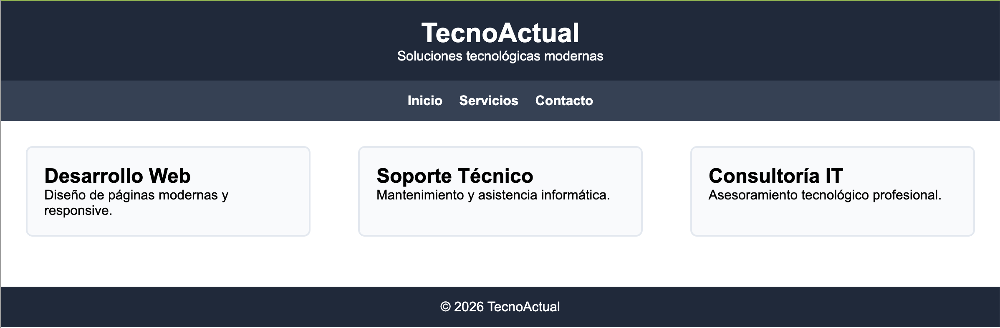

# Pràctica Classe

<div class="interactive-progress-tracker">
  <div class="tracker-header">
    <span>🏆 <strong>Progrés d'aquesta secció:</strong> <span class="tracker-count">0 de 4 superats (0%)</span></span>
    <span class="tracker-pts">⭐ <strong>0 punts</strong></span>
  </div>
  <div class="tracker-bar">
    <div class="tracker-fill" style="width: 0%;"></div>
  </div>
</div>

## Objectiu

Aplicar distintes propietats de **Flexbox** sobre una mateixa pàgina web per a comprendre com afecten a la distribució, alineació i comportament responsive dels elements.

## Punt 0 — Creació de la web base “TecnoActual”

Abans d'aplicar Flexbox, has de crear la versió base de la pàgina web **TecnoActual**, que servirà com punt de partida per a tots els exercicis posteriors.

Aquesta versió inicial ha de ser **funcional, limpia i clara**, ja que sobre ella es realizarán totes les modificacions de Flexbox en els següents punts.

### Requisits de la web

#### Estructura HTML obligatòria

La pàgina ha de contindre, almenys, els següents blocs:

1. **Encapçalament**

1. Títol principal: `TecnoActual`

1. 

Subtítulo descriptivo: “Solucions tecnològiques modernes”

1. 

**Menú de navegació**

1. Enllaços: Inici, Serveis, Contacte

1. Enllaços sense funcionalitat real (poden apuntar a `#`)

1. 

Cal utilitzar flex i un justify-content centrado.

1. 

**Contingut principal**

1. Secció “Serveis”

1. 

Tres targetes de servei:

  - Desenvolupament Web

  - Suport Tècnic

  - Consultoría IT

  - Cal colocar-los en display flex i un justify-content space-between.

1. 

**Peu de pàgina**

1. Text de copyright: `© 2026 TecnoActual`

### Requisits de disseny (CSS)

- Usar un únic fitxer `styles.css`.

- Tipografía base: `Arial` o similar.

- Paleta de colors sobria (tonos oscuros per a capçalera i peu).

- Separació clara entre seccions mitjançant `padding` i `margin`.

- Les targetes han d'estar visibles i diferenciades (vores o fons).

- encapçalament i peu color de fons: #1e293b;

- menu color de fons: #334155;

- targeta-servei color vora #e2e8f0 i color de fons #f8fafc;



<details markdown="1">

<summary>💡 Solució</summary>

<details markdown="1">

<summary>💡 HTML</summary>

```html
<!DOCTYPE html>
<html lang="es">
<head>
    <meta charset="UTF-8" />
    <meta name="viewport" content="width=device-width, initial-scale=1.0" />
    <title>TecnoActual</title>
    <link rel="stylesheet" href="styles.css" />
</head>
<body>
    <header class="encabezado">
    <h1>TecnoActual</h1>
    <p>Soluciones tecnológicas modernas</p>
    </header>
    <nav class="menu">
    <a href="#">Inicio</a>
    <a href="#">Servicios</a>
    <a href="#">Contacto</a>
    </nav>
    <main class="contenido-principal">
    <section class="servicios">
        <article class="tarjeta-servicio">
        <h2>Desarrollo Web</h2>
        <p>Diseño de páginas modernas y responsive.</p>
        </article>
        <article class="tarjeta-servicio">
        <h2>Soporte Técnico</h2>
        <p>Mantenimiento y asistencia informática.</p>
        </article>
        <article class="tarjeta-servicio">
        <h2>Consultoría IT</h2>
        <p>Asesoramiento tecnológico profesional.</p>
        </article>
    </section>
    </main>
    <footer class="pie">
    <p>© 2026 TecnoActual</p>
    </footer>
</body>
</html>
```

</details>

<details markdown="1">

<summary>💡 CSS</summary>

```html
/* Configuración general */
* {
box-sizing: border-box;
margin: 0;
padding: 0;
font-family: Arial, sans-serif;
}

/* Encabezado */
.encabezado {
background-color: #1e293b;
color: white;
padding: 20px;
text-align: center;
}

/* Menú de navegación */
.menu {
display: flex;
justify-content: center;
gap: 20px;
background-color: #334155;
padding: 15px;
}

.menu a {
color: white;
text-decoration: none;
font-weight: bold;
}

/* Contenido principal */
.contenido-principal {
padding: 30px;
}

/* Servicios */
.servicios {
display: flex;
justify-content: space-between;
gap: 20px;
}

/* Tarjetas */
.tarjeta-servicio {
border: 2px solid #e2e8f0;
padding: 20px;
width: 30%;
border-radius: 8px;
background-color: #f8fafc;
}

/* Pie de página */
.pie {
background-color: #1e293b;
color: white;
text-align: center;
padding: 15px;
margin-top: 30px;
}

/* Responsive */
@media (max-width: 768px) {
.menu {
    flex-direction: column;
    align-items: center;
}

.servicios {
    flex-direction: column;
}

.tarjeta-servicio {
    width: 100%;
}
}
```

</details>

</details>

## Punt 1 — Targetes fluides amb `flex-wrap`

### Enunciat

Configura el contenidor de les targetes de serveis perquè:

- Les targetes es distribuyan en diverses files automàticament.

- El número de targetes per fila es adapte al mida de la pantalla.

- No dependa exclusivament de mitjana queries.

### Conceptes a treballar

- `display: flex`

- `flex-wrap`

- `flex-basis`

- `flex-grow`

> **📌 Solució**
> 

<details markdown="1">

<summary>💡 CSS</summary>

```html
/* Servicios */
.servicios {
    display: flex;
    flex-wrap: wrap;
    gap: 20px;
}
/* Tarjetas */
.tarjeta-servicio {
    border: 2px solid #e2e8f0;
    padding: 20px;
    border-radius: 8px;
    background-color: #f8fafc;
    flex: 1 1 260px;
}
/* Quitar Responsive */
```

</details>

## Punt 2 — Reparto de l'espai horitzontal

### Enunciat

Distribueix les targetes horizontalment utilitzant distints valors de `justify-content`.

Has de provar i comparar almenys:
- `space-between`
- `space-around`
- `space-evenly`
- `center`

### Conceptes a treballar

- `justify-content`

- comportament de l'espai lliure en Flexbox

> **📌 Solució**
> 

<details markdown="1">

<summary>💡 CSS</summary>

```html
/* Servicios */
.servicios {
    display: flex;
    justify-content: space-evenly; /*space-between/space-around/space-evenly/center*/
    gap: 20px;
}
/* Tarjetas */
.tarjeta-servicio {
    border: 2px solid #1e293b;
    border-radius:8px;
    background-color: #f8fafc;
    padding:20px;
    margin-bottom:30px;
    width: 240px;
}
```

</details>

## Punt 3 — Alineació vertical: `align-items` vs `align-content`

### Enunciat

Fuerza diverses files de targetes i ajusta la seua alineació vertical dins del contenidor.

Has de comprovar:
- Com actua `align-items` sobre els elements d'una fila.
- Com actua `align-content` sobre el conjunt de files.

### Conceptes a treballar

- `align-items`

- `align-content`

- diferència entre alineació d'elements i de files

> **📌 Solució**
> 

<details markdown="1">

<summary>💡 CSS</summary>

```html
/* Servicios */
.servicios {
    display: flex;
    flex-wrap: wrap;
    gap: 20px;

    align-content: space-between;
    border:  1px dashed #cbd5e1;
    padding: 10px;
}
/* Tarjetas */
.tarjeta-servicio {
    border: 2px solid #1e293b;
    border-radius:8px;
    background-color: #f8fafc;
    padding:20px;
    margin-bottom:30px;
    flex: 1 1 260px;
}
```

</details>

## Punt 4 — Canvi d'ordre visual amb `order`

### Enunciat

Sense modificar el HTML:

- Fes que la targeta **“Consultoría IT”** aparega visualment en primer lloc.

- Fes que la targeta **“Suport Tècnic”** aparega en últim lloc.

### Conceptes a treballar

- `order`

- diferència entre ordre visual i ordre del HTML

> **📌 Solució**
> 

<details markdown="1">

<summary>💡 CSS</summary>

```html
/* Servicios */
.servicios {
    display: flex;
    gap: 20px;
}
/* Tarjetas */
.tarjeta-servicio{
    border: 2px solid #1e293b;
    border-radius:8px;
    background-color: #f8fafc;
    padding:20px;
    margin-bottom:30px;
    flex: 1;
}

.tarjeta-servicio:nth-child(3){ order: -1; }
.tarjeta-servicio:nth-child(2){ order: 2; }
```

</details>

## Punt 5 — Empuje d'elements amb `margin-left: auto`

### Enunciat

Converteix l'enllaç **“Contacte”** del menú en un botó destacat alineat a la dreta, mentre el resta d'enllaços permanecen a l'esquerra.

### Conceptes a treballar

- `margin-left: auto`

- alineació d'elements dins d'un contenidor flex

> **📌 Solució**
> 

<details markdown="1">

<summary>💡 HTML</summary>

```html
<nav class="menu">
    <a href="#">Inicio</a>
    <a href="#">Servicios</a>
    <a class="cta" href="#">Contacto</a>
</nav>
```

</details>

<details markdown="1">

<summary>💡 CSS</summary>

```html
/* Menú de navegación */
.menu{
    display: flex;
    align-items: center;
    gap: 20px;
    background-color: #334155;
    padding: 15px 20px;
}
.menu .cta{
    margin-left: auto;
    background: #0ea5e9;
    padding: 8px 12px;
    border-radius: 8px;
}
```

</details>

## Punt 6 — Layout amb menú lateral (sidebar)

### Enunciat

Reestructura la pàgina perquè:

- El menú aparega en vertical a l'esquerra.

- El contingut principal aparega a la dreta ocupant el resta de l'espai.

### Conceptes a treballar

- `flex-direction`

- `flex`

- ús de Flexbox per a layouts complets

> **📌 Solució**
> 

<details markdown="1">

<summary>💡 HTML</summary>

```html
<div class="layout">
<nav class="menu">
    <a href="#">Inicio</a>
    <a href="#">Servicios</a>
    <a class="cta" href="#">Contacto</a>
</nav>
<main class="contenido-principal">
    <section class="servicios">
    <article class="tarjeta-servicio">
        <h2>Desarrollo Web</h2>
        <p>Diseño de páginas modernas y responsive.</p>
    </article>

    <article class="tarjeta-servicio">
        <h2>Soporte Técnico</h2>
        <p>Mantenimiento y asistencia informática.</p>
    </article>

    <article class="tarjeta-servicio">
        <h2>Consultoría IT</h2>
        <p>Asesoramiento tecnológico profesional.</p>
    </article>
    </section>
</main>
</div>
```

</details>

<details markdown="1">

<summary>💡 CSS</summary>

```html
/* Menú de navegación */
.layout{
    display: flex;
    min-height: 60vh;
}

.menu{
    display: flex;
    flex-direction: column;
    gap: 12px;
    width: 220px;
    padding: 20px;
    background-color: #334155;
}

.contenido-principal{
    flex: 1;
}
```

</details>


---

## 🎮 Reptes Interactius d'Autoavaluació (+100 XP)

Comprova el teu domini sobre **Pràctica de Classe — Pràctica Classe** superant aquests 4 reptes gamificats (+25 punts cadascun):

<div class="interactive-mcq" data-answer="B" data-hint="El 'padding' és el farciment interior (entre contingut i border); el 'margin' és l'espai exterior.">
  <div class="mcq-question">🎯 <strong>Repte 1 (+25 pts):</strong> En el model de caixes (Box Model) de CSS, quina propietat controla l'espai interior entre el contingut de l'element i la seua vora (<code>border</code>)?</div>
  <div class="mcq-options">
    <button type="button" class="btn-mcq-opt" data-opt="A">A) margin</button>
    <button type="button" class="btn-mcq-opt" data-opt="B">B) padding</button>
    <button type="button" class="btn-mcq-opt" data-opt="C">C) outline</button>
    <button type="button" class="btn-mcq-opt" data-opt="D">D) gap</button>
  </div>
  <div class="quiz-feedback"></div>
</div>

<div class="interactive-mcq" data-answer="B" data-hint="justify-content distribueix els ítems en l'eix principal; align-items ho fa en l'eix transversal (cross axis).">
  <div class="mcq-question">🎯 <strong>Repte 2 (+25 pts):</strong> En CSS Flexbox (<code>display: flex</code>), quina propietat alinea els elements al llarg de l'eix principal (main axis)?</div>
  <div class="mcq-options">
    <button type="button" class="btn-mcq-opt" data-opt="A">A) align-items</button>
    <button type="button" class="btn-mcq-opt" data-opt="B">B) justify-content</button>
    <button type="button" class="btn-mcq-opt" data-opt="C">C) flex-wrap</button>
    <button type="button" class="btn-mcq-opt" data-opt="D">D) z-index</button>
  </div>
  <div class="quiz-feedback"></div>
</div>

<div class="interactive-vf" data-answer="V" data-hint="L'especificitat d'un ID (#id) és (0,1,0,0), superior a la d'una classe (.class) que és (0,0,1,0).">
  <div class="vf-statement">✅ <strong>Repte 3 (Vertader o Fals · +25 pts):</strong> En la cascada d'especificitat de CSS, un selector d'identificador (<code>#menu</code>) té més especificitat que un selector de classe (<code>.item</code>).</div>
  <div class="vf-buttons">
    <button type="button" class="btn-vf" data-opt="V">Vertader (V)</button>
    <button type="button" class="btn-vf" data-opt="F">Fals (F)</button>
  </div>
  <div class="quiz-feedback" style="width: 100%;"></div>
</div>

<div class="interactive-quiz" data-answer="media|@media|media query" data-hint="És la regla @media (Media Queries).">
  <div class="quiz-question">⌨️ <strong>Repte 4 (+25 pts):</strong> Quina regla CSS (<code>@_____</code>) permet aplicar estils condicionals segons l'amplària de la pantalla per a crear un disseny web adaptatiu (Responsive Web Design)?</div>
  <div class="quiz-controls">
    <input type="text" class="quiz-input" placeholder="Escriu la resposta..." />
    <button type="button" class="btn-quiz-check">Comprovar</button>
  </div>
  <div class="quiz-feedback"></div>
</div>

### 📋 Llista de Comprovació i Rúbrica d'Assoliment

Marca cada criteri a mesura que completes l'estudi o la resolució pràctica d'aquesta pàgina (**Pràctica de Classe — Pràctica Classe**):

- [ ] He llegit detingudament la teoria o l'enunciat d'aquesta secció i he anotat els conceptes clau.
- [ ] He revisat els esquemes, taules o blocs de codi i he verificat que sé aplicar-los a l'entorn de treball.
- [ ] He resolt correctament els **4 reptes interactius** superiors obtenint els **100 punts XP**.
- [ ] He descarregat el comprovant oficial en PDF per a adjuntar-lo a la tasca d'**Aules**.

<div class="aules-delivery-card">
  <h3>📤 Comprovant de Lliurament per a Aules</h3>
  <p>Quan hages completat els reptes interactius i la llista d'autoavaluació d'aquesta pàgina, introdueix el teu nom i descarrega el teu certificat oficial en PDF per a adjuntar-lo a la tasca d'<strong>Aules</strong>.</p>
  <div class="aules-student-field">
    <label for="aules-student-name">👤 Nom i Cognoms de l'Alumne/a:</label>
    <input type="text" id="aules-student-name" class="aules-student-name" placeholder="Ex: Joan Garcia Pérez" />
  </div>
  <div class="aules-score-badge">
    <span class="aules-score-count">0/4 reptes completats (0%) · 0 punts · 0/4 criteris d'autoavaluació</span>
  </div>
  <div class="aules-actions">
    <button type="button" class="btn-aules-dl" data-module="LMSGI" data-unit="UD03" data-activity="pract_classe">📥 Descarregar Comprovant PDF</button>
    <button type="button" class="btn-aules-copy">📋 Copiar Resum al Porta-retalls</button>
  </div>
  <div class="aules-toast"></div>
</div>
