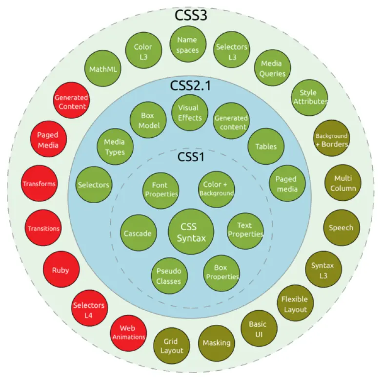

# **Versions**

  

    🏆 <strong>Progrés d'aquesta secció:</strong> 0 de 4 superats (0%)
    ⭐ <strong>0 punts</strong>
  

  

    

  

En 1995, el W3C añadió al seu grup de treball de HTML el desenvolupament i estandarizació de CSS.

## **CSS 1**​

Es publicó en 1996, és la primera recomanació oficial.

## **CSS 2**​

Publicada en 1998, és la segona recomanació oficial.

## **CSS 3**​

Va començar a desarrollar-se en 1998, els seus primers borradors es publicaron en juny de 1999. A diferència de les versions anteriors, la [**especificació**](https://www.w3.org/Style/CSS/current-work) es divideix en diversos documents separats anomenats mòduls. Açò permet que diferents mòduls es troben en diferents estats de desenvolupament i no tots pasen a ser recomendacions oficials del W3C. Un mòdul ha de primer passar per la fase de «recomanació candidata» (*Candidate Recommendation*) abans de ser aprobado.

## **CSS 4**​

Última versió sobre la que **no existeix** una especificació integrada, ja que a l'igual que CSS 3 es troba dividido en diferents mòduls. A partir de la divisió en mòduls que es va fer en CSS 3, l'evolució de cada un d'ells és independent el que provoca que actualment la majoria de mòduls estiguen és especificació de **nivell 3**, mentre que altres (per exemple, selectors) es trobe en **nivell 4**.

La web del W3C recoge [el suport que cada un dels navegadors](https://www.w3schools.com/cssref/css3_browsersupport.asp) tenen sobre les etiquetes CSS.

---

## 🎮 Reptes Interactius d'Autoavaluació (+100 XP)

Comprova el teu domini sobre **3.1.2 Versions** superant aquests 4 reptes gamificats (+25 punts cadascun):

  
🎯 <strong>Repte 1 (+25 pts):</strong> Quin valor de la propietat <code>box-sizing</code> fa que el <code>width</code> d'una caixa incloga també el <code>padding</code> i el <code>border</code>?

  

    <button type="button" class="btn-mcq-opt" data-opt="A">A) content-box</button>
    <button type="button" class="btn-mcq-opt" data-opt="B">B) border-box</button>
    <button type="button" class="btn-mcq-opt" data-opt="C">C) flex-box</button>
    <button type="button" class="btn-mcq-opt" data-opt="D">D) inline-block</button>
  

  

  
🎯 <strong>Repte 2 (+25 pts):</strong> En CSS Grid (<code>display: grid</code>), quina unitat flexible permet repartir proporcionalment les fraccions d'espai lliure del contenidor?

  

    <button type="button" class="btn-mcq-opt" data-opt="A">A) px</button>
    <button type="button" class="btn-mcq-opt" data-opt="B">B) fr</button>
    <button type="button" class="btn-mcq-opt" data-opt="C">C) pt</button>
    <button type="button" class="btn-mcq-opt" data-opt="D">D) cm</button>
  

  

  
✅ <strong>Repte 3 (Vertader o Fals · +25 pts):</strong> La pseudo-classe <code>:hover</code> en CSS s'activa quan l'usuari passa el punter del ratolí per damunt de l'element.

  

    <button type="button" class="btn-vf" data-opt="V">Vertader (V)</button>
    <button type="button" class="btn-vf" data-opt="F">Fals (F)</button>
  

  

" data-hint="És l'etiqueta <link>.">
  
⌨️ <strong>Repte 4 (+25 pts):</strong> Quina etiqueta HTML (<code>&lt;____ rel="stylesheet" href="estils.css"&gt;</code>) s'utilitza dins del <code>&lt;head&gt;</code> per a enllaçar un fitxer CSS extern?

  

    <input type="text" class="quiz-input" placeholder="Escriu la resposta..." />
    <button type="button" class="btn-quiz-check">Comprovar</button>
  

  

### 📋 Llista de Comprovació i Rúbrica d'Assoliment

Marca cada criteri a mesura que completes l'estudi o la resolució pràctica d'aquesta pàgina (**3.1.2 Versions**):

- [ ] He llegit detingudament la teoria o l'enunciat d'aquesta secció i he anotat els conceptes clau.
- [ ] He revisat els esquemes, taules o blocs de codi i he verificat que sé aplicar-los a l'entorn de treball.
- [ ] He resolt correctament els **4 reptes interactius** superiors obtenint els **100 punts XP**.
- [ ] He descarregat el comprovant oficial en PDF per a adjuntar-lo a la tasca d'**Aules**.

  <h3>📤 Comprovant de Lliurament per a Aules</h3>
  
Quan hages completat els reptes interactius i la llista d'autoavaluació d'aquesta pàgina, introdueix el teu nom i descarrega el teu certificat oficial en PDF per a adjuntar-lo a la tasca d'<strong>Aules</strong>.

  

    <label for="aules-student-name">👤 Nom i Cognoms de l'Alumne/a:</label>
    <input type="text" id="aules-student-name" class="aules-student-name" placeholder="Ex: Joan Garcia Pérez" />
  

  

    0/4 reptes completats (0%) · 0 punts · 0/4 criteris d'autoavaluació
  

  

    <button type="button" class="btn-aules-dl" data-module="LMSGI" data-unit="UD03" data-activity="ut0312">📥 Descarregar Comprovant PDF</button>
    <button type="button" class="btn-aules-copy">📋 Copiar Resum al Porta-retalls</button>
  

  

