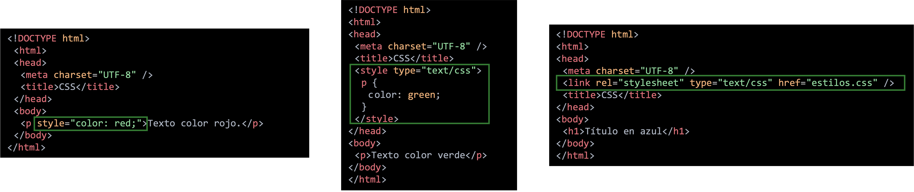

# **Com aplicar estils CSS**

<div class="interactive-progress-tracker">
  <div class="tracker-header">
    <span>🏆 <strong>Progrés d'aquesta secció:</strong> <span class="tracker-count">0 de 4 superats (0%)</span></span>
    <span class="tracker-pts">⭐ <strong>0 punts</strong></span>
  </div>
  <div class="tracker-bar">
    <div class="tracker-fill" style="width: 0%;"></div>
  </div>
</div>

Existeixen tres formes d'incloure CSS en un document HTML/XHTML:

- **Declaració en línia**: es declara l'estil en la mateixa línia en que es va a aplicar. Aquesta opció està desaconsellada.

- **Declaració interna**: es declaran els estils a emprar en la pàgina, en l'encapçalament d'aquesta pàgina, mitjançant l'etiqueta `<style>`.

- **Declaració externa**: es declara la full d'estil que es va a emprar en la pàgina mitjançant l'etiqueta `<link>`. Aquesta etiqueta es declara dins de `<head>`. És l'opció més **recomanada**.



## **Declaració en línia**

Dins de la pròpia etiqueta HTML mitjançant l'atribut `style`.

Aquest mode **ha d'evitar-se** per a preservar el principi de separació de continguts i format.

> **📌 Html**
> 

```html
<!DOCTYPE html>
<html>
  <head>
    <meta charset="UTF-8" />
    <title>CSS</title>
  </head>
  <body>
    <p style="color: red;">Texto en color rojo.</p>
  </body>
</html>
```

> **📌 Provar en el navegador**
> 

> [Document HTML](https://codesandbox.io/s/kind-booth-rbx4nz?file=/index.html)

## **Declaració interna**

En l'encapçalament del document dins de l'element `<style>` inclòs en `<head>`.

> **📌 Html**
> 

```html
<!DOCTYPE html>
<html>
  <head>
    <meta charset="UTF-8" />
    <title>CSS</title>
    <style type="text/css">
      p {
        color: green;
      }
    </style>
  </head>
  <body>
    <p>Texto en color verde</p>
  </body>
</html>
```

Dins de l'etiqueta `<style>` es declarará el codi CSS.

En l'exemple, el text dels elements `<p>` es mostrarà en verd.

> **📌 Provar en el navegador**
> 

> [Document HTML](https://codesandbox.io/s/crazy-kowalevski-lrj46c?file=/index.html)

## **Declaració en arxiu extern**

En l'encapçalament, mitjançant l'etiqueta `<link>` dins de l'element `<head>`.

> **📌 Html**
> 

```html
<!DOCTYPE html>
<html>
  <head>
    <meta charset="UTF-8" />
    <link rel="stylesheet" type="text/css" href="estilos.css" />
    <title>CSS</title>
  </head>
  <body>
    <h1>Título en azul</h1>
  </body>
</html>
```

L'atribut `href` apuntará a la **ruta del fitxer CSS**, el qual tindrà extensió `.css`.

El contingut del fitxer CSS serà **únicament codi CSS** i no tindrà ningunha etiqueta HTML. Per exemple, el contingut d'un arxiu CSS pot ser el següent:

> **📌 Css**
> 

```html
h1 {
    color: blue;
}
```

> **📌 Provar en el navegador**
> 

> [Document HTML](https://codesandbox.io/s/icy-shadow-nrfh3e?file=/index.html)

Una altra forma d'usar fulls d'estil externes és mitjançant l'etiqueta `@import`. És una directiva CSS, no HTML.

> **📌 Html**
> 

```html
<!DOCTYPE html>
<html>
  <head>
    <meta charset="UTF-8" />
    <title>CSS</title>
    <style type="text/css">
      @import url("formato.css");
    </style>
  </head>
  <body>
    <p>Texto en verde.</p>
  </body>
</html>
```

Suposem que el contingut del fitxer `formato.css` és el següent:

> **📌 Css**
> 

```html
p {
    color: green;
}
```

D'aquesta manera, el text dels elements `<p>` es mostrarà en verd.

> **📌 Provar en el navegador**
> 

> [Document HTML](https://codesandbox.io/s/vibrant-ritchie-4n60lb?file=/index.html)

> **📌 Warning**
> 

> Si el fitxer està en el mateix directori que el document HTML, només caldrà indica el nom del fitxer CSS:

> **📌 Html**
> 

```html
@import url("formato.css");
```

Si està dins d'un directori, hem d'indicar la ruta relativa. Per exemple:

> **📌 Html**
> 

```html
@import url("./directorio/formato.css");
```

## **Element `<span>`**

Aquest element s'utilitza habitualment per a donar estil a text no marcatge.

> **📌 Html**
> 

```html
<p>Parte de este párrafo <span style="color:red">está en rojo</span></p>
```

El navegador el mostra de la següent manera:

> **📌 Provar en el navegador**
> 

> [Document HTML](https://codesandbox.io/s/lucid-sun-x9tfj1?file=/index.html)

Es poden enllaçar dos o més fulls d'estil, amb la qual cosa el codi font contendrá tantes etiquetes `<link>` com fulls enlazades:

> **📌 Html**
> 

```html
<link rel="stylesheet" href="estilo1.css">
<link rel="stylesheet" href="estilo2.css">
```

En aquest cas, el navegador aplica les dos fulls d'estil en la pàgina web, un després de l'un altre. Si un element està definit en les dos fulls, el navegador farà el que diga la última full d'estil de la llista.


---

## 🎮 Reptes Interactius d'Autoavaluació (+100 XP)

Comprova el teu domini sobre **3.1.3 Com aplicar estils CSS** superant aquests 4 reptes gamificats (+25 punts cadascun):

<div class="interactive-mcq" data-answer="B" data-hint="El 'padding' és el farciment interior (entre contingut i border); el 'margin' és l'espai exterior.">
  <div class="mcq-question">🎯 <strong>Repte 1 (+25 pts):</strong> En el model de caixes (Box Model) de CSS, quina propietat controla l'espai interior entre el contingut de l'element i la seua vora (<code>border</code>)?</div>
  <div class="mcq-options">
    <button type="button" class="btn-mcq-opt" data-opt="A">A) margin</button>
    <button type="button" class="btn-mcq-opt" data-opt="B">B) padding</button>
    <button type="button" class="btn-mcq-opt" data-opt="C">C) outline</button>
    <button type="button" class="btn-mcq-opt" data-opt="D">D) gap</button>
  </div>
  <div class="quiz-feedback"></div>
</div>

<div class="interactive-mcq" data-answer="B" data-hint="justify-content distribueix els ítems en l'eix principal; align-items ho fa en l'eix transversal (cross axis).">
  <div class="mcq-question">🎯 <strong>Repte 2 (+25 pts):</strong> En CSS Flexbox (<code>display: flex</code>), quina propietat alinea els elements al llarg de l'eix principal (main axis)?</div>
  <div class="mcq-options">
    <button type="button" class="btn-mcq-opt" data-opt="A">A) align-items</button>
    <button type="button" class="btn-mcq-opt" data-opt="B">B) justify-content</button>
    <button type="button" class="btn-mcq-opt" data-opt="C">C) flex-wrap</button>
    <button type="button" class="btn-mcq-opt" data-opt="D">D) z-index</button>
  </div>
  <div class="quiz-feedback"></div>
</div>

<div class="interactive-vf" data-answer="V" data-hint="L'especificitat d'un ID (#id) és (0,1,0,0), superior a la d'una classe (.class) que és (0,0,1,0).">
  <div class="vf-statement">✅ <strong>Repte 3 (Vertader o Fals · +25 pts):</strong> En la cascada d'especificitat de CSS, un selector d'identificador (<code>#menu</code>) té més especificitat que un selector de classe (<code>.item</code>).</div>
  <div class="vf-buttons">
    <button type="button" class="btn-vf" data-opt="V">Vertader (V)</button>
    <button type="button" class="btn-vf" data-opt="F">Fals (F)</button>
  </div>
  <div class="quiz-feedback" style="width: 100%;"></div>
</div>

<div class="interactive-quiz" data-answer="media|@media|media query" data-hint="És la regla @media (Media Queries).">
  <div class="quiz-question">⌨️ <strong>Repte 4 (+25 pts):</strong> Quina regla CSS (<code>@_____</code>) permet aplicar estils condicionals segons l'amplària de la pantalla per a crear un disseny web adaptatiu (Responsive Web Design)?</div>
  <div class="quiz-controls">
    <input type="text" class="quiz-input" placeholder="Escriu la resposta..." />
    <button type="button" class="btn-quiz-check">Comprovar</button>
  </div>
  <div class="quiz-feedback"></div>
</div>

### 📋 Llista de Comprovació i Rúbrica d'Assoliment

Marca cada criteri a mesura que completes l'estudi o la resolució pràctica d'aquesta pàgina (**3.1.3 Com aplicar estils CSS**):

- [ ] He llegit detingudament la teoria o l'enunciat d'aquesta secció i he anotat els conceptes clau.
- [ ] He revisat els esquemes, taules o blocs de codi i he verificat que sé aplicar-los a l'entorn de treball.
- [ ] He resolt correctament els **4 reptes interactius** superiors obtenint els **100 punts XP**.
- [ ] He descarregat el comprovant oficial en PDF per a adjuntar-lo a la tasca d'**Aules**.

<div class="aules-delivery-card">
  <h3>📤 Comprovant de Lliurament per a Aules</h3>
  <p>Quan hages completat els reptes interactius i la llista d'autoavaluació d'aquesta pàgina, introdueix el teu nom i descarrega el teu certificat oficial en PDF per a adjuntar-lo a la tasca d'<strong>Aules</strong>.</p>
  <div class="aules-student-field">
    <label for="aules-student-name">👤 Nom i Cognoms de l'Alumne/a:</label>
    <input type="text" id="aules-student-name" class="aules-student-name" placeholder="Ex: Joan Garcia Pérez" />
  </div>
  <div class="aules-score-badge">
    <span class="aules-score-count">0/4 reptes completats (0%) · 0 punts · 0/4 criteris d'autoavaluació</span>
  </div>
  <div class="aules-actions">
    <button type="button" class="btn-aules-dl" data-module="LMSGI" data-unit="UD03" data-activity="ut0313">📥 Descarregar Comprovant PDF</button>
    <button type="button" class="btn-aules-copy">📋 Copiar Resum al Porta-retalls</button>
  </div>
  <div class="aules-toast"></div>
</div>
