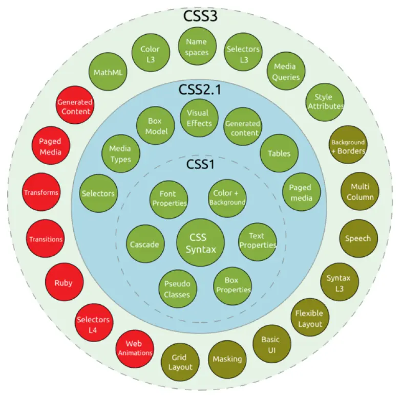

# **Versiones**

En 1995, el W3C añadió a su grupo de trabajo de HTML el desarrollo y estandarización de CSS.

## **CSS 1**​

Se publicó en 1996, es la primera recomendación oficial.

## **CSS 2**​

Publicada en 1998, es la segunda recomendación oficial.

## **CSS 3**​

Empezó a desarrollarse en 1998, sus primeros borradores se publicaron en junio de 1999. A diferencia de las versiones anteriores, la [**especificación**](https://www.w3.org/Style/CSS/current-work) se divide en varios documentos separados llamados módulos. Esto permite que diferentes módulos se encuentren en diferentes estados de desarrollo y no todos pasen a ser recomendaciones oficiales del W3C. Un módulo debe primero pasar por la fase de «recomendación candidata» (*Candidate Recommendation*) antes de ser aprobado.

## **CSS 4**​

Última versión sobre la que **no existe** una especificación integrada, ya que al igual que CSS 3 se encuentra dividido en diferentes módulos. A partir de la división en módulos que se hizo en CSS 3, la evolución de cada uno de ellos es independiente lo que provoca que actualmente la mayoría de módulos estén es especificación de **nivel 3**, mientras que otros (por ejemplo, selectores) se encuentre en **nivel 4**.

La web del W3C recoge [el soporte que cada uno de los navegadores](https://www.w3schools.com/cssref/css3_browsersupport.asp) tienen sobre las etiquetas CSS.

