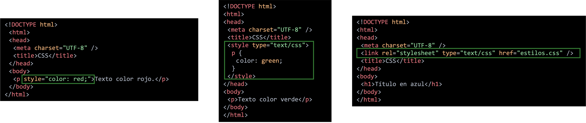

# **Cómo aplicar estilos CSS**

Existen tres formas de incluir CSS en un documento HTML/XHTML:

- **Declaración en línea**: se declara el estilo en la misma línea en que se va a aplicar. Esta opción está desaconsejada.

- **Declaración interna**: se declaran los estilos a emplear en la página, en el encabezado de dicha página, mediante la etiqueta `<style>`.

- **Declaración externa**: se declara la hoja de estilo que se va a emplear en la página mediante la etiqueta `<link>`. Esta etiqueta se declara dentro de `<head>`. Es la opción más **recomendada**.



## **Declaración en línea**

Dentro de la propia etiqueta HTML mediante el atributo `style`.

Este modo **debe evitarse** para preservar el principio de separación de contenidos y formato.

> **📌 Html**
> 

```html
<!DOCTYPE html>
<html>
  <head>
    <meta charset="UTF-8" />
    <title>CSS</title>
  </head>
  <body>
    <p style="color: red;">Texto en color rojo.</p>
  </body>
</html>
```

> **📌 Probar en el navegador**
> 

> [Documento HTML](https://codesandbox.io/s/kind-booth-rbx4nz?file=/index.html)

## **Declaración interna**

En el encabezado del documento dentro del elemento `<style>` incluido en `<head>`.

> **📌 Html**
> 

```html
<!DOCTYPE html>
<html>
  <head>
    <meta charset="UTF-8" />
    <title>CSS</title>
    <style type="text/css">
      p {
        color: green;
      }
    </style>
  </head>
  <body>
    <p>Texto en color verde</p>
  </body>
</html>
```

Dentro de la etiqueta `<style>` se declarará el código CSS.

En el ejemplo, el texto de los elementos `<p>` se mostrará en verde.

> **📌 Probar en el navegador**
> 

> [Documento HTML](https://codesandbox.io/s/crazy-kowalevski-lrj46c?file=/index.html)

## **Declaración en archivo externo**

En el encabezado, mediante la etiqueta `<link>` dentro del elemento `<head>`.

> **📌 Html**
> 

```html
<!DOCTYPE html>
<html>
  <head>
    <meta charset="UTF-8" />
    <link rel="stylesheet" type="text/css" href="estilos.css" />
    <title>CSS</title>
  </head>
  <body>
    <h1>Título en azul</h1>
  </body>
</html>
```

El atributo `href` apuntará a la **ruta del fichero CSS**, el cual tendrá extensión `.css`.

El contenido del fichero CSS será **únicamente código CSS** y no tendrá ningunha etiqueta HTML. Por ejemplo, el contenido de un archivo CSS puede ser el siguiente:

> **📌 Css**
> 

```html
h1 {
    color: blue;
}
```

> **📌 Probar en el navegador**
> 

> [Documento HTML](https://codesandbox.io/s/icy-shadow-nrfh3e?file=/index.html)

Otra forma de usar hojas de estilo externas es mediante la etiqueta `@import`. Es una directiva CSS, no HTML.

> **📌 Html**
> 

```html
<!DOCTYPE html>
<html>
  <head>
    <meta charset="UTF-8" />
    <title>CSS</title>
    <style type="text/css">
      @import url("formato.css");
    </style>
  </head>
  <body>
    <p>Texto en verde.</p>
  </body>
</html>
```

Supongamos que el contenido del fichero `formato.css` es el siguiente:

> **📌 Css**
> 

```html
p {
    color: green;
}
```

De esta manera, el texto de los elementos `<p>` se mostrará en verde.

> **📌 Probar en el navegador**
> 

> [Documento HTML](https://codesandbox.io/s/vibrant-ritchie-4n60lb?file=/index.html)

> **📌 Warning**
> 

> Si el fichero está en el mismo directorio que el documento HTML, solo habrá que indica el nombre del fichero CSS:

> **📌 Html**
> 

```html
@import url("formato.css");
```

Si está dentro de un directorio, debemos indicar la ruta relativa. Por ejemplo:

> **📌 Html**
> 

```html
@import url("./directorio/formato.css");
```

## **Elemento `<span>`**

Este elemento se utiliza habitualmente para dar estilo a texto no marcado.

> **📌 Html**
> 

```html
<p>Parte de este párrafo <span style="color:red">está en rojo</span></p>
```

El navegador lo muestra de la siguiente manera:

> **📌 Probar en el navegador**
> 

> [Documento HTML](https://codesandbox.io/s/lucid-sun-x9tfj1?file=/index.html)

Se pueden enlazar dos o más hojas de estilo, con lo que el código fuente contendrá tantas etiquetas `<link>` como hojas enlazadas:

> **📌 Html**
> 

```html
<link rel="stylesheet" href="estilo1.css">
<link rel="stylesheet" href="estilo2.css">
```

En este caso, el navegador aplica las dos hojas de estilo en la página web, uno después del otro. Si un elemento está definido en las dos hojas, el navegador hará lo que diga la última hoja de estilo de la lista.
