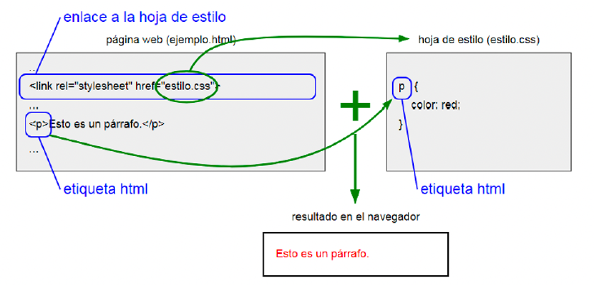

# **Hoja de estilos**

El funcionamiento de las hojas de estilo es el siguiente: 
En la página web (archivo.html) se escriben las etiquetas que definen categorías o elementos. 
En la hoja de estilo (archivo.css) se escribe cómo queremos que siga el estilo de presentación de las etiquetas (color, tamaño, fuente, bordes, márgenes, posición, etc). 
En la página web se escribe qué hoja de estilo queremos utilizar.

> **📌 Ventajas**
> 

> Permiten hacer un diseño consistente y fácil de modificar. Si varias páginas web hacen referencia a la misma hoja de estilo, solo tienes que hacer los cambios en un único lugar.
