# **Sintaxi d'una full d'estils.**

<div class="interactive-progress-tracker">
  <div class="tracker-header">
    <span>🏆 <strong>Progrés d'aquesta secció:</strong> <span class="tracker-count">0 de 4 superats (0%)</span></span>
    <span class="tracker-pts">⭐ <strong>0 punts</strong></span>
  </div>
  <div class="tracker-bar">
    <div class="tracker-fill" style="width: 0%;"></div>
  </div>
</div>

Una full d'estil és un fitxer de text pla (sense format) en el que es defineix l'aspecte de les etiquetes d'una pàgina web i està formada per una o diverses sentències:

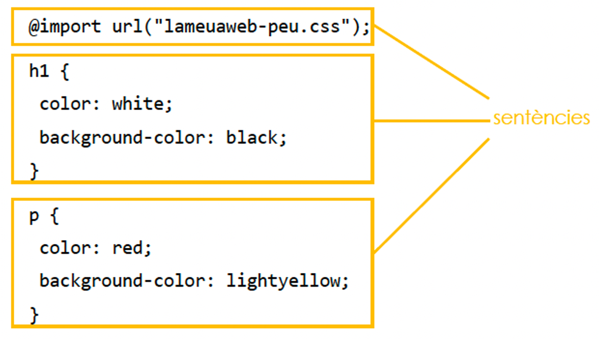

## **regles-arroba**

Existeixen dos tipus de sentències: Les regles-arroba i les regles:

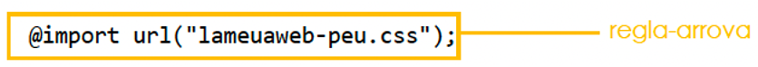

Les regles-arroba comencen pel símbol d'arroba (@) pegado a un identificador i acaven per un punt i coma (;):

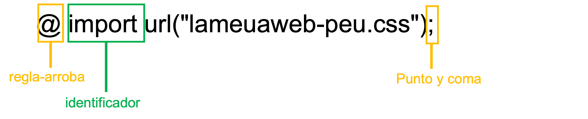

Són declaracions CSS que encapsulan un grup de regles, però no estan directament relacionades a elements HTML/XML. Controlen la forma en que es apliquen els estils extendent la capacitat de CSS i cada una té la seua pròpia sintaxi.

### **Regles generals**

Es apliquen a tot el CSS

- `@charset` Defineix el conjunt de caràcters usat en el CSS.

- `@import` Permet incloure un altre CSS.

- `@namespace` Estableix el XML a ser utilitzat.

### **Regles imbricades**

Poden estar com declaració d'estil i com condicional.

- `@media` Estableix regles condicionals d'acord amb les característiques dels dispositius d'eixida (mida de pantalla, tipus d'impressora, dispositius braille, etc.)

- `@supports` Estableix regles condicionals segons el navegador utilitzat.

- `@document` Restringe les regles contenides segons la URL.

- `@page` Restringe les regles contenides per a quan es vol imprimir (en impressora) el document.

- `@font-face` Inclou fonts (tipográfiques) externes.

- `@keyframes`  Controla els passos intermedios en una seqüència d'animació.

- `@viewport` Restringe les regles segons el mida i orientació de la finestra, especialment útils en smartphones.

- `@counter-style` Defineix estils de comptador específics.

- `@font-feature-values`, `@swash`, `@ornaments`, `@annotation`, `@stylistic`, `@styleset` i `@character-variant` Defineix noms comuns per a la propietat font-variant-alternatas.

## **regles**

Les regles estan formades per un selector i un bloc de declaració. El bloc de declaració comença i acaba amb claus { }.

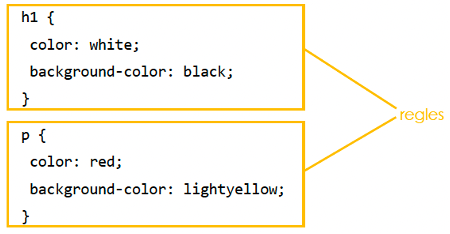

Cada declaració està formada per una o diverses propietats i els seus valors corresponents.

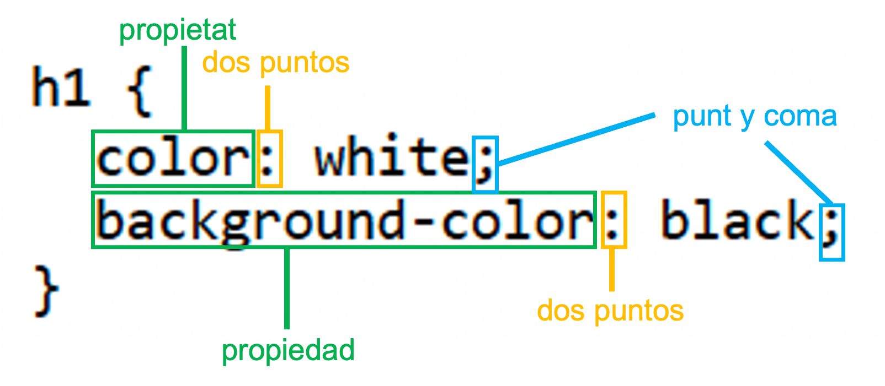

 

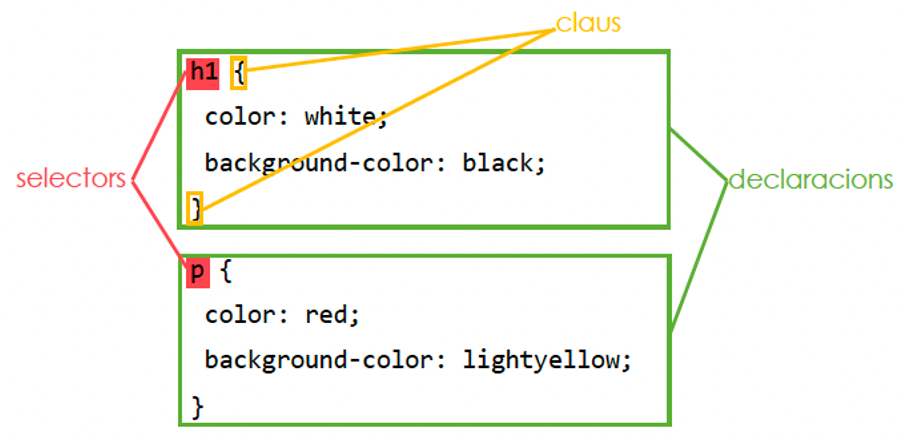

En general, si una propietat necessita diversos valors, els valors van separats per espais en blanc. En general, si una propietat admet diversos valors alternatius, els valors van separats per comes.

## **Error més comú**

Un error bastant habitual és escriure els caràcters `<p>` en la full d'estil.

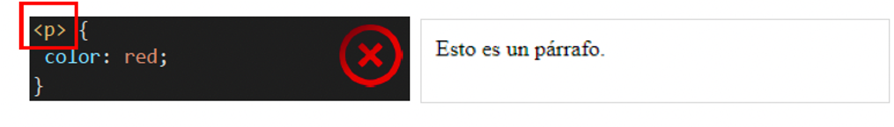

## **Estils en cascada.**

El format final de qualsevol element depèn de la combinació de totes les propietats que afecten a l'element. La denominació de fulls d'estil en cascada fa referència precisament a aquest fet.
Per exemple, una d'aquestes regles és que a un element li afecten totes les propietats dels elements en els que està inclòs. Exemple: el color de text del paràgraf `<p>` ve determinat per la propietat establecida per a l'element `<body>`:

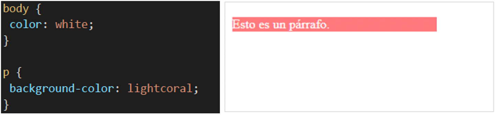

## **Selectors simultáneos**

Es poden definir diversos selectors simultàniament escrivint els selectors separats per comes, com mostren els següents exemples:

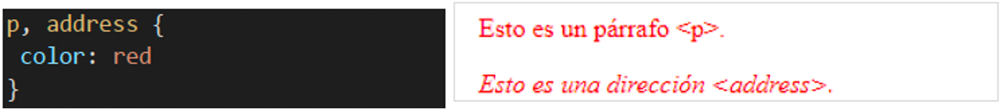

El que no és correcte és definir diverses propietats simultàniament, com mostren els següents exemples:

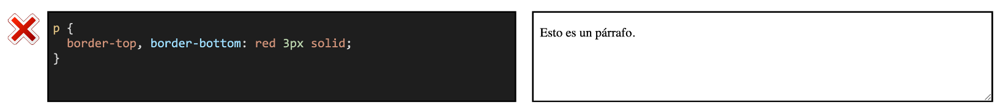

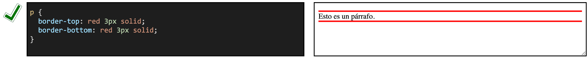

## **Repetir selectors**

Encara que no és incorrecte, no es aconseja repetir selectors, ja que distribueix la informació en diversos llocs de la full d'estil i això dificulta la lectura i interpretació de la full d'estil als lectors humans. 
Si es repeteixen les propietats, el navegador aplica la propietat que apareix en últim lloc, com mostra el següent exemple:

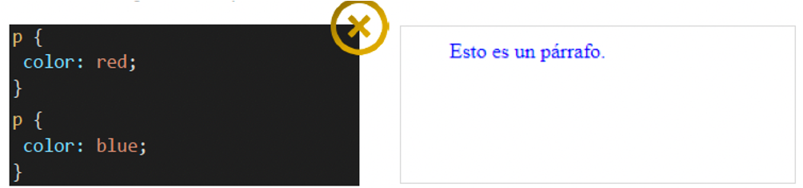

Si no es repeteixen les propietats, el navegador aplica totes les propietats, com mostra el següent exemple:

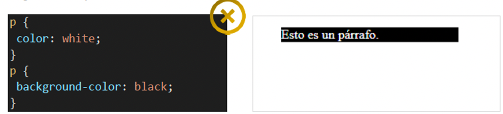

## **Comentaris**

Una full d'estils pot contindre comentaris. Els delimitadors del comentari són `/* ... */` (com en el llenguatge de programació C). Els comentaris poden estenderse en diverses línies.

> **📌 Css**
> 

```html
/*
 Autor: MAA
 Fecha: 10 de octubre del 2025
*/

h1{
    background-color: black;    /*fondo negro*/
    color: white;               /*texto blanco*/
}
```


---

## 🎮 Reptes Interactius d'Autoavaluació (+100 XP)

Comprova el teu domini sobre **3.1.5 Sintaxi d'una full d'estils.** superant aquests 4 reptes gamificats (+25 punts cadascun):

<div class="interactive-mcq" data-answer="B" data-hint="El 'padding' és el farciment interior (entre contingut i border); el 'margin' és l'espai exterior.">
  <div class="mcq-question">🎯 <strong>Repte 1 (+25 pts):</strong> En el model de caixes (Box Model) de CSS, quina propietat controla l'espai interior entre el contingut de l'element i la seua vora (<code>border</code>)?</div>
  <div class="mcq-options">
    <button type="button" class="btn-mcq-opt" data-opt="A">A) margin</button>
    <button type="button" class="btn-mcq-opt" data-opt="B">B) padding</button>
    <button type="button" class="btn-mcq-opt" data-opt="C">C) outline</button>
    <button type="button" class="btn-mcq-opt" data-opt="D">D) gap</button>
  </div>
  <div class="quiz-feedback"></div>
</div>

<div class="interactive-mcq" data-answer="B" data-hint="justify-content distribueix els ítems en l'eix principal; align-items ho fa en l'eix transversal (cross axis).">
  <div class="mcq-question">🎯 <strong>Repte 2 (+25 pts):</strong> En CSS Flexbox (<code>display: flex</code>), quina propietat alinea els elements al llarg de l'eix principal (main axis)?</div>
  <div class="mcq-options">
    <button type="button" class="btn-mcq-opt" data-opt="A">A) align-items</button>
    <button type="button" class="btn-mcq-opt" data-opt="B">B) justify-content</button>
    <button type="button" class="btn-mcq-opt" data-opt="C">C) flex-wrap</button>
    <button type="button" class="btn-mcq-opt" data-opt="D">D) z-index</button>
  </div>
  <div class="quiz-feedback"></div>
</div>

<div class="interactive-vf" data-answer="V" data-hint="L'especificitat d'un ID (#id) és (0,1,0,0), superior a la d'una classe (.class) que és (0,0,1,0).">
  <div class="vf-statement">✅ <strong>Repte 3 (Vertader o Fals · +25 pts):</strong> En la cascada d'especificitat de CSS, un selector d'identificador (<code>#menu</code>) té més especificitat que un selector de classe (<code>.item</code>).</div>
  <div class="vf-buttons">
    <button type="button" class="btn-vf" data-opt="V">Vertader (V)</button>
    <button type="button" class="btn-vf" data-opt="F">Fals (F)</button>
  </div>
  <div class="quiz-feedback" style="width: 100%;"></div>
</div>

<div class="interactive-quiz" data-answer="media|@media|media query" data-hint="És la regla @media (Media Queries).">
  <div class="quiz-question">⌨️ <strong>Repte 4 (+25 pts):</strong> Quina regla CSS (<code>@_____</code>) permet aplicar estils condicionals segons l'amplària de la pantalla per a crear un disseny web adaptatiu (Responsive Web Design)?</div>
  <div class="quiz-controls">
    <input type="text" class="quiz-input" placeholder="Escriu la resposta..." />
    <button type="button" class="btn-quiz-check">Comprovar</button>
  </div>
  <div class="quiz-feedback"></div>
</div>

### 📋 Llista de Comprovació i Rúbrica d'Assoliment

Marca cada criteri a mesura que completes l'estudi o la resolució pràctica d'aquesta pàgina (**3.1.5 Sintaxi d'una full d'estils.**):

- [ ] He llegit detingudament la teoria o l'enunciat d'aquesta secció i he anotat els conceptes clau.
- [ ] He revisat els esquemes, taules o blocs de codi i he verificat que sé aplicar-los a l'entorn de treball.
- [ ] He resolt correctament els **4 reptes interactius** superiors obtenint els **100 punts XP**.
- [ ] He descarregat el comprovant oficial en PDF per a adjuntar-lo a la tasca d'**Aules**.

<div class="aules-delivery-card">
  <h3>📤 Comprovant de Lliurament per a Aules</h3>
  <p>Quan hages completat els reptes interactius i la llista d'autoavaluació d'aquesta pàgina, introdueix el teu nom i descarrega el teu certificat oficial en PDF per a adjuntar-lo a la tasca d'<strong>Aules</strong>.</p>
  <div class="aules-student-field">
    <label for="aules-student-name">👤 Nom i Cognoms de l'Alumne/a:</label>
    <input type="text" id="aules-student-name" class="aules-student-name" placeholder="Ex: Joan Garcia Pérez" />
  </div>
  <div class="aules-score-badge">
    <span class="aules-score-count">0/4 reptes completats (0%) · 0 punts · 0/4 criteris d'autoavaluació</span>
  </div>
  <div class="aules-actions">
    <button type="button" class="btn-aules-dl" data-module="LMSGI" data-unit="UD03" data-activity="ut0315">📥 Descarregar Comprovant PDF</button>
    <button type="button" class="btn-aules-copy">📋 Copiar Resum al Porta-retalls</button>
  </div>
  <div class="aules-toast"></div>
</div>
