# **Tipos de selectores.**

Los selectores son la parte de las reglas que indican en el navegador a qué elementos se aplicarán las propiedades incluidas en las declaraciones. 
En este apartado se comentan únicamente los selectores simples y sus combinaciones.

## **Selector de tipo: E.**

Si se escribe un selector (E), las propiedades afectan a todos los elementos con etiqueta **E**. 
Ejemplo: todos los párrafos `
` se ven de color rojo.

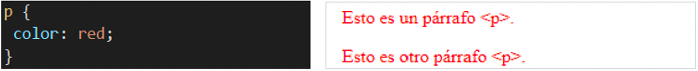

Si se escribe un asterisco (*), las propiedades afectan a todos los elementos de la página. Ejemplo: tanto el párrafo `
` como la dirección `<address>` se ven de color rojo. 

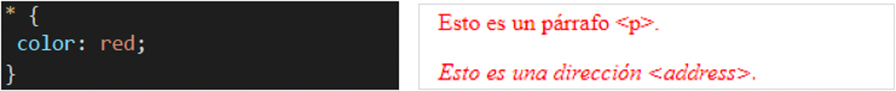

## **Selector de clase: E.c**

Si se escribe una etiqueta seguida de un punto y un nombre de clase (E.c),las propiedades afectan a todos los elementos con etiqueta **E** cuyo atributo class tenga el valor **c**. 
Ejemplo: sólo el párrafo `
` de clase ”aviso" se ven de color rojo.

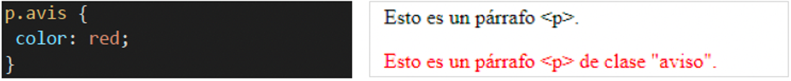

Para definir una clase que se pueda aplicar a cualquier etiqueta, se puede escribir como selector un punto y el nombre de la clase (.nombre-clase) o el selector universal *.nombre-clase.
Ejemplos: cualquier elemento de clase ”aviso" se ve de color rojo.

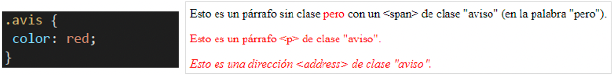

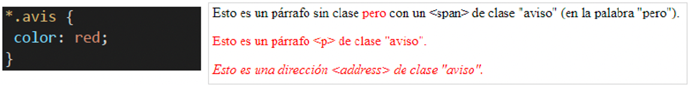

## **Selector de ID: E#i**

Si se escribe una etiqueta seguida de un cojinete y un nombre de **id** (**E#i**), las propiedades afectan al elemento con etiqueta **E** cuyo atributo **id** tenga el valor **i**.
En el ejemplo, sólo el párrafo `
` de id avis se ve de color rojo.

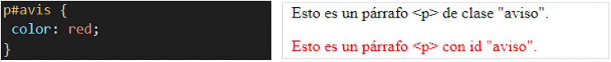

Hay que tener en cuenta que el atributo id no se puede repetir, es decir, no puede haber dos elementos con el mismo valor del atributo id (independientemente de que los elementos tengan etiquetas iguales o diferentes).

Para definir un **id** que se pueda aplicar a cualquier etiqueta, se puede escribir como selector un almoadilla y el nombre del **id** (**#nom-id**) o el selector universal ***#nom-id**.
En los dos ejemplos, cualquier elemento con id ”avisos" se ve de color rojo. 

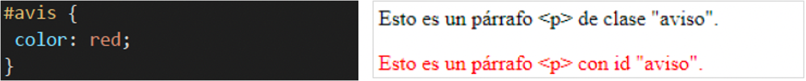

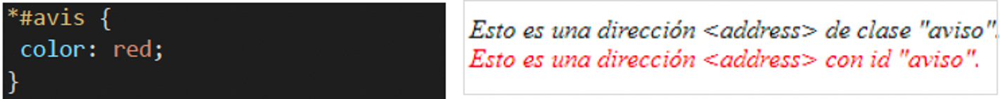

Aunque en una página web no puede haber dos elementos con el mismo valor del atributo id, en páginas diferentes sí puede haber dos elementos con el mismo valor del atributo id. Si la misma hoja de estilo se enlaza desde varias páginas web, el selector universal afectará en cada página a los elementos con el id correspondiente.

## **Selector descendiente: E F**

Si se escriben dos etiquetas seguidas (E F), las propiedades afectan a los elementos con la segunda etiqueta (F) contenidos dentro de la primera etiqueta (E), aunque haya etiquetas intermedias.
En el siguiente ejemplo, todos los párrafos `
` dentro de una división `
` se ven de color rojo.

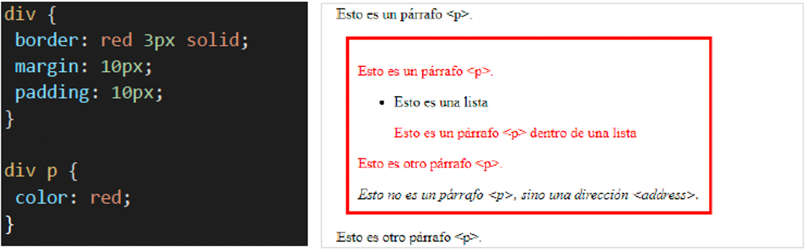

En general, si se escriben varias etiquetas seguidas (E F G ...), las propiedades afectan a los elementos con la última etiqueta contenidos dentro de la etiqueta anterior, contenidos a su vez dentro de etiqueta anterior y así sucesivamente, aunque haya etiquetas intermedias.
En el siguiente ejemplo, únicamente los párrafos `
` dentro de un elemento de lista `<li>` dentro de una división `
` se ven de color rojo.

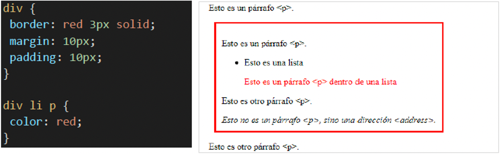

## **Selector hijos: E > F**

Si se escriben dos etiquetas seguidas separadas por un signo "mayor que" (**E > F**), las propiedades afectan a los elementos con la segunda etiqueta (**F**) contenidos dentro de la primera etiqueta (**E**), pero no afecta si hay etiquetas intermedias entre ellos. 
En el ejemplo, únicamente los párrafos `
`dentro de una división `
` sin elementos intermedios se ven de color rojo.

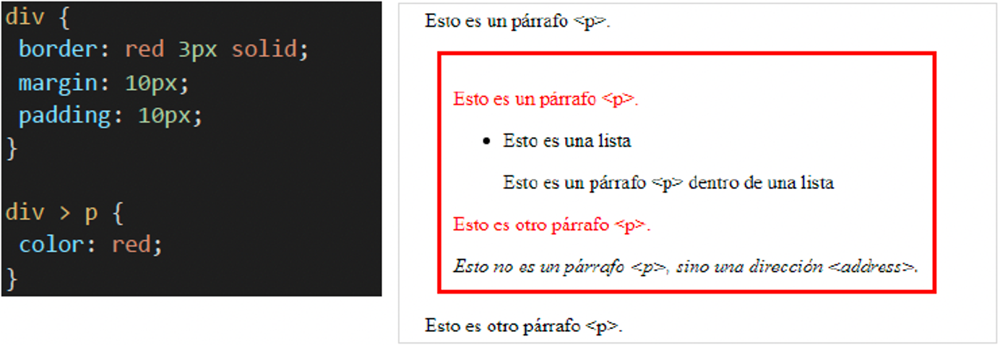

## **Selector consecutivos: E + F**

Si se escriben dos etiquetas seguidas separadas por un signo "más" (**E+F**), las propiedades afectan únicamente a los elementos con la segunda etiqueta (**F**) que van justo después de un elemento con la primera etiqueta (**E**). 
En el ejemplo, únicamente el párrafo `
` inmediatamente posterior a la división `
` se ven de color rojo.

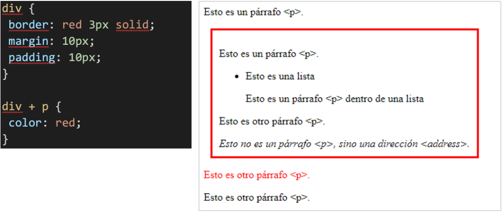

## **Selector hermanos: E ~ F**

Si se escriben dos etiquetas seguidas separadas por un signo "titlle" (**E ~ F**), las propiedades afectan únicamente a los elementos con la segunda etiqueta (**F**) que van después de un elemento con la primera etiqueta (**E**), siendo ambos elementos hermanos, es decir, hijos del mismo padre. 
En el ejemplo, la primera línea tiene una etiqueta ``; la segunda línea uno `
` y la tercera línea tiene una etiqueta `<code>` y una etiqueta ``.

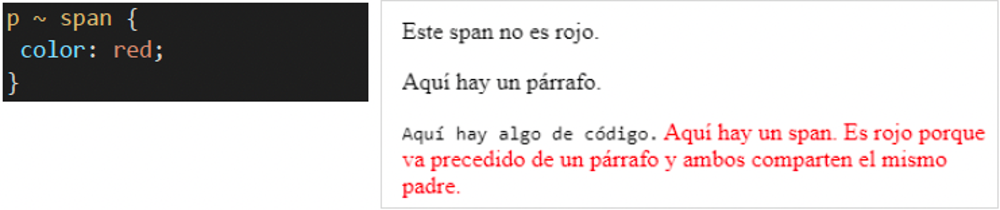

## **Selector atributo:**

Hay cuatro maneras de seleccionar elementos con determinados atributos:
**E[atribut] - E[atribut="valor"] - E[atribut~="valor"] - E[atribut|="valor"]**
  

Si se escribe una etiqueta seguida del nombre de un atributo entre corchetes, **E[atributo]**, las propiedades afectan a todos los elementos que tengan establecidos este atributo. 

En el ejemplo, los párrafos con clase, independientemente de la clase asignada, se muestran en mayúsculas.

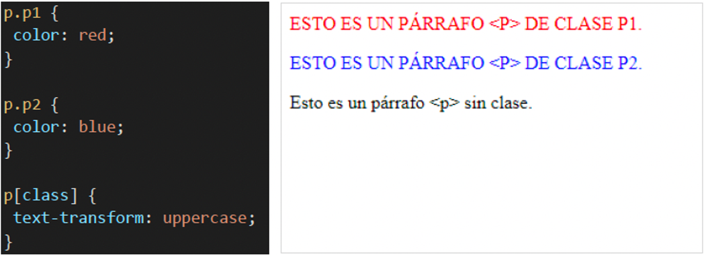

Si se escribe una etiqueta seguida del nombre de un atributo igual a un valor entre corchetes, **E[atributo="valor"]**, las propiedades afectan a todos los elementos que tengan establecidos este atributo exactamente con este valor.

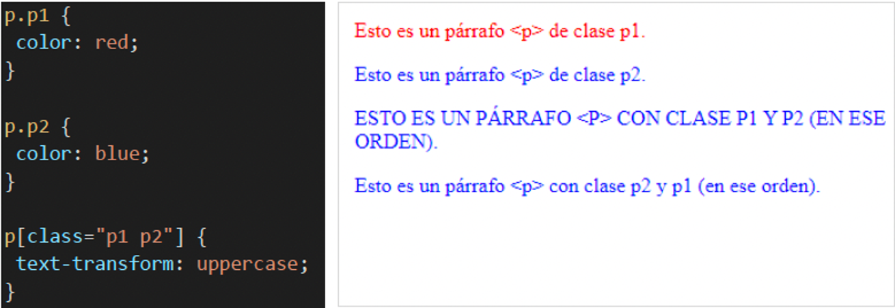

> **📌 Probar en el navegador - "Selectores"**
> 

> [Documento HTML](https://codesandbox.io/p/sandbox/f2pddc)
