# **Pseudo-clases y pseudo elements**

## **¿Que son?**

- Las hojas de estilos asocian características de estilo a los elementos basándose en las etiquetas de los elementos y en su posición relativa (en el árbol del documento).

- Las pseudo-clases y los pseudo-elementos permiten hacer referencia a determinados elementos sin basarse en la información contenida en el árbol del documento.

- La diferencia entre pseudo-clases y pseudo-elementos es sutil. En general, los pseudo-elementos suelen hacer referencia a determinadas partes de un elemento, mientras que las pseudo-clases suelen hacer referencia al estado del elemento.

- Otra diferencia importante es que un pseudo-elemento sólo puede aparecer al final de un selector, mientras que una pseudo-clase puede aparecer en cualquier elemento del selector.

- La notación de los pseudo-elementos es etiqueta::p seudo-elemento.

## **Pseudo clases. First Child**

La pseudo-clase `:first-child` hace referencia al primer elemento de un tipo contenido dentro de otro. 
El ejemplo muestra cómo identificar al primer párrafo dentro de una división sin necesidad de asignar ninguna clase al párrafo.

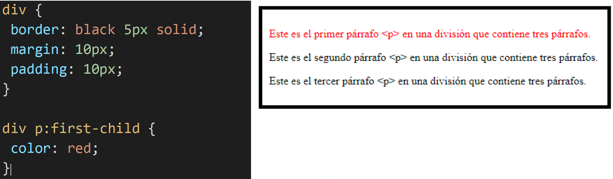

Es necesario que el tipo del primer elemento hijo en la página web sea el indicado en la hoja de estilo. En el ejemplo, el primer elemento dentro de la división no es un `
`, sino uno `<pre>`, así que no se le aplica el estilo indicado en la hoja de estilo.

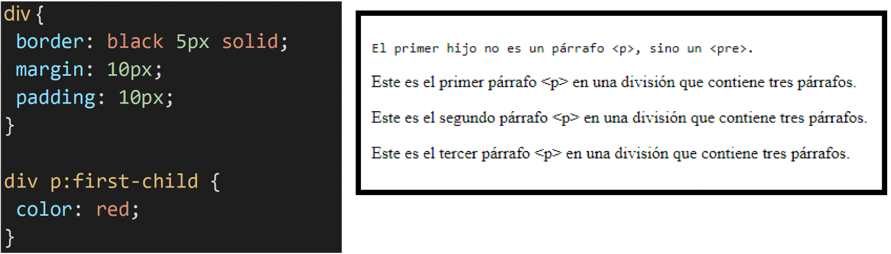

En el ejemplo, la pseudo-clase `:first-child` se aplica al primer elemento dentro de la división, sea como sea el elemento, ya que en la hoja de estilo no se especifica el elemento.

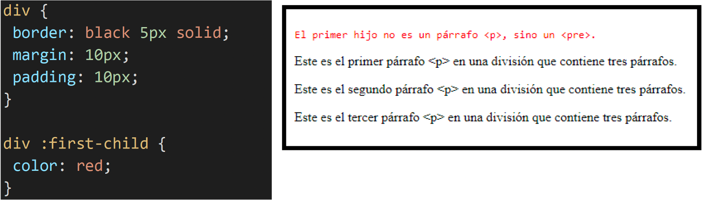

## **Pseudo clases de enlace.**

La pseudo clase `:link` (o `a:link`) permite especificar el aspecto de los enlaces que aún no han sido visitados.

La pseudo clase `:visited` (o `a:visited`) permite especificar el aspecto de los enlaces que sí han sido visitados.

### **Pseudo-classe: :link**

La pseudo-clase `:link` establece el aspecto de los enlaces no visitados, pero si solo se incluye en la hoja de estilo la pseudo-clase `:link`, el aspecto no cambiará al hacer clic en los enlaces:

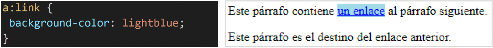

### **Pseudo-classe: :visited**

Es necesario incluir las dos pseudo-clases `:link` y `:visited` para que el aspecto del enlace cambie al hacer clic en él.

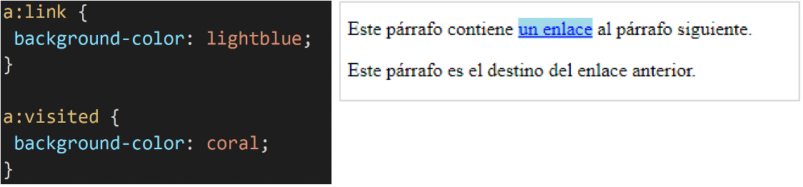

El ejemplo prueba estas cuatro propiedades. En el ejemplo se establecen antes las propiedades en la etiqueta `<a>` porque si no Firefox y Chrome no la modifican.

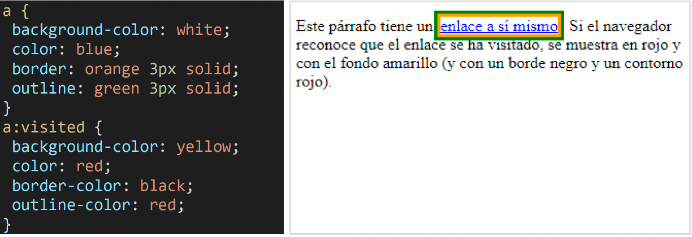

Si queremos cambiar el aspecto de un enlace, pero sin distinguir que el enlace se haya visitado o no, tenemos entonces tres opciones:

- Definir simultáneamente las dos pseudo-clases:

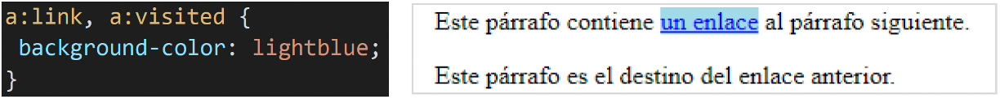

- Definir únicamente los enlaces no visitados:

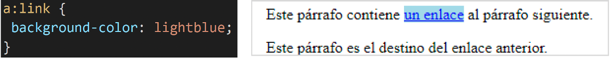

- Definir los enlaces en general:

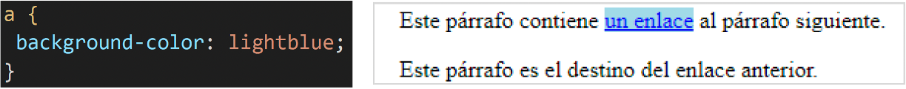

## **Pseudo clases dinámicas.**

### **Pseudo-clase dinámica: :hover**

La pseudo-clase `:hover` permite especificar el aspecto del elemento sobre el que se encuentra el ratón.

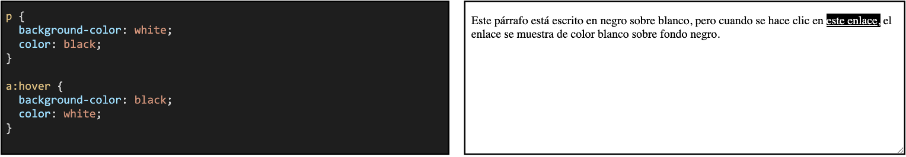

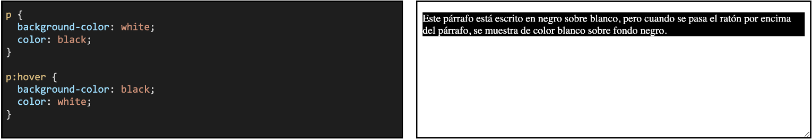

### **Pseudo-clase dinámica: :active**

La pseudo-clase `:active` permite especificar el aspecto de un elemento cuando se hace clic sobre él (y mientras se mantiene el botón del ratón pulsado).

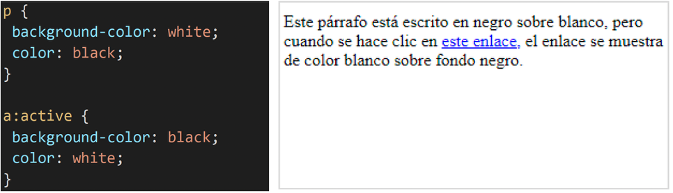

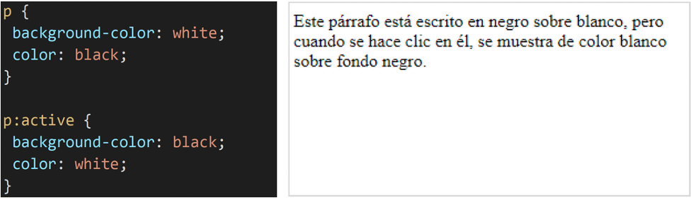

### **Pseudo-clase dinámica: :focus**

La pseudo-clase `:focus` permite especificar el aspecto de un elemento cuando éste tiene el foco. Los elementos que admiten el foco en una página web son aquellos que reaccionan a entrada por teclado (por ejemplo, los elementos de los formularios o los enlaces). 
En el ejemplo, al hacer clic en un campo de texto (o cambiar de campo con el tabulador), el campo seleccionado se resalta con un borde rojo.

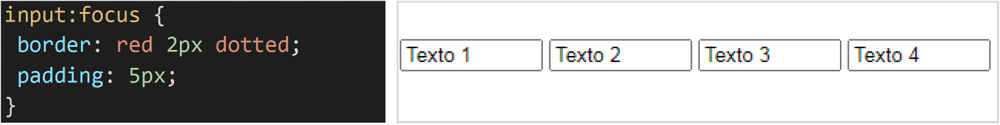

## **Pseudo clases de idiomas.**

### **Pseudo-clase de idiomas: :lang()**

La pseudo-clase de idioma `:lang()` permite especificar el aspecto de los elementos de un idioma determinado. 
En el siguiente ejemplo se cambia las comillas utilizadas en una cita `<q>` según el idioma indicado en el atributo lang.

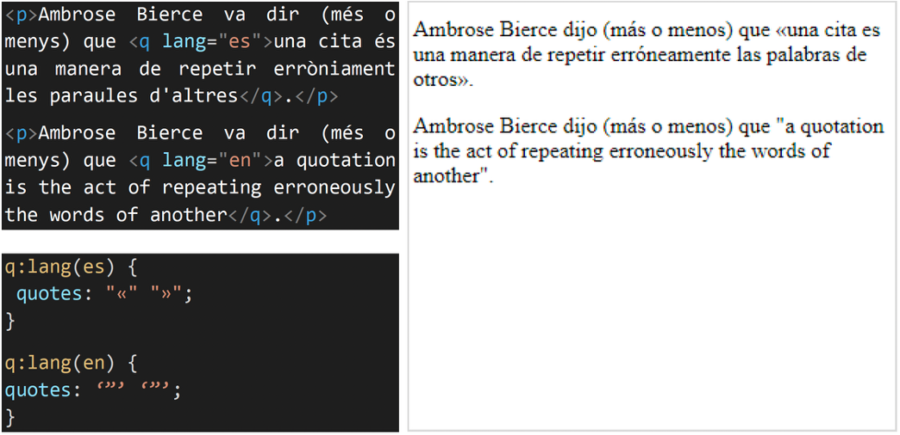

## **Pseudo elementos.**

### **Pseudo-elementos dinámicos ::first-line()**

El pseudo-elemento `::first-line` permite especificar el aspecto de la primera línea de texto.

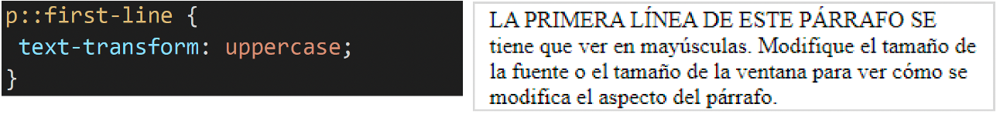

### **Pseudo-elementos dinámicos ::first-letter()**

El pseudo-elemento `::first-letter` permite especificar el aspecto de la primera letra de texto.

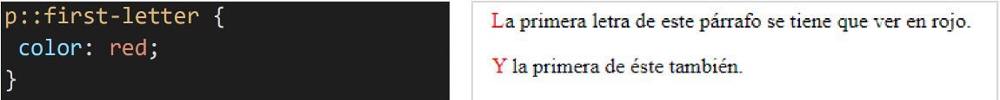

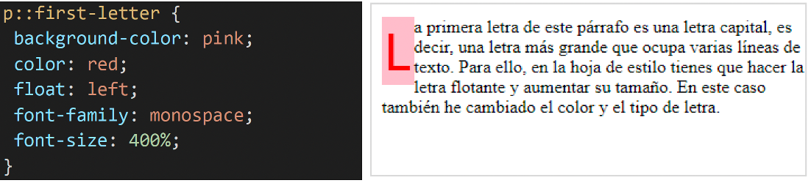

### **Pseudo-elementos ::before ::after**

Los pseudo-elementos `::before` y `::after` permiten añadir contenido a un elemento desde la hoja de estilo, al principio o al final del elemento. 
El contenido generado no puede seleccionarse con el ratón (para copiarlo y pegarlo en otro documento, por ejemplo). 
El contenido generado mediante la propiedad contento puede incluir texto:

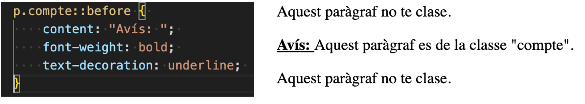

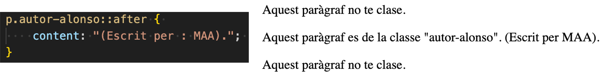

Se pueden generar contadores en los pseudo-elementos `::after` y `::before` mediante la propiedad **content** y el valor **counter**(nom_de_comptador). El contador debe ponerse a cero con la propiedad `counter-reset` y aumentarse con la propiedad `counter-increment`. 
En los siguientes ejemplos se ha definido un contador que se llama **conta-paragrafs**. Este contador se genera al principio de cada párrafo, se pone a cero con el elemento `<pre>` y se incrementa en cada párrafo.

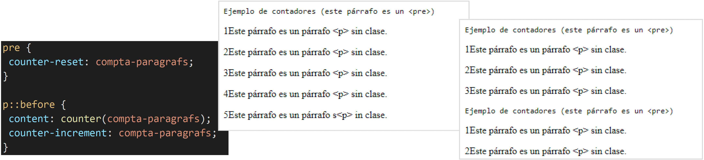

El contador puede incrementarse en cualquier cantidad entera, como muestra el siguiente ejemplo:

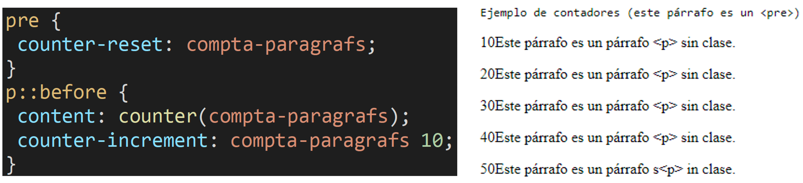

Junto con el contador se puede generar texto, como muestra el siguiente ejemplo:

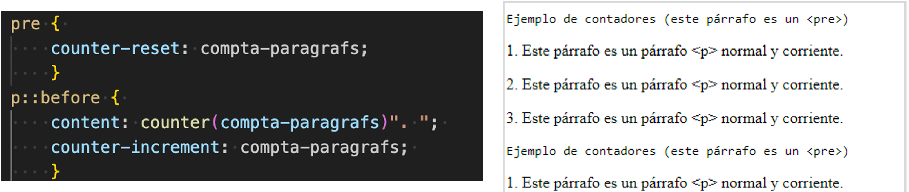

El contador predeterminado muestra números enteros, pero se puede utilizar cualquiera de los estilos de listas como estilo de contador. El estilo se indica en la propiedad **content** mediante el valor counter(nom_de_comptador, estil_de_llista), como muestra el siguiente ejemplo:

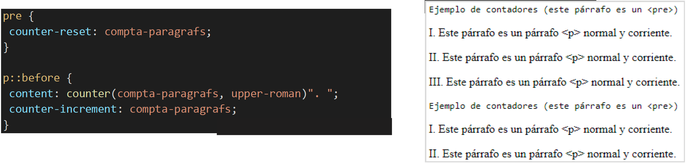

Se pueden utilizar varios contadores simultáneamente, como muestra el siguiente ejemplo:

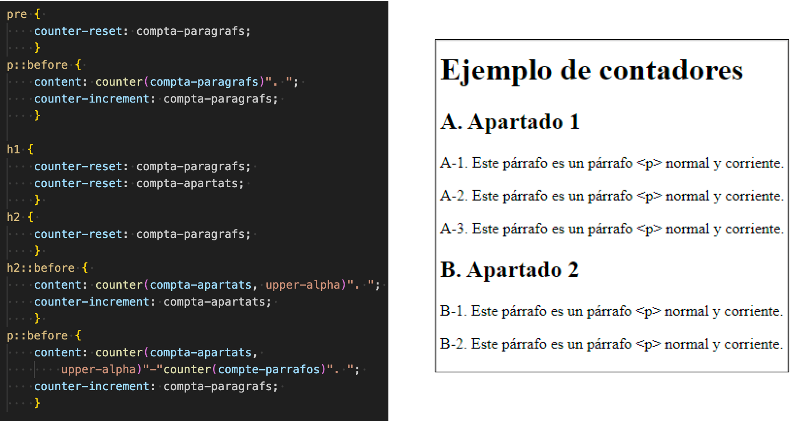

> **📌 Probar en el navegador - "Pseudo clases y pseudo elementos"**
> 

> [Documento HTML](https://codesandbox.io/p/sandbox/up03-css-pseudoclases-y-elements-gtzvy7)
