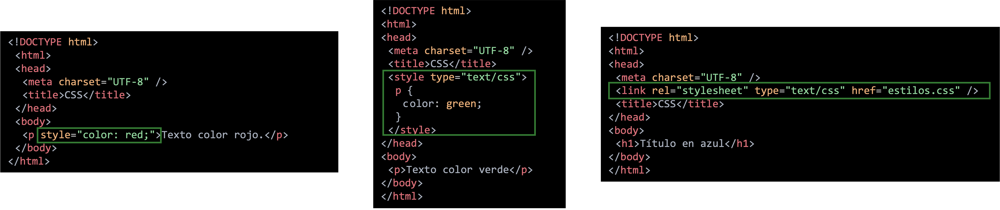
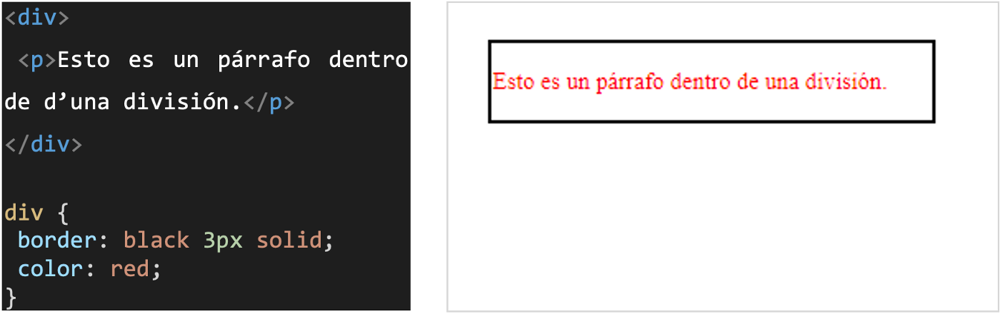
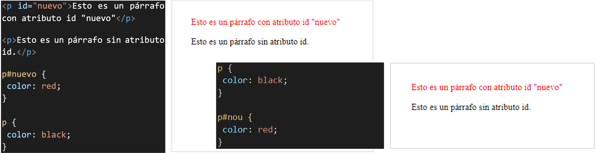
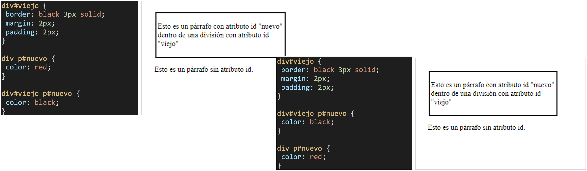
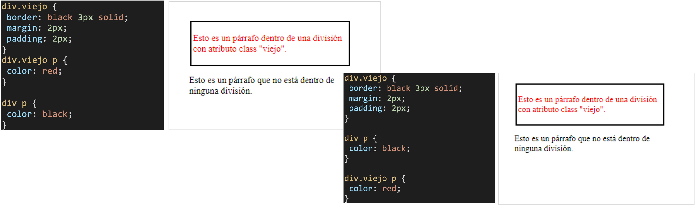
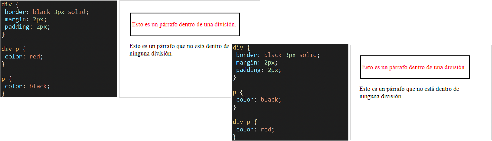
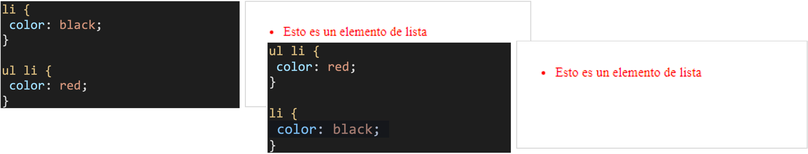
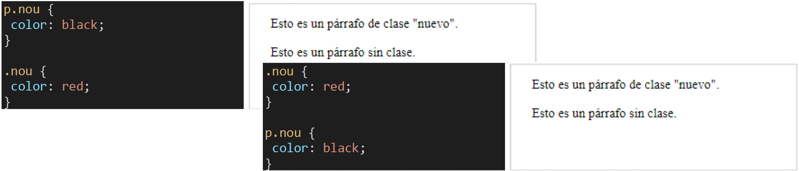
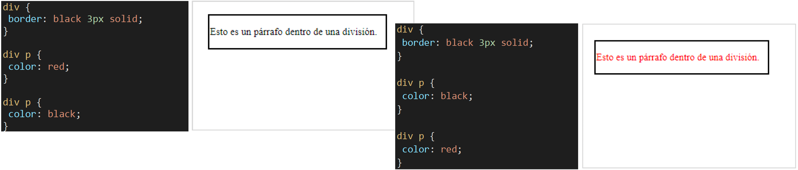

# **Estils en Cascada**

  

    🏆 <strong>Progrés d'aquesta secció:</strong> 0 de 4 superats (0%)
    ⭐ <strong>0 punts</strong>
  

  

    

  

## **Perquè diem estils en cascada**

- Les propietats d'estil poden estar escritas en diversos llocs (en diversos llocs de la pàgina web o de la full d'estil) i depenent del lloc, afecten a més o menys elements. 

- Quan un element està contingut en un altre (per exemple, un paràgraf `
` dins d'una divisió `
`), a l'element de dins es li apliquen també les propietats definides per a l'element de fóra (en el paràgraf `
` es li aplicarían les propietats definides per a la divisió `
`). 

- Dos regles diferents poden ser aplicable a un mateix element (per exemple, a un paràgraf `
` amb classe nom, aplicarà tant el selector .nom com el selector p). 

Si les propietats (escritas en diferents llocs o per a diferents elements) no entran en conflicto, el navegador aplica totes les propietats. Per exemple, si el color de fons d'un element està definit en un lloc i el mida de lletra en un altre lloc, el navegador aplicarà totes dues propietats a l'element. 
Però si les propietats entran en conflicto (per exemple, el color del fons de l'element està definit en diversos llocs amb colors diferents), existeixen regles per a decidir què propietat té preferencia.

> **📌 Recordatorio. On poden aparèixer propietats d'estils.**
> 

> - Existeixen tres formes d'incloure CSS en un document HTML/XHTML:

>   - Declaració en línia: es declara l'estil en la mateixa línia en que es va a aplicar. Aquesta opció està desaconsellada.

>   - Declaració interna: es declaran els estils a emprar en la pàgina, en l'encapçalament d'aquesta pàgina, mitjançant l'etiqueta `<style>`.

>   - Declaració externa: es declara la full d'estil que es va a emprar en la pàgina mitjançant l'etiqueta `<link>`. Aquesta etiqueta es declara dins de `<head>`. És l'opció més recomanada.

> 

## **Regles d'aplicació d'estils.**

Si es defineix la mateixa propietat per a la mateixa etiqueta amb el mateix selector en dos llocs diferents, les regles de precedencia són les següents: 

- Les propietats definides en un atribut style es imponen a les propietats definides en l'etiqueta `<style>`.

- Les propietats definides en l'etiqueta `<style>` es imponen a les propietats definides en una full d'estil enllaçada. 

- Les propietats definides en un atribut style es imponen a les propietats definides en una full d'estil enllaçada. 

A més d'aquestes propietats definides pel creador de la pàgina web, cal tindre en compte que també es apliquen les propietats definides en la full d'estil per defecte del navegador. 
Si les propietats es troben definides en diferents fulls d'estil, el navegador aplica el valor definit en la última full d'estil enllaçada (és a dir, en l'últim enllaç `<link>` del `<head>`).

## **Elements dins d'altres.**

Quan un element està contingut en un altre (per exemple, un paràgraf `
` dins d'una divisió `
`), a l'element de dins es li apliquen també les propietats definides per a l'element de fóra. 
En el següent exemple, el paràgraf inclòs dins de la divisió es mostra de color roig perquè el paràgraf està inclòs dins de la divisió.

## **Regles diferents que es apliquen al mateix element.**

Dos regles diferents es apliquen a un mateix element quan l'element coincideix amb els selectors de les dos regles. La regla que s'aplica és la del selector de major especificitat. L'especificitat d'un selector es calcula atenent als següents criteris:

- Número d'atributs id en el selector. 

- Número d'altres atributs i pseudo-classes en el selector (els pseudo-elements es ignoran). 

- Número d'elements en el selector. 

- Posició en la full d'estil.

Aquests criteris es apliquen en ordre, és a dir, primer es comparen el número d'atributs id de cada selector. Si un selector té més que l'un altre, s'aplica aquesta regla, si el número és el mateix, llavors es calcula el segon criteri (número d'altres atributs i pseudo-classes). I així sucesivament.

### **Número d'atributs id en el selector.**

El següent exemple mostra dos selectors amb un número d'atributs id diferent (1 o 0).
Pot comprobar-se que s'aplica sempre el selector amb atribut id, independentment de l'ordre en que aparegueren en la full d'estil.

El següent exemple mostra també dos selectors amb un número d'atributs id diferent (2 o 1). Pot comprobar-se que s'aplica sempre el selector amb més atributs id, independentment de l'ordre en que aparegueren en la full d'estil.

### **Número d'altres atributs i pseudo-classes en el selector.**

El següent exemple mostra dos selectors amb el mateix número d'atributs id (0), però amb un número diferent d'atributs class (1 o 0). Pot comprobar-se que s'aplica sempre el selector amb més atributs class, independentment de l'ordre en que aparegueren en la full d'estil.

### **Número d'elements en el selector.**

El següent exemple mostra dos selectors amb un número diferent d'elements (2 o 1). Pot comprobar-se que s'aplica sempre el selector amb més elements, independentment de l'ordre en que aparegueren en la full d'estil.

### **Posició en la full d'estil**

Si a un element li afecten dos selectors amb la mateixa especificitat, el navegador aplica la propietat que apareix després en la full d'estil. 
El següent exemple mostra dos selectors idéntics. Pot comprobar-se que s'aplica sempre el selector que apareix després en la full d'estil. En aquest cas, la penúltima regla és superflua i pot eliminar-se sense afectar al resultat.

> **📌 Provar en el navegador - "Estils en Cascada"**
> 

> [Document HTML](https://codesandbox.io/p/sandbox/glyvrv)

---

## 🎮 Reptes Interactius d'Autoavaluació (+100 XP)

Comprova el teu domini sobre **3.4 Estils en Cascada** superant aquests 4 reptes gamificats (+25 punts cadascun):

  
🎯 <strong>Repte 1 (+25 pts):</strong> Quin valor de la propietat <code>box-sizing</code> fa que el <code>width</code> d'una caixa incloga també el <code>padding</code> i el <code>border</code>?

  

    <button type="button" class="btn-mcq-opt" data-opt="A">A) content-box</button>
    <button type="button" class="btn-mcq-opt" data-opt="B">B) border-box</button>
    <button type="button" class="btn-mcq-opt" data-opt="C">C) flex-box</button>
    <button type="button" class="btn-mcq-opt" data-opt="D">D) inline-block</button>
  

  

  
🎯 <strong>Repte 2 (+25 pts):</strong> En CSS Grid (<code>display: grid</code>), quina unitat flexible permet repartir proporcionalment les fraccions d'espai lliure del contenidor?

  

    <button type="button" class="btn-mcq-opt" data-opt="A">A) px</button>
    <button type="button" class="btn-mcq-opt" data-opt="B">B) fr</button>
    <button type="button" class="btn-mcq-opt" data-opt="C">C) pt</button>
    <button type="button" class="btn-mcq-opt" data-opt="D">D) cm</button>
  

  

  
✅ <strong>Repte 3 (Vertader o Fals · +25 pts):</strong> La pseudo-classe <code>:hover</code> en CSS s'activa quan l'usuari passa el punter del ratolí per damunt de l'element.

  

    <button type="button" class="btn-vf" data-opt="V">Vertader (V)</button>
    <button type="button" class="btn-vf" data-opt="F">Fals (F)</button>
  

  

" data-hint="És l'etiqueta <link>.">
  
⌨️ <strong>Repte 4 (+25 pts):</strong> Quina etiqueta HTML (<code>&lt;____ rel="stylesheet" href="estils.css"&gt;</code>) s'utilitza dins del <code>&lt;head&gt;</code> per a enllaçar un fitxer CSS extern?

  

    <input type="text" class="quiz-input" placeholder="Escriu la resposta..." />
    <button type="button" class="btn-quiz-check">Comprovar</button>
  

  

### 📋 Llista de Comprovació i Rúbrica d'Assoliment

Marca cada criteri a mesura que completes l'estudi o la resolució pràctica d'aquesta pàgina (**3.4 Estils en Cascada**):

- [ ] He llegit detingudament la teoria o l'enunciat d'aquesta secció i he anotat els conceptes clau.
- [ ] He revisat els esquemes, taules o blocs de codi i he verificat que sé aplicar-los a l'entorn de treball.
- [ ] He resolt correctament els **4 reptes interactius** superiors obtenint els **100 punts XP**.
- [ ] He descarregat el comprovant oficial en PDF per a adjuntar-lo a la tasca d'**Aules**.

  <h3>📤 Comprovant de Lliurament per a Aules</h3>
  
Quan hages completat els reptes interactius i la llista d'autoavaluació d'aquesta pàgina, introdueix el teu nom i descarrega el teu certificat oficial en PDF per a adjuntar-lo a la tasca d'<strong>Aules</strong>.

  

    <label for="aules-student-name">👤 Nom i Cognoms de l'Alumne/a:</label>
    <input type="text" id="aules-student-name" class="aules-student-name" placeholder="Ex: Joan Garcia Pérez" />
  

  

    0/4 reptes completats (0%) · 0 punts · 0/4 criteris d'autoavaluació
  

  

    <button type="button" class="btn-aules-dl" data-module="LMSGI" data-unit="UD03" data-activity="ut0340">📥 Descarregar Comprovant PDF</button>
    <button type="button" class="btn-aules-copy">📋 Copiar Resum al Porta-retalls</button>
  

  

