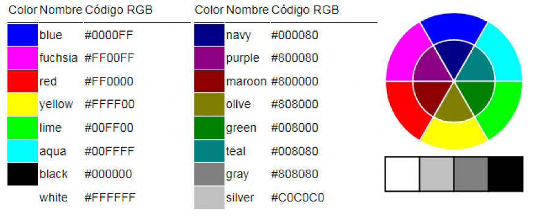
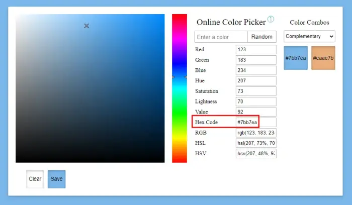
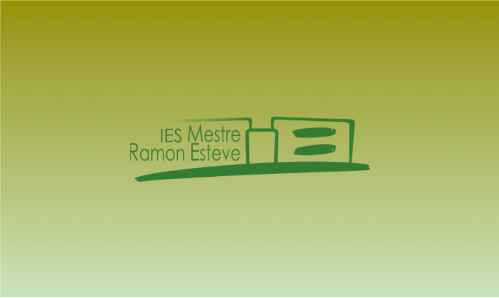
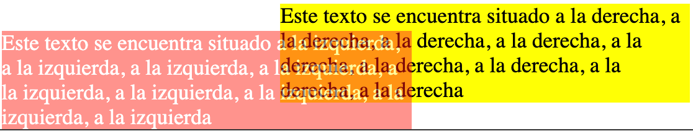

# **Propietats de color i fons**

<div class="interactive-progress-tracker">
  <div class="tracker-header">
    <span>🏆 <strong>Progrés d'aquesta secció:</strong> <span class="tracker-count">0 de 4 superats (0%)</span></span>
    <span class="tracker-pts">⭐ <strong>0 punts</strong></span>
  </div>
  <div class="tracker-bar">
    <div class="tracker-fill" style="width: 0%;"></div>
  </div>
</div>

En aquest apartat es revisarán les [propietats de color](https://www.w3schools.com/colors/default.asp) i fons.

## **color**

La propietat [`color`](https://developer.mozilla.org/es/docs/Web/CSS/color) defineix el **color del text**. L'admeten quasi totes les etiquetes de HTML.

El valor d'aquest atribut és:

- El nom d'un color.

- El valor RGB (hexadecimal) d'un color.



> **📌 CSS**
> 

```html
h1 {
    color: blue;
}
```

```html
h1 {
    color: #2d98da;
}
```

> **📌 Valor RGB**
> 

> Les eines de disseny, pel general, inclouen una utilitat de selecció de color, d'on es pot extraer el **codi hexadecimal** corresponent a un color. Aquest tipus d'utilitat es denomina [**color picker**](https://colorpicker.me/).

> 



## **background-color**

Indica el **color de fons** de l'element. El valor d'aquest atribut és un color.

El valor d'aquest atribut és:

- El nom d'un color.

- El valor RGB (hexadecimal) d'un color.

> **📌 CSS**
> 

```html
div {
    background-color: blue;
}
```

```html
div {
    background-color: #2d98da;
}
```

## **background-image**

Permet col·locar una **imatge de fons** de l'element. El valor que pren és el nom de la imatge amb la seua ruta relativa o absoluta.

> **📌 CSS**
> 

```html
div {
    background-image: url(/images/logoIESMRE.png);
}
```

```html
div {
    background-image: linear-gradient(rgb(149, 146, 0), rgba(235, 235, 181, 0.255));
}
```

## **background-repeat**

Indica si ha de **repetir-se** la imatge de fons i, en eixe cas, si ha de ser horitzontal o verticalment.

Els valors que pot prendre són:

- `repeat-x`

- `repeat-y`

- `no-repeat`

> **📌 CSS**
> 

```html
div {
  padding: 200px;
  background-image: url(/images/logoIESMRE.png);
  background-repeat: no-repeat; /*repeat-x, repeat-y, no-repeat, space, round*/
}
```

## **background-attachment**

Especifica si la imatge ha de **permanecer fixa** o realitzar un scroll.

Els valors que poden prendre són:

- `scroll`

- `fixed`

## **background-position**

És una mesura, percentatge o el posicionament (vertical o horitzontal) amb els valors establits que serveix per a posicionar una imatge.

Els valors que pot prendre són:

- 

Un percentatge.

- 

Un mida.

Els valors:

- 

`top`, `center`, `bottom`

- 

`left`, `center`, `rigth`

> **📌 CSS**
> 

```html
div {
    background-position: top right;
}
```

## **background**

Estableix (en un només pas) qualsevol de les propietats de background anteriors.

Els valors que pot prendre són:

- `background-color`

- `background-image`

- `background-repeat`

- `background-attachment`

- `background-position`

Atès que no tots els noms de colors són admitits en l'estàndard, és aconsejable utilitzar el valor RGB.

> **📌 Exemple background**
> 
HTMLCSSNavegador

```html
<!DOCTYPE html>
<html lang="en">
  <head>
    <meta charset="UTF-8" />
    <meta name="viewport" content="width=device-width, initial-scale=1.0" />
    <meta http-equiv="X-UA-Compatible" content="ie=edge" />
    <title>HTML + CSS</title>
    <link rel="stylesheet" href="styles.css" />
  </head>
  <body>
    <h1>Propiedades Principales</h1>
    <section class="background">
      <h2>Propiedades de Color y Fondo.</h2>
      <div></div>
    </section>
    <section class="background-all">
      <h2>Propiedades de Color y Fondo.</h2>
      <div></div>
    </section>
  </body>
</html>
```

```html
section.background div {
  padding: 200px;
  background-color: rgb(189, 223, 189);
  background-image: url(/md/assets/images/ut03/logoIESMRE.png),
    linear-gradient(rgb(149, 146, 0), rgba(235, 235, 181, 0.255));
  background-position: center; /*top, center, bottom / left, center, rigth*/
  background-repeat: no-repeat; /*repeat-x, repeat-y, no-repeat, space, round*/
  background-attachment: scroll;
}
```



## **Transparencia**

La propietat [`opacity`](https://developer.mozilla.org/es/docs/Web/CSS/Reference/Properties/opacity) permet fer que un element siga parcialment transparent. El valor d'aquesta propietat ha de ser un valor decimal entre 0 i 1 (el valor 0 fa que l'element siga completament transparent i el valor 1 fa que l'element siga completament opaco).
Si un element parcialment transparent es superpone a un altre element d'un altre color, el navegador mescla els colors dels elements.

> **📌 Exemple opacity**
> 
HTMLCSSNavegador

```html
<!DOCTYPE html>
<html lang="en">
  <head>
    <meta charset="UTF-8" />
    <meta name="viewport" content="width=device-width, initial-scale=1.0" />
    <meta http-equiv="X-UA-Compatible" content="ie=edge" />
    <title>HTML + CSS</title>
    <link rel="stylesheet" href="styles.css" />
  </head>
  <body>
    <section class="transparente">
      <h2>Transparencia</h2>
      <div class="box" id="two">
        Este texto se encuentra situado a la izquierda, a la izquierda, a la
        izquierda, a la izquierda, a la izquierda, a la izquierda, a la
        izquierda, a la izquierda, a la izquierda
      </div>
      <div class="box" id="three">
        Este texto se encuentra situado a la derecha, a la derecha, a la
        derecha, a la derecha, a la derecha, a la derecha, a la derecha, a la
        derecha, a la derecha
      </div>
    </section>
  </body>
</html>
```

```html
.box {
  display: inline-block;
  max-width: 300px;

  background: yellow;
}

#two {
  position: relative;
  top: 20px;
  left: 100px;
  background: red;
  color: white;
  opacity: 0.5;
}
```



> **📌 Provar en el navegador - "Propietats de color i fons"**
> 

> [Document HTML](https://codesandbox.io/p/sandbox/8xfwv5)


---

## 🎮 Reptes Interactius d'Autoavaluació (+100 XP)

Comprova el teu domini sobre **3.5.2 Propietats de color i fons** superant aquests 4 reptes gamificats (+25 punts cadascun):

<div class="interactive-mcq" data-answer="B" data-hint="Amb box-sizing: border-box la mida total de la caixa no creix en afegir padding o border.">
  <div class="mcq-question">🎯 <strong>Repte 1 (+25 pts):</strong> Quin valor de la propietat <code>box-sizing</code> fa que el <code>width</code> d'una caixa incloga també el <code>padding</code> i el <code>border</code>?</div>
  <div class="mcq-options">
    <button type="button" class="btn-mcq-opt" data-opt="A">A) content-box</button>
    <button type="button" class="btn-mcq-opt" data-opt="B">B) border-box</button>
    <button type="button" class="btn-mcq-opt" data-opt="C">C) flex-box</button>
    <button type="button" class="btn-mcq-opt" data-opt="D">D) inline-block</button>
  </div>
  <div class="quiz-feedback"></div>
</div>

<div class="interactive-mcq" data-answer="B" data-hint="La unitat 'fr' (fraction) reparteix l'espai disponible en `grid-template-columns`.">
  <div class="mcq-question">🎯 <strong>Repte 2 (+25 pts):</strong> En CSS Grid (<code>display: grid</code>), quina unitat flexible permet repartir proporcionalment les fraccions d'espai lliure del contenidor?</div>
  <div class="mcq-options">
    <button type="button" class="btn-mcq-opt" data-opt="A">A) px</button>
    <button type="button" class="btn-mcq-opt" data-opt="B">B) fr</button>
    <button type="button" class="btn-mcq-opt" data-opt="C">C) pt</button>
    <button type="button" class="btn-mcq-opt" data-opt="D">D) cm</button>
  </div>
  <div class="quiz-feedback"></div>
</div>

<div class="interactive-vf" data-answer="V" data-hint=":hover és una pseudo-classe d'estat dinàmic molt usada en botons i enllaços.">
  <div class="vf-statement">✅ <strong>Repte 3 (Vertader o Fals · +25 pts):</strong> La pseudo-classe <code>:hover</code> en CSS s'activa quan l'usuari passa el punter del ratolí per damunt de l'element.</div>
  <div class="vf-buttons">
    <button type="button" class="btn-vf" data-opt="V">Vertader (V)</button>
    <button type="button" class="btn-vf" data-opt="F">Fals (F)</button>
  </div>
  <div class="quiz-feedback" style="width: 100%;"></div>
</div>

<div class="interactive-quiz" data-answer="link|<link>" data-hint="És l'etiqueta <link>.">
  <div class="quiz-question">⌨️ <strong>Repte 4 (+25 pts):</strong> Quina etiqueta HTML (<code>&lt;____ rel="stylesheet" href="estils.css"&gt;</code>) s'utilitza dins del <code>&lt;head&gt;</code> per a enllaçar un fitxer CSS extern?</div>
  <div class="quiz-controls">
    <input type="text" class="quiz-input" placeholder="Escriu la resposta..." />
    <button type="button" class="btn-quiz-check">Comprovar</button>
  </div>
  <div class="quiz-feedback"></div>
</div>

### 📋 Llista de Comprovació i Rúbrica d'Assoliment

Marca cada criteri a mesura que completes l'estudi o la resolució pràctica d'aquesta pàgina (**3.5.2 Propietats de color i fons**):

- [ ] He llegit detingudament la teoria o l'enunciat d'aquesta secció i he anotat els conceptes clau.
- [ ] He revisat els esquemes, taules o blocs de codi i he verificat que sé aplicar-los a l'entorn de treball.
- [ ] He resolt correctament els **4 reptes interactius** superiors obtenint els **100 punts XP**.
- [ ] He descarregat el comprovant oficial en PDF per a adjuntar-lo a la tasca d'**Aules**.

<div class="aules-delivery-card">
  <h3>📤 Comprovant de Lliurament per a Aules</h3>
  <p>Quan hages completat els reptes interactius i la llista d'autoavaluació d'aquesta pàgina, introdueix el teu nom i descarrega el teu certificat oficial en PDF per a adjuntar-lo a la tasca d'<strong>Aules</strong>.</p>
  <div class="aules-student-field">
    <label for="aules-student-name">👤 Nom i Cognoms de l'Alumne/a:</label>
    <input type="text" id="aules-student-name" class="aules-student-name" placeholder="Ex: Joan Garcia Pérez" />
  </div>
  <div class="aules-score-badge">
    <span class="aules-score-count">0/4 reptes completats (0%) · 0 punts · 0/4 criteris d'autoavaluació</span>
  </div>
  <div class="aules-actions">
    <button type="button" class="btn-aules-dl" data-module="LMSGI" data-unit="UD03" data-activity="ut0352">📥 Descarregar Comprovant PDF</button>
    <button type="button" class="btn-aules-copy">📋 Copiar Resum al Porta-retalls</button>
  </div>
  <div class="aules-toast"></div>
</div>
