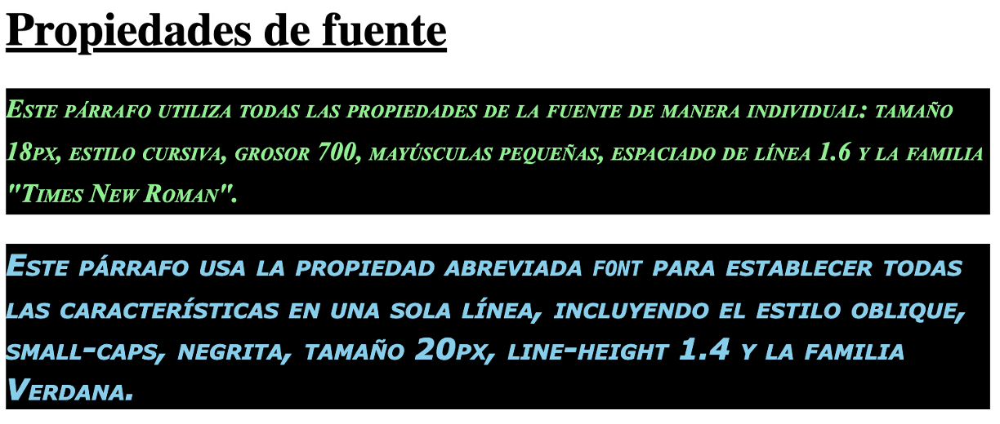

# **Propiedades de fuente**

En este apartado vamos a ver las distintas propiedades que podemos utilizar referentes a las **fuentes tipográficas** de nuestro documento.

## **font-size**

Indica el **tamaño** de la fuente.

Puede ser un tamaño absoluto, relativo o en porcentaje.

Toma valores de unidades de CSS.

> **📌 CSS**
> 

```html
p {
    font-size: 16px;
}
```

## **font-family**

Establece la **familia** a la que pertenece la fuente.

Si el nombre de una fuente contiene espacios, se deben utilizar comillas para encerrar su nombre.

El valor es el nombre de la familia fuente.

## **font-weight**

Define el grosor de los caracteres.

Los valores que puede tomar son: `normal`, `bold`, `bolder`, `lighter`, `100`, `200`, `300`, `400`, `500`, `600`, `700`, `800` o `900`.

> **📌 CSS**
> 

```html
p {
    font-weight: bold;
}
```

## **font-style**

Determina si la fuente es normal o cursiva.

Los valores posibles son:

- `normal`

- `italic`

- `oblique`

El estilo `oblique` es similar al cursiva.

> **📌 CSS**
> 

```html
p {
    font-style: italic;
}
```

## **font-variant**

Determina si la fuente es normal o mayúsculas pequeñas.

Los valores que puede tomar son:

- `normal`

- `small-caps`

## **line-height**

El alto de una línea y por tanto, el espaciado entre líneas.

Es una de esas características que no se podían modificar utilizando HTML.

## **font**

Permite establecer todas las propiedades anteriores en el orden que se indica a continuación:

- `font-style`

- `font-variant`

- `font-weight`

- `font-size`

- `line-height`

- `font family`

Los valores han de estar separados por **espacios**. No es obligatorio el uso de todos los valores.

> **📌 CSS**
> 

```html
p {
    font: italic normal bold 20px 1em Verdana;
}
```

> **📌 Ejemplo font**
> 
HTMLCSSNavegador

```html
<!DOCTYPE html>
<html lang="es">
  <head>
    <meta charset="UTF-8" />
    <meta name="viewport" content="width=device-width, initial-scale=1.0" />
    <meta http-equiv="X-UA-Compatible" content="ie=edge" />
    <title>Propiedades de fuente</title>
    <link rel="stylesheet" href="styles.css" />
  </head>

  <body>
    <h1>Propiedades de fuente</h1>

    <p class="individual">
      Este párrafo utiliza todas las propiedades de la fuente de manera
      individual: tamaño 18px, estilo cursiva, grosor 700, mayúsculas pequeñas,
      espaciado de línea 1.6 y la familia "Times New Roman".
    </p>

    <p class="abreviada">
      Este párrafo usa la propiedad abreviada <code>font</code> para establecer
      todas las características en una sola línea, incluyendo el estilo oblique,
      small-caps, negrita, tamaño 20px, line-height 1.4 y la familia Verdana.
    </p>
  </body>
</html>
```

```html
h1 {
  text-decoration: underline;
}

.individual {
  font-size: 18px;
  font-family: "Times New Roman", serif;
  font-weight: 700;
  font-style: italic;
  font-variant: small-caps;
  line-height: 1.6;
  color: lightgreen;
  background-color: black;
}

.abreviada {
  font: oblique small-caps bold 20px/1.4 "Verdana";
  color: skyblue;
  background-color: black;
}
```



> **📌 Probar en el navegador - "Propiedades de color y fondo"**
> 

> [Documento HTML](https://codesandbox.io/p/sandbox/up03-css-propiedadesfuente-vkmym5)
