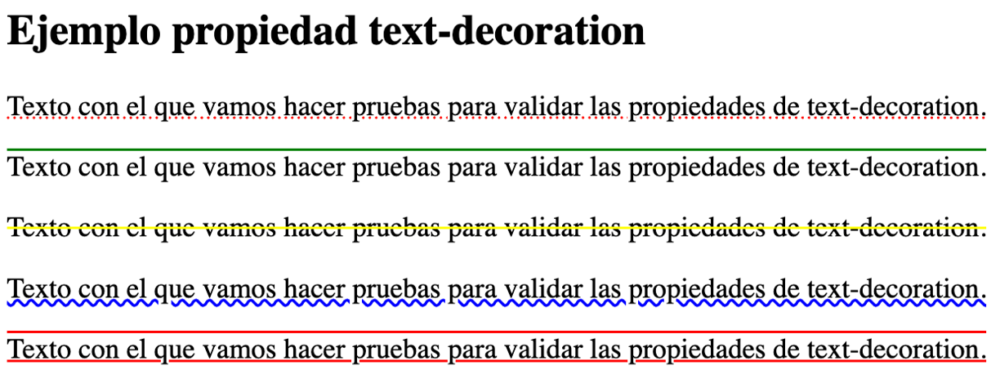
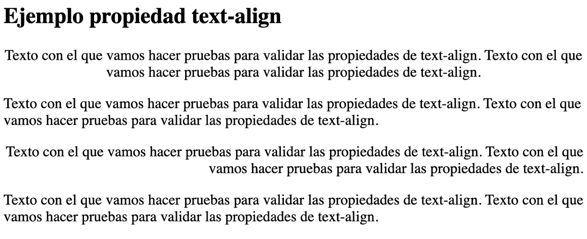
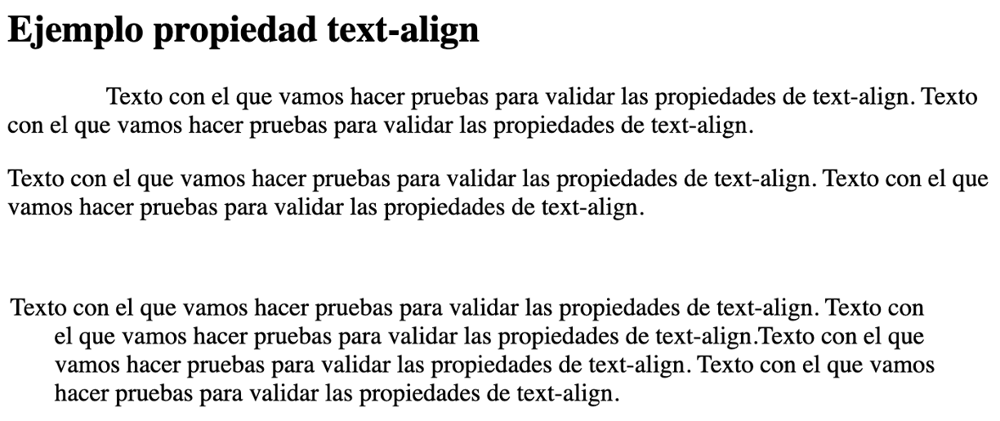
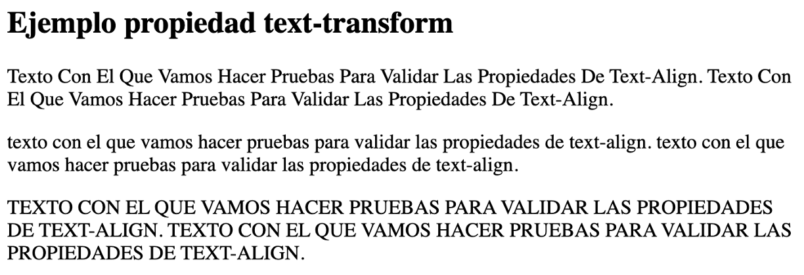
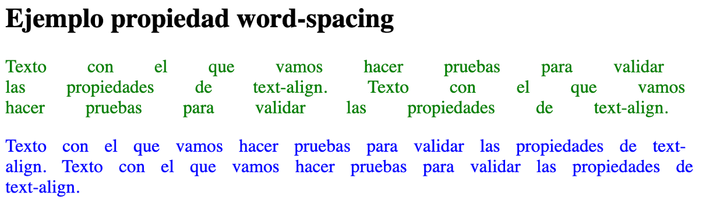
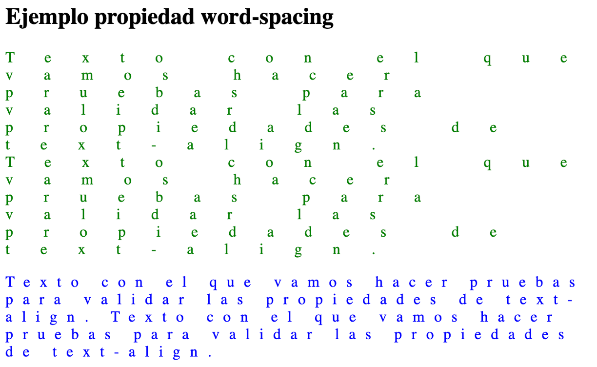
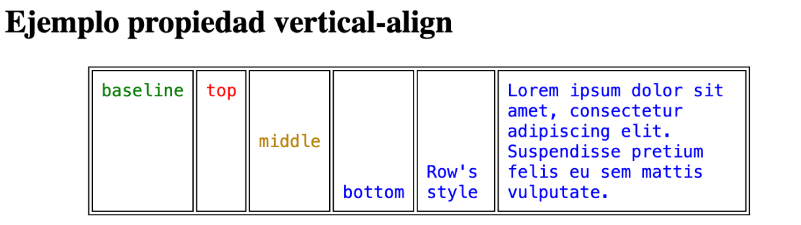
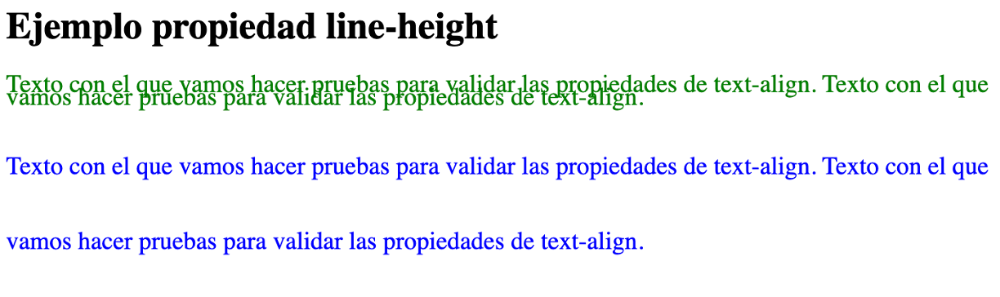

# **Propiedades de texto**

En este apartado se centra en las propiedades relacionadas con el texto.

## **text-decoration**

Establece si el texto está subrayado, sobrerayado o tachado.

Los valores que puede tomar son:

- `none`

- `underline`

- `overline`

- `line-through`

> **📌 Ejemplo text-decoration**
> 
CSSNavegador

```html
.p1 {
  text-decoration: underline red dotted;
}
.p2 {
  text-decoration: overline green;
}
.p3 {
  text-decoration: line-through yellow;
}

.p4 {
  text-decoration: blue wavy underline;
}
.p5 {
  text-decoration: underline overline red;
}
```



## **text-align**

Indica la **alineación** del texto. Aunque las hojas de estilo permiten el justificado de texto, no funciona en todos los sistemas.

Los valores que puede tomar son:

- `left`

- `right`

- `center`

- `justify`

> **📌 Ejemplo text-align**
> 
CSSNavegador

```html
.p1 {
  text-align: center;
}
.p2 {
  text-align: left;
}
.p3 {
  text-align: right;
}
.p4 {
  text-align: justify;
}
```



## **text-indent**

Determina la **tabulación** del texto. Los valores que puede tomar son:

- Una longitud (en unidades CSS).

- Un porcentaje.

> **📌 Ejemplo text-indent**
> 
CSSNavegador

```html
.p1 {
  text-indent: 10%;
}
.p2 {
  text-indent: 0%;
}
.p3 {
  padding: 30px;
  text-indent: -5%;
}
```



## **text-transform**

Nos permite **transformar** el texto, haciendo que tenga la primera letra en mayúsculas de todas las palabras, todo en mayúsculas o minúsculas.

Los valores que puede tomar son:

- `capitalize`

- `uppercase`

- `lowercase`

- `none`

> **📌 Ejemplo text-transform**
> 
CSSNavegador

```html
.p1 {
  text-transform: capitalize;
}
.p2 {
  text-transform: lowercase;
}
.p3 {
  text-transform: uppercase;
}
```



## **word-spacing**

Determina el **espaciado entre las palabras**. Los valores que puede tomar es un tamaño.

> **📌 Ejemplo word-spacing**
> 
CSSNavegador

```html
.p1 {
  word-spacing: 2em;
  color: green;
}
.p2 {
  word-spacing: 10px;
  color: blue;
}
```



## **letter-spacing**

Determina el **espaciado entre letras**. Los valores que puede tomar es un tamaño.

> **📌 Ejemplo letter-spacing**
> 
CSSNavegador

```html
.p1 {
  letter-spacing: 2em;
  color: green;
}
.p2 {
  letter-spacing: 10px;
  color: blue;
}
```



## **vertical-align**

Establece la **alineación vertical** del texto. Sus valores posibles son:

- `baseline`

- `sub`

- `super`

- `top`

- `text-top`

- `middle`

- `bottom`

- `text-bottom`

- Un porcentaje

> **📌 Ejemplo vertical-align**
> 
CSSNavegador

```html
table {
  margin-left: auto;
  margin-right: auto;
  width: 80%;
}

table,
th,
td {
  border: 1px solid black;
}

td {
  padding: 0.5em;
  font-family: monospace;
}

.bottom {
  vertical-align: bottom;
  color: blue;
}

.baseline {
  vertical-align: baseline;
  color: green;
}

.top {
  vertical-align: top;
  color: red;
}

.middle {
  vertical-align: middle;
  color: darkgoldenrod;
}
```



## **line-height**

Altura de la línea. Puede establecerse mediante un tamaño o un porcentaje

> **📌 Ejemplo line-height**
> 
CSSNavegador

```html
.p1 {
  line-height: 0.5;
  color: green;
}
.p2 {
  line-height: 3em;
  color: blue;
}
```



> **📌 Probar en el navegador - "Propiedades de color y fondo"**
> 

> [Documento HTML](https://codesandbox.io/p/sandbox/2zxc46)
