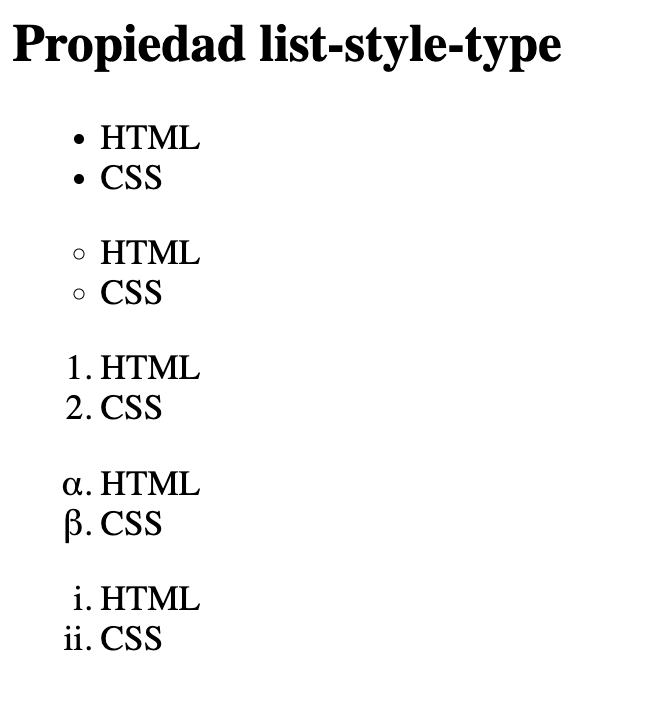
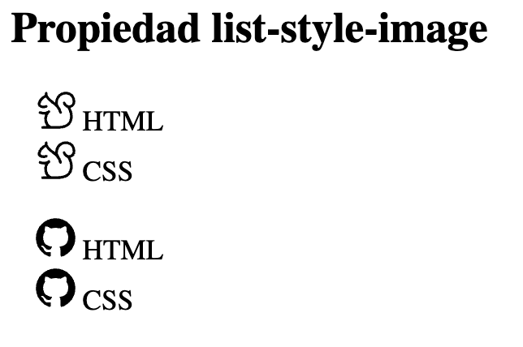
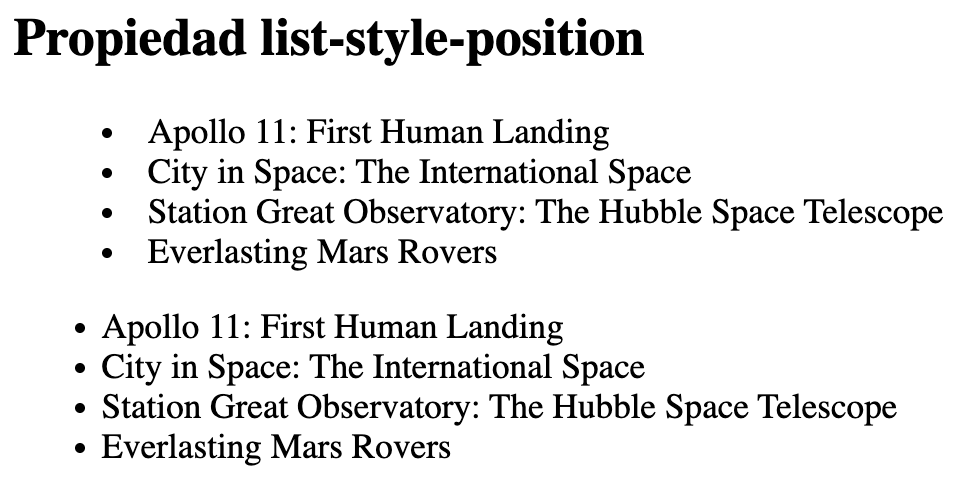

# Propiedades de lista

Hay cuatro propiedades de estilo para listas.

> **📌 Propiedades de estilo para listas**
> 
**list-style-type**list-style-image**list-style-position**list-style**

Con [`list-style-type`](https://developer.mozilla.org/es/docs/Web/CSS/Reference/Properties/list-style-type) se indica cual es el símbolo que se utiliza como marcador en las listas. Valores que puede tomar son:

- `disc`

- `circle`

- `square`

- `decimal`

- `lower-roman`

- `upper-roman`

- `lower-alpha`

- `upper-alpha`

- `none`

> **📌 Ejemplo list-style-type**
> 
CSSNavegador

```html
ul.ul1 {
list-style-type: disc;
}

ul.ul2 {
list-style-type: circle;
}

ul.ul3 {
list-style-type: decimal;
}

ul.ul4 {
list-style-type: lower-greek;
}

ul.ul5 {
list-style-type: lower-roman;
}
```



Para poder utilizar imágenes como marcadores en una lista se utiliza [`list-style-image`](https://developer.mozilla.org/es/docs/Web/CSS/Reference/Properties/list-style-image). El valor que toma es la ruta (relativa, absoluta o URL) del fichero imagen.

> **📌 Ejemplo list-style-image**
> 
CSSNavegador

```html
ul.ul1 {
list-style-image: url("squirrel-24.svg");
}

ul.ul2 {
list-style-image: url("mark-github-24.svg");
}
```



[`list-style-position`](https://developer.mozilla.org/es/docs/Web/CSS/Reference/Properties/list-style-position) determinan la posición del marcador en una lista. Puede tomar los valores:

- `outside`

- `inside`.

> **📌 Ejemplo list-style-position**
> 
CSSNavegador

```html
ul.ul1 {
list-style-position: inside;
}

ul.ul2 {
list-style-position: outside;
}
```



La propiedad [`list-style`](https://developer.mozilla.org/es/docs/Web/CSS/Reference/Properties/list-style) permite establecer de una única vez todas las características de una lista. Hay que seguir el orden siguiente:

- `list-style-type`

- `list-style-position`

- `list-style-image`

> **📌 Probar en el navegador - "Propiedades de lista"**
> 

> [Documento HTML](https://codesandbox.io/p/sandbox/74q2nn)
