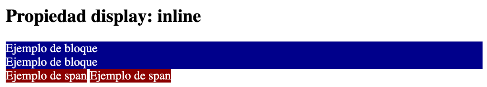
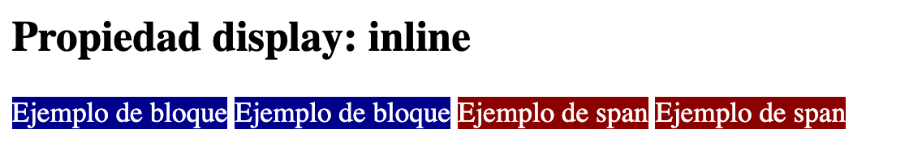
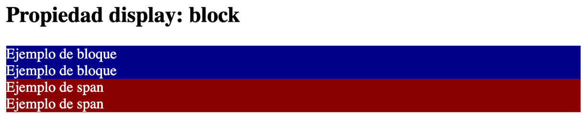
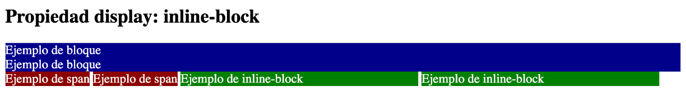
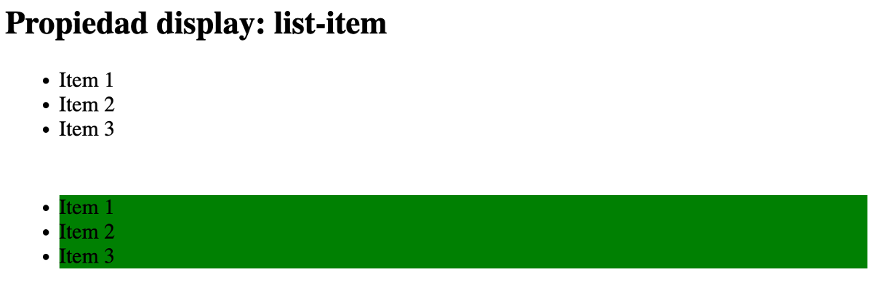
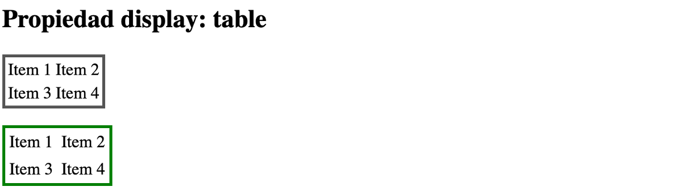
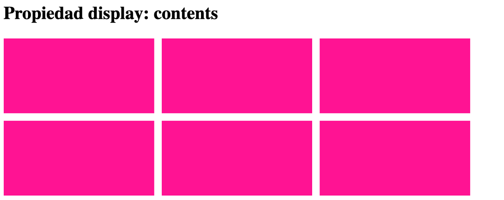

# Propiedad display

## Conceptos fundamentales de maquetación

Probablemente, una de las partes más complejas de CSS sea la creación de **layouts**, **colocación** y **distribución** de los elementos a lo largo de una página, y sin duda el que más le cuesta a los desarrolladores que están comenzando. Sin embargo, es una parte fundamental dentro de CSS, y es necesario entenderla correctamente para que resulte más fácil de trabajar y crear nuestros diseños.

Para establecer estos mecanismos básicos de layout se utiliza una propiedad llamada [`display`](https://developer.mozilla.org/es/docs/Web/CSS/Reference/Properties/display) que, aunque no la estemos utilizando explícitamente, está actuando por omisión. Vamos a aprender de que se trata.

## La propiedad `display`

Por defecto todos los elementos HTML tienen una forma de comportarse a la hora de renderizarse (**dibujarse**) en el navegador. Algunos elementos HTML como `<div>` o `<p>` actúan de una forma, y otros elementos como `<a>` o `<span>` de otra forma diferente. Esto tiene una razón de ser, y la explicaremos un poco más adelante.

Como hemos mencionado, aunque no lo hagamos explícitamente, todos los elementos HTML tienen una forma de representarse. Pero esa forma puede cambiarse a través de la propiedad CSS `display`, indicándole un tipo de representación concreta:

> **📌 CSS**
> 

```html
div {
display: block;   /* Valor por defecto en los <div> */
}
```

Cambiando ese tipo de representación o utilizando el valor `none`, se indicar al navegador que debe renderizarse de una forma concreta o no tiene ningún tipo de representación y debe ocultarse (**en el caso de `none`**).

Estos son los tipos de representación que existen en CSS:

| Tipo | Descripción |
| --- | --- |
| `inline` | Se coloca a continuación del otro (en horizontal). Ignora dimensiones. |
| `block` | Se coloca encima de otro (en vertical). |
| `inline-block` | Híbrido en línea-bloque. Actúa como un elemento en línea, pero obedece dimensiones. |
| `flex` | Utiliza el modelo de **cajas flexibles** de CSS. Ideal para estructuras de 1 dimensión. |
| `inline-flex` | Versión en línea (ocupa sólo su contenido) del modelo de cajas flexibles de CSS. |
| `grid` | Utiliza cuadrículas o rejillas con el modelo de cajas Grid CSS. |
| `inline-grid` | La versión en línea (ocupa sólo su contenido) del modelo de cajas Grid CSS. |
| `list-item` | Actúa como un ítem de una lista. Es el comportamiento de etiquetas como `&LTli>`. |
| `table` | Actúa como una tabla. Es el comportamiento de etiquetas como `&LTtable>`. |
| `table-cell` | Actúa como la celda de una tabla. Es el comportamiento de etiquetas como `&LTth>` o `&LTtd>`. |
| `table-row` | Actúa como la fila de una tabla. Es el comportamiento de etiquetas como `&LTtr>`. |
| `contents` | Ignora la caja del elemento. Útil para mantener Grid/Flex aún teniendo un wrapper intermedio. |
| `none` | No dibuja en el navegador el contenido del elemento ni sus hijos. |

> **📌 Anotación a los tipos de representación**
> 

> Las representaciones como flex o grid lo veremos más adelante en esta misma unidad. Ahora nos vamos a centrar en las propiedades de `inline`, `block`, `inline-block`, `list-item`, `table`, `contents` y `none`.

> **📌 Tipos de representación**
> 
**¿Qué es inline?**¿Qué es block?**¿Qué es inline-block?**¿Qué es list-item?**¿Qué es table?**El valor contents**El valor none**

Como norma general (*con excepciones*) los elementos que se utilizan dentro de un párrafo, son de tipo `inline`. Este tipo se caracteriza por varias cosas:

- Los elementos se alinean uno detrás de otro (*en horizontal*).

- Su tamaño o dimensiones se adaptan al de su contenido.

- Aunque uses `width` o `height`, se ignora y no cambia tamaño.

Por ejemplo, todos los elementos `<span>` o `<strong>` se comportan como elementos en línea (*inline*), mientras que los elementos `<div>` por defecto se comportan como elementos en bloque (*lo explicaremos en el siguiente apartado*):

> **📌 Ejemplo inline**
> 
HTMLCSSNavegador

```html
<div>Ejemplo de bloque</div>
<div>Ejemplo de bloque</div>
<span>Ejemplo de span</span>
<span>Ejemplo de span</span>
```

```html
div {
background: darkblue;
color: white;
}

span {
background: darkred;
color: white;
}
```



Observa, que aún sin haberlo indicado, los elementos `<div>` se comportan como si tuvieran un `display: block` y los elementos `<span>` se comportan como si tuvieran un `display: inline`.

No obstante, nosotros podemos forzar y cambiar su tipo:

> **📌 Ejemplo inline**
> 
HTMLCSSNavegador

```html
<div>Ejemplo de bloque</div>
<div>Ejemplo de bloque</div>
<span>Ejemplo de span</span>
<span>Ejemplo de span</span>
```

```html
div {
background: darkblue;
color: white;
display: inline;
}

span {
background: darkred;
color: white;
}
```



Observa que ahora, tanto `<div>` como `<span>` se comportan de la misma forma: como un elemento en línea. Normalmente, este tipo de representación de elementos se usa para agrupar fragmentos de texto.

Por su parte, los elementos que se utilizan para agrupar otros elementos HTML, por norma general, son de tipo `block`. Este tipo de elementos se caracteriza por lo siguiente:

- Los elementos se apilan uno encima de otro (*en vertical*).

- Por defecto, usa todo el ancho (*en horizontal*) disponible.

- Si usas `width` o `height`, obedece y cambia el tamaño del elemento.

Por ejemplo, todos los elementos `&LTdiv>` se comportan como elementos de bloque (*block*). En este ejemplo, además, aunque los elementos `&LTspan>` se comportan como elementos en línea, vamos a cambiarlos con `display` para que se comporten como elementos en bloque, apilándose unos encima de otros:

> **📌 Ejemplo inline**
> 
HTMLCSSNavegador

```html
<div>Ejemplo de bloque</div>
<div>Ejemplo de bloque</div>
<span>Ejemplo de span</span>
<span>Ejemplo de span</span>
```

```html
div {
background: darkblue;
color: white;
}

span {
background: darkred;
color: white;
display: block;
}
```



Normalmente, este tipo de representación de elementos se usa para agrupar múltiples elementos HTML y organizarlos.

Si utilizamos la propiedad `display` con el valor `inline-block`, conseguiremos un elemento que funcionará como si fuera un elemento `inline`, pero obedeciendo a las propiedades `width` y `height`, las cuales se ignoran si estamos utilizando un `display: inline`.

Se trata de una especie de híbrido entre `inline` y `block`:

> **📌 Ejemplo inline-block**
> 
HTMLCSSNavegador

```html
<div>Ejemplo de bloque</div>
<div>Ejemplo de bloque</div>
<span>Ejemplo de span</span>
<span>Ejemplo de span</span>
<span class="inline-block">Ejemplo de inline-block</span>
<span class="inline-block">Ejemplo de inline-block</span>
```

```html
div {
background: darkblue;
color: white;
}

span {
background: darkred;
color: white;
width: 200px;
}

.inline-block {
background: green;
color: white;
display: inline-block;
width: 300px;
}
```



Observa que en el caso del elemento `<span>` (*inline*), el navegador ignora las dimensiones de ancho que le hemos indicado, al contrario que en los `<Tdiv>` (*block*) o en el elemento `inline-block`. El valor `inline-block` nos puede venir muy bien cuando necesitamos una mezcla de ambos: donde se comporte como un `inline` pero que haga caso a las medidas de dimensión como los `block`.

Aunque no es muy utilizado hoy en día, el valor `list-item` se puede utilizar para que un elemento se represente visualmente como los ítems de una lista:

> **📌 Ejemplo inline-block**
> 
HTMLCSSNavegador

```html
<ul>
<li>Item 1</li>
<li>Item 2</li>
<li>Item 3</li>
</ul>

<div class="list">
<div>Item 1</div>
<div>Item 2</div>
<div>Item 3</div>
</div>
```

```html
.list {
margin: 2.5rem;

& div {
    background: green;
    display: list-item;
}
}
```



De esta forma, podemos renderizar como elementos de una lista a elementos HTML que no lo sean realmente. Ten en cuenta que aunque se pueda hacer esto, se recomienda utilizar el HTML de una lista, salvo en casos donde no tengas más remedio.

Tampoco es demasiado utilizado hoy en día, pero mediante el valor `table` en la propiedad `display` podemos obligar a un elemento cualquiera a renderizarse como si fuera una tabla. De la misma forma, tenemos los valores `table-cell` y `table-row` para renderizar elementos como celdas de una tabla o filas de una tabla, respectivamente:

> **📌 Ejemplo table**
> 
HTMLCSSNavegador

```html
<table>
<tr>
    <td>Item 1</td>
    <td>Item 2</td>
</tr>
<tr>
    <td>Item 3</td>
    <td>Item 4</td>
</tr>
</table>

<div class="table">
<div class="row">
    <div class="cell">Item 1</div>
    <div class="cell">Item 2</div>
</div>
<div class="row">
    <div class="cell">Item 3</div>
    <div class="cell">Item 4</div>
</div>
</div>
```

```html
table {
border: 3px solid #555;
margin-bottom: 1rem;
}

.table {
display: table;
border: 3px solid green;

& .row {
    display: table-row;
}
& .cell {
    display: table-cell;
    padding: 0.25rem;
}
}
```



De la misma forma que con las listas, se recomienda utilizar HTML basado en `&LTtable>` si tenemos la oportunidad. Sólo utilizar esto si no tenemos más remedio.

Para este ejemplo, necesitaremos conocer previamente `flex` o `grid`. Utilizando `display` se puede conseguir un comportamiento muy especial, que puede ser realmente útil en algunas ocasiones, sobre todo cuando trabajamos con librerías de terceros, WebComponents o con Javascript (*o ciertos frameworks*).

Hay situaciones donde se puede arruinar el diseño de maquetaciones **Grid** o **Flex**, porque son sistemas que funcionan relacionando un elemento padre con su hijo, por lo que si se cambia el marcado HTML de forma que se rompa esa relación, el diseño deja de ser efectivo.

Imaginemos la siguiente situación, donde tenemos un layout creado con **Grid**:

> **📌 Ejemplo contents**
> 
HTMLCSSNavegador

```html
<div class="grid">
<div class="item item-1"></div>
<div class="item item-2"></div>
<div class="item item-3"></div>
<div class="item item-4"></div>
<div class="item item-5"></div>
<div class="item item-6"></div>
</div>
```

```html
.grid {
display: grid;
grid-template-columns: repeat(3, 200px);
grid-template-rows: repeat(2, 100px);
gap: 10px;
}

.item {
background: deeppink;
}
```



Si introducimos un elemento con clase `.middle` dentro del `.grid`, que envuelva a todos los `.item`, el **grid** dejaría de funcionar porque se ha eliminado la relación padre-hijo entre `.grid` y los elementos `.item`. Sin embargo, si añadimos un `.middle` con un CSS asociado `.middle { display: contents }`, el navegador ignorará ese elemento intermedio que insertamos por razones de funcionalidad (*normalmente en situaciones de sólo diseño no ocurre*) y hará como que no existe:

> **📌 Ejemplo contents**
> 
HTMLCSSNavegador

```html
<div class="grid">
<div class="middle">
    <div class="item item-1"></div>
    <div class="item item-2"></div>
    <div class="item item-3"></div>
    <div class="item item-4"></div>
    <div class="item item-5"></div>
    <div class="item item-6"></div>
</div>
</div>
```

```html
.grid {
display: grid;
grid-template-columns: repeat(3, 200px);
grid-template-rows: repeat(2, 100px);
gap: 10px;
}

.item {
background: deeppink;
}

.middle {
display: contents;
}
```


Observa que a pesar de que existe el `&LTdiv>` con clase `middle` entre `.grid` y los `.items`, sigue funcionando la relación entre ambos y conservando el estilo del grid.

Mediante el valor especial `none` podemos indicar a la propiedad `display` que el navegador no debe renderizar (*dibujar*) el elemento ni sus hijos y, aunque exista en el HTML, no se mostrará.

> **📌 Probar en el navegador - "Propiedad display"**
> 

> [Documento HTML](https://codesandbox.io/p/sandbox/44tplk)
