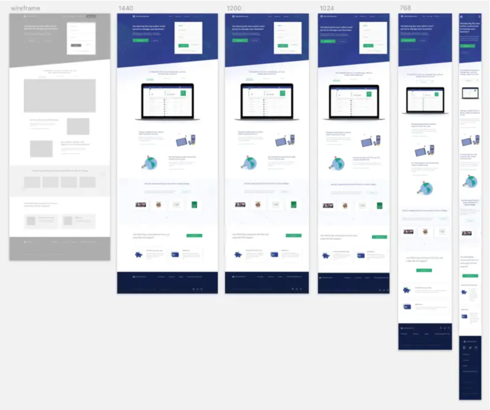
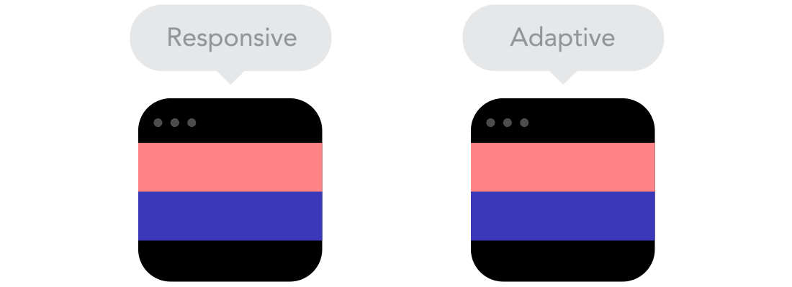
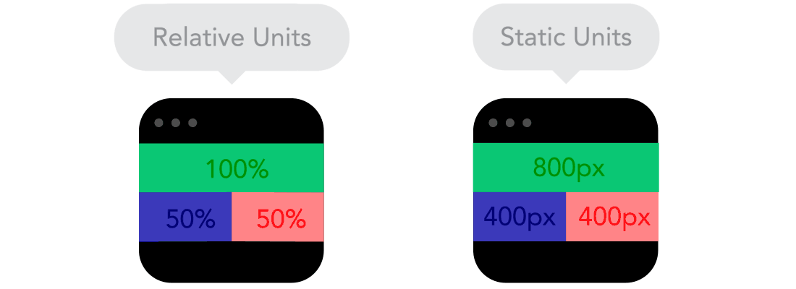
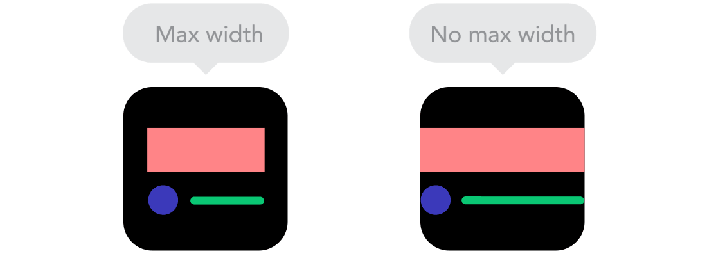
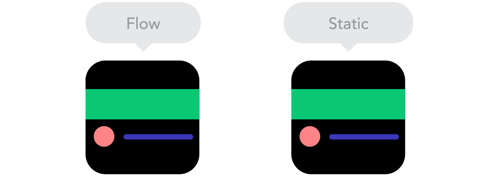
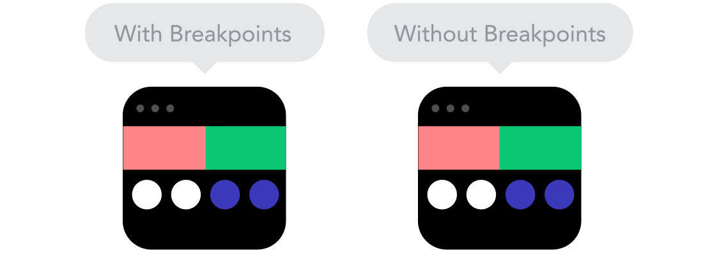
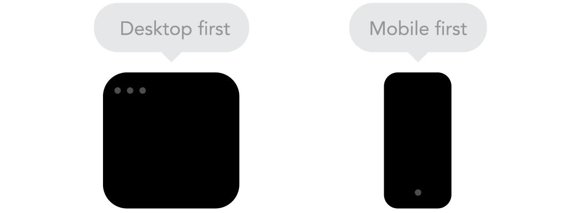

# Què és Responsive Design?

  

    🏆 <strong>Progrés d'aquesta secció:</strong> 0 de 4 superats (0%)
    ⭐ <strong>0 punts</strong>
  

  

    

  

Hui en dia, l'ús de **dispositius mòbils** es ha disparado, no només de «smartphones» viu la persona, sinó també de tablets, «smartwatchs», lectors d'ebooks i múltiples tipus de dispositius amb capacitat de connexió a Internet.

Aquests dispositius té **diferents pantalles i resolucions**, amb distints mides i formes, açò fa que l'aparença de les pàgines webs siga distinta en cada un dels dispositius i, per tant, diferents necessitats, problemes i solucions.

Per aquest motiu, quan es dissenya una web haurà de ser pensada per a verse correctament en diferents resolucions. L'estratègia que es va començar a dur a terme era la de dissenyar una web diferent depenent del dispositiu o navegador. Per suerte es descarto aquesta metodología per a poder passar al disseny adaptable i **dissenyar una sola web, que es adapte visualment al dispositiu utilitzat**.

Així ja que,es denomina **Responsive Web Design** (**o RWD**) als dissenys web que tenen la capacitat d'adaptar-se al mida i format de la pantalla en la que es visualitza el contingut. Aquest concepte és senzill de comprendre, no tant d'aplicar. Pot resultar la part més complicada del disseny de les web i per aquest motiu cal entender-lo, conèixer bé les bases i adquirir experiència amb la pràctica (la pràctica fa al maestro).

## Conceptes bàsics

En l'article [9 basic principles of responsive web design, de Froont](https://blog.froont.com/9-basic-principles-of-responsive-web-design/). En el podem veure una explicació visual d'alguns conceptes bàsics necessaris per a entendre correctament el **Responsive Web Design**, al costat d'unes animacions molt representativas.

### Responsive vs Adaptative

Pot semblar el mateix, però no l'és. Tots dos enfocaments es complementan, així que no hi ha una forma correcta o incorrecta de fer-ho. Deixa que el contingut decida. Com es pot veure en la imatge a continuació, un disseny **responsive** respon en tot moment a les dimensions del dispositiu, mentre que un disseny adaptable és aquell que es adapta, però no necessàriament respon en tot moment:

> **📌 Important**
> 

> Açò pot ser la diferència entre aplicar correctament conceptes com mitjana queries, percentatges i propietats d'ample màxim i mínim, que veurem més avant.

> **📌 Provar en el navegador - Responsive Design**
> 

> [Document HTML](https://codesandbox.io/p/sandbox/95mrgp)

> **📌 Provar en el navegador - Adaptive Design**
> 

> [Document HTML](https://codesandbox.io/p/sandbox/3ldsp2)

### Unitats relativas vs estátiques

El llenç pot ser una pantalla d'escriptori, una pantalla de mòbil o qualsevol una altra. La densitat de píxels també pot variar, per la qual cosa necessitem unitats flexibles i que funcionen en qualsevol lloc. Ací és on les unitats relativas, com els percentatges, resultan útils. Per tant, si un objecte té un ample del 50 %, sempre ocuparà la mitad de la pantalla (o viewport, que és el mida de la finestra del navegador oberta).

> **📌 Provar en el navegador - Unitats Relativas**
> 

> [Document HTML](https://codesandbox.io/p/sandbox/q3sjvg)

> **📌 Provar en el navegador - Unitats Estátiques**
> 

> [Document HTML](https://codesandbox.io/p/sandbox/sgwwm8)

### Amb màxims i sense màxims

A vegades és genial que el contingut ocupe tot l'ample de la pantalla, com en un dispositiu mòbil, però tindre el mateix contingut extendiéndose per tot l'ample de la pantalla del monitor sol tindre menys sentit. Per això, els valors **Min/Max** són útils. Per exemple, tindre un "width" del 100 % i un "width" màxim de 1000 px significaría que el contingut ocuparà tota la pantalla, però no superará els 1000 px.

Amb les propietats `min-width` o `max-width`, es podrà configurar perquè es adapte.

> **📌 Provar en el navegador - Amb màxims i sense màxims**
> 

> [Document HTML](https://codesandbox.io/p/sandbox/zt27m4)

### Flux vs Estàtic

A mesura que les pantalles es redueixen, el contingut comença a ocupar més espai vertical i tot el que estiga davall es desplaza cap a abaix; açò es anomena "flow". Açò pot ser difícil d'entendre si estàs acostumbrado a dissenyar amb píxels i punts, però cobra sentit una vegada que et acostumbras.

> **📌 Provar en el navegador - Fluido - Estàtic**
> 

> [Document HTML](https://codesandbox.io/p/sandbox/jptnq8)

> **📌 Provar en el navegador - Estàtic**
> 

> [Document HTML](https://codesandbox.io/p/sandbox/zt27m4)

> **📌 Provar en el navegador - Fluido - Flow**
> 

> [Document HTML](https://codesandbox.io/p/sandbox/93f3cm)

### Amb breakpoints vs sense breakpoints

Els punts d'interrupció permeten canviar el disseny en punts predefinits, per exemple, tindre 3 columnes en una pantalla d ordinador, però només una en un dispositiu mòbil. La majoria de les propietats CSS es poden canviar d'un "breakpoint" a un altre. Normalment, la ubicació d'un depèn del contingut. Si una oració s'interromp, podria ser necessari agregar un punt d'interrupció. Cal usar-los amb precaució; pot complicar-se ràpidament quan és difícil comprendre què influye en què.

Per exemple, es sol pensar que en una resolució d'escriptori volem mostrar la informació dins d'una cuadrícula (grid) de 4 ó 5 cel·les d'ample, mentre que en la versió de tablet serà només de 3 cel·les d'ample (el resta es desplazará a la següent fila) i en mòbils serà una sola cel·la d'ample, mostrándose el resta de cel·les fent scroll cap a abaix:

Aquesta forma de treballar ens proporciona múltiples avantatges:

- És molt més senzill mostrar la mateixa informació des de dissenys de pantalla gran.

- Ajuda a evitar la mala pràctica d'ocultar blocs d'informació en dispositius mòbils.

- Incentiva a dissenyar seguint bones pràctiques per a facilitar la creació responsive.

> **📌 Provar en el navegador - Amb breakpoints vs sense breakpoints**
> 

> [Document HTML](https://codesandbox.io/p/sandbox/qy7fxx)

## Estratègies de disseny

Finalment, és aconsejable decidir-se per una estratègia de disseny abans de començar. Encara que existeixen altres estratègies, les dos vertientes principals més populars són les següents:

| Estratègia | Descripció |
| --- | --- |
| **Mobile first** | Primer ens enfocamos en dispositius mòbils i després pensem en altres. |
| **Desktop first** | Primer ens enfocamos en dispositius d'escriptori, i després pensem en altres. |

### Mobile-first

L'estratègia **Mobile-first** és la que utilitzen els diseñadors de llocs webs en les que el seu públic objectiu és mayoritariament usuari de mòbil. Exemples com una web per a comprar billetes de transport, la web d'un joc o aplicació mòbil o una web per a demanar cita en un restaurant podrien ser, a priori, una bona elecció per a utilitzar **Mobile-first**.

> **📌 Important**
> 

> Aquesta estratègia fa que el desenvolupament en escriptori siga molt senzill, ja que es redueix a tindre un disseny de mòbil en escriptori i anar afegint noves seccions o parts per a «completar» el disseny en resolucions grans.

### Desktop-first

D'altra banda, l'estratègia **Desktop-first** sol interesar més als diseñadors de llocs webs en les que el públic objectiu són usuaris d'escriptori. Per exemple, una pàgina d'una aplicació per a PC/Mac o similars, podria ser una bona opció per a l'estratègia **Desktop-first**.

En ella, fem justo el contrari que en l'anterior, el primer que dissenyem és la versió d'escriptori, i després anem descargant detalls o recolocant informació fins a tindre la versió per a dispositius mòbils.

---

## 🎮 Reptes Interactius d'Autoavaluació (+100 XP)

Comprova el teu domini sobre **3.7.1 Què és Responsive Design?** superant aquests 4 reptes gamificats (+25 punts cadascun):

  
🎯 <strong>Repte 1 (+25 pts):</strong> En el model de caixes (Box Model) de CSS, quina propietat controla l'espai interior entre el contingut de l'element i la seua vora (<code>border</code>)?

  

    <button type="button" class="btn-mcq-opt" data-opt="A">A) margin</button>
    <button type="button" class="btn-mcq-opt" data-opt="B">B) padding</button>
    <button type="button" class="btn-mcq-opt" data-opt="C">C) outline</button>
    <button type="button" class="btn-mcq-opt" data-opt="D">D) gap</button>
  

  

  
🎯 <strong>Repte 2 (+25 pts):</strong> En CSS Flexbox (<code>display: flex</code>), quina propietat alinea els elements al llarg de l'eix principal (main axis)?

  

    <button type="button" class="btn-mcq-opt" data-opt="A">A) align-items</button>
    <button type="button" class="btn-mcq-opt" data-opt="B">B) justify-content</button>
    <button type="button" class="btn-mcq-opt" data-opt="C">C) flex-wrap</button>
    <button type="button" class="btn-mcq-opt" data-opt="D">D) z-index</button>
  

  

  
✅ <strong>Repte 3 (Vertader o Fals · +25 pts):</strong> En la cascada d'especificitat de CSS, un selector d'identificador (<code>#menu</code>) té més especificitat que un selector de classe (<code>.item</code>).

  

    <button type="button" class="btn-vf" data-opt="V">Vertader (V)</button>
    <button type="button" class="btn-vf" data-opt="F">Fals (F)</button>
  

  

  
⌨️ <strong>Repte 4 (+25 pts):</strong> Quina regla CSS (<code>@_____</code>) permet aplicar estils condicionals segons l'amplària de la pantalla per a crear un disseny web adaptatiu (Responsive Web Design)?

  

    <input type="text" class="quiz-input" placeholder="Escriu la resposta..." />
    <button type="button" class="btn-quiz-check">Comprovar</button>
  

  

### 📋 Llista de Comprovació i Rúbrica d'Assoliment

Marca cada criteri a mesura que completes l'estudi o la resolució pràctica d'aquesta pàgina (**3.7.1 Què és Responsive Design?**):

- [ ] He llegit detingudament la teoria o l'enunciat d'aquesta secció i he anotat els conceptes clau.
- [ ] He revisat els esquemes, taules o blocs de codi i he verificat que sé aplicar-los a l'entorn de treball.
- [ ] He resolt correctament els **4 reptes interactius** superiors obtenint els **100 punts XP**.
- [ ] He descarregat el comprovant oficial en PDF per a adjuntar-lo a la tasca d'**Aules**.

  <h3>📤 Comprovant de Lliurament per a Aules</h3>
  
Quan hages completat els reptes interactius i la llista d'autoavaluació d'aquesta pàgina, introdueix el teu nom i descarrega el teu certificat oficial en PDF per a adjuntar-lo a la tasca d'<strong>Aules</strong>.

  

    <label for="aules-student-name">👤 Nom i Cognoms de l'Alumne/a:</label>
    <input type="text" id="aules-student-name" class="aules-student-name" placeholder="Ex: Joan Garcia Pérez" />
  

  

    0/4 reptes completats (0%) · 0 punts · 0/4 criteris d'autoavaluació
  

  

    <button type="button" class="btn-aules-dl" data-module="LMSGI" data-unit="UD03" data-activity="ut0371">📥 Descarregar Comprovant PDF</button>
    <button type="button" class="btn-aules-copy">📋 Copiar Resum al Porta-retalls</button>
  

  

