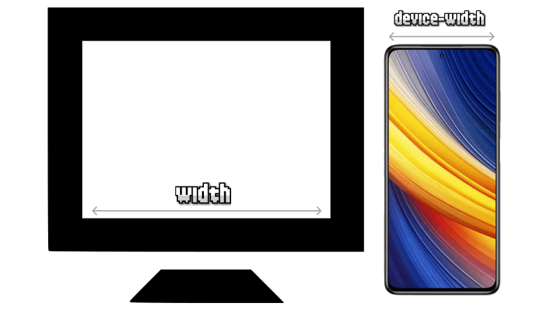

# CSS Media Queries

Una vez nos adentramos en el mundo del **Responsive Design**, nos damos cuenta en que hay situaciones en las que determinados aspectos o componentes visuales deben aparecer con ciertas diferencias dependiendo del dispositivo donde se están visualizando, ya que no todos los dispositivos tienen los mismos tamaños o características.

> **📌 Importante**
> 

> Por ejemplo, una zona donde se encuentra el **buscador de la página** puede estar colocada en un sitio concreto en la versión de escritorio, pero en móvil quizás nos interese que ocupe otra zona (*o que tenga otro tamaño o forma*) para aprovechar mejor el espacio de la versión del dispositivo móvil.

Existe un concepto denominado **media queries**, mediante el cuál podemos hacer excepciones para que unos determinados estilos de diseño sólo se apliquen si se cumplen una serie de condiciones, generalmente relacionadas con el dispositivo o navegador mediante el cuál se está viendo la página.

A fin de cuentas, se trata de una especie de condicionales de diseño, en las que si se cumple la condición se aplicarán unos estilos, y en caso contrario, se aplicarán otros.

## La regla `@media`

Las reglas **media queries** (abreviadas como **MQ**) se indican en el código mediante la regla `@media`, indicando la condición en cuestión entre paréntesis. La sintaxis sería la siguiente:

| Regla | Descripción |
| --- | --- |
| `@media` (<*condición*>) | Si se cumple la condición, se aplican los estilos de su interior. |
| `@media` `not` (<*condición*>) | Si no se cumple la condición, se aplican los estilos de su interior. |
| `@media` `only` (<*condición*>) | Si se cumple la condición y es un navegador moderno, se aplican los estilos. |
| `@media` (<*condición*>) `and` (<*condición*>) | Se se cumplen ambas condiciones, se aplican los estilos. |

Observa que, de utilizar la palabra clave `not` antes de los paréntesis, invertimos la condición. Así pues, veamos un pequeño ejemplo donde escribimos las dos opciones anteriores, pero sin entrar en detalles aún en la condición:

> **📌 CSS**
> 

```html
@media (*condición*) {
      .container {
        background: green;
      }
    }

    @media not (*condición*) {
      .container {
        background: red;
      }
    }
```

En el ejemplo anterior, si se cumple la condición establecida, se aplicará un color verde. Sin embargo, si no se cumple, se aplicará un color rojo. Recuerda que es similar al funcionamiento de un `if` / `else` en programación.

No olvides que al escribir una regla `@media` podrías estar sobreescribiendo los estilos CSS en otro fragmento posterior. Una buena forma de empezar a escribir **MQ** sería escribir las reglas `@media` siempre al final, como excepciones al código anterior.

> **📌 Importante**
> 

> El número de bloques de reglas `@media` a utilizar depende del desarrollador web, ya que no hay una obligación o norma de utilizar un número concreto. Se pueden utilizar desde un sólo media query, hasta múltiples de ellos a lo largo de todo el documento CSS.

Si lo deseas, es posible establecer múltiples condiciones en las reglas `@media`. De esta forma, se pueden conseguir situaciones mucho más específicas y flexibles. Ten mucho cuidado si aplicas el `not` en las condiciones, no sea que niegues de forma incorrecta los casos deseados:

> **📌 CSS**
> 

```html
@media (*condición*) and (*condición) {
      .container {
        background: orangered;
      }
    }
```

> **📌 Tip**
> 

> Al igual que `not`, también existe la palabra clave `only`. Suele usarse a modo de **hack**. El comportamiento por defecto ya incluye los dispositivos que encajan con la condición, así que con `only` conseguimos que navegadores antiguos (*no la entienden*) no procesen la información de esta regla, consiguiendo una forma de dar estilo sólo en navegadores modernos.

## Media Queries (range syntax)

Aunque existen otras formas, hoy en día la forma preferida de escribir **Media Queries** es utilizando la modalidad de **rangos de condiciones** (*Media Query Range Syntax*), mucho más versátiles que las sintaxis anteriores, y mucho menos tediosas.

Para ello, vamos a escribir las condiciones utilizando operadores de comparación como `<`, `<=`, `>` o `>=`:

> **📌 CSS**
> 

```html
.container {
      background: var(--color, grey);
      min-height: 200px;
      padding: 1rem 2rem;
    }

    @media (width <= 550px) {
      .container {
        --color: indigo;
      }
    }

    @media (width >= 750px) {
      .container {
        --color: green;
      }
    }
```

> **📌 HTML**
> 

```html
<div class="container">
      <p>Redimensiona el navegador o mueve abajo a la derecha.</p>
      <ul>
        <li>Dispositivos <= 550px -> Lila</li>
        <li>Dispositivos entre 551px y 749px -> Gris</li>
        <li>Dispositivos >= 750px -> Verde</li>
      </ul>
      <p>¡No te olvides de seguir a Manz en sus redes sociales!</p>
    </div>
```

Observa que en el caso de que la ventana del navegador del dispositivo sea igual o más pequeña que `550px`, se verá el fondo de color lila, y en el caso de que sea mayor o igual que `750px` se verá verde.

Si la ventana tuviera entre `551px` y `749px`, no se aplicaría ninguna media query (*no cumplen las condiciones*) y se quedaría de color gris, que es el valor que tiene indicado por defecto.

Ahora, hagamos una pequeña variación del CSS anterior, y aprovechemos el **CSS Nesting nativo** y la anidación de reglas `@media`:

> **📌 CSS**
> 

```html
.container {
        background: var(--color, grey);
        min-height: 200px;
        padding: 1rem 2rem;

        @media (width <= 550px) { --color: indigo; }
        @media (width >= 750px) { --color: green; }
    }
```

> **📌 HTML**
> 

```html
<div class="container">
      <p>Redimensiona el navegador o mueve abajo a la derecha.</p>
      <ul>
        <li>Dispositivos <= 550px -> Lila</li>
        <li>Dispositivos entre 551px y 749px -> Gris</li>
        <li>Dispositivos >= 750px -> Verde</li>
      </ul>
      <p>¡No te olvides de seguir a Manz en sus redes sociales!</p>
    </div>
```

Como puedes ver, exactamente equivalente al código anterior, pero más compacto y legible. Ten en cuenta que con la sintaxis de rangos también puedes hacer condiciones múltiples de este estilo, en el que el código CSS se aplica sólo si el navegador tiene un ancho de pantalla entre `400px` y `800px`:

> **📌 CSS**
> 

```html
@media (400px <= width <= 800px) {
      /* Código CSS */
    }
```

Esta serie de características de sintaxis junto a poder utilizar los operadores `>`, `>=`, `<`, `<=` en las condiciones de los media queries, hace mucho más intuitivo el escribir MQ CSS.

## Tipos de medios

En algunas ocasiones, queremos indicar que las reglas `@media` sólo se pongan en funcionamiento en determinados tipos de dispositivos. Son los llamados **tipos de medios**, que pueden utilizarse en las condiciones de los media queries. Existen los siguientes:

| Tipo de medio | Significado |
| --- | --- |
| **all** | Todos los dispositivos o medios. El que se utiliza **por defecto**. |
| `screen` | Monitores o pantallas de ordenador. |
| `print` | Documentos de **medios impresos** o pantallas de previsualización de impresión. |
| `speech` | Lectores de texto para invidentes (Antes `aural`, el cuál ya está obsoleto). |

Estos tipos de medios se pueden indicar como una condición más, de modo que podría quedar de la siguiente forma:

> **📌 CSS**
> 

```html
/* Pantallas menores de 600px */
    @media screen and (width <= 600px) {
      /* ... */
    }

    /* Previsualizaciones y formatos de impresión */
    @media print {
      /* ... */
    }
```

> **📌 Importante**
> 

> Quizás encuentres referencias a medios como `braille`, `embossed`, `handheld`, `projection`, `tty` o `tv`. Aunque aún pueden servir, están marcados como obsoletos a favor de los de la lista anterior.

## Viewport (Región visible)

Cuando hablamos de **Responsive Design** muchas veces haremos referencia al **viewport** (*región visible del navegador*). Recordemos que con el siguiente fragmento de código HTML estamos indicando que hay que preparar el navegador para el **Responsive** y que el nuevo ancho de la pantalla será **el ancho del dispositivo**, por lo que el aspecto del viewport se va a adaptar consecuentemente:

> **📌 Html**
> 

```html
<meta name="viewport" content="initial-scale=1, width=device-width">
```



Con esto conseguiremos preparar nuestra web para dispositivos móviles y prepararnos para la introducción de reglas **media query** en el documento CSS. Es importante no olvidar este paso.

## Media Queries desde HTML

Por último, hay que tener en cuenta que los **media queries** también es posible indicarlos desde HTML, utilizando la etiqueta `<link>` y el atributo `media` para establecer la condición:

> **📌 HTML**
> 

```html
<link rel="stylesheet"
          href="mobile.css"
          media="(max-width: 640px)">

    <link rel="stylesheet"
          href="tablet.css"
          media="(min-width: 640px) and (max-width: 1280px)">

    <link rel="stylesheet"
          href="desktop.css"
          media="(min-width: 1280px)">
```

Observa, sin embargo, que en este caso, el código CSS de las diferentes condiciones queda en un archivo `.css` diferente, sin embargo, el navegador al cargar la página los descargará todos y los aplicará cuando sea necesario, al igual que lo hace en los ficheros `.css`.

## Media Queries (legacy syntax)

Lo que veremos a continuación es un ejemplo clásico de **media queries** en el que se utiliza una sintaxis antigua. Hoy en día se recomienda utilizar la **Media Query Range Syntax**, pero es posible encontrarse con una sintaxis similar a la siguiente:

> **📌 CSS**
> 

```html
.menu {
      height: 100px;
    }

    @media (max-width: 400px) {
      .menu {
        background: blue;
      }
    }

    @media (min-width: 400px) and (max-width: 800px) {
      .menu {
        background: red;
      }
    }

    @media (min-width: 800px) {
      .menu {
        background: green;
      }
    }
```

> **📌 HTML**
> 

```html
<div class="menu"></div>
```

El ejemplo anterior muestra un elemento (*con clase `menu`*) con un color de fondo concreto, dependiendo del tipo de medio con el que se visualice la página. Los resultados podrían ser los siguientes (*los valores son sólo ejemplos, habría que adaptarlos al caso deseado*):

- **Azul** para resoluciones menores a **400 píxeles** de ancho (*móviles*).

- **Rojo** para resoluciones entre **400 píxeles** y **800 píxeles** de ancho (*tablets*).

- **Verde** para resoluciones mayores a **800 píxeles** (*desktop*).

## Orientación del viewport

Mediante la feature `orientation` podemos aplicar estilos dependiendo de la orientación del viewport (*región visible*) del navegador del usuario. Ten en cuenta que orientación no se refiere a la **orientación de la pantalla**, sino a la orientación del viewport. En móviles, esto suele coincidir con la situación donde el usuario tiene el móvil en vertical (`portrait`) o en apaisado (`landscape`).

| Característica | Valores | ¿Cuándo se aplica? |
| --- | --- | --- |
| `orientation` | `landscape` / `portrait` | Si el dispositivo está en posición **vertical o apaisado**. |

Observa el siguiente ejemplo. En navegadores de escritorio, generalmente nos encontraremos con que el texto tiene estilo y aparece en fondo verde. En dispositivos móviles o tablets, dependerá indirectamente de la orientación del dispositivo.

> **📌 Ejemplo**
> 
HTMLCSSNavegador

```html
<div>Box 1</div>
    <div>Box 2</div>
    <div>Box 3</div>
```

```html
body {
      display: flex;
    }

    div {
      background: yellow;
      width: 200px;
      height: 200px;
      margin: 0.5rem;
      padding: 0.5rem;
    }

    @media (orientation: landscape) {
      body {
        flex-direction: row;
      }
    }

    @media (orientation: portrait) {
      body {
        flex-direction: column;
      }
    }
```

[CodeSandBox](https://codesandbox.io/p/sandbox/hxyjhy)

> **📌 Tip**
> 

> Recuerda que esta media query no identifica la **orientación de la pantalla**.
