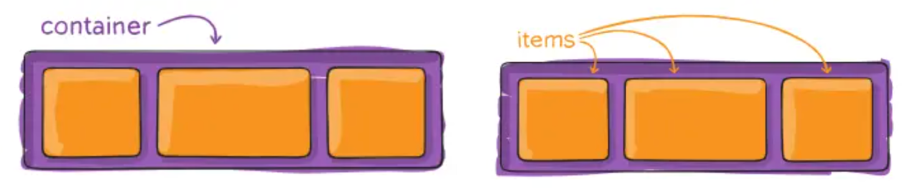

# Flexbox

[Flexbox](https://developer.mozilla.org/es/docs/Learn_web_development/Core/CSS_layout/Flexbox) nos permite crear layouts flexibles y responsivos organizando elementos automáticamente. Los dos **conceptos principales** con los que trabaja flexbox son: contenedor e items.
El **contenedor** contiene una serie de elementos (items) y se encarga de decidir cómo se van a mostrar los items que tiene dentro.
Los **items** son cada uno de los elementos que queremos que distribuya el container (están dentro del mismo).

> **📌 Cosas a tener en cuenta**
> 

> Un contenedor flexbox no se encarga de decir que tamaño tiene, se ajusta al flujo normal del documento.
Los elementos que tenemos dentro si se encarga flexbox de decir como lo organizamos.

