# **Propiedades Flexbox**

## **Display**

Para indicar que un elemento es contenedor flexbox, debemos utilizar la propiedad [display](https://developer.mozilla.org/es/docs/Web/CSS/Reference/Properties/display). En el contexto de flexbox, esta propiedad puede tener dos valores:

- 

Con **flex**, el elemento ocupa el 100% del ancho, como si fuera block.

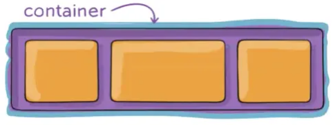

- 

Con **inline-flex**: el elemento toma el espacio mínimo para representar los elementos, como si fuera un inline.

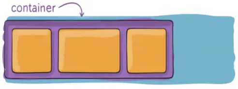

Por tanto, lo primero que debemos hacer para trabajar con flexbox es definir un valor para la propiedad display:

> **📌 flex**
> 
HTMLCSSNavegador

```html
<div class="container-flex">
    <div class="item">1</div>
    <div class="item">2</div>
    <div class="item">3</div>
</div>
```

```html
div.container-flex {
    display: flex;
    column-gap: 1rem;
    padding: 1rem 1.5rem;
    background: #111;
}
```

1
2
3

> **📌 inline-flex**
> 
HTMLCSSNavegador

```html
<div class="container-inlineflex">
    <div class="item">1</div>
    <div class="item">2</div>
    <div class="item">3</div>
</div>
```

```html
div.container-inlineflex {
    display: inline-flex;
    column-gap: 1rem;
    padding: 1rem 1.5rem;
    background: #111;
}
```

1
2
3

> **📌 CodeSandBox - "Display"**
> 

> [CodeSandBox](https://codesandbox.io/p/sandbox/w8q49h)

## **Dirección**

Flexbox trabaja con dos ejes:

- El **eje principal** (main axis) definido por la propiedad flex-direction.

- El **eje cruzado** (cross axis), que es perpendicular a este.

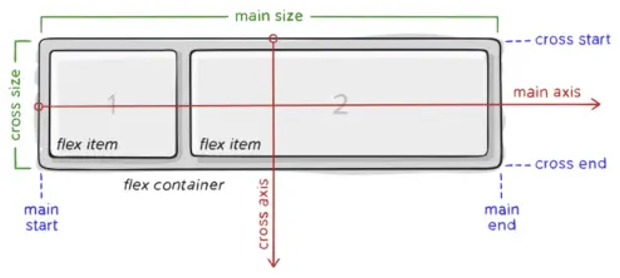

A flexbox le podemos indicar cuál es el eje principal y, con ello, deduce cuál es el cruzado, ya que éste es perpendicular al principal.
Tenemos dos configuraciones posibles de ejes:

- El eje principal es el eje horizontal (eje x). En este caso, el eje cruzado es el vertical (eje y). Es el valor predeterminado.

- El eje principal es el eje vertical (eje y). En este caso, el eje cruzado es el horizontal (eje x).

- Para elegir entre una configuración u otra, utilizamos la propiedad flex-direction.

### **Elementos organizados en filas**

La opción por defecto es `flex-direction: row;`, con esta opción definimos que el eje principal va a ser el de las filas (eje x) y el eje cruzado va a ser el eje vertical (eje y). Los elementos se irán organizando de izquierda a derecha.


Una variante es `flex-direction: row-reverse;`, con los ejes son los mismos, pero los elementos se organizan de derecha a izquierda (en el orden inverso).

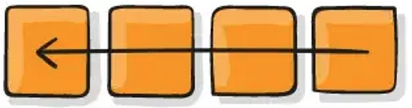

> **📌 row**
> 
HTMLCSSNavegador

```html
<div class="container-row">
    <div class="item">1</div>
    <div class="item">2</div>
    <div class="item">3</div>
</div>
```

```html
div.container-row {
    display: inline-flex;
    flex-direction: row;
    column-gap: 1rem;
    padding: 1rem 1.5rem;
    background: #111;
}
```

1
2
3

> **📌 row-reverse**
> 
HTMLCSSNavegador

```html
<div class="container-rowreverse">
    <div class="item">1</div>
    <div class="item">2</div>
    <div class="item">3</div>
</div>
```

```html
div.container-rowreverse {
    display: inline-flex;
    flex-direction: row-reverse;
    column-gap: 1rem;
    padding: 1rem 1.5rem;
    background: #111;
}
```

1
2
3

> **📌 CodeSandBox - "Dirección Filas"**
> 

> [CodeSandBox](https://codesandbox.io/p/sandbox/ptrrs3)

### **Elementos organizados en columnas**

La opción por defecto es `flex-direction: column;`
Con esta opción definimos que:

- El eje principal va a ser el de las vertical (eje y).

- El eje cruzado va a ser el horizontal (eje x).

Los elementos se irán organizando de arriba a abajo.

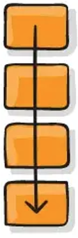

Una variante es `flex-direction: column-reverse;`
Los ejes son los mismos, pero los elementos se organizan de abajo a arriba (en el orden inverso).

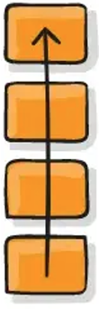

> **📌 column**
> 
HTMLCSSNavegador

```html
<div class="container-column">
    <div class="item">1</div>
    <div class="item">2</div>
    <div class="item">3</div>
</div>
```

```html
div.container-column {
    display: inline-flex;
    flex-direction: column;
    row-gap: 1rem;
    padding: 1rem 1.5rem;
    background: #111;
}
```

1
2
3

> **📌 column-reverse**
> 
HTMLCSSNavegador

```html
<div class="container-columnreverse">
    <div class="item">1</div>
    <div class="item">2</div>
    <div class="item">3</div>
</div>
```

```html
div.container-columnreverse {
    display: inline-flex;
    flex-direction: column-reverse;
    row-gap: 1rem;
    padding: 1rem 1.5rem;
    background: #111;
}
```

1
2
3

> **📌 CodeSandBox - "Dirección columnas"**
> 

> [CodeSandBox](https://codesandbox.io/p/sandbox/6dlg3m)

## wrap

Cuando creamos un contenedor y le añadimos ítems, nos podemos encontrar que no tengamos espacio suficiente para todos. Para estas situaciones, tenemos que decidir qué comportamiento seguir. Con flexbox, podemos utilizar la propiedad [flex-wrap](https://developer.mozilla.org/es/docs/Web/CSS/Reference/Properties/flex-wrap):

La propiedad acepta los siguientes valores:

- **nowrap**: indicamos al navegador que no cree nuevas filas. El texto se saldrá del contenedor. Como diseñadores decidimos si después queremos ocultar el texto que se sale.

- **wrap**: si no entran los elementos, el contenedor va creando nuevas filas.

- **wrap-reverse**: igual que wrap, pero igual que crearse en orden lógico (se añaden filas abajo), los elementos wrapeados pasarían a estar arriba.

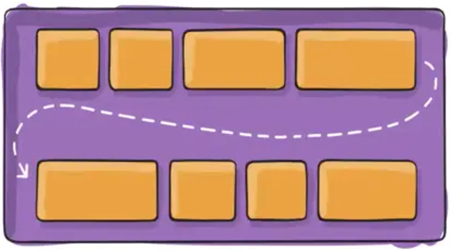

> **📌 nowrap**
> 
HTMLCSSNavegadorCodeSandBox

```html
<div class="container-nowrap">
    <div class="item">1</div>
    <div class="item">2</div>
    <div class="item">3</div>
    <div class="item">4</div>
    <div class="item">5</div>
    <div class="item">6</div>
    <div class="item">7</div>
    <div class="item">8</div>
    <div class="item">9</div>
    <div class="item">10</div>
    <div class="item">11</div>
    <div class="item">12</div>
    <div class="item">13</div>
    <div class="item">14</div>
    <div class="item">15</div>
</div>
```

```html
div.container-nowrap {
    display: flex;
    flex-wrap: nowrap;
    column-gap: 1rem;
    padding: 1rem 1.5rem;
    background: #111;
}
```

1
2
3
4
5
6
7
8
9
10
11
12
13
14
15

[Ejemplo CodeSandBox](https://codesandbox.io/p/sandbox/7swtnz)

> **📌 wrap**
> 
HTMLCSSNavegadorCodeSandBox

```html
<div class="container-wrap">
    <div class="item">1</div>
    <div class="item">2</div>
    <div class="item">3</div>
    <div class="item">4</div>
    <div class="item">5</div>
    <div class="item">6</div>
    <div class="item">7</div>
    <div class="item">8</div>
    <div class="item">9</div>
    <div class="item">10</div>
    <div class="item">11</div>
    <div class="item">12</div>
    <div class="item">13</div>
    <div class="item">14</div>
    <div class="item">15</div>
</div>
```

```html
div.container-wrap {
    display: inline-flex;
    flex-wrap: wrap;
    column-gap: 1rem;
    row-gap: 1rem;
    padding: 1rem 1.5rem;
    background: #111;
}
```

1
2
3
4
5
6
7
8
9
10
11
12
13
14
15

[Ejemplo CodeSandBox](https://codesandbox.io/p/sandbox/7swtnz)

> **📌 wrap-reverse**
> 
HTMLCSSNavegadorCodeSandBox

```html
<div class="container-wrapreverse">
    <div class="item">1</div>
    <div class="item">2</div>
    <div class="item">3</div>
    <div class="item">4</div>
    <div class="item">5</div>
    <div class="item">6</div>
    <div class="item">7</div>
    <div class="item">8</div>
    <div class="item">9</div>
    <div class="item">10</div>
    <div class="item">11</div>
    <div class="item">12</div>
    <div class="item">13</div>
    <div class="item">14</div>
    <div class="item">15</div>
</div>
```

```html
div.container-wrapreverse {
    display: inline-flex;
    flex-wrap: wrap-reverse;
    column-gap: 1rem;
    row-gap: 1rem;
    padding: 1rem 1.5rem;
    background: #111;
}
```

1
2
3
4
5
6
7
8
9
10
11
12
13
14
15

[Ejemplo CodeSandBox](https://codesandbox.io/p/sandbox/7swtnz)

## **gaps**

Existen dos propiedades muy interesantes llamadas: `row-gap` y `column-gap`. Dichas propiedades, permiten establecer el tamaño de los «huecos» entre ítems de un contenedor flex. Esto evita la necesidad de estar utilizando `padding` o `margin` en los elementos hijos, que suele traer muchas complicaciones.

- **row-gap**: Espacio entre filas (sólo funciona con flex-direction: column)

- **column-gap**: Espacio entre columnas (sólo funciona con flex-direction: row)

Como flex es un sistema que trabaja en una sola dimensión, sólo una de las dos propiedades tendrá efecto:

- Si flex-direction: column, podrás utilizar row-gap.

- Si flex-direction: row, podrás utilizar column-gap.

Eso sí, es posible usar ambas si tenemos la propiedad flex-wrap definida a wrap y, por lo tanto, disponemos de multicolumnas flexbox, ya que en este caso si podemos separar elementos por filas y por columnas. En este caso se puede utilizar la propiedad gap, si se indica un valor los dos ejes toman el mismo valor, si se indica dos, una para las x y otro para las y.

> **📌 column-gap**
> 
HTMLCSSNavegadorCodeSandBox

```html
<div class="container-row">
    <div class="item">1</div>
    <div class="item">2</div>
    <div class="item">3</div>
</div>
```

```html
div.container-row {
    display: inline-flex;
    flex-direction: row;
    column-gap: 1rem;
    padding: 1rem 1.5rem;
    background: #111;
}
```

1
2
3

[Ejemplo CodeSandBox](https://codesandbox.io/p/sandbox/ptrrs3)

> **📌 row-gap**
> 
HTMLCSSNavegadorCodeSandBox

```html
<div class="container-column">
    <div class="item">1</div>
    <div class="item">2</div>
    <div class="item">3</div>
</div>
```

```html
div.container-column {
    display: inline-flex;
    flex-direction: column;
    row-gap: 1rem;
    padding: 1rem 1.5rem;
    background: #111;
}
```

1
2
3

[Ejemplo CodeSandBox](https://codesandbox.io/p/sandbox/6dlg3m)

## **Justificación**

Para ordenar los ítems situados dentro de un contenedor, tenemos la propiedad [justify-content](https://developer.mozilla.org/en-US/docs/Web/CSS/Reference/Properties/justify-content)

Esta propiedad afecta al eje principal del contenedor. Podemos repartir y organizar nuestros ítems dentro del contenedor en el eje principal.
La siguiente imagen muestran cómo se organizarían los elementos si eje principal fuese el predeterminado.

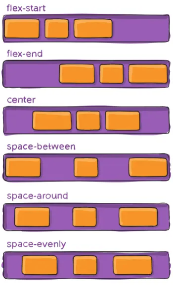

- **flex-start**: se organizan todos al principio. Es la opción por defecto.

- **flex-end**: los ítems se organizan al final del eje principal.

- **center**: se organizan en el centro de eje principal:

- **space-between**: en este caso, el primero y el último caen al principio y al final del contenedor, sin dejar ningún espacio ni margen, y el resto a una distancia equidistante entre ellos, y reparte el espacio que sobre entre los demás elementos que tenga.

- **space-around**: en este caso, todos los elementos van a tener un espacio igual alrededor de ellos, el espacio que sobra lo reparte entre todos los elementos, de forma que cada elemento tiene el mismo espacio a la izquierda y derecha, el efecto: el primero y el último elemento tienen un espacio que es como la mitad de separación entre los que hay en medio.

- **space-evenly**: desaparece el efecto del caso anterior, el espacio entre el principio y el final son iguales, reparte ese espacio.

> **📌 flex-start**
> 
HTMLCSSNavegadorCodeSandBox

```html
<div class="flex-start">
    <div class="item">1</div>
    <div class="item">2</div>
    <div class="item">3</div>
</div>
```

```html
div.flex-strat {
    display: flex;
    flex-direction: row;
    justify-content: flex-strat;
    column-gap: 1rem;
    padding: 1rem 1.5rem;
    background: #111;
}
```

    
        div.flex-strat {
            display: flex;
            flex-direction: row;
            justify-content: flex-strat;
            column-gap: 1rem;
            padding: 1rem 1.5rem;
            background: #111;
        }
        .item {
            width: 100px;
            height: 100px;
            background: rgb(0, 130, 26);
            border-radius: 10px;
            display: grid;
            place-items: center;
            font-size: 2rem;
            position: relative;
            color: white;
        }
    

    
    1
    2
    3
    

[Ejemplo CodeSandBox](https://codesandbox.io/p/sandbox/2pzjdl)

> **📌 flex-end**
> 
HTMLCSSNavegadorCodeSandBox

```html
<div class="flex-end">
    <div class="item">1</div>
    <div class="item">2</div>
    <div class="item">3</div>
</div>
```

```html
div.flex-end {
    display: flex;
    flex-direction: row;
    justify-content: flex-end;
    column-gap: 1rem;
    padding: 1rem 1.5rem;
    background: #111;
}
```

    
        div.flex-end {
            display: flex;
            flex-direction: row;
            justify-content: flex-end;
            column-gap: 1rem;
            padding: 1rem 1.5rem;
            background: #111;
        }
        .item {
            width: 100px;
            height: 100px;
            background: rgb(0, 130, 26);
            border-radius: 10px;
            display: grid;
            place-items: center;
            font-size: 2rem;
            position: relative;
            color: white;
        }
    

    
    1
    2
    3
    

[Ejemplo CodeSandBox](https://codesandbox.io/p/sandbox/2pzjdl)

> **📌 center**
> 
HTMLCSSNavegadorCodeSandBox

```html
<div class="center">
    <div class="item">1</div>
    <div class="item">2</div>
    <div class="item">3</div>
</div>
```

```html
div.center {
    display: flex;
    flex-direction: row;
    justify-content: center;
    column-gap: 1rem;
    padding: 1rem 1.5rem;
    background: #111;
}
```

    
        div.center {
            display: flex;
            flex-direction: row;
            justify-content: center;
            column-gap: 1rem;
            padding: 1rem 1.5rem;
            background: #111;
        }
        .item {
            width: 100px;
            height: 100px;
            background: rgb(0, 130, 26);
            border-radius: 10px;
            display: grid;
            place-items: center;
            font-size: 2rem;
            position: relative;
            color: white;
        }
    

    
    1
    2
    3
    

[Ejemplo CodeSandBox](https://codesandbox.io/p/sandbox/2pzjdl)

> **📌 space-between**
> 
HTMLCSSNavegadorCodeSandBox

```html
<div class="space-between">
    <div class="item">1</div>
    <div class="item">2</div>
    <div class="item">3</div>
</div>
```

```html
div.space-between {
    display: flex;
    flex-direction: row;
    justify-content: space-between;
    column-gap: 1rem;
    padding: 1rem 1.5rem;
    background: #111;
}
```

    
        div.space-between {
            display: flex;
            flex-direction: row;
            justify-content: space-between;
            column-gap: 1rem;
            padding: 1rem 1.5rem;
            background: #111;
        }
        .item {
            width: 100px;
            height: 100px;
            background: rgb(0, 130, 26);
            border-radius: 10px;
            display: grid;
            place-items: center;
            font-size: 2rem;
            position: relative;
            color: white;
        }
    

    
    1
    2
    3
    

[Ejemplo CodeSandBox](https://codesandbox.io/p/sandbox/2pzjdl)

> **📌 space-around**
> 
HTMLCSSNavegadorCodeSandBox

```html
<div class="space-around">
    <div class="item">1</div>
    <div class="item">2</div>
    <div class="item">3</div>
</div>
```

```html
div.space-around {
    display: flex;
    flex-direction: row;
    justify-content: space-around;
    column-gap: 1rem;
    padding: 1rem 1.5rem;
    background: #111;
}
```

    
        div.space-around {
            display: flex;
            flex-direction: row;
            justify-content: space-around;
            column-gap: 1rem;
            padding: 1rem 1.5rem;
            background: #111;
        }
        .item {
            width: 100px;
            height: 100px;
            background: rgb(0, 130, 26);
            border-radius: 10px;
            display: grid;
            place-items: center;
            font-size: 2rem;
            position: relative;
            color: white;
        }
    

    
    1
    2
    3
    

[Ejemplo CodeSandBox](https://codesandbox.io/p/sandbox/2pzjdl)

> **📌 space-evenly**
> 
HTMLCSSNavegadorCodeSandBox

```html
<div class="space-evenly">
    <div class="item">1</div>
    <div class="item">2</div>
    <div class="item">3</div>
</div>
```

```html
div.space-evenly {
    display: flex;
    flex-direction: row;
    justify-content: space-evenly;
    column-gap: 1rem;
    padding: 1rem 1.5rem;
    background: #111;
}
```

    
        div.space-evenly {
            display: flex;
            flex-direction: row;
            justify-content: space-evenly;
            column-gap: 1rem;
            padding: 1rem 1.5rem;
            background: #111;
        }
        .item {
            width: 100px;
            height: 100px;
            background: rgb(0, 130, 26);
            border-radius: 10px;
            display: grid;
            place-items: center;
            font-size: 2rem;
            position: relative;
            color: white;
        }
    

    
    1
    2
    3
    

[Ejemplo CodeSandBox](https://codesandbox.io/p/sandbox/2pzjdl)

## **align-content**

La propiedad [align-content](https://developer.mozilla.org/en-US/docs/Web/CSS/Reference/Properties/align-content) distribúye los ítems en el eje cruzado.
En el caso de que el eje cruzado fuera el vertical, los ítems se alinearían de la siguiente forma:

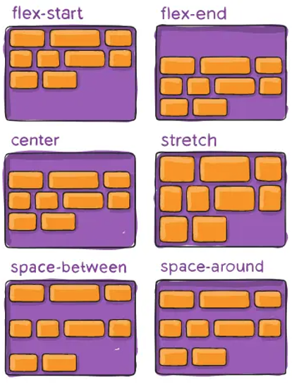

- **flex-start**: empieza colocando los elementos en la parte superior del contenedor.

- **flex-end**: al contrario que el anterior este los coloca en la parte inferior.

- **center**: centra todo el contenido.

- **stretch**: estira los ítems para ocupar de forma equitativa todo el espacio.

- **space-between**: parecido a space-between de justify pero aplicándolo al eje secundario.

- **space-around**: parecido a space-around de justify pero aplicándolo al eje secundario.

> **📌 flex-start**
> 
HTMLCSSNavegadorCodeSandBox

```html
<div class="flex-start">
    <div class="item">1</div>
    <div class="item">2</div>
    <div class="item">3</div>
    <div class="item">4</div>
</div>
```

```html
div.flex-strat {
    display: flex;
    flex-wrap: wrap;
    align-content: flex-start;
    column-gap: 1rem;
    padding: 1rem 1.5rem;
    background: #111;
    height: 300px;
    width: 300px;
}
```

    
        div.flex-strat {
            display: flex;
            flex-wrap: wrap;
            align-content: flex-start;
            column-gap: 1rem;
            padding: 1rem 1.5rem;
            background: #111;
            height: 300px;
            width: 400px;
        }
        .item {
            width: 50px;
            height: 50px;
            background: rgb(0, 130, 26);
            border-radius: 10px;
            display: grid;
            place-items: center;
            font-size: 1rem;
            position: relative;
            color: white;
        }
    

    
    1
    2
    3
    4
    

[Ejemplo CodeSandBox](https://codesandbox.io/p/sandbox/d67kjy)

> **📌 flex-end**
> 
HTMLCSSNavegadorCodeSandBox

```html
<div class="flex-end">
    <div class="item">1</div>
    <div class="item">2</div>
    <div class="item">3</div>
    <div class="item">3</div>
</div>
```

```html
div.flex-end {
    display: flex;
    flex-wrap: wrap;
    align-content: flex-end;
    column-gap: 1rem;
    padding: 1rem 1.5rem;
    background: #111;
    height: 300px;
    width: 400px;
}
```

    
        div.flex-end {
            display: flex;
            flex-wrap: wrap;
            align-content: flex-end;
            column-gap: 1rem;
            padding: 1rem 1.5rem;
            background: #111;
            height: 300px;
            width: 400px;
        }
        .item {
            width: 50px;
            height: 50px;
            background: rgb(0, 130, 26);
            border-radius: 10px;
            display: grid;
            place-items: center;
            font-size: 1rem;
            position: relative;
            color: white;
        }
    

    
    1
    2
    3
    4
    

[Ejemplo CodeSandBox](https://codesandbox.io/p/sandbox/d67kjy)

> **📌 center**
> 
HTMLCSSNavegadorCodeSandBox

```html
<div class="center">
    <div class="item">1</div>
    <div class="item">2</div>
    <div class="item">3</div>
    <div class="item">4</div>
</div>
```

```html
div.center {
    display: flex;
    flex-wrap: wrap;
    align-content: center;
    column-gap: 1rem;
    padding: 1rem 1.5rem;
    background: #111;
    height: 300px;
    width: 400px;
}
```

    
        div.center {
            display: flex;
            flex-wrap: wrap;
            align-content: center;
            column-gap: 1rem;
            padding: 1rem 1.5rem;
            background: #111;
            height: 300px;
            width: 400px;
        }
        .item {
            width: 50px;
            height: 50px;
            background: rgb(0, 130, 26);
            border-radius: 10px;
            display: grid;
            place-items: center;
            font-size: 1rem;
            position: relative;
            color: white;
        }
    

    
    1
    2
    3
    4
    

[Ejemplo CodeSandBox](https://codesandbox.io/p/sandbox/d67kjy)

> **📌 stretch**
> 
HTMLCSSNavegadorCodeSandBox

```html
<div class="stretch">
    <div class="item">1</div>
    <div class="item">2</div>
    <div class="item">3</div>
    <div class="item">4</div>
    <div class="item">5</div>
    <div class="item">6</div>
    <div class="item">7</div>
    <div class="item">8</div>
</div>
```

```html
div.stretch {
    display: flex;
    flex-wrap: wrap;
    align-content: stretch;
    column-gap: 1rem;
    padding: 1rem 1.5rem;
    background: #111;
    height: 300px;
    width: 400px;
}
```

    
        div.stretch {
            display: flex;
            flex-wrap: wrap;
            align-content: stretch;
            column-gap: 1rem;
            padding: 1rem 1.5rem;
            background: #111;
            height: 300px;
            width: 400px;
        }
        div.stretch .item {
            min-width: 50px;
            min-height: 50px;
            background: rgb(0, 130, 26);
            border-radius: 10px;
            display: grid;
            place-items: center;
            font-size: 1rem;
            position: relative;
            color: white;
        }
    

    
        1
        2
        3
        4
        5
        6
        7
        8
    

[Ejemplo CodeSandBox](https://codesandbox.io/p/sandbox/d67kjy)

> **📌 space-between**
> 
HTMLCSSNavegadorCodeSandBox

```html
<div class="space-between">
    <div class="item">1</div>
    <div class="item">2</div>
    <div class="item">3</div>
    <div class="item">4</div>
    <div class="item">5</div>
    <div class="item">6</div>
    <div class="item">7</div>
    <div class="item">8</div>
</div>
```

```html
div.space-between {
    display: flex;
    flex-wrap: wrap;
    align-content: space-between;
    column-gap: 1rem;
    padding: 1rem 1.5rem;
    background: #111;
    height: 300px;
    width: 400px;
}
```

    
        div.space-between {
            display: flex;
            flex-wrap: wrap;
            align-content: space-between;
            column-gap: 1rem;
            padding: 1rem 1.5rem;
            background: #111;
            height: 300px;
            width: 400px;
        }
        div.space-between .item {
            width: 50px;
            height: 50px;
            background: rgb(0, 130, 26);
            border-radius: 10px;
            display: grid;
            place-items: center;
            font-size: 1rem;
            position: relative;
            color: white;
        }
    

    
    1
    2
    3
    4
    5
    6
    7
    8
    

[Ejemplo CodeSandBox](https://codesandbox.io/p/sandbox/d67kjy)

> **📌 space-around**
> 
HTMLCSSNavegadorCodeSandBox

```html
<div class="space-around">
    <div class="item">1</div>
    <div class="item">2</div>
    <div class="item">3</div>
    <div class="item">4</div>
    <div class="item">5</div>
    <div class="item">6</div>
    <div class="item">7</div>
    <div class="item">8</div>
</div>
```

```html
div.space-around {
    display: flex;
    flex-wrap: wrap;
    align-content: space-around;
    column-gap: 1rem;
    padding: 1rem 1.5rem;
    background: #111;
    height: 300px;
    width: 400px;
}
```

    
        div.space-around {
            display: flex;
            flex-wrap: wrap;
            align-content: space-around;
            column-gap: 1rem;
            padding: 1rem 1.5rem;
            background: #111;
            height: 300px;
            width: 400px;
        }
        div.space-around .item {
            width: 50px;
            height: 50px;
            background: rgb(0, 130, 26);
            border-radius: 10px;
            display: grid;
            place-items: center;
            font-size: 1rem;
            position: relative;
            color: white;
        }
    

    
    1
    2
    3
    4
    5
    6
    7
    8
    

[Ejemplo CodeSandBox](https://codesandbox.io/p/sandbox/d67kjy)

## **align-items**

Cuando los ítems no tienen la misma altura utilizamos [align-items](https://developer.mozilla.org/es/docs/Web/CSS/Reference/Properties/align-items).

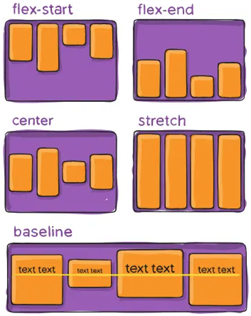

- **flex-start**: que todos los elementos los muestra al principio y cada uno tenga su alto.

- **flex-end**: que todos los elementos los muestra alineados al final y que cada uno tenga su tamaño.

- **center**: que todos los elementos aparezcan centrados en el eje, en este caso vertical.

- **stretch**: que todos los elementos intenten ocupar el máximo espacio vertical disponible.

- **baseline**: nos permite que nos centre en base a la primera línea de texto, así todos los textos se muestran alineados.

> **📌 flex-start**
> 
HTMLCSSNavegadorCodeSandBox

```html
<div class="alingflex-strat">
    <div class="alingitem1 alingitem">1</div>
    <div class="alingitem2 alingitem">2</div>
    <div class="alingitem3 alingitem">3</div>
    <div class="alingitem4 alingitem">4</div>
</div>
```

```html
div.alingflex-strat {
        display: flex;
        align-items: flex-start;
        column-gap: 1rem;
        padding: 1rem 1.5rem;
        background: #111;
        height: 300px;
        width: 300px;
        align-content: flex-start;
        }
        .alingitem1 {
        background-color: #8cffa0;
        min-height: 30px;
        }
        .alingitem2 {
        background-color: #a0c8ff;
        min-height: 50px;
        }
        .alingitem3 {
        background-color: #ffa08c;
        min-height: 40px;
        }
        .alingitem4 {
        background-color: #ffff8c;
        min-height: 60px;
        }
        div.alingitem {
        box-sizing: border-box;
        border: 2px solid white;
        width: 50px;
        display: flex;
        align-items: center;
        justify-content: center;
        }
```

    
        div.alingflex-strat {
            display: flex;
            align-items: flex-start;
            column-gap: 1rem;
            padding: 1rem 1.5rem;
            background: #111;
            height: 300px;
            width: 300px;
            align-content: flex-start;
        }
        .alingitem1 {
        background-color: #8cffa0;
        min-height: 30px;
        }
        .alingitem2 {
        background-color: #a0c8ff;
        min-height: 50px;
        }
        .alingitem3 {
        background-color: #ffa08c;
        min-height: 40px;
        }
        .alingitem4 {
        background-color: #ffff8c;
        min-height: 60px;
        }
        div.alingitem {
            box-sizing: border-box;
            border: 2px solid white;
            width: 50px;
            display: flex;
            align-items: center;
            justify-content: center;
        }
    

    
        1
        2
        3
        4
    

[Ejemplo CodeSandBox](https://codesandbox.io/p/sandbox/cnj99p)

> **📌 flex-end**
> 
HTMLCSSNavegadorCodeSandBox

```html
<div class="alingflex-strat">
    <div class="alingitem1 alingitem">1</div>
    <div class="alingitem2 alingitem">2</div>
    <div class="alingitem3 alingitem">3</div>
    <div class="alingitem4 alingitem">4</div>
</div>
```

```html
div.alingflex-strat {
        display: flex;
        align-items: flex-start;
        column-gap: 1rem;
        padding: 1rem 1.5rem;
        background: #111;
        height: 300px;
        width: 300px;
        align-content: flex-start;
        }
        .alingitem1 {
        background-color: #8cffa0;
        min-height: 30px;
        }
        .alingitem2 {
        background-color: #a0c8ff;
        min-height: 50px;
        }
        .alingitem3 {
        background-color: #ffa08c;
        min-height: 40px;
        }
        .alingitem4 {
        background-color: #ffff8c;
        min-height: 60px;
        }
        div.alingitem {
        box-sizing: border-box;
        border: 2px solid white;
        width: 50px;
        display: flex;
        align-items: center;
        justify-content: center;
        }
```

    
        div.alingflex-end {
            display: flex;
            align-items: flex-end;
            column-gap: 1rem;
            padding: 1rem 1.5rem;
            background: #111;
            height: 300px;
            width: 300px;
            align-content: flex-end;
        }
        .alingitem1 {
        background-color: #8cffa0;
        min-height: 30px;
        }
        .alingitem2 {
        background-color: #a0c8ff;
        min-height: 50px;
        }
        .alingitem3 {
        background-color: #ffa08c;
        min-height: 40px;
        }
        .alingitem4 {
        background-color: #ffff8c;
        min-height: 60px;
        }
        div.alingitem {
            box-sizing: border-box;
            border: 2px solid white;
            width: 50px;
            display: flex;
            align-items: center;
            justify-content: center;
        }
    

    
        1
        2
        3
        4
    

[Ejemplo CodeSandBox](https://codesandbox.io/p/sandbox/cnj99p)

> **📌 center**
> 
HTMLCSSNavegadorCodeSandBox

```html
<div class="alingcenter">
    <div class="alingitem1 alingitem">1</div>
    <div class="alingitem2 alingitem">2</div>
    <div class="alingitem3 alingitem">3</div>
    <div class="alingitem4 alingitem">4</div>
</div>
```

```html
div.alingcenter {
        display: flex;
        align-items: center;
        column-gap: 1rem;
        padding: 1rem 1.5rem;
        background: #111;
        height: 300px;
        width: 300px;
        align-content: center;
        }
        .alingitem1 {
        background-color: #8cffa0;
        min-height: 30px;
        }
        .alingitem2 {
        background-color: #a0c8ff;
        min-height: 50px;
        }
        .alingitem3 {
        background-color: #ffa08c;
        min-height: 40px;
        }
        .alingitem4 {
        background-color: #ffff8c;
        min-height: 60px;
        }
        div.alingitem {
        box-sizing: border-box;
        border: 2px solid white;
        width: 50px;
        display: flex;
        align-items: center;
        justify-content: center;
        }
```

    
        div.alingcenter {
            display: flex;
            align-items: center;
            column-gap: 1rem;
            padding: 1rem 1.5rem;
            background: #111;
            height: 300px;
            width: 300px;
            align-content: center;
        }
        .alingitem1 {
        background-color: #8cffa0;
        min-height: 30px;
        }
        .alingitem2 {
        background-color: #a0c8ff;
        min-height: 50px;
        }
        .alingitem3 {
        background-color: #ffa08c;
        min-height: 40px;
        }
        .alingitem4 {
        background-color: #ffff8c;
        min-height: 60px;
        }
        div.alingitem {
            box-sizing: border-box;
            border: 2px solid white;
            width: 50px;
            display: flex;
            align-items: center;
            justify-content: center;
        }
    

    
        1
        2
        3
        4
    

[Ejemplo CodeSandBox](https://codesandbox.io/p/sandbox/cnj99p)

> **📌 stretch**
> 
HTMLCSSNavegadorCodeSandBox

```html
<div class="alingstretch">
    <div class="alingitem1 alingitem">1</div>
    <div class="alingitem2 alingitem">2</div>
    <div class="alingitem3 alingitem">3</div>
    <div class="alingitem4 alingitem">4</div>
</div>
```

```html
div.alingstretch {
        display: flex;
        align-items: stretch;
        column-gap: 1rem;
        padding: 1rem 1.5rem;
        background: #111;
        height: 300px;
        width: 300px;
        align-content: stretch;
        }
        .alingitem1 {
        background-color: #8cffa0;
        min-height: 30px;
        }
        .alingitem2 {
        background-color: #a0c8ff;
        min-height: 50px;
        }
        .alingitem3 {
        background-color: #ffa08c;
        min-height: 40px;
        }
        .alingitem4 {
        background-color: #ffff8c;
        min-height: 60px;
        }
        div.alingitem {
        box-sizing: border-box;
        border: 2px solid white;
        width: 50px;
        display: flex;
        align-items: center;
        justify-content: center;
        }
```

    
        div.alingstretch {
            display: flex;
            align-items: stretch;
            column-gap: 1rem;
            padding: 1rem 1.5rem;
            background: #111;
            height: 300px;
            width: 300px;
            align-content: stretch;
        }
        .alingitem1 {
        background-color: #8cffa0;
        min-height: 30px;
        }
        .alingitem2 {
        background-color: #a0c8ff;
        min-height: 50px;
        }
        .alingitem3 {
        background-color: #ffa08c;
        min-height: 40px;
        }
        .alingitem4 {
        background-color: #ffff8c;
        min-height: 60px;
        }
        div.alingitem {
            box-sizing: border-box;
            border: 2px solid white;
            width: 50px;
            display: flex;
            align-items: center;
            justify-content: center;
        }
    

    
        1
        2
        3
        4
    

[Ejemplo CodeSandBox](https://codesandbox.io/p/sandbox/cnj99p)

> **📌 baseline**
> 
HTMLCSSNavegadorCodeSandBox

```html
<div class="alingbaseline">
    <div class="alingitem1 alingitem">1</div>
    <div class="alingitem2 alingitem">2</div>
    <div class="alingitem3 alingitem">3</div>
    <div class="alingitem4 alingitem">4</div>
</div>
```

```html
div.alingbaseline {
        height: 300px;
        width: 500px;
        align-items: baseline;
        border: solid 5px transparent;
        gap: 3px;
        display: flex;
        flex-wrap: wrap;
        background-color: #000000;
        }
        .alingitem1 {
        background-color: #8cffa0;
        min-height: 30px;
        }
        .alingitem2 {
        background-color: #a0c8ff;
        min-height: 50px;
        }
        .alingitem3 {
        background-color: #ffa08c;
        min-height: 40px;
        }
        .alingitem4 {
        background-color: #ffff8c;
        min-height: 60px;
        }
        div.alingitem {
        box-sizing: border-box;
        border: 2px solid white;
        width: 50px;
        display: flex;
        align-items: center;
        justify-content: center;
        }
```

    
        div.alingbaseline {
        display: flex;
        align-items: baseline;
        column-gap: 1rem;
        padding: 1rem 1.5rem;
        background: #111;
        height: 300px;
        width: 300px;
        align-content: baseline;
        }
        .alingitem1 {
        background-color: #8cffa0;
        min-height: 30px;
        }
        .alingitem2 {
        background-color: #a0c8ff;
        min-height: 50px;
        }
        .alingitem3 {
        background-color: #ffa08c;
        min-height: 40px;
        }
        .alingitem4 {
        background-color: #ffff8c;
        min-height: 60px;
        }
        div.alingitem {
            box-sizing: border-box;
            border: 2px solid white;
            width: 50px;
            display: flex;
            align-items: center;
            justify-content: center;
        }
    

    
        1
        2
        3
        4
    

[Ejemplo CodeSandBox](https://codesandbox.io/p/sandbox/cnj99p)

## align-self

Podemos alinear un ítem especifico con [align-self](https://developer.mozilla.org/en-US/docs/Web/CSS/Reference/Properties/align-self) y sacarlo de su sitio en el layout. Debemos tener presente que, cuando alieamos un elemento de forma individual, el resto de hermanos no ocupan su sitio.

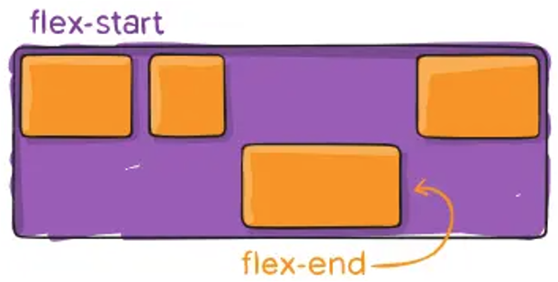

> **📌 align-self**
> 
HTMLCSSNavegadorCodeSandBox

```html
<div class="aling-self">
    <div class="selfitem">1</div>
    <div class="selfitem">2</div>
    <div class="selfitem">3</div>
    <div class="selfitem">4</div>
</div>
```

```html
div.aling-self {
    display: flex;
    align-items: flex-start;
    column-gap: 1rem;
    padding: 1rem 1.5rem;
    background: #111;
    height: 200px;
    width: 300px;
    }
    .selfitem {
    width: 50px;
    height: 50px;
    background: rgb(0, 130, 26);
    border-radius: 10px;
    display: grid;
    place-items: center;
    font-size: 2rem;
    position: relative;
    color: white;
    }
    .selfitem:nth-child(3) {
    align-self: flex-end;
    background: red;
    }
```

    
        div.aling-self {
        display: flex;
        align-items: flex-start;
        column-gap: 1rem;
        padding: 1rem 1.5rem;
        background: #111;
        height: 200px;
        width: 300px;
        }
        .selfitem {
        width: 50px;
        height: 50px;
        background: rgb(0, 130, 26);
        border-radius: 10px;
        display: grid;
        place-items: center;
        font-size: 1rem;
        position: relative;
        color: white;
        }
        .selfitem:nth-child(3) {
        align-self: flex-end;
        background: red;
        }
    

    
        1
        2
        3
        4
    

[Ejemplo CodeSandBox](https://codesandbox.io/p/sandbox/cl8n6p)

## **order**

Es posible especificar un orden ([order](https://developer.mozilla.org/en-US/docs/Web/CSS/Reference/Properties/order)) a los ítems. Esto nos permite cambiar el orden de los elementos sin tener que modificar el código HTML.
El orden de los elementos se establece definiendo un valor numérico a los ítems, que representan su peso. Cuánto menor sea el valor del peso, antes se va a mostrar.

Supongamos el siguiente ejemplo:

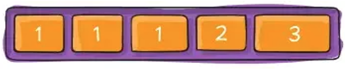

Todos los ítems que están con peso 1 se muestran primero. Como existen varios elementos que tienen el mismo peso, el siguiente criterio que se utiliza para ordenarlos es el orden de aparición en el HTML. Después, irían colocándose el resto de ítems, de menor a mayor peso.
Los pesos pueden ser cualquier valor numérico y no tienen por qué seguir una secuencia (1, 2, 3, 4...). Es decir, podemos saltarnos valores y, por ejemplo, asignar peso 2 a un ítem y peso 99 a otro ítem.
Si usamos un número negativo, se pondría por delante del peso 1.
Si estuviéramos trabajando con un order row-reverse el orden lo aplicaría al contrario.

## **Crecimiento**

Uno de los aspectos más importantes de flexbox es entender el crecimiento/decrecimiento de un ítem. Este crecimiento va a estar condicionado por el tamaño de sus hermanos, entendiendo por hermanos aquellos ítems que están dentro del mismo contenedor. Si el ítem está solo dentro de un contenedor, no dependerá de ningún otro elemento.
Las propiedades relacionadas con el crecimiento/decrecimiento son:

- flex-grow

- flex-shrink

- flex-basis

Todas ellas se pueden resumir en una única propiedad: flex.

### **flex-grow**

[flex-grow](https://developer.mozilla.org/en-US/docs/Web/CSS/Reference/Properties/flex-grow) define cómo se distribuye el **espacio restante** de un contenedor entre los ítems. Es decir, define la posibilidad de un ítem a **crecer** si es necesario.
Acepta **valores numéricos** que se interpretan como **proporciones**. Los valores negativos no son válidos. El valor predeterminado es 0.
Por ejemplo, si todos los elementos tienen valor 1 para flex-grow, el espacio restante se deber repartir equitativamente entre todos los ítems.


Por ejemplo, si todos los elementos tienen valor 1 y uno tiene valor 2, el espacio restante se repartirá de forma proporcional de tal forma que el elemento que tiene valor 2 ocupará el doble de espacio que los que tienen valor 1.

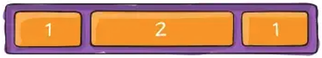

### **flex-shrink**

[flex-shrink](https://developer.mozilla.org/en-US/docs/Web/CSS/Reference/Properties/flex-shrink) define la posibilidad de un ítem a decrecer si es necesario.
Acepta valores numéricos que se interpretan como proporciones. Los valores negativos no son válidos. El valor predeterminado es 1.
Cuando el valor de todos los elementos es 1 (que el valor predeterminado), todos los elementos encogerán proporcionalmente. Si, por ejemplo, hay uno que tiene asignado un valor 2, encogerá el doble que el resto de sus hermanos.

### **flex-basis**

Los elementos tienen un tamaño definido y, con el espacio restante, se realiza la distribución. Con la propiedad [flex-basis](https://developer.mozilla.org/en-US/docs/Web/CSS/Reference/Properties/flex-basis), indicamos cuál es el tamaño original de un ítem antes de crecer o decrecer.

### **flex**

La propiedad [flex](https://developer.mozilla.org/en-US/docs/Web/CSS/Reference/Properties/flex) reúne las tres propiedades en una única propiedad. Se deben indicar en el siguiente orden:

```html
flex: <flex-grow> <flex-shrink> <flex-basis>
```

Los dos últimos valores son opcionales, es decir, flex-shrink y flex-basis son opcionales.
El valor predeterminado es el mismo que el de sus propiedades particulares: `

```html
flex: 0 1 auto;
```

La línea anterior es equivalente al siguiente bloque:

> **📌 CSS**
> 

```html
flex-grow: 0;
flex-shrink: 1;
flex-basis: auto;
```

Algunos valores posibles son:

> **📌 CSS**
> 

```html
flex: none;
flex: 1 1 auto;
flex: 1 1 200px;
```

> **📌 Recomendación**
> 

> Se recomienda utilizar la propiedad flex en lugar de las tres propiedades individuales, ya que ésta permite establecer en una única línea todos los comportamientos (crecimiento, decrecimiento y tamaño base).
