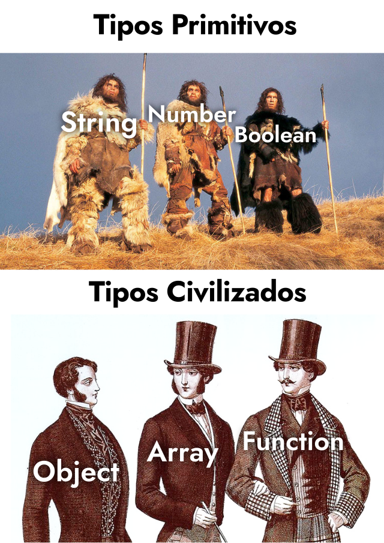
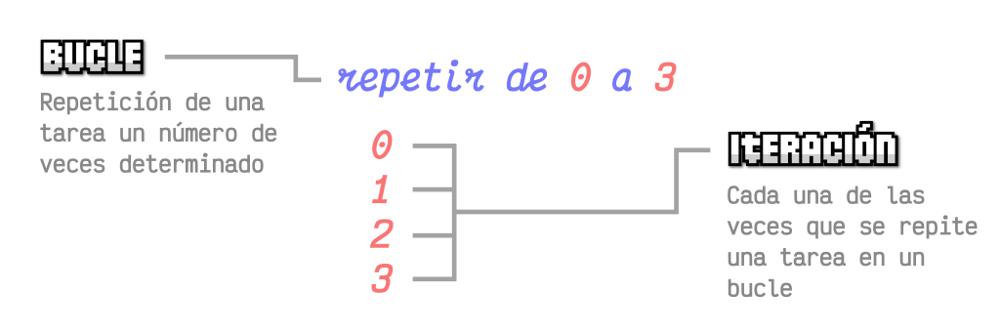
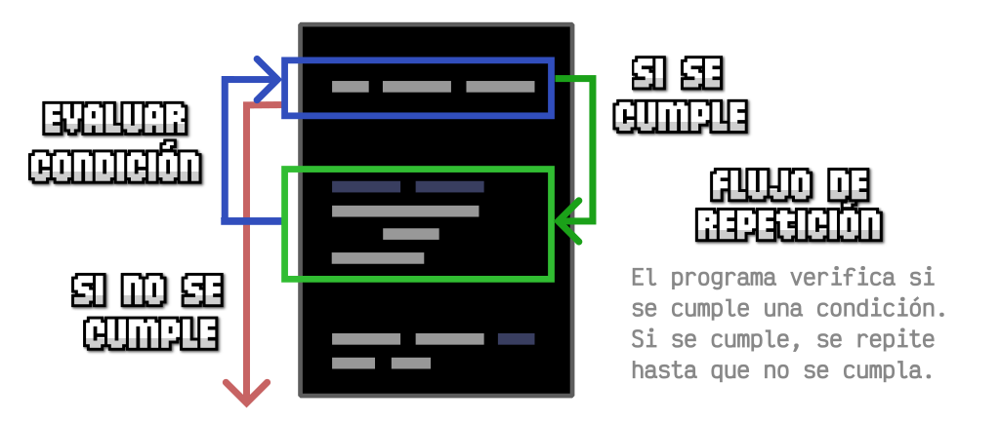
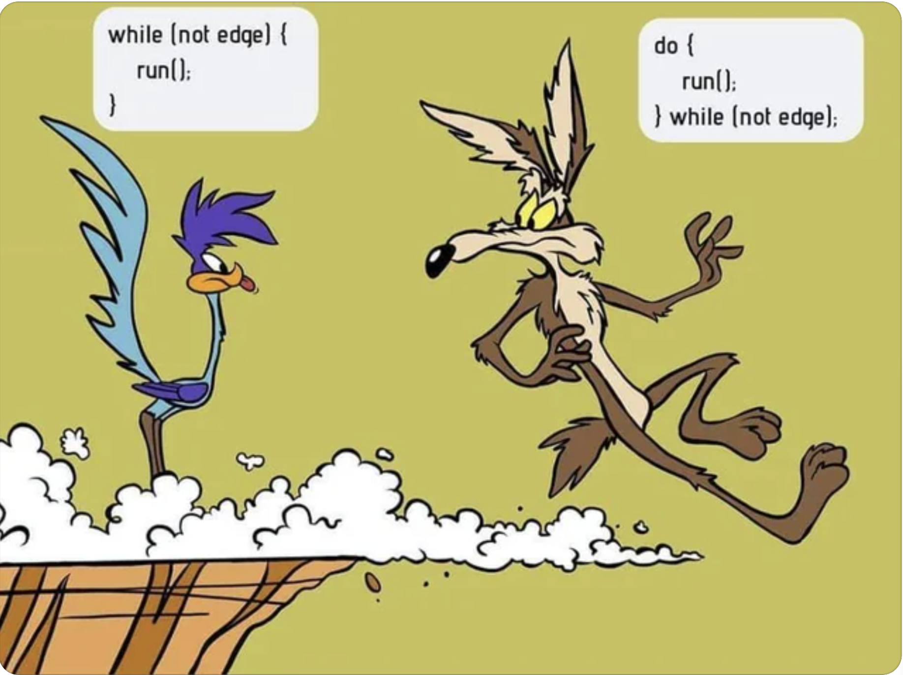
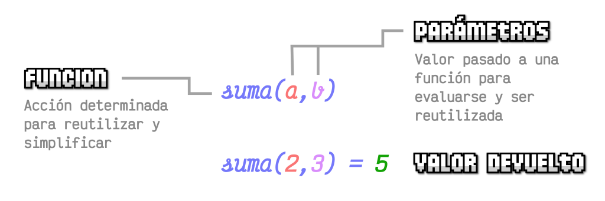

# UD4: Programación con JavaScript — Sintaxis, Arrays, Funciones y Objetos

Bienvenido/a a la **UD4: Programación con JavaScript — Sintaxis, Arrays, Funciones y Objetos** del módulo profesional de **Lenguajes de Marcas y Sistemas de Gestión de Información** (1º DAW / DAM / ASIX · Lenguajes de Marcas (LMSGI)).

En esta unidad encontrarás los contenidos teóricos, ejemplos prácticos, ejercicios resueltos y actividades de evaluación curricular desarrollados por el profesor **Manuel Alonso Argente**.

---

### 📑 Índice de Apartados y Actividades de la Unidad

- [**📋 4.0 Propuesta Didáctica: Sintaxis de JavaScript**](./ut0400.html)
- [**4.1.1 Introducción**](./ut0411.html)
- [**4.1.2 Ámbitos**](./ut0412.html)
- [**4.1.3 La consola Javascript**](./ut0413.html)
- [**4.1.4 ¿Cómo funciona Javascript?**](./ut0414.html)
- [**4.1.5 La especificación ECMAScript**](./ut0415.html)
- [**4.2.1 Conceptos Básicos**](./ut0421.html)
- [**4.3.1 Tipos de Datos**](./ut0431.html)
- [**4.3.2 Variables y Constantes**](./ut0432.html)
- [**4.3.3 Estructuras de Control**](./ut0433.html)
- [**4.3.4 Bucles e iteraciones**](./ut0434.html)
- [**4.3.5 Funciones**](./ut0435.html)
- [**4.4.1 Numbers**](./ut0441.html)
- [**4.4.2 Strings**](./ut0442.html)
- [**4.5.1 Arrays**](./ut0451.html)
- [**4.5.2 Array Functions**](./ut0452.html)
- [**4.6.1 Objetos**](./ut0461.html)
- [**4.6.2 Formato JSON**](./ut0462.html)

**Actividades Prácticas y Fichas de Trabajo:**

- [**✏️ ACT400 Introducción a Javascript**](./act_act400.html)
- [**✏️ ACT401 es 01-05**](./act_act401.html)
- [**✏️ ACT402 es 06-10**](./act_act402.html)
- [**✏️ ACT403 es 11-15**](./act_act403.html)
- [**✏️ ACT404 es 16-20**](./act_act404.html)
- [**✏️ ACT405 es 21-25**](./act_act405.html)
- [**✏️ ACT406 Ejercicios de Arrays y Array Functions en JavaScript**](./act_act406.html)

---

# 📖 Vista Completa de la Unidad

## 4.0 Propuesta Didáctica — Sintaxis de JavaScript

# **Sintaxis de JavaScript**

## **Propuesta didáctica**

En esta unidad vamos a trabajar el **RA3**: Accede y manipula web utilizando lenguajes de script de cliente.

## **Criterios de evaluación**

### **Respecto al RA3:**

| Código | Descripción | Peso (%) | Herramientas Evaluación |
| --- | --- | --- | --- |
| **CE3a** | Se han identificado y clasificado los lenguajes de script de cliente relacionados con la web y sus diferentes versiones y estándares. | 10% | EXA301 |
| **CE3b** | Se ha aplicado la sintaxis de los lenguajes de script de cliente. | 35% | ACT401 – ACT406 (10%) -- EXA301 (90%) |

## **Contenidos**

### **Sintaxis de JavaScript:**

- Introducción: ¿Qué es JavaScript?, ámbitos, la consola JavaScript, cómo funciona JavaScript, ECMAScript. (CE3.a)

- Conceptos básicos. (CE3.a, CE3.b)

- Sintaxis básica: tipos de datos, variables y constantes, estructuras de control, bucles e iteraciones, funciones. (CE3.b)

- Tipos de datos primitivos: Number y Strings. (CE3.b)

- Tipos de datos complejos: Arrays y Array Functions. (CE3.b)

- Tipos de datos complejos: Objetos y formato JSON. (CE3.b)

**Cuestionario inicial**

1. ¿Qué es JavaScript y para qué se utiliza?

1. ¿Qué es ECMAScript y qué relación tiene con JavaScript?

1. ¿Qué es una variable y qué es una constante?

1. ¿Qué tipos de datos existen en JavaScript?

1. ¿Qué estructuras de control y bucles conoces?

1. ¿Qué es un array y cómo se accede a sus elementos?

1. ¿Qué es un objeto y qué es el formato JSON?

## **Programación de Aula (9h)**

Esta unidad se imparte en la segunda evaluación, a continuación de la UP03 (Apariencia y diseño de los documentos WEB - CSS). La unidad tiene una duración estimada de 9 horas lectivas durante los días que se indican en el calendario (los días de clase son lunes, con una sesión, y jueves, con dos sesiones). Las vacaciones de Navidad interrumpen la unidad entre las sesiones de diciembre y enero.

### **Calendario**

#### **Diciembre 2026**

| Lunes | Martes | Miércoles | Jueves | Viernes | Sábado | Domingo |
| --- | --- | --- | --- | --- | --- | --- |
|  | 1 | 2 | **3 📚** | 4 | **5 🛑** | **6 🛑** |
| **7 🛑** | **8 🛑** | 9 | **10 📚** | 11 | **12 🛑** | **13 🛑** |
| **14 📚** | 15 | 16 | **17 📚** | 18 | **19 🛑** | **20 🛑** |
| **21 📚** | **22 🛑** | **23 🛑** | **24 🛑** | **25 🛑** | **26 🛑** | **27 🛑** |
| **28 🛑** | **29 🛑** | **30 🛑** | **31 🛑** |  |  |  |

#### **Enero 2027**

| Lunes | Martes | Miércoles | Jueves | Viernes | Sábado | Domingo |
| --- | --- | --- | --- | --- | --- | --- |
|  |  |  |  | **1 🛑** | **2 🛑** | **3 🛑** |
| **4 🛑** | **5 🛑** | **6 🛑** | **7 📚** | 8 | **9 🛑** | **10 🛑** |
| 11 | 12 | 13 | 14 | 15 | **16 🛑** | **17 🛑** |
| 18 | 19 | 20 | 21 | 22 | **23 🛑** | **24 🛑** |
| 25 | 26 | 27 | 28 | 29 | **30 🛑** | **31 🛑** |

### **Sesiones**

| Sesión | Contenidos | Actividades | Criterios trabajados |
| --- | --- | --- | --- |
| 1 | 4.1 Introducción a JavaScript – 4.1.5 ECMAScript | -- | CE3.a |
| 2 | 4.1 Introducción (continuación) | ACT400 | CE3.a |
| 3 | 4.2 Conceptos Básicos -- 4.3.1 Tipos de datos | ACT401 | CE3.b |
| 4 | 4.3.2 Variables y Constantes -- 4.3.3 Estructuras de Control | ACT402 | CE3.b |
| 5 | 4.3.4 Bucles e iteraciones -- 4.3.5 Funciones | ACT403 | CE3.b |
| 6 | 4.4.1 Number -- 4.4.2 Strings | ACT404 | CE3.b |
| 7 | 4.5.1 Arrays -- 4.5.2 Array Functions | ACT406 | CE3.b |
| 8 | 4.6.1 Objetos -- 4.6.2 Formato JSON | ACT405 | CE3.b |
| 9 | Repaso y ejercicios de la unidad | ACT401 – ACT406 | CE3.a - CE3.b |
| 10 | Repaso y refuerzo | -- | CE3.a - CE3.b |

---

## 4.1.1 Introducción

# **Introducción**

Cualquier página web de Internet está construida, como mínimo, por **HTML** (*un lenguaje de marcas*) y **CSS** (*un lenguaje de estilos*). El primero de ellos permite construir todo el marcado de la página (*contenido e información*) mediante etiquetas HTML y dotando de semántica a la información mediante la naturaleza de dichas etiquetas. Posteriormente, el segundo de ellos permite darle estilo a la página y construir una interfaz visual más agradable para el usuario.

> **📌 Tip**
> 

> La separación bien marcada de estos dos pilares permite que si en algún momento necesitamos modificar la información (*o el diseño*) de la página, no tengamos también que lidiar con modificaciones en el otro.

Sin embargo, utilizar sólo y exclusivamente **HTML** y **CSS** en una página nos limita considerablemente. Si bien es cierto que con estos dos lenguajes podemos hacer un gran abanico de cosas, hay otras que serían totalmente imposibles, o al menos, mucho más fáciles de realizar si tuviéramos un **lenguaje de programación** a nuestra disposición. Y en este punto es donde aparece **Javascript**.

## **¿Qué es Javascript?**

Javascript es un **lenguaje de programación**, o lo que es lo mismo, un mecanismo con el que podemos decirle a nuestro navegador que tareas debe realizar, en que orden y cuantas veces (*por ejemplo*).

Muchas de las tareas que realizamos con HTML y CSS se podrían realizar con Javascript. De hecho, es muy probable que al principio nos parezca que es mucho más complicado hacerlo con Javascript, y que por lo tanto no merece la pena. Sin embargo, con el tiempo veremos que Javascript nos ofrece una mayor flexibilidad y un abanico de posibilidades más grande, y que bien usadas, pueden ahorrarnos bastante tiempo.

Para comprenderlo, un ejemplo muy sencillo sería el siguiente:

> **📌 HTML**
> 

```html
<div class="item">
<p>Número: <span class="numero">1</span></p>
<p>Número: <span class="numero">2</span></p>
<p>Número: <span class="numero">3</span></p>
<p>Número: <span class="numero">4</span></p>
<p>Número: <span class="numero">5</span></p>
</div>
```

Imaginemos que tenemos que crear una lista de números desde el **1** hasta el **500**. Hacerlo solamente con **HTML** sería muy tedioso, ya que tendríamos que copiar y pegar esas filas varias veces hasta llegar a 500. Sin embargo, mediante **Javascript**, podemos decirle al navegador que escriba el primer párrafo, que luego escriba el mismo pero sumándole uno al número. Y que esto lo repita hasta llegar a 500.

De esta forma y con este sencillo ejemplo, con **HTML** habría que escribir **500 líneas** mientras que con **Javascript** no serían más de **10 líneas**.

## **Dificultad**

Aunque **Javascript** es ideal en muchos casos, es mucho más complicado aprender Javascript (*o un lenguaje de programación de propósito general*) que aprender HTML o CSS, los cuales son mucho más sencillos de comprender (*o al menos, su base y fundamentos*).

Antes de continuar debemos conocer varias detalles:

- Para **aprender Javascript** debemos conocer el lenguaje **Javascript**, pero no podremos hacerlo si no sabemos programar. Se puede aprender a programar con Javascript, pero es recomendable tener una serie de fundamentos básicos de programación antes para que no nos resulte muy duro.

- Para **aprender a programar** antes debemos saber como «trabaja una máquina». Programar no es más que decirle a una máquina que cosas debe hacer y como debe hacerlas. Eso significa que no podemos pasar por alto nada, o la máquina lo hará mal.

- Para **darle órdenes a una máquina** debemos tener claro que esas órdenes son correctas y harán lo que se supone que deben hacer. Si le indicamos a una máquina los pasos para resolver un problema, pero dichos pasos son erróneos, la máquina también hará mal el trabajo.

Dicho esto, es necesario tener presente que **aprender a programar** es una tarea que no ocurre de un día para otro. Requiere tiempo, esfuerzo, acostumbrarse a cambiar la forma de pensar y practicar mucho.

- Puedes **copiar un programa** en segundos, pero eso no significa que lo entiendas.

- Puedes **comprender un programa** en minutos, pero eso no significa que lo puedas crear.

- Puedes **crear un programa** en horas, pero eso no significa que sepas programar.

- Puedes **aprender a programar** en semanas, pero eso no significa que no cometas errores.

- Puedes **aprender a programar bien y sin demasiados errores** en meses.

Pero **dominar la programación** es una tarea que requiere años.

---

## 4.1.2 Ámbitos

# **Ámbitos**


## **JavaScript en la web**

El entorno donde JavaScript apareció en primer lugar fue la web. Su ejecución se centraba en el ámbito de un documento **HTML** y permitía a los desarrolladores aportar interactividad, manipular el documento o la ventana del navegador, realizar cálculos, etc. Netscape Navigator, un navegador desaparecido hoy en día, tiene el honor de haber introducido **JavaScript** como lenguaje, aunque hoy lo soportan todos los clientes web con los que un usuario común pueda llegar a navegar.

Usar **JavaScript** para la web, en torno al navegador, también se conoce como programación del lado del cliente y es una de las actividades englobadas en el término "frontend". Hoy sigue siendo el ambiente más habitual de ejecución de **JavaScript**, pero realmente es sólo una más entre sus posibilidades.

## **JavaScript en el backend**

A ciertos desarrolladores se les ocurrió que podrían extraer el motor de ejecución de **JavaScript**, que hasta entonces sólo se disponía dentro del ámbito del navegador, para usarlo en cualquier otro propósito fuera del cliente web. Así es como nació **NodeJS**, que no es más que **JavaScript** fuera del navegador.

Con **NodeJS** podemos programar con **JavaScript** aplicaciones que se ejecutan directamente sobre el sistema operativo y que son capaces de resolver cualquier tipo de problema. Con esta tecnología, **JavaScript** se convirtió en un lenguaje de programación de propósito general.

Uno de los usos más habituales de **NodeJS** es la **programación backend**. Permite programar aplicaciones que son capaces de ejecutarse en el servidor, proporcionando acceso a bases de datos, el sistema de archivos y cualquier otro recurso del lado del servidor. Sin embargo, **NodeJS** es tan amplio que se puede usar para muchas otras tareas, como la automatización, optimización o despliegue de aplicaciones, entre otras operaciones.

## **JavaScript como lenguaje para apps de dispositivos**

Como **lenguaje para la creación de aplicaciones para dispositivos** (apps para móviles, tabletas, TVs...). Las aplicaciones desarrolladas **se instalan desde los correspondientes app stores** de los principales sistemas móviles y el usuario en principio no percibe ninguna diferencia de las mismas respecto a las aplicaciones desarrolladas con los lenguajes nativos. Pero, por ser programadas con **JavaScript**  y **HTML5**, abren un nuevo campo de actuación para las personas experimentadas en el desarrollo para la web y dispensa del aprendizaje de lenguajes nativos para cada plataforma móvil.

Al principio, para ejecutar aplicaciones realizadas en **JavaScript**  y HTML5 se necesitaba de un "**Web View**". Básicamente la función de la web view consiste en ofrecer un marco para la ejecución de la app, de manera que ésta se ejecuta dentro de un navegador, aunque el usuario no lo perciba. Esta situación tiene varias ventajas e inconvenientes en los que no entraremos, pero hoy también existe la posibilidad de usar **JavaScript**  como lenguaje de desarrollo de aplicaciones nativas, **que no requieren una web view para funcionar**.

Ejemplos de frameworks para el desarrollo de aplicaciones basadas en web view tenemos en **Apache Cordova**, **Phone Gap** o **Ionic**. Ejemplos de frameworks para desarrollo de aplicaciones nativas usando **JavaScript**  tenemos a **Native Script** y **React Native**.

## **JavaScript como lenguaje para aplicaciones de escritorio**

En el desarrollo de **aplicaciones para ordenadores personales**. Con **JavaScript** somos capaces de crear aplicaciones avanzadas, capaces de usar todos los recursos de un ordenador y además ejecutarse en cualquier sistema operativo que necesitemos.

Usar **JavaScript** para aplicaciones de escritorio es sencillo gracias a proyectos como Electron, que nos permite producir aplicaciones multiplataforma, es decir, que se podrán instalar en **Windows**, **Mac US X** y **Linux**.
Hay bastantes aplicaciones conocidas desarrolladas con **Electron**, como **Atom**, **Visual Studio Code**, **Slack**, **Hyper**, etc.

---

## 4.1.3 La consola Javascript

# **La consola Javascript**

El objeto **console** provee acceso a la consola de depuración de los navegadores. Los detalles de cómo funciona varían de navegador en navegador, pero hay un conjunto de características que de facto son proporcionadas generalmente.

Para acceder a la consola JavaScript del navegador, podemos pulsar **CTRL+SHIFT+I** (o **F12**) sobre la pestaña de la página web en cuestión, lo que nos llevará al Inspector de elementos del navegador. Este inspector es un panel de control general donde podemos ver varios aspectos de la página en la que nos encontramos: su etiquetado **HTML**, sus estilos **CSS**, etc...

En esta consola, podemos escribir funciones o sentencias de JavaScript que estarán actuando en la página que se encuentra en la pestaña actual del navegador. De esta manera podremos observar los resultados que nos devuelve en la consola al realizar diferentes acciones.

> **📌 JS**
> 

```html
console.log("Hola Mundo");
console.log(2+2);
```

## **Funciones**

| Función | Descripción |
| --- | --- |
| `console.debug()` | Muestra información con todo nivel de detalle. |
| `console.info()` | Muestra mensajes de información. |
| `console.warn()` | Muestra información de advertencia. Aparece destacado en amarillo. |
| `console.error()` | Muestra información de error. Aparece destacado en rojo. |

## **Ejemplos**

> **📌 Ejemplos Consola**
> 
Aplicar algún datoAplicar estilosAplicar WarningsAplicar errores

> **📌 JS**
> 

```html
console.log("¡Hola a tots! Observem aquest nombre: ", 5 + 18);
```

> **📌 JS**
> 

```html
console.log("%c¡Hola 1erDAW!","background:linear-gradient(#000, #555); color:#fff; padding: 5px 10px;");
```

> **📌 JS**
> 

```html
console.warn("Warning!!!");
```

> **📌 JS**
> 

```html
console.error("Error!!!");
```

---

## 4.1.4 ¿Cómo funciona Javascript?

# **¿Cómo funciona Javascript?**

El **esquema general** de una página web es un **documento HTML** donde están todas las etiquetas HTML de la página. A lo largo de ese documento, pueden existir **referencias o relaciones** a otros documentos, como archivos CSS o archivos Javascript.

Por ejemplo, si dentro del documento HTML se encuentra una referencia a un **archivo CSS**, el navegador lo descarga y lo aplica al documento HTML, cambiando su apariencia visual. De la misma forma, si encuentra una referencia a un **archivo Javascript**, el navegador lo descarga y ejecuta las órdenes o acciones que allí se indican.

## **Formas de escribir Javascript**

### **Script en línea**

Tenemos el archivo HTML. En él, existe una etiqueta `<script>` que contiene las órdenes de Javascript que le indican al navegador qué tiene que hacer (mostrar un "¡Hola!" en la consola):

> **📌 HMTL**
> 

```html
<html>
<head>
    <title>Título de la página</title>
    <script>
    console.log("¡Hola!");
    </script>
</head>
<body>
    <p>Ejemplo de texto.</p>
</body>
</html>
```

Este método de escribir scripts se denomina JavaScript en línea (online), y significa que el JavaScript está escrito directamente en el código HTML. Nos puede servir como ejemplo inicial, pero no es la forma recomendable de escribirlo, ya que **lo ideal es separar el código HTML del código JavaScript**.

### **Script externo**

Tiene la ventaja de, en el caso de necesitar incluir el código JavaScript desde varios documentos HTML, no tendremos que volver a escribir este código, sino simplemente referenciar el nombre del propio archivo JavaScript a incluir en todas las páginas HTML.
Para relacionar un documento JavaScript desde una página web, al igual que antes, utilizaremos la etiqueta `<script>`, sólo que en este caso, haremos referencia al archivo Javascript con un atributo src (source), como se ve en el siguiente ejemplo:

> **📌 HMTL**
> 

```html
<html>
<head>
    <title>Título de la página</title>
    <script src="js/index.js"></script>
</head>
<body>
    <p>Ejemplo de texto.</p>
</body>
</html>
```

### **Ubicación de la etiqueta script**

Es posible que te hayas encontrado ejemplos donde esta etiqueta esté situada en otra parte del documento HTML. Veamos las posibilidades:

| Ubicación | ¿Cómo descarga el archivo Javascript? | Estado de la página |
| --- | --- | --- |
| En `<head>` | **ANTES** de empezar a dibujar la página. | Página aún no dibujada. |
| En `<body>` | **DURANTE** el dibujado de la página. | Dibujada hasta donde está la etiqueta `<script>`. |
| Antes de `</body>` | **DESPUÉS** de dibujar la página. | Dibujada al 100%. |

Ten en cuenta que el navegador puede descargar un documento Javascript en cualquier momento de la carga de la página y necesitamos saber cuál es el más oportuno para nosotros.

- Si queremos que un documento Javascript actúe antes que se muestre la página, la opción de colocarlo en el `<head>` es la más adecuada.

- Si por el contrario, queremos que actúe una vez se haya terminado de cargar la página, la opción de colocarlo justo antes del `</body>` es la más adecuada. Esta opción es equivalente a usar el atributo `defer` en la etiqueta `<script>`, sin embargo, esta opción es además compatible con navegadores muy antiguos (IE9 o anteriores) que no soportan **defer**.

---

## 4.1.5 La especificación ECMAScript

# **La especificación ECMAScript**

JavaScript como lenguaje es estandarizado por la organización "ECMA International". Esta empresa se dedica a la creación de estándares para la comunicación y el tratamiento de información. Uno de sus más conocidos estándar es [**ECMAScript**](https://262.ecma-international.org/9.0/).

**ECMAScript** especifica todos los detalles de cómo debe funcionar y comportarse JavaScript en un navegador. De esta manera, los diferentes navegadores (Chrome, Firefox, Opera, Edge, Safari...) saben cómo deben desarrollar los motores de JavaScript para que el código o programa funcione exactamente igual, independientemente del navegador que se utilice.

Los navegadores web intentan cumplir la especificación **ECMAScript** al máximo nivel, pero no todos ellos lo consiguen. Por lo tanto, pueden existir unas ciertas discrepancias. Por ejemplo, pueden existir navegadores que cumplan la especificación **ECMAScript** al 80% y otros que sólo la cumplan al 60%. Esto significa que pueden haber características que no funcionen en un navegador específico (y en otros sí).

## **Versiones de ECMAScript**

A lo largo de los años, Javascript ha ido sufriendo modificaciones que los navegadores han ido implementando para acomodarse a la última versión de **ECMAScript** cuanto antes.

A partir del año 2015, se marcó un antes y un después en el mundo de Javascript. Las últimas versiones de ECMAScript son las siguientes:

| Ed. | Fecha | ECMAScript | Cambios significativos |
| --- | --- | --- | --- |
| 16 | JUN/2025 | ES2025 | Set helpers, Iterator helpers, Promise.try, import attributes... |
| 15 | JUN/2024 | ES2024 | groupBy, withResolvers, waitAsync, isWellFormed... |
| 14 | JUN/2023 | ES2023 | findLast(), hashbang, toReversed(), toSorted()... |
| 13 | JUN/2022 | ES2022 | at(), top-level await modules, private fields... |
| 12 | JUN/2021 | ES2021 | Promise.any, globalThis, replaceAll(), flat(), flatMap()... |
| 11 | JUN/2020 | ES2020 | Dynamic imports, BigInt, Promise.allSettled |

En ocasiones, algunos navegadores deciden implementar pequeñas funcionalidades de versiones posteriores de ECMAScript antes que otras, para ir testeando y probando características, por lo que no es raro que algunas características de futuras especificaciones puedan estar implementadas en algunos navegadores.

Una buena forma de conocer en que estado se encuentra un navegador concreto en su especificación de ECMAScript es consultando la [tabla de compatibilidad Kangax](https://compat-table.github.io/compat-table/es6/). En dicha tabla, encontramos una columna «Desktop browsers» donde podemos ver el porcentaje de compatibilidad con las diferentes características de determinadas especificaciones de ECMAScript.

## **Estrategia «crossbrowser»**

Teniendo en cuenta lo comentado anteriormente, es muy habitual que el programador esté confuso en cómo empezar a programar y que versión ECMAScript adoptar como preferencia.

Generalmente, el programador suele tomar una de las siguientes estrategias «crossbrowser» para asegurarse de que el código funcionará en todos los navegadores:

| Enfocament | Codi escrit | Descripció |
| --- | --- | --- |
| Conservador | ECMAScript 5 | Incómodo de escribir. Anticuado. Compatible con navegadores nativos. |
| Delegador | depende | Cómodo. Rápido. Genera dependencia al framework/librería. |
| Evergreen | ECMAScript 6+ | Cómodo. Moderno. No garantiza la compatibilidad en navegadores antiguos. |
| Transpilador | ECMAScript 6+ | Cómodo. Moderno. Preparado para el futuro. Requiere preprocesamiento. |

### **Enfoque conservador**

El programador decide crear código ECMAScript 5, una versión «segura» que actualmente una gran mayoría de navegadores (incluye Internet Explorer soporta). Este enfoque permite asegurarse de que el código funcionará sin problemas en cualquier navegador, pero por otro lado, implica que para muchas tareas tendrá que escribir mucho código, código extra o no podrá disfrutar de las últimas novedades de JavaScript.

Uno de los principales motivos por los que se suele elegir esta estrategia es porque se necesita compatibilidad con navegadores, sistemas antiguos y/o Internet Explorer. También se suele elegir porque es más sencilla o porque funciona nativo sin necesidad de herramientas externas.

- El código será compatible en la mayoría de navegadores.

- No requiere configurar herramientas externas para transformar el código.

- Se deberá escribir mucho código para ciertas tareas.

- El código será antiguo y no podrá disfrutar de las últimas novedades de JS.

### **Enfoque delegador**

El programador decide delegar la responsabilidad «crossbrowser» a un framework o librería que se encargará de ello. Este enfoque tiene como ventaja que es mucho más cómodo para el programador y ahorra mucho tiempo de desarrollo. Hay que tener en cuenta que se heredan todas las ventajas y desventajas de dicha framework/librería, así como que se adopta como dependencia (sin dicha framework/librería, nuestro código no funcionará). Además, también se suele perder un poco de rendimiento y control sobre el código, aunque en la mayoría de los casos es prácticamente inapreciable.

Hoy en día, excepto para proyectos pequeños, es muy común elegir un framework JavaScript para trabajar. Un framework te ayuda a organizar tu código, a escribir menos código y a ser más productivo a la larga. Como desventaja, genera dependencia al framework (Angular.Js, React.Js, Node.js, ...).

- Más cómodo para el programador.

- El framework/librería gestiona esas tareas de forma transparente.

- El framework es una **dependencia** (*si el framework muere, debemos cambiar a otro*).

- Se suele perder algo de rendimiento y control (*inapreciable en la mayoría de los casos*).

### **Enfoque evergreen**

El programador decideix no preocupar-se de la compatibilitat amb navegadors antics, sinó donar suport només a les últimes versions dels navegadors (evergreen browsers), o fins i tot només a determinats navegadors com Google Chrome o Mozilla Firefox. Aquest enfocament sol ser habitual en programadors novençans, empreses que desenvolupen aplicacions SPA o projectes que van dirigits a un públic molt concret i no estan obertes a un públic majoritari.

- Cómodo para el programador.

- Ideal en casos donde puedes «obligar» al usuario a actualizar su navegador.

- Si tienes una gran masa de usuarios con navegadores antiguos, no les funcionará.

- Suele ser una fuente de problemas en muchos casos.

### **Enfoque transpilador**

El programador decide crear código de la última versión de ECMAScript. Para asegurarse de que funcione en todos los navegadores, utiliza un transpilador, que no es más que un sistema que revisa el código y lo traduce de la versión actual a ECMAScript 5, que es la que leerá el navegador.

La ventaja de este método es que se puede escribir código JavaScript moderno y actualizado y cuando los navegadores soporten completamente esta versión de ECMAScript, solo tendremos que retirar el transpilador. La desventaja es que hay que preprocesar el código para hacer la traducción.

- Cómodo para el programador.

- Usas las últimas novedades de Javascript, y es compatible en navegadores antiguos.

- Es algo más complejo y en algunos casos debes realizar configuraciones.

- Debes asegurarte bien de no editar los ficheros transpilados, sino los originales.

### **Otros conceptos**

Independientemente del enfoque que se decida utilizar, el programador también puede utilizar **polyfills** o **fallbacks** para asegurarse de que ciertas características funcionarán en navegadores antiguos. También puede utilizar enfoques mixtos.

- Un **polyfill** no es más que una librería o código Javascript que actúa de «parche» o «relleno» para dotar de una característica que el navegador aún no posee, hasta que una actualización del navegador la implemente.

- Un **fallback** es algo también muy similar: un fragmento de código que el programador prepara para que en el caso de que algo no entre en funcionamiento, se ofrezca una alternativa.

---

## 4.2.1 Conceptos Básicos

# **Conceptos Básicos**

## **Glosario general**

- **Programa**: conjunto total de código que desarrollas. En JavaScript, quizás el término más utilizado es aplicación web (cuando es un desarrollo con mucha cantidad de JavaScript). También se suelen generalizar utilizando términos como «script» o «código JavaScript».

- **Algoritmo**: conjunto de pasos conocidos, en un determinado orden, para conseguir hacer una tarea satisfactoriamente y conseguir un objetivo.

- **Comentarios**: fragmentos de texto o anotaciones que el navegador ignora y no repercuten en el programa. Sirven para dejar por escrito detalles importantes para el programador. De esta manera cuando volvamos al código, nos será más rápido comprenderlo. Es una buena costumbre comentar en la medida de lo posible.

- **Indentación**: acción de colocar espacios o tabuladores antes del código, para indicar si nos encontramos dentro de un if, de un bucle, etc... Esta práctica es muy importante y necesaria, y más adelante profundizaremos en ella.

- **Variables**: pequeños espacios de memoria donde guardas una información determinada, de forma muy similar a las incógnitas en matemáticas. Un programa puede tener muchas variables, y cada una de ellas tendrá un nombre, un valor y un tipo de dato. El nombre se utiliza para diferenciarlas las unas de las otras y hacer referencia a ellas, el valor es la información que contienen y el tipo de dato es la naturaleza de este valor. Se llaman variables porque podemos cambiarle su valor a lo largo del programa, según necesitamos.

> **📌 JS**
> 

```html
x = 5; // nom: x, valor: 5, tipus dada: nombre
y = "Hola"; // nom: y, valor: Hola, tipus dada:: texto
Manuel = "MAA"; // nom: Manuel, valor: MAA, tipus dada: texto
```

- **Constantes**: la información que contiene es siempre la misma (no puede variar).

- **Funciones**: las funciones son agrupaciones de código que, entre otras cosas, evitan que tengamos que escribir varias veces lo mismo en nuestro código. Una función contendrá una o más acciones a realizar y cada vez que ejecutemos una función, se realizarán todas ellas.

- **Parámetros**: las variables que se le pasan a las funciones (también argumentos).

- **Bucles**: muchas veces necesitaremos hacer tareas repetitivas. Una de las ventajas de la programación es que permite automatizar acciones y no es necesario hacerlas varias veces. Los bucles permiten indicar el número de veces que se repetirá una acción. De esta manera, sólo lo escribimos una vez en nuestro código, y simplemente indicamos el número de veces que queremos que se repita.

- **Iteración**: Cuando el programa está en un bucle repitiendo varias veces la misma tarea, cada una de estas repeticiones se denomina iteración.


- **Librería**: Muchas veces, desarrollamos código que resuelve tareas o problemas que, posteriormente, queremos reutilizar en otros programas. Cuando esto ocurre, en JavaScript se suele empaquetar el código en el que se llaman librerías, que no es más que código listo para que otros programadores puedan utilizarlo fácilmente en sus programas y beneficiarse de las tareas que resuelven de forma muy sencilla.

## **Comentarios**

Al igual que ocurre con otros lenguajes, JavaScript permite añadir comentarios entre el código, que fundamentalmente tienen como propósito explicar o introducir el código que va a continuación. Existen dos tipos de comentarios:

- **Comentarios de una sola línea**: empieza con los símbolos // y solo comenta la línea actual desde donde se escribe.

- **Comentarios de múltiples líneas**: Se utiliza para hacer comentarios extensos que ocuparán varias líneas. Empieza por /*, acompañado por texto y se cierra con */.

> **📌 JS**
> 

```html
// Comentaris ccurts d'una sola línia. Solen explicar la línia seguent al comentari o en la mateixa línia que CompressionStream..
var a = 1;
var x = 45; // També s'utilitza al final d'una línia.
/* Per altre costat, existeixen els comentaris multiples de varies línies consecutives.
Solen utilitzar-se per explicacions llargues que requereixex suficient espai perque es
mencionen gran qüantitat de coses*/
```

## **Identación de código**

Se dice al hecho de utilizar sangrado (mover ligeramente hacia la derecha) en las líneas de código para facilitar la lectura, e indicar visualmente si nos encontramos en el interior de una función, bucle, condicional, etc...

> **📌 Ejemplo**
> 
VÁLIDONO VÁLIDO

```html
function bucle() {
  for (i = 0; i < 10; i++) {
    console.log("Iteración #", i);

    if (i == 9) {
      console.log("Estoy en la última iteración");
    } // if
  } // for
} // function
```

```html
function bucle() { for (i = 0; i < 10; i++) {
  console.log("Iteración #", i);
  if (i == 9) console.log("Estoy en la última iteración"); }
}
```

## **Convenciones de nombres**

- **Nombres descriptivos** :Evita nombres poco claros o inconsistentes como tmp, a, b2, variable2, etc...

- **Índices y contadores** :Las variables que actúan como contador suelen nombrarse con una letra minúscula empezando por y (de index): **i**, **j**, **k**. También se utilizan letras como, **b**, **c** o la inicial minúscula de lo que representan: **c** para un contador, **p** para una posición, etc...

- **Constantes, clases y variables** :

  - **Constantes**: siempre en mayúsculas.

  - **Variables**: siempre empezar por la letra minúscula.

  - **Clases**: letras capitalizadas (la primera en mayúscula y el resto en minúsculas).

> **📌 Danger**
> 

> Nunca empezar un nombre por un número.

| Nombre | Descripción | Ejemplo |
| --- | --- | --- |
| **lowercase** | Todo minúsculas. ❌ No se usa porque en palabras compuestas puede confundir. | **precioproducto** |
| **UPPERCASE** | Todo mayúsculas. ❌ No se usa porque en palabras compuestas puede confundir. | **PRECIOPRODUCTO** |
| **camelCase** | Primera palabra, todo minúsculas. El resto, todo minúsculas excepto primera letra. | **precioProducto** |
| **PascalCase** | Idem, pero las palabras empiezan con la primera letra mayúscula. Se usa en Clases. | **PrecioProducto** |
| **snake_case** | Las palabras se separan con un guión bajo y se escriben siempre en minúsculas. | **precio_producto** |
| **UPPER_SNAKE_CASE** | Se usa en constantes ajustables a menudo por el programador. | **PRECIO_PRODUCTO** |
| **kebab-case** | Palabras separadas con un guión normal y en minúsculas. Usadas en HTML/CSS. | **precio-producto** |
| **dot.case** | Palabras en minúsculas separadas por puntos. ❌ En Javascript no se puede usar. | **precio.producto** |
| **Húngara** | Prefijo (minúsculas) con el tipo de dato (n = número, t = texto, ...). ❌ Desaconsejada. | **nPrecioProducto** |

---

## 4.3.1 Tipos de Datos

# **Tipos de Datos**

En Javascript, al igual que en la mayoría de los lenguajes de programación, al declarar una variable y guardar su contenido, también le estamos asignando un **tipo de dato**. En algunos lenguajes se hace de forma explícita, y en algunos otros lenguajes se hace de forma implícita. El **tipo de dato** no es más que la naturaleza de su contenido: contenido numérico, contenido de texto, etc...

## **¿Qué tipos de lenguajes existen?**

A grandes rasgos, nos podemos encontrar con dos tipos de lenguajes de programación:

- **Lenguajes estáticos**: Cuando creamos una variable, debemos indicar el **tipo de dato** del valor que va a contener. En consecuencia, el valor asignado finalmente, siempre deberá ser del tipo de dato que hemos indicado (*si definimos que es un número debe ser un número, si definimos que es un texto debe ser un texto, etc...*).

- **Lenguajes dinámicos**: Cuando creamos una variable, no es necesario indicarle el tipo de dato que va a contener. El lenguaje de programación se encargará de deducir o inferir el tipo de dato (*dependiendo del valor que le hayamos asignado*).

Javascript pertenece a los **lenguajes dinámicos**, ya que automáticamente detecta de que tipo de dato se trata en cada caso, dependiendo del contenido que le hemos asignado a la variable.

> **📌 Tip**
> 

> En los **lenguajes dinámicos**, realmente el tipo de dato se asocia al valor (*y no a la variable*). Así es mucho más fácil entender que a lo largo del programa, dicha variable puede «cambiar» a tipos de datos diferentes, ya que la restricción del tipo de dato está asociada al valor y no a la variable en sí. No obstante, para simplificar, solemos hablar de variables y sus respectivos tipos de datos.

### **Javascript**

Es importante recalcar que en Javascript, aunque no tengamos que indicar el tipo de dato de cada variable, los **tipos de datos existen**, se puede acceder a ellos e incluso convertir entre un tipo de dato y otro.

> **📌 JS**
> 

```html
const valueAsText = "50";
const valueAsNumber = 50;
const convertedValue = Number("50");

console.log(valueAsText);    // "50"
console.log(valueAsNumber);  // 50
console.log(convertedValue); // 50
```

Observa que en el ejemplo anterior, la constante `valueAsText` tiene un tipo de dato de texto, mientras que la constante `valueAsNumber` tiene un tipo de dato numérico. Hemos utilizado `Number()` para forzar un texto y convertirlo a otro tipo de dato (*numérico*).

> **📌 Más Info**
> 

> En muchas ocasiones (*y de manera informal*) también se suele hacer referencia a **lenguajes tipados** (*tipado fuerte, o fuertemente tipado*) o **lenguajes no tipados** (*tipado débil, débilmente tipado*), para indicar si el lenguaje requiere indicar manualmente el tipo de dato de las variables o no, respectivamente.

## **Tipos de datos en JavaScript**

Los **tipos de datos** son la naturaleza del contenido de una variable o constante. En la programación debemos tener varios conceptos claros porque estaremos utilizándolos todo el tiempo y es importante no confundirlos: **nombre de una variable**, **contenido de la variable** y **tipo de dato de la variable**.

Veamos algunos ejemplos:

| Código | Nombre de la variable | Contenido | Tipo de dato |
| --- | --- | --- | --- |
| `const num = 44` | `num` | `44` | Numérico (`number`) |
| `const text = "Manz"` | `text` | `"Manz"` | Texto (`string`) |

### **Agrupación Tipos de Datos**

Los **tipos de datos** en JavaScript se suelen catalogar en dos grupos:

- **Tipos de datos primitivos** (*básicos*)

- **Tipos de datos no primitivos** (*complejos*)

Vamos a desglosarlos:

| Tipo de dato | Descripción | Ejemplo |
| --- | --- | --- |
| Tipos de datos primitivos |  |  |
| `Number` | Valor numérico (enteros, decimales...) | 45 |
| `String` | Valor de texto (cadenas de texto, caracteres...) | 'MAA' |
| `Boolean` | Valor booleano (valores verdadero o falso) | true |
| `BigInt` | Valor numérico muy grande | 2n ** 53n |
| `Symbol` | Símbolo (valor único) | const id = Symbol("id"); |
| `undefined` | Valor sin definir (variable sin inicializar) | undefined |
| Tipos de datos no primitivos |  |  |
| `Object` | Objeto (estructura más compleja) | {'Manuel',25} |
| `Function` | Función (función guardada en una variable) | funcion(){} |

Tipos primitivosTipos no primitivosTipo undefinedValor null

#### **Tipos de datos primitivos**

Para empezar, nos centraremos en introducir los 3 primeros: tipos de datos numéricos, de texto y booleanos. Son denominados los **tipos de datos primitivos** de Javascript. En próximos temas iremos descubriendo más detalles sobre cada uno de ellos y profundizando en el resto.



*(Los tipos primitivos existen, pero los civilizados es broma... ¿eh?)*

Para saber que tipo de dato tiene una variable, debemos observar el valor que le hemos dado.

- Si es un valor numérico, será de tipo `number`.

- Si es un valor de texto, será de tipo `string`.

- Si es verdadero o falso, será de tipo `boolean`.

Veamos un ejemplo en el que identificaremos que tipo de dato tiene cada variable:

> **📌 JS**
> 

```html
// Un texto, letra o carácter
const text = "Hola, me llamo Manz";

// Un número (entero o decimal)
const number = 42;

// Un número muy grande (se añade n al final)
const bignumber = 12345678901234567890n;

// Un valor de verdadero o falso
const boolean = true;

// Un valor único
const symbol = Symbol("unique");
```

Como se puede ver, estos son los **tipos de datos primitivos** básicos de Javascript. Cada uno de ellos tiene sus particularidades, sus características y una serie de operaciones que se puede realizar con ellos. Las iremos viendo a lo largo de los diferentes temas.

#### **Tipos de datos no primitivos**

Al margen de los tipos de datos que hemos visto hasta ahora, en Javascript cualquier tipo de dato no primitivo se considera un `object`, lo que suele indicar que se trata de un tipo de dato más complejo.

Veamos un ejemplo de tipos de datos no primitivos:

> **📌 JS**
> 

```html
// Tipo de dato: Objeto
const user = { name: "ManzDev" };

// Tipo de dato: Array
const users = ["ManzDev", "CyberManzDev", "Manz9000"];

// Tipo de dato: RegExp
const regex = /.+/;
```

En todos estos casos, los tipos de datos de cada constante se consideran `object`, ya que son tipos de datos más complejos que los primitivos. Ahora no nos preocuparemos de ellos, los veremos más adelante.

#### **Tipo de dato `undefined`**

Por otro lado, existe un tipo de dato especial denominado `undefined` (*sin definir*). Se suele considerar también un tipo primitivo, pero es un caso bastante especial.

El tipo `undefined` es el valor que tienen las variables a las que aún no se les ha dado ningún valor específico (*es decir, como su propio nombre indica, están sin definir*).

> **📌 JS**
> 

```html
let notDefined;
// Tiene el valor undefined

let sinDefinir = undefined;
// Aunque no es lo habitual, también se puede asignar explícitamente
```

Tanto `notDefined` como `sinDefinir` tienen el valor `undefined`, por lo que no están definidas.

#### **Tipo de dato `null`**

El valor especial `null` indica la **ausencia intencional** de información. A diferencia de `undefined` (*que indica que aún no se ha definido**), `null` indica que el valor ha sido definido, pero representa **ausencia de valor**.

Veamos un ejemplo con la variable `selectedUser` de la reserva de una habitación, donde se puede observar el matiz:

> **📌 JS**
> 

```html
// Caso A
let selectedUser;

// Caso B
let selectedUser = null;

// Caso C
let selectorUser = "ManzDev";
```

- **Primer caso**: la variable `selectedUser` tiene el valor `undefined` indicando que posiblemente el usuario aún no ha sido seleccionado (*no se ha realizado la asignación de un huésped a esa habitación*).

- **Segundo caso**: la variable `selectedUser` tiene el valor `null`, indicando que el usuario ya ha sido seleccionado, pero se ha elegido no seleccionar ningún usuario (*la habitación está vacía, no tiene huésped*).

- **Tercer caso**: la variable `selectedUser` tiene el valor `ManzDev`, indicando que ese usuario seleccionado como huésped.

Si no te ha quedado claro, hay un ejemplo gráfico donde siempre suele entenderse:


---

## 4.3.2 Variables y Constantes

# **Variables y Constantes**

En javascript es muy sencillo declarar y utilizar variables, pero aunque sea un procedimiento simple, hay que tener una serie de conceptos previos muy claros antes de continuar para evitar futuras confusiones, sobre todo si estamos acostumbrados a otros lenguajes más tradicionales.

## **Variables**

En programación, las **variables** son espacios o «compartimentos» donde se puede guardar información y asociarla a un determinado nombre al que haremos referencia durante el programa. De esta forma, cada vez que se consulte ese nombre posteriormente, te devolverá la información que contiene. La primera vez que se realiza este paso se suele llamar **inicializar una variable**.

### **Inicialización**

En Javascript, utilizaremos la palabra clave `let` para inicializar variables. Si una variable no se inicializa con un valor concreto, contendrá un valor especial llamado **undefined**, que significa que su valor no está definido aún, o lo que es lo mismo, que no contiene información:

> **📌 JS**
> 

```html
let a;          // Declaramos variable con nombre "a" (no le asociamos contenido)
let b = 0;      // Declaramos variable con nombre "b" (le asociamos el número 0)

console.log(b); // Muestra 0 (el valor guardado en la variable "b")
console.log(a); // Muestra "undefined" (no hay valor guardado en la variable "a")
```

> **📌 Tip**
> 

> Las mayúsculas y minúsculas en los nombres de las variables de Javascript **importan**. No es lo mismo una variable llamada **precio** que **Precio**, pueden contener valores diferentes.

Si tenemos que declarar muchas variables consecutivas, una buena práctica suele ser escribir sólo el primer `let` y separar por comas las diferentes variables con sus respectivos contenidos (*método 3*). Aunque se podría escribir todo en una misma línea (*método 2*), con el último método el código es mucho más fácil de leer:

> **📌 JS**
> 

```html
// Método 1: Declaración de variables de forma independiente
let a = 3;
let c = 1;
let d = 2;

// Método 2: Declaración masiva de variables en el mismo let
let a = 3, c = 1, d = 2;

// Método 3: Igual al anterior, pero mejorando la legibilidad del código
let a = 3,
    c = 1,
    d = 2;
```

> **📌 Dato**
> 

> Antiguamente, en Javascript se utilizaba la palabra clave `var` para inicializar variables. Aunque te lo puedes encontrar o pueden existir situaciones donde puede ser útil, hoy en día no tiene demasiado sentido utilizar `var` en nuestro código.

### **Reasignación**

Como su propio nombre indica, una **variable** puede variar su contenido, ya que aunque contenga una cierta información, se puede volver a cambiar. A esta acción ya no se le llamaría «inicializar» una variable, sino «redeclarar» o «reasignar» una variable, ya que le estamos cambiando su contenido. En el código se puede diferenciar porque se omite el `let` (*la variable ya existe*):

> **📌 JS**
> 

```html
// Inicializamos la variable "a" al valor 40.
let a = 40;

// Ahora, hemos redeclarado la variable a, que pasa a contener 50 en lugar de 40.
a = 50;
```

## **Constantes**

En ECMAScript 2015 se añade la palabra clave **const**, que permite crear «compartimentos» similares a una variable, salvo que los valores que contiene no pueden ser modificados. Esto tiene varios matices, así que vamos a explicarlo poco a poco. Observa el siguiente ejemplo:

> **📌 JS**
> 

```html
const name = "MAA";
console.log(name);

name = "Paco";  // Uncaught TypeError: Assignment to constant variable.
```

Como puedes ver, la diferencia respecto al `let` es que `const` asigna un valor y no permite reasignarlo o redeclararlo posteriormente. Además, tampoco puedes crear una constante sin indicarle un valor concreto:

> **📌 JS**
> 

```html
const surname;  // Uncaught SyntaxError: Missing initializer in const declaration
```

En Javascript, es muy habitual declarar las variables con `const` para anunciar implícitamente que esos valores no cambiarán a lo largo del programa, y en el caso que tengamos intenciones de que cambien, declararlas con `let`. En esos casos, se suele utilizar **camelCase** como estrategia de nombrado.

## **Ámbitos o contextos**

Un tema complejo en el mundo de la programación es el de los **ámbitos**, **scopes** o **contextos**. Cuando comenzamos a aprender sobre variables y constantes, es bueno aprender y entender bien los ámbitos, ya que es la zona de alcance que tiene una variable.

En principio, existen dos ámbitos muy bien definidos:

- **Ámbito global**: Existe a lo largo de todo el programa o aplicación.

- **Ámbito local**: Existe sólo en una pequeña región del programa.

Normalmente, esto se determina muy fácilmente observando las llaves `{` y `}` (*curly braces*), que abren un nuevo ámbito o contexto.

### **Ámbitos de variables**

Cuando inicializamos una variable al principio de nuestro programa y le asignamos un valor, ese valor generalmente está disponible a lo largo de todo el programa. Sin embargo, esto puede variar dependiendo de múltiples factores. Se conoce como **ámbito de una variable** a la zona donde esa variable existe.

Por ejemplo, si consultamos el valor de una variable antes de inicializarla, no existe:

> **📌 JS**
> 

```html
console.log(e);  // Uncaught ReferenceError: e is not defined

let e = 40;
console.log(e);  // 40 (existe porque ya se ha inicializado en la línea anterior)
```

En el ejemplo anterior, el ámbito de la variable `e` comienza a partir de su inicialización y "vive" hasta el final del programa. A esto se le llama **ámbito global** y es el caso más sencillo. Observa que en la primera línea la variable `e` no existe y da un error, pero tras la linea del `let`, si devuelve su valor porque ahí si existe.

Sin embargo, esto se puede ir complicando a medida que vamos abriendo llaves de instrucciones como `if`, `else`, `for` o `while`. Observa el siguiente ejemplo:

> **📌 Ejemplo**
> 
Primer EjemploSegundo EjemploTercer Ejemplo 'FOR'

```html
let a = 1;
console.log(e);  // Uncaught ReferenceError: e is not defined

if (a == 1) {
    let e = 40;
    console.log(e);   // 40, existe
}

console.log(e);  // Uncaught ReferenceError: e is not defined
```

Observa que la variable `a` existe en un ámbito global, mientras que la variable `e` sólo existe en el interior del `if`: es un ámbito local.

```html
let a = 1;
console.log(a); // Aquí accedemos a la "a", con valor 1

function x() {
    let a = 5; // Aquí volvemos a crear la variable.
    console.log(a); // Aquí "a" es 5 (a nivel de función)
}

console.log(a); // Aquí “a” es 1
```

En este caso creamos la variable "a" y les asignamos el valor "1", dentro de la función volvemos a crear la variable "a" y le asignamos el valor "5". Lo que vemos en el ejemplo es que dentro de la función la variable a tiene un valor y fuera de esa función toma el valor "global", podemos decir que las variables nacen y mueren dentro de los curly braces.

```html
/** Opción 1: Bucle con let **/
console.log("Antes: ", p);    // Antes: undefined
for (let p = 0; p < 3; p++)
  console.log("- ", p);       // Durante: 0, 1, 2
console.log("Después: ", p);  // Después: undefined

/** Opción 2: Bucle con var **/
console.log("Antes: ", p);    // Antes: undefined
for (var p = 0; p < 3; p++)
  console.log("- ", p);       // Durante: 0, 1, 2
console.log("Después: ", p);  // Después: 3
```

Aquí tenemos la diferencia de declarar una variable con `let`o con `var`, con `let` la variable solo tiene "vida" dentro del for, mientras con `var` la "vida" se extiende por toda la función.


Se puede volver un poco más complicado dependiendo de si utilizar `let`, `const` o `var`, o dependiendo de la anidación.

### **Ámbitos con `var` (legacy)**

Aunque declarar variables con `var` ya se considera legacy (*obsoleto*) y no debe usarse, si te interesa saber un poco más por si te lo encuentras, en este enfoque tradicional de Javascript, existen ámbitos diferentes: el **ámbito global** y el **ámbito a nivel de función**. Esta diferencia lo hemos visto en el último ejemplo del apartado anterior.

Ahora vamos a ver ejemplos donde veremos la declaración global y declaración a nivel de función y sus distintos comportamientos:

> **📌 JS**
> 

```html
var a = 1;
console.log(a); // Aquí accedemos a la "a" global, que vale 1

function x() {
console.log(a); // En esta línea el valor de "a" es undefined
var a = 5; // Aquí creamos una variable "a" a nivel de función

console.log(a); // Aquí el valor de "a" es 5 (a nivel de función)
console.log(window.a); // Aquí el valor de "a" es 1 (ámbito global)
}

x(); // Aquí se ejecuta el código de la función x()
console.log(a); // En esta línea el valor de "a" es 1
```

En el ejemplo anterior vemos que el valor de `a` dentro de una función no es el `1` inicial, sino que estamos en otro ámbito diferente donde la variable `a` anterior no existe: un **ámbito a nivel de función**. Mientras estemos dentro de una función, las variables inicializadas en ella estarán en el **ámbito** de la propia función.

> **📌 Importante**
> 

> Estamos usando el objeto especial `window` para acceder directamente al ámbito global independientemente de donde nos encontremos. Esto ocurre así porque las variables globales se almacenan dentro del objeto `window` (*la pestaña actual del navegador web*). Hoy en día, en lugar de utilizar `window` sería preferible utilizar `globalThis`.

---

## 4.3.3 Estructuras de Control

# **Estructuras de Control**

## **Condicionales**

Al hacer un programa necesitaremos establecer condiciones o decisiones, donde buscamos que el navegador realice una acción A si se cumple una condición o una acción B si no se cumple. Este es el primer tipo de estructuras de control que encontraremos. Para ello existen varias estructuras de control:

| Estructura de control | Descripción |
| --- | --- |
| `If` | **Condición simple**: Si ocurre algo, haz lo siguiente... |
| `If/else` | **Condición con alternativa**: Si ocurre algo, haz esto, sino, haz esto otro... |
| `?:` | **Operador ternario**: Equivalente a `If/else`, forma abreviada. |
| `Switch` | **Estructura para casos específicos**: Similar a varios `If/else` anidados. |

### **Condicional If**

Quizás, el más conocido de estos mecanismos de estructura de control es el `if` (*condicional*). Con él podemos indicar en el programa que se tome un camino sólo si se cumple la **condición** que establezcamos.

> **📌 JS**
> 

```html
let nota = 7;
console.log("He realizado mi examen.");

// Condición (si la nota es mayor o igual a 5)
if (nota >= 5) {
console.log("¡Estoy aprobado!"); //como el valor de `nota`es mayor a 5, por consola aparecerá "¡Estoy aprobado!"
}
```

### **Condicional If / else**

Se puede dar el caso que queramos establecer una **alternativa** a una condición. Para eso utilizamos el `if` seguido de un `else`. Con esto podemos establecer una acción A si se cumple la condición, y una acción B si no se cumple.

Vamos a modificar el ejemplo anterior para mostrar también un mensaje cuando estamos suspendidos, pero en este caso, en lugar de mostrar el mensaje directamente con un `console.log` vamos a guardar ese texto en una nueva variable `calificacion`:

> **📌 JS**
> 

```html
let nota = 7;
console.log("He realizado mi examen. Mi resultado es el siguiente:");

if (nota < 5) {
// Acción A: nota es menor que 5
calificacion = "suspendido";
} else {
// Acción B: Cualquier otro caso diferente a A (nota es mayor o igual que 5)
calificacion = "aprobado";
}

console.log("Estoy", calificacion);
```

Nuevamente, en este ejemplo comprobaremos que podemos conseguir que se muestre el mensaje **Estoy aprobado** o **Estoy suspendido** dependiendo del valor que tenga la variable `nota`. La diferencia con el ejemplo anterior es que creamos una nueva variable que contendrá un valor determinado dependiendo de la condición del `If`.

Por último, el `console.log` del final, muestra el contenido de la variable `calificacion`, independientemente de que sea el primer caso o el segundo.

### **Condicional If múltiple**

Es posible que necesitemos crear un condicional múltiple con más de 2 condiciones, por ejemplo, para establecer la calificación específica. Para ello, podemos anidar varios `if/else` uno dentro de otro, de la siguiente forma:

> **📌 JS**
> 

```html
let nota = 7;
console.log("He realizado mi examen.");

// Condición
if (nota < 5) {
calificacion = "Insuficiente";
} else if (nota < 6) {
calificación = "Suficiente";
} else if (nota < 8) {
calificacion = "Bien";
} else if (nota <= 9) {
calificacion = "Notable";
} else {
calificacion = "Sobresaliente";
}

console.log("He obtenido un", calificacion);
```

Sin embargo, anidar de esta forma varios `if` suele ser muy poco legible y produce un código repetitivo algo feo. En **algunos casos** se podría utilizar otra estructura de control llamada `switch`, que veremos a continuación.

### **Condicional operador ternario**

El operador ternario es una alternativa de condicional if/else de una forma mucho más corta y, en muchos casos, más legible. Reescribiremos el ejemplo anterior utilizando este operador:

> **📌 JS**
> 

```html
condición ? valor verdadero : valor falso;
```

> **📌 JS**
> 

```html
let nota = 7;
console.log("He realitzat l’examen. El meu resultat es el següent:");

// Operador ternario: (condición ? verdadero : falso)
let calificacion = nota < 5 ? ”suspés" : "aprobat";
console.log("Estic", calificacion);
```

Este ejemplo hace exactamente lo mismo que el ejemplo primero. La idea del operador ternario es que podemos condensar mucho código y tener un if en una sola línea. Obviamente, es una opción que solo se recomienda utilizar cuando son if muy pequeños.

### **Condicional Switch**

La estructura de control `switch` permite definir casos específicos a realizar cuando la variable expuesta como condición sea igual a los valores que se especifican a continuación mediante cada `case`:

> **📌 JS**
> 

```html
let nota = 7;
console.log("He realizado mi examen. Mi resultado es el siguiente:");

switch (nota) {
case 10:
    calificacion = "Sobresaliente";
    break;
case 9:
case 8:
    calificacion = "Notable";
    break;
case 7:
case 6:
    calificacion = "Bien";
    break;
case 5:
    calificacion = "Suficiente";
    break;
case 4:
case 3:
case 2:
case 1:
case 0:
    calificacion = "Insuficiente";
    break;
default:
    // Cualquier otro caso
    calificacion = "Nota errónea";
    break;
}

console.log("He obtenido un", calificacion);
```

Hay varias puntualizaciones que aclarar sobre este ejemplo, así que vamos a explicarlo:

- La sentencia `switch` establece que vamos a realizar múltiples condiciones analizando la variable `nota`.

- Cada condición se establece mediante un `case`, seguido del valor posible de cada caso.

- El `switch` comienza evaluando el primer `case`, y continua con el resto, hacia abajo.

- Observa que algunos `case` tienen un `break`. Esto hace que deje de evaluar y se salga del `switch`.

- Los `case` que no tienen `break`, no se interrumpen, sino que se salta al siguiente `case`.

- El caso especial `default` es como un `else`. Si no entra en ninguno de los anteriores, entra en `default`.

Ten en cuenta que este ejemplo **no es exactamente equivalente al que vimos en el tema de if/else**. Este ejemplo funcionaría si sólo permitimos notas que sean **números enteros**, es decir, números del `0` al `10`, sin decimales. En el caso de que `nota` tuviera por ejemplo, el valor `7.5`, mostraría `Nota errónea`, ya que no entraría en los casos anteriores.

> **📌 Importante**
> 

> El ejemplo de los `if múltiples` si controla casos de números decimales porque establecemos comparaciones de rangos con mayor o menor, cosa que con el **switch** no se puede hacer. El **switch** está indicado para **casos con valores concretos y específicos**.

Recuerda que al final de cada caso es necesario indicar un `break` para terminar y salir del `switch`. En el caso que no sea haga, el programa saltará al siguiente caso, incluso aunque no se cumpla la condición específica.

---

## 4.3.4 Bucles e iteraciones

# **Bucles e iteraciones**

## **Conceptos básicos de los bucles e iteraciones**

Una de las principales ventajas de la programación es la posibilidad de crear **bucles y repeticiones** para tareas específicas, y que no tengamos que realizar el mismo código varias veces de forma manual.



Los bucles nos permiten simplificar nuestro código, que sea más fácil de leer e incluso más fácil de modificar y mantener.

### **Tipos de bucles**

Existen muchas formas de realizar bucles, vamos a ver los más básicos, que son muy similares en otros lenguajes de programación:

| Tipo de bucle | Descripción |
| --- | --- |
| **while** | Bucles simples. |
| **for** | Bucles clásicos por excelencia. |
| **do..while** | Bucles simples que se realizan siempre como mínimo una vez. |
| **for..in** | Bucles sobre posiciones de un array. |
| **for..of** | Bucles sobre elementos de un array. |
| **Array functions** | Bucles específicos sobre arrays. |

Los tres primeros son los **bucles** por excelencia en la programación. Un poco más adelante, cuando conozcamos ciertas estructuras de datos y funciones, también podremos ampliar y conocer los bucles basados en arrays, pero de momento nos centraremos en los primeros.

### **Conceptos de bucles**

Antes de comenzar a aprender como funcionan los diferentes tipos de bucles que existen, es necesario conocer algunos conceptos básicos relacionados con los bucles.



- **Condición**: Al igual que en los condicionales `if`, en los bucles se va a **evaluar una condición** para saber si se debe seguir repetiendo el bucle o se debe finalizar. Habitualmente, lo que se suele hacer es establecer que si la condición es verdadera, se vuelve a repetir el bucle. Por el contrario, si es falsa, se finaliza. Sin embargo, esta condición puede variar dependiendo de la implementación que le indique el programador.

- **Iteración**: Otro concepto que usaremos mucho dentro de un bucle es el concepto de **Iteración**. Esto se refiere a cada una de las repeticiones de un bucle. Por ejemplo, si un bucle se repite como en el gráfico superior de este artículo (*de 0 a 3**), se dice que hay **4 iteraciones**.

> **📌 Importante**
> 

> Mucho cuidado con los bucles, porque en programación se suele empezar a contar en `0`, por lo que esa es la primera iteración. Si el bucle va desde `0` a `3`, hay `4 iteraciones`.

- **Contador**: Muchas veces, los bucles que creamos incorporan un contador, que no es más que algo que irá guardando un número para contar el número de repeticiones realizadas, y así finalizar cuando se llegue a otro número concreto. Dicho contador hay que inicializarlo (*crearlo y darle un valor*) antes de comenzar el bucle.

- **Incremento**: Al igual que tenemos un contador en un bucle, también debemos tener una parte donde hagamos un **incremento** (*o un decremento*) de dicho contador. Si no lo tuviéramos, el contador no cambiaría y la condición siempre sería verdadera, por lo que sería imposible salir del bucle.

### **Bucles infinitos**

Cuando estamos aprendiendo a programar, es muy común que cometamos un error creando el bucle y nos quedemos en un **bucle infinito**, es decir, en una situación donde nuestro programa se queda eternamente en bucle y nunca termina. Como programadores, esta situación siempre hay que evitarla. Para ello, lo que debemos hacer es siempre comprobar que existe un incremento (*o decremento*) y que en algún momento la condición va a ser falsa y se podrá salir del bucle.

> **📌 Peligro!**
> 

> Ten en cuenta que de producirse un bucle infinito, nuestro programa se quedará atascado y tendremos que forzar para finalizarlo. Ten siempre cuidado al crear un bucle para que no sea infinito.

## **Bucle while**

El bucle **while** es uno de los bucles más simples que podemos crear. Este bucle se caracteriza en que se repite, revisando la condición en cada iteración y sólo se detiene cuando la condición es falsa. Por este motivo hay que tener presente la inicialización de la variable, su incremento y la condición para validar si se deberá ejecutar otra vez

> **📌 JS**
> 

```html
let i = 0;  // Inicialización de la variable contador

// Condición: Mientras la variable contador sea menor de 5
while (i < 5) {
console.log("Valor de i:", i);

i = i + 1; // Incrementamos el valor de i
}
```

Veamos que es lo que ocurre a la hora de ejecutar este código:

- Antes de entrar en el bucle `while`, se inicializa la variable `i` al valor `0`.

- Antes de realizar la primera **iteración** del bucle, comprobamos la **condición**.

- Si la condición es **verdadera**, hacemos las tareas que están indentadas dentro del bucle.

- Mostramos por pantalla el valor de `i`.

- Luego, incrementamos el valor de `i` sumándole `1` a lo que ya teníamos en `i`.

- Terminamos la iteración del bucle, por lo que volvemos al inicio del `while` a hacer una **nueva iteración**.

- Volvemos al punto `2)` donde comprobamos de nuevo la **condición** del bucle.

- Repetimos hasta que la condición sea **falsa**. Entonces, salimos del bucle y continuamos el programa.

### **Traza del bucle**

Una tarea que suele servir para entender mejor el bucle, es hacer una **traza** de lo que haría un programa internamente. Esto es ir realizando cada paso, para entenderlo bien.

Veamos una muestra paso a paso de las iteraciones de este ejemplo anterior:

| Iteración del bucle | Valor de i | Descripción | Incremento |
| --- | --- | --- | --- |
| **Antes de empezar** | i = undefined | Antes de comenzar el programa. |  |
| **Iteración #1** | i = 0 | ¿(0 < 5)? Verdadero. Mostramos 0 por pantalla. | i = 0 + 1 |
| **Iteración #2** | i = 1 | ¿(1 < 5)? Verdadero. Mostramos 1 por pantalla. | i = 1 + 1 |
| **Iteración #3** | i = 2 | ¿(2 < 5)? Verdadero. Mostramos 2 por pantalla. | i = 2 + 1 |
| **Iteración #4** | i = 3 | ¿(3 < 5)? Verdadero. Mostramos 3 por pantalla. | i = 3 + 1 |
| **Iteración #5** | i = 4 | ¿(4 < 5)? Verdadero. Mostramos 4 por pantalla. | i = 4 + 1 |
| **Iteración #6** | i = 5 | ¿(5 < 5)? Falso. Salimos del bucle. |  |

## **Bucle do ... while**

Existe una variación del bucle `while` denominado **bucle `do while`**. La diferencia fundamental, a parte de variar un poco la sintaxis, es que este tipo de bucle siempre se ejecuta una vez, al contrario que el bucle `while` que en algún caso podría no ejecutarse nunca.



Con el bucle `do while` podemos obligar a que **siempre** se realice el interior del bucle **al menos una vez**:

> **📌 JS**
> 

```html
let i = 5;

do {
console.log("Hola a todos");
i = i + 1;
} while (i < 5);

console.log("Bucle finalizado");
```

Observa los siguientes detalles de la variación `do while`:

- En lugar de utilizar un `while` desde el principio junto a la condición, escribimos `do`.

- El `while` con la condición se traslada al final del bucle.

- Lo que ocurre en este caso es que el interior del bucle se realiza **siempre**, y sólo se analiza la condición al terminar el bucle, por lo que aunque no se cumpla, se va a realizar **al menos una vez**.

## **Bucle for**

El bucle **for** es quizás uno de los más utilizados en el mundo de la programación. En Javascript se utiliza exactamente igual que en otros lenguajes como Java o C/C++. Veamos un ejemplo muy similar al que hemos realizado con el bucle `while` en el tema anterior:

> **📌 JS**
> 

```html
// for (inicialización; condición; incremento)
for (let i = 0; i < 5; i++) {
  console.log("Valor de i:", i);
}
```

Como vemos, la sintaxis de un **bucle for** es mucho más compacta y rápida de escribir que la de un **bucle `while`**, sin embargo puede parecernos más críptica cuando la vemos por primera vez.

La sintaxis del bucle for es mucho más práctica porque te obliga a escribir la **inicialización**, la **condición** y el **incremento** antes del propio bucle, y eso hace que no te olvides de estos tres puntos fundamentales, cosa que suele ocurrir en los bucles `while`, lo que suele desembocar en un bucle infinito. Aunque también puede ocurrir en el bucle for, suele ser menos habitual.

Analicemos la sintaxis del bucle:

- Separemos por `;` lo que establecemos dentro de los paréntesis del `for`.

- Lo primero es la inicialización `let i = 0`. Esto ocurre sólo una vez antes de empezar el bucle.

- Lo segundo es la condición `i < 5`. Esto se comprueba al principio de cada iteración.

- Lo tercero es el incremento `i++`, es decir, `i = i + 1`. Esto ocurre al final de cada iteración.

Aunque no suele ser habitual, es posible añadir varias inicializaciones o incrementos en un bucle for separando por comas.

En el siguiente ejemplo además de aumentar el valor de una variable `i`, inicializamos una variable `j` con el valor `5` y la vamos decrementando:

> **📌 JS**
> 

```html
for (i = 0, j = 5; i < 5; i++, j--) {
    console.log("Valor de i y j:", i, j);
}
```

---

## 4.3.5 Funciones

# **Funciones**

## **Funciones Básicas**

### **El concepto de función en programación**

En programación, cuando el código se va haciendo cada vez más grande, se busca una forma de organizarlo y preparar para reutilizarlo y no repetir innecesariamente las mismas tareas. Para ello, un primer recurso muy útil son las **funciones**.

Las **funciones** permiten agrupar líneas de código en tareas con un nombre, para que, posteriormente, se pueda hacer referencia a ese nombre para realizar todo lo que se agrupe en dicha tarea. Para usar funciones hay que hacer 2 cosas:

- **Declarar la función**: Preparar la función, darle un nombre y decirle las tareas que realizará.

- **Ejecutar la función**: «Llamar» a la función para que realice las tareas de su contenido.

### **Declaración**

Ejemplo de la **declaración de una función** llamada **saludar**:

> **📌 JS**
> 

```html
// Declaración de la función "saludar"
function saludar() {
  // Contenido de la función
  console.log("Hola, soy una función");
}
```

El contenido de la función es una línea que mostrará por consola un saludo. En estos momentos la función no realizará ninguna acción, está preparada para que sea invocada, y en ese momento su mostrará o realizará las acciones indicadas. Ese segundo paso se cono ce como **Ejecución**.

### **Ejecución**

Ejemplo completo con declaración y ejecución:

> **📌 JS**
> 

```html
// Declaración de la función "saludar"
function saludar() {
  // Contenido de la función
  console.log("Hola, soy una función");
}

// Ejecución de la función
saludar();
```

En este ejemplo se **declara la función** y además, se **ejecuta** la función (*en la última línea*) llamándola por su nombre y seguida de ambos paréntesis, que indican que es una función. En este ejemplo, si se mostrará el mensaje de saludo en la consola Javascript.

> **📌 Ejemplo**
> 
Sin Función sin BucleSin Función con BucleCon Función con Bucle

Veamos un primer ejemplo que muestre en la consola Javascript la **tabla de multiplicar del 1**:

> **📌 JS**
> 

```html
// Tabla de multiplicar del 1
console.log("1 x 0 = ", 1 * 0);
console.log("1 x 1 = ", 1 * 1);
console.log("1 x 2 = ", 1 * 2);
console.log("1 x 3 = ", 1 * 3);
console.log("1 x 4 = ", 1 * 4);
console.log("1 x 5 = ", 1 * 5);
console.log("1 x 6 = ", 1 * 6);
console.log("1 x 7 = ", 1 * 7);
console.log("1 x 8 = ", 1 * 8);
console.log("1 x 9 = ", 1 * 9);
console.log("1 x 10 = ", 1 * 10);
```

Este primer ejemplo funciona perfectamente, sin embargo, no estamos aprovechando las ventajas de la programación, sino que hemos hecho todo el trabajo escribiendo **10 líneas de código**.

Vamos a utilizar un **bucle for** para ahorrarnos tantas líneas de código:

> **📌 JS**
> 

```html
// Declaración
for (let i = 0; i < 11; i++) {
    console.log("1 x", i, "=", 1 * i);
}
```

Esto está mucho mejor. Hemos resumido 11 líneas de código en prácticamente 2 líneas utilizando un bucle for que va de **0 a 10** incrementando de 1 en 1. Incluso, recuerda que cuando las llaves sólo contienen una línea, se pueden omitir.

Para darle más importancia a las funciones y su eficacia nos planteamos que queremos hacer que por consola aparezca 3 veces la tabla de multiplicar del 1.

Sería como si ejecutáramos 3 veces el Bucle for que hemos creado en el apartado anterior:de la

> **📌 JS**
> 

```html
// Primera vez
for (let i = 0; i <= 10; i++) console.log("1 x", i, "=", 1 * i);

// Segunda vez
for (let i = 0; i <= 10; i++) console.log("1 x", i, "=", 1 * i);

// Tercera vez
for (let i = 0; i <= 10; i++) console.log("1 x", i, "=", 1 * i);
```

Esto mismo lo podemos hacer con una función y llamarla 3 veces por medio de un bucle::

> **📌 JS**
> 

```html
// Declaración de la función tablaDelUno()
function tablaDelUno() {
    for (let i = 0; i <= 10; i++) console.log("1 x", i, "=", 1 * i);
}

// Bucle que ejecuta 3 veces la función tablaDelUno()
for (intento = 0; intento < 3; intento++) tablaDelUno();
```

### **Parámetros**

A las funciones se les pueden pasar **parámetros**, que no son más que variables que se pasan desde fuera hacia dentro de la función. Además, también se puede hacer que la función realice sus tareas y devuelva un resultado hacia el exterior de la función. Para ello contamos con los **parámetros de entrada**, los que se le indican a la función para operar, y los **parámetros de salida**, el resultado de las operaciones de la función.



Ejemplo donde se utiliza el parámetro **hasta** para indicar hasta donde debe llegar:

> **📌 JS**
> 

```html
// Declaración
function tablaDelUno(hasta) {
for (let i = 0; i <= hasta; i++) {
    console.log("1 x", i, "=", 1 * i);
}
}

// Ejecución
tablaDelUno(10); // Tabla del 1
tablaDelUno(5);  // Tabla del 1
```

En el interior de los paréntesis de la función se ha indicado una variable llamada **hasta**. Esa variable contiene el valor que se le da a la hora de ejecutar la función, que en este ejemplo, se ejecuta dos veces: una con valor **10** y otra con valor **5**.

Analicemos este código:

- Ejecutamos la función **tablaDelUno(10)**.

- En la función **tablaDelUno**, el parámetro **hasta** valdrá **10**.

- Por lo tanto, haremos un bucle **for** desde **0** hasta **10**, incrementando de **1** en **1**.

- Se mostrará la tabla de multiplicar del uno, desde el **0** hasta el **10**.

Al terminar ejecutaremos la segunda función:

- Ejecutamos la función **tablaDelUno(5)**`.

- En la función **tablaDelUno**, el parámetro **hasta** valdrá **5**.

- Por lo tanto, haremos un bucle **for** desde **0** hasta **5**, incrementando de **1** en **1**.

- Se mostrará la tabla de multiplicar del uno, desde el **0** hasta el **5**.

**Parámetros múltiples**Parámetros por defecto**Devolución de valores**

#### **Parámetros múltiples**

Una función de Javascript puede tener muchos más parámetros. Este ejemplo incorpora un parámetro más para dar una funcionalidad más amplia:

> **📌 JS**
> 

```html
// Declaración
function tablaMultiplicar(tabla, hasta) {
for (let i = 0; i <= hasta; i++) {
    console.log(tabla, "x", i, "=", tabla * i);
}
}

// Ejecución
tablaMultiplicar(1, 10); // Tabla del 1
tablaMultiplicar(5, 10); // Tabla del 5
```

Se ha modificado la función **tablaDelUno()** por esta nueva versión que hemos cambiado de nombre a **tablaMultiplicar()**. Esta función necesita que le pasemos dos parámetros: **tabla** (*la tabla de multiplicar en cuestión*) y **hasta** (*el número hasta donde llegará la tabla de multiplicar*).

De esta forma, las dos llamadas para ejecutar la función mostrarán por la consola la tabla de multiplicar del 1 y del 5.

#### **Parámetros por defecto**

Es posible que en algunos casos se quiera que ciertos parámetros tengan un valor sin necesidad de escribirlos en la ejecución. Es lo que se llama un **valor por defecto**.

En el ejemplo anterior, podría interesar que la tabla de multiplicar llegue siempre hasta el 10, ya que es el comportamiento por defecto. Si se quiere que llegue hasta otro número, se indica explícitamente, pero si se omite, se quiere que llegue hasta 10. Esto se haría de la siguiente forma:

> **📌 JS**
> 

```html
function tablaMultiplicar(tabla, hasta = 10) {
for (let i = 0; i <= hasta; i++) {
    console.log(tabla, "x", i, "=", tabla * i);
}
}

// Ejecución
tablaMultiplicar(2);      // Tabla del 2, del 0 al número 10
tablaMultiplicar(2, 15);  // Tabla del 2, del 0 al número 15
```

> **📌 Importante**
> 

> Es importante recordar que el orden de los parámetros es importante y que los nombres de cada parámetro no se pueden repetir en una misma función.

#### **Devolución de valores**

Una de las funciones más importantes de las funciones es la devolución de valores, la función realiza las operaciones con o sin los parámetros que se le indican y para finalizar devuelva esa información al exterior. Para ello, se utiliza la palabra clave **return**, que suele colocarse al final de la función, ya que con dicha devolución se termina la ejecución de la función (*si existe código después, nunca será ejecutado*).

Veamos un ejemplo con una operación muy sencilla, para verlo claramente:

> **📌 JS**
> 

```html
function sumar(a, b) {
return a + b;                    // Devolvemos la suma de a y b al exterior
console.log("Suma realizada.");  // Este código nunca se ejecutará
}

// Ejecución
const resultado = sumar(5, 5);            // Se guarda 10 en la variable resultado
console.log("Resultado = ", resultado);   // Mostramos el resultado por consola
```

Esto permite crear funciones más modulares y reutilizables que se pueden utilizar en multitud de casos, ya que la información se puede enviar al exterior de la función y utilizarla junto a otras funciones o para otros objetivos.

## **Funciones anónimas y clausuras**

### **Formas de crear funciones anónimas y ejecutarlas**

Las **funciones anónimas** (*o funciones lambda*) son un tipo de funciones que se declaran sin definir un nombre de función, alojándolas en el interior de una variable y haciendo referencia a dicha variable cada vez que queramos utilizarla.

### **¿Qué es una función anónima?**

El siguiente ejemplo de código, donde se crea una función:

> **📌 JS**
> 

```html
// Función anónima "saludo"
const saludo = function () {
return "Hola";
};

saludo(); // 'Hola'
saludo;   // ƒ () { return 'Hola'; }
```

Tras definir la función, hace dos acciones:

- 1️⃣ Ejecutar la variable **saludo**, que como contiene una función, se ejecuta la función

- 2️⃣ Mostrar el valor de la variable **saludo** (*no se indica paréntesis, no se ejecuta*)

Lo importante aquí es entender que en el primer caso se está ejecutando la función que contiene la variable **saludo** y en el segundo caso se está mostrando el contenido de dicha variable, sin ejecutar la función.

**Función autoejecutable**Clausuras**

### **Funciones autoejecutables**

Pueden existir casos en los que se necesite crear una función y ejecutarla inmediatamente, sabiendo que no se va a volver a necesitar. Este tipo de funciones muchas veces también se llama **IIFE** (*Función por expresión invocada inmediatamente*).

Esto se puede resolver con lo que se llama una **función autoejecutable**. Básicamente, sólo se tiene que envolver entre paréntesis la función anónima en cuestión (*no se necesita que tenga nombre, puesto que no se va a guardar*) y luego, ejecutarla:

> **📌 JS**
> 

```html
(function () {
console.log("Hola!!");
})();
```

De hecho, también se puede utilizar parámetros en dichas funciones autoejecutables. Sólo hay que pasar los parámetros deseados al final de la función autoejecutable:

> **📌 JS**
> 

```html
(function (name) {
console.log(`¡Hola, ${name}!`);
})("Luis");
```

Si la función autoejecutable devuelve algún valor con **return**, a diferencia de las **funciones por expresión**, en este caso lo que se almacena en la variable es el valor que devuelve la función autoejecutada:

> **📌 JS**
> 

```html
const value = (function (name) {
return `¡Hola, ${name}!`;
})("Luis");

value;        // '¡Hola, Luis!`
typeof value; // 'string'
```

¿Qué está ocurriendo aquí?:

- 1️⃣ Se ejecuta la función autoejecutable contenida en paréntesis.

- 2️⃣ La función toma el valor **Luis** como parámetro **name**.

- 3️⃣ La función devuelve el valor **¡Hola, Luis!** como resultado.

- 4️⃣ La variable **value** almacena el valor devuelto por la función autoejecutada.

### **Clausuras**

Las **clausuras** (*o cierres*) son un concepto relacionado con las funciones y los ámbitos que suele costar comprender cuando se empieza en Javascript. Es importante tener las bases de funciones claras hasta este punto, para poder entender las bases de una clausura.

A grandes rasgos, en Javascript, una clausura o cierre se define como una función que «encierra» variables en su propio ámbito (*y que continúan existiendo aún habiendo terminado de ejecutar la función*).

> **📌 JS**
> 

```html
const createCounter = function () {
let number = 0;
return function () {
    number++;
    return number;
};
};

const counter = createCounter();
counter();  // 1
counter();  // 2
counter();  // 3
```

Que hay en el código y como se comporta la ejecución:

- 1️⃣ Hay una **función anónima** llamada **createCounter**

- 2️⃣ La función **createCounter** devuelve otra función diferente.

- 3️⃣ Al ejecutar la función **createCounter** devuelve esa otra función que es la que se guarda en **counter** para futuras ejecuciones, y guarda el contexto de variables como **number**.

La «magia» de las clausuras es que en el interior de la función estamos creando una variable **number** que se guardará en el ámbito de dicha función **createCounter**, por lo tanto seguirá existiendo, inicialmente con el valor declarado: **0**.

Por lo tanto, en la variable **counter** se guarda una función que además conoce el valor de una variable **NUMBER**, que sólo existe dentro de **counter**.

> **📌 JS**
> 

```html
typeof counter; // 'function'
counter(); // 1
counter(); // 2
counter(); // 3
```

La función incrementa el valor de **number** y lo devuelve. Como la variable **number** está dentro de una clausura y mantiene el valor de la variable en su propio contexto, a medida que se ejecuta **counter()**, los valores de **number** conservan su valor y se van incrementando.

## **Funciones callback y HOF**

### **¿Qué es una función callback?**

A grandes rasgos, un **callback** (*llamada hacia atrás*) es pasar una **función por parámetro** a otra **función**, de modo que esta última función puede ejecutar la función pasada por parámetro de forma genérica desde su propio código, y nosotros podemos definirlas desde fuera de dicha función.

> **📌 JS**
> 

```html
const action = function () {
console.log("Acción ejecutada.");
};

const mainFunction = function (callback) {
callback();
};

mainFunction(action);
```

- 1️⃣ Se define la función **action** que realiza una tarea.

- 2️⃣ Se define la  función **mainFunction**, que recibe como parámetro una función **callback** genérica.

- 3️⃣ Se llama a **mainFunction**, pasándole como parámetro la función concreta, que en este caso es **action**.

### **¿Qué es una función «HOF»?**

Las **funciones de orden superior** o **HOF** (*High Order Functions*) son funciones que reciben por parámetro otra función y/o devuelven una función mediante el **return**.

En el ejemplo anterior podría permitir crear varias funciones HOF y reutilizarlas posteriormente con diferentes propósitos. De hecho, esta es una primera aproximación para controlar la asincronía en Javascript.

En el siguiente ejemplo se crean números aleatorios entre **0** y **1**. Se define que al ejecutar **doTask**, exista un 50% de probabilidad de que ocurra un error (*valores entre 0 y 0.5*), o no ocurra error (*valores entre 0.5 y 1*):

> **📌 JS**
> 

```html
const action = function () {
console.log("Acción ejecutada.");
};

const error = function () {
console.error("Ha ocurrido un error");
};

const doTask = function (callback, callbackError) {
const isError = Math.random() < 0.5;

if (!isError) callback();
else callbackError();
};

doTask(action, error);
```

Viendo este ejemplo, podemos planear ejecutar la función **doTask()**, que es nuestra HOF, cambiando los callbacks según nos interese, sin necesidad de crear funciones con el mismo código repetido una y otra vez.

Además, en el caso de que las funciones **callbacks** sean muy cortas, muchas veces utilizamos directamente la función anónima, sin necesidad de guardarla en una variable previamente:

> **📌 JS**
> 

```html
const doTask = function (callback, callbackError) {
const isError = Math.random() < 0.5;

if (!isError) callback();
else callbackError();
};

doTask(function () {
    console.log("Acción ejecutada.");
},
function () {
    console.error("Ha ocurrido un error");
}
);
```

Esta forma de escribir código se suele evitar para facilitar la legibilidad del código, y sólo se utiliza en casos muy específicos donde estás seguro que no hace falta guardar las funciones previamente.

## Arrow functions

### ¿Qué son las Arrow function?

Las **Arrow functions**, funciones flecha o «fat arrow» son una forma corta y compacta de escribir las funciones tradicionales de Javascript. A grandes rasgos, se trata de eliminar la palabra **function** y añadir el texto **=>** antes de abrir las llaves:

> **📌 JS**
> 

```html
const func = function () {
return "Función tradicional.";
};

const func = () => {
return "Función flecha.";
};
```

En principio, no hay ninguna diferencia más, y se ejecutan de la misma forma. Sin embargo, las **funciones flechas** tienen algunos matices y diferencias bastante interesantes:

- 1️⃣ Si el cuerpo de la función sólo tiene una línea, podemos omitir las llaves (*{}*).

- 2️⃣ En ese caso, se hace un **return** implícito, por lo que podemos omitir también el **return**.

- 3️⃣ Si la función no tiene parámetros, se indica como en el ejemplo anterior: **() =>**.

- 4️⃣ Si la función tiene un solo parámetro, opcionalmente te puedes ahorrar los paréntesis: **e =>**.

- 5️⃣ Si la función tiene 2 ó más parámetros, se indican entre paréntesis: **(a, b) =>**.

- 6️⃣ Si queremos devolver un objeto, que coincide con la sintaxis de las llaves, se puede englobar con paréntesis: **({name: 'Luis'})**.

Por lo tanto, el ejemplo anterior se puede simplificar aún más:

> **📌 JS**
> 

```html
// 0 parámetros: Devuelve "Función flecha"
const func = () => "Función flecha.";

// 1 parámetro:  Devuelve el valor de e + 1
const func = (e) => e + 1;

// 2 parámetros: Devuelve el valor de a + b
const func = (a, b) => a + b;
```

Las **funciones flecha** hacen que el código sea mucho más legible y claro de escribir, mejorando la productividad a la hora de escribir nuestro código. Sim embargo, también hay algunas diferencias más técnicas respecto a las funciones tradicionales.

### Ámbito léxico de **this**

Aunque aún no se utilice la palabra clave **this**, una de las principales diferencias de las **arrow functions** respecto a las funciones tradicionales, es el valor de la palabra clave **this**, que no siempre es el mismo.

Por ejemplo, si se utiliza una función de forma global en nuestro programa, no se notará ninguna diferencia:

> **📌 JS**
> 

```html
const a = function () {
console.log(this);
};

a(); // Window

const b = () => {
console.log(this);
};

b(); // Window
```

En ambos casos, el valor de **this** es el objeto global **Window** o **globalThis**, que es una referencia al objeto que representa la ventana o pestaña del navegador: si se está en un contexto global, **this** hace referencia a **esta ventana del navegador**. Sin embargo, si se utiliza una función en el interior de un objeto, como suele ser el caso más habitual, si se encontraran diferencias.

> **📌 JS**
> 

```html
padre = {
    a: function () { console.log(this); },
    b: () => { console.log(this); },
};

padre.a(); // { a: f(), b: f() } (el padre)
padre.b(); // Window
```

Esta es una **diferencia clave** que hay que tener bien en cuenta a la hora de trabajar con las **arrow function** de Javascript:

- 1️⃣ En la función **a()**, una función tradicional, el **this** devuelve el objeto padre de la función.

- 2️⃣ En la función **b()**, una arrow function, el **this** devuelve el objeto **Window** o **globalThis**.

Cuando se trabaja con **funciones tradicionales**, el valor de **this** hace referencia a su «elemento padre». Sin embargo, cuando se trabaja con **arrow functions**, el valor de **this** no se establece. Esto es un punto muy interesante que se puede utilizar cuando se trabaje con varios niveles de objetos o funciones.

Sin embargo, si se combinan funciones arrow dentro de funciones tradicionales, el **this** que se usa en una **arrow function** va a apuntar realmente al **this** de la función tradicional que se encuentre más cerca subiendo hacia sus padres. Por esta razón, una buena práctica es utilizar funciones tradicionales como las funciones de primer nivel y, luego, en su interior o en funciones callbacks, utilizar **arrow functions**.

---

## 4.4.1 Numbers

# **Numbers**

## **Variables con contenido numérico**

En Javascript, los **números** son uno de los tipos de datos básicos (*tipos primitivos*), que, para crearlos, simplemente basta con escribirlos literalmente. No obstante, como en Javascript todo se puede representar con objetos (*como veremos más adelante*) también se pueden declarar mediante la palabra clave `new`:

| Constructor | Descripción |
| --- | --- |
| `new Number(number)` | Crea un objeto numérico a partir del número `number` pasado por parámetro. |
| `number` | Simplemente, el número en cuestión. **Notación preferida**. |

Sin embargo, aunque existan estas dos formas de declararlas, no se suele utilizar la notación `new` con números, ya que es bastante más tedioso y complicado, por lo que lo preferible es utilizar la notación de literales:

> **📌 JS**
> 

> 

```html
// Notación literal (preferida)
const number = 4;
const decimal = 15.8;

// Notación con objetos (evitar)
const number = new Number(4);
const decimal = new Number(15.8);
const letter = new Number("A");
```

Cualquier parámetro pasado al `new Number()` que no sea un número (*por ejemplo, la `"A"`*), dará como resultado un valor `NaN` (*Not A Number*), algo en lo que profundizaremos un poco más adelante, en el siguiente apartado.

También hay casos, donde un número muy grande (*o muy pequeño*) tenga un comportamiento extraño, como el siguiente:

> **📌 JS**
> 

```html
const incorrectNumber = 482598752875287528533; // 482598752875287540000 (Diferente)
const bigNumber = 482598752875287528533n;      // 482598752875287528533n (El mismo)
```

Observa que `incorrectNumber` no muestra realmente el mismo número, sino que es diferente. Sin embargo, si le añadimos una `n` al final, si que guarda la cantidad exacta.

- En el primer caso, estamos guardando un número más grande de los que Javascript puede representar, entonces **pierde precisión**.

- En el segundo caso, en lugar de crear un tipo `Number`, añadiendo la `n` creamos un tipo `BigInt`.

### **Constantes numéricas**

Existe una serie de **constantes** definidas para poder determinar por ejemplo los límites mínimo o máximos de una un valor numérico. O si estamos en un infinito positivo o negativo.
en relación a este tema, que marcan los límites mínimo o máximo. Veamos cuales son y su significado:

| Constante | Valor en Javascript | Descripción |
| --- | --- | --- |
| Number.MAX_VALUE | ~ 21024 | Valor más grande |
| Number.MIN_VALUE | ~ 5×10 -324 | Valor más pequeño |
| Number.MAX_SAFE_INTEGER | 253 -1 | Valor seguro más grande |
| Number.MIN_SAFE_INTEGER | -(253-1) | Valor seguro más pequeño |
| Number.EPSILON | 2-52 | Número muy pequeño: ε |
| Number.POSITIVE_INFINITY | Infinity | Infinito positivo: +∞ |
| Number.NEGATIVE_INFINITY | -Infinity | Infinito negativo: -∞ |

### **Comprobaciones numéricas**

Si queremos conocer la naturaleza de una variable numérica (*número finito, número entero o número seguro*), las podemos comprobar con uno de los métodos estáticos de `Number` que tenemos a continuación:

| Método | Descripción |
| --- | --- |
| Number.isFinite(number) | Comprueba si number es un número finito. |
| Number.isInteger(number) | Comprueba si number es un número entero. |
| Number.isSafeInteger(number) | Comprueba si number es un número seguro. |
| Number.isNaN(number) | Comprueba si number no és un número. |

Ten en cuenta que estas funciones devuelven un  (*verdadero o falso*), lo que lo hace ideales para usarlas como condiciones en bucles o condicionales. A continuación veamos dos ejemplos para cada una de estas funciones:

> **📌 JS**
> 

```html
// ¿Número finito?
Number.isFinite(42);          // true
Number.isFinite(551.3);       // true
Number.isFinite(Infinity);    // false, es infinito

// ¿Número entero?
Number.isInteger(5);          // true
Number.isInteger(4.6);        // false, es decimal

// ¿Número seguro?
Number.isSafeInteger(1e15);   // true
Number.isSafeInteger(1e16);   // false

1e309 === Infinity;           // true
Number.isSafeInteger(1e309);  // false

// ¿No es un número?
Number.isNaN(NaN); // true
Number.isNaN(5); // false, es un número
```

### **Conversión numérica**

Que Javascript no sea un lenguaje fuertemente tipado y no tengamos que declarar obligatoriamente su tipo de dato, no significa que tengamos que despreocuparnos de ello. En muchas ocasiones, tendremos variables string que nos interesa convertir a número por muchos motivos (realizar operaciones posteriormente, convertirlas a otra base numérica, etc...).

#### **Convertir texto a número**

Para convertir un string en number en Javascript, lo ideal es utilizar las funciones de parseo numérico, .parseInt() y .parseFloat(), que aunque son sencillas, tienen algunos detalles que deberíamos mencionar:

| Método | Descripción |
| --- | --- |
| Number.parseInt(s) | Converteix una cadena de text s en un número enter. |
| Number.parseInt(s,radix) | Idem al anterior, però desde una base radix. |
| Number.parseFloat(s) | Converteix una cadena de text s en un número decimal. |
| Number.parseFloat(s,radix) | Idem al anterior, però desde una base radix. |

> **📌 JS**
> 

```html
Number.parseInt("42");      // 42
Number.parseInt("42€");     // 42 (descarta todo desde un carácter no numérico)
Number.parseInt("Núm. 42"); // NaN (empieza a descartar en Núm, descarta también 42)
Number.parseInt("A");       // NaN (No se puede representar como un número)
Number.parseInt("");        // NaN (No se puede representar como un número)

Number.parseFloat("42.5");      // 42.5 (Conserva decimales)
Number.parseFloat("42");        // 42 (El número es entero, convierte a entero)
Number.parseFloat("88.99€");    // 88.99 (Conserva decimales)
Number.parseFloat("42€");       // 42 (El número es entero, convierte a entero)
Number.parseFloat("Núm. 33.5"); // NaN (empieza a descartar en Núm, descarta todo)
```

#### **Convertir número a texto**

También nos podría interesar hacer la operación inversa. Es decir, tenemos un número en base decimal y queremos convertirlo a una base numérica diferente. Para ello, lo ideal es utilizar el método .toString() de los string:

| Método | Descripción |
| --- | --- |
| Number.toString() | Convierte un número en texto. |
| Number.toString(radix) | Convierte un número a la base número radix y lo devuelve como texto. |

> **📌 JS**
> 

```html
(16).toString();        // "16"     (lo convierte a string)
(42.5).toString();      // "42.5"   (lo convierte a string)
(26).toString(2);       // "11010"  (26 en decimal, es 11010 en binario)
(80).toString(8);       // "120"    (80 en decimal, es 120 en octal)
(245123).toString(16);  // "3bd83"  (245123 en decimal, es 3bd83 en hexadecimal)
```

### **Representación numérica**

En Javascript tenemos dos formas de representar los números: la **notación exponencial** (*basada en potencias de 10*) y la **notación de punto fijo** (*una cantidad de dígitos para la parte entera, y otra para la parte decimal*).

Podemos cambiar entre ellas utilizando los siguientes métodos:

| Método | Descripción |
| --- | --- |
| .toExponential(digits) | Convierte el número a **notación exponencial** con digits decimales. |
| .toFixed(digits) | Convierte el número a **notación de punto fijo** con digits decimales. |
| .toPrecision(size) | Utiliza size dígitos de precisión en el número. |

Además, el método `.toPrecision()` mediante el cuál puedes cambiar la precisión de un número. Observemos ahora el siguiente ejemplo aplicando las funciones anteriores al número decimal `1.25` y al `523.75` para cambiar la precisión:

> **📌 JS**
> 

```html
// Notación exponencial
(1.25).toExponential(0);     // "1e+0"
(1.25).toExponential(1);     // "1.3e+0"
(1.25).toExponential(2);     // "1.25e+0"
(1.25).toExponential(3);     // "1.250e+0"

// Notación punto fijo
(1.25).toFixed(0);           // "1"
(1.25).toFixed(1);           // "1.3"
(1.25).toFixed(2);           // "1.25"
(1.25).toFixed(3);           // "1.250"

// Cambiando precisión
(523.75).toPrecision(1);      // "5e+2"
(523.75).toPrecision(2);      // "5.2e+2"
(523.75).toPrecision(3);      // "524"
(523.75).toPrecision(4);      // "523.8"
(523.75).toPrecision(5);      // "523.75"
```

## **NaN (Not A Number)**

El acrónimo NaN es un valor especial de Javascript que significa literalmente **Not A Number** (*No es un número*). Sin embargo, no hay que dejarse llevar por su significado literal, ya que nos podría dar lugar a malentendidos. El valor NaN, a pesar de su significado, se usa para representar **valores numéricos** (*y ahora es donde viene el matiz*) que son indeterminados o imposibles de representar como número. (*También és un conocido podcast* :-P [NaN - Not a Number](https://www.youtube.com/@NotaNumber_podcast))

Dentro de esa categoría hay varios:

- **Indeterminación matemática**: Por ejemplo, 0 / 0.

- **Valores imposibles**: Por ejemplo, 4 - 'a', ya que es imposible restar una letra a un número.

- **Operaciones con NaN**: Por ejemplo, NaN + 4, ya que el primer operando es NaN.

Uno de los más frecuentes es el segundo, ya que Javascript es un lenguaje flexible que no requiere tipos. Eso, unido a que la mayoría de datos que extraemos de una página web se obtienen como strings (cadenas de textos), da como resultado operaciones de ese tipo, o concatenaciones inesperadas.

Por aquí puedes encontrar las propiedades y métodos relacionados con NaN que existen:

| Propiedad o Método | Descripción |
| --- | --- |
| Number.NaN | Es equivalente a NaN. Valor que no puede representarse como número. |
| Number.isNaN(number) | Comprueba si number no es un número. |

Observa que aunque NaN es un valor global, también existe un Number.NaN como propiedad de Number, para tenerlo modularizado y encapsulado como propiedad estática en el objeto Number.

### **Todos los NaN son diferentes**

Como hemos dicho, el valor `NaN` se utiliza para intentar representar un valor que no se puede representar. Sin embargo, no podemos compararlo literalmente con `NaN`, sino que tenemos que usar la función `Number.isNaN()`:

> **📌 JS**
> 

```html
NaN == NaN;         // false (El valor no es el mismo)
NaN === NaN;        // false (Ni el valor, ni el tipo de dato es el mismo)

Number.isNaN(NaN);  // true (Forma correcta de comprobarlo)
Number.isNaN(5);    // false (5 es un número, no es un NaN)
Number.isNaN("A");  // false ("A" es un string, no es un NaN)
```

> **📌 Importante**
> 

> Recuerda que aunque desafortunadamente, `NaN` significa **Not A Number** (*no es un número*), pero `NaN` **sí** que es un valor numérico, lo que ocurre es que ese valor no es representable de forma numérica:

> **📌 JS**
> 

```html
const number = NaN;

typeof number;              // "number"
number.constructor.name;    // "Number"
```

### **Conversiones de valores NaN**

Si intentamos convertir un valor `NaN` a otro tipo de dato primitivo utilizando un **typecast** (*forzar conversión explícita*), nos encontraremos lo siguiente:

> **📌 JS**
> 

```html
Boolean(NaN);   // false (convertimos a booleano)
String(NaN);    // "NaN" (convertimos a texto)
Number(NaN);    // NaN (Ya estaba en contexto numérico)
```

## **El objeto Math**

Cuando trabajamos con Javascript, es posible realizar gran cantidad de **operaciones matemáticas** de forma nativa, sin necesidad de librerías externas. Para ello, haremos uso del objeto `Math`, un objeto interno de Javascript que tiene incorporadas ciertas constantes y métodos (*funciones*) para trabajar matemáticamente.

### **Constantes de Math**

El objeto `Math` de Javascript incorpora varias constantes que podemos necesitar en algunas operaciones matemáticas. Veamos su significado y valor aproximado:

| Constante | Descripción | Valor |
| --- | --- | --- |
| Math.E | Número de Euler | 2.718281828459045 |
| Math.LN2 | Equivalente a Math.log(2) | 0.6931471805599453 |
| Math.LN10 | Equivalente a Math.log(10) | 2.302585092994046 |
| Math.LOG2E | Equivalente a Math.log2(Math.E) | 1.4426950408889634 |
| Math.LOG10E | Equivalente a Math.log10(Math.E) | 0.4342944819032518 |
| Math.PI | Número PI o Π | 3.141592653589793 |
| Math.SQRT1_2 | Equivalente a Math.sqrt(1/2). | 0.7071067811865476 |
| Math.SQRT2 | Equivalente a Math.sqrt(2). | 1.4142135623730951 |

Además de estas constantes, el objeto `Math` también nos proporciona gran cantidad de métodos o funciones para trabajar con números. Vamos a analizarlos.

### **Métodos matemáticos**

Los siguientes métodos matemáticos están disponibles en Javascript a través del objeto `Math`:

| Método | Descripción | Ejemplo |
| --- | --- | --- |
| Math.abs(x) | Devuelve el valor absoluto de x. |  |
| Math.sign(x) | Devuelve el signo del número: 1 positivo, -1 negativo |  |
| Math.exp(x) | Exponenciación. Devuelve el número e elevado a x. | ex |
| Math.expm1(x) | Equivalente a Math.exp(x) - 1. | ex-1 |
| Math.max(a, b, c...) | Devuelve el número más grande de los indicados por parámetro. |  |
| Math.min(a, b, c...) | Devuelve el número más pequeño de los indicados por parámetro. |  |
| Math.pow(base, exp) | Potenciación. Devuelve el número base elevado a exp. | baseexp |
| Math.sqrt(x) | Devuelve la raíz cuadrad de x. | √x |
| Math.cbrt(x) | Devuelve la raíz cúbica de x. | √3x |
| Math.imul(a, b) | Equivalente a a * b, pero a nivel de bits. |  |
| Math.clz32(x) | Devuelve el número de ceros a la izquierda de x en binario (32 bits). |  |

Veamos algunos ejemplos aplicados a las mencionadas funciones anteriormente:

> **📌 JS**
> 

```html
Math.abs(-5);             // 5
Math.sign(-5);            // -1
Math.exp(1);              // e, o sea, 2.718281828459045
Math.expm1(1);            // 1.718281828459045
Math.max(1, 40, 5, 15);   // 40
Math.min(5, 10, -2, 0);   // -2
Math.pow(2, 10);          // 1024 (Equivale a 2**10)
Math.sqrt(2);             // 1.4142135623730951 (Equivale a Math.SQRT2)
Math.cbrt(2);             // 1.2599210498948732
Math.imul(0xffffffff, 7); // -7

// Ejemplo de clz32 (count leading zeros)
const x = 1;
"0".repeat(Math.clz32(x)) + x.toString(2);
// Devuelve "00000000000000000000000000000001"
```

Existe más métodos matemáticos que vamos a ver a continuación:

Método Math.random()Métodos de logaritmosMétodos de redondeoMétodos trigonométricos

Uno de los métodos más útiles e interesantes del objeto `Math` es `Math.random()`.

| Método | Descripción |
| --- | --- |
| Math.random() | Devuelve un número al azar entre 0 y 1 con 16 decimales. |

Este método nos da un número al azar entre los valores `0` y `1`, con 16 decimales. Normalmente, cuando queremos trabajar con números aleatorios, lo que buscamos es obtener un número entero al azar entre `a` y `b`. Para ello, se suele hacer lo siguiente:

> **📌 JS**
> 

```html
// Obtenemos un número al azar entre [0, 1) con 16 decimales
let x = Math.random();

// Multiplicamos dicho número por el valor máximo que buscamos (5)
x = x * 5;

// Redondeamos inferiormente, quedándonos sólo con la parte entera
x = Math.floor(x);
```

Este ejemplo nos dará en `x` un valor al azar entre `0` y `5` (*5 no incluido*). Lo hemos realizado por pasos para entenderlo mejor, pero podemos realizarlo directamente como se ve en el siguiente ejemplo:

> **📌 JS**
> 

```html
// Número al azar entre 0 y 5 (no incluido)
const x = Math.floor(Math.random() * 5);

// Equivalente al anterior
const x = ~~(Math.random() * 5);
```

Javascript incorpora varios métodos en el objeto `Math` para trabajar con logaritmos. Desde **logaritmos neperianos** hasta **logaritmos binarios** a través de las siguientes funciones:

| Método | Descripción | Ejemplo |
| --- | --- | --- |
| Math.log(x) | Devuelve el logaritmo natural en base e de x. | loge x o ln x |
| Math.log10(x) | Devuelve el logaritmo decimal (en base 10) de x. | log10 x ó log x |
| Math.log2(x) | Devuelve el logaritmo binario (en base 2) de x. | log2 x |
| Math.log1p(x) | Devuelve el logaritmo natural de (1+x). | loge (1+x) o ln (1+x) |

A continuación, unos ejemplos de estas funciones aplicadas en Javascript:

> **📌 JS**
> 

```html
Math.log(2);    // 0.6931471805599453
Math.log10(2);  // 0.3010299956639812
Math.log2(2);   // 1
Math.log1p(2);  // 1.0986122886681096
```

Como hemos visto anteriormente, es muy común necesitar métodos para **redondear números** y reducir el número de decimales o aproximar a una cifra concreta. Para ello, de forma nativa, Javascript proporciona los siguientes métodos de redondeo:

| Método | Descripción |
| --- | --- |
| Math.round(x) | Devuelve x con **redondeo** (*el entero más cercano*) |
| Math.ceil(x) | Devuelve x con **redondeo superior** (*el entero más alto*) |
| Math.floor(x) | Devuelve x con **redondeo inferior** (*el entero más bajo*) |
| Math.fround(x) | Devuelve x con **redondeo** (*flotante con precisión simple*) |
| Math.trunc(x) | Trunca el número x (*devuelve sólo la parte entera*) |

Veamos las diferencias de utilizar los diferentes **métodos** anteriores para redondear un número decimal y los resultados obtenidos:

> **📌 JS**
> 

```html
// Redondeo natural, el más cercano
Math.round(3.75);           // 4
Math.round(3.25);           // 3

// Redondeo superior (el más alto)
Math.ceil(3.75);            // 4
Math.ceil(3.25);            // 4

// Redondeo inferior (el más bajo)
Math.floor(3.75);           // 3
Math.floor(3.25);           // 3

// Redondeo con precisión
Math.round(3.123456789);    // 3
Math.fround(3.123456789);   // 3.1234567165374756

// Truncado (sólo parte entera)
Math.trunc(3.75);           // 3
Math.round(-3.75);          // -4
Math.trunc(-3.75);          // -3
```

Por último, y no por ello menos importante, el objeto `Math` nos proporciona de forma nativa una serie de métodos trigonométricos, que nos permiten hacer cálculos con operaciones como **seno**, **coseno**, **tangente** y relacionados:

| Método | Descripción |
| --- | --- |
| Math.sin(x) | Seno de x |
| Math.asin(x) | Arcoseno de x |
| Math.sinh(x) | Seno hiperbólico de x |
| Math.asinh(x) | Arcoseno hiperbólico de x |
| Math.cos(x) | Coseno de x |
| Math.acos(x) | Arcocoseno de x |
| Math.cosh(x) | Coseno hiperbólico de x |
| Math.acosh(x) | Arcocoseno hiperbólico de x |
| Math.tan(x) | Tangente de x |
| Math.atan(x) | Arcotangente de x |
| Math.tanh(x) | Tangente hiperbólica de x |
| Math.atanh(x) | Arcotangente hiperbólica de x |
| Math.atan2(x, y) | Arcotangente del cociente de x/y |
| Math.hypot(a, b..) | Devuelve la raíz cuadrada de a2 + b2 + ... |

---

## 4.4.2 Strings

# **Strings**

## **¿Qué es un String?**

En programación, cuando hablamos de una variable que posee información de texto, decimos que su tipo de dato es . En Javascript, es muy sencillo crear una variable de texto. A rasgos generales, hay dos formas principales de hacerlo:

| Constructor | Descripción |
| --- | --- |
| new String(text) | Crea un objeto de texto a partir del texto text pasado por parámetro. **Evitar** |
| "texto" | Simplemente, escribimos el texto entre comillas simples o dobles. **Notación preferida**. |

Los  son uno de los tipos de datos básicos (*primitivos*), y como tal, es más sencillo utilizar los literales que la notación que utiliza la palabra clave new.

A continuación, un ejemplo de declaración de variables de texto en Javascript:

> **📌 JS**
> 

```html
// Notación literal (preferida)
const text = "¡Hola a todos!";
const message = "Otro mensaje de texto";

// Notación mediante objeto
const text = new String("¡Hola a todos!");
const message = new String("Otro mensaje de texto");
```

> **📌 Importante**
> 

> A diferencia de otros lenguajes de programación, Javascript no diferencia entre  (*cadena de texto*) y caracteres (*char, un sólo carácter*). Javascript mantiene ambos dentro del tipo de dato , por lo que una variable, aunque sólo contenga un carácter, sigue siendo un .

PropiedadesAcceso

### **Propiedades de un string**

Al crear una variable con contenido de texto , automáticamente, esa variable pasa a tener a su disposición todas las **propiedades** (*variables*) y **métodos** (*funciones*) disponibles para este tipo de dato, por lo que podemos utilizarlos en nuestro código, como iremos viendo a continuación:

| Propiedad | Descripción |
| --- | --- |
| .length | Devuelve el número de caracteres totales del texto. |

En el caso de los strings, solo tenemos una propiedad importante, `.length`, que se encarga de devolver el tamaño total de la cadena de texto en cuestión, como se puede ver en los siguientes ejemplos:

> **📌 JS**
> 

```html
"Hola".length;    // 4
"Adiós".length;   // 5
"".length;        // 0
"¡Yeah!".length;  // 6
```

Nótese que se ha utilizado  directamente, sin necesidad de guardarlos en una variable.

### **Acceso a un carácter**

Si lo pensamos bien, un  está formado por caracteres, de forma que el texto `"Hola"`, esta formado por los caracteres `"H"`, `"o"`, `"l"` y `"a"`. Si queremos acceder a cada uno de ellos, podemos utilizar el operador `[]` indicando la posición a la que queremos acceder:

> **📌 JS**
> 

```html
const text = "Hola";

text[0];      // "H"
text[1];      // "o"
text[2];      // "l"
text[4];      // undefined
```

Si intentamos acceder a una **posición** (*índice*) que no existe, nos devolverá `undefined` (*no está definido*).

## **Métodos para un string**

Obtener posición o índiceObtener fragmentosDividirComprobaciónBúsquedaReemplazarModificar

### **Obtener posición o índice**

Existen varios métodos que permiten darnos información sobre la **posición** o **ubicación** que ocupa un determinado carácter o texto. Como ya hemos mencionado, esta posición también suele denominarse **índice**. Veamos detalladamente dichos métodos:

| Método | Descripción |
| --- | --- |
| .charAt(pos) | Devuelve el carácter de la posición pos. Similar al operador [ ]. |
| .indexOf(text) | Devuelve la primera posición del texto text. |
| .indexOf(text, from) | Idem al anterior, partiendo desde la posición from. |
| .lastIndexOf(text) | Devuelve la última posición del texto text. |
| .lastIndexOf(text, from) | Idem al anterior, partiendo desde from hacia el inicio. |

> **📌 JS**
> 

```html
“Joan”.charAt(); // 'J’
“Joan”.charAt(0); // 'J’
“Joan”.charAt(1); // 'o’
“Joan”.charAt(10); // ’’

“Joan”[]; // Error
“Joan”[0]; // 'J’
“Joan”[1]; // 'o’
“Joan”[10]; // undefined

"LenguajeJS, página de Javascript".indexOf("n"); // 2
"LenguajeJS, página de Javascript".indexOf("n", 3); // 16
"LenguajeJS, página de Javascript".indexOf("n", 17); // -1

"LenguajeJS, página de Javascript".lastIndexOf("n"); // 16
"LenguajeJS, página de Javascript".lastIndexOf("n", 3); // 2
```

### **Obtener fragmentos (substrings)**

Javascript también posee una serie de **métodos** mediante los cuales podemos crear **substrings** formados por un fragmento del  original. Veamos de que métodos se trata:

| Método | Descripción |
| --- | --- |
| .repeat(num) | Devuelve el repetido num veces. |
| .substring(start, end) | Devuelve el **substring** desde la posición start hasta end. |
| .substr(start, size) | Devuelve el **substring** desde la posición start hasta start+size. |
| .slice(start, end) | Idem a .substr() con [leves diferencias](https://stackoverflow.com/a/2243835). |

> **📌 JS**
> 

```html
const text = "Jamón";
text.repeat(4); // "JamónJamónJamónJamón"
text.repeat(1); // "Jamón"
text.repeat(0); // ""
text.repeat(-1); // ERROR (Valor negativo)

const text = "Submarino";
text.substring(3); // 'marino' (desde el 3 en adelante)
text.substring(3, 5); // 'ma' (desde el 3, hasta el 5)
text.substr(3); // 'marino' (desde el 3 en adelante)
text.substr(3, 5); // 'marin' (desde el 3, hasta el 3+5)
text.substr(-3); // 'ino' (desde la posición 3 desde el final, en adelante)
text.substr(-3, 2); // 'in' (desde la posición 3 desde el final, hasta 2 posiciones más)
```

### **Dividir un texto en partes (array)**

Un método muy útil y versátil es `.split(text)`. Permite **dividir** un  por el substring `text` utilizándolo como separador las veces que haga falta. Como resultado, devolverá un  con cada una de las partes divididas. Es muy útil para **crear arrays**, o dividir textos que tienen **separadores** repetidos (*comas, puntos, etc...*) en varias partes:

| Método | Descripción |
| --- | --- |
| .split(text) | Separa el texto en varias partes, usando text como separador. |
| .split(text, limit) | Idem, pero crea como máximo limit fragmentos. |
| .split(regexp) | Separa el texto usando la regexp como separador. |
| .split(regexp, limit) | Idem, pero crea como máximo limit fragmentos. |

Veamos algunos ejemplos indicando un  como separador:

> **📌 JS**
> 

```html
"88.12.44.123".split(".");    // ["88", "12", "44", "123"] (4 elementos)
"1.2.3.4.5".split(".");       // ["1", "2", "3", "4", "5"] (5 elementos)
"Hola a todos".split(" ");    // ["Hola", "a", "todos"] (3 elementos)
"A,B,C,D,E".split(",", 3);    // ["A", "B", "C"] (limitado a los 3 primeros elementos)
"Código".split("");           // ["C", "ó", "d", "i", "g", "o"] (6 elementos)
"88.12,44.123".split(/[.,]/); // ["88", "12", "44", "123"] (4 elements)
```

### **Comprobación en textos**

Los siguientes métodos se utilizan para realizar algún tipo de **comprobación** y saber si un fragmento de texto **está incluido** en un :

| Método | Descripción | Retorno |
| --- | --- | --- |
| .startsWith(text, from) | Comprueba si el texto comienza por text. | Devolverá true si el string comienza por text. De lo contrario, false. |
| .endsWith(text, to) | Comprueba si el texto termina por text. | Devolverá true si el string acaba en text. De lo contrario, false. |
| .includes(text, from) | Comprueba si el texto contiene el subtexto text. | Devolverá true si el string contiene text. De lo contrario, false. |

> **📌 JS**
> 

```html
"Jose".startsWith("J"); // true ('Jose' empieza por 'J')
"Jose".startsWith("o", 1); // true ('ose' empieza por 'o')

"Jose".endsWith("o"); // false ('Jose' no acaba en 'o')
"Jose".endsWith("s", 3); // true ('Jos' acaba en 's')

"Jose".includes("os"); // true ('Jose' incluye 'os')
"Jose".includes("J", 1); // false ('ose' no incluye 'J')
```

### **Búsqueda de cadenas de textos**

Si necesitamos realizar una **búsqueda de un texto** (*que muchas veces no tenemos claro como es*) y queremos obtener información como la posición o las búsquedas encontradas, y los métodos del tema anterior de posiciones y substrings no nos sirven (*o se nos quedan cortos*), podemos utilizar alguno de los siguientes:

| Método | Descripción | Retorno |
| --- | --- | --- |
| .search(regexp) | Busca un patrón que encaje con regexp y devuelve la posición encontrada. | Devuelve la posición de la primera ocurrencia. -1 si no se encuentra. |
| .match(regexp) | Idem a la anterior, pero devuelve las coincidencias encontradas. | Devuelve un array con las coincidencias encontradas. null si no se encuentran. |
| .matchAll(regexp) | Idem a la anterior, pero devuelve un iterador para iterar por cada coincidencia. | Devuelve un iterador para poder recorrer las coincidencias encontradas. |

> **📌 JS**
> 

```html
const text = "El gato, el perro y el pato.";
const regexp = /.a.o/g;

text.search(regexp);   // 3, porque la primera coincidencia ocurre en la posición 3 (gato)
text.match(regexp);    // ["gato", "pato"], las dos coincidencias encontradas
```

```html
const text = "El gato, el perro y el pato.";
const regexp = /.a.o/g;

const iterator = text.matchAll(regexp);
for (let ocurrence of iterator) {
    console.log(ocurrence);
}

// ['gato', index: 3, input: 'El gato, el perro y el pato.', groups: undefined]
// ['pato', index: 23, input: 'El gato, el perro y el pato.', groups: undefined]
```

### **Reemplazar cadenas de texto**

Si lo que necesitamos es reemplazar un texto, tenemos a nuestra disposición una serie de métodos, tanto en versión donde buscas mediante un , como en versión donde buscas mediante una :

| Método | Descripción | Retorno |
| --- | --- | --- |
| .replace(text, newText) | Reemplaza la primera aparición del text por newText. | Reemplaza **solo la primera aparición** de un texto (*salvo se use regexp global*) |
| .replace(regexp, newText) | Idem, pero busca a partir de una en lugar de un . | Reemplaza **todas las apariciones con algunos extras**. |
| .replaceAll(text, newText) | Reemplaza todas las apariciones del texto text por newText. | Reemplaza **todas las apariciones** de un texto. |
| .replaceAll(regexp, newText) | Idem, pero busca a partir de una en lugar de un . | Reemplaza **todas las apariciones** de un texto. |

> **📌 JS**
> 

> 

```html
const text = "Hola gato, ¿eres un perro o eres un pato?";

// *** Reemplazar la primera ocurrencia
// Cambia la primera "a" por una "i"
text.replace("a", "i");       // "Holi gato, ¿eres un perro o eres un pato?"

// Cambia la primera "g" por una "p"
text.replace("g", "p");       // "Hola pato, ¿eres un perro o eres un pato?"

// Dos acciones. Cambia la primera "g" por una "p" y la primera "o" por una "a"
text.replace("g", "p")
    .replace("o", "a");       // "Hala pato, ¿eres un perro o eres un pato?"
```

```html
// *** Reemplazar todas las ocurrencias
text.replaceAll("e", "i");    // "Hola gato, ¿iris un pirro o iris un pato?"
```

```html
const frase = "Javascript es un gran lenguaje";
frase.replace(/[aeou]/g, "i");     // 'Jiviscript is in grin lingiiji'
```

### **Modificar strings**

Los siguientes métodos realizan algún tipo de operación de modificación sobre un :

| Método | Descripción |
| --- | --- |
| .toLowerCase() | Devuelve el string transformado a minúsculas. |
| .toUpperCase() | Devuelve el string transformado a mayúsculas. |
| .padStart(size, text) | Devuelve el string rellenando el inicio con text hasta llegar al tamaño size. |
| .padEnd(size, text) | Devuelve el string rellenando el final con text hasta llegar al tamaño size. |
| .trimStart() | Devuelve el string eliminando espacios a la izquierda del texto. |
| .trimEnd() | Devuelve el string eliminando espacios a la derecha del texto. |
| .trim() | Devuelve el string eliminando espacios a la izquierda y derecha del texto. |

Observa que en todos los casos, se devuelve un nuevo , en lugar de **mutar** el original.

> **📌 JS**
> 

```html
"Nombre".toLowerCase();   // "nombre."
"Nombre".toUpperCase();   // "NOMBRE."

"15".padStart(5, "0");    // "00015"
"15".padStart(2, "0");    // "15" el tamaño es de dos caracteres, no incluye más
"A".padEnd(5, "-");    // "A----"

const text = "  ¡Saludad a vuestro nuevo rey gato!  ";

text.trim();        // "¡Saludad a vuestro nuevo rey gato!"
text.trimStart();   // "¡Saludad a vuestro nuevo rey gato!  "
text.trimEnd();     // "  ¡Saludad a vuestro nuevo rey gato!"

text.trimStart().trimEnd() === text.trim();     // true
```

---

## 4.5.1 Arrays

# **Arrays**

A medida que trabajamos en nuestro código, se hace necesario agrupar valores en una misma variable, para representar conjuntos de datos con cierta relación entre sí. Para ello, tenemos la opción de crear **objetos**, o unas variables más sencillas llamadas **arrays**.

Un array es una colección o agrupación de elementos en una misma variable, cada uno de ellos ubicado por la posición que ocupa en el array. En Javascript, se pueden definir de varias formas:

| Constructor | Descripción |
| --- | --- |
| new Array(size) | Crea un array vacío de tamaño size. Sus valores no están definidos, pero son . |
| new Array(e1, e2...) | Crea un array con los elementos indicados. |
| [e1, e2...] | Simplemente, los elementos dentro de corchetes: []. **Notación preferida**. |

Por ejemplo, podríamos tener un array que en su primera posición tenemos el  'a', en la segunda el  'b' y en la tercera el  'c'. En Javascript, esto se crearía de esta forma:

> **📌 JS**
> 

```html
// Forma tradicional (no se suele usar en Javascript)
const letters = new Array("a", "b", "c");   // Array con 3 elementos
const letters = new Array(3);               // Array vacío de tamaño 3

// Mediante literales (notación preferida)
const letters = ["a", "b", "c"];  // Array con 3 elementos
const letters = [];               // Array vacío (0 elementos)
const letters = ["a", 5, true];   // Array mixto (String, Number, Boolean)
```

> **📌 Importante**
> 

> Al contrario que muchos otros lenguajes de programación, Javascript permite que se puedan realizar arrays de **tipo mixto**, no siendo obligatorio que todos los elementos sean del mismo tipo de dato.

> **📌 Nota**
> 

> Al crear un array con `new Array(size)` hay varios matices que merece la pena mencionar. Lo primero, si sólo se indica un parámetro numérico `size`, Javascript creará un array vacío de `size` elementos. Es decir, no es lo mismo que `const a = [3]`, donde creamos un array con un elemento `3`. Por otro lado, `new Array(size)` realmente crea un array vacío que aún no ha sido rellenado con nada (*esto hace que sea más óptimo para arrays grandes*) y aunque es equivalente, no es exactamente igual `new Array(3)` que `[undefined, undefined, undefined]`.

## **Acceso a elementos del array**

Al igual que los string, saber el número elementos que tiene un array es muy sencillo. Sólo hay que acceder a la propiedad `.length`, que nos devolverá el número de elementos existentes en un array:

| Forma | Descripción |
| --- | --- |
| .length | Propiedad que devuelve el número de elementos del array. |
| [pos] | Operador que devuelve (o modifica) el elemento número pos del array. |
| .at(pos) | Método que devuelve el elemento en la posición pos. Números negativos en orden inverso. |
| .with(pos, el) | Método que crea una copia y modifica el elemento de la posición `pos` con `el`. |

Operador []Método .at()Método .with

### **El operador []**

Por otro lado, si lo que queremos es acceder a un elemento específico del array, no hay más que utilizar el operador `[]`, al igual que lo podríamos hacer con los  para acceder a un carácter concreto. En este caso, accedemos a la posición del elemento que queremos recuperar sobre el array:

> **📌 JS**
> 

```html
const letters = ["a", "b", "c"];

letters.length;   // 3
letters[0];       // 'a'
letters[2];       // 'c'
letters[5];       // undefined
```

Recuerda que las posiciones empiezan a contar desde `0` y que si intentamos acceder a una posición que no existe (*mayor del tamaño del array*), nos devolverá un UNDEFINED.

El operador `[]` no sólo nos permite obtener o acceder a un elemento del array, sino que también nos permite modificar un elemento específico del array, si utilizamos la asignación:

> **📌 JS**
> 

```html
const letters =  ["a", "b", "c"];

letters[1] = "Z";  // Da "Z" y modifica letters a ["a", "Z", "c"]
letters[3] = "D";  // Da "D" y modifica letters a ["a", "Z", "c", "D"]
letters[5] = "A";  // Da "A" y modifica letters a ["a", "Z", "c", "D", undefined, "A"]
```

### **El método .at()**

Además del clásico operador `[]`, también podemos utilizar el método `.at()`, añadido en Javascript . Con él, se puede hacer exactamente lo mismo que con `[pos]`, sólo que además permite valores negativos, mediante los cuales se puede obtener elementos en orden inverso, es decir, empezando a contar desde el último elemento:

> **📌 JS**
> 

```html
const letters = ["a", "b", "c"];

letters.at(0);    // "a"
letters.at(1);    // "b"
letters.at(3);    // undefined
letters.at(-1);   // "c"
letters.at(-2);   // "b"
```

Esta característica hace que acceder al último elemento (*o cercanos*) sea bastante práctico, ya que hacer la misma operación con el operador `[]` era algo menos directo que en algunos casos se podría volver confuso o poco intuitivo:

> **📌 JS**
> 

```html
const letters = ["a", "b", "c"];
const lastItem = letters.length - 1;

letters[lastItem];    // "c"
```

### **El método .with()**

Ten en cuenta que con el nuevo método `.with()`, se puede hacer esto de una forma más cómoda y sin modificar el array original. Permite encadenar múltiples operaciones, pero ten en cuenta que sólo modifica, no se pueden añadir elementos que no existen antes en el array:

> **📌 JS**
> 

```html
const letters =  ["a", "b", "c"];

letters.with(1, "Z");   // Devuelve "Z" y modifica letters a ["a", "Z", "c"]
letters.with(1, "Z")
    .with(3, "D");   // No se puede hacer porque la posición 3 no existe
letters.with(5, "A");   // No se puede hacer porque la posición 5 no existe
```

## **Añadir o eliminar elementos**

Existen varias formas de añadir elementos a un array ya existente. Ten en cuenta que en todos estos casos estamos **mutando** (*variando los elementos del array ya existente*).

| Método | Descripción |
| --- | --- |
| push(e1, e2, e3...) | Añade uno o varios elementos al final del array. Devuelve el tamaño del array. Muta el array original. |
| pop() | Elimina el último elemento del array. Devuelve dicho elemento. Muta el array original. |
| unshift(e1, e2, e3...) | Añade uno o varios elementos al inicio del array. Devuelve el tamaño del array. Muta el array original. |
| shift() | Elimina el primer elemento del array. Devuelve dicho elemento. Muta el array original. |

En los arrays, Javascript proporciona métodos tanto para insertar o eliminar elementos **por el final** del array, como **por el principio**:

> **📌 JS**
> 

```html
const elements = ["a", "b", "c"]; // Array inicial

elements.push("d");    // Devuelve 4.   Ahora elements = ['a', 'b', 'c', 'd']
elements.pop();        // Devuelve 'd'. Ahora elements = ['a', 'b', 'c']

elements.unshift("Z"); // Devuelve 4.   Ahora elements = ['Z', 'a', 'b', 'c']
elements.shift();      // Devuelve 'Z'. Ahora elements = ['a', 'b', 'c']
```

## **Alternativas para crear arrays**

Aunque hemos visto las formas principales de crear un array en Javascript, existen otras que permiten generar un array partiendo de otras (*y muy variadas*) estructuras de datos.

Algunos de estos casos son los siguientes:

| Método | Descripción |
| --- | --- |
| Array.from(obj) | Intenta convertir el obj en un array. |
| Array.from(obj, fmap) | Idem, pero ejecuta la función fmap por cada elemento. Equivalente a .map() |
| Array.from({ length:*size*}) | Crea un array a partir de un object de tamaño size, relleno de |
| .concat(e1, e2, e3...) | Devuelve los elementos pasados por parámetro concatenados al final del array. |
| .join(sep) | Une los elementos del array mediante separadores sep en un string. |

Vamos a analizar cada uno de estos métodos y poner algunos ejemplos.

"Array.from o spread"concatjoin/split

### **Convertir a array**

El método estático Array.from(), se suele utilizar para convertir variables «parecidas» a los **arrays** (*pero que no son arrays*) en un array. Este es el caso de variables como string.

> **📌 JS**
> 

```html
const text = "12345";
text.constructor.name;                          // "String"

const letters = Array.from(text);               // ["1", "2", "3", "4", "5"]
const letters = [...text];                      // ["1", "2", "3", "4", "5"]

const divs = document.querySelectorAll("div");
divs.constructor.name;                          // "NodeList"

const elements = Array.from(divs);              // [div, div, div]
const elements = [...divs];                     // [div, div, div]
```

Pero no todos los elementos se pueden convertir a arrays. Por ejemplo, si intentamos convertir un `undefined` o un `null`, nos dará un error similar a **Uncaught TypeError: null is not iterable**.

### **Concatenar arrays**

Al igual que en los string, en los arrays tenemos el método `concat()`, que nos permite unir los elementos pasados por parámetro en un array a la estructura que estamos manejando. Se podría pensar que los métodos `.push()` y `concat()` funcionan de la misma forma, pero no es exactamente así.

> **📌 JS**
> 

```html
const elements = [1, 2, 3];

elements.push(4, 5, 6);     // Devuelve 6. Ahora elements = [1, 2, 3, 4, 5, 6]
elements.push([7, 8, 9]);   // Devuelve 7. Ahora elements = [1, 2, 3, 4, 5, 6, [7, 8, 9]]
```

Ahora veamos el mismo ejemplo realizado con el método `.concat()`:

> **📌 JS**
> 

```html
const firstPart = [1, 2, 3];
const secondPart = [4, 5, 6];

firstPart.concat(firstPart);              // Devuelve [1, 2, 3, 1, 2, 3]
firstPart.concat(secondPart);             // Devuelve [1, 2, 3, 4, 5, 6]

// Se pueden pasar elementos sueltos
firstPart.concat(4, 5, 6);                // Devuelve [1, 2, 3, 4, 5, 6]

// Se pueden concatenar múltiples arrays e incluso mezclarlos con elementos sueltos
firstPart.concat(firstPart, secondPart, 7);  // Devuelve [1, 2, 3, 1, 2, 3, 4, 5, 6, 7]
```

Observa un detalle muy importante: El método `concat()`, a diferencia de `push()`, no modifica el array sobre el cuál trabajamos y al que le añadimos los elementos, sino que simplemente lo devuelve. Al margen de esto, observa que en el caso de pasar un array por parámetro, `push()` lo inserta como un array, mientras que `concat()` inserta cada uno de sus elementos.

### **Separar y unir strings**

Además, también tenemos otro método con el que es posible crear un array a partir de un string. Se trata del método `.split()` que vimos en el tema de los string. En este caso, el método `.join()` es su contrapartida. Con `.join()` podemos crear un  con todos los elementos del array, separándolo por el texto que le pasemos por parámetro:

> **📌 JS**
> 

```html
const letters = ["a", "b", "c"];

// Une elementos del array por el separador indicado
letters.join("->");       // Devuelve 'a->b->c'
letters.join(".");        // Devuelve 'a.b.c'

// Separa elementos del string por el separador indicado
"a.b.c".split(".");       // Devuelve ['a', 'b', 'c']
"5-4-3-2-1".split("-");   // Devuelve ['5', '4', '3', '2', '1']
```

Ten en cuenta que, como se puede ver en los ejemplos, `.join()` siempre devolverá los elementos como string, mientras que `.split()` devolverá un array.

## **Búsqueda y comprobación**

En muchas ocasiones nos interesará buscar elementos en un array para, o bien, encontrar el elemento y trabajar con él, o para saber la posición del elemento en el array. Para ello, existen una serie de métodos mediante los cuales podemos realizar estas acciones. Son los siguientes:

| Método | Descripción |
| --- | --- |
| BOOLEAN .includes(element) | Comprueba si element está incluido en el array. |
| BOOLEAN .includes(element, from) | Idem, pero partiendo desde la posición from del array. |
| NUMBER .indexOf(element) | Devuelve la posición de la primera aparición de element o -1 si no existe. |
| NUMBER .indexOf(element, from) | Idem, pero partiendo desde la posición from del array. |
| NUMBER .lastIndexOf(element) | Devuelve la posición de la última aparición de element. Devuelve -1 si no existe. |
| NUMBER .lastIndexOf(element, from) | Idem, pero partiendo desde la posición from del array. |

IncludesIndexOfLastIndexOf

### **¿El elemento existe?**

El método `.includes()` comprueba si el elemento indicado está incluido en el . Es posible indicar un segundo parámetro donde indicaremos la posición  `from` desde donde empezamos a buscar:

> **📌 JS**
> 

```html
const numbers = [5, 10, 15, 20, 25];

numbers.includes(3);    // false
numbers.includes(15);   // true

numbers.includes(15, 1);  // true
numbers.includes(15, 4);  // false
```

Esto puede ser realmente útil para comprobar rápidamente si un elemento está incluido en una estructura de tipo . Recuerda que el tipo de dato  también tiene un método similar para comprobar si una subcadena de texto está incluida en un .

### **Buscar la posición (indexOf)**

El método `.indexOf()` (*el índice de..., la posición de...*) hace algo similar a `.includes()`, pero en lugar de devolver un `BOOLEAN`, devuelve la posición del elemento buscado. En el caso de no encontrarlo, devuelve un valor negativo `-1`.

> **📌 JS**
> 

```html
const numbers = [5, 10, 15, 20, 25, 20, 15, 10, 5];

numbers.indexOf(5);   // 0
numbers.indexOf(15);  // 2
numbers.indexOf(25);  // 4
numbers.indexOf(99);  // -1

numbers.indexOf(15, 1); // 2
numbers.indexOf(15, 4); // 6
numbers.indexOf(15, 7); // -1
```

De la misma forma que en el anterior, a `.indexOf()` se le puede pasar un segundo parámetro para indicarle la posición desde la que queremos empezar a buscar, permitiendo encontrar elementos repetidos que estén después de ocurrencias anteriores.

### **Buscar al final (lastIndexOf)**

Por su parte, el método `.lastIndexOf()` hace exactamente lo mismo que `.indexOf()`, con la única diferencia que empezará a buscar desde el final, en lugar desde el principio del .

Veamos el método en acción:

> **📌 JS**
> 

```html
const numbers = [5, 10, 15, 20, 25, 20, 15, 10, 5];

numbers.lastIndexOf(5);   // 8
numbers.lastIndexOf(15);  // 6
numbers.lastIndexOf(25);  // 4
numbers.lastIndexOf(99);  // -1

numbers.lastIndexOf(15, 8); // 6
numbers.lastIndexOf(15, 5); // 2
numbers.lastIndexOf(15, 1); // -1
```

De esta forma, puedes buscar rápidamente elementos que se encuentren al final del array y recuperar su posición.

### **Buscar un elemento en un array**

Ahora que conocemos los métodos anteriores, podemos aprovecharlos para buscar un elemento en un array. Cuando se trata de estructuras muy simples, no tiene sentido buscar el mismo elemento que ya conocemos y tenemos previamente, pero en estructuras más complejas si puede ser interesante.

Observa el siguiente ejemplo donde partimos de una estructura `ARRAY` de `OBJECT`, que tienen el nombre y la edad de una persona. Vamos a implementar una función `findElement()` para buscar la primera persona con una cierta edad:

> **📌 JS**
> 

```html
const names = [
{ name: "María", age: 20 },
{ name: "Bernardo", age: 28 },
{ name: "Pancracio", age: 22 },
{ name: "Andrea", age: 19 },
{ name: "Sara", age: 29 },
{ name: "Jorge", age: 32 },
{ name: "Yurena", age: 38 },
{ name: "Ayoze", age: 18 }
];

// Busca el primer elemento con la edad indicada, sino devuelve -1
const findElement = (array, searchedAge) => {
for (let i = 0; i < array.length; i++) {
    const element = array[i];
    if (element.age === searchedAge) {
    return element;
    }
}
return -1;
}

findElement(names, 19);     // { name: "Andrea", age: 19 }
findElement(names, 32);     // { name: "Jorge", age: 32 }
findElement(names, 33);     // -1
```

La función `findElement()` permite buscar en el `array` indicado, la edad indicada en `searchedAge`. Sin embargo, esta función tiene una **implementación imperativa** (*indicas los pasos que quieres hacer*). También es posible realizar una **implementación declarativa** (*indicas lo que quieres obtener*), que suele ser mucho más clara y legible en estos casos.

Para ello, usaremos la función `.find()` que veremos más adelante. Vamos a crear un ejemplo que haga exactamente lo mismo que lo anterior:

> **📌 JS**
> 

```html
const findElement = (array, searchedAge) => {
return array.find(element => element.age === searchedAge) ?? -1;
}

findElement(names, 19);     // { name: "Andrea", age: 19 }
findElement(names, 32);     // { name: "Jorge", age: 32 }
findElement(names, 33);     // -1
```

## **Modificar y Crear Arrays (subarrays)**

Hay situaciones en las que tenemos un `ARRAY` y queremos crear nuevos **subarrays**, es decir, un pequeño fragmento del `ARRAY` original, o simplemente **modificar** el array original para hacer ciertos cambios, pero de una forma más general y no tener que hacerlo elemento a elemento.

### **Crear fragmentos**

Para ello, existen varios métodos relacionados, entre los que se encuentran los siguientes:

| Método | Descripción |
| --- | --- |
| .slice(start, end) | Devuelve los elementos desde la posición start hasta end (excluido), sin mutar el array original. |
| .splice(start, size) | Devuelve los size siguientes elementos desde la posición start, cambiando el array original. |
| .splice(start, size, e1, e2...) | Idem. Además, luego inserta e1, e2... en la posición start, cambiando el array original.. |
| .toSpliced(start, size) | Idem a splice(start, size), pero sin mutar el array original. |
| .toSpliced(st, sz, e1, e2...) | Idem a splice(st, sz, e1, e2..), pero sin mutar el array original. |

slicetoSpliced / splice

#### **El método .slice()**

El método `.slice()` devuelve los elementos del array desde la posición `start` hasta la posición `end`, permitiendo crear un **nuevo array** más pequeño con ese grupo de elementos. Recuerda que las posiciones empiezan a contar desde `0`. En el caso de que no se proporcione el parámetro `end`, se devuelven todos los elementos desde la posición `start` hasta el final del array.

> **📌 JS**
> 

```html
const letters = ["a", "b", "c", "d", "e"];

letters.slice(3);         // ["d", "e"]
letters.slice(0, 2);      // ["a", "b"]
letters.slice(4, 5);      // ["e"]
letters.slice(2, 5);      // ["c", "d", "e"]
letters.slice(-2);        // ["d", "e"]
```

Observa que en el primer caso, al indicar un sólo parámetro, `end` es la posición del último elemento del array. En el último caso, al indicar un parámetro negativo, se empieza a contar desde el final. Recuerda que en todo momento, el  original `letters` no sufre modificaciones.

#### **El método .toSpliced() o .splice()**

Por otro lado, el método `.splice()` realiza algo parecido a `.slice()`. Veamos las diferencias antes de continuar:

- Método `.slice()`: Obtiene un subarray desde una **posición inicial** a una **final**

- Método `.splice()`: Obtiene un subarray desde una **posición inicial**, con un **tamaño concreto**

> **📌 Warning**
> 

> El método `.splice()` tiene una gran diferencia respecto al anterior: **muta el array original**.

Observa que el método `.splice()`, en su segundo parámetro, `size` no es la posición final del subarray (*como ocurre con `slice`*), sino el tamaño del subarray final, es decir, el número de elementos que se van a obtener desde la posición `start`:

> **📌 JS**
> 

```html
const letters = ["a", "b", "c", "d", "e"];

letters.splice(0, 2);       // Crea y devuelve ["a", "b"]
letters                     // Altera el array original: ["c", "d", "e"]

const letters = ["a", "b", "c", "d", "e"];

letters.splice(2, 1);       // Crea y devuelve ["c"]
letters                     // Altera el array original ["a", "b", "d", "e"]

const letters = ["a", "b", "c", "d", "e"];
letters.splice(2, 2);            // Devuelve ['c', 'd']. Ahora array = ['a', 'b', 'e']
letters.splice(1, 0, "z", "x");  // Devuelve []. Ahora array = ['a', 'z', 'x', 'b', 'e']
```

Si no queremos mutar el array original, podemos utilizar `.toSpliced()`, que es un método nuevo que funciona de forma muy similar a `.spliced()`, pero sin alterar el array original. Mucho cuidado a la hora de utilizarlo como reemplazo, ya que este método devuelve como queda el array final, pero no devuelve lo que hemos extraído.

> **📌 JS**
> 

```html
const letters = ["a", "b", "c", "d", "e"];

letters.toSpliced(0, 2);      // Crea y devuelve ["c", "d", "e"]
letters                       // El array original no cambia ["a", "b", "c", "d", "e"]

letters.toSpliced(2, 1);      // Crea y devuelve ["a, "b, "d", "e"]
letters                       // El array original no cambia ["a", "b", "c", "d", "e"]
```

### **Modificar fragmentos**

Vamos a echar un vistazo ahora a los métodos y formas de modificar fragmentos de un array. Hay varias formas de hacerlo, echemos un vistazo:

| Método | Descripción |
| --- | --- |
| .copyWithin(pos, start, end) | Muta el array, cambiando en pos y copiando desde start a end. |
| .fill(element, start, end) | Cambia los elementos del array por element desde start hasta end. Muta el array. |
| .with(index, item) | Devuelve una copia del original, con el elemento index modificado, el array original no muta. |

copyWithin()fill()with()

#### **Alterar fragmento con .copyWithin()**

copyWithin(pos, start, end) nos permite alterar el array, de modo que, empezando en la posición `pos`, copiará los elementos que están desde la posición `start` hasta la posición `end`. El parámetro `end` es opcional, de modo que si no se indica, se asume que `end` es el tamaño del array.

> **📌 JS**
> 

```html
const letters = ["a", "b", "c", "d", "e", "f"];

// Estos métodos modifican el array original
letters.copyWithin(3, 0, 3);      // ["a", "b", "c", "a", "b", "c"]
letters.copyWithin(3, 1);         // ["a", "b", "c", "b", "c", "a"]
letters.copyWithin(4, 0, 1);      // ["a", "b", "c", "d", "a", "a"]
```

#### **Rellenar un array con .fill()**

Existe un método que nos permite **rellenar** el array con los elementos indicados. Se le puede indicar unos parámetros opcionales `start` y `end` para establecer la posición de inicio y/o fin donde queremos rellenar, y así sólo alterar un fragmento del array. Con este método estamos **alterando** el array.

> **📌 JS**
> 

```html
const letters = ["a", "b", "c", "d", "e", "f"];

// Estos métodos modifican el array original

letters.fill("Z", 0, 5);             // ["Z", "Z", "Z", "Z", "Z", "f"]
letters.fill("AA", 0, 2);            // ["AA", "AA", "Z", "Z", "Z", "f"]
letters.fill(1);                     // [1, 1, 1, 1, 1]
new Array(5).fill(5);                // [5, 5, 5, 5, 5] creamos un array de 5 elementos undefined y lo rellenamos con números `5`
```

#### **Crear modificación con .with()**

El nuevo método `.with()` nos proporciona una forma donde podemos hacer una pequeña modificación en un array, sin que alteremos el original.

> **📌 JS**
> 

```html
// Ejemplo 1: Reemplazo con with()
const elements = ["A", "B", "C", "D", "E"];

elements.with(0, "a");  // ["a", "B", "C", "D", "E"]

// Ejemplo 2: Reemplazo múltiple con with()
const elements = ["A", "B", "C", "D", "E"];

elements.with(0, "a")
        .with(2, "c")
        .with(4, "e");  // ["a", "B", "c", "D", "e"]
```

Lo importante de usar `.with()` es que el array original no muta y permanece intacto, simplemente se crea un nuevo array.

## **Ordenar Arrays**

En Javascript, es muy habitual que tengamos una estructura de datos  y queramos ordenar su contenido por un criterio determinado. En este apartado, vamos a ver algunos métodos y formas para ordenar un array o realizar modificaciones para cambiar su orden:

| Método | Descripción |
| --- | --- |
| .reverse() | Invierte el orden de elementos del array. El array original **cambia**. |
| .toReversed() | Devuelve una copia del array, con el orden de los elementos invertido. El array original **no muta**. |
| .sort() | Ordena los elementos del array bajo un criterio de **ordenación alfabética.** El array original **cambia**. |
| .sort(criterio) | Idem, pero bajo un criterio de ordenación indicado por criterio. El array original **cambia**. |
| .toSorted() | Devuelve una copia del array, con los elementos ordenados. El array original **no muta**. |
| .toSorted(criterio) | Idem, pero ordenado por el criterio establecido por parámetro. El array original **no muta**. |

Invertir ordenOrdenar array

### **El método .toReversed() y .reverse()**

El método `reverse()` reordena los elementos del array en **orden inverso**, es decir, si tenemos `[5, 4, 3]` lo modifica de modo que obtenemos `[3, 4, 5]`.

> **📌 JS**
> 

```html
const elements = ["A", "B", "C", "D", "E", "F"];

const reversedElements = elements.reverse();

reversedElements                // ["F", "E", "D", "C", "B", "A"]
elements                        // ["F", "E", "D", "C", "B", "A"] la función ha mutado el original
reversedElements === elements   // true
```

```html
const elements = ["A", "B", "C", "D", "E", "F"];

const reversedElements = structuredClone(elements).reverse(); // Clona el elemento original

reversedElements                 // ["F", "E", "D", "C", "B", "A"]
elements                         // ['A', 'B', 'C', 'D', 'E', 'F'] hemos aplicado el reverse al elemento clonado y el original no sufre cambio.
reversedElements === elements    // false
```

Utilizando `structuredClone()`, lo que hacemos es crear una copia de la estructura original `elements`, y luego invertirla. Ahora si, tenemos dos arrays independientes.

Otra solución, mucho más sencilla es utilizar el nuevo método `.toReversed()` , el cuál funciona exactamente igual que `.reverse()`, pero sin mutar el original:

> **📌 JS**
> 

```html
const elements = ["A", "B", "C", "D", "E", "F"];

const reversedElements = elements.toReversed();

reversedElements                // ["F", "E", "D", "C", "B", "A"]
elements                        // ["A", "B", "C", "D", "E", "F"]
reversedElements === elements   // false
```

### **El método toSorted() y .sort()**

Cualquier estructura de datos array en Javascript tiene el método `sort()`. Este método realiza una ordenación de los elementos del array, con la peculiaridad que siempre realizará una **ordenación alfabética**:

> **📌 JS**
> 

```html
const names = ["Alberto", "Zoe", "Ana", "Mauricio", "Bernardo"];

const sortedNames = names.sort();

sortedNames               // ["Alberto", "Ana", "Bernardo", "Mauricio", "Zoe"]
names                     // ["Alberto", "Ana", "Bernardo", "Mauricio", "Zoe"]
sortedNames === names     // true
```

Efectivamente, vemos que ahora el array `sortedNames` está ordenado alfabéticamente. Sin embargo, ocurre exactamente lo mismo que en el caso anterior. Nuevamente, tenemos que utilizar la función `structuredClone()` para hacer una copia y que sea independiente:

> **📌 JS**
> 

```html
const names = ["Alberto", "Zoe", "Ana", "Mauricio", "Bernardo"];

const sortedNames = structuredClone(names).sort();

sortedNames               // ["Alberto", "Ana", "Bernardo", "Mauricio", "Zoe"]
names                     // ["Alberto", "Zoe", "Ana", "Mauricio", "Bernardo"];
sortedNames === names     // false
```

Nuevamente, otra solución mucho más sencilla podría ser utilizar la función `.toSorted()` , que funciona exactamente igual que `.sort()`, pero manteniendo intacto el array original, sin mutarlo:

> **📌 JS**
> 

```html
const names = ["Alberto", "Zoe", "Ana", "Mauricio", "Bernardo"];

const sortedNames = names.toSorted();

sortedNames               // ["Alberto", "Ana", "Bernardo", "Mauricio", "Zoe"]
names                     // ["Alberto", "Zoe", "Ana", "Mauricio", "Bernardo"]
sortedNames === names     // false
```

Sin embargo, la ordenación anterior se realizó sobre un array de elementos string y todo fue bien. Veamos que ocurre si intentamos ordenar un array de elementos number, tanto utilizando el método `.sort()` como el método `.toSorted()`:

> **📌 JS**
> 

```html
const numbers = [1, 8, 2, 32, 9, 7, 4];

const sortedNumbers = numbers.toSorted();

sortedNumbers   // [1, 2, 32, 4, 7, 8, 9]
numbers         // [1, 8, 2, 32, 9, 7, 4]
```

Esto ocurre porque, al igual que en el ejemplo anterior, el tipo de ordenación que se realiza por defecto es una **ordenación alfabética**, mientras que en esta ocasión buscamos una **ordenación natural**, que es la que se suele utilizar con números (*no nos interesa que el 32 se encuentre antes del 9*).

Esto se puede hacer en Javascript, pero requiere pasarle por parámetro al `sort()` lo que se llama una **función de comparación** o **función de ordenación**.

---

## 4.5.2 Array Functions

# **Array Functions**

Así como tenemos un conjunto de métodos para realizar sobre variables que sean  u otro conjunto de métodos para variables que sean , existe una serie de métodos que podemos utilizar sobre variables que sean de tipo . Son las llamadas **array functions** que veremos a continuación.

## **¿Qué son las Array functions?**

Básicamente, son métodos que tiene cualquier variable que sea de tipo , y que permite realizar una operación con todos los elementos de dicho array (*o parte de ellos*) para conseguir un objetivo concreto, dependiendo del método. En general, a dichos métodos se les pasa por parámetro una **función callback** y unos parámetros opcionales.

Estas son las **Array functions** que podemos encontrarnos en Javascript:

| Bloque | Método | Descripción |
| --- | --- | --- |
| Iteración | **.forEach(ƒ)** | Ejecuta la función definida en **ƒ** por cada uno de los elementos del array. |
| Comprobaciones | **.every(ƒ)** | Comprueba si **todos** los elementos del array cumplen la condición de **ƒ**. |
| Comprobaciones | **.some(ƒ)** | Comprueba si **al menos** un elemento del array cumple la condición de **ƒ**. |
| Transformadores | **.map(ƒ)** | Construye un array con lo que devuelve **ƒ** por cada elemento del array. |
| Transformadores | **.filter(ƒ)** | Filtra un array y se queda sólo con los elementos que cumplen la condición de **ƒ**. |
| Transformadores | **.flat(level)** | Aplana el array al nivel **level** indicado. |
| Transformadores | **.flatMap(ƒ)** | Aplana cada elemento del array, transformándolo según **ƒ**. Equivale a **.map().flat(1)**. |
| Búsquedas | **.findIndex(ƒ)** | Devuelve la posición del elemento que cumple la condición de **ƒ**. |
| Búsquedas | **.find(ƒ)** | Devuelve el elemento que cumple la condición de **ƒ**. |
| Búsquedas | **.findLastIndex(ƒ)** | Idem a **findIndex()**, pero empezando a buscar desde el último elemento al primero. |
| Búsquedas | **.findLast(ƒ)** | Idem a **find()**, pero empezando a buscar desde el último elemento al primero. |
| Acumuladores | **.reduce(ƒ, initial)** | Ejecuta **ƒ** con cada elemento (de izq a der), acumulando el resultado. |
| Acumuladores | **.reduceRight(ƒ, initial)** | Idem al anterior, pero en orden de derecha a izquierda. |

A grandes rasgos, a cada uno de estos métodos se les pasa una función **callback** que se ejecutará por cada uno de los elementos que contiene el array.

## **Iteración**

### **Bucles .forEach()**

El método **forEach()** no devuelve nada y espera que se le pase por parámetro una **FUNCTION** que se ejecutará **por cada elemento del array**.

> **📌 JS**
> 

```html
const letters = ["a", "b", "c", "d"];

// Con funciones por expresión
const f = function () {
  console.log("Un elemento.");
};
letters.forEach(f);

// Con funciones anónimas
letters.forEach((function () {
  console.log("Un elemento.");
});

// Con funciones flecha
letters.forEach(() => console.log("Un elemento."));
```

A la llamada se le pueden pasar 3 parámetros, vemos como se puede pasar en estos ejemplos:

- Si se le pasa un **primer parámetro**, este será el elemento del array.

- Si se le pasa un **segundo parámetro**, este será la posición en el array.

- Si se le pasa un **tercer parámetro**, este será el array en cuestión.

> **📌 JS**
> 

```html
const letters = ["a", "b", "c", "d"];

//primer parámetro
letters.forEach(function(element) {
  console.log(element);
});

letters.forEach((element) => console.log(element));
// Devuelve 'a' / 'b' / 'c' / 'd'

//segundo parámetro
letters.forEach(function(element, index) {
  console.log(element, index);
});

letters.forEach((element, index) => console.log(element, index));
// Devuelve 'a' 0 / 'b' 1 / 'c' 2 / 'd' 3

//tercer parámetro
letters.forEach(function(element, index, array) {
  console.log("elemento:", element, "-", array[index]);
});

letters.forEach((element, index, array) => console.log("elemento: ",element, "-", array[index]));
// Devuelve elemento: 'a' - 'a'/elemento: 'b' - 'b'/elemento: 'c' - 'c'/elemento: 'd' - 'd'
```

En este ejemplo, he nombrado **element** al parámetro que hará referencia al **elemento**, **index** al parámetro que hará referencia al índice (*posición del array*) y **array** al parámetro que hará referencia al propio **array** en cuestión. En algunos ejemplos los abreviaré como **(e, i, a)**, por su inicial. Aún así, el programador puede ponerle a estos parámetros el nombre que prefiera.

## **Comprobaciones**

Existen dos métodos para realizar comprobaciones: el método **.every()** y el método **.some()**. Ambos métodos evalúan los elementos del array y devuelven siempre un **BOOLEAN**, que representa si se cumple o no.

**.every() (Todos)**.some() (Al menos uno)**

### **El método .every() (Todos)**

El método **every()** permite comprobar si **todos y cada uno** de los elementos de un array cumplen la condición que se especifique en la  **callback**:

> **📌 JS**
> 

```html
const letters = ["a", "b", "c", "d"];

// función flecha
letters.every((letter) => letter.length === 1); // true

// funsión anónima
letters.every(function(letter) {
  return letter.length === 1;
}); // true
```

La condición es que la longitud de cada elemento **STRING** del array sea **1**. Si dicha función devuelve **true**, significa que cumple la condición, si devuelve **false**, no la cumple. Por lo tanto, si todos los elementos del array devuelven **true**, entonces **every()** devolverá **true**.

También podemos hacer el ejemplo con una función por expresiones y puede ser más fácil seguir la traza del código:

> **📌 JS**
> 

```html
const letters = ["a", "b", "c", "d"];

// Esta función se ejecuta por cada elemento del array
const condition = function (letter) {
  // Si el tamaño del elemento (string) es igual a 1
  if (letter.length == 1) {
    return true;
  }
  else {
    return false;
  }
};

// Si todos los elementos devuelven true, devuelve true
letters.every(condition);   // true
```

### **El método .some() (Al menos uno)**

De la misma forma que el método anterior sirve para comprobar si todos los elementos del array cumplen una determinada condición, con **some()** podemos comprobar si **al menos uno** de los elementos del array, cumplen dicha condición definida por el **callback**.

> **📌 Js**
> 

```html
const letters = ["a", "bb", "c", "d"];
//función anónima
letters.some(function(element) {
  return element.length == 2;
}); // true

// función flecha
letters.some((element) => element.length == 2);   // true
```

Observa que en este ejemplo, el método  **some()** devuelve **true** porque existe al menos un elemento del array con una longitud de **2** caracteres.

## **Transformadores y filtros**

En esta categoría se encuentran varios métodos que realizan operaciones de transformación o de filtrado, es decir, son una variación de los elementos de un array (*transformación*) o filtros y se crea un array con el resultado de la transformación o del filtro.

**.map()**.filter()**.flatMap()**

### **El método .map()**

El método **map()** es un método muy potente y útil para trabajar con arrays, puesto que su objetivo es devolver un nuevo **array** donde cada uno de sus elementos será lo que devuelva la función **callback** por cada uno de los elementos del array original:

> **📌 JS**
> 

```html
const names = ["Ana", "Pablo", "Pedro", "Pancracio", "Heriberto"];

// función anónima
const names = ["Ana", "Pablo", "Pedro", "Pancracio", "Heriberto"];
const nameSizes = names.map(function(name) {
  return name.length;
});

// función flecha
const nameSizes = names.map((name) => name.length);

nameSizes; // Devuelve [3, 5, 5, 9, 9]
```

Observa que el array devuelto por **map()** es **nameSizes**, y cada uno de los elementos que lo componen, es el número devuelto por el **callback** (name.length), que no es otra cosa sino el tamaño de cada .

Este método nos permite hacer multitud de operaciones, ya que donde devolvemos **name.length** podríamos devolver el propio  modificado o cualquier otra cosa.

### **El método .filter()**

El método **filter()** permite filtrar los elementos de un array y devolver un nuevo array con sólo los elementos filtrados. Para ello, se utiliza la función **callback** para establecer una condición que devuelve **true** sólo en los elementos que interesan:

> **📌 JS**
> 

```html
const names = ["Ana", "Pablo", "Pedro", "Pancracio", "Heriberto"];

//función anónima
const filteredNames = names.filter(function(name) {
  return name.startsWith("P");
});

//función flecha
const filteredNames = names.filter((name) => name.startsWith("P"));

filteredNames; // Devuelve ['Pablo', 'Pedro', 'Pancracio']
```

En este ejemplo, se filtra sólo los elementos en los que su primera letra sea **P**. Por lo tanto, la variable `filteredNames` será un array con sólo esos elementos.

Si no hay ningún elemento que cumple con la condición del filtro devolverá un **ARRAY** vacío.

### **El método .flatMap()**

El método **.flat(level)** revisa todos los elementos del array en busca de arrays anidados, y los **aplana** hasta el nivel **level** indicado por parámetro.

Por ejemplo, considera el siguiente array:

> **📌 JS**
> 

```html
const values = [10, 15, 20, [25, 30], 35, [40, 45, [50, 55], 60]];

values.flat(0);         // [10, 15, 20, [25, 30], 35, [40, 45, [50, 55], 60]];
values.flat(1);         // [10, 15, 20, 25, 30, 35, 40, 45, [50, 55], 60];
values.flat(2);         // [10, 15, 20, 25, 30, 35, 40, 45, 50, 55, 60];

// Idem al anterior, pero si hubieran más niveles los aplanaría todos
values.flat(Infinity);
```

Se observa que el array **values** tiene 6 elementos, donde el cuarto elemento y el sexto elemento son arrays anidados. En el array del cuarto elemento hay dos números, pero en el array del sexto elemento hay a su vez un array con cuatro elementos donde su tercer elemento es nuevamente otro array. Estaríamos hablando de que el array **values** tiene arrays hasta un **nivel 3**.

Con **.flat()** se puede indicar el nivel deseado para «aplanarlo».

Este método **.flat()** es la base del método **.flatMap(ƒ)**. Funciona de forma muy parecida al método **.map(ƒ)**, aplanando un nivel y transformando cada elemento del array, según la función pasada por parámetro. Es decir, el método **.flatMap(ƒ)** es el equivalente a realizar la operación **.map(ƒ).flat(1)**:

> **📌 JS**
> 

```html
const values = [10, 15, 20, [25, 30], 35, [40, 45, [50, 55], 60]];
//función anónima
values.flatMap(function(element) {
  return Array.isArray(element) ? element.length : 1;
});

//función flecha
values.flatMap(element => Array.isArray(element) ? element.length : 1 );
// [1, 1, 1, 2, 1, 4]
```

El ejemplo anterior, realiza una **.flatMap()** por la estructura **values**. En primer lugar, recorre cada uno de los elementos mediante un **map()** para transformarlos: si son un array, devuelve su cantidad de elementos, si no es un array, devuelve **1**. Finalmente, si el array resultante tuviera algún array entre sus elementos (*que en este caso es imposible*), le aplicaría un **flat(1)**.

## **Búsquedas**

Otra tarea habitual y necesaria es la de realizar búsquedas de elementos en un array. Mediante los siguientes métodos se pueden realizar búsquedas de elementos concretos, ya sea buscando desde el principio o desde el final, así como quedarse con el elemento buscado o la posición en el array del elemento buscado.

**.find() y .findIndex()**.findLast() y .findLastIndex()**

### **El método .find() y .findIndex()**

Dentro de las **Array functions**, existen dos métodos de búsqueda **find()**  y **findIndex()** . Ambos se utilizan para buscar elementos de un array mediante una condición, la diferencia es que el primero devuelve el elemento mientras que el segundo devuelve su posición en el array original.

> **📌 JS**
> 

```html
const names = ["Ana", "Pablo", "Pedro", "Pancracio", "Heriberto"];

//función anónima
names.find(function(name) {
    return name.length == 5;
});       // 'Pablo'

names.findIndex(function(name) {
    return name.length == 5;
});  // 1

//función flecha
names.find((name) => name.length == 5);       // 'Pablo'
names.findIndex((name) => name.length == 5);  // 1
```

La condición que hemos utilizado en este ejemplo es buscar el elemento que tiene **5** caracteres de longitud. Al buscarlo en el array original, el primero que encontramos es **Pablo**, puesto que **find()** devolverá **Pablo** y **findIndex()** devolverá **1**, que es la segunda posición del array donde se encuentra.

En el caso de no encontrar ningún elemento que cumpla la condición, **find()** devolverá **UNDEFINED**, mientras que **findIndex()**, que debe devolver un **NUMBER**, devolverá **-1**.

### **El método .findLast() y .findLastIndex()**

De la misma forma, tenemos **findLastIndex()** y **findLast()**, que son las funciones equivalentes a **findIndex()** y **find()**, pero buscando elementos de derecha a izquierda, en lugar de izquierda a derecha:

> **📌 JS**
> 

```html
const names = ["Ana", "Pablo", "Pedro", "Pancracio", "Heriberto"];

//función anónima
names.findLast(function(name) {
    return name.length == 5;
});       // 'Pedro'

names.findLastIndex(function(name) {
    return name.length == 5;
});  // 2

//función flecha
names.findLast((name) => name.length == 5);       // 'Pedro'
names.findLastIndex((name) => name.length == 5);  // 2
```

En este caso, en lugar de encontrar a **Pablo** (*posición 1*), el primer elemento que tiene 5 caracteres, como va buscando de derecha a izquierda, el primero que encuentra es **Pedro** (*posición 2*).

## Acumuladores

Por último, los acumuladores permiten realizar tareas por cada elemento del array, acumulando valores para hacerles una modificación en cada iteración.

Los métodos **reduce()** y **reduceRight()** se encargan de recorrer todos los elementos del array, e ir acumulando sus valores (*o alguna operación diferente*) y sumarlo todo, para devolver su resultado final.

En estos métodos se encuentra un diferencia en su función **callback**, ahora no se tienen disponibles los parámetros opcionales **(element, index, array)** utilizados hasta el momento, ahora se tienen disponibles los parámetros **(first, second, iteration, array)**, que funciona de forma muy similar, pero adaptado a este tipo de acumuladores.

**.reduce()**.reduceRight()**

### **El método .reduce()**

El método **reduce()** recorre el array de izquierda a derecha. En el siguiente ejemplo en la primera iteración, `first` contiene el valor del primer elemento del array y `second` del segundo. En siguientes iteraciones, `first` es el acumulador que contiene lo que devolvió el **callback** en la iteración anterior, mientras que `second` es el siguiente elemento del array, y así sucesivamente.

> **📌 JS**
> 

```html
const numbers = [95, 5, 25, 10, 25];
numbers.reduce((first, second) => {
  console.log(`F=${first} S=${second}`);
  return first + second;
});

// F=95  S=5    (1ª iteración: elemento 1: 95 + elemento 2: 5) = 100
// F=100 S=25   (2ª iteración: 100 + elemento 3: 25) = 125
// F=125 S=10   (3ª iteración: 125 + elemento 4: 10) = 135
// F=135 S=25   (4ª iteración: 135 + elemento 5: 25) = 160

// Finalmente, devuelve 160
```

### **El método .reduceRight()**

Al contrario que **reduce()**, el método **reduceRight()** acumula los elementos de derecha a izquierda.

> **📌 JS**
> 

```html
const numbers = [95, 5, 25, 10, 25];

numbers.reduce((first, second) => first - second);
// 95 - 5 - 25 - 10 - 25. Devuelve 30

numbers.reduceRight((first, second) => first - second);
// 25 - 10 - 25 - 5 - 95. Devuelve -110
```

### **Parámetro inicial**

Es posible indicar un segundo parámetro opcional en el **.reduce()**. Este parámetro es el valor inicial que quiere tomar en el **reduce**, lo que puede facilitar bastante la implementación. Se observa que en el primer ejemplo anterior, se realizan 4 iteraciones. Sin embargo, al indicar este valor inicial de **cero** se realizan 5 iteraciones:

> **📌 JS**
> 

```html
const numbers = [95, 5, 25, 10, 25];
numbers.reduce((accumulator, nextElement) => {
  console.log(`F=${accumulator} S=${nextElement}`);
  return accumulator + nextElement;
}, 0);

// F=0   S=95   (iteración inicial): 0 + elemento 1: 95) = 95
// F=95  S=5    (1ª iteración: elemento 1: 95 + elemento 2: 5) = 100
// F=100 S=25   (2ª iteración: 100 + elemento 3: 25) = 125
// F=125 S=10   (3ª iteración: 125 + elemento 4: 10) = 135
// F=135 S=25   (4ª iteración: 135 + elemento 5: 25) = 160

// Finalmente, devuelve 160
```

Como se puede ver, hay una iteración 0 extra que es la que toma el valor inicial indicado, junto al primer elemento del array. Luego, sigue iterando con el resto de elementos.

---

## 4.6.1 Objetos

# **Objetos**

Uno de los aspectos más importantes del lenguaje Javascript es el concepto de **objeto**, puesto que prácticamente todo lo que utilizamos en Javascript, son objetos.

En Javascript, existe un tipo de dato llamado **objeto** . Una primera forma de verlo, es como una variable especial que puede contener más variables en su interior. De esta forma, tenemos la posibilidad de organizar **múltiples variables** de la misma temática en el interior de un objeto.

En muchos lenguajes de programación, para crear un objeto se utiliza la palabra clave `new`.

> **📌 JS**
> 

```html
const objeto = new Object();    // Evitar esta sintaxis en Javascript (no se suele usar)
```

## **Declaración de un objeto**

Los literales de los objetos en Javascript son las llaves `{}`. Este ejemplo es equivalente al anterior, pero es más corto, rápido y cómodo, por lo que se aconseja declararlos siempre así:

> **📌 JS**
> 

```html
const objeto = {};    // Esto es un objeto vacío
```

Sin embargo, en esta ocasión hemos creado un objeto con nombre `objeto` que está vacío. Vamos a crear un nuevo objeto llamado `player`, que contenga variables con información en su interior:

> **📌 JS**
> 

```html
const player = {
    name: "Luis",
    life: 99,
    power: 10,
};
```

Estas variables dentro de los objetos se suelen denominar **propiedades**. Como se puede ver, un objeto en Javascript nos permite encapsular en su interior información relacionada rápidamente, para posteriormente poder acceder a ella de forma sencilla e intuitiva.

## **Propiedades de un objeto**

Una vez tengamos un objeto, podemos acceder a sus propiedades de dos formas diferentes:

- a través de la notación con **puntos**

- a través de la notación con **corchetes**.

> **📌 JS**
> 

```html
// Notación con puntos (preferida)
console.log(player.name);     // Muestra "Luis"
console.log(player.life);     // Muestra 99

// Notación con corchetes
console.log(player["name"]);  // Muestra "Luis"
console.log(player["life"]);  // Muestra 99
```

El programador puede utilizar la notación que más le guste. La más utilizada en Javascript suele ser la **notación con puntos**, mientras que la notación con corchetes se suele conocer en otros lenguajes como «arrays asociativos» o «diccionarios».

> **📌 Importante**
> 

> Hay ciertos casos en los que sólo se puede utilizar la **notación con corchetes**, como por ejemplo cuando se utilizan espacios en el nombre de la propiedad. Es imposible hacerlo con la notación con puntos.

### **Añadir propiedades**

También podemos añadir **propiedades** al **objeto** después de haberlo creado, y no sólo en el momento de crear el objeto. Veamos un ejemplo equivalente al anterior donde crearemos las propiedades, pero tras haber creado el objeto:

> **📌 JS**
> 

```html
// FORMA 1: A través de notación con puntos
const player = {};

player.name = "Luis";
player.life = 99;
player.power = 10;

// FORMA 2: A través de notación con corchetes
const player = {};

player["name"] = "Luis";
player["life"] = 99;
player["power"] = 10;
```

Las **propiedades** del objeto pueden ser utilizadas como variables. De hecho, utilizar los objetos como elementos para organizar múltiples variables suele ser una primera buena práctica de organización en Javascript.

## **Métodos de un objeto**

Los objectos no solo están compuesto por **propiedades**, podemos crear variables que contiene una función, esto se denomina **método de un objeto**:

> **📌 JS**
> 

```html
const user = {
name: "Luis",
talk: function() { return "Hola"; }
};

user.name;       // Es una variable (propiedad), devuelve "Luis"
user.talk();     // Es una función (método), se ejecuta y devuelve "Hola"
```

El método .toString()Creando nuestro .toString()

### **El método .toString()**

Simplemente por generar una variable de tipo object, esa variable «hereda» una serie de métodos que existen en cualquier variable que sea de tipo object. Un buen ejemplo, sería el método `.toString()`, un método que intenta representar la información de ese objeto en un string.

Si creamos un objeto vacío y ejecutamos dicho método, comprobaremos que ocurre lo siguiente:

> **📌 JS**
> 

```html
const objeto = {};
objeto.toString();    // Devuelve "[object Object]"
                    // (representación textual de un objeto genérico)
```

Observa que en ningún momento hemos añadido una función `.toString()` al objeto, pero aún así existe y la podemos ejecutar. Esto ocurre también con otros tipos de dato que a priori no son , sino por ejemplo ,  o :

> **📌 JS**
> 

```html
const number = 42;      // Tipo Number
number.toString();      // Devuelve "42"

const booleano = true;  // Tipo Boolean
booleano.toString();    // Devuelve "true"

const regexp = /.+/;    // Tipo RegExp
regexp.toString();      // Devuelve "/.+/"
```

Al crear una variable de un determinado tipo de dato, la variable será siempre también de tipo , ya que todas las variables heredan de este tipo de dato. Por lo tanto, nuestra variable tendrá:

- Los métodos que implementemos nosotros personalmente

- Los métodos heredados de su propio tipo de dato

- Los métodos heredados del tipo

Observa el siguiente ejemplo:

> **📌 JS**
> 

```html
const number = 42.5;
number.toString();          // Devuelve "42.5" (Método de variables de tipo Object)
number.toLocaleString();    // Devuelve "42,5" (Método de variables de tipo Object)
number.toFixed(3);          // Devuelve "42.500" (Método de variables de tipo Number)
```

Hemos definido una variable numérica, de tipo , con el valor con decimales `42.5`. En la siguiente línea, ejecutamos el método `.toString()` un método heredado de los  para mostrarlo como texto. Lo mismo ocurre con el método `.toLocaleString()`. Sin embargo, el método `toFixed()` es un método heredado del tipo de dato , y como el tipo de dato de la variable `number` es  tenemos disponible ese método.

### **Creando nuestro .toString()**

Si quisiéramos, podríamos crear una variable `toString` dentro de nuestro objeto, que contenga una función que muestre el texto ideal para representar nuestro objeto de información. Por ejemplo:

> **📌 JS**
> 

```html
const player = {
name: "Luis",       // Nombre del jugador
life: 4,            // Cantidad de vida actual
totalLife: 6,       // Máximo de vida posible
toString: function() {
    return `${this.name} (${this.life}/${this.totalLife})`;
}
};
```

Observa que en la función `.toString()` devolvemos un  que contiene el **nombre** del jugador y entre paréntesis, la **vida actual** del jugador y tras un `/` el **máximo posible** de vida que podría tener. De esta forma, el método `.toString()` representa el objeto de la mejor forma posible para este caso particular:

> **📌 JS**
> 

```html
console.log("Mi jugador es " + player);       // "Mi jugador es Luis (4/6)"
```

Aquí, el `console.log()` está concatenando un  y un objeto . Como el objeto `player` no es de tipo , llama automáticamente al método `.toString()` y obtiene un  para representarlo.

---

## 4.6.2 Formato JSON

# **Formato JSON**

**JSON** son las siglas de **JavaScript Object Notation**, y no es más que un **formato ligero** de datos, con una estructura (*notación*) específica, que es totalmente compatible de forma nativa con Javascript. Como su propio nombre indica, **JSON** se basa en la sintaxis que tiene Javascript para crear objetos.

Un archivo **JSON** mínimo suele tener la siguiente sintaxis:

```html
{
}
```

Sin embargo, su contenido puede ser simplemente un **ARRAY**, un **NUMBER**, un **STRING**, un **BOOLEAN** o incluso un **NULL**, sin embargo, lo más habitual es que parta siendo un **OBJECT** o un **ARRAY**. Puedes comprobar en [JSONLint](https://jsonlint.com/) si algo concreto es un **JSON** válido o no.

Este ejemplo anterior simplemente es un objeto vacío **{}**. Un archivo JSON, suele contener mucha información almacenada.

> **📌 JSON**
> 

```html
{
  "name": "Luis",
  "life": 3,
  "totalLife": 6
  "power": 10,
  "dead": false,
  "props": ["invisibility", "coding", "happymood"],
  "senses": {
    "vision": 50,
    "audition": 75,
    "taste": 40,
    "touch": 80
  }
}
```

Si comparamos un **JSON** con un objeto Javascript, aparecen algunas ligeras diferencias y matices:

- Las propiedades del objeto deben estar entrecomilladas con «comillas dobles»

- Los textos **STRING** deben estar entrecomillados con «comillas dobles»

- Sólo se puede almacenar tipos como **STRING**, **NUMBER**, **OBJECT**, **ARRAY**, **BOOLEAN** o **null**.

- Tipos de datos como **FUNCTION**, **DATE**, **REGEXP** u otros, no es posible almacenarlos en un JSON.

- Tampoco es posible añadir **comentarios** en un JSON.

> **📌 Aclaración**
> 

> Hay formatos derivados de JSON que sí permiten comentarios, como es el caso de [JSON5](https://json5.org/).

Mucho cuidado con las **comillas mal cerradas** o las **comas sobrantes** (*antes de un cierre de llaves, por ejemplo*). Suelen ser motivos de error de sintaxis frecuentemente. Existe una cómoda [extensión para Visual Code](https://manz.dev/software/vscode/) llamada [Fix JSON](https://marketplace.visualstudio.com/items?itemName=oliversturm.fix-json) que te corrige los errores de formato de un JSON.

## **¿Cómo utilizar JSON?**

Si analizamos bien la sintaxis de un JSON, es muy similar a un objeto declarado Javascript, pero con ciertas diferencias:

> **📌 JSON**
> 

```html
const user = {
  name: "Luis",
  life: 99,
};
```

En Javascript hay una serie de métodos que facilitan la tarea de pasar de  de Javascript a **JSON** y viceversa, pudiendo trabajar con contenido de tipo  (*que contenga un JSON*) y objetos Javascript según interese.

Dichos métodos son los siguientes:

| Tipo | Método | Descripción |
| --- | --- | --- |
| Parseo (De string a objeto) | **JSON.parse(str)** | Convierte el texto **STRING** **str** (si es un JSON válido) a un objeto y lo devuelve. |
| Convertir a texto (De objeto a string) | **JSON.stringify(obj)** | Convierte un objeto **OBJECT** **obj** a su representación JSON y la devuelve. |
| Convertir a texto (De objeto a string) | **JSON.stringify(obj, props)** | Idem al anterior, pero filtra y mantiene solo las propiedades del **ARRAY** **props**. |
| Convertir a texto (De objeto a string) | **JSON.stringify(obj, props, spaces)** | Idem al anterior, pero indenta el JSON a **NUMBER** **spaces** espacios. |

El primero de ellos, el método **.parse()** permite pasar el contenido de texto **STRING** de un JSON a **OBJECT**. En contrapartida, el método **.stringify()** permite pasar de **OBJECT** de Javascript a contenido de texto **STRING** con el JSON en cuestión.

JSON.parseJSON.stringify

### **Convertir JSON a objeto**

La acción de **convertir JSON a objeto** Javascript se le suele denominar **parsear**. Es una acción que analiza un **STRING** que contiene un **JSON** válido y devuelve un objeto Javascript con dicha información correctamente estructurada.

> **📌 JSON**
> 

```html
const json = `{
  "name": "Luis",
  "life": 99
}`;

const user = JSON.parse(json);

user.name;  // "Luis"
user.life;  // 99
```

Como se puede ver, **OBJECT** **user** es un objeto generado a partir del JSON almacenado en la variable STRING **json** y podemos consultar sus propiedades y trabajar con ellas sin problemas.

### **Convertir objeto a JSON**

La operación inversa, **convertir un objeto Javascript a JSON** también se puede realizar fácilmente haciendo uso del método **JSON.stringify()**.

> **📌 JSON**
> 

```html
const user = {
  name: "Luis",
  life: 99,
  talk: function () {
    return "Hola!";
  },
};

JSON.stringify(user);       // '{"name":"Luis","life":99}'
```

> **📌 Importante**
> 

> Las funciones no están soportadas por **JSON**, por lo que si convertimos un objeto que contiene métodos o funciones, **JSON.stringify()** no fallará, pero simplemente devolverá un **STRING** omitiendo las propiedades que contengan funciones (*u otros tipos de datos no soportados*).

Además, se le puede pasar un segundo parámetro al método **.stringify()**, que será un **ARRAY** que actuará de filtro a la hora de generar el objeto.

> **📌 JSON**
> 

```html
const user = {
  name: "Luis",
  life: 99,
  power: 10,
};

JSON.stringify(user, ["life"])            // '{"life":99}'
JSON.stringify(user, ["name", "power"])   // '{"name":"Luis","power":10}'
JSON.stringify(user, [])                  // '{}'
JSON.stringify(user, null)                // '{"name":"Luis","life":99,"power":10}'
```

También se puede añadir un tercer parámetro en el método **.stringify()** que indicará el número de espacios que quiere usar al crear el **STRING** del JSON resultante.

> **📌 JSON**
> 

```html
const user = {
  name: "Luis",
  life: 99
};

JSON.stringify(user, null, 2);
// {
//   "name": "Luis",
//   "life": 99
// }

JSON.stringify(user, null, 4);
// {
//     "name": "Luis",
//     "life": 99
// }

JSON.stringify(user, ["name"], 1);
// {
//  "name": "Luis"
// }
```

En el primer caso, **json2**, el resultado se genera indentado a **2 espacios**. En el segundo caso, **json4**, el resultado se genera indentado a **4 espacios**. En el tercer y último caso, **json1**, se filtran las propiedades, dejando sólo **"name"** y se genera indentando a **1 espacio**.

## **Leyendo JSON externo**

En los ejemplos resultados hasta ahora, se está convirtiendo un **STRING** a **OBJECT** y viceversa. Normalmente los contenidos de **JSON** suelen estar almacenados en un archivo externo, que habría que leer desde el código Javascript.

Para ello, hoy en día se suele utilizar la función **fetch()** para hacer peticiones a sitios que devuelven contenido JSON. También se podría leer ficheros locales con contenido **.json**.

---

## ✏️ Actividades y Prácticas de la Unidad


---

### Actividad Práctica ACT400 — Introducción a Javascript

# **Introducción a Javascript**

## **Instrucciones**

Tenemos 3 formas de introducir código javascript en mi página web.

### **Dentro de la etiqueta head**

> **📌 HTML**
> 

```html
<head>
<!-- ... -->
    <script>
        function holaMundo(){
            alert("Hola mundo");
        }
        holaMundo();
    </script>
</head>
```

### **Dentro de la etiqueta body**

Podemos ver que el código se ejecuta de forma secuencial.

> **📌 HTML**
> 

```html
<body>
    <h1>Benvingut al tema de Javascript</h1>
    <script>
        function holaMundo(){
            alert("Hola mundo");
        }
        holaMundo();
    </script>
    <h1>fins després!!</h1>
</body>
```

### **Dentro de un fichero_externo.js y haciendo referencia a él en el fichero .html**

**Recomendable esta opción para que**:

- Separamos, por un lado, el código html y, por otro lado, el código javascript; hace más fácil leer y mantener.

- Si nuestro navegador almacena los ficheros javascript en caché no será necesario que vuelva a buscarlos en el servidor web porque ya los tiene en local.

> **📌 HTML**
> 

```html
<!DOCTYPE html>
<html lang="es">
    <head>
        <meta charset="UTF-8">
        <meta name="viewport" content="width=device-width, initial-scale=1.0">
        <title>Primer programa Java Script</title>
        <script src="prac01.js"></script>
    </head>
    <body>
        <script>intro();</script>
        <script>holaMundo();</script>
        <script>fin();</script>
    </body>
</html>
```

---

### Actividad Práctica ACT401 — es 01-05

# Actividades 01-05

## **Actividad 01 - Mi primer programa**

> **📌 A realizar**
> 

> Para realizar la primera práctica debes crear un fichero html de nombre **prac01.html** y un fichero .js de nombre **prac01.js** en el que:

> 1. 

> muestras en la página web un mensaje (con un título): **Introducción a Javascript**.

> 1. 

> muestras un mensaje con una ventana emergente: **Hola, soy el alumno XXXXXX**.

> 1. 

> muestras otro mensaje en la página web (con un título): **¡Hasta pronto!**.

> Intenta utilizar todas las instrucciones de salida explicadas en el siguiente apartado.

> **📌 A tener en cuenta**
> 

> - Poner el mensaje emergente en una función de nombre holaTUNOMRE en el fichero prac01.js.

> - Hacer referencia desde prac01.html a la función holaTUNOMRE.

> **📌 Solución**
> 

<details markdown="1">

<summary>💡 HTML</summary>

```html
<!DOCTYPE html>
<html lang="es">
    <head>
        <meta charset="UTF-8">
        <meta name="viewport" content="width=device-width, initial-scale=1.0">
        <title>Practica 01</title>
        <script src="prac01.js"></script>
    </head>
    <body>
        <script>intro();</script>
        <p id="elem1">parágrafo Introducción</p>
        <script>
            document.getElementById("elem1").innerHTML = "<h1>Introduccion a JavaScript (document.getElementById)</h1>";
        </script>
        <script>holaMundo();</script>
        <script>fin();</script>
        <p id="elem2">parágrafo Despedida</p>
        <script>
            document.getElementById("elem2").innerHTML = "<h1>¡¡¡Hasta pronto!!! (document.getElementById)</h1>";
        </script>
    </body>
</html>
```

</details>

<details markdown="1">

<summary>💡 JS</summary>

```html
function intro(){
    document.write("<h1>Introduccion a JavaScript (document.write)</h1>");
}
function holaMundo(){
    window.alert("Hola, soy el alumno Manuel Alonso");
}
function fin(){
    document.write("<h1>¡¡¡Hasta pronto!!! (document.write)</h1>");
}
```

</details>

<details markdown="1">

<summary>💡 **Instruccions d'eixida**</summary>

### **Con la función `alert();`**

Forma parte de un objeto en javascript llamado window.

> **📌 HTML**
> 

```html
<body>
    <h1>Benvingut al tema de Javascript</h1>
    <script>
        window.alert("hola què tal?");
    </script>
    <h1>fins després!!</h1>
</body>
```

### **Las funciones para escribir dentro del fichero html**

#### **Con la función `documento.write();`**

> **📌 Importante**
> 

> Esta función SOLO RECOMENDABLE PARA REALIZAR PRUEBAS.

> **📌 HTML**
> 

```html
<body>
    <h1>Benvingut al tema de Javascript</h1>
    <script>
        document.write ("hola què tal?");
    </script>
    <h1>fins després!!</h1>
</body>
```

Podemos escribir sentencias propias del html:

> **📌 HTML**
> 

```html
documento.write("<h2>hola qué tal?</h2>");
```

> **📌 HTML**
> 

```html
<body>
    <h1>Benvingut al tema de Javascript</h1>
    <script>
        document.write ("<h2>hola què tal?</h2>");
    </script>
    <h1>fins després!!</h1>
</body>
```

#### **Con la función `documento.getElementById()` con innerHTML**

- comprobar y hacer referencia a un elemento html en el que el id es el mismo que el que nosotros ponemos entre paréntesis.

- 

cuenta con innerHTML porque sobreescribe el texto.

- 

aquí podemos escribir sentencias propias del html:

> **📌 HTML**
> 

```html
<body>
    <h1>Benvingut al tema de Javascript</h1>
    <p id="elem1">paràgraf de prova</p>
    <script>
        document.getElementById("elem1").innerHTML= "<h2>paràgraf canviat!!!!</h2>";
    </script>
    <h1>fins després!!</h1>
</body>
```

#### **Con la función `console.log();`**

Sirve para escribir en la consola del navegador. Así, podemos poner mensajes que no queremos que interfieren en el fichero html pero que, como desarrolladores, los consideramos interesantes.

> **📌 HTML**
> 

```html
<body>
    <h1>Benvingut al tema de Javascript</h1>
    <p id="elem1">paràgraf de prova</p>
    <script>
        console.log("monitorització");
    </script>
    <h1>fins després!!</h1>
</body>
```

> **📌 Importante**
> 

> Además, a estas instrucciones de salida, podemos escribir instrucciones que contengan una evaluación:

> - alert(4+5);

> - document.getElementById(“elem1”).innerHTML = 5/7;

> - console.log(3-5);

</details>

## **Actividad 02 - Instrucciones de salida**

> **📌 A realizar**
> 

> Para realizar la segunda práctica debes crear un fichero html de nombre prac02.html en el que:

> 1. 

> muestras en la página web un mensaje (con un título): Introducción a Javascript.

> 1. 

> pon un mensaje en la propia web (después del primer título) y con javascript que ponga, con la etiqueta título 3: Hola, aquí empezamos con Javascript.

> 1. 

> muestras un mensaje con una ventana emergente: Bienvenido a la segunda práctica.

> 1. 

> modifica el segundo mensaje (Hola, aquí empezamos con Javascript) con Javascript por:
Soy TUNOMBRE y estoy modificando este mensaje.

> 1. 

> Mostrar por consola tu nombre.

> 1. 

> Mostrar por consola la fecha en la que has realizado esta práctica.

> 1. 

> muestras otro mensaje en la página web (con un título): ¡Hasta pronto!.

> **📌 A tener en cuenta**
> 

> - en el paso 2 utiliza documento.write().

> - en el paso 3 utiliza alert().

> - en el paso 4 utiliza documento.getElementById() con innerHTML.

> - en el paso 5 y el paso 6 utiliza console.log().

> **📌 Solución**
> 

<details markdown="1">

<summary>💡 HTML</summary>

```html
<!DOCTYPE html>
<html lang="es">
    <head>
        <meta charset="UTF-8">
        <meta name="viewport" content="width=device-width, initial-scale=1.0">
        <title>Practica 02</title>
        <script src="prac02.js"></script>
    </head>
    <body>
        <h1>Introducción a Javascript</h1>
        <script>
            intro();
            alerta();
            modifica();
            consola();
        </script>
        <h1>!!!Hasta pronto!!!</h1>
    </body>
</html>
```

</details>

<details markdown="1">

<summary>💡 JS</summary>

```html
function intro(){
    document.write("<h3 id=titulo>Hola, aquí empezamos con Javascript</h3>");
}

function alerta() {
    window.alert("Benvingut a la segona pràctica");
}

function modifica() {
document.getElementById("titulo").innerHTML = "Soy Manuel Alonso y estoy modificando este mensaje";
}

function consola() {
console.log("Manuel Alonso");
console.log(new Date());
}
```

</details>

<details markdown="1">

<summary>💡 **Sintaxi en javascript**</summary>

<details markdown="1">

<summary>💡 HTML</summary>

```html
<!DOCTYPE html>
<html lang="es">
<head>
    <meta charset="UTF-8">
    <meta http-equiv="X-UA-Compatible" content="IE=edge">
    <meta name="viewport" content="width=device-width, initial-scale=1.0">
    <title>exemple 03 - sintaxi Javascript</title>
</head>
<body>
    <h1>sintaxis Javascript</h1>
    <ul>
        <li>Valors</li>
        <ul>
            <li>Literals</li>
            <script>
                alert(3.1415);
                alert("hola");
                alert('hola altra vegada');
            </script>
            <li>Variables</li>
            <script>
                var a = 45; alert (a);
            </script>
        </ul>
        <li>Operadors</li>
        <script>
            // operador de asignación var b = 3;
            var c = a * b; alert (c);
        </script>
        <li>Expressions</li>
        <script>
            alert ("hola "+76); //este 76 se convierte en parte de la cadena
        </script>
        <li>Paraules reservades (keywords)</li>
        <li>Comentaris</li>
        <h2>Identificadors</h2>
        <ul>
            <li>Començament: lletra, $, _</li>
            <li>Seguidament: lletra, $, _, número</li>
            <li>Dos paraules: primeraSegona</li>
        </ul>
    </ul>
</body>
</html>
```

</details>

## **Instrucciones de entrada**

### **Con la `función pronta();`**

Y guardamos el resultado en una variable.

### **Con la función `confirm();`**

Podemos sacar un valor true o false.

<details markdown="1">

<summary>💡 HTML</summary>

```html
<!DOCTYPE html>
<html lang="es">
<head>
    <meta charset="UTF-8">
    <meta http-equiv="X-UA-Compatible" content="IE=edge">
    <meta name="viewport" content="width=device-width, initial-scale=1.0">
    <title>exemple 04 - instruccions d’entrada</title>
</head>
<body>
    <h1>sintaxis Javascript</h1>
    <script>
        //PIDE POR TECLADO Y GUARDA EN LA VARIABLE nom
        var nom = prompt("Introdueix el teu nom");
        //SACA POR VENTANA SI SE QUIERE CONTINUAR
        //EL VALOR SERÁ VERDADERO O FALSO (true - false)
        if (confirm("Desitges continuar?") alert(nom + " vol continuar.");
    </script>
</body>
</html>
```

</details>

</details>

## **Actividad 03 - Mayor de edad**

> **📌 A realizar**
> 

> Pide la edad y, si es mayor de 18 años, indica que ya puede conducir.
Para realizar la tercera práctica debes crear un fichero html de nombre prac03.html en el que:

> 1. 

> muestras en la página web un mensaje por ventana: Introduce tu edad.

> 1. 

> el resultado del mensaje anterior lo guardas en una variable cadena.

> 1. 

> compruebas si el número que se introduce es mayor de 18.

> 1. 

> si es cierto el punto anterior, muestra por el documento (recuerda: con la función documento.write()) que: puedes conducir.

> 1. ¿qué pasaría si no introducimos un número entero válido?

> **📌 A tener en cuenta**
> 

> 1. el punto 5º lo podríamos comprobar con: Number(variable)=variable

> **📌 Solución**
> 

<details markdown="1">

<summary>💡 HTML</summary>

```html
<!DOCTYPE html>
<html lang="es">
    <head>
        <meta charset="UTF-8">
        <meta name="viewport" content="width=device-width, initial-scale=1.0">
        <title>Practica 03 - Mayor de edad</title>
        <script src="prac03.js"></script>
    </head>
    <body>
        <p id="texto"></p>
        <script>mayorEdad()</script>
    </body>
</html>
```

</details>

<details markdown="1">

<summary>💡 JS</summary>

```html
function mayorEdad() {

edad = prompt("Introduce la edad --> ");
console.log(edad);
if (edad>=18) {
    document.getElementById("texto").innerHTML = "<h1>Eres mayor de edad</h1>"
} else if(edad<18){
    document.getElementById("texto").innerHTML = "<h1>Eres menor de edad</h1>"
}
}

/* Otras posibles soluciones.
function mayorEdad() {

edad = parseInt(prompt("Introduce la edad --> "));
console.log(edad);
if (edad>=18) {
    document.getElementById("texto").innerHTML = "<h1>Eres mayor de edad</h1>"
} else {
    document.getElementById("texto").innerHTML = "<h1>Eres menor de edad</h1>"
}
}

function mayorEdad() {
    do {
        edad = parseInt(prompt("Introduce la edad --> "));
    } while (isNaN(edad));

    if (edad>=18) {
        document.getElementById("texto").innerHTML = "<h1>Eres mayor de edad</h1>"
    } else {
        document.getElementById("texto").innerHTML = "<h1>Eres menor de edad</h1>"
    }
}
*/
```

</details>

## **Actividad 04 - Notas**

> **📌 A realizar**
> 

> Para realizar la cuarta práctica debes crear un fichero html de nombre prac04.html

> Pide una nota (número). Muestra la calificación según la nota:

> 1. 0-3: Muy deficiente

> 1. 3-5: Insuficiente

> 1. 5-6: Suficiente

> 1. 6-7: Bien

> 1. 7-9: Notable

> 1. 9-10: Excel·lent

> **📌 Solución**
> 

<details markdown="1">

<summary>💡 HTML</summary>

```html
<!DOCTYPE html>
<html lang="es">
    <head>
        <meta charset="UTF-8">
        <meta name="viewport" content="width=device-width, initial-scale=1.0">
        <title>Practica 04 - Notas</title>
        <script src="prac04.js"></script>
    </head>
    <body>
        <h1 id="texto"></h1>
        <script>notaExamen()</script>
    </body>
</html>
```

</details>

<details markdown="1">

<summary>💡 JS</summary>

```html
function notaExamen() {
    do {
        nota = parseInt(prompt("Introduzca la nota:"))
    } while (nota<0 || nota>10 || isNaN(nota));
    console.log(nota);

    switch (nota) {
        case 0:
        case 1:
        case 2:
            document.getElementById("texto").innerHTML = "<p>0-3: Muy deficiente</p>";
            break;
        case 3:
        case 4:
            document.getElementById("texto").innerHTML = "3-5: Insuficiente";
            break;
        case 5:
            document.getElementById("texto").innerHTML = "5-6: Suficiente";
            break;
        case 6:
            document.getElementById("texto").innerHTML = "6-7: Bien";
            break;
        case 7:
        case 8:
            document.getElementById("texto").innerHTML = "7-9: Notable";
            break;
        case 9:
        case 10:
            document.getElementById("texto").innerHTML = "9-10: Excelente";
            break;
        default:
            document.getElementById("texto").innerHTML = "No es un número o la nota es mayor de 10";
            break;
    }
}
```

</details>

## **Actividad 05 - Concatenar**

> **📌 A realizar**
> 

> Para realizar la práctica debes crear un fichero html de nombre prac05.html.

> Realiza un script que pida cadenas de texto hasta que se pulse "cancelar". Al parecer con "cancelar" deben mostrarse todas las cadenas concatenadas con un guión -.

> **📌 Solución**
> 

<details markdown="1">

<summary>💡 HTML</summary>

```html
<!DOCTYPE html>
<html lang="es">
    <head>
        <meta charset="UTF-8">
        <meta name="viewport" content="width=device-width, initial-scale=1.0">
        <title>Practica 05 - Concatenar</title>
        <script src="prac05.js"></script>
    </head>
    <body>
        <h1 id="texto"></h1>
        <script>concatenar()</script>
    </body>
</html>
```

</details>

<details markdown="1">

<summary>💡 JS</summary>

```html
function concatenar() {
    let concatenado = "";
    do {
        palabra = prompt("Introduzca las palabras()");
        if (palabra != null) {
            concatenado += palabra + " - ";
            console.log(palabra);
            console.log(concatenado);
        }
    } while (palabra != null);

    document.getElementById("texto").innerHTML = concatenado.substring(0,concatenado.length - 3);
}
```

</details>

---

### Actividad Práctica ACT402 — es 06-10

# Actividades 06-10

## **Actividad 06 - suma total**

> **📌 A realizar**
> 

> Para realizar la práctica debes crear un fichero html de nombre prac06.html

> Realiza un script que pida números hasta que se pulse "cancelar". Si no es un número tendrá que indicarse con un «alert» y seguir pidiendo. Al parecer con "cancelar" deberá indicarse la suma total de los números introducidos.

> **📌 Solución**
> 

<details markdown="1">

<summary>💡 HTML</summary>

```html
<!DOCTYPE html>
<html lang="es">
    <head>
        <meta charset="UTF-8">
        <meta name="viewport" content="width=device-width, initial-scale=1.0">
        <title>Practica 06 - Suma</title>
        <script src="prac06.js"></script>
    </head>
    <body>
        <h1 id="texto"></h1>
        <script>sumar()</script>
    </body>
</html>
```

</details>

<details markdown="1">

<summary>💡 JS</summary>

```html
function sumar() {
    let total = 0;

    do {
        entrada = prompt("Dame un número");

        if (isNaN(entrada)) {
            alert("No has introducido un número");
        }
        else {
            numero = parseInt(entrada);
            if (!isNaN(numero)) {
                total += numero;
            }
        }
    } while (entrada !== null)
    document.getElementById("texto").innerHTML = "Total de la suma: " + total;
}
```

</details>

## **Actividad 07 - dni y letra**

> **📌 A realizar**
> 

> Para realizar la práctica debes crear un fichero html de nombre prac07.html

> Realizar una página con un script que calcule el valor de la letra de un número de DNI (Documento nacional de identidad).

> El algoritmo para calcular la letra del dni es el siguiente :

> 1. El número debe ser entre 0 y 99999999

> 1. Debemos calcular el resto de la división entera entre el número y el número 23.

> 1. Según el resultado, de 0 a 22, le corresponderá una letra de las siguientes: (T, R, W, A, G, M, I, F, P, D, X, B, N, J, Z, S, Q, V, H, L, C, K, E)

> 1. Si lo introducido no es un número deberá indicarse con un alerta y volver a preguntar.

> 1. Deberá repetirse el proceso hasta que el usuario prema «cancelar».

> **📌 Solución**
> 

<details markdown="1">

<summary>💡 HTML</summary>

```html
<!DOCTYPE html>
<html lang="es">
    <head>
        <meta charset="UTF-8">
        <meta name="viewport" content="width=device-width, initial-scale=1.0">
        <title>Practica 07 - DNI</title>
        <script src="prac07.js"></script>
    </head>
    <body>
        <h1 id="texto"></h1>
        <script>letraDni()</script>
    </body>
</html>
```

</details>

<details markdown="1">

<summary>💡 JS</summary>

```html
function letraDni() {
    do {
        entrada = prompt("Introduce los números de tu DNI");

        if (isNaN(entrada)) {
            alert("Valor introducido invalido");
        } else {
            dni = parseInt(entrada);
            if (dni < 0 || dni > 99999999) {
                alert("El número debe estar entre 0 y 99999999.");
            } else if (!isNaN(dni)) {
                caracteres = "TRWAGMYFPDXBNJZSQVHLCKE";
                resto = parseInt(dni) % 23;
                dni += caracteres.charAt(resto);
                alert(dni);
            }
        }
    } while (entrada !== null);

    document.getElementById("texto").innerHTML = "Fín";
}
```

</details>

## **Actividad 08**

> **📌 A realizar**
> 

> Debes crear un fichero html de nombre prac08.html

> Realiza un script que pida por teclado 3 edades y 3 nombres e indique en la página el nombre del de mayor edad.

> **📌 Solución**
> 

<details markdown="1">

<summary>💡 HTML</summary>

```html
<!DOCTYPE html>
<html lang="es">
    <head>
        <meta charset="UTF-8">
        <meta name="viewport" content="width=device-width, initial-scale=1.0">
        <title>Practica 08</title>
        <script src="prac08.js"></script>
    </head>
    <body>
        <p id="texto"></p>
        <script>mayor()</script>
    </body>
</html>
```

</details>

<details markdown="1">

<summary>💡 JS</summary>

```html
function mayor() {
    nombreMayor = "";
    edadMayor = 0;

    for (let index = 0; index < 3; index++) {
        nombre = prompt("Introduzca el nombre de la persona "+(index+1));
        do{
            edad = parseInt(prompt("Introduzca la edad de la persona "+(index+1)));
        }while(isNaN(edad))

        if (edad>edadMayor) {
            nombreMayor = nombre;
            edadMayor = edad;
        }
    }

    document.getElementById("texto").innerHTML = nombreMayor + " " + edadMayor;
}
```

</details>

## **Actividad 09**

> **📌 A realizar**
> 

> Debes crear un fichero html de nombre prac09.html

> Realiza un script que genere un número aleatorio entre 1 y 99 y lo indique en la página.

> **📌 Solución**
> 

<details markdown="1">

<summary>💡 HTML</summary>

```html
<!DOCTYPE html>
<html lang="es">
    <head>
        <meta charset="UTF-8">
        <meta name="viewport" content="width=device-width, initial-scale=1.0">
        <title>Practica 09</title>
        <script src="prac09.js"></script>
    </head>
    <body>
        <p id="texto"></p>
        <script>random()</script>
    </body>
</html>
```

</details>

<details markdown="1">

<summary>💡 JS</summary>

```html
function random() {
    numero = Math.floor(Math.random() * 99+1);

    document.getElementById("texto").innerHTML = numero;
}
```

</details>

## **Actividad 10**

> **📌 A realizar**
> 

> Debes crear un fichero html de nombre prac10.html

> Genera 3 números aleatorios entre 1 y 99 pero que no se repite ninguno de ellos.

> **📌 Solución**
> 

<details markdown="1">

<summary>💡 HTML</summary>

```html
<!DOCTYPE html>
<html lang="es">
    <head>
        <meta charset="UTF-8">
        <meta name="viewport" content="width=device-width, initial-scale=1.0">
        <title>Practica 10</title>
        <link rel="stylesheet" href="estilos.css">
        <script src="prac10.js"></script>
    </head>
    <body>
        <table>
            <tr>
                <th>Num1</th>
                <th>Num2</th>
                <th>Num3</th>
            </tr>
            <tr>
                <td id="num1"></td>
                <td id="num2"></td>
                <td id="num3"></td>
            </tr>
        </table>
        <script>random()</script>
    </body>
</html>
```

</details>

<details markdown="1">

<summary>💡 JS</summary>

```html
function random() {
    numero1 = Math.floor(Math.random() * 99 + 1);

    do {
        numero2 = Math.floor(Math.random() * 99 + 1);
    } while (numero1 == numero2);

    do {
        numero3 = Math.floor(Math.random() * 99 + 1);
    } while (numero1 == numero3 || numero2 == numero3);

    document.getElementById("num1").innerHTML = numero1;
    document.getElementById("num2").innerHTML = numero2;
    document.getElementById("num3").innerHTML = numero3;

}
```

</details>

<details markdown="1">

<summary>💡 CSS</summary>

```html
table {
    width: 100%;
    border-collapse: collapse; /* Perquè les línies no siguin dobles */
}
th, td {
    border: 1px solid #dddddd;
    padding: 8px;
}
tr:nth-child(even) {
    background-color: #f2f2f2; /* Color gris per a les files parells */
}
th {
    background-color: #4CAF50;
    color: white;
    text-align: center;
}
td{
    text-align: right;
}
```

</details>

---

### Actividad Práctica ACT403 — es 11-15

# Actividades 11-15

## **Actividad 11**

> **📌 A realizar**
> 

> Debes crear un fichero html de nombre prac11.html
Realiza un script que imprimiera 14 resultados aleatorios de una quiniela 1 X 2. ejercicio de resultado:

> - Resultado 1: 1

> - Resultado 2: X

> - Resultado 3: 2

> - ...

> - Resultado 14: 2

> **📌 Solución**
> 

<details markdown="1">

<summary>💡 HTML</summary>

```html
<!DOCTYPE html>
<html lang="es">
    <head>
        <meta charset="UTF-8">
        <meta name="viewport" content="width=device-width, initial-scale=1.0">
        <title>Practica 11</title>
        <script src="prac11.js"></script>
    </head>
    <body>
        <p id="texto"></p>
        <script>random()</script>
    </body>
</html>
```

</details>

<details markdown="1">

<summary>💡 JS</summary>

```html
function random() {
    texto = ""
    for (let index = 0; index < 14; index++) {
        numero = Math.floor(Math.random() * 3+1);
        if (numero == 3) {
            texto += "<br>Resultado " + (index+1) + " : X </br>";
        }else{
            texto += "<br>Resultado " + (index+1) + " : " + numero + " </br>";
        }
    }
    document.getElementById("texto").innerHTML = texto;
}

/* otra posible solución
function mostrarQuiniela() {
    const opciones = ["1", "X", "2"];
    let quiniela = [];

    for (let i = 0; i < 15; i++) {
        quiniela.push(opciones[Math.floor(Math.random() * 3)]);
    }

    document.getElementById("resultado").innerText =
        quiniela.join(" - ");
}*/
```

</details>

## **Actividad 12**

> **📌 A realizar**
> 

> Debes crear un fichero html de nombre prac12.html
Realiza el script anterior pero con la probabilidad de que se produzca el 1 del 60%, la de la X del 30% y la del 2 del 10%.

> **📌 Solución**
> 

<details markdown="1">

<summary>💡 HTML</summary>

```html
<!DOCTYPE html>
<html lang="es">
    <head>
        <meta charset="UTF-8">
        <meta name="viewport" content="width=device-width, initial-scale=1.0">
        <title>Practica 12</title>
        <script src="prac12.js"></script>
    </head>
    <body>
        <p id="texto"></p>
        <script>random()</script>
    </body>
</html>
```

</details>

<details markdown="1">

<summary>💡 JS</summary>

```html
function random() {
    texto = ""
    for (let index = 0; index < 15; index++) {
        numero = Math.random();
            if (numero < 0.6) {
                texto += "<br>Resultado " + (index+1) + " : 1 </br>";
            }else if (numero<0.9){
                texto += "<br>Resultado " + (index+1) + " : X </br>";
            }else{
                texto += "<br>Resultado " + (index+1) + " : 2 </br>";
            }
    }
    document.getElementById("texto").innerHTML = texto;
}

/* otra posible solución
function random() {
    texto = ""
    for (let index = 0; index < 14; index++) {
        numero = Math.floor(Math.random() * 10+1);
        if (numero <= 6) {
            texto += "<br>Resultat " + (index+1) + " : 1 </br>";
        }else if (numero <=9) {
            texto += "<br>Resultat " + (index+1) + " : X </br>"
        } else if(numero ==10){
            texto += "<br>Resultat " + (index+1) + " : 2 </br>"
        }
    }
    document.getElementById("texto").innerHTML = texto;
}
*/
```

</details>

## **Actividad 13**

> **📌 A realizar**
> 

> Debes crear un fichero html de nombre prac13.html

> Realiza un script que pida un texto y lo muestre en la página con mayúsculas.

> **📌 Solución**
> 

<details markdown="1">

<summary>💡 HTML</summary>

```html
<!DOCTYPE html>
<html lang="es">
    <head>
        <meta charset="UTF-8">
        <meta name="viewport" content="width=device-width, initial-scale=1.0">
        <title>Practica 13</title>
        <script src="prac13.js"></script>
    </head>
    <body>
        <p id="texto"></p>
        <script>mayus()</script>
    </body>
</html>
```

</details>

<details markdown="1">

<summary>💡 JS</summary>

```html
function mayus() {
    texto = prompt("Introduzca el texto");

    document.getElementById("texto").innerHTML = texto.toUpperCase();
}
```

</details>

## **Actividad 14**

> **📌 A realizar**
> 

> Debes crear un fichero html de nombre prac14.html

> Realiza un script que pida una cadena de texto y la muestre poniendo el signo * entre cada carácter sin utilizar el método reemplazar.
Y, además, reemplace el espacio " " también a un *.

> Por ejemplo, si teclee "hola qué tal", deberá ser 'h*o*l*a**q*u*e**t*a*l'.

> **📌 Solución**
> 

<details markdown="1">

<summary>💡 HTML</summary>

```html
<!DOCTYPE html>
<html lang="es">
    <head>
        <meta charset="UTF-8">
        <meta name="viewport" content="width=device-width, initial-scale=1.0">
        <title>Practica 14</title>
        <script src="prac14.js"></script>
    </head>
    <body>
        <p id="texto"></p>
        <script>modificar()</script>
    </body>
</html>
```

</details>

<details markdown="1">

<summary>💡 JS</summary>

```html
function modificar() {
    texto = prompt("Introduzca el texto");
    array = texto.split("");
    final = "";
    for (let index = 0; index < array.length; index++) {
        if (array[index] === " ") {
            final+="*";
        } else {
            final+=array[index];
        }
        if (index < array.length-1) {
            final+="*";
        }
    }
    document.getElementById("texto").innerHTML = final;
}
```

</details>

## **Actividad 15**

> **📌 A realizar**
> 

> Debes crear un fichero html de nombre prac15.html

> Realiza un script que cuenta el número de vocales que tiene un texto.

> **📌 Solución**
> 

<details markdown="1">

<summary>💡 HTML</summary>

```html
<!DOCTYPE html>
<html lang="es">
    <head>
        <meta charset="UTF-8">
        <meta name="viewport" content="width=device-width, initial-scale=1.0">
        <title>Practica 15</title>
        <script src="prac15.js"></script>
    </head>
    <body>
        <p id="texto"></p>
        <script>cuenta()</script>
    </body>
</html>
```

</details>

<details markdown="1">

<summary>💡 JS</summary>

```html
function cuenta() {
    const vocales = "aeiou";
    let texto = prompt("Introduce un texto");

    let contador = 0;
    for (let index = 0; index < texto.length; index++) {
        // si el carácter se encuentra en vocales aumentamos contador
        if (vocales.includes(texto[index])) {
        contador++;
        }
    }

    document.getElementById("texto").innerHTML = "El texto tiene " + contador + " vocales.";
}
```

</details>

---

### Actividad Práctica ACT404 — es 16-20

# Actividades 16-20

## **Actividad 16**

> **📌 A realizar**
> 

> Debes crear un fichero html de nombre prac16.html

> Realiza un script que pida una cadena de texto que sabemos que puede contener paréntesis. Realiza un script que extraiga la cadena que se encuentra entre los paréntesis.

> Ejemplo: Si escribimos el texto "Hola (que) tal" se mostrará "que". Si no existe el signo "(" mostrará una cadena vacía y si existe el signo "("pero no el signo ")" mostrará desde el primer paréntesis hasta el final.

> **📌 Solución**
> 

<details markdown="1">

<summary>💡 HTML</summary>

```html
<!DOCTYPE html>
<html lang="es">
    <head>
        <meta charset="UTF-8">
        <meta name="viewport" content="width=device-width, initial-scale=1.0">
        <title>Practica 16</title>
        <script src="prac16.js"></script>
    </head>
    <body>
        <p id="texto"></p>
        <script>parentesi()</script>
    </body>
</html>
```

</details>

<details markdown="1">

<summary>💡 JS</summary>

```html
function parentesi() {
    texto = prompt("Introduce el texto: ")

    primerParentesi = texto.indexOf("(")
    ultimoParentesi = texto.indexOf(")")

    resultado = "";

    if (primerParentesi == -1) {
        resultado = "El texto no continen paréntesis";
    }else if (primerParentesi != -1 && ultimoParentesi == -1) {
        resultado = texto.substring(primerParentesi+1, texto.lenght);
    } else if (primerParentesi != -1 && ultimoParentesi != -1) {
        resultado = texto.substring(primerParentesi+1, ultimoParentesi);
    }
    document.getElementById("texto").innerHTML = resultado;
}
```

</details>

## **Actividad 17**

> **📌 A realizar**
> 

> Debes crear un fichero html de nombre prac17.html
Realiza un script que pida una cadena de texto y la devuelva al revés. Es decir, si teclee "hola que tal" deberá mostrar "lat euq aloh".

> **📌 Solución**
> 

<details markdown="1">

<summary>💡 HTML</summary>

```html
<!DOCTYPE html>
<html lang="es">
    <head>
        <meta charset="UTF-8">
        <meta name="viewport" content="width=device-width, initial-scale=1.0">
        <title>Practica 17</title>
        <script src="prac17.js"></script>
    </head>
    <body>
        <p id="texto"></p>
        <script>reverse()</script>
    </body>
</html>
```

</details>

<details markdown="1">

<summary>💡 JS</summary>

```html
function reverse() {
    texto = prompt("Introduce el texto: ")

    array = texto.split("");

    array.reverse();

    reverse = "";

    for (let index = 0; index < array.length; index++) {
        reverse += array[index];
    }

    document.getElementById("texto").innerHTML = reverse;
}
```

</details>

## **Actividad 18**

> **📌 A realizar**
> 

> Debes crear un fichero html de nombre prac18.html
Realiza un script que pida un texto e indique si es un palíndromo. Ejemplo de palíndromo: "Dábale arroz a la zorra el abad".

> **📌 Solución**
> 

<details markdown="1">

<summary>💡 HTML</summary>

```html
<!DOCTYPE html>
<html lang="es">
    <head>
        <meta charset="UTF-8">
        <meta name="viewport" content="width=device-width, initial-scale=1.0">
        <title>Practica 18</title>
        <script src="prac18.js"></script>
    </head>
    <body>
        <p id="texto"></p>
        <script>palindromo()</script>
    </body>
</html>
```

</details>

<details markdown="1">

<summary>💡 JS</summary>

```html
function palindromo() {
    texto = prompt("Introduce el texto: ")
    texto = texto.toLowerCase();
    texto = texto.replace(" ", "");
    array = texto.split("");
    array.reverse();
    reverse = "";
    for (let index = 0; index < array.length; index++) {
        reverse += array[index];
    }

    respuesta = "";

    if (texto==reverse) {
        respuesta = "Es palindromo.";
    } else {
        respuesta = "No es palindromo.";
    }

    document.getElementById("texto").innerHTML = respuesta;
}
```

</details>

## **Actividad 19**

> **📌 A realizar**
> 

> Debes crear un fichero html de nombre prac19.html
Realiza un script que escriba una pirámide del 1 hasta el 30 de la siguiente forma:

> - 1

> - 22

> - 333

> - 4444

> - 55555

> - 666666

> - …

> **📌 Solución**
> 

<details markdown="1">

<summary>💡 HTML</summary>

```html
<!DOCTYPE html>
<html lang="es">
    <head>
        <meta charset="UTF-8">
        <meta name="viewport" content="width=device-width, initial-scale=1.0">
        <title>Practica 19</title>
        <script src="prac19.js"></script>
    </head>
    <body>
        <p id="texto"></p>
        <script>piramide()</script>
    </body>
</html>
```

</details>

<details markdown="1">

<summary>💡 JS</summary>

```html
function piramide() {
    texto = "";

    for (let index = 1; index <= 30; index++) {
        texto+="<br>";
        texto+=String(index).repeat(index) + " ";
        texto+="</br>";
    }

    document.getElementById("texto").innerHTML = texto;
}
```

</details>

## **Actividad 20**

> **📌 A realizar**
> 

> Debes crear un fichero html de nombre prac20.html
Realiza un script que escriba una pirámide inversa de los números del 1 hasta el número que indique el usuario de la siguiente forma (suponiendo que indicas 30):

> - 303030303030303030303030303030303030303030303030303030303030

> - 2929292929292929292929292929292929292929292929292929292929

> - 28282828282828282828282828282828282828282828282828282828

> - …

> - 333

> - 22

> - 1

> **📌 Solución**
> 

<details markdown="1">

<summary>💡 HTML</summary>

```html
<!DOCTYPE html>
<html lang="es">
    <head>
        <meta charset="UTF-8">
        <meta name="viewport" content="width=device-width, initial-scale=1.0">
        <title>Practica 20</title>
        <script src="prac20.js"></script>
    </head>
    <body>
        <p id="texto"></p>
        <script>piramide()</script>
    </body>
</html>
```

</details>

<details markdown="1">

<summary>💡 JS</summary>

```html
function piramide() {
    texto = "";

    for (let index = 30; index >= 1; index--) {
        texto+="<br>";
        texto+=String(index).repeat(index) + " ";
        texto+="</br>";
    }

    document.getElementById("texto").innerHTML = texto;
}
```

</details>

---

### Actividad Práctica ACT405 — es 21-25

# Actividades 21-25

## **Actividad 21**

> **📌 A realizar**
> 

> Debes crear un fichero html de nombre prac21.html
Realiza un script para generar una pirámide con los números del 1 hasta el número que indicas (no mayor de 50):

> - 1

> - 12

> - 123

> - 1234

> - 12345

> - 123456

> - …

> **📌 Solución**
> 

<details markdown="1">

<summary>💡 HTML</summary>

```html
<!DOCTYPE html>
<html lang="es">
    <head>
        <meta charset="UTF-8">
        <meta name="viewport" content="width=device-width, initial-scale=1.0">
        <title>Practica 21</title>
        <script src="prac21.js"></script>
    </head>
    <body>
        <p id="texto"></p>
        <script>piramide()</script>
    </body>
</html>
```

</details>

<details markdown="1">

<summary>💡 JS</summary>

```html
function piramide() {
    texto = "";
    do {
        numero = parseInt(prompt("Introduzca un numero entre 1 y 50: "));
    } while (numero<=0 || numero>50);

    for (let index = 1; index <= numero; index++) {
        texto+="<br>";
        for (let j=1;j<=index;j++){
            texto+=j + " ";
        }
        texto+="</br>";
    }

    document.getElementById("texto").innerHTML = texto;
}
```

</details>

## **Actividad 22**

> **📌 A realizar**
> 

> Debes crear un fichero html de nombre prac22.html
Realiza un script que escriba los números del 1 hasta el 500, que indique cuáles son múltiplos de 4 y de 9 y que cada 5 líneas se muestre una línea horizontal.
Por ejemplo:

> - 1

> - 2

> - 3

> - 4 (Múltiplo de 4)

> - 5

> - ————————————————————-

> - 6

> - 7

> - 8 (Múltiplo de 4)

> - 9 (Múltiplo de 9)

> - 10

> **📌 Solución**
> 

<details markdown="1">

<summary>💡 HTML</summary>

```html
<!DOCTYPE html>
<html lang="es">
    <head>
        <meta charset="UTF-8">
        <meta name="viewport" content="width=device-width, initial-scale=1.0">
        <title>Practica 22</title>
        <script src="prac22.js"></script>
    </head>
    <body>
        <p id="texto"></p>
        <script>multiplo()</script>
    </body>
</html>
```

</details>

<details markdown="1">

<summary>💡 JS</summary>

```html
function multiplo() {
    texto = "";

    for (let index = 1; index <= 500; index++) {
        texto+="<br>";
        texto+=String(index);
        if(index%4==0){
            texto+=" (Múltiplo de 4)";
        }
        if(index%9==0){
            texto+=" (Múltiplo de 9)";
        }
        texto+="</br>";
        if (index%5==0) {
            texto+="<hr>";
        }
    }

    document.getElementById("texto").innerHTML = texto;
}
```

</details>

## **Actividad 23**

> **📌 A realizar**
> 

> Debes crear un fichero html de nombre prac23.html
Realiza un script que pida un número de filas y un número de columnas y escriba una tabla. Dentro de cada una de las celdas deberá escribirse un número consecutivo con orden descendente.
Si, por ejemplo, la tabla es de 7×5 los números irán del 35 hasta el 1.

> **📌 Solución**
> 

<details markdown="1">

<summary>💡 HTML</summary>

```html
<!DOCTYPE html>
<html lang="es">
    <head>
        <meta charset="UTF-8">
        <meta name="viewport" content="width=device-width, initial-scale=1.0">
        <title>Practica 23</title>
        <script src="prac23.js"></script>
    </head>
    <body>
        <p id="texto"></p>
        <script>tabla()</script>
    </body>
</html>
```

</details>

<details markdown="1">

<summary>💡 JS</summary>

```html
function tabla() {
    numFilas = parseInt(prompt("Introduzca el numero de filas: "));

    numColumnas = parseInt(prompt("Introduzca el numero de columnas: "));

    texto = "<table>";

    contador = 1;

    for (i = 1; i <= numFilas; i++) {
        texto += "<tr>";
        for (j = 1; j <= numColumnas; j++) {
            texto+= "<td>" + contador + "</td>";
            contador++;
        }
        texto +="</tr>"
    }

    texto += "</table>"

    document.getElementById("texto").innerHTML = texto;
}
```

</details>

## **Actividad 24**

> **📌 A realizar**
> 

> Debes crear un fichero html de nombre prac24.html
Realiza un script que pida el nombre y apellidos del usuario y que muestre por página un correo electrónico con esta nomenclatura:

> - primeralletradelnom.primercognomsegoncognom@prova.es

> Por ejemplo: si el nombre es Carmen y los apellidos Martínez Sala el correo electrónico será
c.martinezsala@prova.es
Con cuidado cuando se ponen mayúsculas y minúsculas y los acentos.

> **📌 Solución**
> 

<details markdown="1">

<summary>💡 HTML</summary>

```html
<!DOCTYPE html>
<html lang="es">
    <head>
        <meta charset="UTF-8">
        <meta name="viewport" content="width=device-width, initial-scale=1.0">
        <title>Practica 24</title>
        <script src="prac24.js"></script>
    </head>
    <body>
        <p id="texto"></p>
        <script>mail()</script>
    </body>
</html>
```

</details>

<details markdown="1">

<summary>💡 JS</summary>

```html
function mail() {
    nombre = prompt("Introduzca su nombre: ").toLowerCase().charAt(0);

    apellidos = prompt("Introduzca sus apellidos: ").toLowerCase().replace(" ", "");

    texto = nombre + "." + apellidos + "@prova.es";

    texto = texto.normalize('NFD').replace(/([aeio])\u0301|(u)[\u0301\u0308]/gi,"$1$2").normalize();

    document.getElementById("texto").innerHTML = texto;
}
```

</details>

## **Actividad 25**

> **📌 A realizar**
> 

> Debes crear un fichero html de nombre prac25.html
Realiza un script que rellene un array de 10 números aleatorios que estén entre un número mínimo y un número máximo (que tendrás que pedir por pantalla). Muéstralo por la consola.
También, después, que pida por pantalla tres números y los inserte en la cuarta posición (¡recuerda que los arrays empiezan por cero!). Muestra este nuevo array por consola.

> **📌 Solución**
> 

<details markdown="1">

<summary>💡 HTML</summary>

```html
<!DOCTYPE html>
<html lang="es">
    <head>
        <meta charset="UTF-8">
        <meta name="viewport" content="width=device-width, initial-scale=1.0">
        <title>Practica 25</title>
        <script src="prac25.js"></script>
    </head>
    <body>
        <p id="texto"></p>
        <script>ejerArray()</script>
    </body>
</html>
```

</details>

<details markdown="1">

<summary>💡 JS</summary>

```html
function ejerArray() {
    numMin = parseInt(prompt("Introduzca el numero minimo: "));

    numMax = parseInt(prompt("Introduzca el numero maximo: "));

    v = [];

    for (let index = 0; index < 5; index++) {
        v.push(Math.floor((Math.random()*((numMax+1)-numMin))+numMin));
    }

    console.table(v);

    for (let index = 1; index <= 3; index++) {
        aux = [];
        num = parseInt(prompt("Introduzca el numero " + index + ": "));
        aux = aux.concat(v.splice(3, v.length-3));
        v.push(num);
        v = v.concat(aux);
    }

    console.table(v);
}
```

</details>

---

### Actividad Práctica ACT406 — Ejercicios de Arrays y Array Functions en JavaScript

# **Ejercicios de Arrays y Array Functions en JavaScript**

## **1. Creación de arrays y acceso a elementos**

### **Ejercicio 1**

> **📌 Enunciado**
> 

> Crea un array llamado frutas con estos elementos:

> - `"manzana"`

> - `"pera"`

> - `"plátano"`

> - `"naranja"`

> Después:

> 1. Muestra el array completo.

> 1. Muestra cuántos elementos tiene.

> 1. Muestra el primer elemento.

> 1. Muestra el último elemento usando su posición.

> 1. Intenta mostrar una posición que no exista.

<details markdown="1">

<summary>💡 Solució</summary>

```html
const frutas = [“manzana”, “pera”, “plátano”, “naranja”];

console.log(frutas);
console.log(frutas.length);
console.log(frutas[0]);
console.log(frutas[frutas.length - 1]);
console.log(frutas[10]);
```

</details>

### **Ejercicio 2**

> **📌 Enunciado**
> 

> Crea un array vacío llamado números.

> 1. Añade manualmente los valores `10`, `20` y `30` usando el operador `[]`.

> 1. Muestra el resultado final.

> 1. Cambia el valor de la posición 1 por `99`.

> 1. Muestra el array actualizado.

<details markdown="1">

<summary>💡 Solució</summary>

```html
const numeros = [];

numeros[0] = 10;
numeros[1] = 20;
numeros[2] = 30;

console.log(numeros);

numeros[1] = 99;
console.log(numeros);
```

</details>

### **Ejercicio 3**

> **📌 Enunciado**
> 

> Crea estos arrays:

```html
const a = new Array(3);
const b = [3];
```

1. Muestra ambos arrays.

1. Indica cuántos elementos tiene cada uno.

1. Explica la diferencia entre ambos.

<details markdown="1">

<summary>💡 Solució</summary>

```html
const a = new Array(3);
const b = [3];

console.log(a);
console.log(b);
console.log(a.length);
console.log(b.length);
```

</details>

> **📌 Explicación**
> 

> new Array(3) crea un array de longitud 3 sin valores definidos. [3] crea un array con un único elemento, el número 3.

## **2. Añadir y eliminar elementos**

### **Ejercicio 4**

> **📌 Enunciado**
> 

> Dado el array:

```html
const letras = ["a", "b", "c"];
```

Realiza estas operaciones una a una:

1. Añade `"d"` al final.

1. Elimina el último elemento.

1. Añade `"z"` al principio.

1. Elimina el primer elemento.

Muestra el array después de cada operación.

<details markdown="1">

<summary>💡 Solució</summary>

```html
const letras = [“a”, “b”, “c”];

letras.push("d");
console.log(letras);

letras.pop();
console.log(letras);

letras.unshift("z");
console.log(letras);

letras.shift();
console.log(letras);
```

</details>

### **Ejercicio 5**

> **📌 Enunciado**
> 

> Crea un programa que:

> 1. Empiece con este array: `["lunes", "martes"]`

> 1. Añada `"miércoles"` y `"jueves"` al final.

> 1. Añada `"domingo"` al principio.

> 1. Elimine el primer elemento.

> 1. Muestre el resultado final.

<details markdown="1">

<summary>💡 Solució</summary>

```html
const dias = [“lunes”, “martes”];

dias.push("miércoles", "jueves");
dias.unshift("domingo");
dias.shift();

console.log(dias);
```

</details>

> **📌 Explicación**
> 

javascript ["lunes", "martes", "miércoles", "jueves"]

## **3. Conversión y creación de arrays**

### **Ejercicio 6**

> **📌 Enunciado**
> 

> Convierte el string:

```html
const texto = "javascript";
```

en un array de letras de dos formas:

1. Con `Array.from()`

1. Con spread `...`

Muestra ambos resultados.

<details markdown="1">

<summary>💡 Solució</summary>

```html
const texto = “javascript”;

const array1 = Array.from(texto);
const array2 = [...texto];

console.log(array1);
console.log(array2);
```

</details>

### **Ejercicio 7**

> **📌 Enunciado**
> 

> Crea un array de longitud 5 usando:

```html
Array.from({ length: 5 })
```

Después, crea otro array de longitud 5 donde cada posición contenga el número de su índice.

Resultado esperado:

```html
[0, 1, 2, 3, 4]
```

<details markdown="1">

<summary>💡 Solució</summary>

```html
const vacio = Array.from({ length: 5 });
const indices = Array.from({ length: 5 }, function(_, i) {
return i;
});

console.log(vacio);
console.log(indices);
```

</details>

### **Ejercicio 8**

> **📌 Enunciado**
> 

> Dado:

```html
const array1 = ["a", "b"];
const array2 = ["c", "d"];
```

1. Une ambos arrays usando `concat()`.

1. Une los elementos del resultado en un string separado por `"-"`.

<details markdown="1">

<summary>💡 Solució</summary>

```html
const array1 = [“a”, “b”];
const array2 = [“c”, “d”];

const unido = array1.concat(array2);
const texto = unido.join("-");

console.log(unido);
console.log(texto);
```

</details>

## **4. Búsqueda y comprobación**

### **Ejercicio 9**

> **📌 Enunciado**
> 

> Dado el array:

```html
const numeros = [5, 10, 15, 20, 25];
```

Indica qué devuelven estas expresiones:

1. `numeros.includes(10)`

1. `numeros.includes(30)`

1. `numeros.indexOf(15)`

1. `numeros.indexOf(50)`

1. `numeros.lastIndexOf(25)`

<details markdown="1">

<summary>💡 Solució</summary>

```html
const numeros = [5, 10, 15, 20, 25];

console.log(numeros.includes(10));
console.log(numeros.includes(30));
console.log(numeros.indexOf(15));
console.log(numeros.indexOf(50));
console.log(numeros.lastIndexOf(25));
```

!!! note “Resultados”
javascript true false 2 -1 4

</details>

### **Ejercicio 10**

> **📌 Enunciado**
> 

> Crea una función llamada existeElemento(array, elemento) que devuelva true si el elemento está dentro del array y false si no lo está.

> Pruébala con:

```html
["rojo", "azul", "verde"]
```

<details markdown="1">

<summary>💡 Solució</summary>

```html
function existeElemento(array, elemento) {
return array.includes(elemento);
}

console.log(existeElemento(["rojo", "azul", "verde"], "azul"));
console.log(existeElemento(["rojo", "azul", "verde"], "negro"));
```

</details>

### **Ejercicio 11**

> **📌 Enunciado**
> 

> Dado este array:

```html
const notas = [4, 7, 5, 7, 9, 7];
```

1. Busca la primera posición del número `7`.

1. Busca la última posición del número `7`.

1. Busca la posición del número `10`.

<details markdown="1">

<summary>💡 Solució</summary>

```html
const notas = [4, 7, 5, 7, 9, 7];

console.log(notas.indexOf(7));
console.log(notas.lastIndexOf(7));
console.log(notas.indexOf(10));
```

</details>

## **5. Subarrays y fragmentos**

### **Ejercicio 12**

> **📌 Enunciado**
> 

> Dado:

```html
const letras = ["a", "b", "c", "d", "e", "f"];
```

Obtén con `slice()`:

1. Los 3 primeros elementos.

1. Los 2 últimos elementos.

1. Los elementos desde la posición 2 hasta la 4 sin incluir la 4.

1. Una copia completa del array.

<details markdown="1">

<summary>💡 Solució</summary>

```html
const letras = [“a”, “b”, “c”, “d”, “e”, “f”];

console.log(letras.slice(0, 3));
console.log(letras.slice(-2));
console.log(letras.slice(2, 4));
console.log(letras.slice());
```

</details>

### **Ejercicio 13**

> **📌 Enunciado**
> 

> Dado:

```html
const animales = ["perro", "gato", "conejo", "tortuga"];
```

Usa `splice()` para:

1. Eliminar `"gato"`.

1. Insertar `"loro"` en su lugar.

1. Mostrar cómo queda el array final.

<details markdown="1">

<summary>💡 Solució</summary>

```html
const animales = [“perro”, “gato”, “conejo”, “tortuga”];

animales.splice(1, 1, "loro");
console.log(animales);
```

</details>

> **📌 Resultado**
> 

> javascript ["perro", "loro", "conejo", "tortuga"]

### **Ejercicio 14**

> **📌 Enunciado**
> 

> Repite el ejercicio anterior, pero con toSpliced() para que no se modifique el array original.

<details markdown="1">

<summary>💡 Solució</summary>

```html
const animales = [“perro”, “gato”, “conejo”, “tortuga”];
const nuevo = animales.toSpliced(1, 1, “loro”);

console.log(animales);
console.log(nuevo);
```

</details>

## **6. Modificar arrays**

### **Ejercicio 15**

> **📌 Enunciado**
> 

> Dado:

```html
const numeros = [1, 2, 3, 4, 5];
```

1. Usa `fill(0, 1, 4)` y observa el resultado.

1. Explica qué posiciones se han modificado.

<details markdown="1">

<summary>💡 Solució</summary>

```html
const numeros = [1, 2, 3, 4, 5];

numeros.fill(0, 1, 4);
console.log(numeros);
```

</details>

### **Ejercicio 16**

> **📌 Enunciado**
> 

> Dado:

```html
const letras = ["a", "b", "c", "d", "e"];
```

Usa `copyWithin()` para copiar los dos primeros elementos a partir de la posición 3.

<details markdown="1">

<summary>💡 Solució</summary>

```html
const letras = [“a”, “b”, “c”, “d”, “e”];

letras.copyWithin(3, 0, 2);
console.log(letras);
```

</details>

> **📌 Resultado**
> 

> javascript ["a", "b", "c", "a", "b"]

### **Ejercicio 17**

> **📌 Enunciado**
> 

> Dado:

```html
const colores = ["rojo", "verde", "azul"];
```

Usa `with()` para crear una copia donde `"verde"` se sustituya por `"amarillo"`.

1. Muestra el array original.

1. Muestra el nuevo array.

<details markdown="1">

<summary>💡 Solució</summary>

```html
const colores = [“rojo”, “verde”, “azul”];
const nuevo = colores.with(1, “amarillo”);

console.log(colores);
console.log(nuevo);
```

</details>

## **7. Ordenación e inversión**

### **Ejercicio 18**

> **📌 Enunciado**
> 

> Dado:

```html
const letras = ["d", "a", "c", "b"];
```

1. Ordénalo con `sort()`.

1. Muestra el array original después de ordenar.

1. Explica si ha mutado o no.

<details markdown="1">

<summary>💡 Solució</summary>

```html
const letras = [“d”, “a”, “c”, “b”];

letras.sort();
console.log(letras);
```

</details>

### **Ejercicio 19**

> **📌 Enunciado**
> 

> Haz lomismo que en el ejercicio anterior, pero con toSorted().

<details markdown="1">

<summary>💡 Solució</summary>

```html
const letras = [“d”, “a”, “c”, “b”];
const ordenadas = letras.toSorted();

console.log(letras);
console.log(ordenadas);
```

</details>

### **Ejercicio 20**

> **📌 Enunciado**
> 

> Dado:

```html
const numeros = [1, 2, 3, 4, 5];
```

1. Invierte el array con `reverse()`.

1. Crea otro ejemplo usando `toReversed()`.

1. Explica la diferencia.

<details markdown="1">

<summary>💡 Solució</summary>

```html
const numeros1 = [1, 2, 3, 4, 5];
const numeros2 = [1, 2, 3, 4, 5];

numeros1.reverse();
const invertido = numeros2.toReversed();

console.log(numeros1);
console.log(numeros2);
console.log(invertido);
```

</details>

## **8. forEach()**

### **Ejercicio 21**

> **📌 Enunciado**
> 

> Dado:

```html
const nombres = ["Ana", "Luis", "Elena", "Mario"];
```

Usa `forEach()` para mostrar cada nombre por consola.

<details markdown="1">

<summary>💡 Solució</summary>

```html
const nombres = [“Ana”, “Luis”, “Elena”, “Mario”];

nombres.forEach(function(nombre) {
console.log(nombre);
});
```

</details>

### **Ejercicio 22**

> **📌 Enunciado**
> 

> Con el mismo array, usa forEach() para mostrar:

```html
Posición 0: Ana
Posición 1: Luis
...
```

<details markdown="1">

<summary>💡 Solució</summary>

```html
const nombres = [“Ana”, “Luis”, “Elena”, “Mario”];

nombres.forEach(function(nombre, indice) {
console.log("Posición " + indice + ": " + nombre);
});
```

</details>

### **Ejercicio 23**

> **📌 Enunciado**
> 

> Crea un array de números y usa forEach() para mostrar el doble de cada número.

> Ejemplo:

```html
[2, 4, 6]
```

debería mostrar:

```html
4
8
12
```

<details markdown="1">

<summary>💡 Solució</summary>

```html
const numeros = [2, 4, 6];

numeros.forEach(function(numero) {
console.log(numero * 2);
});
```

</details>

## **9. every() y some()**

### **Ejercicio 24**

> **📌 Enunciado**
> 

> Dado:

```html
const palabras = ["sol", "mar", "pan", "luz"];
```

Comprueba con `every()` si todas las palabras tienen longitud 3.

<details markdown="1">

<summary>💡 Solució</summary>

```html
const palabras = [“sol”, “mar”, “pan”, “luz”];

const resultado = palabras.every(function(palabra) {
return palabra.length === 3;
});

console.log(resultado);
```

</details>

### **Ejercicio 25**

> **📌 Enunciado**
> 

> Dado:

```html
const palabras = ["sol", "montaña", "pan", "luz"];
```

Comprueba con `some()` si existe alguna palabra con más de 5 letras.

<details markdown="1">

<summary>💡 Solució</summary>

```html
const palabras = [“sol”, “montaña”, “pan”, “luz”];

const resultado = palabras.some(function(palabra) {
return palabra.length > 5;
});

console.log(resultado);
```

</details>

### **Ejercicio 26**

> **📌 Enunciado**
> 

> Crea una función que reciba un array de números y devuelva:

> - `true` si todos son positivos

> - `false` si alguno no lo es

> Hazlo con `every()`.

<details markdown="1">

<summary>💡 Solució</summary>

```html
function todosPositivos(numeros) {
return numeros.every(function(numero) {
return numero > 0;
});
}

console.log(todosPositivos([1, 2, 3]));
console.log(todosPositivos([1, -2, 3]));
```

</details>

### **Ejercicio 27**

> **📌 Enunciado**
> 

> Crea una función que reciba un array de números y devuelva:

> - `true` si alguno es par

> - `false` si ninguno lo es

> Hazlo con `some()`.

<details markdown="1">

<summary>💡 Solució</summary>

```html
function hayPar(numeros) {
return numeros.some(function(numero) {
return numero % 2 === 0;
});
}

console.log(hayPar([1, 3, 5]));
console.log(hayPar([1, 4, 5]));
```

</details>

## **10. map()**

### **Ejercicio 28**

> **📌 Enunciado**
> 

> Dado:

```html
const numeros = [1, 2, 3, 4, 5];
```

Crea un nuevo array con sus cuadrados usando `map()`.

Resultado esperado:

```html
[1, 4, 9, 16, 25]
```

<details markdown="1">

<summary>💡 Solució</summary>

```html
const numeros = [1, 2, 3, 4, 5];

const cuadrados = numeros.map(function(numero) {
return numero * numero;
});

console.log(cuadrados);
```

</details>

### **Ejercicio 29**

> **📌 Enunciado**
> 

> Dado:

```html
const nombres = ["Ana", "Pablo", "Pedro"];
```

Crea un nuevo array con la longitud de cada nombre.

<details markdown="1">

<summary>💡 Solució</summary>

```html
const nombres = [“Ana”, “Pablo”, “Pedro”];

const longitudes = nombres.map(function(nombre) {
return nombre.length;
});

console.log(longitudes);
```

</details>

### **Ejercicio 30**

> **📌 Enunciado**
> 

> Dado:

```html
const precios = [10, 20, 30];
```

Crea un nuevo array con el IVA aplicado al 21%.

<details markdown="1">

<summary>💡 Solució</summary>

```html
const precios = [10, 20, 30];

const conIva = precios.map(function(precio) {
return precio * 1.21;
});

console.log(conIva);
```

</details>

### **Ejercicio 31**

> **📌 Enunciado**
> 

> Dado este array de objetos:

```html
const personas = [
{ nombre: "Ana", edad: 20 },
{ nombre: "Luis", edad: 25 },
{ nombre: "Marta", edad: 19 }
];
```

Usa `map()` para crear un array solo con los nombres.

Resultado esperado:

```html
["Ana", "Luis", "Marta"]
```

<details markdown="1">

<summary>💡 Solució</summary>

```html
const personas = [
{ nombre: “Ana”, edad: 20 },
{ nombre: “Luis”, edad: 25 },
{ nombre: “Marta”, edad: 19 }
];

const nombres = personas.map(function(persona) {
return persona.nombre;
});

console.log(nombres);
```

</details>

## **11. filter()**

### **Ejercicio 32**

> **📌 Enunciado**
> 

> Dado:

```html
const numeros = [1, 2, 3, 4, 5, 6];
```

Filtra solo los números pares.

<details markdown="1">

<summary>💡 Solució</summary>

```html
const numeros = [1, 2, 3, 4, 5, 6];

const pares = numeros.filter(function(numero) {
return numero % 2 === 0;
});

console.log(pares);
```

</details>

### **Ejercicio 33**

> **📌 Enunciado**
> 

Dado:

```html
const nombres = ["Ana", "Pablo", "Pedro", "Luis", "Paula"];
```

Filtra los nombres que empiecen por `"P"`.

<details markdown="1">

<summary>💡 Solució</summary>

</details>

```html
const nombres = [“Ana”, “Pablo”, “Pedro”, “Luis”, “Paula”];

const filtrados = nombres.filter(function(nombre) {
  return nombre.startsWith("P");
});

console.log(filtrados);
```

### **Ejercicio 34**

> **📌 Enunciado**
> 

Dado este array de objetos:

```html
const alumnos = [
  { nombre: "Ana", nota: 8 },
  { nombre: "Luis", nota: 4 },
  { nombre: "Marta", nota: 7 },
  { nombre: "Carlos", nota: 3 }
];
```

Filtra solo los alumnos aprobados.

<details markdown="1">

<summary>💡 Solució</summary>

</details>

```html
const alumnos = [
{ nombre: “Ana”, nota: 8 },
{ nombre: “Luis”, nota: 4 },
{ nombre: “Marta”, nota: 7 },
{ nombre: “Carlos”, nota: 3 }
];

const aprobados = alumnos.filter(function(alumno) {
  return alumno.nota >= 5;
});

console.log(aprobados);
```

## **12. flat() y flatMap()**

### **Ejercicio 35**

> **📌 Enunciado**
> 

> Dado:

```html
const datos = [1, 2, [3, 4], 5];
```

Usa `flat()` para obtener:

```html
[1, 2, 3, 4, 5]
```

<details markdown="1">

<summary>💡 Solució</summary>

```html
const datos = [1, 2, [3, 4], 5];

console.log(datos.flat());
```

</details>

### **Ejercicio 36**

> **📌 Enunciado**
> 

> Dado:

```html
const datos = [1, [2, [3, 4]], 5];
```

1. Usa `flat(1)`

1. Usa `flat(2)`

Explica la diferencia.

<details markdown="1">

<summary>💡 Solució</summary>

```html
const datos = [1, [2, [3, 4]], 5];

console.log(datos.flat(1));
console.log(datos.flat(2));
```

</details>

### **Ejercicio 37**

> **📌 Enunciado**
> 

> Dado:

```html
const valores = ["a", ["b", "c"], "d", ["e", "f", "g"]];
```

Usa `flatMap()` para devolver:

- `1` si el elemento no es un array

- la longitud si sí es un array

Resultado esperado:

```html
[1, 2, 1, 3]
```

<details markdown="1">

<summary>💡 Solució</summary>

```html
const valores = [“a”, [“b”, “c”], “d”, [“e”, “f”, “g”]];

const resultado = valores.flatMap(function(elemento) {
return Array.isArray(elemento) ? elemento.length : 1;
});

console.log(resultado);
```

</details>

### **Ejercicio 38**

> **📌 Enunciado**
> 

> Dado:

```html
const frases = ["hola mundo", "adios", "javascript arrays"];
```

Usa `flatMap()` para separar todas las palabras en un único array.

Resultado esperado:

```html
["hola", "mundo", "adios", "javascript", "arrays"]
```

<details markdown="1">

<summary>💡 Solució</summary>

```html
const frases = [“hola mundo”, “adios”, “javascript arrays”];

const palabras = frases.flatMap(function(frase) {
return frase.split(" ");
});

console.log(palabras);
```

</details>

## **13. find(), findIndex(), findLast() y findLastIndex()**

### **Ejercicio 39**

> **📌 Enunciado**
> 

> Dado:

```html
const nombres = ["Ana", "Pablo", "Pedro", "Pancracio", "Heriberto"];
```

Busca con `find()` el primer nombre que tenga 5 letras.

<details markdown="1">

<summary>💡 Solució</summary>

```html
const nombres = [“Ana”, “Pablo”, “Pedro”, “Pancracio”, “Heriberto”];

const encontrado = nombres.find(function(nombre) {
return nombre.length === 5;
});

console.log(encontrado);
```

</details>

### **Ejercicio 40**

> **📌 Enunciado**
> 

> Con el mismo array, usa findIndex() para obtener la posición del primer nombre de 5 letras.

<details markdown="1">

<summary>💡 Solució</summary>

```html
const nombres = [“Ana”, “Pablo”, “Pedro”, “Pancracio”, “Heriberto”];

const posicion = nombres.findIndex(function(nombre) {
return nombre.length === 5;
});

console.log(posicion);
```

</details>

### **Ejercicio 41**

> **📌 Enunciado**
> 

> Dado:

```html
const numeros = [2, 4, 6, 7, 8, 10, 7];
```

1. Usa `find()` para encontrar el primer número impar.

1. Usa `findLast()` para encontrar el último número impar.

1. Usa `findIndex()` para la primera posición del impar.

1. Usa `findLastIndex()` para la última posición del impar.

<details markdown="1">

<summary>💡 Solució</summary>

```html
const numeros = [2, 4, 6, 7, 8, 10, 7];

console.log(numeros.find(function(numero) {
return numero % 2 !== 0;
}));

console.log(numeros.findLast(function(numero) {
return numero % 2 !== 0;
}));

console.log(numeros.findIndex(function(numero) {
return numero % 2 !== 0;
}));

console.log(numeros.findLastIndex(function(numero) {
return numero % 2 !== 0;
}));
```

</details>

### **Ejercicio 42**

> **📌 Enunciado**
> 

> Dado este array de objetos:

```html
const personas = [
{ nombre: "Ana", edad: 20 },
{ nombre: "Luis", edad: 25 },
{ nombre: "Marta", edad: 19 },
{ nombre: "Carlos", edad: 25 }
];
```

1. Busca la primera persona con edad 25.

1. Busca la posición de la primera persona con edad 25.

1. Busca la última persona con edad 25.

<details markdown="1">

<summary>💡 Solució</summary>

```html
const personas = [
{ nombre: “Ana”, edad: 20 },
{ nombre: “Luis”, edad: 25 },
{ nombre: “Marta”, edad: 19 },
{ nombre: “Carlos”, edad: 25 }
];

console.log(personas.find(function(persona) {
return persona.edad === 25;
}));

console.log(personas.findIndex(function(persona) {
return persona.edad === 25;
}));

console.log(personas.findLast(function(persona) {
return persona.edad === 25;
}));
```

</details>

## **14. reduce()**

### **Ejercicio 43**

> **📌 Enunciado**
> 

> Dado:

```html
const numeros = [10, 20, 30, 40];
```

Usa `reduce()` para sumar todos los números.

<details markdown="1">

<summary>💡 Solució</summary>

```html
const numeros = [10, 20, 30, 40];

const suma = numeros.reduce(function(acumulador, numero) {
return acumulador + numero;
}, 0);

console.log(suma);
```

</details>

### **Ejercicio 44**

> **📌 Enunciado**
> 

> Dado:

```html
const numeros = [2, 3, 4];
```

Usa `reduce()` para multiplicarlos todos.

<details markdown="1">

<summary>💡 Solució</summary>

```html
const numeros = [2, 3, 4];

const producto = numeros.reduce(function(acumulador, numero) {
return acumulador * numero;
}, 1);

console.log(producto);
```

</details>

### **Ejercicio 45**

> **📌 Enunciado**
> 

> Dado:

```html
const palabras = ["Hola", " ", "mundo", "!"];
```

Usa `reduce()` para formar una sola cadena:

```html
"Hola mundo!"
```

<details markdown="1">

<summary>💡 Solució</summary>

```html
const palabras = [“Hola”, “ “, “mundo”, “!”];

const texto = palabras.reduce(function(acumulador, palabra) {
return acumulador + palabra;
}, "");

console.log(texto);
```

</details>

### **Ejercicio 46**

> **📌 Enunciado**
> 

> Dado:

```html
const numeros = [5, 12, 8, 20, 3];
```

Usa `reduce()` para obtener el número mayor.

<details markdown="1">

<summary>💡 Solució</summary>

```html
const numeros = [5, 12, 8, 20, 3];

const mayor = numeros.reduce(function(acumulador, numero) {
return numero > acumulador ? numero : acumulador;
});

console.log(mayor);
```

</details>

### **Ejercicio 47**

> **📌 Enunciado**
> 

> Dado este array de objetos:

```html
const carrito = [
{ producto: "Ratón", precio: 15 },
{ producto: "Teclado", precio: 25 },
{ producto: "Pantalla", precio: 120 }
];
```

Usa `reduce()` para calcular el precio total del carrito.

<details markdown="1">

<summary>💡 Solució</summary>

```html
const carrito = [
{ producto: “Ratón”, precio: 15 },
{ producto: “Teclado”, precio: 25 },
{ producto: “Pantalla”, precio: 120 }
];

const total = carrito.reduce(function(acumulador, item) {
return acumulador + item.precio;
}, 0);

console.log(total);
```

</details>

### **Ejercicio 48**

> **📌 Enunciado**
> 

> Dado:

```html
const palabras = ["a", "b", "a", "c", "b", "a"];
```

Usa `reduce()` para contar cuántas veces aparece cada letra.

Resultado esperado:

```html
{ a: 3, b: 2, c: 1 }
```

<details markdown="1">

<summary>💡 Solució</summary>

```html
const palabras = [“a”, “b”, “a”, “c”, “b”, “a”];

const conteo = palabras.reduce(function(acumulador, letra) {
if (acumulador[letra]) {
    acumulador[letra]++;
} else {
    acumulador[letra] = 1;
}
return acumulador;
}, {});

console.log(conteo);
```

</details>

## **15. reduceRight()**

### **Ejercicio 49**

> **📌 Enunciado**
> 

> Dado:

```html
const palabras = ["uno", "dos", "tres"];
```

Usa `reduceRight()` para unirlas de derecha a izquierda.

Resultado esperado:

```html
"tresdosuno"
```

<details markdown="1">

<summary>💡 Solució</summary>

```html
const palabras = [“uno”, “dos”, “tres”];

const resultado = palabras.reduceRight(function(acumulador, palabra) {
return acumulador + palabra;
}, "");

console.log(resultado);
```

</details>

### **Ejercicio 50**

> **📌 Enunciado**
> 

> Dado:

```html
const numeros = [1, 2, 3, 4];
```

Usa `reduceRight()` para mostrar el orden en el que se recorren los elementos.

<details markdown="1">

<summary>💡 Solució</summary>

```html
const numeros = [1, 2, 3, 4];

numeros.reduceRight(function(acumulador, numero) {
console.log(numero);
return acumulador;
}, 0);
```

</details>

## 16. Ejercicios mixtos

### **Ejercicio 51**

> **📌 Enunciado**
> 

> Dado este array:

```html
const alumnos = [
{ nombre: "Ana", nota: 8 },
{ nombre: "Luis", nota: 4 },
{ nombre: "Marta", nota: 7 },
{ nombre: "Carlos", nota: 3 },
{ nombre: "Pablo", nota: 9 }
];
```

Haz lo siguiente:

1. Obtén un array solo con los nombres.

1. Obtén un array solo con los aprobados.

1. Comprueba si todos están aprobados.

1. Comprueba si alguno ha sacado un 10.

1. Calcula la nota media.

<details markdown="1">

<summary>💡 Solució</summary>

```html
const alumnos = [
{ nombre: “Ana”, nota: 8 },
{ nombre: “Luis”, nota: 4 },
{ nombre: “Marta”, nota: 7 },
{ nombre: “Carlos”, nota: 3 },
{ nombre: “Pablo”, nota: 9 }
];

const nombres = alumnos.map(function(alumno) {
return alumno.nombre;
});

const aprobados = alumnos.filter(function(alumno) {
return alumno.nota >= 5;
});

const todosAprobados = alumnos.every(function(alumno) {
return alumno.nota >= 5;
});

const hayDiez = alumnos.some(function(alumno) {
return alumno.nota === 10;
});

const media = alumnos.reduce(function(acumulador, alumno) {
return acumulador + alumno.nota;
}, 0) / alumnos.length;

console.log(nombres);
console.log(aprobados);
console.log(todosAprobados);
console.log(hayDiez);
console.log(media);
```

</details>

### **Ejercicio 52**

> **📌 Enunciado**
> 

> Dado:

```html
const productos = [
{ nombre: "Portátil", precio: 800, stock: 3 },
{ nombre: "Ratón", precio: 20, stock: 10 },
{ nombre: "Teclado", precio: 50, stock: 0 },
{ nombre: "Monitor", precio: 200, stock: 5 }
];
```

Resuelve:

1. Filtra los productos con stock.

1. Obtén un array con solo los nombres.

1. Busca el primer producto que cueste más de 100.

1. Comprueba si alguno no tiene stock.

1. Calcula el valor total del almacén (`precio * stock`).

<details markdown="1">

<summary>💡 Solució</summary>

```html
const productos = [
{ nombre: “Portátil”, precio: 800, stock: 3 },
{ nombre: “Ratón”, precio: 20, stock: 10 },
{ nombre: “Teclado”, precio: 50, stock: 0 },
{ nombre: “Monitor”, precio: 200, stock: 5 }
];

const conStock = productos.filter(function(producto) {
return producto.stock > 0;
});

const nombres = productos.map(function(producto) {
return producto.nombre;
});

const caro = productos.find(function(producto) {
return producto.precio > 100;
});

const haySinStock = productos.some(function(producto) {
return producto.stock === 0;
});

const valorTotal = productos.reduce(function(acumulador, producto) {
return acumulador + producto.precio * producto.stock;
}, 0);

console.log(conStock);
console.log(nombres);
console.log(caro);
console.log(haySinStock);
console.log(valorTotal);
```

</details>

### **Ejercicio 53**

> **📌 Enunciado**
> 

> Dado:

```html
const frases = ["hola", "que tal", "adios mundo"];
```

1. Convierte el array en uno con el número de palabras de cada frase.

1. Comprueba si alguna frase tiene más de una palabra.

1. Une todas las palabras en un único array con `flatMap()`.

<details markdown="1">

<summary>💡 Solució</summary>

```html
const frases = [“hola”, “que tal”, “adios mundo”];

const numPalabras = frases.map(function(frase) {
return frase.split(" ").length;
});

const algunaVarias = frases.some(function(frase) {
return frase.split(" ").length > 1;
});

const todasLasPalabras = frases.flatMap(function(frase) {
return frase.split(" ");
});

console.log(numPalabras);
console.log(algunaVarias);
console.log(todasLasPalabras);
```

</details>

### **Ejercicio 54**

> **📌 Enunciado**
> 

> Dado:

```html
const numeros = [1, 2, 3, 4, 5, 6, 7, 8, 9, 10];
```

1. Filtra los pares.

1. Multiplica por 2 cada uno de ellos.

1. Suma el resultado final con `reduce()`.

<details markdown="1">

<summary>💡 Solució</summary>

```html
const numeros = [1, 2, 3, 4, 5, 6, 7, 8, 9, 10];

const resultado = numeros
.filter(function(numero) {
    return numero % 2 === 0;
})
.map(function(numero) {
    return numero * 2;
})
.reduce(function(acumulador, numero) {
    return acumulador + numero;
}, 0);

console.log(resultado);
```

</details>
