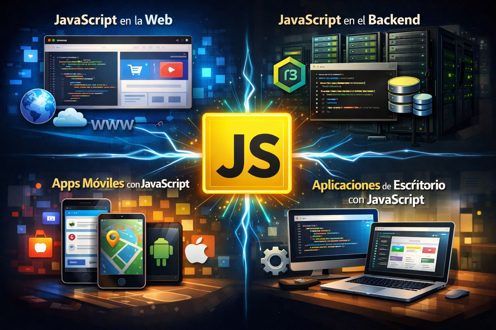

# **Àmbits**

  

    🏆 <strong>Progrés d'aquesta secció:</strong> 0 de 4 superats (0%)
    ⭐ <strong>0 punts</strong>
  

  

    

  

## **JavaScript en la web**

L'entorn on JavaScript apareció en primer lloc va ser la web. La seua ejecució es centrava en l'àmbit d'un document **HTML** i permitía als desenvolupadors aportar interactivitat, manipular el document o la finestra del navegador, realitzar cálculos, etc. Netscape Navigator, un navegador desaparecido hui en dia, té l'honor d'haver introduït **JavaScript** com llenguatge, encara que hui el suporten tots els clients web amb els que un usuari comú puga arribar a navegar.

Usar **JavaScript** per a la web, en torno al navegador, també es coneix com programació del costat del client i és una de les activitats englobades en el terme "frontend". Hui segueix sent l'ambient més habitual d'ejecució de **JavaScript**, però realment és només una més entre les seues possibilitats.

## **JavaScript en el backend**

A certs desenvolupadors es els ocurrió que podrien extraer el motor d'ejecució de **JavaScript**, que fins a llavors només es disponía dins de l'àmbit del navegador, per a usar-lo en qualsevol un altre propòsit fóra del client web. Així és com nació **NodeJS**, que no és més que **JavaScript** fóra del navegador.

Amb **NodeJS** podem programar amb **JavaScript** aplicacions que s'executen directament sobre el sistema operatiu i que són capaços de resoldre qualsevol tipus de problema. Amb aquesta tecnologia, **JavaScript** es convirtió en un llenguatge de programació de propòsit general.

Un dels usos més habituals de **NodeJS** és la **programació backend**. Permet programar aplicacions que són capaços d'executar-se en el servidor, proporcionant accés a bases de dades, el sistema d'arxius i qualsevol un altre recurs del costat del servidor. No obstant això, **NodeJS** és tan ampli que es pot usar per a moltes altres tasques, com l'automatització, optimització o desplegament d'aplicacions, entre altres operacions.

## **JavaScript com llenguatge per a apps de dispositius**

Com **llenguatge per a la creació d'aplicacions per a dispositius** (apps per a mòbils, tabletas, TVs...). Les aplicacions desenvolupades **es instalan des d'els corresponents app stors** dels principals sistemes mòbils i l'usuari en principi no percibe cap diferència de les mateixes respecte a les aplicacions desenvolupades amb els llenguatges natius. Però, per ser programades amb **JavaScript**  i **HTML5**, abren un nou camp d'actuació per a les persones experimentades en el desenvolupament per a la web i dispensa de l'aprenentatge de llenguatges natius per a cada plataforma mòbil.

Al principi, per a executar aplicacions realitzades en **JavaScript**  i HTML5 es necesitava d'un "**Web View**". Básicament la funció de la web view consisteix en oferir un marco per a l'ejecució de l'app, de manera que ésta s'executa dins d'un navegador, encara que l'usuari no el perciba. Aquesta situació té diverses avantatges i inconvenients en els que no entrarem, però hui també existeix la possibilitat d'usar **JavaScript**  com llenguatge de desenvolupament d'aplicacions natives, **que no requereixen una web view per a funcionar**.

Exemples de frameworks per al desenvolupament d'aplicacions basades en web view tenim en **Apache Cordova**, **Phone Gap** o **Ionic**. Exemples de frameworks per a desenvolupament d'aplicacions natives usant **JavaScript**  tenim a **Native Script** i **React Native**.

## **JavaScript com llenguatge per a aplicacions d'escriptori**

En el desenvolupament de **aplicacions per a ordinadors personals**. Amb **JavaScript** som capaços de crear aplicacions avançades, capaços d'usar tots els recursos d'un ordinador i a més executar-se en qualsevol sistema operatiu que necessitem.

Usar **JavaScript** per a aplicacions d'escriptori és senzill gràcies a projectes com Electron, que ens permet produir aplicacions multiplataforma, és a dir, que es podran instal·lar en **Windows**, **Mac US X** i **Linux**.
Hi ha bastantes aplicacions conegudes desenvolupades amb **Electron**, com **Atom**, **Visual Studio Code**, **Slack**, **Hyper**, etc.

---

## 🎮 Reptes Interactius d'Autoavaluació (+100 XP)

Comprova el teu domini sobre **4.1.2 Àmbits** superant aquests 4 reptes gamificats (+25 punts cadascun):

  
🎯 <strong>Repte 1 (+25 pts):</strong> En JavaScript modern (ES6+), quina diferència hi ha entre declarar una variable amb <code>let</code> i declarar-la amb <code>const</code>?

  

    <button type="button" class="btn-mcq-opt" data-opt="A">A) <code>let</code> té àmbit global obligatori i <code>const</code> no existeix en navegadors.</button>
    <button type="button" class="btn-mcq-opt" data-opt="B">B) Ambdues tenen àmbit de bloc (<code>{}</code>), però <code>const</code> impedeix reassignar la referència de la variable després de la seua inicialització.</button>
    <button type="button" class="btn-mcq-opt" data-opt="C">C) <code>const</code> només admet nombres enters i <code>let</code> només cadenes de text.</button>
    <button type="button" class="btn-mcq-opt" data-opt="D">D) No hi ha cap diferència.</button>
  

  

  
🎯 <strong>Repte 2 (+25 pts):</strong> Quin mètode funcional dels Arrays en JavaScript crea i retorna un NOU array amb tots els elements que compleixen la condició d'una funció callback?

  

    <button type="button" class="btn-mcq-opt" data-opt="A">A) forEach()</button>
    <button type="button" class="btn-mcq-opt" data-opt="B">B) filter()</button>
    <button type="button" class="btn-mcq-opt" data-opt="C">C) push()</button>
    <button type="button" class="btn-mcq-opt" data-opt="D">D) pop()</button>
  

  

  
✅ <strong>Repte 3 (Vertader o Fals · +25 pts):</strong> En JavaScript, l'operador d'igualtat estricta (<code>===</code>) compara tant el valor com el tipus de dades sense fer conversió implícita.

  

    <button type="button" class="btn-vf" data-opt="V">Vertader (V)</button>
    <button type="button" class="btn-vf" data-opt="F">Fals (F)</button>
  

  

  
⌨️ <strong>Repte 4 (+25 pts):</strong> Com s'anomena l'estructura de dades en JavaScript que emmagatzema una col·lecció ordenada de valors entre claudàtors <code>[10, 20, 30]</code>?

  

    <input type="text" class="quiz-input" placeholder="Escriu la resposta..." />
    <button type="button" class="btn-quiz-check">Comprovar</button>
  

  

### 📋 Llista de Comprovació i Rúbrica d'Assoliment

Marca cada criteri a mesura que completes l'estudi o la resolució pràctica d'aquesta pàgina (**4.1.2 Àmbits**):

- [ ] He llegit detingudament la teoria o l'enunciat d'aquesta secció i he anotat els conceptes clau.
- [ ] He revisat els esquemes, taules o blocs de codi i he verificat que sé aplicar-los a l'entorn de treball.
- [ ] He resolt correctament els **4 reptes interactius** superiors obtenint els **100 punts XP**.
- [ ] He descarregat el comprovant oficial en PDF per a adjuntar-lo a la tasca d'**Aules**.

  <h3>📤 Comprovant de Lliurament per a Aules</h3>
  
Quan hages completat els reptes interactius i la llista d'autoavaluació d'aquesta pàgina, introdueix el teu nom i descarrega el teu certificat oficial en PDF per a adjuntar-lo a la tasca d'<strong>Aules</strong>.

  

    <label for="aules-student-name">👤 Nom i Cognoms de l'Alumne/a:</label>
    <input type="text" id="aules-student-name" class="aules-student-name" placeholder="Ex: Joan Garcia Pérez" />
  

  

    0/4 reptes completats (0%) · 0 punts · 0/4 criteris d'autoavaluació
  

  

    <button type="button" class="btn-aules-dl" data-module="LMSGI" data-unit="UD04" data-activity="ut0412">📥 Descarregar Comprovant PDF</button>
    <button type="button" class="btn-aules-copy">📋 Copiar Resum al Porta-retalls</button>
  

  

