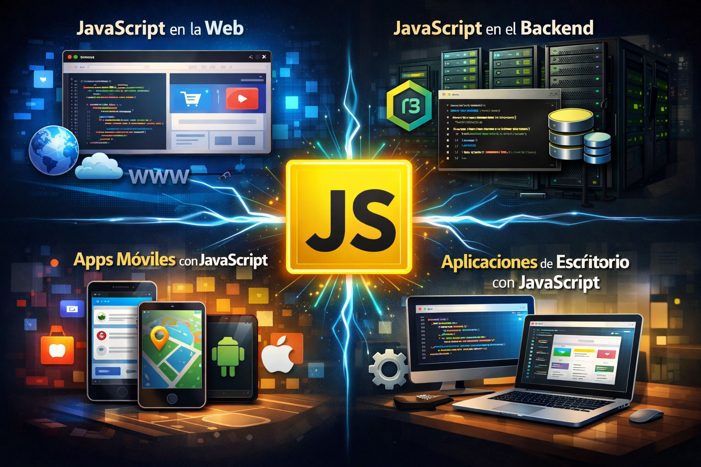

# **Ámbitos**

## **JavaScript en la web**

El entorno donde JavaScript apareció en primer lugar fue la web. Su ejecución se centraba en el ámbito de un documento **HTML** y permitía a los desarrolladores aportar interactividad, manipular el documento o la ventana del navegador, realizar cálculos, etc. Netscape Navigator, un navegador desaparecido hoy en día, tiene el honor de haber introducido **JavaScript** como lenguaje, aunque hoy lo soportan todos los clientes web con los que un usuario común pueda llegar a navegar.

Usar **JavaScript** para la web, en torno al navegador, también se conoce como programación del lado del cliente y es una de las actividades englobadas en el término "frontend". Hoy sigue siendo el ambiente más habitual de ejecución de **JavaScript**, pero realmente es sólo una más entre sus posibilidades.

## **JavaScript en el backend**

A ciertos desarrolladores se les ocurrió que podrían extraer el motor de ejecución de **JavaScript**, que hasta entonces sólo se disponía dentro del ámbito del navegador, para usarlo en cualquier otro propósito fuera del cliente web. Así es como nació **NodeJS**, que no es más que **JavaScript** fuera del navegador.

Con **NodeJS** podemos programar con **JavaScript** aplicaciones que se ejecutan directamente sobre el sistema operativo y que son capaces de resolver cualquier tipo de problema. Con esta tecnología, **JavaScript** se convirtió en un lenguaje de programación de propósito general.

Uno de los usos más habituales de **NodeJS** es la **programación backend**. Permite programar aplicaciones que son capaces de ejecutarse en el servidor, proporcionando acceso a bases de datos, el sistema de archivos y cualquier otro recurso del lado del servidor. Sin embargo, **NodeJS** es tan amplio que se puede usar para muchas otras tareas, como la automatización, optimización o despliegue de aplicaciones, entre otras operaciones.

## **JavaScript como lenguaje para apps de dispositivos**

Como **lenguaje para la creación de aplicaciones para dispositivos** (apps para móviles, tabletas, TVs...). Las aplicaciones desarrolladas **se instalan desde los correspondientes app stores** de los principales sistemas móviles y el usuario en principio no percibe ninguna diferencia de las mismas respecto a las aplicaciones desarrolladas con los lenguajes nativos. Pero, por ser programadas con **JavaScript**  y **HTML5**, abren un nuevo campo de actuación para las personas experimentadas en el desarrollo para la web y dispensa del aprendizaje de lenguajes nativos para cada plataforma móvil.

Al principio, para ejecutar aplicaciones realizadas en **JavaScript**  y HTML5 se necesitaba de un "**Web View**". Básicamente la función de la web view consiste en ofrecer un marco para la ejecución de la app, de manera que ésta se ejecuta dentro de un navegador, aunque el usuario no lo perciba. Esta situación tiene varias ventajas e inconvenientes en los que no entraremos, pero hoy también existe la posibilidad de usar **JavaScript**  como lenguaje de desarrollo de aplicaciones nativas, **que no requieren una web view para funcionar**.

Ejemplos de frameworks para el desarrollo de aplicaciones basadas en web view tenemos en **Apache Cordova**, **Phone Gap** o **Ionic**. Ejemplos de frameworks para desarrollo de aplicaciones nativas usando **JavaScript**  tenemos a **Native Script** y **React Native**.

## **JavaScript como lenguaje para aplicaciones de escritorio**

En el desarrollo de **aplicaciones para ordenadores personales**. Con **JavaScript** somos capaces de crear aplicaciones avanzadas, capaces de usar todos los recursos de un ordenador y además ejecutarse en cualquier sistema operativo que necesitemos.

Usar **JavaScript** para aplicaciones de escritorio es sencillo gracias a proyectos como Electron, que nos permite producir aplicaciones multiplataforma, es decir, que se podrán instalar en **Windows**, **Mac US X** y **Linux**.
Hay bastantes aplicaciones conocidas desarrolladas con **Electron**, como **Atom**, **Visual Studio Code**, **Slack**, **Hyper**, etc.
