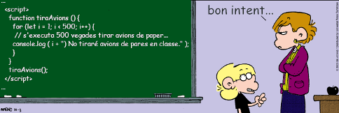

# **Conceptos Básicos**

## **Glosario general**

- **Programa**: conjunto total de código que desarrollas. En JavaScript, quizás el término más utilizado es aplicación web (cuando es un desarrollo con mucha cantidad de JavaScript). También se suelen generalizar utilizando términos como «script» o «código JavaScript».

- **Algoritmo**: conjunto de pasos conocidos, en un determinado orden, para conseguir hacer una tarea satisfactoriamente y conseguir un objetivo.

- **Comentarios**: fragmentos de texto o anotaciones que el navegador ignora y no repercuten en el programa. Sirven para dejar por escrito detalles importantes para el programador. De esta manera cuando volvamos al código, nos será más rápido comprenderlo. Es una buena costumbre comentar en la medida de lo posible.

- **Indentación**: acción de colocar espacios o tabuladores antes del código, para indicar si nos encontramos dentro de un if, de un bucle, etc... Esta práctica es muy importante y necesaria, y más adelante profundizaremos en ella.

- **Variables**: pequeños espacios de memoria donde guardas una información determinada, de forma muy similar a las incógnitas en matemáticas. Un programa puede tener muchas variables, y cada una de ellas tendrá un nombre, un valor y un tipo de dato. El nombre se utiliza para diferenciarlas las unas de las otras y hacer referencia a ellas, el valor es la información que contienen y el tipo de dato es la naturaleza de este valor. Se llaman variables porque podemos cambiarle su valor a lo largo del programa, según necesitamos.

> **📌 JS**
> 

```html
x = 5; // nom: x, valor: 5, tipus dada: nombre
y = "Hola"; // nom: y, valor: Hola, tipus dada:: texto
Manuel = "MAA"; // nom: Manuel, valor: MAA, tipus dada: texto
```

- **Constantes**: la información que contiene es siempre la misma (no puede variar).

- **Funciones**: las funciones son agrupaciones de código que, entre otras cosas, evitan que tengamos que escribir varias veces lo mismo en nuestro código. Una función contendrá una o más acciones a realizar y cada vez que ejecutemos una función, se realizarán todas ellas.

- **Parámetros**: las variables que se le pasan a las funciones (también argumentos).

- **Bucles**: muchas veces necesitaremos hacer tareas repetitivas. Una de las ventajas de la programación es que permite automatizar acciones y no es necesario hacerlas varias veces. Los bucles permiten indicar el número de veces que se repetirá una acción. De esta manera, sólo lo escribimos una vez en nuestro código, y simplemente indicamos el número de veces que queremos que se repita.

- **Iteración**: Cuando el programa está en un bucle repitiendo varias veces la misma tarea, cada una de estas repeticiones se denomina iteración.



- **Librería**: Muchas veces, desarrollamos código que resuelve tareas o problemas que, posteriormente, queremos reutilizar en otros programas. Cuando esto ocurre, en JavaScript se suele empaquetar el código en el que se llaman librerías, que no es más que código listo para que otros programadores puedan utilizarlo fácilmente en sus programas y beneficiarse de las tareas que resuelven de forma muy sencilla.

## **Comentarios**

Al igual que ocurre con otros lenguajes, JavaScript permite añadir comentarios entre el código, que fundamentalmente tienen como propósito explicar o introducir el código que va a continuación. Existen dos tipos de comentarios:

- **Comentarios de una sola línea**: empieza con los símbolos // y solo comenta la línea actual desde donde se escribe.

- **Comentarios de múltiples líneas**: Se utiliza para hacer comentarios extensos que ocuparán varias líneas. Empieza por /*, acompañado por texto y se cierra con */.

> **📌 JS**
> 

```html
// Comentaris ccurts d'una sola línia. Solen explicar la línia seguent al comentari o en la mateixa línia que CompressionStream..
var a = 1;
var x = 45; // També s'utilitza al final d'una línia.
/* Per altre costat, existeixen els comentaris multiples de varies línies consecutives.
Solen utilitzar-se per explicacions llargues que requereixex suficient espai perque es
mencionen gran qüantitat de coses*/
```

## **Identación de código**

Se dice al hecho de utilizar sangrado (mover ligeramente hacia la derecha) en las líneas de código para facilitar la lectura, e indicar visualmente si nos encontramos en el interior de una función, bucle, condicional, etc...

> **📌 Ejemplo**
> 
VÁLIDONO VÁLIDO

```html
function bucle() {
  for (i = 0; i < 10; i++) {
    console.log("Iteración #", i);

    if (i == 9) {
      console.log("Estoy en la última iteración");
    } // if
  } // for
} // function
```

```html
function bucle() { for (i = 0; i < 10; i++) {
  console.log("Iteración #", i);
  if (i == 9) console.log("Estoy en la última iteración"); }
}
```

## **Convenciones de nombres**

- **Nombres descriptivos** :Evita nombres poco claros o inconsistentes como tmp, a, b2, variable2, etc...

- **Índices y contadores** :Las variables que actúan como contador suelen nombrarse con una letra minúscula empezando por y (de index): **i**, **j**, **k**. También se utilizan letras como, **b**, **c** o la inicial minúscula de lo que representan: **c** para un contador, **p** para una posición, etc...

- **Constantes, clases y variables** :

  - **Constantes**: siempre en mayúsculas.

  - **Variables**: siempre empezar por la letra minúscula.

  - **Clases**: letras capitalizadas (la primera en mayúscula y el resto en minúsculas).

> **📌 Danger**
> 

> Nunca empezar un nombre por un número.

| Nombre | Descripción | Ejemplo |
| --- | --- | --- |
| **lowercase** | Todo minúsculas. ❌ No se usa porque en palabras compuestas puede confundir. | **precioproducto** |
| **UPPERCASE** | Todo mayúsculas. ❌ No se usa porque en palabras compuestas puede confundir. | **PRECIOPRODUCTO** |
| **camelCase** | Primera palabra, todo minúsculas. El resto, todo minúsculas excepto primera letra. | **precioProducto** |
| **PascalCase** | Idem, pero las palabras empiezan con la primera letra mayúscula. Se usa en Clases. | **PrecioProducto** |
| **snake_case** | Las palabras se separan con un guión bajo y se escriben siempre en minúsculas. | **precio_producto** |
| **UPPER_SNAKE_CASE** | Se usa en constantes ajustables a menudo por el programador. | **PRECIO_PRODUCTO** |
| **kebab-case** | Palabras separadas con un guión normal y en minúsculas. Usadas en HTML/CSS. | **precio-producto** |
| **dot.case** | Palabras en minúsculas separadas por puntos. ❌ En Javascript no se puede usar. | **precio.producto** |
| **Húngara** | Prefijo (minúsculas) con el tipo de dato (n = número, t = texto, ...). ❌ Desaconsejada. | **nPrecioProducto** |
