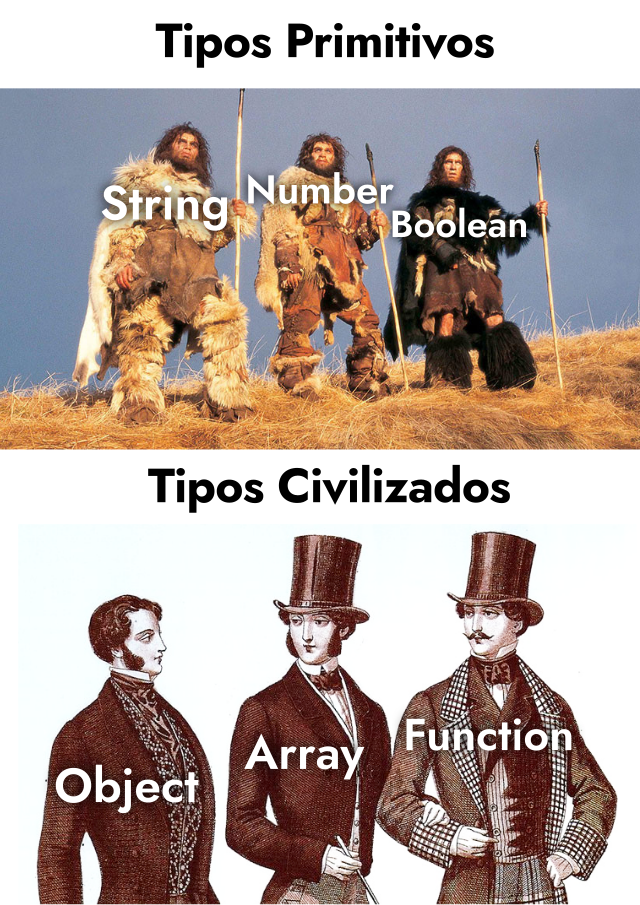

# **Tipus de dades**

<div class="interactive-progress-tracker">
  <div class="tracker-header">
    <span>🏆 <strong>Progrés d'aquesta secció:</strong> <span class="tracker-count">0 de 4 superats (0%)</span></span>
    <span class="tracker-pts">⭐ <strong>0 punts</strong></span>
  </div>
  <div class="tracker-bar">
    <div class="tracker-fill" style="width: 0%;"></div>
  </div>
</div>

En Javascript, a l'igual que en la majoria dels llenguatges de programació, al declarar una variable i guardar el seu contingut, també li estem assignant un **tipus de dada**. En alguns llenguatges es fa de forma explícita, i en alguns altres llenguatges es fa de forma implícita. El **tipus de dada** no és més que la naturalesa del seu contingut: contingut numèric, contingut de text, etc...

## **Què tipus de llenguatges existeixen?**

A grans rasgos, ens podem trobar amb dos tipus de llenguatges de programació:

- **Llenguatges estátics**: Quan creem una variable, hem d'indicar el **tipus de dada** del valor que va a contindre. En conseqüència, el valor assignat finalment, sempre haurà de ser del tipus de dada que hem indicat (*si definim que és un número ha de ser un número, si definim que és un text ha de ser un text, etc...*).

- **Llenguatges dinàmics**: Quan creem una variable, no és necessari indicarle el tipus de dada que va a contindre. El llenguatge de programació es encargará de deducir o inferir el tipus de dada (*depenent del valor que li hayamos assignat*).

Javascript pertany als **llenguatges dinàmics**, ja que automàticament detecta de que tipus de dada es tracta en cada cas, depenent del contingut que li hem assignat a la variable.

> **📌 Tip**
> 

> En els **llenguatges dinàmics**, realment el tipus de dada s'associa al valor (*i no a la variable*). Així és molt més fàcil entendre que al llarg del programa, aquesta variable pot «canviar» a tipus de dades diferents, ja que la restricció del tipus de dada està associada al valor i no a la variable en sí. No obstant això, per a simplificar, solemos parlar de variables i els seus respectivos tipus de dades.

### **Javascript**

És important recalcar que en Javascript, encara que no tinguem que indicar el tipus de dada de cada variable, els **tipus de dades existeixen**, es pot accedir a ells i fins i tot convertir entre un tipus de dada i un altre.

> **📌 JS**
> 

```html
const valueAsText = "50";
const valueAsNumber = 50;
const convertedValue = Number("50");

console.log(valueAsText);    // "50"
console.log(valueAsNumber);  // 50
console.log(convertedValue); // 50
```

Observa que en l'exemple anterior, la constant `valueAsText` té un tipus de dada de text, mentre que la constant `valueAsNumber` té un tipus de dada numèric. Hem utilitzat `Number()` per a forçar un text i convertir-lo a un altre tipus de dada (*numèric*).

> **📌 Més Info**
> 

> En moltes ocasions (*i de manera informal*) també es sol fer referència a **llenguatges tipats** (*tipat fort, o fuertement tipat*) o **llenguatges no tipats** (*tipat feble, débilment tipat*), per a indicar si el llenguatge requereix indicar manualment el tipus de dada de les variables o no, respectivament.

## **Tipus de dades en JavaScript**

Els **tipus de dades** són la naturalesa del contingut d'una variable o constant. En la programació hem de tindre diversos conceptes clars perquè estarem utilizándolos tot el temps i és important no confundirlos: **nom d'una variable**, **contingut de la variable** i **tipus de dada de la variable**.

Vegem alguns exemples:

| Codi | Nom de la variable | Contingut | Tipus de dada |
| --- | --- | --- | --- |
| `const num = 44` | `num` | `44` | Numèric (`number`) |
| `const text = "Manz"` | `text` | `"Manz"` | Text (`string`) |

### **Agrupació Tipus de dades**

Els **tipus de dades** en JavaScript es solen catalogar en dos grups:

- **Tipus de dades primitius** (*bàsics*)

- **Tipus de dades no primitius** (*complexos*)

Anem a desglosar-los:

| Tipus de dada | Descripció | Exemple |
| --- | --- | --- |
| Tipus de dades primitius |  |  |
| `Number` | Valor numèric (enters, decimals...) | 45 |
| `String` | Valor de text (cadenes de text, caràcters...) | 'MAA' |
| `Boolean` | Valor booleano (valors vertader o fals) | true |
| `BigInt` | Valor numèric molt gran | 2n ** 53n |
| `Symbol` | Símbol (valor únic) | const id = Symbol("id"); |
| `undefined` | Valor sense definir (variable sense inicialitzar) | undefined |
| Tipus de dades no primitius |  |  |
| `Object` | Objecte (estructura més complexa) | {'Manuel',25} |
| `Function` | Funció (funció guardada en una variable) | funcion(){} |

Tipus primitivosTipos no primitivosTipo undefinedValor null

#### **Tipus de dades primitius**

Per a començar, ens centrarem en introduir els 3 primers: tipus de dades numèrics, de text i booleanos. Són denominats els **tipus de dades primitius** de Javascript. En pròxims temes anirem descubrent més detalls sobre cada un d'ells i profunditzant en el resta.



*(Els tipus primitius existeixen, però els civilitzats és broma... eh?)*

Per a saber que tipus de dada té una variable, hem d'observar el valor que li hem donat.

- Si és un valor numèric, serà de tipus `number`.

- Si és un valor de text, serà de tipus `string`.

- Si és vertader o fals, serà de tipus `boolean`.

Vegem un exemple en el que identificarem que tipus de dada té cada variable:

> **📌 JS**
> 

```html
// Un texto, letra o carácter
const text = "Hola, me llamo Manz";

// Un número (entero o decimal)
const number = 42;

// Un número muy grande (se añade n al final)
const bignumber = 12345678901234567890n;

// Un valor de verdadero o falso
const boolean = true;

// Un valor único
const symbol = Symbol("unique");
```

Com es pot veure, aquests són els **tipus de dades primitius** bàsics de Javascript. Cada un d'ells té les seues particularitats, les seues característiques i una sèrie d'operacions que es pot realitzar amb ells. Les anirem veient al llarg dels diferents temes.

#### **Tipus de dades no primitius**

Al marge dels tipus de dades que hem vist fins a ara, en Javascript qualsevol tipus de dada no primitiu es considera un `object`, el que sol indicar que es tracta d'un tipus de dada més complex.

Vegem un exemple de tipus de dades no primitius:

> **📌 JS**
> 

```html
// Tipo de dato: Objeto
const user = { name: "ManzDev" };

// Tipo de dato: Array
const users = ["ManzDev", "CyberManzDev", "Manz9000"];

// Tipo de dato: RegExp
const regex = /.+/;
```

En tots aquests casos, els tipus de dades de cada constant es consideran `object`, ja que són tipus de dades més complexos que els primitius. Ara no ens preocuparem d'ells, els veurem més avant.

#### **Tipus de dada `undefined`**

D'altra banda, existeix un tipus de dada especial denominat `undefined` (*sense definir*). Es sol considerar també un tipus primitiu, però és un cas bastant especial.

El tipus `undefined` és el valor que tenen les variables a les que encara no es els ha donat cap valor específic (*és a dir, com el seu propi nom indica, estan sense definir*).

> **📌 JS**
> 

```html
let notDefined;
// Tiene el valor undefined

let sinDefinir = undefined;
// Aunque no es lo habitual, también se puede asignar explícitamente
```

Tant `notDefined` com `sinDefinir` tenen el valor `undefined`, per la qual cosa no estan definides.

#### **Tipus de dada `null`**

El valor especial `null` indica la **ausencia intencional** d'informació. A diferència de `undefined` (*que indica que encara no es ha definit**), `null` indica que el valor ha sigut definit, però representa **ausencia de valor**.

Vegem un exemple amb la variable `selectedUser` de la reserva d'una habitació, on es pot observar el matís:

> **📌 JS**
> 

```html
// Caso A
let selectedUser;

// Caso B
let selectedUser = null;

// Caso C
let selectorUser = "ManzDev";
```

- **Primer cas**: la variable `selectedUser` té el valor `undefined` indicant que posiblement l'usuari encara no ha sigut seleccionat (*no es ha realitzat l'assignació d'un huésped a eixa habitació*).

- **Segon cas**: la variable `selectedUser` té el valor `null`, indicant que l'usuari ja ha sigut seleccionat, però es ha triat no seleccionar cap usuari (*l'habitació està buida, no té huésped*).

- **Tercer cas**: la variable `selectedUser` té el valor `ManzDev`, indicant que eixe usuari seleccionat com huésped.

Si no et ha quedado clar, hi ha un exemple gràfic on sempre sol entenderse:


---

## 🎮 Reptes Interactius d'Autoavaluació (+100 XP)

Comprova el teu domini sobre **4.3.1 Tipus de dades** superant aquests 4 reptes gamificats (+25 punts cadascun):

<div class="interactive-mcq" data-answer="A" data-hint="map() projecta cada element a un nou valor i retorna el nou array resultant.">
  <div class="mcq-question">🎯 <strong>Repte 1 (+25 pts):</strong> Quin mètode funcional dels Arrays en JavaScript transforma cada element aplicant una funció i retorna un nou array de la mateixa longitud?</div>
  <div class="mcq-options">
    <button type="button" class="btn-mcq-opt" data-opt="A">A) map()</button>
    <button type="button" class="btn-mcq-opt" data-opt="B">B) shift()</button>
    <button type="button" class="btn-mcq-opt" data-opt="C">C) splice()</button>
    <button type="button" class="btn-mcq-opt" data-opt="D">D) indexOf()</button>
  </div>
  <div class="quiz-feedback"></div>
</div>

<div class="interactive-mcq" data-answer="A" data-hint="Les funcions fletxa (=>) proporcionen una sintaxi concisa i lèxica.">
  <div class="mcq-question">🎯 <strong>Repte 2 (+25 pts):</strong> Com s'anomena la sintaxi abreujada <code>(a, b) =&gt; a + b</code> per a escriure funcions en JavaScript ES6?</div>
  <div class="mcq-options">
    <button type="button" class="btn-mcq-opt" data-opt="A">A) Funció fletxa (Arrow function).</button>
    <button type="button" class="btn-mcq-opt" data-opt="B">B) Bucle infinit.</button>
    <button type="button" class="btn-mcq-opt" data-opt="C">C)  Variable global.</button>
    <button type="button" class="btn-mcq-opt" data-opt="D">D) Comentari de bloc.</button>
  </div>
  <div class="quiz-feedback"></div>
</div>

<div class="interactive-vf" data-answer="V" data-hint="JSON.stringify serialitza a text JSON, i JSON.parse fa el pas invers.">
  <div class="vf-statement">✅ <strong>Repte 3 (Vertader o Fals · +25 pts):</strong> El mètode <code>JSON.stringify(obj)</code> converteix un objecte de JavaScript en una cadena de text en format JSON.</div>
  <div class="vf-buttons">
    <button type="button" class="btn-vf" data-opt="V">Vertader (V)</button>
    <button type="button" class="btn-vf" data-opt="F">Fals (F)</button>
  </div>
  <div class="quiz-feedback" style="width: 100%;"></div>
</div>

<div class="interactive-quiz" data-answer="log|console.log" data-hint="És console.log().">
  <div class="quiz-question">⌨️ <strong>Repte 4 (+25 pts):</strong> Quin mètode de l'objecte <code>console</code> (<code>console.____()</code>) s'utilitza habitualment per a imprimir missatges de depuració en les eines del navegador?</div>
  <div class="quiz-controls">
    <input type="text" class="quiz-input" placeholder="Escriu la resposta..." />
    <button type="button" class="btn-quiz-check">Comprovar</button>
  </div>
  <div class="quiz-feedback"></div>
</div>

### 📋 Llista de Comprovació i Rúbrica d'Assoliment

Marca cada criteri a mesura que completes l'estudi o la resolució pràctica d'aquesta pàgina (**4.3.1 Tipus de dades**):

- [ ] He llegit detingudament la teoria o l'enunciat d'aquesta secció i he anotat els conceptes clau.
- [ ] He revisat els esquemes, taules o blocs de codi i he verificat que sé aplicar-los a l'entorn de treball.
- [ ] He resolt correctament els **4 reptes interactius** superiors obtenint els **100 punts XP**.
- [ ] He descarregat el comprovant oficial en PDF per a adjuntar-lo a la tasca d'**Aules**.

<div class="aules-delivery-card">
  <h3>📤 Comprovant de Lliurament per a Aules</h3>
  <p>Quan hages completat els reptes interactius i la llista d'autoavaluació d'aquesta pàgina, introdueix el teu nom i descarrega el teu certificat oficial en PDF per a adjuntar-lo a la tasca d'<strong>Aules</strong>.</p>
  <div class="aules-student-field">
    <label for="aules-student-name">👤 Nom i Cognoms de l'Alumne/a:</label>
    <input type="text" id="aules-student-name" class="aules-student-name" placeholder="Ex: Joan Garcia Pérez" />
  </div>
  <div class="aules-score-badge">
    <span class="aules-score-count">0/4 reptes completats (0%) · 0 punts · 0/4 criteris d'autoavaluació</span>
  </div>
  <div class="aules-actions">
    <button type="button" class="btn-aules-dl" data-module="LMSGI" data-unit="UD04" data-activity="ut0431">📥 Descarregar Comprovant PDF</button>
    <button type="button" class="btn-aules-copy">📋 Copiar Resum al Porta-retalls</button>
  </div>
  <div class="aules-toast"></div>
</div>
