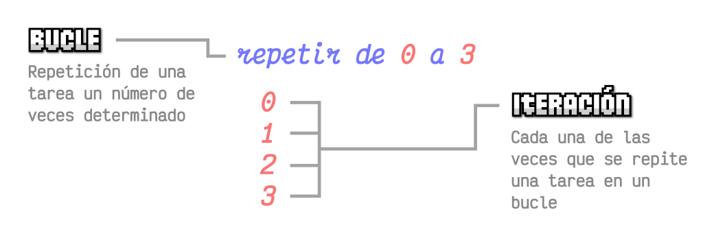
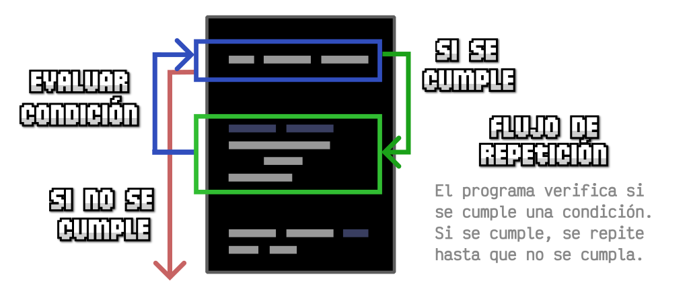
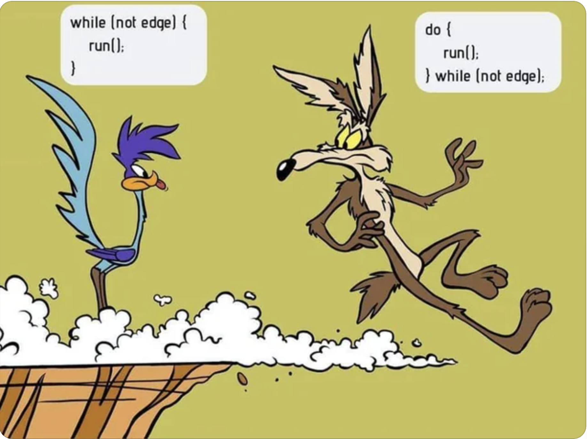

# **Bucles i iteracions**

<div class="interactive-progress-tracker">
  <div class="tracker-header">
    <span>🏆 <strong>Progrés d'aquesta secció:</strong> <span class="tracker-count">0 de 4 superats (0%)</span></span>
    <span class="tracker-pts">⭐ <strong>0 punts</strong></span>
  </div>
  <div class="tracker-bar">
    <div class="tracker-fill" style="width: 0%;"></div>
  </div>
</div>

## **Conceptes bàsics dels bucles i iteracions**

Una de les principals avantatges de la programació és la possibilitat de crear **bucles i repeticions** per a tasques específiques, i que no tinguem que realitzar el mateix codi diverses vegades de forma manual.



Els bucles ens permeten simplificar el nostre codi, que siga més fàcil de llegir i fins i tot més fàcil de modificar i mantindre.

### **Tipus de bucles**

Existeixen moltes formes de realitzar bucles, veurem els més bàsics, que són molt similars en altres llenguatges de programació:

| Tipus de bucle | Descripció |
| --- | --- |
| **while** | Bucles simples. |
| **for** | Bucles clásics per excel·lència. |
| **do..while** | Bucles simples que es realitzen sempre com a mínim una vegada. |
| **for..in** | Bucles sobre posicions d'un array. |
| **for..of** | Bucles sobre elements d'un array. |
| **Array functions** | Bucles específics sobre arrays. |

Els tres primers són els **bucles** per excel·lència en la programació. Un poc més avant, quan conozcamos certes estructures de dades i funcions, també podrem ampliar i conèixer els bucles basats en arrays, però de moment ens centrarem en els primers.

### **Conceptes de bucles**

Abans de començar a aprendre com funcionen els diferents tipus de bucles que existeixen, és necessari conèixer alguns conceptes bàsics relacionats amb els bucles.



- **Condició**: A l'igual que en els condicionals `if`, en els bucles es va a **avaluar una condició** per a saber si s'ha de seguir repetent el bucle o s'ha de finalitzar. Habitualment, el que es sol fer és establir que si la condició és vertadera, es torna a repetir el bucle. Pel contrari, si és falsa, es finalitza. No obstant això, aquesta condició pot variar depenent de la implementació que li indique el programador.

- **Iteració**: Un altre concepte que usarem molt dins d'un bucle és el concepte de **Iteració**. Açò es refereix a cada una de les repeticions d'un bucle. Per exemple, si un bucle es repeteix com en el gràfic superior d'aquest article (*de 0 a 3**), es diu que hi ha **4 iteracions**.

> **📌 Important**
> 

> Molt cura amb els bucles, perquè en programació es sol començar a comptar en `0`, per la qual cosa eixa és la primera iteració. Si el bucle va des de `0` a `3`, hi ha `4 iteraciones`.

- **Comptador**: Moltes vegades, els bucles que creem incorporen un comptador, que no és més que alguna cosa que anirà guardant un número per a comptar el número de repeticions realitzades, i així finalitzar quan es arribe a un altre número concret. Aquest comptador cal inicializar-lo (*crear-lo i darle un valor*) abans de començar el bucle.

- **Increment**: A l'igual que tenim un comptador en un bucle, també hem de tindre una part on fem un **increment** (*o un decremento*) d'aquest comptador. Si no el tuviéramos, el comptador no cambiaría i la condició sempre seria vertadera, per la qual cosa seria impossible eixir del bucle.

### **Bucles infinitos**

Quan estem aprendent a programar, és molt comú que cometamos un error creant el bucle i ens quedemos en un **bucle infinit**, és a dir, en una situació on el nostre programa es queda eternament en bucle i mai acaba. Com programadors, aquesta situació sempre cal evitar-la. Per a això, el que hem de fer és sempre comprovar que existeix un increment (*o decremento*) i que en algun moment la condició va a ser falsa i es podrà eixir del bucle.

> **📌 Perill!**
> 

> Tingues en compte que de producir-se un bucle infinit, el nostre programa es quedarà atascado i haurem de forçar per a finalizar-lo. Tingues sempre cura al crear un bucle perquè no siga infinit.

## **Bucle while**

El bucle **while** és un dels bucles més simples que podem crear. Aquest bucle es caracteritza en que es repeteix, revisant la condició en cada iteració i només es detiene quan la condició és falsa. Per aquest motiu cal tindre present la inicializació de la variable, el seu increment i la condició per a validar si es haurà d'executar una altra vegada

> **📌 JS**
> 

```html
let i = 0;  // Inicialización de la variable contador

// Condición: Mientras la variable contador sea menor de 5
while (i < 5) {
console.log("Valor de i:", i);

i = i + 1; // Incrementamos el valor de i
}
```

Vegem que és el que ocorre a l'hora d'executar aquest codi:

- Abans d'entrar en el bucle `while`, es inicializa la variable `i` al valor `0`.

- Abans de realitzar la primera **iteració** del bucle, comprovem la **condició**.

- Si la condició és **vertadera**, fem les tasques que estan indentades dins del bucle.

- Mostrem per pantalla el valor de `i`.

- Després, incrementamos el valor de `i` sumándole `1` al que ja teníamos en `i`.

- Terminamos la iteració del bucle, per la qual cosa tornem a l'inici del `while` a fer una **nova iteració**.

- Tornem al punt `2)` on comprovem de nou la **condició** del bucle.

- Repetim fins a que la condició siga **falsa**. Llavors, salimos del bucle i continuem el programa.

### **Traça del bucle**

Una tasca que sol servir per a entendre millor el bucle, és fer una **traça** del que faria un programa internament. Açò és anar realitzant cada pas, per a entender-lo bé.

Vegem una mostra pas a pas de les iteracions d'aquest exemple anterior:

| Iteració del bucle | Valor de i | Descripció | Increment |
| --- | --- | --- | --- |
| **Abans de començar** | i = undefined | Abans de començar el programa. |  |
| **Iteració #1** | i = 0 | (0 < 5)? Verdadero. Mostramos 0 por pantalla. | i = 0 + 1 |
| **Iteración #2** | i = 1 | ¿(1 < 5)? Verdadero. Mostramos 1 por pantalla. | i = 1 + 1 |
| **Iteración #3** | i = 2 | ¿(2 < 5)? Verdadero. Mostramos 2 por pantalla. | i = 2 + 1 |
| **Iteración #4** | i = 3 | ¿(3 < 5)? Verdadero. Mostramos 3 por pantalla. | i = 3 + 1 |
| **Iteración #5** | i = 4 | ¿(4 < 5)? Verdadero. Mostramos 4 por pantalla. | i = 4 + 1 |
| **Iteración #6** | i = 5 | ¿(5 < 5)? Falso. Salimos del bucle. |  |

## **Bucle do ... while**

Existe una variación del bucle `while` denominado **bucle `do while`**. La diferencia fundamental, a parte de variar un poco la sintaxis, es que este tipo de bucle siempre se ejecuta una vez, al contrario que el bucle `while` que en algún caso podría no ejecutarse nunca.



Con el bucle `do while` podemos obligar a que **siempre** se realice el interior del bucle **al menos una vez**:

> **📌 JS**
> 

```html
let i = 5;

do {
console.log("Hola a todos");
i = i + 1;
} while (i < 5);

console.log("Bucle finalizado");
```

Observa els següents detalls de la variació `do while`:

- En lloc d'utilitzar un `while` des del principi al costat de la condició, escrivim `do`.

- El `while` amb la condició es traslada al final del bucle.

- El que ocorre en aquest cas és que l'interior del bucle es realitza **sempre**, i només es analitza la condició a l'acabar el bucle, per la qual cosa encara que no es complisca, es va a realitzar **almenys una vegada**.

## **Bucle for**

El bucle **for** és potser un dels més utilitzats en el món de la programació. En Javascript s'utilitza exactament igual que en altres llenguatges com Java o C/C++. Vegem un exemple molt similar al que hem realitzat amb el bucle `while` en el tema anterior:

> **📌 JS**
> 

```html
// for (inicialización; condición; incremento)
for (let i = 0; i < 5; i++) {
  console.log("Valor de i:", i);
}
```

Com veiem, la sintaxi d'un **bucle for** és molt més compacta i ràpida d'escriure que la d'un **bucle `while`**, no obstant això pot parecernos més críptica quan la veiem per primera vegada.

La sintaxi del bucle for és molt més pràctica perquè et obliga a escriure la **inicializació**, la **condició** i el **increment** abans del propi bucle, i això fa que no et olvides d'aquests tres punts fonamentals, cosa que sol ocórrer en els bucles `while`, el que sol desembocar en un bucle infinit. Encara que també pot ocórrer en el bucle for, sol ser menys habitual.

Analicemos la sintaxi del bucle:

- Separem per `;` el que establim dins dels parèntesis del `for`.

- El primer és la inicializació `let i = 0`. Açò ocorre només una vegada abans de començar el bucle.

- El segon és la condició `i < 5`. Açò es comprova al principi de cada iteració.

- El tercer és l'increment `i++`, és a dir, `i = i + 1`. Açò ocorre al final de cada iteració.

Encara que no sol ser habitual, és possible afegir diverses inicializacions o incrementos en un bucle for separant per comes.

En el següent exemple a més d'aumentar el valor d'una variable `i`, inicializamos una variable `j` amb el valor `5` i l'anem decrementant:

> **📌 JS**
> 

```html
for (i = 0, j = 5; i < 5; i++, j--) {
    console.log("Valor de i y j:", i, j);
}
```


---

## 🎮 Reptes Interactius d'Autoavaluació (+100 XP)

Comprova el teu domini sobre **4.3.4 Bucles i iteracions** superant aquests 4 reptes gamificats (+25 punts cadascun):

<div class="interactive-mcq" data-answer="A" data-hint="map() projecta cada element a un nou valor i retorna el nou array resultant.">
  <div class="mcq-question">🎯 <strong>Repte 1 (+25 pts):</strong> Quin mètode funcional dels Arrays en JavaScript transforma cada element aplicant una funció i retorna un nou array de la mateixa longitud?</div>
  <div class="mcq-options">
    <button type="button" class="btn-mcq-opt" data-opt="A">A) map()</button>
    <button type="button" class="btn-mcq-opt" data-opt="B">B) shift()</button>
    <button type="button" class="btn-mcq-opt" data-opt="C">C) splice()</button>
    <button type="button" class="btn-mcq-opt" data-opt="D">D) indexOf()</button>
  </div>
  <div class="quiz-feedback"></div>
</div>

<div class="interactive-mcq" data-answer="A" data-hint="Les funcions fletxa (=>) proporcionen una sintaxi concisa i lèxica.">
  <div class="mcq-question">🎯 <strong>Repte 2 (+25 pts):</strong> Com s'anomena la sintaxi abreujada <code>(a, b) =&gt; a + b</code> per a escriure funcions en JavaScript ES6?</div>
  <div class="mcq-options">
    <button type="button" class="btn-mcq-opt" data-opt="A">A) Funció fletxa (Arrow function).</button>
    <button type="button" class="btn-mcq-opt" data-opt="B">B) Bucle infinit.</button>
    <button type="button" class="btn-mcq-opt" data-opt="C">C)  Variable global.</button>
    <button type="button" class="btn-mcq-opt" data-opt="D">D) Comentari de bloc.</button>
  </div>
  <div class="quiz-feedback"></div>
</div>

<div class="interactive-vf" data-answer="V" data-hint="JSON.stringify serialitza a text JSON, i JSON.parse fa el pas invers.">
  <div class="vf-statement">✅ <strong>Repte 3 (Vertader o Fals · +25 pts):</strong> El mètode <code>JSON.stringify(obj)</code> converteix un objecte de JavaScript en una cadena de text en format JSON.</div>
  <div class="vf-buttons">
    <button type="button" class="btn-vf" data-opt="V">Vertader (V)</button>
    <button type="button" class="btn-vf" data-opt="F">Fals (F)</button>
  </div>
  <div class="quiz-feedback" style="width: 100%;"></div>
</div>

<div class="interactive-quiz" data-answer="log|console.log" data-hint="És console.log().">
  <div class="quiz-question">⌨️ <strong>Repte 4 (+25 pts):</strong> Quin mètode de l'objecte <code>console</code> (<code>console.____()</code>) s'utilitza habitualment per a imprimir missatges de depuració en les eines del navegador?</div>
  <div class="quiz-controls">
    <input type="text" class="quiz-input" placeholder="Escriu la resposta..." />
    <button type="button" class="btn-quiz-check">Comprovar</button>
  </div>
  <div class="quiz-feedback"></div>
</div>

### 📋 Llista de Comprovació i Rúbrica d'Assoliment

Marca cada criteri a mesura que completes l'estudi o la resolució pràctica d'aquesta pàgina (**4.3.4 Bucles i iteracions**):

- [ ] He llegit detingudament la teoria o l'enunciat d'aquesta secció i he anotat els conceptes clau.
- [ ] He revisat els esquemes, taules o blocs de codi i he verificat que sé aplicar-los a l'entorn de treball.
- [ ] He resolt correctament els **4 reptes interactius** superiors obtenint els **100 punts XP**.
- [ ] He descarregat el comprovant oficial en PDF per a adjuntar-lo a la tasca d'**Aules**.

<div class="aules-delivery-card">
  <h3>📤 Comprovant de Lliurament per a Aules</h3>
  <p>Quan hages completat els reptes interactius i la llista d'autoavaluació d'aquesta pàgina, introdueix el teu nom i descarrega el teu certificat oficial en PDF per a adjuntar-lo a la tasca d'<strong>Aules</strong>.</p>
  <div class="aules-student-field">
    <label for="aules-student-name">👤 Nom i Cognoms de l'Alumne/a:</label>
    <input type="text" id="aules-student-name" class="aules-student-name" placeholder="Ex: Joan Garcia Pérez" />
  </div>
  <div class="aules-score-badge">
    <span class="aules-score-count">0/4 reptes completats (0%) · 0 punts · 0/4 criteris d'autoavaluació</span>
  </div>
  <div class="aules-actions">
    <button type="button" class="btn-aules-dl" data-module="LMSGI" data-unit="UD04" data-activity="ut0434">📥 Descarregar Comprovant PDF</button>
    <button type="button" class="btn-aules-copy">📋 Copiar Resum al Porta-retalls</button>
  </div>
  <div class="aules-toast"></div>
</div>
