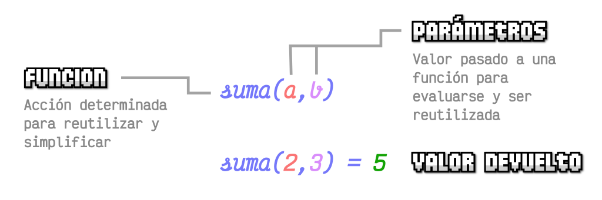

# **Funciones**

## **Funciones Básicas**

### **El concepto de función en programación**

En programación, cuando el código se va haciendo cada vez más grande, se busca una forma de organizarlo y preparar para reutilizarlo y no repetir innecesariamente las mismas tareas. Para ello, un primer recurso muy útil son las **funciones**.

Las **funciones** permiten agrupar líneas de código en tareas con un nombre, para que, posteriormente, se pueda hacer referencia a ese nombre para realizar todo lo que se agrupe en dicha tarea. Para usar funciones hay que hacer 2 cosas:

- **Declarar la función**: Preparar la función, darle un nombre y decirle las tareas que realizará.

- **Ejecutar la función**: «Llamar» a la función para que realice las tareas de su contenido.

### **Declaración**

Ejemplo de la **declaración de una función** llamada **saludar**:

> **📌 JS**
> 

```html
// Declaración de la función "saludar"
function saludar() {
  // Contenido de la función
  console.log("Hola, soy una función");
}
```

El contenido de la función es una línea que mostrará por consola un saludo. En estos momentos la función no realizará ninguna acción, está preparada para que sea invocada, y en ese momento su mostrará o realizará las acciones indicadas. Ese segundo paso se cono ce como **Ejecución**.

### **Ejecución**

Ejemplo completo con declaración y ejecución:

> **📌 JS**
> 

```html
// Declaración de la función "saludar"
function saludar() {
  // Contenido de la función
  console.log("Hola, soy una función");
}

// Ejecución de la función
saludar();
```

En este ejemplo se **declara la función** y además, se **ejecuta** la función (*en la última línea*) llamándola por su nombre y seguida de ambos paréntesis, que indican que es una función. En este ejemplo, si se mostrará el mensaje de saludo en la consola Javascript.

> **📌 Ejemplo**
> 
Sin Función sin BucleSin Función con BucleCon Función con Bucle

Veamos un primer ejemplo que muestre en la consola Javascript la **tabla de multiplicar del 1**:

> **📌 JS**
> 

```html
// Tabla de multiplicar del 1
console.log("1 x 0 = ", 1 * 0);
console.log("1 x 1 = ", 1 * 1);
console.log("1 x 2 = ", 1 * 2);
console.log("1 x 3 = ", 1 * 3);
console.log("1 x 4 = ", 1 * 4);
console.log("1 x 5 = ", 1 * 5);
console.log("1 x 6 = ", 1 * 6);
console.log("1 x 7 = ", 1 * 7);
console.log("1 x 8 = ", 1 * 8);
console.log("1 x 9 = ", 1 * 9);
console.log("1 x 10 = ", 1 * 10);
```

Este primer ejemplo funciona perfectamente, sin embargo, no estamos aprovechando las ventajas de la programación, sino que hemos hecho todo el trabajo escribiendo **10 líneas de código**.

Vamos a utilizar un **bucle for** para ahorrarnos tantas líneas de código:

> **📌 JS**
> 

```html
// Declaración
for (let i = 0; i < 11; i++) {
    console.log("1 x", i, "=", 1 * i);
}
```

Esto está mucho mejor. Hemos resumido 11 líneas de código en prácticamente 2 líneas utilizando un bucle for que va de **0 a 10** incrementando de 1 en 1. Incluso, recuerda que cuando las llaves sólo contienen una línea, se pueden omitir.

Para darle más importancia a las funciones y su eficacia nos planteamos que queremos hacer que por consola aparezca 3 veces la tabla de multiplicar del 1.

Sería como si ejecutáramos 3 veces el Bucle for que hemos creado en el apartado anterior:de la

> **📌 JS**
> 

```html
// Primera vez
for (let i = 0; i <= 10; i++) console.log("1 x", i, "=", 1 * i);

// Segunda vez
for (let i = 0; i <= 10; i++) console.log("1 x", i, "=", 1 * i);

// Tercera vez
for (let i = 0; i <= 10; i++) console.log("1 x", i, "=", 1 * i);
```

Esto mismo lo podemos hacer con una función y llamarla 3 veces por medio de un bucle::

> **📌 JS**
> 

```html
// Declaración de la función tablaDelUno()
function tablaDelUno() {
    for (let i = 0; i <= 10; i++) console.log("1 x", i, "=", 1 * i);
}

// Bucle que ejecuta 3 veces la función tablaDelUno()
for (intento = 0; intento < 3; intento++) tablaDelUno();
```

### **Parámetros**

A las funciones se les pueden pasar **parámetros**, que no son más que variables que se pasan desde fuera hacia dentro de la función. Además, también se puede hacer que la función realice sus tareas y devuelva un resultado hacia el exterior de la función. Para ello contamos con los **parámetros de entrada**, los que se le indican a la función para operar, y los **parámetros de salida**, el resultado de las operaciones de la función.



Ejemplo donde se utiliza el parámetro **hasta** para indicar hasta donde debe llegar:

> **📌 JS**
> 

```html
// Declaración
function tablaDelUno(hasta) {
for (let i = 0; i <= hasta; i++) {
    console.log("1 x", i, "=", 1 * i);
}
}

// Ejecución
tablaDelUno(10); // Tabla del 1
tablaDelUno(5);  // Tabla del 1
```

En el interior de los paréntesis de la función se ha indicado una variable llamada **hasta**. Esa variable contiene el valor que se le da a la hora de ejecutar la función, que en este ejemplo, se ejecuta dos veces: una con valor **10** y otra con valor **5**.

Analicemos este código:

- Ejecutamos la función **tablaDelUno(10)**.

- En la función **tablaDelUno**, el parámetro **hasta** valdrá **10**.

- Por lo tanto, haremos un bucle **for** desde **0** hasta **10**, incrementando de **1** en **1**.

- Se mostrará la tabla de multiplicar del uno, desde el **0** hasta el **10**.

Al terminar ejecutaremos la segunda función:

- Ejecutamos la función **tablaDelUno(5)**`.

- En la función **tablaDelUno**, el parámetro **hasta** valdrá **5**.

- Por lo tanto, haremos un bucle **for** desde **0** hasta **5**, incrementando de **1** en **1**.

- Se mostrará la tabla de multiplicar del uno, desde el **0** hasta el **5**.

**Parámetros múltiples**Parámetros por defecto**Devolución de valores**

#### **Parámetros múltiples**

Una función de Javascript puede tener muchos más parámetros. Este ejemplo incorpora un parámetro más para dar una funcionalidad más amplia:

> **📌 JS**
> 

```html
// Declaración
function tablaMultiplicar(tabla, hasta) {
for (let i = 0; i <= hasta; i++) {
    console.log(tabla, "x", i, "=", tabla * i);
}
}

// Ejecución
tablaMultiplicar(1, 10); // Tabla del 1
tablaMultiplicar(5, 10); // Tabla del 5
```

Se ha modificado la función **tablaDelUno()** por esta nueva versión que hemos cambiado de nombre a **tablaMultiplicar()**. Esta función necesita que le pasemos dos parámetros: **tabla** (*la tabla de multiplicar en cuestión*) y **hasta** (*el número hasta donde llegará la tabla de multiplicar*).

De esta forma, las dos llamadas para ejecutar la función mostrarán por la consola la tabla de multiplicar del 1 y del 5.

#### **Parámetros por defecto**

Es posible que en algunos casos se quiera que ciertos parámetros tengan un valor sin necesidad de escribirlos en la ejecución. Es lo que se llama un **valor por defecto**.

En el ejemplo anterior, podría interesar que la tabla de multiplicar llegue siempre hasta el 10, ya que es el comportamiento por defecto. Si se quiere que llegue hasta otro número, se indica explícitamente, pero si se omite, se quiere que llegue hasta 10. Esto se haría de la siguiente forma:

> **📌 JS**
> 

```html
function tablaMultiplicar(tabla, hasta = 10) {
for (let i = 0; i <= hasta; i++) {
    console.log(tabla, "x", i, "=", tabla * i);
}
}

// Ejecución
tablaMultiplicar(2);      // Tabla del 2, del 0 al número 10
tablaMultiplicar(2, 15);  // Tabla del 2, del 0 al número 15
```

> **📌 Importante**
> 

> Es importante recordar que el orden de los parámetros es importante y que los nombres de cada parámetro no se pueden repetir en una misma función.

#### **Devolución de valores**

Una de las funciones más importantes de las funciones es la devolución de valores, la función realiza las operaciones con o sin los parámetros que se le indican y para finalizar devuelva esa información al exterior. Para ello, se utiliza la palabra clave **return**, que suele colocarse al final de la función, ya que con dicha devolución se termina la ejecución de la función (*si existe código después, nunca será ejecutado*).

Veamos un ejemplo con una operación muy sencilla, para verlo claramente:

> **📌 JS**
> 

```html
function sumar(a, b) {
return a + b;                    // Devolvemos la suma de a y b al exterior
console.log("Suma realizada.");  // Este código nunca se ejecutará
}

// Ejecución
const resultado = sumar(5, 5);            // Se guarda 10 en la variable resultado
console.log("Resultado = ", resultado);   // Mostramos el resultado por consola
```

Esto permite crear funciones más modulares y reutilizables que se pueden utilizar en multitud de casos, ya que la información se puede enviar al exterior de la función y utilizarla junto a otras funciones o para otros objetivos.

## **Funciones anónimas y clausuras**

### **Formas de crear funciones anónimas y ejecutarlas**

Las **funciones anónimas** (*o funciones lambda*) son un tipo de funciones que se declaran sin definir un nombre de función, alojándolas en el interior de una variable y haciendo referencia a dicha variable cada vez que queramos utilizarla.

### **¿Qué es una función anónima?**

El siguiente ejemplo de código, donde se crea una función:

> **📌 JS**
> 

```html
// Función anónima "saludo"
const saludo = function () {
return "Hola";
};

saludo(); // 'Hola'
saludo;   // ƒ () { return 'Hola'; }
```

Tras definir la función, hace dos acciones:

- 1️⃣ Ejecutar la variable **saludo**, que como contiene una función, se ejecuta la función

- 2️⃣ Mostrar el valor de la variable **saludo** (*no se indica paréntesis, no se ejecuta*)

Lo importante aquí es entender que en el primer caso se está ejecutando la función que contiene la variable **saludo** y en el segundo caso se está mostrando el contenido de dicha variable, sin ejecutar la función.

**Función autoejecutable**Clausuras**

### **Funciones autoejecutables**

Pueden existir casos en los que se necesite crear una función y ejecutarla inmediatamente, sabiendo que no se va a volver a necesitar. Este tipo de funciones muchas veces también se llama **IIFE** (*Función por expresión invocada inmediatamente*).

Esto se puede resolver con lo que se llama una **función autoejecutable**. Básicamente, sólo se tiene que envolver entre paréntesis la función anónima en cuestión (*no se necesita que tenga nombre, puesto que no se va a guardar*) y luego, ejecutarla:

> **📌 JS**
> 

```html
(function () {
console.log("Hola!!");
})();
```

De hecho, también se puede utilizar parámetros en dichas funciones autoejecutables. Sólo hay que pasar los parámetros deseados al final de la función autoejecutable:

> **📌 JS**
> 

```html
(function (name) {
console.log(`¡Hola, ${name}!`);
})("Luis");
```

Si la función autoejecutable devuelve algún valor con **return**, a diferencia de las **funciones por expresión**, en este caso lo que se almacena en la variable es el valor que devuelve la función autoejecutada:

> **📌 JS**
> 

```html
const value = (function (name) {
return `¡Hola, ${name}!`;
})("Luis");

value;        // '¡Hola, Luis!`
typeof value; // 'string'
```

¿Qué está ocurriendo aquí?:

- 1️⃣ Se ejecuta la función autoejecutable contenida en paréntesis.

- 2️⃣ La función toma el valor **Luis** como parámetro **name**.

- 3️⃣ La función devuelve el valor **¡Hola, Luis!** como resultado.

- 4️⃣ La variable **value** almacena el valor devuelto por la función autoejecutada.

### **Clausuras**

Las **clausuras** (*o cierres*) son un concepto relacionado con las funciones y los ámbitos que suele costar comprender cuando se empieza en Javascript. Es importante tener las bases de funciones claras hasta este punto, para poder entender las bases de una clausura.

A grandes rasgos, en Javascript, una clausura o cierre se define como una función que «encierra» variables en su propio ámbito (*y que continúan existiendo aún habiendo terminado de ejecutar la función*).

> **📌 JS**
> 

```html
const createCounter = function () {
let number = 0;
return function () {
    number++;
    return number;
};
};

const counter = createCounter();
counter();  // 1
counter();  // 2
counter();  // 3
```

Que hay en el código y como se comporta la ejecución:

- 1️⃣ Hay una **función anónima** llamada **createCounter**

- 2️⃣ La función **createCounter** devuelve otra función diferente.

- 3️⃣ Al ejecutar la función **createCounter** devuelve esa otra función que es la que se guarda en **counter** para futuras ejecuciones, y guarda el contexto de variables como **number**.

La «magia» de las clausuras es que en el interior de la función estamos creando una variable **number** que se guardará en el ámbito de dicha función **createCounter**, por lo tanto seguirá existiendo, inicialmente con el valor declarado: **0**.

Por lo tanto, en la variable **counter** se guarda una función que además conoce el valor de una variable **NUMBER**, que sólo existe dentro de **counter**.

> **📌 JS**
> 

```html
typeof counter; // 'function'
counter(); // 1
counter(); // 2
counter(); // 3
```

La función incrementa el valor de **number** y lo devuelve. Como la variable **number** está dentro de una clausura y mantiene el valor de la variable en su propio contexto, a medida que se ejecuta **counter()**, los valores de **number** conservan su valor y se van incrementando.

## **Funciones callback y HOF**

### **¿Qué es una función callback?**

A grandes rasgos, un **callback** (*llamada hacia atrás*) es pasar una **función por parámetro** a otra **función**, de modo que esta última función puede ejecutar la función pasada por parámetro de forma genérica desde su propio código, y nosotros podemos definirlas desde fuera de dicha función.

> **📌 JS**
> 

```html
const action = function () {
console.log("Acción ejecutada.");
};

const mainFunction = function (callback) {
callback();
};

mainFunction(action);
```

- 1️⃣ Se define la función **action** que realiza una tarea.

- 2️⃣ Se define la  función **mainFunction**, que recibe como parámetro una función **callback** genérica.

- 3️⃣ Se llama a **mainFunction**, pasándole como parámetro la función concreta, que en este caso es **action**.

### **¿Qué es una función «HOF»?**

Las **funciones de orden superior** o **HOF** (*High Order Functions*) son funciones que reciben por parámetro otra función y/o devuelven una función mediante el **return**.

En el ejemplo anterior podría permitir crear varias funciones HOF y reutilizarlas posteriormente con diferentes propósitos. De hecho, esta es una primera aproximación para controlar la asincronía en Javascript.

En el siguiente ejemplo se crean números aleatorios entre **0** y **1**. Se define que al ejecutar **doTask**, exista un 50% de probabilidad de que ocurra un error (*valores entre 0 y 0.5*), o no ocurra error (*valores entre 0.5 y 1*):

> **📌 JS**
> 

```html
const action = function () {
console.log("Acción ejecutada.");
};

const error = function () {
console.error("Ha ocurrido un error");
};

const doTask = function (callback, callbackError) {
const isError = Math.random() < 0.5;

if (!isError) callback();
else callbackError();
};

doTask(action, error);
```

Viendo este ejemplo, podemos planear ejecutar la función **doTask()**, que es nuestra HOF, cambiando los callbacks según nos interese, sin necesidad de crear funciones con el mismo código repetido una y otra vez.

Además, en el caso de que las funciones **callbacks** sean muy cortas, muchas veces utilizamos directamente la función anónima, sin necesidad de guardarla en una variable previamente:

> **📌 JS**
> 

```html
const doTask = function (callback, callbackError) {
const isError = Math.random() < 0.5;

if (!isError) callback();
else callbackError();
};

doTask(function () {
    console.log("Acción ejecutada.");
},
function () {
    console.error("Ha ocurrido un error");
}
);
```

Esta forma de escribir código se suele evitar para facilitar la legibilidad del código, y sólo se utiliza en casos muy específicos donde estás seguro que no hace falta guardar las funciones previamente.

## Arrow functions

### ¿Qué son las Arrow function?

Las **Arrow functions**, funciones flecha o «fat arrow» son una forma corta y compacta de escribir las funciones tradicionales de Javascript. A grandes rasgos, se trata de eliminar la palabra **function** y añadir el texto **=>** antes de abrir las llaves:

> **📌 JS**
> 

```html
const func = function () {
return "Función tradicional.";
};

const func = () => {
return "Función flecha.";
};
```

En principio, no hay ninguna diferencia más, y se ejecutan de la misma forma. Sin embargo, las **funciones flechas** tienen algunos matices y diferencias bastante interesantes:

- 1️⃣ Si el cuerpo de la función sólo tiene una línea, podemos omitir las llaves (*{}*).

- 2️⃣ En ese caso, se hace un **return** implícito, por lo que podemos omitir también el **return**.

- 3️⃣ Si la función no tiene parámetros, se indica como en el ejemplo anterior: **() =>**.

- 4️⃣ Si la función tiene un solo parámetro, opcionalmente te puedes ahorrar los paréntesis: **e =>**.

- 5️⃣ Si la función tiene 2 ó más parámetros, se indican entre paréntesis: **(a, b) =>**.

- 6️⃣ Si queremos devolver un objeto, que coincide con la sintaxis de las llaves, se puede englobar con paréntesis: **({name: 'Luis'})**.

Por lo tanto, el ejemplo anterior se puede simplificar aún más:

> **📌 JS**
> 

```html
// 0 parámetros: Devuelve "Función flecha"
const func = () => "Función flecha.";

// 1 parámetro:  Devuelve el valor de e + 1
const func = (e) => e + 1;

// 2 parámetros: Devuelve el valor de a + b
const func = (a, b) => a + b;
```

Las **funciones flecha** hacen que el código sea mucho más legible y claro de escribir, mejorando la productividad a la hora de escribir nuestro código. Sim embargo, también hay algunas diferencias más técnicas respecto a las funciones tradicionales.

### Ámbito léxico de **this**

Aunque aún no se utilice la palabra clave **this**, una de las principales diferencias de las **arrow functions** respecto a las funciones tradicionales, es el valor de la palabra clave **this**, que no siempre es el mismo.

Por ejemplo, si se utiliza una función de forma global en nuestro programa, no se notará ninguna diferencia:

> **📌 JS**
> 

```html
const a = function () {
console.log(this);
};

a(); // Window

const b = () => {
console.log(this);
};

b(); // Window
```

En ambos casos, el valor de **this** es el objeto global **Window** o **globalThis**, que es una referencia al objeto que representa la ventana o pestaña del navegador: si se está en un contexto global, **this** hace referencia a **esta ventana del navegador**. Sin embargo, si se utiliza una función en el interior de un objeto, como suele ser el caso más habitual, si se encontraran diferencias.

> **📌 JS**
> 

```html
padre = {
    a: function () { console.log(this); },
    b: () => { console.log(this); },
};

padre.a(); // { a: f(), b: f() } (el padre)
padre.b(); // Window
```

Esta es una **diferencia clave** que hay que tener bien en cuenta a la hora de trabajar con las **arrow function** de Javascript:

- 1️⃣ En la función **a()**, una función tradicional, el **this** devuelve el objeto padre de la función.

- 2️⃣ En la función **b()**, una arrow function, el **this** devuelve el objeto **Window** o **globalThis**.

Cuando se trabaja con **funciones tradicionales**, el valor de **this** hace referencia a su «elemento padre». Sin embargo, cuando se trabaja con **arrow functions**, el valor de **this** no se establece. Esto es un punto muy interesante que se puede utilizar cuando se trabaje con varios niveles de objetos o funciones.

Sin embargo, si se combinan funciones arrow dentro de funciones tradicionales, el **this** que se usa en una **arrow function** va a apuntar realmente al **this** de la función tradicional que se encuentre más cerca subiendo hacia sus padres. Por esta razón, una buena práctica es utilizar funciones tradicionales como las funciones de primer nivel y, luego, en su interior o en funciones callbacks, utilizar **arrow functions**.
