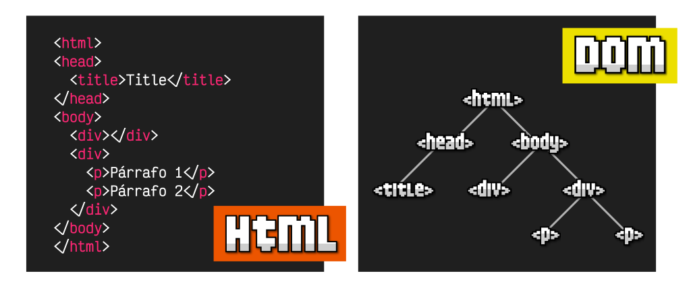
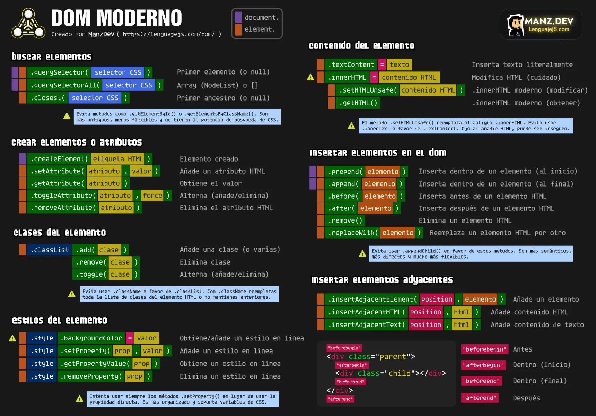
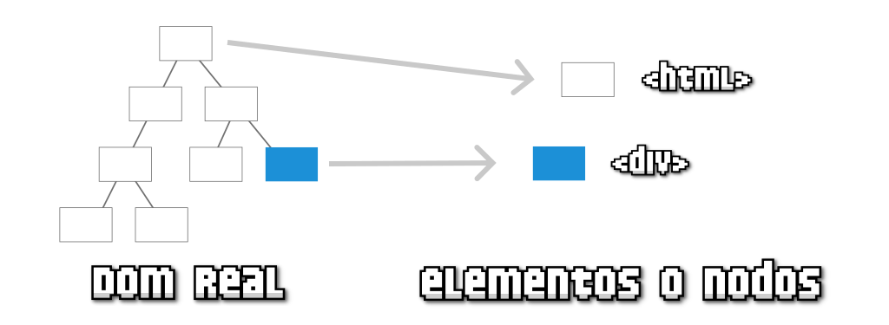
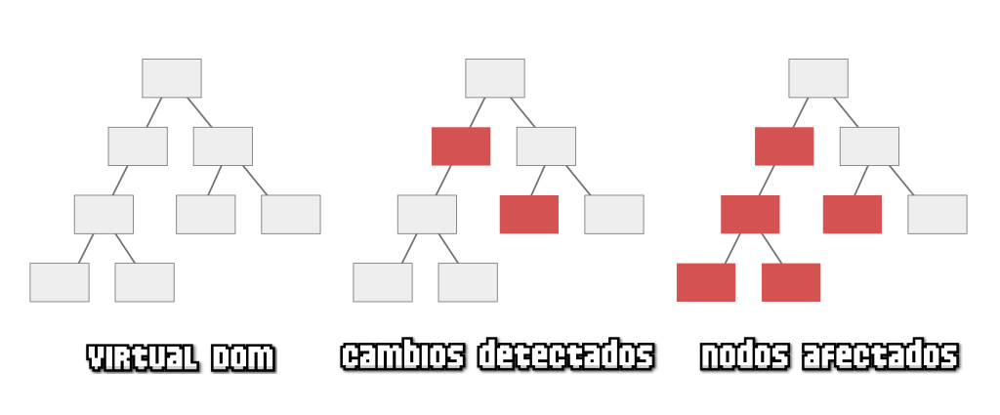
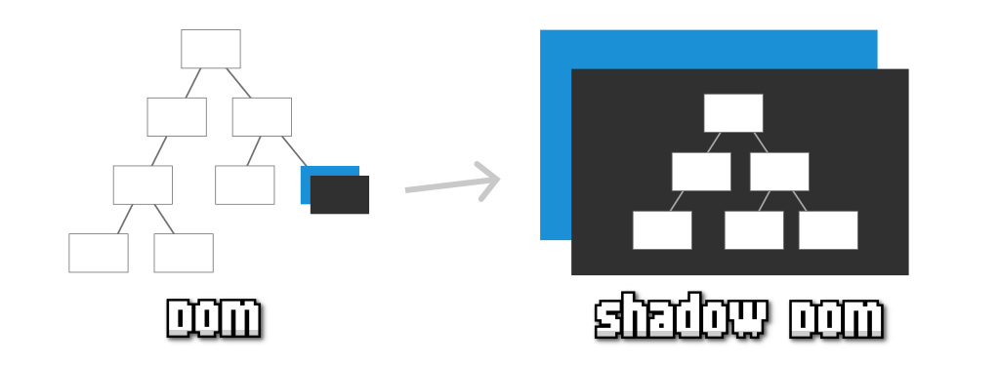
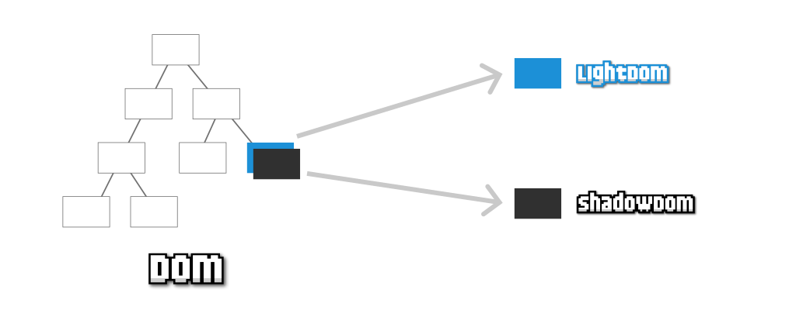
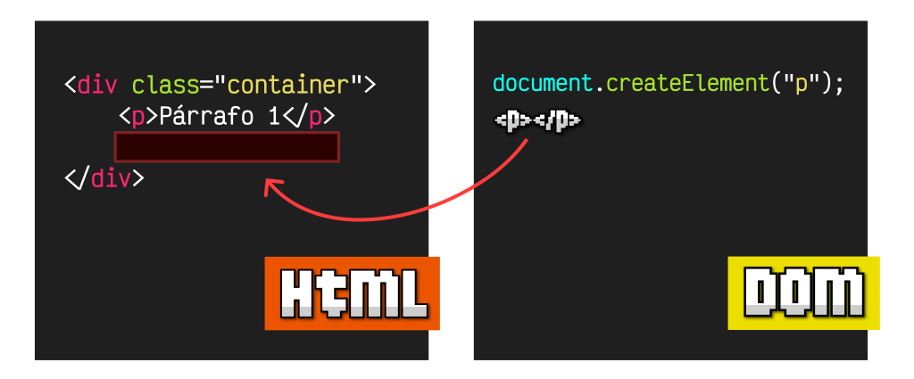

# UD5: JavaScript Avanzado — Manipulación del DOM, Eventos, Formularios y Fetch API

Bienvenido/a a la **UD5: JavaScript Avanzado — Manipulación del DOM, Eventos, Formularios y Fetch API** del módulo profesional de **Lenguajes de Marcas y Sistemas de Gestión de Información** (1º DAW / DAM / ASIX · Lenguajes de Marcas (LMSGI)).

En esta unidad encontrarás los contenidos teóricos, ejemplos prácticos, ejercicios resueltos y actividades de evaluación curricular desarrollados por el profesor **Manuel Alonso Argente**.

---

### 📑 Índice de Apartados y Actividades de la Unidad

- [**📋 5.0 Propuesta Didáctica: Manipulación de documentos web JavaScript - DOM**](./ut0500.html)
- [**5.1 Introducción al DOM**](./ut0510.html)
- [**5.2 Acceso al DOM**](./ut0520.html)
- [**5.3 Modificar el DOM**](./ut0530.html)
- [**5.4 Crear y Eliminar en el DOM**](./ut0540.html)
- [**5.5 Modificar estilos y CSS del DOM con JavaScript.**](./ut0550.html)
- [**5.6.1 Asincronía en Javascript**](./ut0561.html)
- [**5.6.2 Callbacks**](./ut0562.html)
- [**5.6.3 Promesas**](./ut0563.html)
- [**5.6.4 Async/await**](./ut0564.html)
- [**5.6.5 Uso de fetch**](./ut0565.html)

**Actividades Prácticas y Fichas de Trabajo:**

- [**✏️ ACT501 Ejercicios de DOM**](./act_act501.html)
- [**✏️ ACT502 es sobre asincronía y DOM dinámico**](./act_act502.html)

---

# 📖 Vista Completa de la Unidad

## 5.0 Propuesta Didáctica — Manipulación de documentos web JavaScript - DOM

# **Manipulación de documentos web JavaScript - DOM**

## **Propuesta didáctica**

En esta unidad continuamos trabajando el **RA3**: Accede y manipula web utilizando lenguajes de script de cliente.

## **Criterios de evaluación**

### **Respecto al RA3:**

| Código | Descripción | Peso (%) | Herramientas Evaluación |
| --- | --- | --- | --- |
| **CE3c** | Se han utilizado métodos para la selección y acceso de los diferentes elementos de un documento web. | 20% | ACT501 (10%) -- EXA501 (90%) |
| **CE3d** | Se han creado y modificado elementos de documentos web. | 15% | ACT501 – ACT502 (10%) -- EXA501 (90%) |
| **CE3e** | Se han eliminado elementos de documentos web. | 10% | ACT501 (10%) -- EXA501 (90%) |
| **CE3f** | Se han realizado modificaciones sobre los estilos de un documento web. | 10% | ACT501 (10%) -- EXA501 (90%) |

## **Contenidos**

### **Manipulación de documentos web JavaScript - DOM:**

- Introducción al DOM. (CE3.c)

- Acceso al DOM. (CE3.c)

- Modificar el DOM. (CE3.d)

- Crear en el DOM. (CE3.d, CE3.e)

- Modificar CSS del DOM. (CE3.f)

- DOM dinámico: asincronía, callbacks, promesas, async/await, uso de Fetch. (CE3.c, CE3.d)

**Cuestionario inicial**

1. ¿Qué es el DOM y para qué se utiliza?

1. ¿Por qué una página HTML se representa como un árbol?

1. ¿Qué relación hay entre HTML y JavaScript a través del DOM?

1. ¿Cómo se seleccionan y acceden los elementos de un documento web?

1. ¿Cómo se crean, modifican y eliminan elementos del DOM?

1. ¿Cómo se modifican los estilos de una página mediante JavaScript?

1. ¿Qué es la asincronía y qué herramientas se utilizan para trabajarla (callbacks, promesas, async/await)?

## **Programación de Aula (13h)**

Esta unidad se imparte en la segunda evaluación, a continuación de la UP04 (Sintaxis de JavaScript). La unidad tiene una duración estimada de 13 horas lectivas repartidas en 13 sesiones, durante los días que se indican en el calendario (los días de clase son lunes, con una sesión, y jueves, con dos sesiones).

### **Calendario**

#### **Enero 2027**

| Lunes | Martes | Miércoles | Jueves | Viernes | Sábado | Domingo |
| --- | --- | --- | --- | --- | --- | --- |
|  |  |  |  | **1 🛑** | **2 🛑** | **3 🛑** |
| **4 🛑** | **5 🛑** | **6 🛑** | 7 | 8 | **9 🛑** | **10 🛑** |
| **11 📚** | 12 | 13 | **14 📚** | 15 | **16 🛑** | **17 🛑** |
| **18 📚** | 19 | 20 | **21 📚** | 22 | **23 🛑** | **24 🛑** |
| **25 📚** | 26 | 27 | **28 📚** | 29 | **30 🛑** | **31 🛑** |

#### **Febrero 2027**

| Lunes | Martes | Miércoles | Jueves | Viernes | Sábado | Domingo |
| --- | --- | --- | --- | --- | --- | --- |
| **1 📚** | 2 | 3 | **4 📚** | 5 | **6 🛑** | **7 🛑** |
| **8 📚** | 9 | 10 | 11 | 12 | **13 🛑** | **14 🛑** |
| 15 | 16 | 17 | 18 | 19 | **20 🛑** | **21 🛑** |
| 22 | 23 | 24 | 25 | 26 | **27 🛑** | **28 🛑** |

### **Sesiones**

| Sesión | Contenidos | Actividades | Criterios trabajados |
| --- | --- | --- | --- |
| 1 | 5.1 Introducción al DOM | -- | CE3.c |
| 2 | 5.2 Acceso al DOM | ACT501 | CE3.c |
| 3 | 5.3 Modificar el DOM | ACT501 | CE3.d |
| 4 | 5.4 Crear en el DOM | ACT501 | CE3.d - CE3.e |
| 5 | 5.5 Modificar CSS del DOM | ACT501 | CE3.f |
| 6 | 5.6.1 Asincronía -- 5.6.2 Callbacks | ACT502 | CE3.c - CE3.d |
| 7 | 5.6.2 Callbacks (continuación) -- 5.6.3 Promesas | ACT502 | CE3.c - CE3.d |
| 8 | 5.6.4 Async/Await | ACT502 | CE3.c - CE3.d |
| 9 | 5.6.5 Uso de Fetch | ACT502 | CE3.c - CE3.d |
| 10 | 5.6 DOM dinámico (repaso y ejercicios) | ACT502 | CE3.c - CE3.d |
| 11 | Repaso de la unidad | -- | CE3.c - CE3.d - CE3.e - CE3.f |
| 12 | Ejercicios de repaso | ACT501 – ACT502 | CE3.c - CE3.d - CE3.e - CE3.f |
| 13 | Evaluación de la unidad | EXA501 | CE3.c - CE3.d - CE3.e - CE3.f |

---

## 5.1 Introducción al DOM

# **Introducción al DOM**

## **¿Qué es el DOM?**

Las siglas **DOM** significan **Document Object Model**, o lo que es lo mismo, la estructura de un documento HTML. Una página HTML está formada por múltiples etiquetas HTML, anidadas una dentro de otra, formando un árbol de etiquetas relacionadas entre sí, que se denomina **árbol DOM** (*o simplemente DOM*).



Observa que como la etiqueta **`<head>`** está dentro de **`<html>`** se dibuja como hija de **`<html>`**. La etiqueta **`<title>`** está dentro de **`<head>`**, por lo que será hija de esta y así sucesivamente.

En Javascript, cuando nos referimos al **DOM** nos referimos a esta estructura de árbol, mediante la cuál podemos acceder a ella y modificar los elementos del HTML desde Javascript, añadiendo nuevas etiquetas, modificando o eliminando otras, cambiando sus atributos HTML, añadiendo clases, cambiando el contenido de texto, etc...

> **📌 Importante**
> 

> Al estar controlado por un **lenguaje de programación**, todas estas tareas se pueden automatizar, incluso indicando que se realicen cuando el usuario haga acciones determinadas, eventos, como por ejemplo: pulsar un botón, mover el ratón, hacer click en una parte del documento, escribir un texto, etc...

**El objeto document**API nativa de Javascript**¿Usar o no utilizar el DOM?**

### **El objeto document**

Desde el navegador, la forma de acceder al DOM es a través de un objeto Javascript llamado **document**, que representa el árbol DOM de la página o, más concretamente, la página de la pestaña del navegador donde nos encontramos. En su interior pueden existir varios tipos de elementos, pero principalmente serán objetos de tipo  o :

- Un  no es más que la representación genérica de una etiqueta: **HTMLElement**.

- Un  es una unidad más básica, la cuál puede ser  o un **nodo de texto**.

Todos los **elementos HTML**, dependiendo del elemento que sean, tendrán un tipo de dato específico asociado. Veamos algunos ejemplos:

| Tipo de dato específico | Etiqueta | Descripción |
| --- | --- | --- |
| **HTMLDivElement** | **`<div>`** | Etiqueta divisoria (en bloque). |
| **HTMLSpanElement** | **`<span>`** | Etiqueta divisoria (en línea). |
| **HTMLImageElement** | **``** | Imagen. |
| **HTMLAudioElement** | **`<audio>`** | Contenedor de audio. |

> **📌 Importante**
> 

> Existen muchos tipos de datos específicos, prácticamente uno por cada etiqueta HTML.

### **API nativa de Javascript**

En los siguientes capítulos de este curso veremos que **Javascript** nos proporciona un conjunto de herramientas para trabajar de forma nativa con el DOM de la página. Las categorías importantes que deberíamos tener en cuenta son las siguientes:

| Capítulo del DOM | Descripción |
| --- | --- |
| **Buscar etiquetas** | Formas y métodos para buscar elementos en el DOM como **.querySelector()**. |
| **Modificar contenido** | Acceder y modificar el contenido de una etiqueta HTML del DOM desde Javascript. |
| **Gestionar atributos o clases** | Uso de varias de las API de Javascript para manipular clases CSS o atributos HTML. |
| **Crear etiquetas** | Métodos y consejos para crear elementos en el DOM y trabajar con ellos. |
| **Insertar etiquetas** | Varias de las API de Javascript para insertar elementos en el DOM de una página. |

A continuación tienes una breve **cheatsheet** para manejar el DOM de Javascript a modo de resumen. Las explicaciones para entender a utilizar todos estos conceptos lo veremos a lo largo de este curso y sus capítulos, con algunos ejemplos:



### **¿Usar o no utilizar el DOM?**

En la industria de la programación web, se suele optar por **evitar la manipulación del DOM de forma directa**. Esto es así porque trabajar con el DOM requiere destreza, conocimiento y es un proceso lento que necesita experiencia para que no resulte incómodo o se realicen acciones contraproducentes.

Por esta razón, habitualmente, se **delega** la tarea de la manipulación del DOM a una **librería o framework de terceros** (*generalmente a frameworks como React o Vue, por ejemplo*). El uso de estos frameworks nos simplifica el trabajo a cambio de dos cosas:

- Aprender otras estrategias propias del framework (*habitualmente más sencillas y cómodas*)

- Perder un poco de rendimiento y control sobre el DOM de nuestra aplicación o web

## **Tipos de DOM**

### **Diferentes tipos o modalidades de DOM**

Como vimos en el artículo anterior, el **DOM** es la forma que tenemos de llamar a la **estructura del documento HTML**. Una estructura organizada por orden de aparición, en forma de árbol, que nos permite acceder a los elementos HTML de una página web y modificarlos.


Sin embargo, hoy en día, dependiendo de las herramientas con las que estemos trabajando, podemos estar utilizando un tipo de DOM o alguna de sus variaciones:

| Tipo de DOM | Descripción | ¿Dónde actúa? |
| --- | --- | --- |
| DOM (real) | Es el DOM que se genera al cargar una web. | Navegador (nativo). |
| Virtual DOM | Es el DOM que se genera al cargar una web cuando usamos un framework Javascript. | Framework (código). |
| Shadow DOM | Es un DOM particular que se puede generar para encapsular un elemento. | Navegador (nativo). |
| Light DOM | Es el DOM real que queda oculto cuando se genera un Shadow DOM. | Navegador (nativo). |

Vamos a explicarlos detenidamente y a explicar sus características principales.

**DOM real**Virtual DOM**Shadow DOM**Light DOM**

### **DOM real**

El **DOM real** es la forma en la que se denomina a la estructura HTML original de una página. Puedes verla desde un navegador, simplemente pulsando con botón derecho, seleccionando **Inspeccionar** y abriendo la pestaña **Elementos**.



Javascript proporciona una serie de funciones y mecanismos para acceder a estos elementos, modificarlos o eliminarlos de forma potente y flexible, como iremos viendo en los siguientes artículos.

> **📌 Importante**
> 

> El **DOM** real siempre existe, aunque a veces trabajamos directamente con él, y otras veces utilizaremos herramientas que trabajan con él de forma transparente, sin que el desarrollador sea consciente.

### **Virtual DOM**

Un **Virtual DOM** (*o VDOM*) es una representación ligera y artificial del DOM real.

Durante la aparición de los diferentes **frameworks** del ecosistema Javascript, estos idearon un concepto denominado **Virtual DOM**, que no es más que una copia en memoria del DOM de la página, donde se gestionarían directamente las actualizaciones y cambios del mismo, para traducirlos posteriormente al **DOM** real del documento, con el objetivo de acelerar y optimizar los cambios del DOM en la página sin que el programador tenga que preocuparse por ello.

Por ejemplo, la popular librería **React** introducía el concepto de **Virtual DOM** para detectar los cambios (*diferencias entre árboles*), actualizar los nodos afectados (*cambios y descendientes a quienes pueden afectar*) y posteriormente, actualizarlos en el **DOM** real:



El surgimiento del concepto de **Virtual DOM** y su definición, ayudó a promover (*quizás por cuestiones de marketing*) el falso concepto «**el DOM es lento**», cuando en realidad, lo que puede hacerlo lento es una incorrecta gestión del mismo.

Es importante tener en cuenta que el **Virtual DOM** es una ventaja para los programadores porque les abstrae de tener que preocuparse por la manipulación del DOM, pero también conlleva desventajas: peor rendimiento, más coste de memoria y mayor complejidad en determinados casos.

> **📌 Importante**
> 

> Recuerda que el **Virtual DOM** es un proceso que se implementa y ejecuta «fuera» del navegador, es decir, no es nativo, sino que forma parte del código de las librerías o frameworks Javascript. Si utilizas un framework o librería de Javascript, probablemente estés trabajando con un **Virtual DOM**. React y Vue tienen Virtual DOM, pero por ejemplo, Svelte, no.

### **Shadow DOM**

El concepto de **Shadow DOM**, o «sombra del DOM», es un concepto relativamente moderno para crear elementos HTML en el DOM, teniendo su propio DOM particular, y por lo tanto, siendo independientes del resto del documento, facilitando así su encapsulación.

Por ejemplo, imaginemos un elemento HTML (*en azul*) en un árbol DOM tradicional. Si le añadimos un **Shadow DOM** a ese elemento HTML, pasaríamos a tener un elemento HTML con su propio DOM encapsulado, por lo que podemos hacer cambios sólo en ese DOM, aplicar CSS sólo a ese DOM sin que afecte al resto, etc.



El concepto de **Shadow DOM** es especialmente interesante en la creación de componentes reutilizables de forma nativa, por lo que es común encontrarlo junto a temas de **Web Components**. Sin embargo, es una característica independiente que puede utilizarse en Javascript vanilla, sin necesidad de usar WebComponents.

### **Light DOM**

El concepto de **Light DOM** tiene sentido sólo en el contexto de un elemento que posea un **Shadow DOM**. Igual que decimos que un **Shadow DOM** es la sombra de un elemento del DOM, el **Light DOM** es su contrapartida.



Cuando creamos un **Shadow DOM** para un elemento del DOM, este, al igual que una sombra, oculta el contenido que ya tenía el elemento, mostrando sólo el de su **Shadow DOM** (*el DOM particular*). El contenido oculto es el que se denomina informalmente **Light DOM**, el contenido real del DOM que ha sido ocultado.

---

## 5.2 Acceso al DOM

# **Acceso al DOM**

Si nos encontramos en nuestro código Javascript y queremos obtener información del contenido de nuestra página o hacer modificaciones en un elemento de la página HTML, lo primero que debemos hacer es **buscar el elemento que nos interesa**. Probablemente, la forma más sencilla de hacerlo suele ser intentar identificar el elemento a través de alguno de sus atributos más utilizados, generalmente el **id** o la clase mediante el atributo **class**.

## **Métodos de búsqueda**

Hay diversos métodos de búsqueda de elementos, en la siguiente tabla se muestran los más utilizados:

| Métodos de búsqueda | Descripción | Devuelve | Si no lo encuentra... |
| --- | --- | --- | --- |
| **.getElementById(id)** | Busca el elemento HTML por su **id**. | **ELEMENT** | Devuelve **null**. |
| **.getElementsByClassName(class)** | Busca elementos con la clase **class**. | **HTMLCollection** | Devuelve **[ ]**. |
| **.getElementsByName(value)** | Busca elementos con el atributo **name** a **value**. | **NodeList** | Devuelve **[ ]**. |
| **.getElementsByTagName(tag)** | Busca etiquetas HTML **tag**. | **HTMLCollection** | Devuelve **[ ]**. |
| **.querySelector(sel)** | Busca el primer elemento que coincide con el selector CSS **sel**. | **ELEMENT** | Devuelve null. |
| **.querySelectorAll(sel)** | Busca todos los elementos que coinciden con el selector CSS **sel**. | **NodeList** | Devuelve **[ ]**. |

Por IDPor clasePor namePor etiquetaquerySelector()querySelectorAll()

### **getElementById()**

El primer método, **.getElementById(id)** busca un elemento HTML con el **id** especificado. En principio, un documento HTML bien construido **no debería** tener más de un elemento con el mismo **id**, por lo tanto, este método devolverá siempre un solo elemento, ya que no debería existir más de uno:

> **📌 Ejemplo**
> 

> **📌 JS**
> 

```html
const element = document.getElementById("page");

console.log(element); // <div id="page"></div>
```

> **📌 HTML**
> 

```html
<div id="page"></div>
```

En la constante **element** guardaríamos una referencia a ese elemento `<div>` con **id** con valor **page**.En el caso de no encontrar el elemento indicado, devolverá null.

> **📌 Importante**
> 

> Hay que tener en cuenta que este método sólo trabaja con **id**. Hoy en día, es más habitual localizar elementos por sus clases, ya que no todos los elementos son únicos o tienen un **id** establecido.

### **getElementsByClassName()**

Por otro lado, el método **.getElementsByClassName(class)** permite buscar los elementos que tengan la clase especificada en **class**. Es importante darse cuenta del matiz de que el método tiene **getElements** en plural, al contrario del anterior.

Esto ocurre porque en este caso buscamos clases, y puede devolver **varios elementos**, ya que al contrario que los **id**, pueden existir varios elementos con la misma clase:

> **📌 Ejemplo**
> 

> **📌 JS**
> 

```html
const elements = document.getElementsByClassName("item");

console.log(elements);         // [div, div, div]
console.log(elements[0]);      // Primer item encontrado: <div class="item"></div>
console.log(elements.length);  // 3
```

> **📌 HTML**
> 

```html
<div class="container">
      <div class="item">Item 1</div>
      <div class="item">Item 2</div>
      <div class="item">Item 3</div>
    </div>
```

> **📌 Importante**
> 

> Estos métodos devuelven siempre un array con todos los elementos encontrados que encajen con el criterio. En el caso de no encontrar ninguno, devolverá un array vacío: **[]**.

### **getElementsByName()**

Exactamente igual que el caso anterior funciona el método **getElementsByName(name)**. En este caso, estamos buscando elementos HTML por el valor que tienen en el atributo **name**, algo muy habitual en **formularios HTML**:

> **📌 Ejemplo**
> 

> **📌 JS**
> 

```html
const nicknames = document.getElementsByName("nickname");

console.log(nicknames);   // [input]
```

> **📌 HTML**
> 

```html
<form>
      <input type="text" name="nickname">
      <input type="text" name="country">
    </form>
```

Observa que devuelve un array de elementos, ya que podría darse el caso de tener varios elementos HTML con ese mismo atributo **name**.

### **getElementsByTagName()**

En el caso del método **getElementsByTagName(tag)**, lo que hacemos es buscar elementos por el tipo de etiqueta HTML. Es decir, si queremos buscar todos los elementos `<div>` de una página, podemos hacerlo indicándole el parámetro **div**:

> **📌 Ejemplo**
> 

> **📌 JS**
> 

```html
const divs = document.getElementsByTagName("div");

console.log(divs);   //  [div, div, div, div]
```

> **📌 HTML**
> 

```html
<div class="container">
      <div class="item">Item 1</div>
      <div class="item">Item 2</div>
      <div class="item">Item 3</div>
    </div>
```

Observa que en este ejemplo, obtenemos un array con **4 elementos**. Esto es así porque incluso el elemento `<div>` contenedor también es un `<div>`, por lo que es el primero que encuentra. Luego, añade los `<div>` de su interior, y así con todo los elementos `<div>` que encuentre.

En el caso de no encontrar ninguno, nos devolvería un array vacío **[]**.

### **querySelector()**

El método **.querySelector()** devuelve devuelve el primer elemento del documento que coincide con el **selector CSS** indicado por parámetro:

> **📌 JS**
> 

```html
const page = document.querySelector("#page");               // <div id="page"></div>
const info = document.querySelector(".main .info");         // <div class="info"></div>
```

Lo realmente interesante de este método, es que al permitir suministrarle un selector CSS básico o incluso un selector CSS avanzado, se vuelve un sistema mucho más potente que los tradicionales.

- El primer ejemplo sería equivalente a utilizar un **.getElementById()**, sólo que en la versión de **.querySelector()** indicamos por parámetro un selector, y en el primero le pasamos un simple string. Observa que estamos indicando un **#** porque se trata de un **id**.

- En el segundo ejemplo, estamos recuperando el primer elemento con clase **info** que esté dentro de otro con clase **main**. En los métodos tradicionales, sería menos directo ya que tendríamos que realizar varias llamadas. Con **.querySelector()** se hace directamente sólo con una.

El método **querySelector()** siempre devuelve un solo elemento: el primero que encuentra. En el caso de no coincidir con ninguno, devuelve null.

### **querySelectorAll()**

Por otro lado, el método **.querySelectorAll()** realiza una búsqueda de elementos en el DOM, sólo que como podremos intuir por ese **All()**, devuelve un  con todos los elementos que coinciden con el  CSS:

> **📌 JS**
> 

```html
// Obtiene todos los elementos con clase "info"
const infos = document.querySelectorAll(".info");

// Obtiene todos los elementos con atributo name="nickname"
const nicknames = document.querySelectorAll('[name="nickname"]');

// Obtiene todos los elementos <div> de la página HTML
const divs = document.querySelectorAll("div");
```

El método **.querySelectorAll()** siempre nos devolverá un array de elementos. En el caso de no encontrar ninguna coincidencia, nos devolverá un array de 0 elementos.

## **Navegar por el DOM**

En algunas ocasiones en las que conocemos y controlamos perfectamente la estructura del código HTML de la página, nos puede resultar interesante utilizar una forma de **navegar por la jerarquía** de elementos HTML. Por ejemplo, acceder al elemento que está a continuación de otro elemento del DOM, o acceder al último elemento de una estructura contenedora.

> **📌 Alarm**
> 

> **¡Alto!** Mucho cuidado con esta estrategia de moverse de forma jerárquica. En general, suele ser una mala opción porque si la estructura DOM cambia, nuestro código dejaría de funcionar correctamente. Úsalo sólo si tu DOM es una estructura sólida que no cambia y conoces perfectamente.

### **Navegar a través de elementos**

Las propiedades que veremos a continuación devuelven información de otros elementos relacionados con el elemento en cuestión. En este caso estamos trabajando con el tipo **ELEMENT**:

| Propiedades de elementos HTML | Descripción | Devuelve | Si está vacío... |
| --- | --- | --- | --- |
| **.children** | Devuelve una lista de elementos HTML hijos. | **HTMLCollection** | Devuelve **[ ]** |
| **.parentElement** | Devuelve el padre del elemento. | **ELEMENT** | Devuelve **null**. |
| **.firstElementChild** | Devuelve el primer elemento hijo. | **ELEMENT** | Devuelve **null**. |
| **.lastElementChild** | Devuelve el último elemento hijo. | **ELEMENT** | Devuelve **null**. |
| **.previousElementSibling** | Devuelve el elemento hermano anterior. | **ELEMENT** | Devuelve **null**. |
| **.nextElementSibling** | Devuelve el elemento hermano siguiente. | **ELEMENT** | Devuelve **null**. |

En primer lugar, tenemos la propiedad **children** que nos ofrece un **HTMLCollection** con una lista de elementos HTML hijos. Podríamos acceder a cualquier hijo utilizando los corchetes de array y seguir utilizando otras propiedades en el hijo seleccionado.

- La propiedad **firstElementChild** sería un acceso rápido a **children[0]**

- La propiedad **lastElementChild** sería un acceso rápido al último elemento hijo.

Por último, tenemos las propiedades **previousElementSibling** y **nextElementSibling** que nos devuelven los elementos hermanos anteriores o posteriores, respectivamente. La propiedad **parentElement** nos devolvería el padre del elemento en cuestión. En el caso de no existir alguno de estos elementos, nos devolvería **null**.

Observa el siguiente código HTML. Si trabajamos bajo este documento HTML, y utilizamos el siguiente código Javascript, podremos «navegar» por la jerarquía de elementos, **moviéndonos entre elementos** padre, hijo o hermanos:

> **📌 JS**
> 

```html
// Trabajando sobre <body>
document.body.children.length;  // 1
document.body.children;         // <div id="app">
document.body.parentElement;    // <html>

const app = document.querySelector("#app");

app.children;                   // [div.header, p, a]
app.firstElementChild;          // <div class="header">
app.lastElementChild;           // <a href="/">

const a = app.querySelector("a");

a.previousElementSibling;       // <p>
a.nextElementSibling;           // null
```

> **📌 HTML**
> 

```html
<html>
<body>
    <div id="app">
    <div class="header">
        <h1>Titular</h1>
    </div>
    <p>Párrafo de descripción</p>
    <a href="/">Enlace</a>
    </div>
</body>
</html>
```

### **Navegar a través de nodos**

Si queremos hilar más fino, podemos trabajar a nivel de elementos de tipo **NODE**, utilizando las siguientes propiedades, que son equivalentes a las anteriores, pero trabajando con la unidad más básica: **nodos**.

| Propiedades de nodos HTML | Descripción | Devuelve | Si está vacío... |
| --- | --- | --- | --- |
| **.childNodes** | Devuelve una lista de nodos hijos (incluye nodos de texto y comentarios). | **HTMLCollection** | Devuelve **null** |
| **.parentNode** | Devuelve el nodo padre del nodo. | **NODE** | Devuelve **null** |
| **.firstChild** | Devuelve el primer nodo hijo. | **NODE** | Devuelve **null** |
| **.lastChild** | Devuelve el último nodo hijo. | **NODE** | Devuelve **null** |
| **.previousSibling** | Devuelve el nodo hermano anterior. | **NODE** | Devuelve **null** |
| **.nextSibling** | Devuelve el nodo hermano siguiente. | **NODE** | Devuelve **null** |

Estas propiedades suelen ser más interesantes cuando queremos trabajar sobre nodos de texto, ya que incluso los espacios en blanco entre elementos HTML influyen. Volvamos a trabajar sobre el documento HTML anterior, pero ahora utilizando este grupo de propiedades basadas en **NODE**:

> **📌 JS**
> 

```html
// Trabajando sobre <body>
document.body.childNodes.length;  // 3
document.body.childNodes;         // [text, div#app, text]
document.body.parentNode;         // <html>

const app = document.querySelector("#app");

app.childNodes;                   // [text, div.header, text, p, text, a, text]
app.firstChild.textContent;       // "                             "
app.lastChild.textContent;        // "                             "

const a = app.querySelector("a");

a.previousSibling;                // #text
a.nextSibling;                    // #text
```

> **📌 HTML**
> 

```html
<html>
<body>
    <div id="app">
    <div class="header">
        <h1>Titular</h1>
    </div>
    <p>Párrafo de descripción</p>
    <a href="/">Enlace</a>
    </div>
</body>
</html>
```

---

## 5.3 Modificar el DOM

# **Modificar el DOM**

## **Consultar o modificar contenido de texto**

Las páginas están repletas de elementos HTML y es posible que se quiera modificar dichos elementos para cambiar su contenido de **texto** por otro. En el apartado anterior se explica como localizar los elementos en el DOM, ahora lo que se va a ver es como se puede modificar el contenido html.

Las propiedades relacionadas con este cometido son:

| Propiedades | Descripción |
| --- | --- |
| **.textContent** | Devuelve (o cambia) el contenido de texto del elemento. |
| **.innerText** | Devuelve (o cambia) el contenido de texto renderizado (tiene en cuenta los estilos CSS). |
| **.outerText** | Idem a **.innerText**, pero al reemplazar también reemplaza la etiqueta contenedora. |

Vamos a ir viéndolas detalladamente para comprender su funcionamiento y características.

**textContent**innerText**outerText**

### **La propiedad `.textContent`**

La propiedad recomendada para hacer modificaciones de texto es **.textContent**, que nos devuelve el **contenido de texto** de un elemento HTML concreto. Es muy útil para obtener (*o modificar*) **sólo el texto** de un elemento, obviando el marcado o etiquetado HTML.

Observa el siguiente ejemplo, donde vamos a seleccionar el elemento `<p>` con clase **.message** desde Javascript y a trabajar con él accediendo a varias de sus propiedades:

<details markdown="1">

<summary>💡 JS</summary>

```html
const element = document.querySelector(".message");

element.textContent;                   // "Mi nombre es Luis."
element.textContent = "Hola a todos";  // Modificamos el contenido de texto
element.textContent;                   // "Hola a todos"
```

</details>

<details markdown="1">

<summary>💡 HTML</summary>

```html
<div class="container">
  <div class="parent">
    <p>Hola a todos.</p>
    <p class="message">Mi nombre es <strong>Luis</strong>.</p>
  </div>
</div>
```

</details>

Como puedes ver, no sólo podemos utilizar la propiedad **.textContent** para acceder a la información de texto que contiene, sino también para reemplazar su contenido, simplemente asignándolo como si fuera una variable o constante.

> **📌 Importante**
> 

> Observa que en el HTML tenemos una etiqueta `<strong>`. En el caso de que el elemento tenga anidadas varias etiquetas HTML una dentro de otra, la propiedad **.textContent** se quedará sólo con el contenido textual.

### **La propiedad `.innerText`**

La propiedad **.innerText** es muy similar a **.textContent**, pero tiene una diferencia clave: accede al texto **renderizado visualmente por el navegador**.

Observa el siguiente fragmento de código:

<details markdown="1">

<summary>💡 HTML</summary>

```html
<div class="container">
  <p>Hola a todos.</p>
  <p>Me llamo <strong>Luis</strong>. <mark style="display: none">New message</mark></p>
  <p hidden>Esto es un mensaje posterior oculto semánticamente.</p>
  <details>
    <summary>Más información</summary>
    <div>Esto es un desplegable que está colapsado.</div>
  </details>
</div>
```

</details>

Observa que:

- El contenido de la etiqueta `<mark>` está oculto mediante CSS.

- El contenido de la tercera etiqueta `<p>` está oculto semánticamente mediante el atributo **hidden**.

- El contenido de la etiqueta `<div>` dentro del `<details>` está oculto porque el acordeón está colapsado.

Si consultamos el contenido de texto del **.container** mediante la propiedad **.textContent** nos devolvería todo el contenido de texto de todas las etiquetas del interior del **.container**. Sin embargo, si lo hacemos mediante la propiedad **.innerText** nos devolvería **sólo lo renderizado visualmente**:

<details markdown="1">

<summary>💡 JS</summary>

```html
const element = document.querySelector(".container");
element.innerText;

// "Hola a todos.
//
// Me llamo Luis.
//
// Más información"
```

</details>

### **La propiedad `.outerText`**

En el caso de la propiedad **.outerText**, funciona exactamente igual que **.innerText** para obtener información. Sin embargo, tiene una pequeña diferencia si la utilizamos para modificar texto:

- En el caso de utilizar **.innerText**, modificamos el contenido de la etiqueta.

- En el caso de utilizar **.outerText**, hacemos lo mismo, pero incluyendo la etiqueta en sí.

<details markdown="1">

<summary>💡 JS</summary>

```html
// <section><div class="container"></div></section>
const element = document.querySelector(".container");

element.innerText = "Me llamo Luis";
// <section><div class="container">Me llamo Luis</div></section>

element.outerText = "Me llamo Luis";
// <section>Me llamo Luis</section>
```

</details>

Observa que en el primer caso, ha añadido el texto en el interior de la etiqueta `<iv>`. En el segundo caso, está reemplazando la propia etiqueta `<div>`, quedándose sólo con el texto.

### Insertando contenido HTML

Un aspecto muy importante a tener en cuenta es que las propiedades que hemos visto sirven sólo para **contenido de texto**. Si intentamos insertar contenido HTML de esta forma:

<details markdown="1">

<summary>💡 JS</summary>

```html
const element = document.querySelector(".container");
element.textContent = "<h1>Hola</h1>";
```

</details>

Obtendremos que lo que ocurre es que se inserta literalmente el texto `<h1>Hola</h1>`, en lugar de renderizarse una etiqueta `<h1>` como encabezado, con el texto **Hola**. Si lo que queremos es renderizar contenido, lo veremos en el siguiente artículo.

## **Acceder al contenido de una etiqueta HTML**

Es posible que necesitemos añadir **contenido HTML** a las etiquetas existentes que ya tenemos en el DOM. En el artículo anterior, vimos como añadir contenido de texto a nuestras etiquetas HTML, pero no como añadir contenido HTML. Para ello vamos a utilizar las propiedades y métodos que aprenderemos en este artículo.

Antes de empezar, echemos un vistazo a las propiedades relacionadas que tenemos para esto:

| Propiedades | Descripción |
| --- | --- |
| **.innerHTML** | Devuelve (o cambia) el contenido HTML del interior del elemento. |
| **.outerHTML** | Idem a **.innerHTML** pero incluye también la propia etiqueta HTML. |

Vamos a ir viéndolas detalladamente para comprender su funcionamiento y características.

**innerHTML**outerHTML**

### **La propiedad `.innerHTML`**

La propiedad **.innerHTML** nos permite acceder al contenido de un elemento, pero en lugar de devolver su contenido de texto como lo hace **.textContent**, esta propiedad nos devuelve su **contenido HTML**, es decir, su marcado HTML. Esto tiene varias implicaciones que explicaremos más adelante.

Primero, un ejemplo con la diferencia entre **.textContent** y **.innerHTML**:

<details markdown="1">

<summary>💡 JS</summary>

```html
const element = document.querySelector(".message");

element.innerHTML;    // "Mi nombre es <strong>Luis</strong>."
element.textContent;  // "Mi nombre es Luis."
```

</details>

Observa que **.textContent** se enfoca en obtener el contenido de texto, mientras que **.innerHTML** se enfoca en el contenido HTML.

De la misma forma que **.textContent**, también podemos usar **.innerHTML** para modificar el contenido. Ten en cuenta que el contenido HTML suministrado a **.innerHTML** se interpretará, mientras que el suministrado por **.textContent** se inserta **literalmente como texto**:

<details markdown="1">

<summary>💡 JS</summary>

```html
element.innerHTML = "<strong>BOLD</strong>";    // Se lee "BOLD" (en negrita)
element.textContent = "<strong>BOLD</strong>";  // Se lee "<strong>BOLD</strong>"
```

</details>

> **📌 Importante**
> 

> Ten mucho cuidado a la hora de insertar contenido HTML utilizando **.innerHTML** puesto que si añades contenido que provenga del usuario sin revisarlo, podrían insertar HTML que realice acciones dañinas como inyección de código malicioso.

### **La propiedad `.outerHTML`**

La propiedad **.outerHTML** es muy similar a **.innerHTML**. Mientras este último devuelve el código HTML del **interior** de un elemento HTML, **.outerHTML** devuelve el código HTML **desde el exterior**, es decir, incluyendo al propio elemento implicado:

<details markdown="1">

<summary>💡 JS</summary>

```html
const data = document.querySelector(".data");
data.innerHTML = "<h1>Tema 1</h1>";

data.textContent;   // "Tema 1"
data.innerHTML;     // "<h1>Tema 1</h1>"
data.outerHTML;     // "<div class="data"><h1>Tema 1</h1></div>"
```

</details>

Al igual que hemos visto anteriormente, se puede utilizar **.outerHTML** asignando textos para modificar su contenido. Esto puede ser muy útil para reemplazar un elemento HTML, incluido el propio elemento HTML contenedor.

---

## 5.4 Crear y Eliminar en el DOM

# **Crear y Eliminar en el DOM**

## **Crear y Eliminar elementos HTML**

Existe una serie de métodos para **crear de forma eficiente** diferentes elementos HTML o nodos. Y hay un método que permite eliminar elementos del HTML. En el siguiente listado están estos métodos:

| Métodos | Descripción |
| --- | --- |
| **.createElement(tag, options)** | Crea y devuelve el elemento HTML definido por el **tag**. |
| **.createComment(text)** | Crea y devuelve un nodo de comentarios HTML **. |
| **.createTextNode(text)** | Crea y devuelve un nodo HTML con el texto **text**. |
| **.remove()** | Elimina el propio elemento donde se llama el método. |

**createElement**createComment**createTextNode**remove

### El método `.createElement()`

Mediante el método **.createElement()** podemos crear un **ELEMENT** HTML **en memoria**. Es importante tener en cuenta que al crearlo **¡no estará insertado AÚN en nuestro documento HTML!**. Habitualmente, se almacena en una variable o constante, permitiéndonos modificar sus atributos o contenido, para **posteriormente** insertarlo en una posición determinada del DOM o documento HTML:



Vamos a centrarnos en el proceso de **creación del elemento**, y más adelante veremos diferentes formas de insertarlo en el DOM. El funcionamiento de **.createElement()** es muy sencillo: se trata de pasarle el nombre de la etiqueta **tag** a utilizar:

<details markdown="1">

<summary>💡 JS</summary>

```html
const div = document.createElement("div");      // Creamos un <div></div>
const span = document.createElement("span");    // Creamos un <span></span>
const img = document.createElement("img");      // Creamos un 
```

</details>

El método **createElement()** tiene un segundo parámetro opcional denominado **options**. Si se indica, se espera un **OBJECT** con una propiedad **is** para definir un **elemento personalizado** particular. De momento, no exploraremos ese camino, pero podemos abordarlo más adelante en el tema de **Web Components**.

### **El método `.createComment()`**

Aunque es menos frecuente, tenemos un método **.createComment()** que sirve para crear comentarios HTML, e insertarlos en el DOM, como hacemos con los elementos HTML que vimos anteriormente. No es algo muy práctico o habitual, pero en algunos casos concretos podría sernos de utilidad.

<details markdown="1">

<summary>💡 JS</summary>

```html
const comment = document.createComment("Comentario");   // <!--Comentario-->
```

</details>

Hemos creado el comentario ** y lo hemos guardado en una constante **comment**.

### **El método `.createTextNode()`**

De la misma forma, el método **.createTextNode()** nos permite crear un nodo de texto con el **NODE** texto indicado por parámetro. Esto nos permite crear fragmentos de texto sin necesidad de tener una etiqueta HTML contenedora:

<details markdown="1">

<summary>💡 JS</summary>

```html
const text = document.createTextNode("Hola");           // Nodo de texto: 'hola'
```

</details>

Nuevamente, no es algo muy común, ya que normalmente añadimos los textos a través de etiquetas HTML. Sin embargo, a veces nos encontramos con situaciones en las que necesitamos crear un nodo de texto sin tener una etiqueta HTML contenedora, y en esos casos podría sernos de utilidad.

### **El método `.remove()`**

Al igual que podemos insertar o reemplazar elementos, también podemos eliminarlos. Ten en cuenta que al «eliminar» un nodo o elemento HTML, lo que hacemos realmente no es borrarlo, sino **desconectarlo del DOM o documento HTML**, de modo que no están conectados, pero siguen existiendo.

El método **.remove()** se encarga de desconectarse del DOM a sí mismo,

<details markdown="1">

<summary>💡 JS</summary>

```html
const div = document.querySelector(".deleteme");

div.isConnected;    // true, indica si existe el elemento
div.remove();
div.isConnected;    // false, indica si existe el elemento
```

</details>

En este caso, lo que hemos hecho es buscar el elemento HTML `&LTdiv class="deleteme">` en el documento HTML y desconectarlo de su elemento padre, de forma que dicho elemento pasa a no pertenecer al documento HTML, pero sigue existiendo en la constante `div`.

---

## 5.5 Modificar estilos y CSS del DOM con JavaScript.

# **Modificar estilos y CSS del DOM con JavaScript.**

De igual forma que podemos modificar los elementos y estructura del DOM, **también podemos cambiar sus estilos**.

La manipulación de estilos en JavaScript puede hacerse a través de dos principales métodos:

- **Modificación directa del estilo**: Cambiando los valores de estilo de los elementos.

- **Manipulación de clases CSS**: Agregando, eliminando o alternando clases que definen los estilos.

## **Modificación directa de estilos CSS.**

Con JavaScript, puedes cambiar directamente las propiedades CSS de un elemento. Esto se realiza utilizando la propiedad **style** del elemento y asignando valores a las propiedades CSS que desees modificar.

| Comando | Descripción |
| --- | --- |
| **elemento.style.propiedadCSS = 'valor'** | Cambia el estilo directamente. |
| **elemento.style.propiedadCSS = 'valor'** | Cambia el estilo CSS directamente en línea. |
| **elemento.style.color = 'blue'** | Cambia el color del texto. |
| **elemento.style.backgroundColor = 'yellow'** | Cambia el color de fondo del elemento. |
| **elemento.style.fontSize = '18px'** | Ajusta el tamaño de la fuente. |
| **elemento.style.width = '200px'** | Define el ancho del elemento. |
| **elemento.style.height = '100px'** | Define la altura del elemento. |
| **elemento.style.margin = '10px'** | Ajusta el margen del elemento. |
| **elemento.style.padding = '15px'** | Ajusta el relleno interno del elemento. |
| **elemento.style.border = '2px solid black'** | Establece un borde para el elemento. |
| **elemento.style.borderRadius = '5px'** | Define el radio de las esquinas del borde. |
| **elemento.style.boxShadow = '2px 2px 10px gray'** | Aplica sombra al elemento. |

Veamos algunos ejemplos

**Color y Fondo**Tamaños y Espacios**Bordes y Sombras**

Puedes cambiar las propiedades de color y fondo utilizando las propiedades color y backgroundColor.

> **📌 JS**
> 

```html
elemento.style.color = 'red';
elemento.style.backgroundColor = 'yellow';
```

Propiedades como fontSize, width, height, margin, y padding permiten ajustar el tamaño y el espaciado de los elementos.

> **📌 JS**
> 

```html
elemento.style.fontSize = '18px';
elemento.style.width = '200px';
elemento.style.height = '100px';
elemento.style.margin = '10px';
elemento.style.padding = '15px';
```

Puedes añadir bordes y sombras utilizando propiedades como border, borderRadius, y boxShadow.

> **📌 JS**
> 

```html
elemento.style.border = '2px solid black';
elemento.style.borderRadius = '5px';
elemento.style.boxShadow = '2px 2px 10px gray';
```

## **Manipulación de Clases CSS**

La manipulación de clases es una técnica más flexible y organizada que evita llenar el código con estilos en línea. Usamos las propiedades classList del elemento para agregar, eliminar o alternar clases.

| Comando | Descripción |
| --- | --- |
| **elemento.classList.add('clase')** | Agrega una clase al elemento. |
| **elemento.classList.remove('clase')** | Elimina una clase del elemento. |
| **elemento.classList.toggle('clase')** | Alterna una clase en el elemento. |

**.add ( )**.remove ( )**.toggle ( )**

### **Añadir clase**

El método **add()** permite añadir una o más clases a un elemento, asegurándose de que no estén duplicadas. Esto es útil para aplicar estilos o indicar un estado específico de un elemento.

> **📌 JS**
> 

```html
elemento.classList.add('activo');
```

En este ejemplo, se añade la clase activo al elemento, lo que podría, por ejemplo, cambiar su color o hacerlo visible según los estilos definidos en tu archivo CSS.

### **Eliminar clase**

El método remove() elimina una o más clases de un elemento. Es una forma práctica de revertir un estado visual o funcional previamente aplicado.

> **📌 JS**
> 

```html
elemento.classList.remove('invisible');
```

Aquí, la clase invisible se elimina del elemento, probablemente haciendo que el elemento vuelva a ser visible en la página si esa clase controlaba su visibilidad.

### **Alternar clase**

El método toggle() añade la clase si no está presente y la elimina si ya lo está. Esto es especialmente útil para crear interacciones dinámicas con un solo comando.

> **📌 JS**
> 

```html
elemento.classList.toggle('resaltado');
```

Por ejemplo, este código podría alternar un estilo destacado en un botón al ser clicado, mejorando la experiencia del usuario con un comportamiento interactivo.

## **Uso de variables CSS**

Otra forma de modificar el estilo de un elemento es modificar una variable CSS. Esta variable actuará de forma conjunta con las hojas CSS para dar formato al elemento.

| Comando | Descripción |
| --- | --- |
| **document.documentElement.style.setProperty('--variable', 'valor')** | Modifica dinámicamente el valor de una variable CSS personalizada. |

> **📌 JS**
> 

> Modificar variables con JavaScript:

```html
document.documentElement.style.setProperty('--color-principal', 'lightcoral');
```

> **📌 CSS**
> 

> Definir variable en CSS:

```html
:root {
    --color-principal: lightblue;
}

#miElemento {
    background-color: var(--color-principal);
}
```

## **Lectura de estilos computados**

También podemos obtener el estilo actualmente aplicado a un elemento, incluyendo los estilos heredados o calculados por el navegador:

| Comando | Descripción |
| --- | --- |
| **window.getComputedStyle(elemento).propiedad** | Obtiene el valor calculado de una propiedad. |

> **📌 JS**
> 

```html
const estiloComputado = window.getComputedStyle(elemento);
console.log(estiloComputado.backgroundColor);
```

## **Aplicar transiciones y animaciones**

También podemos usar JavaScript para aplicar transiciones y animaciones CSS. Primero define las reglas en una hoja de estilos CSS y luego utiliza JavaScript para modificar las propiedades que desencadenan estas animaciones.

Por ejemplo para activar una transición,

> **📌 JS**
> 

> Desencadenar transición con JavaScript

```html
elemento.style.backgroundColor = 'blue';
```

> **📌 CSS**
> 

> Definir transición en CSS

```html
#miElemento {
    transition: background-color 0.5s ease;
}
```

---

## 5.6.1 Asincronía en Javascript

# **Asincronía en Javascript**

En JavaScript, una operación asíncrona es aquella cuyo resultado no se obtiene de forma inmediata. En lugar de detener todo el programa hasta que termine, JavaScript continúa ejecutando el resto del código y, cuando la operación finaliza, procesa el resultado.
Esto es muy importante en aplicaciones web porque muchas tareas tardan un tiempo en completarse:

- pedir datos a una API.

- cargar una imagen.

- esperar la respuesta de un servidor.

- leer información del usuario.

- ejecutar temporizadores.

Si JavaScript trabajara siempre de forma bloqueante en estos casos, la página quedaría “parada” mientras espera. Gracias a la asincronía, la web puede seguir funcionando mientras llegan los datos.

## **Ejemplos de tareas asíncronas**

En Javascript no todas las tareas son asíncronas, pero hay ciertas tareas que si lo son, y probablemente se entiendan mejor con ejemplos reales:

- Descargarse un archivo .json de otra web.

- Reproducir un .mp3 desde otra web.

- Un botón o campo de datos donde el usuario debe activar un mecanismo.

- Una orden al sintetizador de voz del navegador para que lea un mensaje.

- Una comunicación con un sensor del smartphone.

Todos estos ejemplos se realizan mediante asincronia, ya que deben realizar una tarea que podría tardar y bloquear la ejecución del programa (si tarda mucho o no ocurre):

- La descarga de un fichero muy grande o desde un servidor lento.

- Una conexión a internet muy lenta o con poca cobertura.

- Un usuario que está ausente y no ha proporcionado la información.

- Un sensor de smartphone que es lento al activarse o transmitir datos.

## **Gestión de la asincronía**

Para gestionar estas esperas hay que aprender mecanismos para dejar claro en nuestro código Javascript, que ciertas tareas tienen que procesarse de forma asíncrona para quedarse a la espera, y otras deben ejecutarse de forma síncrona.

En Javascript existen varias formas de gestionar la asincronía:

| Mecanismo | Descripción |
| --- | --- |
| **callbacks** | Probablemente, la forma más clásica de gestionar la asincronía. |
| **promesas** | Mecanismo moderno para gestionar la asincronía de forma no bloqueante. |
| **async/await** | Una forma simplificada de manejar promesas, pero bloqueante. |

---

## 5.6.2 Callbacks

# **Callbacks**

En JavaScript, una de las formas más comunes de implementar la programación asincrónica es **mediante el uso de callbacks**.
Un **callback** es una función que se pasa como argumento a otra función y se ejecuta después de que esta última complete su tarea.
La idea básica de una función **callback** es que se “llama de vuelta” una vez que se realiza una tarea.
Un ejemplo común es el manejo de eventos. Por ejemplo, cuando se hace clic en un botón en una página web, se puede pasar una función de callback como argumento a la función **addEventListener()** para que se ejecute cuando se haga clic en el botón.

## **Funcionamiento**

- Definición de una función callback: Una función callback se define como cualquier función que puede ser pasada como argumento a otra función.

- Pasar el callback como argumento: El callback se pasa como argumento a la función principal. Esta función principal ejecutará el callback en el momento apropiado.

- Ejecución del Callback: Una vez que la función principal completa su tarea principal, invoca el callback.

> **📌 JS**
> 

> 

```html
function saludo(nombre, callback) {
console.log(`Hola, ${nombre}!`);
callback(); // Llamada a la función callback
}

function despedida() {
console.log('Adios!');
}

saludo('Luis', despedida);
// Output:
// Hola, Luis!
// Adios!
```

Explicación del ejemplo:

- **despedida** es una función de callback.

- **despedida** se pasa como parámetro a la función principal **saludo**.

- **saludo** ejecuta **despedida** después de que ha terminado su ejecución.

## **Operaciones asíncronas**

Los **callbacks** se emplean para realizar operaciones asíncronas. A diferencia de las operaciones sincrónicas, que se ejecutan en secuencia, las operaciones asíncronas permiten que el programa continúe ejecutándose mientras espera que una operación se complete.

Para ver este comportamiento asíncrono, vamos a ver un ejemplo usando la función setTimeout.

> **📌 JS**
> 

> 

```html
console.log('Inicio');

setTimeout(() => {
console.log('Tarea Asíncrona Completada');
}, 2000);

console.log('Fin');
```

Explicación del ejemplo:

- **setTimeout** toma una función de callback (en este caso, una lambda)

- La función lambda se ejecutará después de un retraso de 2000 milisegundos.

- El resultado es que **Fin** se imprime antes que **Tarea Asíncrona Completada**.

## **Manejar errores**

Una de las ventajas de los callbacks en JavaScript es que se pueden utilizar para manejar errores.
Es común seguir el patrón de error-primer, donde el primer argumento del callback es el error y el segundo argumento es el resultado.
Si una tarea asincrónica falla, se puede llamar a un callback de error para manejar la situación.

> **📌 JS**
> 

```html
function miCallback() {
console.log('La tarea se ha completado');
}

function miCallbackError() {
console.error('La tarea ha fallado');
}

function miFuncion(callback, callbackError) {
setTimeout(function() {
    if (Math.random() < 0.5) {
    callback();
    } else {
    callbackError();
    }
}, 3000);
}

miFuncion(miCallback, miCallbackError);
```

Explicación del ejemplo:

- **miFuncion()** acepta dos callbacks como argumentos

- **miCallback()** para el caso de éxito y **miCallbackError()** para el caso de error.

- Si la tarea tiene éxito, se llama a **miCallback()**, y si falla, se llama a **miCallbackError()**.

Callback hell
    El callback hell (o pirámide de la perdición) ocurre cuando tenemos muchos callbacks anidados. Por ejemplo,

> **📌 JS**
> 

> 

```html
doSomething(function(result1) {
doSomethingElse(result1, function(result2) {
    doAnotherThing(result2, function(result3) {
    // Más código aquí
    });
});
});
```

A medida que tenemos más y más callbacks, cada vez se vuelve más lío. Al final, el código se puede hacer muy difícil de leer y mantener.

> **📌 Importante**
> 

> Para operaciones más complejas considera el uso de promesas y async/await. Estas técnicas ofrecen una forma más limpia y manejable de trabajar con código asíncrono.

---

## 5.6.3 Promesas

# **Promesas**

En JavaScript las **Promesas** son un mecanismo fundamental para **facilitar la programación asíncrona**.
Nos permiten gestionar operaciones que no se completan inmediatamente (como solicitudes de red, operaciones de lectura de archivos o temporizadores) de una manera más estructurada y menos propensa a errores en comparación con los callbacks.
Una promesa es como un “contenedor” para un valor que puede estar disponible ahora, en el futuro, o nunca (por eso se llama promesa)

## **Funcionamiento**

Una promesa es un objeto que representa el **posible éxito o fallo** de una operación asíncrona.
Para reflejar esto, durante su ejecución la promesa tiene una propiedad **Estado**, que puede ser uno de los siguientes:

- **Pendiente (Pending)**: Estado inicial. La operación asíncrona aún no se ha completado.

- **Cumplida (Fulfilled)**: La operación se ha completado con éxito y la promesa tiene un valor resultante.

- **Rechazada (Rejected)**: La operación falló y la promesa tiene un motivo de error.

## **Creación**

Podemos crear una promesa utilizando el constructor **Promise**. Este constructor toma una función (llamada executor) que recibe dos funciones como argumentos:

- **resolve** se llama si la operación es exitosa, y se cambia el estado de la promesa a **cumplida**.

- **reject** se llama si hay un error, y se cambia el estado a **rechazada**.

Estos argumentos son funciones que se llaman para cambiar el estado de la promesa.

> **📌 JS**
> 

> En este ejemplo se crea una promesa que recibe sus dos funciones **resolve** y **reject**. Simula hacer una operación cualquiera con éxito. Y en función del resultado de la operación, se invoca a **resolve** o a **reject**.

```html
const miPromesa = new Promise((resolve, reject) => {
// Simulación de una operación asíncrona
let exito = true; // Simula el resultado de la operación

if (exito) {
    resolve('Operación exitosa');
} else {
    reject('Error en la operación');
}
});
```

## **Manejo**

Para manejar el resultado de una **promesa**, normalmente se utiliza los métodos **.then()** y **.catch()**:

**.then()**.catch()**

> **📌 JS**
> 

```html
miPromesa.then(onFulfilled, onRejected)
```

Este método se llama cuando la promesa se cumple o se rechaza.

- **onFulfilled** es una función que se llama con el valor de la promesa cuando se cumple,

- **onRejected** se llama con el motivo del rechazo si la promesa falla.

> **📌 JS**
> 

```html
miPromesa.catch(onRejected)
```

Este método se utiliza para manejar errores. Es un atajo para **.then(null, onRejected)** y se llama cuando la promesa es rechazada.

En este ejemplo se ve como se usaría una promesa normalmente:

> **📌 JS**
> 

```html
miPromesa
.then(result => {
    console.log(result); // 'Operación exitosa'
})
.catch(error => {
    console.error(error); // 'Error en la operación'
});
```

## **Encadenamiento**

Las promesas permiten encadenar múltiples **.then()** para manejar secuencias de operaciones asíncronas.
Cada **.then()** devuelve una nueva promesa, lo que facilita la composición de tareas asíncronas.

> **📌 JS**
> 

```html
miPromesa
.then(result => {
    console.log(result); // 'Operación exitosa'
    return 'Otro valor';
})
.then(otroResultado => {
    console.log(otroResultado); // 'Otro valor'
})
.catch(error => {
    console.error(error);
});
```

## **Promesas anidadas**

También se pueden **anidar** promesas dentro de otras promesas para gestionar operaciones que dependen de resultados anteriores.

> **📌 JS**
> 

```html
miPromesa
.then(result => {
    console.log(result); // 'Operación exitosa'
    return new Promise((resolve, reject) => {
    setTimeout(() => resolve('Operación asíncrona adicional'), 1000);
    });
})
.then(adicional => {
    console.log(adicional); // 'Operación asíncrona adicional'
})
.catch(error => {
    console.error(error);
});
```

> **📌 Importante**
> 

> Sin embargo, esto puede llevar a código difícil de leer, por lo que es preferible usar encadenamiento siempre que sea posible.

## **Métodos estáticos**

JavaScript proporciona varios **métodos estáticos** en el objeto **Promise** para manejar múltiples promesas simultáneamente.
Estos métodos devuelven una nueva promesa, que es una composición de las promesas que se pasan como argumentos.

**all ( )**race ( )**allSettled ( )**any ( )**

### **Promise.all ( )**

**Promise.all ( )** recibe un iterable de promesas y devuelve una nueva promesa que se resuelve cuando todas las promesas del iterable se cumplen. Si alguna promesa es rechazada, la promesa devuelta será rechazada inmediatamente.

> **📌 JS**
> 

```html
const promesa1 = Promise.resolve(1);
const promesa2 = Promise.resolve(2);
const promesa3 = Promise.resolve(3);

Promise.all([promesa1, promesa2, promesa3])
.then(results => {
    console.log(results); // [1, 2, 3]
})
.catch(error => {
    console.error(error);
});
```

### **Promise.race ( )**

**Promise.race ( )** devuelve una promesa que se resuelve o se rechaza tan pronto como una de las promesas en el iterable se resuelve o se rechaza.

> **📌 JS**
> 

```html
const promesaLenta = new Promise(resolve => setTimeout(() => resolve('Lenta'), 2000));
const promesaRápida = new Promise(resolve => setTimeout(() => resolve('Rápida'), 1000));

Promise.race([promesaLenta, promesaRápida])
.then(result => {
    console.log(result); // 'Rápida'
});
```

### **Promise.allSettled ( )**

**Promise.allSettled ( )** devuelve una promesa que se resuelve cuando todas las promesas del iterable han terminado (ya sea que se hayan cumplido o rechazado)

> **📌 JS**
> 

```html
const promesa1 = Promise.resolve(1);
const promesa2 = Promise.reject('Error');
const promesa3 = Promise.resolve(3);

Promise.allSettled([promesa1, promesa2, promesa3])
.then(results => {
    console.log(results);
    // [{status: 'fulfilled', value: 1}, {status: 'rejected', reason: 'Error'}, {status: 'fulfilled', value: 3}]
});
```

Devuelve un array de objetos que describen el resultado de cada promesa.

### **Promise.any ( )**

**Promise.any ( )** devuelve una promesa que se resuelve tan pronto como una de las promesas en el iterable se resuelve.

> **📌 JS**
> 

```html
const promesa1 = Promise.reject('Error 1');
const promesa2 = Promise.reject('Error 2');
const promesa3 = Promise.resolve('Éxito');

Promise.any([promesa1, promesa2, promesa3])
.then(result => {
    console.log(result); // 'Éxito'
});
```

Si todas las promesas son rechazadas, la promesa devuelta será rechazada con una **AggregateError**.

---

## 5.6.4 Async/await

# **Async/await**

En JavaScript, **async** y **await** son una sintaxis para escribir código asíncrono que es más sencillo más fácil de leer y mantener que las alternativas anteriores (como los callbacks y las promesas)

Introducido en **ECMAScript 2017**, **async/await** permite escribir código secuencialmente, en lugar de anidar callbacks o encadenar promesas.

Internamente, **async/await** se basa en promesas. De hecho **then/catch** y **async/await** son funcionalmente equivalentes.

Pero **async/await** proporciona una sintaxis más cómoda de usar, que anidar promesas (es syntacic sugar para simplificarnos la vida).

Otra ventaja de **async/await** es que maneja los errores de manera forma más sencilla. Con **async/await**, puede usar la estructura **try/catch** (que es más familiar y fácil de entender para los desarrolladores).

## **Sintaxis de async/await**

La sintaxis async/await se basa en dos palabras clave,

- **async** se coloca antes de la función para indicar que contiene código asincrónico.

- **await** se coloca antes de cualquier operación que devuelva una promesa para indicar que el código debe esperar a que se resuelva la promesa antes de continuar.

**async**"**await**"

### **Async**

La palabra clave **async** se usa para declarar una función asincrónica. Una función marcada con **async** siempre devuelve una promesa.

- Si la función retorna un valor, la promesa se resuelve con ese valor.

- Si la función lanza una excepción, la promesa se rechaza con esa excepción.
  !!!js "JS"
    

```html
async function miFuncion() {
  return 'Hola, mundo';
}

miFuncion().then(console.log); // 'Hola, mundo'
```

En el ejemplo anterior, **miFuncion** es una función asincrónica que devuelve una promesa que se resuelve con el valor 'Hola, mundo'.

### **Await**

La palabra clave **await** se utiliza dentro de una función async para esperar la resolución de una promesa.

**await** pausa la ejecución de la función async hasta que la promesa se resuelve o se rechaza.

> **📌 JS**
> 

```html
async function miFuncion() {
  let valor = await Promise.resolve('Hola, mundo');
  console.log(valor); // 'Hola, mundo'
}

miFuncion();
```

En este ejemplo, **await** se usa para esperar a que la promesa se resuelva, y luego se imprime el valor resultante.

<details markdown="1">

<summary>💡 Exemple bàsic</summary>

> **📌 JS**
> 

```html
async function obtenerDatos() {
  //funcion que simula devolver una promesa
  const respuesta = await FuncionQueDevuelvePromesa();

  console.log(respuesta);
}
```

- La función **obtenerDatos** es asincrónica

- La **FuncionQueDevuelvePromesa** es una función que simula devolver una promesa ( es la respuesta de una solicitud de red).

- Se usa la palabra clave **await** para esperar a que se resuelva una promesa antes de continuar con la siguiente línea de código.

- Después de que se resuelve la promesa, podemos hacer lo que queramos con respuesta.

Esto sería equivalente a este código, sin usar async y await

> **📌 JS**
> 

```html
function obtenerDatos() {
  // Llamar a la función que devuelve una promesa
  FuncionQueDevuelvePromesa()
    .then((respuesta) => {
      // Manejar la respuesta cuando la promesa se resuelve
      console.log(respuesta);
    })
    .catch((error) => {
      // Manejar errores si la promesa se rechaza
      console.error(error);
    });
}
```

</details>

## **Manejando errores**

Para manejar **errores** en funciones **async**, puedes usar **try/catch** en lugar de **.catch()** como lo harías con promesas.

> **📌 JS**
> 

```html
async function obtenerDatos() {
  try {
    let respuesta = await fetch('https://api.example.com/data');
    if (!respuesta.ok) {
      throw new Error('Error en la respuesta de la red');
    }
    let datos = await respuesta.json();
    console.log(datos);
  } catch (error) {
    console.error('Error:', error);
  }
}

obtenerDatos();
```

En este ejemplo, si ocurre un error en cualquier punto dentro del bloque try, el flujo de control pasa al bloque catch, donde se maneja el error.

---

## 5.6.5 Uso de fetch

# **Uso de fetch**

**Fetch** es el nombre de una API para Javascript con la cuál se pueden realizar peticiones HTTP asíncronas utilizando promesas y de forma que el código sea un poco más sencillo y menos verbose. La forma de realizar una petición es muy sencilla, básicamente se trata de llamar a **fetch** y pasarle por parámetro la URL de la petición a realizar:

> **📌 JS**
> 

```html
const promise = fetch("/robots.txt");

promise.then(function(response) {
  /* ... */
});
```

El **fetch()** devolverá una **PROMISE** que será aceptada cuando reciba una respuesta y sólo será rechazada si hay un fallo de red o si por alguna razón no se pudo completar la petición.

El modo más habitual de manejar las promesas es utilizando **.then()**, aunque también se puede utilizar **async/await**. Esto se suele reescribir de la siguiente forma, que queda mucho más simple y se evitan constantes o variables temporales de un solo uso:

> **📌 JS**
> 

```html
fetch("/robots.txt")
  .then(function(response) {
    /** Código que procesa la respuesta **/
  });
```

Al método **.then()** se le pasa una función callback donde su parámetro **response** es el objeto de respuesta de la petición que se ha realizado. En su interior se realiza la lógica que se quiera hacer con la respuesta a la petición petición.

## **Peticiones GET**

La petición **GET** es la más habitual cuando queremos **obtener información** de una API.

Por ejemplo, si queremos consultar personajes de una API, podemos hacer:

> **📌 JS**
> 

```html
fetch("https://jsonplaceholder.typicode.com/users")
  .then(response => response.json())
  .then(data => {
    console.log(data);
  });
```

Las partes del fetch son:

- **fetch("url")** inicia la petición HTTP a la dirección indicada..

- **response** representa el **OBJECT** de la respuesta.

- **response.json()** convierte la respuesta en un objeto json.

- **data** contiene los datos ya convertidos y listos para trabajar con ellos.

La mayor parte de las primeras prácticas con APIs se basan en peticiones **GET**, porque son las más sencillas y permiten centrarse en la lectura, tratamiento y visualización de datos. Antes de introducir otros métodos como **POST**, **PUT** o **DELETE**, conviene que el alumnado domine bien este patrón.

## **Devolución del fetch**

**fetch()** devuelve una **promesa**. Una **promesa**, como se indica en apartados anteriores, es un objeto que representa un resultado que llegará más adelante. Ese resultado puede terminar en dos estados principales:

- resolverse correctamente, si la petición ha podido completarse.

- rechazarse, si se ha producido un fallo que impide completarla.

Esto significa que no podemos escribir el código como si la respuesta estuviera disponible al instante. En su lugar, debemos indicar qué queremos hacer cuando la respuesta llegue. Por eso suelen utilizarse **.then ( )** y **.catch ( )**.

- **.then()** para cuando la petición va bien

- **.catch()** para cuando ocurre un error

<details markdown="1">

<summary>💡 Exemple</summary>

```html
fetch("https://jsonplaceholder.typicode.com/users")
  .then(response => response.json())
  .then(data => {
    console.log("Datos recibidos:", data);
  })
  .catch(error => {
    console.error("Ha ocurrido un error:", error);
  });
```

</details>

Es importante insistir en que la promesa no contiene ya los datos, sino la posibilidad de obtenerlos más adelante. Este detalle suele costar al principio, pero es clave para entender por qué el trabajo con APIs siempre se organiza en pasos encadenados.

## **Conversión a JSON**

La mayoría de APIs modernas devuelven la información en formato **JSON**. Este formato se usa porque es ligero, legible y muy fácil de transformar en objetos de JavaScript.

JSON significa **JavaScript Object Notation**. Aunque se parece mucho a la sintaxis de los objetos de JavaScript, en realidad es un formato de texto estructurado para intercambiar información entre sistemas.

> **📌 JSON**
> 

```html
{
  "name": "Leanne Graham",
  "username": "Bret"
}
```

Cuando recibimos una respuesta desde una API, esa información no se usa directamente como objeto JavaScript hasta que la convertimos. Para ello se emplean diversos métodos:

| Método | Descripción |
| --- | --- |
| **.text()** | Devuelve una promesa con el texto plano de la respuesta. |
| **.json()** | Idem, pero con un objeto **json**. Equivale a usar **JSON.parse()**. |
| **.blob()** | Idem, pero con un objeto **Blob** (binary large object). |
| **.arrayBuffer()** | Idem, pero con un objeto **ArrayBuffer** (buffer binario puro). |
| **.formData()** | Idem, pero con un objeto **FormData** (datos de formulario). |
| **.clone()** | Crea y devuelve un clon de la instancia en cuestión. |
| **Response.error()** | Devuelve un nuevo objeto **Response** con un error de red asociado. |
| **Response.redirect(url, code)** | Redirige a una **url**, opcionalmente con un **code** de error. |

En este caso, nos vamos a centrar en el método que convirtiendo el objeto de la promesa en un objeto **json** con **response.json()**.

JavaScript convierte automáticamente ese JSON en un objeto que ya podemos usar.

<details markdown="1">

<summary>💡 Exemple</summary>

> **📌 JS**
> 

```html
fetch("https://jsonplaceholder.typicode.com/users")
  .then(response => response.json())
  .then(data => {
    console.log(data.name);
    console.log(data.status);
  });
```

En este caso:

- `data.name` sería `"Leanne Graham"`

- `data.username` sería `"Bret"`

</details>

## **Manejo de errores**

Uno de los aspectos más importantes cuando se trabaja con **fetch()** es aprender a detectar errores de forma correcta. Muchas veces se piensa que cualquier problema hará que el código entre automáticamente en **.catch()**, pero no siempre es así.

### **Error de red vs error HTTP**

**fetch()** solo entra en **.catch()** automáticamente cuando hay un problema de red real, por ejemplo:

- no hay conexión

- la URL está mal escrita y no se puede resolver

- el servidor no responde

Sin embargo, si el servidor responde correctamente pero indicando que ha habido un problema, por ejemplo con un código `404` o `500`, la promesa no se rechaza automáticamente. En ese caso, la petición se ha completado desde el punto de vista técnico, pero la respuesta no es válida para nuestro objetivo.

Por eso debemos comprobar manualmente el valor de **response.ok**. Puede tomar los valores:

- vale **true** si la respuesta está en el rango 200–299.

- vale **false** si ha habido un error HTTP.

<details markdown="1">

<summary>💡 Exemple</summary>

> **📌 JS**
> 

```html
fetch("https://jsonplaceholder.typicode.com/users")
  .then(response => {
    if (!response.ok) {
      throw new Error("Error HTTP: " + response.status);
    }
    return response.json();
  })
  .then(data => {
    console.log(data);
  })
  .catch(error => {
    console.error("Error:", error.message);
  });
```

</details>

## **Estructura petición fetch**

Esta es una estructura muy útil para enseñar y repetir:

> **📌 JS**
> 

```html
fetch("https://jsonplaceholder.typicode.com/users")
  .then(response => {
    if (!response.ok) {
      throw new Error("La petición ha fallado");
    }
    return response.json();
  })
  .then(data => {
    console.log(data);
  })
  .catch(error => {
    console.error(error);
  });
```

Esta estructura resume varias ideas importantes:

- primero se hace la petición.

- después se valida la respuesta.

- luego se convierte el contenido a JSON.

- a continuación se usan los datos.

- por último se capturan posibles errores.

## **fetch con async/await**

Otra forma de trabajar con **fetch()** es utilizando **async/await**. Esta sintaxis permite escribir código asíncrono con un estilo visual más parecido al código secuencial tradicional.

> **📌 JS**
> 

```html
async function cargarDatos() {
  try {
    const response = await fetch("https://jsonplaceholder.typicode.com/users");

    if (!response.ok) {
      throw new Error("Error HTTP: " + response.status);
    }

    const data = await response.json();
    console.log(data);
  } catch (error) {
    console.error("Error:", error.message);
  }
}
```

---

## ✏️ Actividades y Prácticas de la Unidad


---

### Actividad Práctica ACT501 — Ejercicios de DOM

# **Ejercicios de DOM**

## **1 Introducción al DOM**

### **Ejercicio 1. ¿Qué es el DOM?**

> **📌 Enunciado**
> 

> Explica:

> 1. ¿Qué significan las siglas DOM??

> 1. ¿Por qué una página HTML se representa como un árbol?

> 1. ¿Qué relación hay entre HTML y JavaScript a través del DOM?

<details markdown="1">

<summary>💡 Solució</summary>

1. DOM significa **Document Object Model**.

1. Se representa como un árbol porque las etiquetas HTML están **anidadas** unas dentro de otras, formando relaciones de **padre, hijo y hermano**.

1. JavaScript utiliza el DOM para **acceder, leer, modificar, crear o eliminar elementos** de una página web.

</details>

### **Ejercicio 2. Padre, hijos y hermanos**

> **📌 Enunciado**
> 

> Observa este código:

> **📌 HTML**
> 

```html
<body>
  <div id="contenedor">
    <h1>Título</h1>
    <p>Texto</p>
  </div>
</body>
```

Indica:

1. El padre de `<h1>`.

1. Un hermano de `<h1>`.

1. El hijo de `<body>`.

<details markdown="1">

<summary>💡 Solució</summary>

1. El padre de `<h1>` es `<div id="contenedor">`.

1. El hermano de `<h1>` es `<p>Texto</p>`.

1. El hijo de `<body>` es `<div id="contenedor">`.

</details>

### **Ejercicio 3. Dibujar el árbol DOM**

> **📌 Enunciado**
> 

> Dibuja el árbol DOM de este documento:

> **📌 HTML**
> 

```html
<html>
  <body>
    <main>
      <section>
        <h2>Noticias</h2>
        <p>Última hora</p>
      </section>
    </main>
  </body>
</html>
```

<details markdown="1">

<summary>💡 Solució</summary>

```html
html
└── body
    └── main
        └── section
            ├── h2
            └── p
```

- Nodo raíz: `html`

- Padre de `section`: `main`

- Hijos de `section`: `h2` y `p`

</details>

### **Ejercicio 4. Tipos de DOM**

> **📌 Enunciado**
> 

> Explica brevemente qué es:

> 1. DOM real

> 1. Virtual DOM

> 1. Shadow DOM

> 1. Light DOM

<details markdown="1">

<summary>💡 Solució</summary>

1. **DOM real**: estructura real de la página en el navegador.

1. **Virtual DOM**: representación intermedia usada por algunos frameworks para optimizar cambios.

1. **Shadow DOM**: DOM encapsulado dentro de un componente.

1. **Light DOM**: DOM normal visible fuera del Shadow DOM.

</details>

## **2 Acceso al DOM**

### **Ejercicio 5. Buscar por id**

> **📌 Enunciado**
> 

> Dado este HTML:

> **📌 HTML**
> 

```html
<p id="mensaje">Hola clase</p>
```

Escribe el código JavaScript para seleccionar el párrafo y mostrarlo por consola.

<details markdown="1">

<summary>💡 Solució</summary>

> **📌 JS**
> 

```html
const mensaje = document.getElementById("mensaje");
console.log(mensaje);
```

</details>

### **Ejercicio 6. Buscar por clase**

> **📌 Enunciado**
> 

> Dado este HTML:

> **📌 HTML**
> 

```html
<p class="texto">Uno</p>
<p class="texto">Dos</p>
<p class="texto">Tres</p>
```

Obtén todos los elementos con la clase `texto` y muestra cuántos hay.

<details markdown="1">

<summary>💡 Solució</summary>

> **📌 JS**
> 

```html
const textos = document.getElementsByClassName("texto");
console.log(textos.length);
```

</details>

### **Ejercicio 7. Buscar por etiqueta**

> **📌 Enunciado**
> 

> Dado este HTML:

> **📌 HTML**
> 

```html
<li>Manzana</li>
<li>Pera</li>
<li>Plátano</li>
```

Selecciona todos los `li` y muestra el contenido del último.

<details markdown="1">

<summary>💡 Solució</summary>

> **📌 JS**
> 

```html
const elementos = document.getElementsByTagName("li");
console.log(elementos[elementos.length - 1].textContent);
```

</details>

### **Ejercicio 8. Usar `querySelector()`**

> **📌 Enunciado**
> 

> Dado este HTML:

> **📌 HTML**
> 

```html
<div class="caja">Contenido inicial</div>
```

Selecciona el elemento y cambia su texto por `Contenido modificado`.

<details markdown="1">

<summary>💡 Solució</summary>

> **📌 JS**
> 

```html
const caja = document.querySelector(".caja");
caja.textContent = "Contenido modificado";
```

</details>

### **Ejercicio 9. Usar `querySelectorAll()`**

> **📌 Enunciado**
> 

> Dado este HTML:

> **📌 HTML**
> 

```html
<p class="item">A</p>
<p class="item">B</p>
<p class="item">C</p>
```

Selecciona todos los elementos con clase `item` y muestra sus textos por consola.

<details markdown="1">

<summary>💡 Solució</summary>

> **📌 JS**
> 

```html
const items = document.querySelectorAll(".item");

items.forEach(item => {
  console.log(item.textContent);
});
```

</details>

### Ejercicio 10. Navegar por elementos

> **📌 Enunciado**
> 

> Dado este HTML:

> **📌 HTML**
> 

```html
<div id="app">
  <h1>Título</h1>
  <p>Párrafo 1</p>
  <p>Párrafo 2</p>
</div>
```

Obtén:

1. El número de hijos de `#app`

1. El primer hijo

1. El último hijo

<details markdown="1">

<summary>💡 Solució</summary>

> **📌 JS**
> 

```html
const app = document.getElementById("app");

console.log(app.children.length);
console.log(app.firstElementChild);
console.log(app.lastElementChild);
```

**Resultado esperado**

1. `3`

1. `<h1>Título</h1>`

1. `<p>Párrafo 2</p>`

</details>

### **Ejercicio 11. Navegar por nodos**

> **📌 Enunciado**
> 

> Con el mismo HTML anterior, muestra `childNodes`.

<details markdown="1">

<summary>💡 Solució</summary>

> **📌 JS**
> 

```html
const app = document.getElementById("app");
console.log(app.childNodes);
```

</details>

## **3 Modificar el DOM**

### **Ejercicio 12. Cambiar texto con `textContent`**

> **📌 Enunciado**
> 

> Dado este HTML:

> **📌 HTML**
> 

```html
<p id="saludo">Hola</p>
```

Cambia el texto a `Hola alumnado`.

<details markdown="1">

<summary>💡 Solució</summary>

> **📌 JS**
> 

```html
const saludo = document.getElementById("saludo");
saludo.textContent = "Hola alumnado";
```

**Resultado esperado en pantalla**

> **📌 HTML**
> 

```html
<p id="saludo">Hola alumnado</p>
```

</details>

### **Ejercicio 13. Diferencia entre `textContent` e `innerHTML`**

> **📌 Enunciado**
> 

> Dado este HTML:

> **📌 HTML**
> 

```html
<p id="demo">Texto <strong>importante</strong></p>
```

Muestra por consola `textContent` e `innerHTML`.

<details markdown="1">

<summary>💡 Solució</summary>

> **📌 JS**
> 

```html
const demo = document.getElementById("demo");

console.log(demo.textContent);
console.log(demo.innerHTML);
```

**Resultado esperado**

> **📌 JS**
> 

```html
Texto importante
Texto <strong>importante</strong>
```

**Conclusión**
- `textContent` devuelve solo texto.
- `innerHTML` devuelve el contenido HTML interno.

</details>

### **Ejercicio 14. Insertar HTML con `innerHTML`**

> **📌 Enunciado**
> 

> Dado este HTML:

> **📌 HTML**
> 

```html
<div id="info"></div>
```

Inserta un título y un párrafo dentro del `div`.

<details markdown="1">

<summary>💡 Solució</summary>

> **📌 JS**
> 

```html
const info = document.getElementById("info");
info.innerHTML = "<h2>Bienvenido</h2><p>Contenido nuevo</p>";
```

**Resultado esperado en pantalla**

> **📌 HTML**
> 

```html
<div id="info">
<h2>Bienvenido</h2>
<p>Contenido nuevo</p>
</div>
```

</details>

### **Ejercicio 15. Modificar contenido desde un input**

> **📌 Enunciado**
> 

> Crea un input, un botón y un párrafo. Al pulsar el botón, el párrafo debe mostrar el texto escrito.

> **📌 HTML**
> 

```html
<input type="text" id="entrada">
<button id="boton">Mostrar</button>
<p id="resultado"></p>
```

<details markdown="1">

<summary>💡 Solució</summary>

> **📌 JS**
> 

```html
const entrada = document.getElementById("entrada");
const boton = document.getElementById("boton");
const resultado = document.getElementById("resultado");

boton.addEventListener("click", () => {
resultado.textContent = entrada.value;
});
```

**Resultado esperado**
- Si el usuario escribe `Hola DOM`, el párrafo mostrará `Hola DOM`.

</details>

### **Ejercicio 16. Sustituir todo el contenido interno**

> **📌 Enunciado**
> 

> Dado este HTML:

> **📌 HTML**
> 

```html
<div id="bloque">
<h2>Título</h2>
<p>Descripción</p>
</div>
```

Sustituye su contenido por una lista con tres elementos.

<details markdown="1">

<summary>💡 Solució</summary>

> **📌 JS**
> 

```html
const bloque = document.getElementById("bloque");

bloque.innerHTML = `
<ul>
    <li>Uno</li>
    <li>Dos</li>
    <li>Tres</li>
</ul>
`;
```

**Resultado esperado en pantalla**

Una lista con los elementos Uno, Dos y Tres.

</details>

### **Ejercicio 17. Riesgo de `innerHTML`**

> **📌 Enunciado**
> 

> Explica por qué puede ser peligroso usar `innerHTML` con texto del usuario.

<details markdown="1">

<summary>💡 Solució</summary>

Porque si el usuario introduce código HTML o JavaScript malicioso, este puede ser interpretado por el navegador.
Por eso, para texto normal del usuario es más seguro usar `textContent`.

</details>

## **4 Crear y eliminar en el DOM**

### **Ejercicio 18. Crear un párrafo**

> **📌 Enunciado**
> 

> Crea un nuevo párrafo con el texto `Nuevo párrafo` y añádelo al final del `body`.

<details markdown="1">

<summary>💡 Solució</summary>

> **📌 JS**
> 

```html
const parrafo = document.createElement("p");
parrafo.textContent = "Nuevo párrafo";
document.body.appendChild(parrafo);
```

**Resultado esperado en pantalla**

Aparece un nuevo `<p>` al final de la página.

</details>

### **Ejercicio 19. Crear elementos de una lista**

> **📌 Enunciado**
> 

> Dado este HTML:

> **📌 HTML**
> 

```html
<ul id="lista"></ul>
```

Crea tres elementos `li` desde JavaScript.

<details markdown="1">

<summary>💡 Solució</summary>

> **📌 JS**
> 

```html
const lista = document.getElementById("lista");

const li1 = document.createElement("li");
li1.textContent = "Rojo";

const li2 = document.createElement("li");
li2.textContent = "Verde";

const li3 = document.createElement("li");
li3.textContent = "Azul";

lista.appendChild(li1);
lista.appendChild(li2);
lista.appendChild(li3);
```

**Resultado esperado en pantalla**

- Rojo

- Verde

- Azul

</details>

### **Ejercicio 20. Eliminar un elemento**

> **📌 Enunciado**
> 

> Dado este HTML:

> **📌 HTML**
> 

```html
<p>Primero</p>
<p id="borrar">Segundo</p>
<p>Tercero</p>
```

Elimina el segundo párrafo.

<details markdown="1">

<summary>💡 Solució</summary>

> **📌 JS**
> 

```html
const borrar = document.getElementById("borrar");
borrar.remove();
```

**Resultado esperado en pantalla**

Solo se verán:

- Primero

- Tercero

</details>

### **Ejercicio 21. Lista de tareas simple**

> **📌 Enunciado**
> 

> Crea una lista de tareas con un input, un botón y una lista. Cada clic debe añadir una tarea nueva.

> **📌 HTML**
> 

```html
<input type="text" id="tarea">
<button id="agregar">Añadir</button>
<ul id="listaTareas"></ul>
```

<details markdown="1">

<summary>💡 Solució</summary>

> **📌 JS**
> 

```html
const tarea = document.getElementById("tarea");
const agregar = document.getElementById("agregar");
const listaTareas = document.getElementById("listaTareas");

agregar.addEventListener("click", () => {
const li = document.createElement("li");
li.textContent = tarea.value;
listaTareas.appendChild(li);
tarea.value = "";
});
```

**Resultado esperado**
- Cada vez que se pulsa el botón, aparece una nueva tarea en la lista.

</details>

### **Ejercicio 22. No permitir tareas vacías**

> **📌 Enunciado**
> 

> Mejora el ejercicio anterior para que no añada tareas vacías.

<details markdown="1">

<summary>💡 Solució</summary>

> **📌 JS**
> 

```html
const tarea = document.getElementById("tarea");
const agregar = document.getElementById("agregar");
const listaTareas = document.getElementById("listaTareas");

agregar.addEventListener("click", () => {
if (tarea.value.trim() !== "") {
    const li = document.createElement("li");
    li.textContent = tarea.value;
    listaTareas.appendChild(li);
    tarea.value = "";
}
});
```

**Resultado esperado**
- Si el input está vacío o solo tiene espacios, no se añade nada.

</details>

### **Ejercicio 23. Botón para eliminar cada tarea**

> **📌 Enunciado**
> 

> Haz que cada tarea tenga un botón **Eliminar**.

<details markdown="1">

<summary>💡 Solució</summary>

> **📌 JS**
> 

```html
const tarea = document.getElementById("tarea");
const agregar = document.getElementById("agregar");
const listaTareas = document.getElementById("listaTareas");

agregar.addEventListener("click", () => {
if (tarea.value.trim() !== "") {
    const li = document.createElement("li");
    li.textContent = tarea.value + " ";

    const botonEliminar = document.createElement("button");
    botonEliminar.textContent = "Eliminar";

    botonEliminar.addEventListener("click", () => {
    li.remove();
    });

    li.appendChild(botonEliminar);
    listaTareas.appendChild(li);
    tarea.value = "";
}
});
```

**Resultado esperado**
- Cada tarea aparece con su botón.
- Al pulsarlo, esa tarea desaparece.

</details>

### **Ejercicio 24. Crear con `createTextNode()`**

> **📌 Enunciado**
> 

> Crea un nodo de texto con el contenido `Hola desde nodo` y añádelo a un `div`.

<details markdown="1">

<summary>💡 Solució</summary>

> **📌 JS**
> 

```html
const div = document.createElement("div");
const texto = document.createTextNode("Hola desde nodo");

div.appendChild(texto);
document.body.appendChild(div);
```

**Resultado esperado**
- Aparece un `div` con el texto `Hola desde nodo`.

</details>

## **5.5 Modificar CSS del DOM**

### **Ejercicio 25. Cambiar color de texto**

> **📌 Enunciado**
> 

> Dado este HTML:

> **📌 HTML**
> 

```html
<p id="frase">Texto de prueba</p>
<button id="cambiar">Cambiar color</button>
```

Al pulsar el botón, el texto debe ponerse azul.

<details markdown="1">

<summary>💡 Solució</summary>

> **📌 JS**
> 

```html
const frase = document.getElementById("frase");
const cambiar = document.getElementById("cambiar");

cambiar.addEventListener("click", () => {
frase.style.color = "blue";
});
```

**Resultado esperado**
- El texto cambia a azul.

</details>

### **Ejercicio 26. Cambiar varios estilos**

> **📌 Enunciado**
> 

> Dado este HTML:

> **📌 HTML**
> 

```html
<div id="caja">Caja</div>
```

Haz que desde JavaScript se cambien:

- fondo

- color

- borde

- tamaño de letra

<details markdown="1">

<summary>💡 Solució</summary>

> **📌 JS**
> 

```html
const caja = document.getElementById("caja");

caja.style.backgroundColor = "yellow";
caja.style.color = "red";
caja.style.border = "2px solid black";
caja.style.fontSize = "24px";
```

**Resultado esperado**
- Caja con fondo amarillo, texto rojo, borde negro y letra grande.

</details>

### **Ejercicio 27. Añadir una clase**

> **📌 Enunciado**
> 

> Crea una clase CSS `.activo` y aplícala con JavaScript a un elemento.

> **CSS**

```html
.activo {
  background-color: lightgreen;
  font-weight: bold;
}
```

> **📌 HTML**
> 

```html
<p id="estado">Elemento</p>
```

<details markdown="1">

<summary>💡 Solució</summary>

> **📌 JS**
> 

```html
const estado = document.getElementById("estado");
estado.classList.add("activo");
```

**Resultado esperado**
- El párrafo toma el estilo definido en `.activo`.

</details>

### Ejercicio 28. Eliminar una clase

> **📌 Enunciado**
> 

> Dado un elemento que ya tiene la clase `activo`, elimínala.

<details markdown="1">

<summary>💡 Solució</summary>

> **📌 JS**
> 

```html
const estado = document.getElementById("estado");
estado.classList.remove("activo");
```

**Resultado esperado**
- El elemento pierde el estilo de la clase.

</details>

### Ejercicio 29. Alternar clase con `toggle`

> **📌 Enunciado**
> 

> Crea un botón que active o desactive una clase `oscuro` en el `body`.

> **📌 CSS**
> 

```html
.oscuro {
background-color: black;
color: white;
}
```

<details markdown="1">

<summary>💡 Solució</summary>

> **📌 JS**
> 

```html
const boton = document.getElementById("modo");

boton.addEventListener("click", () => {
document.body.classList.toggle("oscuro");
});
```

**Resultado esperado**
- Un clic activa modo oscuro.
- Otro clic lo desactiva.

</details>

### Ejercicio 30. Variables CSS

> **📌 Enunciado**
> 

> Cambia el valor de una variable CSS desde JavaScript.

> **📌 CSS**
> 

```html
:root {
--color-principal: lightblue;
}

#panel {
background-color: var(--color-principal);
}
```

<details markdown="1">

<summary>💡 Solució</summary>

> **📌 JS**
> 

```html
document.documentElement.style.setProperty("--color-principal", "lightcoral");
```

**Resultado esperado**
- El fondo de `#panel` pasa a usar el nuevo color.

</details>

### **Ejercicio 31. Leer estilo computado**

> **📌 Enunciado**
> 

> Obtén el color de fondo real de un elemento.

<details markdown="1">

<summary>💡 Solució</summary>

> **📌 JS**
> 

```html
const panel = document.getElementById("panel");
const estilo = window.getComputedStyle(panel);

console.log(estilo.backgroundColor);
```

**Resultado esperado**
- En consola aparece el color calculado por el navegador, por ejemplo:

> **📌 JS**
> 

```html
rgb(240, 128, 128)
```

</details>

## **Ejercicios completos**

### **Ejercicio 32. Cambiar título y estilo**

> **📌 Enunciado**
> 

> Dado este HTML:

> **📌 HTML**
> 

```html
<h1 id="titulo">Mi página</h1>
<button id="botonTitulo">Cambiar</button>
```

Al pulsar el botón:

1. cambia el texto a `Página actualizada`

1. cambia el color a verde

1. añade una clase `grande`

<details markdown="1">

<summary>💡 Solució</summary>

> **📌 JS**
> 

```html
const titulo = document.getElementById("titulo");
const botonTitulo = document.getElementById("botonTitulo");

botonTitulo.addEventListener("click", () => {
  titulo.textContent = "Página actualizada";
  titulo.style.color = "green";
  titulo.classList.add("grande");
});
```

</details>

### **Ejercicio 33. Crear y eliminar tarjetas**

> **📌 Enunciado**
> 

> Haz un botón que cree una tarjeta con título y otro botón dentro para eliminarla.

<details markdown="1">

<summary>💡 Solució</summary>

> **📌 JS**
> 

```html
const crear = document.getElementById("crear");
const contenedor = document.getElementById("contenedor");

crear.addEventListener("click", () => {
  const tarjeta = document.createElement("div");
  const titulo = document.createElement("h3");
  const boton = document.createElement("button");

  titulo.textContent = "Nueva tarjeta";
  boton.textContent = "Eliminar";

  boton.addEventListener("click", () => {
    tarjeta.remove();
  });

  tarjeta.appendChild(titulo);
  tarjeta.appendChild(boton);
  contenedor.appendChild(tarjeta);
});
```

**Resultado esperado**
- Cada clic crea una tarjeta nueva.
- Cada tarjeta se puede borrar individualmente.

</details>

### **Ejercicio 34. Mini gestor de alumnos**

> **📌 Enunciado**
> 

> Haz una aplicación que permita:

> 1. escribir un nombre

> 1. añadirlo a una lista

> 1. eliminarlo después

<details markdown="1">

<summary>💡 Solució</summary>

> **📌 JS**
> 

```html
const nombre = document.getElementById("nombre");
const agregarAlumno = document.getElementById("agregarAlumno");
const listaAlumnos = document.getElementById("listaAlumnos");

agregarAlumno.addEventListener("click", () => {
  if (nombre.value.trim() !== "") {
    const li = document.createElement("li");
    li.textContent = nombre.value + " ";

    const borrar = document.createElement("button");
    borrar.textContent = "Eliminar";

    borrar.addEventListener("click", () => {
      li.remove();
    });

    li.appendChild(borrar);
    listaAlumnos.appendChild(li);
    nombre.value = "";
  }
});
```

**Resultado esperado**
- Se pueden añadir alumnos.
- Cada uno tiene su botón de borrado.

</details>

### **Ejercicio 35. Proyecto final: lista de tareas completa**

> **📌 Enunciado**
> 

> Crea una app que permita:

> 1. añadir tareas

> 1. marcarlas como completadas

> 1. eliminarlas

<details markdown="1">

<summary>💡 Solució</summary>

> **📌 JS**
> 

```html
const input = document.getElementById("tarea");
const boton = document.getElementById("agregar");
const lista = document.getElementById("lista");

boton.addEventListener("click", () => {
  if (input.value.trim() !== "") {
    const li = document.createElement("li");

    const texto = document.createElement("span");
    texto.textContent = input.value;

    const completar = document.createElement("button");
    completar.textContent = "Completar";

    const eliminar = document.createElement("button");
    eliminar.textContent = "Eliminar";

    completar.addEventListener("click", () => {
      texto.classList.toggle("completada");
    });

    eliminar.addEventListener("click", () => {
      li.remove();
    });

    li.appendChild(texto);
    li.appendChild(completar);
    li.appendChild(eliminar);
    lista.appendChild(li);

    input.value = "";
  }
});
```

**CSS sugerido**

```html
.completada {
  text-decoration: line-through;
  color: gray;
}
```

**Resultado esperado**
- Se añade una tarea.
- Se puede marcar como completada.
- Se puede eliminar.

</details>

---

### Actividad Práctica ACT502 — es sobre asincronía y DOM dinámico

# **Actividades sobre asincronía y DOM dinámico**

## **Bloque 1. Callback**

### **Actividad 1. Comprender la asincronía con setTimeout**

> **📌 Enunciado**
> 

> Observa el siguiente código y responde:

> **📌 JS**
> 

```html
console.log("Inicio");

setTimeout(() => {
console.log("Mensaje asíncrono");
}, 2000);

console.log("Fin");
```

Indica en qué orden se mostrarán los mensajes en consola.
Explica por qué "Fin" aparece antes que "Mensaje asíncrono".
Indica qué papel desempeña la función que está dentro de setTimeout().

<details markdown="1">

<summary>💡 Solució</summary>

1. Orden de salida
El resultado será:

```html
Inicio
Fin
Mensaje asíncrono
```

1. Explicación
JavaScript ejecuta primero las instrucciones síncronas.
La llamada a setTimeout() programa una tarea para ejecutarse más tarde, pero no bloquea el resto del programa. Por eso "Fin" se muestra antes.

1. Papel de la función
La función que está dentro de setTimeout() es un callback, es decir, una función que se ejecutará más adelante cuando se cumpla la condición indicada, en este caso haber esperado 2 segundos.

</details>

### **Actividad 2. Identificar callbacks**

> **📌 Enunciado**
> 

> Lee el siguiente código:

> **📌 JS**
> 

```html
function saludar(nombre) {
console.log("Hola, " + nombre);
}

function procesarUsuario(callback) {
const nombre = "Lucía";
callback(nombre);
}

procesarUsuario(saludar);
```

Responde:
¿Qué función actúa como callback?
¿Qué mostrará la consola?
Explica con tus palabras qué es un callback.

<details markdown="1">

<summary>💡 Solució</summary>

1. Función callback
La función saludar actúa como callback porque se pasa como argumento a procesarUsuario() para ejecutarse después.

1. Salida
La consola mostrará:
Hola, Lucía

1. Explicación
Un callback es una función que se pasa como parámetro a otra función para que esta la ejecute más tarde.

</details>

### **Actividad 3. Crear un callback propio**

> **📌 Enunciado**
> 

> Crea una función llamada **mostrarResultado** que reciba un texto y lo muestre por consola.

> Después, crea una función llamada **realizarTarea** que reciba un **callback** y, tras **1 segundo**, ejecute ese **callback** con el texto "**Tarea completada**".

<details markdown="1">

<summary>💡 Solució</summary>

> **📌 JS**
> 

```html
function mostrarResultado(texto) {
console.log(texto);
}

function realizarTarea(callback) {
setTimeout(() => {
    callback("Tarea completada");
}, 1000);
}

realizarTarea(mostrarResultado);
```

Explicación:

- mostrarResultado recibe un mensaje y lo muestra.

- realizarTarea espera 1 segundo con setTimeout.

- cuando termina, ejecuta el callback.

</details>

## **Bloque 2. Promesas y async/await**

### **Actividad 4. Comprender una promesa**

> **📌 Enunciado**
> 

> **📌 JS**
> 

```html
Analiza este código:
const promesa = new Promise((resolve, reject) => {
setTimeout(() => {
    resolve("Datos cargados");
}, 1500);
});

promesa.then(resultado => {
console.log(resultado);
});
```

Responde:

- ¿Qué representa la variable promesa?

- ¿Qué método se usa cuando la operación sale bien?

- ¿Qué se mostrará en consola?

<details markdown="1">

<summary>💡 Solució</summary>

1. La **promesa** es un objeto de JavaScript que representa una operación asíncrona cuyo resultado estará disponible en el futuro.

1. Se utiliza **then ( )** para indicar qué hacer cuando la promesa se resuelve correctamente.

1. Tras 1,5 segundos, se mostrará: "Datos cargados".

</details>

### **Actividad 5. Gestionar errores con catch**

> **📌 Enunciado**
> 

> Completa el siguiente código para que, si la promesa falla, se muestre el mensaje de error:

> **📌 JS**
> 

```html
const promesa = new Promise((resolve, reject) => {
setTimeout(() => {
    reject("No se pudo cargar la información");
}, 1000);
});

promesa
.then(resultado => {
    console.log(resultado);
})
// Completa aquí
```

<details markdown="1">

<summary>💡 Solució</summary>

> **📌 JS**
> 

```html
const promesa = new Promise((resolve, reject) => {
setTimeout(() => {
    reject("No se pudo cargar la información");
}, 1000);
});

promesa
.then(resultado => {
    console.log(resultado);
})
.catch(error => {
    console.log(error);
});
```

</details>

### **Actividad 6. Reescribir una promesa con async/await**

> **📌 Enunciado**
> 

> Observa este código:

> **📌 JS**
> 

```html
function obtenerMensaje() {
return new Promise((resolve, reject) => {
    setTimeout(() => {
    resolve("Operación finalizada");
    }, 1000);
});
}

obtenerMensaje()
.then(resultado => {
    console.log(resultado);
})
.catch(error => {
    console.log(error);
});
```

Reescríbelo usando async/await.

<details markdown="1">

<summary>💡 Solució</summary>

> **📌 JS**
> 

```html
function obtenerMensaje() {
return new Promise((resolve, reject) => {
    setTimeout(() => {
    resolve("Operación finalizada");
    }, 1000);
});
}

async function mostrarMensaje() {
try {
    const resultado = await obtenerMensaje();
    console.log(resultado);
} catch (error) {
    console.log(error);
}
}

mostrarMensaje();
```

</details>

## **Bloque 3. Uso de fetch**

### **Actividad 7. Primera petición GET**

> **📌 Enunciado**
> 

> Realiza una petición GET a la siguiente API: https://jsonplaceholder.typicode.com/users

> Debes:

> - usar **fetch ( )**.

> - convertir la respuesta a **JSON**.

> - mostrar en consola el **array** completo de usuarios.

<details markdown="1">

<summary>💡 Solució</summary>

> **📌 JS**
> 

```html
fetch("https://jsonplaceholder.typicode.com/users")
.then(response => response.json())
.then(data => {
    console.log(data);
})
.catch(error => {
    console.error("Error:", error);
});
```

</details>

### **Actividad 8. Mostrar solo nombres**

> **📌 Enunciado**
> 

> A partir de la misma API: https://jsonplaceholder.typicode.com/users

> Muestra en consola únicamente el nombre de cada usuario.

<details markdown="1">

<summary>💡 Solució</summary>

> **📌 JS**
> 

```html
fetch("https://jsonplaceholder.typicode.com/users")
.then(response => response.json())
.then(data => {
    data.forEach(usuario => {
    console.log(usuario.name);
    });
})
.catch(error => {
    console.error("Error:", error);
});
```

</details>

### **Actividad 9. Comprobar errores con response.ok**

> **📌 Enunciado**
> 

> Realiza una petición a esta URL incorrecta: https://jsonplaceholder.typicode.com/userrrr

> Debes:

> - comprobar si la respuesta es correcta con **response.ok**.

> - lanzar un error si no lo es.

> - mostrar el mensaje en consola con **.catch ( )**.

<details markdown="1">

<summary>💡 Solució</summary>

> **📌 JS**
> 

```html
fetch("https://jsonplaceholder.typicode.com/userrrr")
.then(response => {
    if (!response.ok) {
    throw new Error("La URL no es válida o el recurso no existe");
    }
    return response.json();
})
.then(data => {
    console.log(data);
})
.catch(error => {
    console.error("Error:", error.message);
});
```

Explicación
Aunque haya respuesta del servidor, puede no ser satisfactoria. Por eso hay que revisar **response.ok**.

</details>

### **Actividad 10. fetch con async/await**

> **📌 Enunciado**
> 

> Realiza una petición GET con async/await a: https://jsonplaceholder.typicode.com/user

> Muestra en consola la propiedad results.

<details markdown="1">

<summary>💡 Solució</summary>

> **📌 JS**
> 

```html
async function cargarPersonajes() {
    try {
        const response = await fetch("https://jsonplaceholder.typicode.com/user");

        if (!response.ok) {
        throw new Error("No se pudieron obtener los personajes");
        }

        const data = await response.json();
        console.log(data);

    } catch (error) {
        console.error("Error:", error.message);
    }
}

cargarPersonajes();
```

</details>

## **Bloque 4. Tratamiento de datos**

### **Actividad 11. Recorrer arrays de una API**

> **📌 Enunciado**
> 

> Usa la API de JsonPlaceHolder: https://jsonplaceholder.typicode.com/users

> Recorre el array de usuarios y muestra en consola:

> - nombre

> - email

> - Formato deseado:

>   - Leanne Graham - Sincere@april.biz

>   - Ervin Howell - Shanna@melissa.tv

>   - ...

<details markdown="1">

<summary>💡 Solució</summary>

> **📌 JS**
> 

```html
fetch("https://jsonplaceholder.typicode.com/users")
.then(response => response.json())
.then(data => {
    data.forEach(users => {
    console.log(users.name + " - " + users.email);
    });
})
.catch(error => {
    console.error("Error:", error);
});
```

</details>

### **Actividad 12. Acceder a propiedades concretas**

> **📌 Enunciado**
> 

> De cada usuario de la API anterior, muestra:

> - nombre

> - username

> - teléfono

<details markdown="1">

<summary>💡 Solució</summary>

> **📌 JS**
> 

```html
fetch("https://jsonplaceholder.typicode.com/users")
.then(response => response.json())
.then(data => {
    data.forEach(users => {
    console.log("Nombre:", users.name);
    console.log("UserName:", users.username);
    console.log("Teléfono:", users.phone);
    console.log("-----");
    });
})
.catch(error => {
    console.error("Error:", error);
});
```

</details>

### **Actividad 13. Filtrar resultados**

> **📌 Enunciado**
> 

> Muestra únicamente aquellos usuarios cuya ciudad sea **"South Christy"**.

<details markdown="1">

<summary>💡 Solució</summary>

> **📌 JS**
> 

```html
fetch("https://jsonplaceholder.typicode.com/users")
.then(response => response.json())
.then(data => {
    const usuariosFiltrados = data.filter(user => user.address.city === "South Christy");

    usuariosFiltrados.forEach(user => {
    console.log(user.name + " - " + user.address.city);
    });
})
.catch(error => {
    console.error("Error:", error);
});
```

Explicación

- **filter()**

  - Crea un nuevo array con los elementos que cumplen una condición

  - En este caso: usuarios cuya ciudad es "South Christy"

- **user.address.city**

  - Accede a un dato anidado dentro del JSON

- **forEach()**

  - Recorre el array filtrado para mostrar los resultados

</details>

### **Actividad 14. Filtrado combinado**

> **📌 Enunciado**
> 

> Muestra solo aquellos usuarios que cumplan las dos condiciones:

> - Que su ciudad sea "South Christy"

> - Que su empresa sea "Considine-Lockman"

> Formato de salida:

> - Nombre - Empresa - Ciudad

<details markdown="1">

<summary>💡 Solució</summary>

> **📌 JS**
> 

```html
fetch("https://jsonplaceholder.typicode.com/users")
.then(response => response.json())
.then(data => {
    const filtrados = data.filter(user =>
    user.address.city === "South Christy" &&
    user.company.name === "Considine-Lockman"
    );

    filtrados.forEach(user => {
    console.log(user.name + " - " + user.company.name + " - " + user.address.city);
    });
})
.catch(error => {
    console.error("Error:", error);
});
```

Explicación

- **filter()**

  - Permite aplicar varias condiciones a la vez

- **&& (AND lógico)**

  - El usuario debe cumplir ambas condiciones

- **Acceso a propiedades anidadas:**

  - user.address.city

  - user.company.name

- **forEach()**

  - Recorre el resultado filtrado

</details>

## **Bloque 5. Renderizado dinámico en el DOM**

### Actividad 15. Pintar una lista en el DOM

> **📌 Enunciado**
> 

> Crea una página con un contenedor vacío:

```html
<div id="contenedor"></div>
```

Haz una petición a: https://jsonplaceholder.typicode.com/users y muestra en el contenedor una lista con el nombre de cada usuario.

<details markdown="1">

<summary>💡 Solució</summary>

> **📌 HTML**
> 

```html
<!DOCTYPE html>
<html lang="es">
    <head>
        <meta charset="UTF-8">
        <title>Usuarios</title>
    </head>
    <body>
        <div id="contenedor"></div>
        <script src="script.js"></script>
    </body>
</html>
```

> **📌 JS**
> 

```html
const contenedor = document.getElementById("contenedor");

fetch("https://jsonplaceholder.typicode.com/users")
.then(response => response.json())
.then(data => {
    const ul = document.createElement("ul");

    data.forEach(usuario => {
    const li = document.createElement("li");
    li.textContent = usuario.name;
    ul.appendChild(li);
    });

    contenedor.appendChild(ul);
})
.catch(error => {
    contenedor.textContent = "Error al cargar los usuarios";
});
```

</details>

### Actividad 16. Crear tarjetas dinámicas

> **📌 Enunciado**
> 

> A partir de la API: https://jsonplaceholder.typicode.com/users

> Crea tarjetas en el DOM que muestren:

> - Nombre

> - Email

> - Ciudad

> Usa este contenedor:

```html
<div id="usuarios"></div>
```

<details markdown="1">

<summary>💡 Solució</summary>

> **📌 HTML**
> 

```html
<!DOCTYPE html>
<html lang="es">
    <head>
        <meta charset="UTF-8">
        <title>Ficha Usuarios</title>
    </head>
    <body>
        <div id="usuarios"></div>
        <script src="script.js"></script>
    </body>
</html>
```

> **📌 JS**
> 

```html
const usuariosDiv = document.getElementById("usuarios");

fetch("https://jsonplaceholder.typicode.com/users")
.then(response => response.json())
.then(data => {
    data.forEach(user => {
    const tarjeta = document.createElement("div");

    const nombre = document.createElement("h3");
    nombre.textContent = user.name;

    const email = document.createElement("p");
    email.textContent = "Email: " + user.email;

    const ciudad = document.createElement("p");
    ciudad.textContent = "Ciudad: " + user.address.city;

    tarjeta.appendChild(nombre);
    tarjeta.appendChild(email);
    tarjeta.appendChild(ciudad);

    usuariosDiv.appendChild(tarjeta);
    });
})
.catch(error => {
    usuariosDiv.textContent = "No se pudieron cargar los usuarios";
});
```

</details>

### Actividad 17. Limpiar y volver a renderizar

> **📌 Enunciado**
> 

> Crea una función llamada **mostrarUsuarios(lista)** que reciba un array de usuarios y los pinte en el contenedor.

> Antes de pintar los usuarios:

> - Debes vaciar el contenido anterior del contenedor con innerHTML = ""

> Después:

> - usa esa función para mostrar los usuarios obtenidos desde la API https://jsonplaceholder.typicode.com/users

> Usa este contenedor:

```html
<div id="usuarios"></div>
```

<details markdown="1">

<summary>💡 Solució</summary>

> **📌 HTML**
> 

```html
<!DOCTYPE html>
<html lang="es">
    <head>
        <meta charset="UTF-8">
        <title>Ficha Usuarios</title>
    </head>
    <body>
        <div id="usuarios"></div>
        <script src="script.js"></script>
    </body>
</html>
```

> **📌 JS**
> 

```html
const contenedor = document.getElementById("usuarios");

function mostrarUsuarios(lista) {
// Limpiar contenido anterior
contenedor.innerHTML = "";

lista.forEach(user => {
    const tarjeta = document.createElement("div");

    tarjeta.innerHTML = `
    <h3>${user.name}</h3>
    <p>Email: ${user.email}</p>
    <p>Ciudad: ${user.address.city}</p>
    `;

    contenedor.appendChild(tarjeta);
});
}

fetch("https://jsonplaceholder.typicode.com/users")
.then(response => response.json())
.then(data => {
    mostrarUsuarios(data);
})
.catch(error => {
    contenedor.textContent = "Error al cargar los datos";
});
```

Explicación

- Vaciar el contenedor evita que los resultados se acumulen si se vuelve a ejecutar la función.

</details>

### Actividad 18. Filtrar y renderizar

> **📌 Enunciado**
> 

> Modifica la actividad anterior para que solo se muestren en el DOM los usuarios cuya ciudad sea "South Christy".

<details markdown="1">

<summary>💡 Solució</summary>

> **📌 HTML**
> 

```html
<!DOCTYPE html>
<html lang="es">
    <head>
        <meta charset="UTF-8">
        <title>Ficha Usuarios con filtro</title>
    </head>
    <body>
        <div id="usuarios"></div>
        <script src="script.js"></script>
    </body>
</html>
```

> **📌 JS**
> 

```html
const contenedor = document.getElementById("usuarios");

function mostrarUsuarios(lista) {
contenedor.innerHTML = "";

lista.forEach(user => {
    const tarjeta = document.createElement("div");

    tarjeta.innerHTML = `
    <h3>${user.name}</h3>
    <p>Email: ${user.email}</p>
    <p>Ciudad: ${user.address.city}</p>
    `;

    contenedor.appendChild(tarjeta);
});
}

fetch("https://jsonplaceholder.typicode.com/users")
.then(response => response.json())
.then(data => {
    const filtrados = data.filter(user => user.address.city === "South Christy");

    mostrarUsuarios(filtrados);
})
.catch(error => {
    contenedor.textContent = "Error al cargar los datos";
});
```

</details>

### Actividad 19. Mostrar errores en pantalla

> **📌 Enunciado**
> 

> Realiza una petición a una URL incorrecta y muestra el error dentro del contenedor HTML, no solo en consola.
Contenedor:

```html
<div id="resultado"></div>
```

<details markdown="1">

<summary>💡 Solució</summary>

> **📌 HTML**
> 

```html
<!DOCTYPE html>
<html lang="es">
    <head>
        <meta charset="UTF-8">
        <title>Ficha Usuarios con filtro</title>
    </head>
    <body>
        <div id="usuarios"></div>
        <script src="script.js"></script>
    </body>
</html>
```

> **📌 JS**
> 

```html
const resultado = document.getElementById("resultado");

// URL incorrecta (provoca error 404)
fetch("https://jsonplaceholder.typicode.com/userrrr")
.then(response => {
    if (!response.ok) {
    throw new Error("No se ha encontrado el recurso solicitado");
    }
    return response.json();
})
.then(data => {
    resultado.textContent = "Datos cargados correctamente";
})
.catch(error => {
    resultado.textContent = "Error: " + error.message;
});
```

</details>

### Actividad 20. Tabla dinámica desde API

> **📌 Enunciado**
> 

> Usa esta API: https://jsonplaceholder.typicode.com/users
Crea una tabla dinámica que muestre:

> - nombre

> - correo electrónico

> - ciudad
La tabla debe insertarse dentro del contenedor:

```html
<div id="tablaUsuarios"></div>
```

<details markdown="1">

<summary>💡 Solució</summary>

> **📌 HTML**
> 

```html
<!DOCTYPE html>
<html lang="es">
    <head>
        <meta charset="UTF-8">
        <title>Tabla de usuarios</title>
    </head>
    <body>
        <div id="tablaUsuarios"></div>
        <script src="script.js"></script>
    </body>
</html>
```

> **📌 JS**
> 

```html
const tablaUsuarios = document.getElementById("tablaUsuarios");

fetch("https://jsonplaceholder.typicode.com/users")
.then(response => response.json())
.then(data => {
    const table = document.createElement("table");
    table.border = "1";

    const thead = document.createElement("thead");
    thead.innerHTML = `
    <tr>
        <th>Nombre</th>
        <th>Email</th>
        <th>Ciudad</th>
    </tr>
    `;

    const tbody = document.createElement("tbody");

    data.forEach(usuario => {
    const fila = document.createElement("tr");
    fila.innerHTML = `
        <td>${usuario.name}</td>
        <td>${usuario.email}</td>
        <td>${usuario.address.city}</td>
    `;
    tbody.appendChild(fila);
    });

    table.appendChild(thead);
    table.appendChild(tbody);
    tablaUsuarios.appendChild(table);
})
.catch(error => {
    tablaUsuarios.textContent = "Error al cargar la tabla";
});
```

</details>
