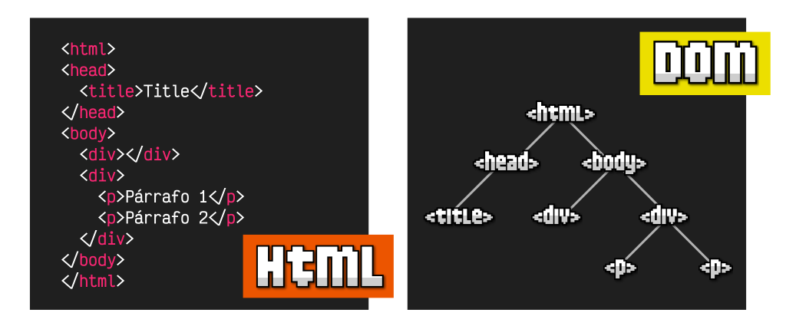
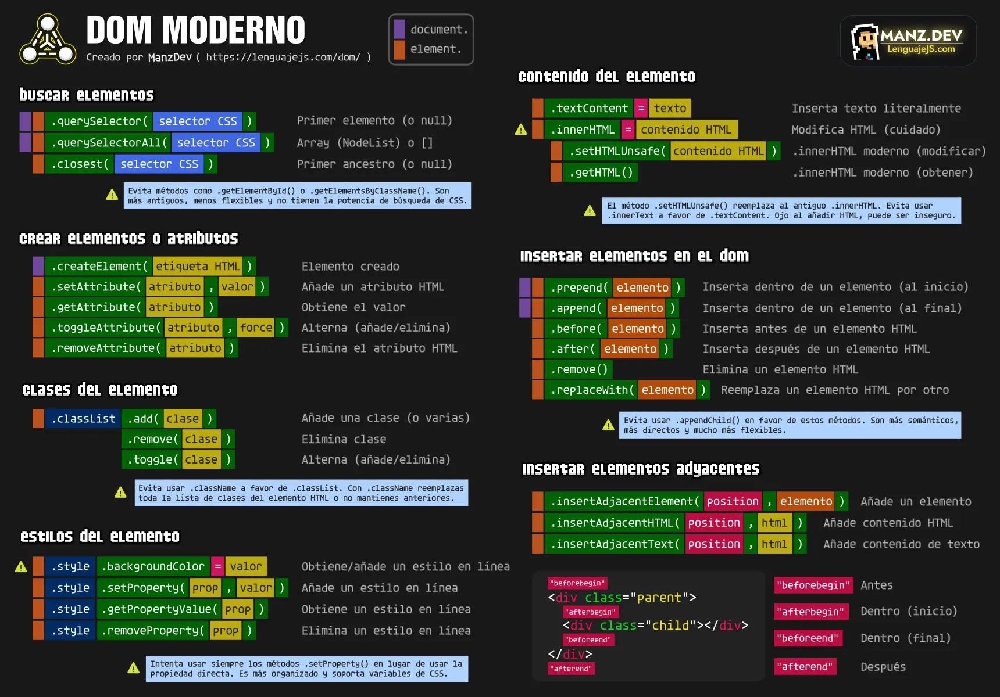
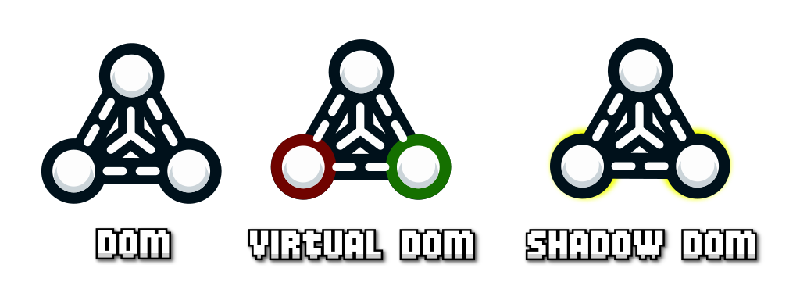
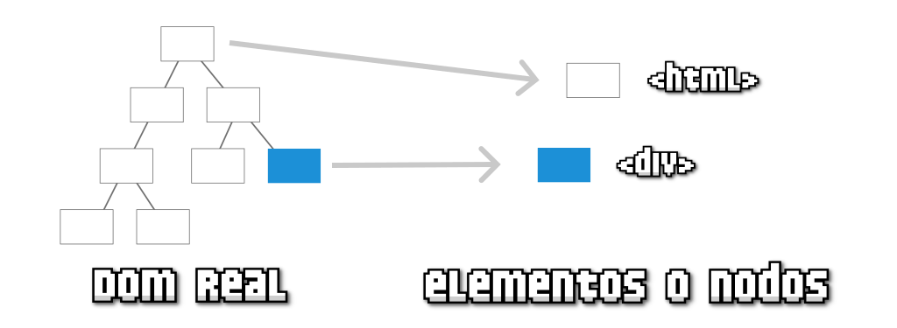
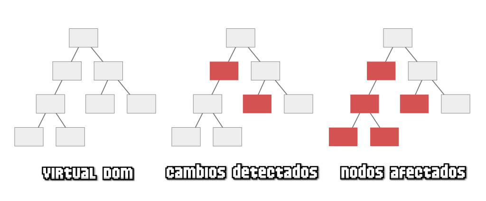
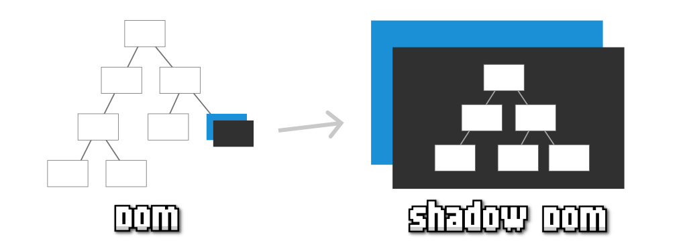
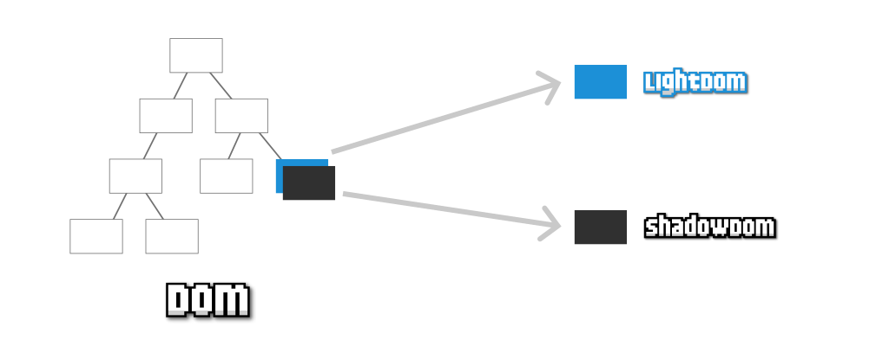

# **Introducció al DOM**

  

    🏆 <strong>Progrés d'aquesta secció:</strong> 0 de 4 superats (0%)
    ⭐ <strong>0 punts</strong>
  

  

    

  

## **Què és el DOM?**

Les sigles **DOM** signifiquen **Document Object Model**, o el que és el mateix, l'estructura d'un document HTML. Una pàgina HTML està formada per múltiples etiquetes HTML, imbricades una dins d'una altra, formant un arbre d'etiquetes relacionades entre sí, que es denomina **arbre DOM** (*o simplement DOM*).

Observa que com l'etiqueta **`<head>`** està dins de **`<html>`** es dibuixa com hija de **`<html>`**. L'etiqueta **`<title>`** està dins de **`<head>`**, per la qual cosa serà hija d'aquesta i així sucesivament.

En Javascript, quan ens referim al **DOM** ens referim a aquesta estructura d'arbre, mitjançant la quin podem accedir a ella i modificar els elements del HTML des de Javascript, afegint noves etiquetes, modificant o eliminant altres, canviant els seus atributs HTML, afegint classes, canviant el contingut de text, etc...

> **📌 Important**
> 

> A l'estar controlat per un **llenguatge de programació**, totes aquestes tasques es poden automatitzar, fins i tot indicant que es realicen quan l'usuari faça accions determinades, esdeveniments, com per exemple: polsar un botó, mover el ratolí, fer click en una part del document, escriure un text, etc...

**L'objecte document**API nativa de Javascript**Usar o no utilitzar el DOM?**

### **L'objecte document**

Des del navegador, la forma d'accedir al DOM és a través d'un objecte Javascript anomenat **document**, que representa l'arbre DOM de la pàgina o, més concretament, la pàgina de la pestanya del navegador on ens trobem. En el seu interior poden existir diversos tipus d'elements, però principalment seran objectes de tipus  o :

- Un  no és més que la representació genérica d'una etiqueta: **HTMLElement**.

- Un  és una unitat més bàsica, la quin pot ser  o un **node de text**.

Tots els **elements HTML**, depenent de l'element que siguen, tindran un tipus de dada específic associat. Vegem alguns exemples:

| Tipus de dada específic | Etiqueta | Descripció |
| --- | --- | --- |
| **HTMLDivElement** | **`
`** | Etiqueta divisoria (en bloc). |
| **HTMLSpanElement** | **``** | Etiqueta divisoria (en línia). |
| **HTMLImageElement** | **``** | Imatge. |
| **HTMLAudioElement** | **`<audio>`** | Contenidor d'àudio. |

> **📌 Important**
> 

> Existeixen molts tipus de dades específics, pràcticament un per cada etiqueta HTML.

### **API nativa de Javascript**

En els següents capítulos d'aquest curs veurem que **Javascript** ens proporciona un conjunt d'eines per a treballar de forma nativa amb el DOM de la pàgina. Les categories importants que hauríem de tindre en compte són les següents:

| Capítulo del DOM | Descripció |
| --- | --- |
| **Cercar etiquetes** | Formes i mètodes per a cercar elements en el DOM com **.querySelector()**. |
| **Modificar contingut** | Accedir i modificar el contingut d'una etiqueta HTML del DOM des de Javascript. |
| **Gestionar atributs o classes** | Ús de diverses de les API de Javascript per a manipular classes CSS o atributs HTML. |
| **Crear etiquetes** | Mètodes i consejos per a crear elements en el DOM i treballar amb ells. |
| **Inserir etiquetes** | Diverses de les API de Javascript per a inserir elements en el DOM d'una pàgina. |

A continuació tens una breve **cheatsheet** per a manejar el DOM de Javascript a mode de resum. Les explicacions per a entendre a utilitzar tots aquests conceptes el veurem al llarg d'aquest curs i els seus capítulos, amb alguns exemples:

### **Usar o no utilitzar el DOM?**

En la industria de la programació web, es sol optar per **evitar la manipulació del DOM de forma directa**. Açò és així perquè treballar amb el DOM requereix destreza, coneixement i és un procés lent que necessita experiència perquè no resulte incómodo o es realicen accions contraproducentes.

Per aquesta raó, habitualment, es **delega** la tasca de la manipulació del DOM a una **llibreria o framework de tercers** (*generalment a frameworks com React o Vue, per exemple*). L'ús d'aquests frameworks ens simplifica el treball a canvi de dos coses:

- Aprendre altres estratègies pròpies del framework (*habitualment més senzilles i cómodas*)

- Perdre un poc de rendiment i control sobre el DOM de la nostra aplicació o web

## **Tipus de DOM**

### **Diferents tipus o modalitats de DOM**

Com vam veure en l'article anterior, el **DOM** és la forma que tenim d'anomenar a la **estructura del document HTML**. Una estructura organitzada per ordre d'aparició, en forma d'arbre, que ens permet accedir als elements HTML d'una pàgina web i modificar-los.

No obstant això, hui en dia, depenent de les eines amb les que estiguem treballant, podem estar utilitzant un tipus de DOM o alguna de les seues variacions:

| Tipus de DOM | Descripció | On actua? |
| --- | --- | --- |
| DOM (real) | És el DOM que es genera al carregar una web. | Navegador (natiu). |
| Virtual DOM | És el DOM que es genera al carregar una web quan usem un framework Javascript. | Framework (codi). |
| Shadow DOM | És un DOM particular que es pot generar per a encapsular un element. | Navegador (natiu). |
| Light DOM | És el DOM real que queda ocult quan es genera un Shadow DOM. | Navegador (natiu). |

Anem a explicar-los detenidament i a explicar les seues característiques principals.

**DOM real**Virtual DOM**Shadow DOM**Light DOM**

### **DOM real**

El **DOM real** és la forma en la que es denomina a l'estructura HTML original d'una pàgina. Pots verla des d'un navegador, simplement polsant amb botó dret, seleccionant **Inspeccionar** i abrent la pestanya **Elements**.

Javascript proporciona una sèrie de funcions i mecanismes per a accedir a aquests elements, modificar-los o eliminar-los de forma potent i flexible, com anirem veient en els següents articles.

> **📌 Important**
> 

> El **DOM** real sempre existeix, encara que a vegades treballem directament amb ell, i altres vegades utilitzarem eines que treballen amb ell de forma transparent, sense que el desenvolupador siga consciente.

### **Virtual DOM**

Un **Virtual DOM** (*o VDOM*) és una representació lleugera i artificial del DOM real.

Durant l'aparició dels diferents **frameworks** de l'ecosistema Javascript, aquests idearon un concepte denominat **Virtual DOM**, que no és més que una còpia en memòria del DOM de la pàgina, on es gestionarían directament les actualizacions i canvis del mateix, per a traducirlos posteriorment al **DOM** real del document, amb l'objectiu d'acelerar i optimitzar els canvis del DOM en la pàgina sense que el programador tinga que preocupar-se per això.

Per exemple, la popular llibreria **React** introducía el concepte de **Virtual DOM** per a detectar els canvis (*diferències entre árboles*), actualitzar els nodes afectats (*canvis i descendientes a quienes poden afectar*) i posteriorment, actualizar-los en el **DOM** real:

El surgiment del concepte de **Virtual DOM** i la seua definició, ayudó a promover (*potser per qüestions de marketing*) el fals concepte «**el DOM és lent**», quan en realitat, el que pot fer-ho lent és una incorrecta gestió del mateix.

És important tindre en compte que el **Virtual DOM** és una avantatge per als programadors perquè els abstrae de tindre que preocupar-se per la manipulació del DOM, però també conlleva desavantatges: pitjor rendiment, més cost de memòria i major complexitat en determinats casos.

> **📌 Important**
> 

> Recorda que el **Virtual DOM** és un procés que es implementa i executa «fóra» del navegador, és a dir, no és natiu, sinó que forma part del codi de les llibreries o frameworks Javascript. Si utilizas un framework o llibreria de Javascript, probablement estés treballant amb un **Virtual DOM**. React i Vue tenen Virtual DOM, però per exemple, Svelte, no.

### **Shadow DOM**

El concepte de **Shadow DOM**, o «sombra del DOM», és un concepte relativament modern per a crear elements HTML en el DOM, tenint el seu propi DOM particular, i per tant, sent independents del resta del document, facilitant així la seua encapsulació.

Per exemple, imaginem un element HTML (*en blau*) en un arbre DOM tradicional. Si li afegim un **Shadow DOM** a eixe element HTML, pasaríamos a tindre un element HTML amb el seu propi DOM encapsulat, per la qual cosa podem fer canvis només en eixe DOM, aplicar CSS només a eixe DOM sense que afecte al resta, etc.

El concepte de **Shadow DOM** és especialment interessant en la creació de components reutilitzables de forma nativa, per la qual cosa és comú encontrar-lo al costat de temes de **Web Components**. No obstant això, és una característica independent que pot utilitzar-se en Javascript vanilla, sense necessitat d'usar WebComponents.

### **Light DOM**

El concepte de **Light DOM** té sentit només en el context d'un element que posea un **Shadow DOM**. Igual que diem que un **Shadow DOM** és la sombra d'un element del DOM, el **Light DOM** és la seua contrapartida.

Quan creem un **Shadow DOM** per a un element del DOM, aquest, a l'igual que una sombra, oculta el contingut que ja tenia l'element, mostrant només el del seu **Shadow DOM** (*el DOM particular*). El contingut ocult és el que es denomina informalment **Light DOM**, el contingut real del DOM que ha sigut ocultado.

---

## 🎮 Reptes Interactius d'Autoavaluació (+100 XP)

Comprova el teu domini sobre **5.1 Introducció al DOM** superant aquests 4 reptes gamificats (+25 punts cadascun):

  
🎯 <strong>Repte 1 (+25 pts):</strong> Quin mètode de l'objecte <code>document</code> (DOM) permet seleccionar el primer element HTML que coincidisca amb qualsevol selector CSS vàlid?

  

    <button type="button" class="btn-mcq-opt" data-opt="A">A) document.getElementsByTagName()</button>
    <button type="button" class="btn-mcq-opt" data-opt="B">B) document.querySelector()</button>
    <button type="button" class="btn-mcq-opt" data-opt="C">C) window.alert()</button>
    <button type="button" class="btn-mcq-opt" data-opt="D">D) console.log()</button>
  

  

  
🎯 <strong>Repte 2 (+25 pts):</strong> En consumir una API REST amb <code>fetch()</code> en JavaScript utilitzant <code>async / await</code>, per a què serveix <code>await resposta.json()</code>?

  

    <button type="button" class="btn-mcq-opt" data-opt="A">A) Per a tancar la connexió de xarxa sense llegir les dades.</button>
    <button type="button" class="btn-mcq-opt" data-opt="B">B) Per a llegir el cos de la resposta HTTP i convertir-lo (parsejar-lo) de text JSON a un objecte o array natiu de JavaScript.</button>
    <button type="button" class="btn-mcq-opt" data-opt="C">C) Per a esborrar el DOM de la pàgina.</button>
    <button type="button" class="btn-mcq-opt" data-opt="D">D) Per a recarregar la pestanya del navegador.</button>
  

  

  
✅ <strong>Repte 3 (Vertader o Fals · +25 pts):</strong> El mètode <code>element.addEventListener('click', funcio)</code> permet associar múltiples manejadors d'esdeveniments a un mateix element del DOM sense sobreescriure'ls.

  

    <button type="button" class="btn-vf" data-opt="V">Vertader (V)</button>
    <button type="button" class="btn-vf" data-opt="F">Fals (F)</button>
  

  

  
⌨️ <strong>Repte 4 (+25 pts):</strong> Quines són les sigles de la interfície que representa el document HTML com un arbre d'objectes manipulable des de JavaScript (Document Object Model)?

  

    <input type="text" class="quiz-input" placeholder="Escriu la resposta..." />
    <button type="button" class="btn-quiz-check">Comprovar</button>
  

  

### 📋 Llista de Comprovació i Rúbrica d'Assoliment

Marca cada criteri a mesura que completes l'estudi o la resolució pràctica d'aquesta pàgina (**5.1 Introducció al DOM**):

- [ ] He llegit detingudament la teoria o l'enunciat d'aquesta secció i he anotat els conceptes clau.
- [ ] He revisat els esquemes, taules o blocs de codi i he verificat que sé aplicar-los a l'entorn de treball.
- [ ] He resolt correctament els **4 reptes interactius** superiors obtenint els **100 punts XP**.
- [ ] He descarregat el comprovant oficial en PDF per a adjuntar-lo a la tasca d'**Aules**.

  <h3>📤 Comprovant de Lliurament per a Aules</h3>
  
Quan hages completat els reptes interactius i la llista d'autoavaluació d'aquesta pàgina, introdueix el teu nom i descarrega el teu certificat oficial en PDF per a adjuntar-lo a la tasca d'<strong>Aules</strong>.

  

    <label for="aules-student-name">👤 Nom i Cognoms de l'Alumne/a:</label>
    <input type="text" id="aules-student-name" class="aules-student-name" placeholder="Ex: Joan Garcia Pérez" />
  

  

    0/4 reptes completats (0%) · 0 punts · 0/4 criteris d'autoavaluació
  

  

    <button type="button" class="btn-aules-dl" data-module="LMSGI" data-unit="UD05" data-activity="ut0510">📥 Descarregar Comprovant PDF</button>
    <button type="button" class="btn-aules-copy">📋 Copiar Resum al Porta-retalls</button>
  

  

