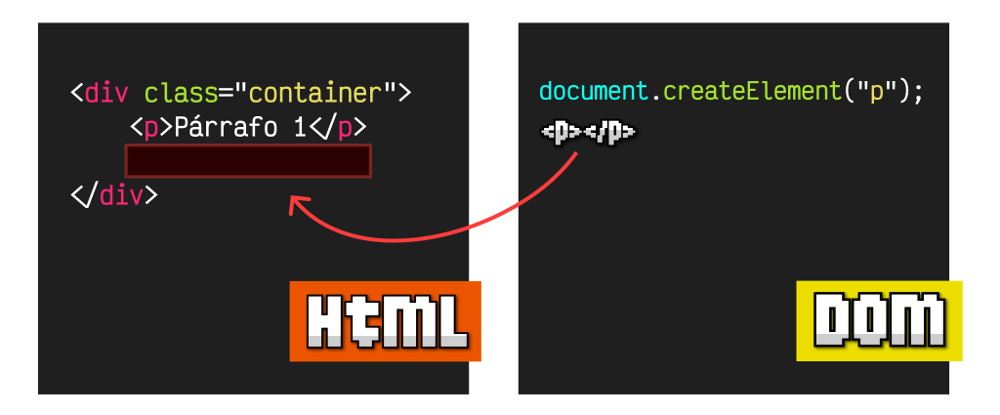

# **Crear i Eliminar en el DOM**

<div class="interactive-progress-tracker">
  <div class="tracker-header">
    <span>🏆 <strong>Progrés d'aquesta secció:</strong> <span class="tracker-count">0 de 4 superats (0%)</span></span>
    <span class="tracker-pts">⭐ <strong>0 punts</strong></span>
  </div>
  <div class="tracker-bar">
    <div class="tracker-fill" style="width: 0%;"></div>
  </div>
</div>

## **Crear i Eliminar elements HTML**

Existeix una sèrie de mètodes per a **crear de forma eficient** diferents elements HTML o nodes. I hi ha un mètode que permet eliminar elements del HTML. En el següent llistat estan aquests mètodes:

| Mètodes | Descripció |
| --- | --- |
| **.createElement(tag, options)** | Crea i retorna l'element HTML definit per el **tag**. |
| **.createComment(text)** | Crea i retorna un node de comentaris HTML **. |
| **.createTextNode(text)** | Crea i retorna un node HTML amb el text **text**. |
| **.remove()** | Elimina el propi element on es anomena el mètode. |

**createElement**createComment**createTextNode**remove

### El mètode `.createElement()`

Mitjançant el mètode **.createElement()** podem crear un **ELEMENT** HTML **en memòria**. És important tindre en compte que al crear-lo **no estarà inserit ENCARA en el nostre document HTML!**. Habitualment, s'emmagatzema en una variable o constant, permitiéndonos modificar els seus atributs o contingut, per a **posteriorment** insertar-lo en una posició determinada del DOM o document HTML:



Anem a centrarnos en el procés de **creació de l'element**, i més avant veurem diferents formes d'insertar-lo en el DOM. El funcionament de **.createElement()** és molt senzill: es tracta de pasarle el nom de l'etiqueta **tag** a utilitzar:

<details markdown="1">

<summary>💡 JS</summary>

```html
const div = document.createElement("div");      // Creamos un <div></div>
const span = document.createElement("span");    // Creamos un <span></span>
const img = document.createElement("img");      // Creamos un 
```

</details>

El mètode **createElement()** té un segon paràmetre opcional denominat **options**. Si es indica, es espera un **OBJECT** amb una propietat **is** per a definir un **element personalitzat** particular. De moment, no explorarem eixe camino, però podem abordar-lo més avant en el tema de **Web Components**.

### **El mètode `.createComment()`**

Encara que és menys freqüent, tenim un mètode **.createComment()** que serveix per a crear comentaris HTML, i insertar-los en el DOM, com fem amb els elements HTML que vam veure anteriorment. No és alguna cosa molt pràctic o habitual, però en alguns casos concrets podria sernos d'utilitat.

<details markdown="1">

<summary>💡 JS</summary>

```html
const comment = document.createComment("Comentario");   // <!--Comentario-->
```

</details>

Hem creat el comentari ** i l'hem guardat en una constant **comment**.

### **El mètode `.createTextNode()`**

De la mateixa forma, el mètode **.createTextNode()** ens permet crear un node de text amb el **NODE** text indicat per paràmetre. Açò ens permet crear fragments de text sense necessitat de tindre una etiqueta HTML contenedora:

<details markdown="1">

<summary>💡 JS</summary>

```html
const text = document.createTextNode("Hola");           // Nodo de texto: 'hola'
```

</details>

Novament, no és alguna cosa molt comú, ja que normalment afegim els textos a través d'etiquetes HTML. No obstant això, a vegades ens trobem amb situacions en les que necessitem crear un node de text sense tindre una etiqueta HTML contenedora, i en eixos casos podria sernos d'utilitat.

### **El mètode `.remove()`**

A l'igual que podem inserir o reemplaçar elements, també podem eliminar-los. Tingues en compte que al «eliminar» un node o element HTML, el que fem realment no és borrar-lo, sinó **desconectar-lo del DOM o document HTML**, de mode que no estan connectats, però segueixen existint.

El mètode **.remove()** s'encarrega de desconectar-se del DOM a sí mateix,

<details markdown="1">

<summary>💡 JS</summary>

```html
const div = document.querySelector(".deleteme");

div.isConnected;    // true, indica si existe el elemento
div.remove();
div.isConnected;    // false, indica si existe el elemento
```

</details>

En aquest cas, el que hem fet és cercar l'element HTML `&LTdiv class="deleteme">` en el document HTML i desconectar-lo del seu element pare, de forma que aquest element passa a no pertànyer al document HTML, però segueix existint en la constant `div`.


---

## 🎮 Reptes Interactius d'Autoavaluació (+100 XP)

Comprova el teu domini sobre **5.4 Crear i Eliminar en el DOM** superant aquests 4 reptes gamificats (+25 punts cadascun):

<div class="interactive-mcq" data-answer="B" data-hint="document.querySelector('.classe #id') utilitza la sintaxi de selectors CSS.">
  <div class="mcq-question">🎯 <strong>Repte 1 (+25 pts):</strong> Quin mètode de l'objecte <code>document</code> (DOM) permet seleccionar el primer element HTML que coincidisca amb qualsevol selector CSS vàlid?</div>
  <div class="mcq-options">
    <button type="button" class="btn-mcq-opt" data-opt="A">A) document.getElementsByTagName()</button>
    <button type="button" class="btn-mcq-opt" data-opt="B">B) document.querySelector()</button>
    <button type="button" class="btn-mcq-opt" data-opt="C">C) window.alert()</button>
    <button type="button" class="btn-mcq-opt" data-opt="D">D) console.log()</button>
  </div>
  <div class="quiz-feedback"></div>
</div>

<div class="interactive-mcq" data-answer="B" data-hint="response.json() retorna una Promesa que es resol amb l'objecte JavaScript resultant de parsejar el JSON.">
  <div class="mcq-question">🎯 <strong>Repte 2 (+25 pts):</strong> En consumir una API REST amb <code>fetch()</code> en JavaScript utilitzant <code>async / await</code>, per a què serveix <code>await resposta.json()</code>?</div>
  <div class="mcq-options">
    <button type="button" class="btn-mcq-opt" data-opt="A">A) Per a tancar la connexió de xarxa sense llegir les dades.</button>
    <button type="button" class="btn-mcq-opt" data-opt="B">B) Per a llegir el cos de la resposta HTTP i convertir-lo (parsejar-lo) de text JSON a un objecte o array natiu de JavaScript.</button>
    <button type="button" class="btn-mcq-opt" data-opt="C">C) Per a esborrar el DOM de la pàgina.</button>
    <button type="button" class="btn-mcq-opt" data-opt="D">D) Per a recarregar la pestanya del navegador.</button>
  </div>
  <div class="quiz-feedback"></div>
</div>

<div class="interactive-vf" data-answer="V" data-hint="addEventListener és la forma estàndard i recomanada de gestionar esdeveniments en el DOM.">
  <div class="vf-statement">✅ <strong>Repte 3 (Vertader o Fals · +25 pts):</strong> El mètode <code>element.addEventListener('click', funcio)</code> permet associar múltiples manejadors d'esdeveniments a un mateix element del DOM sense sobreescriure'ls.</div>
  <div class="vf-buttons">
    <button type="button" class="btn-vf" data-opt="V">Vertader (V)</button>
    <button type="button" class="btn-vf" data-opt="F">Fals (F)</button>
  </div>
  <div class="quiz-feedback" style="width: 100%;"></div>
</div>

<div class="interactive-quiz" data-answer="dom" data-hint="Són les sigles DOM.">
  <div class="quiz-question">⌨️ <strong>Repte 4 (+25 pts):</strong> Quines són les sigles de la interfície que representa el document HTML com un arbre d'objectes manipulable des de JavaScript (Document Object Model)?</div>
  <div class="quiz-controls">
    <input type="text" class="quiz-input" placeholder="Escriu la resposta..." />
    <button type="button" class="btn-quiz-check">Comprovar</button>
  </div>
  <div class="quiz-feedback"></div>
</div>

### 📋 Llista de Comprovació i Rúbrica d'Assoliment

Marca cada criteri a mesura que completes l'estudi o la resolució pràctica d'aquesta pàgina (**5.4 Crear i Eliminar en el DOM**):

- [ ] He llegit detingudament la teoria o l'enunciat d'aquesta secció i he anotat els conceptes clau.
- [ ] He revisat els esquemes, taules o blocs de codi i he verificat que sé aplicar-los a l'entorn de treball.
- [ ] He resolt correctament els **4 reptes interactius** superiors obtenint els **100 punts XP**.
- [ ] He descarregat el comprovant oficial en PDF per a adjuntar-lo a la tasca d'**Aules**.

<div class="aules-delivery-card">
  <h3>📤 Comprovant de Lliurament per a Aules</h3>
  <p>Quan hages completat els reptes interactius i la llista d'autoavaluació d'aquesta pàgina, introdueix el teu nom i descarrega el teu certificat oficial en PDF per a adjuntar-lo a la tasca d'<strong>Aules</strong>.</p>
  <div class="aules-student-field">
    <label for="aules-student-name">👤 Nom i Cognoms de l'Alumne/a:</label>
    <input type="text" id="aules-student-name" class="aules-student-name" placeholder="Ex: Joan Garcia Pérez" />
  </div>
  <div class="aules-score-badge">
    <span class="aules-score-count">0/4 reptes completats (0%) · 0 punts · 0/4 criteris d'autoavaluació</span>
  </div>
  <div class="aules-actions">
    <button type="button" class="btn-aules-dl" data-module="LMSGI" data-unit="UD05" data-activity="ut0540">📥 Descarregar Comprovant PDF</button>
    <button type="button" class="btn-aules-copy">📋 Copiar Resum al Porta-retalls</button>
  </div>
  <div class="aules-toast"></div>
</div>
