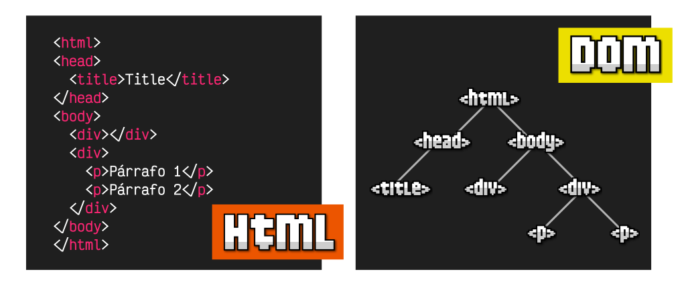
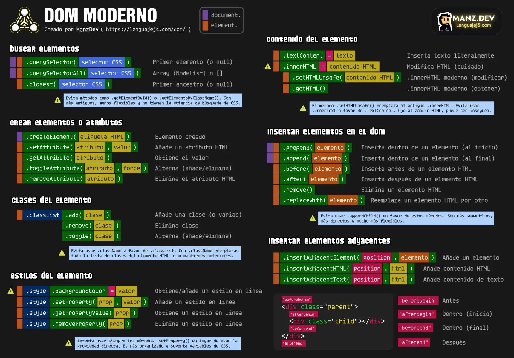
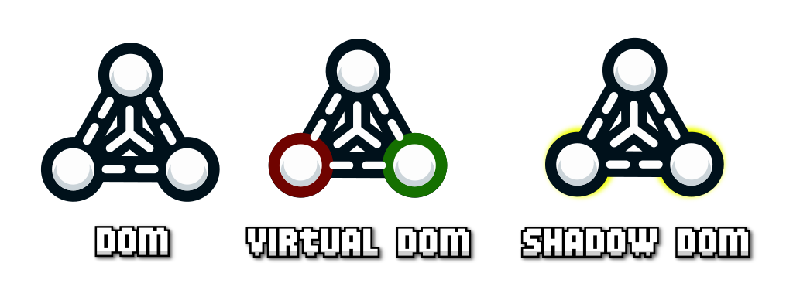
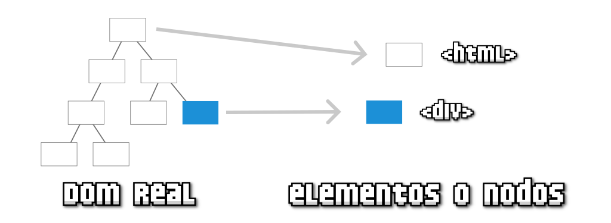
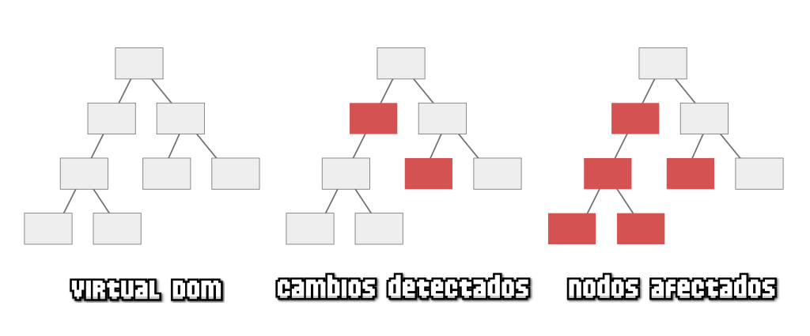
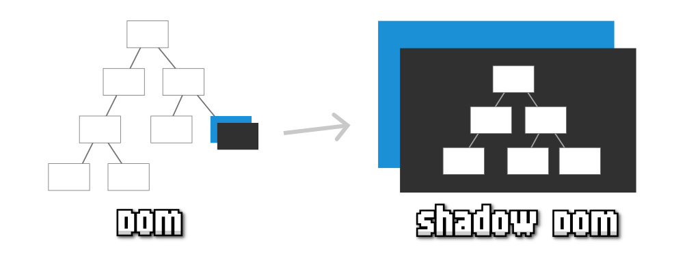
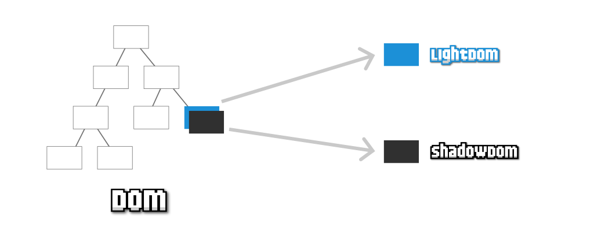

# **Introducción al DOM**

## **¿Qué es el DOM?**

Las siglas **DOM** significan **Document Object Model**, o lo que es lo mismo, la estructura de un documento HTML. Una página HTML está formada por múltiples etiquetas HTML, anidadas una dentro de otra, formando un árbol de etiquetas relacionadas entre sí, que se denomina **árbol DOM** (*o simplemente DOM*).

Observa que como la etiqueta **`<head>`** está dentro de **`<html>`** se dibuja como hija de **`<html>`**. La etiqueta **`<title>`** está dentro de **`<head>`**, por lo que será hija de esta y así sucesivamente.

En Javascript, cuando nos referimos al **DOM** nos referimos a esta estructura de árbol, mediante la cuál podemos acceder a ella y modificar los elementos del HTML desde Javascript, añadiendo nuevas etiquetas, modificando o eliminando otras, cambiando sus atributos HTML, añadiendo clases, cambiando el contenido de texto, etc...

> **📌 Importante**
> 

> Al estar controlado por un **lenguaje de programación**, todas estas tareas se pueden automatizar, incluso indicando que se realicen cuando el usuario haga acciones determinadas, eventos, como por ejemplo: pulsar un botón, mover el ratón, hacer click en una parte del documento, escribir un texto, etc...

**El objeto document**API nativa de Javascript**¿Usar o no utilizar el DOM?**

### **El objeto document**

Desde el navegador, la forma de acceder al DOM es a través de un objeto Javascript llamado **document**, que representa el árbol DOM de la página o, más concretamente, la página de la pestaña del navegador donde nos encontramos. En su interior pueden existir varios tipos de elementos, pero principalmente serán objetos de tipo  o :

- Un  no es más que la representación genérica de una etiqueta: **HTMLElement**.

- Un  es una unidad más básica, la cuál puede ser  o un **nodo de texto**.

Todos los **elementos HTML**, dependiendo del elemento que sean, tendrán un tipo de dato específico asociado. Veamos algunos ejemplos:

| Tipo de dato específico | Etiqueta | Descripción |
| --- | --- | --- |
| **HTMLDivElement** | **`
`** | Etiqueta divisoria (en bloque). |
| **HTMLSpanElement** | **``** | Etiqueta divisoria (en línea). |
| **HTMLImageElement** | **``** | Imagen. |
| **HTMLAudioElement** | **`<audio>`** | Contenedor de audio. |

> **📌 Importante**
> 

> Existen muchos tipos de datos específicos, prácticamente uno por cada etiqueta HTML.

### **API nativa de Javascript**

En los siguientes capítulos de este curso veremos que **Javascript** nos proporciona un conjunto de herramientas para trabajar de forma nativa con el DOM de la página. Las categorías importantes que deberíamos tener en cuenta son las siguientes:

| Capítulo del DOM | Descripción |
| --- | --- |
| **Buscar etiquetas** | Formas y métodos para buscar elementos en el DOM como **.querySelector()**. |
| **Modificar contenido** | Acceder y modificar el contenido de una etiqueta HTML del DOM desde Javascript. |
| **Gestionar atributos o clases** | Uso de varias de las API de Javascript para manipular clases CSS o atributos HTML. |
| **Crear etiquetas** | Métodos y consejos para crear elementos en el DOM y trabajar con ellos. |
| **Insertar etiquetas** | Varias de las API de Javascript para insertar elementos en el DOM de una página. |

A continuación tienes una breve **cheatsheet** para manejar el DOM de Javascript a modo de resumen. Las explicaciones para entender a utilizar todos estos conceptos lo veremos a lo largo de este curso y sus capítulos, con algunos ejemplos:

### **¿Usar o no utilizar el DOM?**

En la industria de la programación web, se suele optar por **evitar la manipulación del DOM de forma directa**. Esto es así porque trabajar con el DOM requiere destreza, conocimiento y es un proceso lento que necesita experiencia para que no resulte incómodo o se realicen acciones contraproducentes.

Por esta razón, habitualmente, se **delega** la tarea de la manipulación del DOM a una **librería o framework de terceros** (*generalmente a frameworks como React o Vue, por ejemplo*). El uso de estos frameworks nos simplifica el trabajo a cambio de dos cosas:

- Aprender otras estrategias propias del framework (*habitualmente más sencillas y cómodas*)

- Perder un poco de rendimiento y control sobre el DOM de nuestra aplicación o web

## **Tipos de DOM**

### **Diferentes tipos o modalidades de DOM**

Como vimos en el artículo anterior, el **DOM** es la forma que tenemos de llamar a la **estructura del documento HTML**. Una estructura organizada por orden de aparición, en forma de árbol, que nos permite acceder a los elementos HTML de una página web y modificarlos.

Sin embargo, hoy en día, dependiendo de las herramientas con las que estemos trabajando, podemos estar utilizando un tipo de DOM o alguna de sus variaciones:

| Tipo de DOM | Descripción | ¿Dónde actúa? |
| --- | --- | --- |
| DOM (real) | Es el DOM que se genera al cargar una web. | Navegador (nativo). |
| Virtual DOM | Es el DOM que se genera al cargar una web cuando usamos un framework Javascript. | Framework (código). |
| Shadow DOM | Es un DOM particular que se puede generar para encapsular un elemento. | Navegador (nativo). |
| Light DOM | Es el DOM real que queda oculto cuando se genera un Shadow DOM. | Navegador (nativo). |

Vamos a explicarlos detenidamente y a explicar sus características principales.

**DOM real**Virtual DOM**Shadow DOM**Light DOM**

### **DOM real**

El **DOM real** es la forma en la que se denomina a la estructura HTML original de una página. Puedes verla desde un navegador, simplemente pulsando con botón derecho, seleccionando **Inspeccionar** y abriendo la pestaña **Elementos**.

Javascript proporciona una serie de funciones y mecanismos para acceder a estos elementos, modificarlos o eliminarlos de forma potente y flexible, como iremos viendo en los siguientes artículos.

> **📌 Importante**
> 

> El **DOM** real siempre existe, aunque a veces trabajamos directamente con él, y otras veces utilizaremos herramientas que trabajan con él de forma transparente, sin que el desarrollador sea consciente.

### **Virtual DOM**

Un **Virtual DOM** (*o VDOM*) es una representación ligera y artificial del DOM real.

Durante la aparición de los diferentes **frameworks** del ecosistema Javascript, estos idearon un concepto denominado **Virtual DOM**, que no es más que una copia en memoria del DOM de la página, donde se gestionarían directamente las actualizaciones y cambios del mismo, para traducirlos posteriormente al **DOM** real del documento, con el objetivo de acelerar y optimizar los cambios del DOM en la página sin que el programador tenga que preocuparse por ello.

Por ejemplo, la popular librería **React** introducía el concepto de **Virtual DOM** para detectar los cambios (*diferencias entre árboles*), actualizar los nodos afectados (*cambios y descendientes a quienes pueden afectar*) y posteriormente, actualizarlos en el **DOM** real:

El surgimiento del concepto de **Virtual DOM** y su definición, ayudó a promover (*quizás por cuestiones de marketing*) el falso concepto «**el DOM es lento**», cuando en realidad, lo que puede hacerlo lento es una incorrecta gestión del mismo.

Es importante tener en cuenta que el **Virtual DOM** es una ventaja para los programadores porque les abstrae de tener que preocuparse por la manipulación del DOM, pero también conlleva desventajas: peor rendimiento, más coste de memoria y mayor complejidad en determinados casos.

> **📌 Importante**
> 

> Recuerda que el **Virtual DOM** es un proceso que se implementa y ejecuta «fuera» del navegador, es decir, no es nativo, sino que forma parte del código de las librerías o frameworks Javascript. Si utilizas un framework o librería de Javascript, probablemente estés trabajando con un **Virtual DOM**. React y Vue tienen Virtual DOM, pero por ejemplo, Svelte, no.

### **Shadow DOM**

El concepto de **Shadow DOM**, o «sombra del DOM», es un concepto relativamente moderno para crear elementos HTML en el DOM, teniendo su propio DOM particular, y por lo tanto, siendo independientes del resto del documento, facilitando así su encapsulación.

Por ejemplo, imaginemos un elemento HTML (*en azul*) en un árbol DOM tradicional. Si le añadimos un **Shadow DOM** a ese elemento HTML, pasaríamos a tener un elemento HTML con su propio DOM encapsulado, por lo que podemos hacer cambios sólo en ese DOM, aplicar CSS sólo a ese DOM sin que afecte al resto, etc.

El concepto de **Shadow DOM** es especialmente interesante en la creación de componentes reutilizables de forma nativa, por lo que es común encontrarlo junto a temas de **Web Components**. Sin embargo, es una característica independiente que puede utilizarse en Javascript vanilla, sin necesidad de usar WebComponents.

### **Light DOM**

El concepto de **Light DOM** tiene sentido sólo en el contexto de un elemento que posea un **Shadow DOM**. Igual que decimos que un **Shadow DOM** es la sombra de un elemento del DOM, el **Light DOM** es su contrapartida.

Cuando creamos un **Shadow DOM** para un elemento del DOM, este, al igual que una sombra, oculta el contenido que ya tenía el elemento, mostrando sólo el de su **Shadow DOM** (*el DOM particular*). El contenido oculto es el que se denomina informalmente **Light DOM**, el contenido real del DOM que ha sido ocultado.
