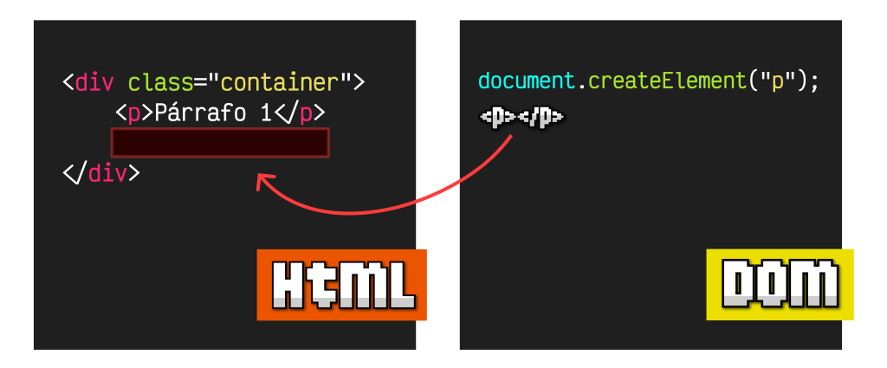

# **Crear y Eliminar en el DOM**

## **Crear y Eliminar elementos HTML**

Existe una serie de métodos para **crear de forma eficiente** diferentes elementos HTML o nodos. Y hay un método que permite eliminar elementos del HTML. En el siguiente listado están estos métodos:

| Métodos | Descripción |
| --- | --- |
| **.createElement(tag, options)** | Crea y devuelve el elemento HTML definido por el **tag**. |
| **.createComment(text)** | Crea y devuelve un nodo de comentarios HTML **. |
| **.createTextNode(text)** | Crea y devuelve un nodo HTML con el texto **text**. |
| **.remove()** | Elimina el propio elemento donde se llama el método. |

**createElement**createComment**createTextNode**remove

### El método `.createElement()`

Mediante el método **.createElement()** podemos crear un **ELEMENT** HTML **en memoria**. Es importante tener en cuenta que al crearlo **¡no estará insertado AÚN en nuestro documento HTML!**. Habitualmente, se almacena en una variable o constante, permitiéndonos modificar sus atributos o contenido, para **posteriormente** insertarlo en una posición determinada del DOM o documento HTML:



Vamos a centrarnos en el proceso de **creación del elemento**, y más adelante veremos diferentes formas de insertarlo en el DOM. El funcionamiento de **.createElement()** es muy sencillo: se trata de pasarle el nombre de la etiqueta **tag** a utilizar:

<details markdown="1">

<summary>💡 JS</summary>

```html
const div = document.createElement("div");      // Creamos un <div></div>
const span = document.createElement("span");    // Creamos un <span></span>
const img = document.createElement("img");      // Creamos un 
```

</details>

El método **createElement()** tiene un segundo parámetro opcional denominado **options**. Si se indica, se espera un **OBJECT** con una propiedad **is** para definir un **elemento personalizado** particular. De momento, no exploraremos ese camino, pero podemos abordarlo más adelante en el tema de **Web Components**.

### **El método `.createComment()`**

Aunque es menos frecuente, tenemos un método **.createComment()** que sirve para crear comentarios HTML, e insertarlos en el DOM, como hacemos con los elementos HTML que vimos anteriormente. No es algo muy práctico o habitual, pero en algunos casos concretos podría sernos de utilidad.

<details markdown="1">

<summary>💡 JS</summary>

```html
const comment = document.createComment("Comentario");   // <!--Comentario-->
```

</details>

Hemos creado el comentario ** y lo hemos guardado en una constante **comment**.

### **El método `.createTextNode()`**

De la misma forma, el método **.createTextNode()** nos permite crear un nodo de texto con el **NODE** texto indicado por parámetro. Esto nos permite crear fragmentos de texto sin necesidad de tener una etiqueta HTML contenedora:

<details markdown="1">

<summary>💡 JS</summary>

```html
const text = document.createTextNode("Hola");           // Nodo de texto: 'hola'
```

</details>

Nuevamente, no es algo muy común, ya que normalmente añadimos los textos a través de etiquetas HTML. Sin embargo, a veces nos encontramos con situaciones en las que necesitamos crear un nodo de texto sin tener una etiqueta HTML contenedora, y en esos casos podría sernos de utilidad.

### **El método `.remove()`**

Al igual que podemos insertar o reemplazar elementos, también podemos eliminarlos. Ten en cuenta que al «eliminar» un nodo o elemento HTML, lo que hacemos realmente no es borrarlo, sino **desconectarlo del DOM o documento HTML**, de modo que no están conectados, pero siguen existiendo.

El método **.remove()** se encarga de desconectarse del DOM a sí mismo,

<details markdown="1">

<summary>💡 JS</summary>

```html
const div = document.querySelector(".deleteme");

div.isConnected;    // true, indica si existe el elemento
div.remove();
div.isConnected;    // false, indica si existe el elemento
```

</details>

En este caso, lo que hemos hecho es buscar el elemento HTML `&LTdiv class="deleteme">` en el documento HTML y desconectarlo de su elemento padre, de forma que dicho elemento pasa a no pertenecer al documento HTML, pero sigue existiendo en la constante `div`.
