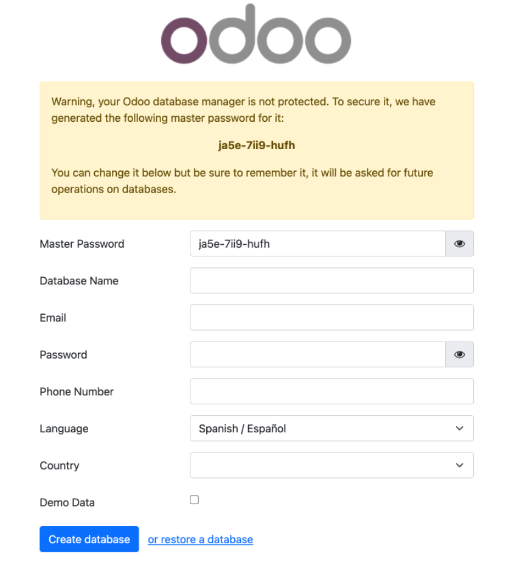
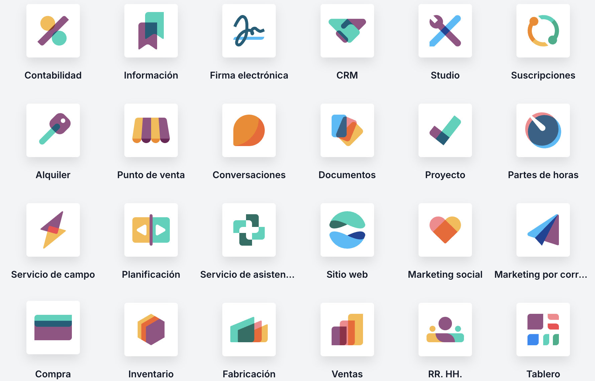

# UD9: Sistemas de Gestión Empresarial — ERP (Odoo), CRM, CMS y Seguridad

Bienvenido/a a la **UD9: Sistemas de Gestión Empresarial — ERP (Odoo), CRM, CMS y Seguridad** del módulo profesional de **Lenguajes de Marcas y Sistemas de Gestión de Información** (1º DAW / DAM / ASIX · Lenguajes de Marcas (LMSGI)).

En esta unidad encontrarás los contenidos teóricos, ejemplos prácticos, ejercicios resueltos y actividades de evaluación curricular desarrollados por el profesor **Manuel Alonso Argente**.

---

### 📑 Índice de Apartados y Actividades de la Unidad

- [**📋 9.0 Propuesta Didáctica: Sistemes empresarials de gestió d'informació**](./ut0900.html)
- [**9.1.1 Introducción**](./ut0911.html)
- [**9.2.1 Sistemas de gestión empresarial**](./ut0921.html)
- [**9.2.2 Instalación**](./ut0922.html)
- [**9.2.3 Configuración de un ERP**](./ut0923.html)
- [**9.3.1 Odoo**](./ut0931.html)
- [**9.3.2 Instalación**](./ut0932.html)
- [**9.3.3 Módulos**](./ut0933.html)

**Actividades Prácticas y Fichas de Trabajo:**

- [**✏️ ACT901 901**](./act_act901.html)

---

# 📖 Vista Completa de la Unidad

## 9.0 Propuesta Didáctica — Sistemes empresarials de gestió d'informació

# **Sistemes empresarials de gestió d'informació**

## **Propuesta didáctica**

En esta unidad vamos a trabajar el **RA7**: Opera sistemas empresariales de gestión de información haciendo tareas de importación, integración, aseguramiento y extracción de la información.

## **Criterios de evaluación**

### **Respecto al RA7:**

| Código | Descripción | Peso (%) | Herramientas Evaluación |
| --- | --- | --- | --- |
| **CE7a** | Se han identificado los principales sistemas de gestión empresarial. | 10% | EXA901 |
| **CE7b** | Se han reconocido las ventajas de los sistemas de gestión de información empresarial. | 10% | EXA901 |
| **CE7c** | Se han evaluado las características de las principales aplicaciones de gestión empresarial. | 10% | ACT901 (10%) -- EXA901 (90%) |
| **CE7d** | Se han instalado aplicaciones de gestión empresarial. | 15% | ACT901 (100%) |
| **CE7e** | Se han configurado y administrado las aplicaciones. | 15% | ACT901 (100%) |
| **CE7f** | Se han establecido y verificado mecanismos de acceso seguro a la información. | 10% | ACT901 (50%) -- EXA901 (50%) |
| **CE7g** | Se han generado informes. | 10% | ACT901 (100%) |
| **CE7h** | Se han realizado procedimientos de extracción de información para el tratamiento e incorporación a diversos sistemas. | 10% | ACT901 (100%) |
| **CE7i** | Se han elaborado documentos relativos a la explotación de la aplicación. | 10% | ACT901 (100%) |

## **Contenidos**

### **Sistemas empresariales de gestión de información:**

- Introducción a los sistemas empresariales de gestión de información. (CE7.a, CE7.b)

- ERP: objetivos, características, ventajas y desventajas. (CE7.a, CE7.b)

- CRM. (CE7.a, CE7.b)

- ECM/DMS y sistemas integrales. (CE7.a, CE7.b, CE7.c)

- Soluciones en el mercado. (CE7.c)

- Instalación de aplicaciones de gestión empresarial: local y en la nube (SaaS). (CE7.c, CE7.d)

- Configuración y administración de las aplicaciones: módulos, usuarios, roles y permisos. (CE7.e, CE7.f)

- Seguridad y acceso seguro a la información. (CE7.f)

- Elaboración de informes e integración con aplicaciones ofimáticas. (CE7.g)

- Extracción de información para su tratamiento e incorporación a otros sistemas. (CE7.h)

- Documentación relativa a la explotación de la aplicación. (CE7.i)

- Odoo: introducción, versiones, instalación y módulos. (CE7.c, CE7.d, CE7.e)

**Cuestionario inicial**

1. ¿Qué es un sistema de gestión empresarial de la información y para qué se utiliza?

1. ¿Qué es un ERP y qué módulos lo componen?

1. ¿Qué es un CRM y en qué se diferencia de un ERP?

1. ¿Qué ventajas ofrece la implantación de un ERP en una empresa?

1. ¿Qué diferencias existen entre un ERP local y un ERP en la nube (SaaS)?

1. ¿Qué es Odoo y qué versiones ofrece?

1. ¿Cómo se gestionan los usuarios, roles y permisos en un sistema ERP?

## **Programación de Aula (6h)**

Esta unidad se imparte en la tercera evaluación, a continuación de la UP08 (Almacenamiento de información). La unidad tiene una duración estimada de 6 horas lectivas repartidas en 6 sesiones de una hora, durante los días que se indican en el calendario (los días de clase son lunes, con una hora, y jueves, con dos horas). La sesión de evaluación del jueves 22 de abril se cuenta dentro de esta unidad.

### **Calendario**

#### **Abril 2027**

| Lunes | Martes | Miércoles | Jueves | Viernes | Sábado | Domingo |
| --- | --- | --- | --- | --- | --- | --- |
|  |  |  | 1 | 2 | **3 🛑** | **4 🛑** |
| **5 🛑** | 6 | 7 | 8 | 9 | **10 🛑** | **11 🛑** |
| **12 📚** | 13 | 14 | **15 📚** | 16 | **17 🛑** | **18 🛑** |
| **19 📚** | 20 | 21 | **22 📚** | 23 | **24 🛑** | **25 🛑** |
| 26 | 27 | 28 | 29 | 30 |  |  |

### **Sesiones**

| Sesión | Contenidos | Actividades | Criterios trabajados |
| --- | --- | --- | --- |
| 1 | 9.1 Introducción -- 9.2.1 Sistemas de gestión empresarial | -- | CE7.a - CE7.b |
| 2 | 9.2.2 Instalación de un ERP -- 9.2.3 Configuración de un ERP | -- | CE7.c - CE7.d - CE7.e |
| 3 | 9.3.1 Introducción a Odoo -- 9.3.3 Módulos de Odoo | ACT901 | CE7.a - CE7.c - CE7.d - CE7.e |
| 4 | 9.3.2 Instalación de Odoo | ACT901 | CE7.d - CE7.e - CE7.f |
| 5 | Configuración, usuarios, permisos, productos, compras, ventas e informes en Odoo | ACT901 | CE7.f - CE7.g - CE7.h |
| 6 | Evaluación de la unidad | EXA901 | CE7.a - CE7.b - CE7.c - CE7.d - CE7.e - CE7.f - CE7.g - CE7.h - CE7.i |

---

## 9.1.1 Introducción

# **Introducción**

Los sistemas empresariales de gestión de la información constituyen el conjunto de infraestructuras tecnológicas, procedimientos organizativos y políticas de gobierno del dato orientados a capturar, estructurar, almacenar, proteger, integrar y explotar la información generada por una organización. Su finalidad es transformar datos dispersos en información consistente, trazable y oportuna, de modo que pueda sustentar tanto la operación diaria como la toma de decisiones en los distintos niveles de la empresa (operativo, táctico y estratégico).

En el contexto actual, caracterizado por procesos interdependientes y por un elevado volumen de transacciones, estos sistemas persiguen la integración transversal de áreas funcionales —finanzas, aprovisionamiento, ventas, logística, producción, recursos humanos o atención al cliente— para reducir redundancias, minimizar errores y garantizar una fuente única de información. En este ecosistema se encuadran soluciones como los ERP (planificación de recursos empresariales), CRM (gestión de relaciones con clientes), ECM/DMS (gestión documental y de contenidos), así como plataformas de Business Intelligence y analítica avanzada, que permiten convertir la información en conocimiento accionable mediante indicadores, informes y cuadros de mando.

Asimismo, la gestión empresarial de la información incorpora dimensiones críticas de seguridad, control y cumplimiento normativo, tales como la definición de roles y permisos, auditoría, trazabilidad, continuidad de negocio y protección de datos. En síntesis, los sistemas de gestión de la información no solo automatizan y coordinan procesos, sino que proporcionan un marco socio-técnico para asegurar la calidad, disponibilidad y gobernanza del dato, incrementando la eficiencia organizativa y mejorando la capacidad de adaptación ante cambios del entorno.

## **ERP**

Un **ERP** (Enterprise Resource Planning o Planificación de Recursos Empresariales) es un sistema de información integrado diseñado para coordinar y automatizar los procesos principales de una organización mediante una base de datos común y un conjunto de módulos funcionales. Su propósito es proporcionar una visión unificada del negocio, de modo que áreas como finanzas y contabilidad, compras, ventas, almacén y logística, producción o recursos humanos trabajen con datos consistentes y actualizados, reduciendo duplicidades y mejorando la trazabilidad de las operaciones.

Desde una perspectiva organizativa, un ERP actúa como el núcleo transaccional de la empresa: registra eventos (pedidos, facturas, movimientos de stock, costes, nóminas, etc.), estandariza procedimientos y facilita la interoperabilidad entre departamentos. Esto permite reforzar el control interno (permisos, auditoría, trazas), optimizar la planificación (aprovisionamiento, capacidad, inventario) y generar información fiable para el seguimiento mediante informes e indicadores. En consecuencia, la implantación de un ERP no es solo un proyecto tecnológico, sino también un proceso de reingeniería y alineación de procesos, datos y responsabilidades, orientado a mejorar la eficiencia, la calidad de la información y la capacidad de decisión.

## **CRM**

Un **CRM** (Customer Relationship Management o Gestión de las Relaciones con Clientes) es un sistema de información orientado a organizar, centralizar y optimizar todas las interacciones entre una organización y sus clientes (o potenciales clientes) a lo largo del ciclo de vida comercial. Su objetivo es disponer de una visión única y completa del cliente, integrando datos de contacto, historial de comunicaciones, oportunidades de venta, contratos, incidencias y preferencias, para mejorar tanto la eficacia comercial como la calidad del servicio.

Desde un enfoque funcional, los CRM suelen estructurarse en ámbitos como ventas (gestión de leads, oportunidades, pipeline y previsiones), marketing (segmentación, campañas y automatización) y atención al cliente (tickets, SLA, base de conocimiento). Al estandarizar procesos y registrar evidencias, un CRM facilita la trazabilidad de la actividad, la coordinación entre equipos y la medición del rendimiento mediante indicadores (tasa de conversión, coste de adquisición, retención, valor del cliente, etc.). En síntesis, un CRM no solo almacena información: actúa como una plataforma para gestionar relaciones, incrementar la fidelización, personalizar la comunicación y apoyar la toma de decisiones basada en datos, siempre incorporando requisitos de seguridad y protección de datos acordes con el marco normativo vigente.

## **ECM/DMS**

Los sistemas **ECM/DMS** (Enterprise Content Management / Document Management System) son soluciones orientadas a la gestión integral de documentos y contenidos dentro de una organización. Su finalidad es controlar, de forma estructurada y segura, el ciclo de vida de la información no estrictamente transaccional —contratos, facturas, expedientes, informes, actas, correos, evidencias de calidad, manuales, etc.— garantizando su clasificación, localización, conservación y acceso conforme a criterios corporativos y normativos.

Un DMS se centra principalmente en la gestión documental: captura y digitalización, indexación mediante metadatos, almacenamiento, control de versiones, búsquedas avanzadas, permisos de acceso y auditoría. Por su parte, un ECM amplía este enfoque al incorporar la gestión de contenidos en sentido amplio (documentos, registros, contenido web, multimedia), así como funcionalidades de automatización de flujos de trabajo (aprobaciones, circuitos de revisión, firmas electrónicas), políticas de retención y archivo, y mecanismos de cumplimiento (trazabilidad, evidencias, e-discovery, etc.).

En conjunto, ECM/DMS permiten reducir la dispersión de archivos, evitar duplicidades, mejorar la colaboración y asegurar que la información esté disponible, controlada y protegida. En consecuencia, se convierten en una pieza clave de la gobernanza de la información, al facilitar la estandarización documental, la continuidad del negocio y el cumplimiento de requisitos legales y de calidad (por ejemplo, protección de datos, auditorías o sistemas de gestión).

## **Sistemas integrales**

Los **sistemas integrales** de gestión empresarial (también denominados suites o plataformas corporativas) son entornos que pretenden concentrar en una misma arquitectura la gestión de procesos, datos y contenidos de la organización: desde la operativa transaccional (ERP: finanzas, compras, ventas, almacén, producción), pasando por la relación con el cliente (CRM: marketing, ventas y soporte), hasta la gestión documental y de expedientes (ECM/DMS), con capacidades añadidas de analítica/BI, automatización de flujos y control de acceso. Su valor reside en ofrecer una visión unificada del negocio y una fuente única de información, reduciendo silos de información y mejorando trazabilidad, eficiencia y control.

En el mercado existen distintas aproximaciones a estas suites. Algunas soluciones de referencia en el ámbito empresarial son Microsoft Dynamics 365 (con integración natural con Microsoft 365/SharePoint), SAP S/4HANA (con su ecosistema de módulos y analítica), y Oracle NetSuite / Oracle Fusion Cloud para organizaciones que buscan una plataforma cloud amplia. En entornos de pymes y despliegues más modulares destacan opciones como Odoo (muy extensible por módulos), Zoho One (suite SaaS con múltiples aplicaciones integradas) o ERPNext (alternativa open source). También hay enfoques “suite” centrados en cliente que se integran con el resto del ecosistema, como Salesforce (CRM) combinado con herramientas de integración y analítica para cubrir escenarios integrales en organizaciones grandes.

## **Soluciones en el mercado**

En el mercado actual, también encontramos los tres grupos de soluciones: ERP, CRM y plataformas integrales (suites, sistemas integrales).

> **📌 Tip**
> 

> Un matiz importante: “gratuito” puede significar código abierto/autohospedado (sin coste de licencia, pero con costes de servidor y mantenimiento) o plan gratuito SaaS (gratis con límites y ampliaciones de pago).

### **Soluciones gratuitas (open source o con plan gratuito)**

- **ERP / suites tipo ERP**

  - **Odoo (Community)**: suite de apps empresariales (ERP/CRM, inventario, POS, proyectos, etc.).

  - **ERPNext**: ERP “100% open-source” con enfoque integral (contabilidad, inventario, operaciones, etc.).

  - **Dolibarr (ERP/CRM)**: suite “todo-en-uno”, modular, open source.

- **CRM**

  - **SuiteCRM**: CRM de código abierto (ventas/marketing/servicio) disponible para descarga y despliegue propio.

  - **HubSpot CRM** (plan gratuito): ofrece un CRM con herramientas base sin coste (con escalado a planes premium).

### **Soluciones de pago (SaaS / enterprise)**

- **ERP**

  - **SAP Cloud ERP / S/4HANA Cloud**: ERP cloud de SAP orientado a gestión integral.

  - **Oracle Fusion Cloud ERP**: suite ERP cloud de Oracle.

  - **Oracle NetSuite ERP**: ERP cloud integrado (con enfoque “suite” para gestión empresarial).

  - **Microsoft Dynamics 365 Business Central**: ERP para pymes/medianas dentro del ecosistema Dynamics 365.

  - **Workday (Finance/HR)**: plataforma empresarial centrada en finanzas y RR. HH.

  - **Sage Intacct**: solución cloud para gestión financiera (muy usada como “core financiero” en organizaciones en crecimiento).

- **CRM**

  - **Salesforce (Sales Cloud y plataforma CRM)**: CRM líder con módulos de ventas/servicio/marketing y unificación de datos en su plataforma.

  - **Microsoft Dynamics 365 (Sales/Customer Service)**: CRM por aplicaciones integrables con el resto de Dynamics 365. (Referencia del ecosistema D365).

En esta unidad se abordará la importancia de los sistemas de gestión empresarial, así como las principales características de los sistemas ERP y la solución Odoo.

---

## 9.2.1 Sistemas de gestión empresarial

# **Sistemas de gestión empresarial**

Los ERP (*Enterprise Resource Planning*) son **sistemas de gestión de información** que se caracterizan por estar compuestos por varios **módulos**. Cada uno de estos módulos proporciona una unidad de gestión y funcionalidad diferente y específica. Algunos ejemplos son:

- Producción

- Ventas

- Compras

- Pedidos

- Nóminas

## **Objetivos**

Los objetivos principales de los ERP son:

- Optimizar los procesos empresariales.

- Acceder a la información confiable y precisa.

- Permitir compartir información entre los componentes de la organización.

- Eliminar los datos y operaciones innecesarias.

## **Características**

Las características que distinguen a un ERP de cualquier otro software empresarial, es que deben de ser **sistemas integrales, modulares y adaptables**.

Un ERP se caracteriza por:

- Ser un programa con acceso a una base de datos.

- Sus componentes o módulos interactúan entre sí.

- Los datos deben ser consistentes, completos.

## **Consultoría**

Los ERP son sistemas complejos y difíciles de implantar debido a que necesitan un desarrollo personalizado para cada empresa a partir del paquete inicial. Estas adaptaciones suelen encargarse a las consultorías.

La consultoría en materia de ERP puede ser de dos tipos:

- **Consultoría de negocios**. Estudia los procesos de negocio de la compañía y evalúa su correspondencia con los procesos del sistema ERP para poder personalizarlo. De este modo, se puede ajustar a las necesidades de la organización.

- **Consultoría técnica**. Conlleva el estudio de los recursos tecnológicos existentes. En ocasiones, implica la programación del sistema y obtener determinados informes.

En la actualidad y debido a la amplia implantación de las intranets en las empresas, la mayoría de los sistemas ERP tienen **interfaz web**, aportando todas las ventajas de una aplicación web.

## **Ventajas**

Contar con un sistema ERP personalizado, permite a una empresa:

- Tener integradas diferentes utilidades que le facilitan la gestión de la información.

- Si incluye un CRM, aporta beneficios relacionados con la gestión de la información y las comunicaciones con los clientes de la empresa.

- Aumenta la información que la empresa posee sobre sus actuales y potenciales clientes.

- Le permite dirigir la oferta hacia sus deseos y necesidades, aumentando así el grado de satisfacción y las ventas.

- Optimizando el ciclo de vida de los productos y el ciclo de venta.

## **Desventajas**

A veces las compañías tienen problemas con su ERP. La mayor parte de las veces, son debidos a una inversión inadecuada en la **formación del personal** y una **falta de políticas corporativas**, que afectan al modo en que se obtienen y se actualizan los datos del ERP.

Además, un ERP tiene sus propias **limitaciones**:

- Ha de ser utilizado y realizado por personal capacitado.

- Son vistos como sistemas muy rígidos y difíciles de adaptar al modo de trabajo de las empresas.

- Son sistemas que sufren problemas de *cuello de botella*, es decir, todos los usuarios del sistema se pueden ver afectados por la ineficiencia en uno de los departamentos participantes.

- Es muy caro modificar un ERP una vez implantado.

---

## 9.2.2 Instalación

# **Instalación**

La instalación de un sistema ERP puede variar según el proveedor del software y los requerimientos específicos del negocio. Por lo general, el proceso de instalación incluye la selección del software, la configuración de los servidores y la carga de datos, así como la integración con otros sistemas existentes en la empresa. La implementación de un sistema ERP puede ser un proceso complejo y costoso, que requiere la participación de un equipo de expertos en tecnología y negocios para garantizar una implementación exitosa.

Podemos diferenciar dos grupos de ERP según su modo de instalación:

- Locales.

- Online.

## **ERP local**

Los sistemas ERP locales son aquellos que se instalan localmente en los servidores de la empresa.

La instalación de un sistema ERP local ofrece ciertas **ventajas** en comparación con un sistema ERP online:

- Permiten un **mayor control y personalización** del software, lo que puede ser importante para empresas con necesidades específicas o complejas.

- Ofrecen una **mayor seguridad y privacidad** de los datos, ya que los servidores se encuentran en las instalaciones de la empresa y no en servidores remotos controlados por terceros.

- **No dependen** de la calidad de la **conexión a Internet**, lo que garantiza un acceso más rápido y confiable a la información.

- Pueden ofrecer un **menor costo a largo plazo**, ya que la inversión inicial en servidores y software se amortiza a lo largo del tiempo, sin la necesidad de pagar tarifas mensuales o anuales por el alojamiento del software en la nube.

## **ERP en la nube**

Los sistemas ERP online se alojan en servidores remotos y se acceden a través de Internet. Este tipo de sistemas ERP pueden ofrecer una solución más flexible y escalable, ya que permiten a las empresas pagar por el software y el alojamiento de acuerdo a sus necesidades.

La instalación de un sistema ERP online ofrece ciertas **ventajas** en comparación con un sistema ERP local:

- Eliminan la necesidad de comprar y mantener costosos servidores.

- Reducen la carga de trabajo de los informáticos de la empresa.

- Permiten el acceso remoto a la información y la posibilidad de colaboración en tiempo real, lo que mejora la eficiencia y la comunicación dentro de la organización.

Los sistemas ERP online también conocidos como **SaaS** (*Software as a Service*). SaaS es un modelo de entrega de software en el que los usuarios acceden a aplicaciones a través de Internet en lugar de instalarlas localmente en sus dispositivos. Al no requerir una instalación local y, por lo tanto, conocimientos técnicos, se vuelven una **opción más asequible** y conveniente para las **empresas de menor tamaño**.

---

## 9.2.3 Configuración de un ERP

# **Configuración de un ERP**

## **Configuración**

Tras el proceso de instalación, se debe configurar y personalizar el software para **adecuarlo al entorno de la empresa** que va a utilizarlo.

Este proceso incluye **aspectos** como los siguientes:

- Incorporar el logotipo de la compañía.

- Dar de alta a los usuarios con los permisos adecuados.

- Configurar el sistema de avisos que proporciona la aplicación.

- Configurar la compatibilidad con herramientas de correo.

- Modificar la configuración de seguridad.

- Realizar la instalación de módulos que amplíen funcionalidades del ERP.

### **Módulos**

Los sistemas ERP que existen hoy en el mercado permiten la incorporación de distintos tipos de **módulos** predefinidos que facilitan la personalización del paquete. La integración de estos módulos, que complementan la aplicación base, puede realizarse tanto en el momento inicial de la instalación de la aplicación, como en un proceso posterior de ampliación de la misma.

Los **recursos** que proporcionan estos **módulos** son muy variados. Algunos ejemplos son:

- Creación de informes avanzados.

- Servicios de comunicación para plataformas móviles.

- Interconexión con el paquete ofimático utilizado en la empresa.

- CRM.

La instalación de módulos solo la pueden realizar aquellos **usuarios** que tengan **permisos de administración**.

### **Origen de los módulos**

Estos módulos que se incorporan posteriormente a la instalación pueden:

- Estar prediseñados por el **fabricante** de la aplicación base.

- Ser módulos programados por **terceros** para ese software.

- Ser programas solicitados **a medida** por la empresa en la que se instala la aplicación.

## **Seguridad**

Las medidas de seguridad de estos sistemas se suelen basar, principalmente, en los siguientes aspectos:

- **Niveles de acceso configurables para los usuarios según su rol**. En función de las tareas que deba realizar, el usuario debe contar con una serie de políticas que le permitan acceder a determinados datos, quedando algunos de ellos reservados para usuarios con un nivel de toma de decisión más elevado.

- **Auditoría de cada transacción**. Se controla cada envío de datos, lo que garantiza las operaciones realizadas.

- **Soporte para la conexión segura mediante HTTPS**. Para garantizar la seguridad de la comunicación entre los equipos cliente y el servidor en el que está instalada la aplicación, ésta se realiza con un protocolo de comunicación seguro (HTTPS) que no permita espiar el canal de comunicación. Se emplea este tipo de comunicación segura también en el proceso de autentificación de usuarios.

## **Usuarios**

En un sistema ERP es común contar con **varios usuarios** que tienen acceso a diferentes partes del sistema. A estos usuarios se les asignan **roles** específicos con el objetivo de controlar qué partes del sistema pueden acceder y qué acciones pueden realizar en él.

### **Roles**

Un **rol** se puede definir como un conjunto de permisos y privilegios que se asignan a un usuario para permitirle acceder y realizar tareas específicas dentro del sistema. Por ejemplo, un rol de «*gerente*» podría tener acceso a la información financiera y de ventas, mientras que un rol de «*empleado de ventas*» solo tendría acceso a la información de ventas.

La asignación adecuada de roles a los usuarios del sistema es crucial para garantizar que cada usuario tenga acceso solo a la información que necesita para realizar su trabajo. Los paquetes básicos de los ERP suelen tener varios **tipos de usuarios** y cada uno puede ser asignado con **determinados permisos**. Algunos sistemas ERP tienen paquetes dedicados a la gestión de roles de usuario que agregan funcionalidades adicionales a las que ofrece el núcleo del sistema.

Algunas **características** importantes de los **roles** son los siguientes:

- Solo tienen validez cuando se asignan a un usuario.

- Un usuario puede tener varios roles asignados.

- Los cambios realizados en los roles no son efectivos hasta que se inicia una nueva sesión.

- Cuando un rol niega el acceso a un módulo, se pierde la posibilidad de ver cualquier subpanel del mismo.

### **Gestión de usuarios y roles**

La configuración adecuada de la seguridad del sistema requiere la asignación adecuada de roles a los usuarios, lo que ayuda a garantizar que la información esté protegida de accesos no autorizados. Es importante tener en cuenta que la **administración de usuarios** y roles debe realizarse con un **usuario administrador** y, en algunos casos, los usuarios no se pueden eliminar directamente y deben ser desactivados desde la base de datos.

## **Elaboración de informes**

Los sistemas ERP tienen herramientas que facilitan la **elaboración de informes**, los cuales son útiles para **tomar decisiones** estratégicas y **mejorar la planificación**, gestión y control.

Estas herramientas permiten que cualquier usuario (incluso aquellos sin conocimientos técnicos) puedan hacer **informes dinámicos, flexibles e interactivos**. Esto significa que el usuario no estará limitado por listados predefinidos.

Además, estas herramientas integran todos los sistemas y departamentos de la compañía, garantizando la calidad y la integración de los datos dentro de la empresa.

Hoy en día, la posibilidad de generar informes y tableros con gráficos que permitan tomar decisiones estratégicas es una área en constante desarrollo. Los equipos de Business Intelligence son los encargados de esta funcionalidad.

Es importante tener en cuenta que en algunas ediciones de los sistemas ERP, el módulo de informes puede no estar disponible.

## **Integración con aplicaciones ofimáticas**

Los sistemas ERP/CRM suelen permitir la **interacción** con suites ofimáticas para facilitar el **procesamiento de datos** y la realización de informes y escritos.

### **Ventajas**

Algunas ventajas de realizar este tipo de integración son:

- Se consigue potenciar el uso de la herramienta ERP al no tener que salir de ella para continuar realizando las tareas correspondientes.

- El **flujo de información** entre la aplicación ERP y la suite ofimática es **automático**, lo que facilita la escritura de cartas y otro tipo de documentos.

- El almacenamiento de los documentos generados se produce dentro de la misma aplicación ERP, lo que facilita compartirlos.

### **Proceso de integración**

La integración de un ERP con una aplicación ofimática implica cambios en las dos partes:

- La instalación de un **módulo** en la **aplicación ERP**.

- La instalación de un **complemento** en la **suite ofimática**, lo que suele incorporar una nueva barra de herramientas.

Muchos ERP además soportan integración con **herramientas ofimaticas online** como, por ejemplo, [ownCloud](https://owncloud.com/) u [Office 365](https://www.office.com/).

## **Exportación**

La exportación de información de un ERP es una función esencial para la **gestión de datos** empresariales y la **toma de decisiones** informadas. En este sentido, integrar aplicaciones ofimáticas dentro del ERP puede facilitar en gran medida el proceso de exportación de información.

Una de las **ventajas** de integrar las aplicaciones ofimáticas con el ERP es la facilidad para exportar datos a una **hoja de cálculo** y realizar gráficos para su posterior análisis. Además, se puede incorporar fácilmente la información exportada en una **presentación de diapositivas** o en un correo electrónico, lo que proporciona rapidez en la ejecución de la tarea deseada y una mayor eficiencia en la comunicación con los clientes y socios comerciales.

Sin embargo, estas facilidades también tienen un inconveniente importante: la posibilidad de **filtrar información delicada** de la empresa al exterior. Es fundamental establecer políticas de seguridad de la información para evitar este riesgo, como la definición de roles y permisos de acceso a la información y la implementación de herramientas de cifrado de datos.

---

## 9.3.1 Odoo

# **Odoo**

[**Odoo**](https://www.odoo.com/) es ERP completo de código abierto (*open source*) y sin coste de licencias (la versión *Community*).

Este software cubre las necesidades de las áreas de:

- Contabilidad y finanzas.

- Ventas.

- Recursos Humanos.

- Compras.

- Proyectos.

- Almacenes.

- Relaciones con el cliente.

- Fabricación.

## **Demo**

Para tener una idea rápida de cómo es Odoo, se puede acceder a una [**demo**](https://demo.odoo.com/). Gracias a esta demo, es posible navegar a través del software y probar las funciones sin necesidad de realizar la instalación.

- [**Demo**](https://demo.odoo.com/)

## **Versiones**

Existen [**dos versiones**](https://www.odoo.com/documentation/16.0/administration/install/install.html#editions) de Odoo:

- Odoo Community.

- Odoo Enterprise.

### **Odoo Community**

Community es una versión de [**código abierto**](https://github.com/odoo/odoo) y gratuita de Odoo. La comunidad de desarrolladores de Odoo es muy activa y constantemente desarrolla nuevos módulos y funcionalidades que se pueden agregar a la plataforma. Las características principales de Odoo Community son:

- Licencia de código abierto GPL (*General Public License*).

- No se incluyen todas las funcionalidades de la versión Enterprise.

- Es compatible con la mayoría de los módulos y aplicaciones de Odoo.

- No hay soporte técnico oficial de Odoo, aunque se puede acceder a la [**documentación**](https://www.odoo.com/documentation/16.0/index.html) y la ayuda de la comunidad de usuarios.

### **Odoo Enterprise**

Enterprise es una versión de pago de Odoo que incluye características adicionales y soporte técnico de [**Odoo**](https://www.odoo.com/page/about-us), la compañía detrás de Odoo. Las características principales de Odoo Enterprise son:

- Licencia propietaria y de pago.

- Incluye todas las funcionalidades de Odoo Community, además de algunas funcionalidades adicionales exclusivas de la versión Enterprise.

- Soporte técnico oficial de Odoo.

- Actualizaciones de seguridad y mantenimiento de la plataforma.

### **Elección de la versión**

La elección de una versión u otra depende de las necesidades y el presupuesto de cada empresa o usuario:

- Si se necesita una plataforma sólida y confiable con soporte técnico oficial y una amplia gama de funcionalidades, la versión **Enterprise** puede ser la opción más adecuada.

- Si se dispone de un presupuesto limitado y no se requieren todas las funcionalidades de la plataforma, la versión **Community** puede ser suficiente para cubrir las necesidades del negocio. Además, si se cuenta con conocimientos técnicos y se necesita una mayor personalización, la versión Community puede ser la opción más adecuada ya que su código abierto permite la libre modificación y personalización de la plataforma.

---

## 9.3.2 Instalación

# **Instalación**

Los pasos para [**instalar Odoo**](https://www.odoo.com/documentation/16.0/administration/install/install.html) en un sistema varían según el sistema operativo que se utilice. A continuación, se describen los **requisitos mínimos** del sistema y los **componentes necesarios** para el correcto funcionamiento de Odoo.

## **Requisitos mínimos**

Antes de realizar la instalación de Odoo, es necesario tener presente los **requisitos mínimos** de hardware para su instalación:

- Procesador de 2 GHz o superior.

- 4 GB de RAM.

- Espacio en disco duro: 20 GB.

- Sistema operativo compatible: Debian, Ubuntu, Windows o MacOS, etc.

- Python 3.7 o superior.

- PostgreSQL 10 o superior.

- Librerías y paquetes necesarios (se pueden instalar automáticamente durante la instalación de Odoo).

## **Componentes**

A partir de los requisitos mínimos, podemos extraer la necesidad de dos componentes básicos:

- La **base de datos**: Odoo utiliza [**PostgreSQL**](https://www.postgresql.org/) como base de datos para almacenar toda la información.

- Un **intéprete de Python**: Odoo está escrito en [**Python**](https://www.python.org/), por lo que se requiere Python y algunos módulos de Python para ejecutar la aplicación.

## **Opciones de instalación**

Según la documentación oficial de Odoo, existen varias formas de instalar Odoo, que se describen a continuación:

- Instalación mediante **paquetes de sistema**. Esta es la forma más común de instalar Odoo en sistemas operativos Linux, ya que permite la gestión de Odoo como cualquier otro paquete del sistema operativo. Se pueden utilizar herramientas como `apt-get` en Debian/Ubuntu o `yum` en CentOS/Fedora.

- Instalación mediante **Docker**. Odoo puede ser instalado y ejecutado dentro de un contenedor de Docker. Esto permite la creación de entornos aislados y la fácil migración de Odoo entre diferentes sistemas.

- Instalación mediante descarga del **código fuente**. Si se desea una instalación personalizada, se puede descargar el código fuente de Odoo desde el repositorio oficial y compilarlo e instalarlo en el sistema.

Es importante tener en cuenta que cada método de instalación tiene sus propias ventajas y desventajas, y que la elección del método de instalación adecuado dependerá de los requisitos específicos del sistema y de la experiencia del usuario en la administración de sistemas y en el uso de Odoo.

# **Docker**

Docker es una plataforma de software libre que permite **crear, desplegar y ejecutar aplicaciones** en contenedores.

Un **contenedor** es una unidad de software que incluye todo lo necesario para que una aplicación se ejecute de manera aislada en cualquier sistema operativo. Esto permite que una aplicación se pueda ejecutar en cualquier entorno sin tener que preocuparse por la configuración del sistema operativo o de las dependencias del software.

## **Imágenes y contenedores en Docker**

Los contenedores se obtienen a partir de una imagen. Una **imagen** es una plantilla de solo lectura que contiene un sistema de archivos con todos los componentes necesarios para ejecutar una aplicación, como bibliotecas, dependencias, código y configuración. Una imagen se utiliza como base para crear uno o varios contenedores que se ejecutan de manera aislada, cada uno con su propia copia del sistema de archivos de la imagen.

Cada imagen de Docker tiene un **identificador único** que se utiliza para referirse a ella y descargarla de un repositorio central de Docker, como [**Docker Hub**](https://hub.docker.com).

Un **contenedor**, por otro lado, es una instancia en ejecución de una imagen de Docker. Los contenedores proporcionan un ambiente aislado para ejecutar aplicaciones y permiten que las aplicaciones se ejecuten de manera consistente en diferentes entornos de infraestructura. Cada contenedor tiene su propio sistema de archivos y recursos aislados, incluyendo CPU, memoria y almacenamiento.

Las imágenes y los contenedores son dos conceptos fundamentales en Docker, y ambos son esenciales para ejecutar aplicaciones en entornos aislados y portátiles. Por ello, es necesario tener claro lo siguiente:

- Una **imagen** de Docker es la plantilla que se utiliza para crear **uno o varios contenedores** que se ejecutan de manera aislada.

- Cada **contenedor** es una instancia en ejecución de una imagen.

- Cada **contenedor** tiene su propio sistema de archivos y recursos aislados.

## **Instalación de Odoo Community con Docker**

En este apartado se indica, paso a paso, como configurar Docker para tener una instancia de **Odoo Community** totalmente funcional.

### **Requisitos: lo indispensable**

Antes de empezar, solo necesitas dos cosas:

1. **Sistema operativo:** Da igual si usas Windows, macOS o Linux. Docker Desktop funciona en todos.

1. **Docker Desktop instalado:** Si aún no lo tienes, descárgalo e instálalo desde la web oficial de Docker. Sigue los pasos de instalación que te indique para tu sistema operativo.

Una vez que tengas Docker Desktop funcionando, estarás listo para el siguiente paso.

> **📌 Nota para usuarios de Windows**
> 

> Durante la instalación, es posible que Docker te pida activar o instalar la característica **WSL 2**. No te preocupes: es un componente estándar de Windows necesario para que Docker funcione. Simplemente acepta y sigue las instrucciones.

### **Paso 1: Crea la carpeta de tu proyecto**

Abre tu terminal (o cmd/PowerShell en Windows) y crea una carpeta para tu proyecto Odoo.

Por ejemplo, en tu carpeta de usuario:

```html
mkdir -p ~/mis_proyectos_odoo/CataDAW/addons
cd ~/mis_proyectos_odoo/CataDAW
```

Esta carpeta CataDAW será la base de tu proyecto Odoo local, y addons es donde podrás añadir módulos personalizados más adelante si te animas a explorar.

### **Paso 2: Crea la receta y los contenedores acorazados para tus datos**

Antes de escribir la receta de nuestro Odoo, vamos a crear los contenedores donde guardaremos nuestros datos más preciados: la base de datos y los archivos adjuntos. Al crearlos de esta forma, nos aseguramos de que estén totalmente a salvo, incluso de nosotros mismos.

- 

Crea los volúmenes persistentes
En tu terminal, ejecuta estos dos comandos. Esto solo necesitas hacerlo una vez:

```html
docker volume create catadaw-db-data
docker volume create catadaw-web-data
```

Con esto, hemos creado dos "cajas fuertes" para nuestros datos que son independientes de nuestro proyecto. Ahora, le diremos a docker compose que las use.

- 

Crea el archivo docker-compose.yml
Este archivo es la receta que Docker usará para construir tu Odoo y conectarlo a estos contenedores acorazados.
Dentro de la carpeta odoo1rDAW, crea el archivo docker-compose.yml con tu editor de texto favorito:

```html
nano docker-compose.yml
```

Ahora, copia y pega el siguiente contenido:
docker-compose.yml

```html
services:
  web:
    image: odoo:19.0
    depends_on:
      - db
    ports:
      - "8069:8069"
    volumes:
      - catadaw-web-data:/var/lib/odoo
      - ./addons:/mnt/extra-addons
    environment:
      - HOST=db
      - USER=odoo
      - PASSWORD=tu_contraseña_segura

  db:
    image: postgres:15
    environment:
      - POSTGRES_DB=postgres
      - POSTGRES_PASSWORD=tu_contraseña_segura
      - POSTGRES_USER=odoo
      - PGDATA=/var/lib/postgresql/data/pgdata
    volumes:
      - catadaw-db-data:/var/lib/postgresql/data/pgdata

volumes:
  catadaw-web-data:
    external: true
  catadaw-db-data:
    external: true
```

- Sobre los volúmenes (la clave de la persistencia):
El volumen catadaw-web-data guarda archivos internos de Odoo (como documentos o adjuntos), mientras que catadaw-db-data almacena toda la información crítica de tu negocio.

Hemos declarado estos volúmenes como external: true. Esto significa que Docker Compose solo los toma prestados, pero no es su dueño. Gracias a esto, incluso si por error ejecutas el comando docker compose down -v, tus datos permanecerán intactos y a salvo. Es la forma profesional de proteger la información crítica de tu negocio.

Guarda el archivo (Ctrl + O y luego Enter en nano, o "Guardar" en tu editor).

> **📌 Tip**
> 

> Cambia tu_contraseña_segura por una contraseña robusta y única.

### **Paso 3: Inicia Odoo con un solo comando**

Ahora sí, ¡a lanzar Odoo! Gracias a la configuración anterior (o si usas Docker Desktop en Mac/Windows), ya no necesitas sudo. Simplemente ejecuta:

```html
docker compose up -d
```

Este comando hará la magia:
*   Descargará las imágenes de Odoo 19 y PostgreSQL 15 (solo la primera vez).
*   Creará y configurará los "contenedores" (las cajas mágicas) donde Odoo y su base de datos funcionarán.
*   Los dejará corriendo en segundo plano (-d de "detached").

Puedes verificar que todo está funcionando con:

```html
docker compose ps
```

### **Acceso inicial a tu Odoo y primeros pasos**

¡Felicidades! Si todo ha ido bien, tu instancia de Odoo ya está corriendo en tu ordenador.
Abrir el navegador web yescribe la siguiente dirección:
http://localhost:8069

Se abrirá la pantalla de inicio tal y como muestra la siguiente imagen:



En esta pantalla se deberá:

- Crear una nueva base de datos: Eligir un nombre para la base (ej. cataDAW), un usuario administrador (admin) y una contraseña segura.

- Seleccionar el idioma: Castellano (o el que prefieras).

- ¡Muy importante! No marcar "Demo Data", así contaremos con una base de datos totalmente limpia.

Tras unos segundos, Odoo creará la base de datos y Odoo será totalmente funcional.

---

## 9.3.3 Módulos

# Módulos

Odoo es un **software modular**, lo que significa que está compuesto por varios **módulos** que se pueden **activar o desactivar** según las necesidades de cada empresa o usuario.



Algunos de los módulos de Odoo son:

- **Ventas** (*sales*): permite gestionar el proceso de venta desde la cotización hasta la facturación, incluyendo la gestión de clientes, productos y precios.

- **Compras** (*purchase*): permite gestionar el proceso de compra desde la solicitud de presupuestos hasta la recepción de facturas, incluyendo la gestión de proveedores, productos y precios.

- **Inventario** (*inventory*): permite gestionar el inventario de productos, incluyendo el seguimiento de las existencias, las entradas y salidas de productos, la valoración de inventario y la gestión de ubicaciones.

- **Contabilidad** (*accounting*): permite gestionar la contabilidad financiera y analítica, incluyendo la gestión de cuentas, asientos contables, impuestos y presupuestos.

- **Recursos humanos** (*human resources*): permite gestionar los recursos humanos, incluyendo la gestión de empleados, contratos, nóminas, ausencias y evaluaciones.

- **Proyectos** (*project*): permite gestionar proyectos y tareas, incluyendo la planificación, asignación de tareas, seguimiento de tiempos y facturación.

- **CRM**: permite gestionar la relación con los clientes, incluyendo la gestión de oportunidades de venta, seguimiento de clientes potenciales y automatización de campañas de marketing.

- **Punto de venta** (*point of sale*): permite gestionar la venta en tiendas físicas, incluyendo la gestión de cajas, ventas, devoluciones y pagos.

Cada módulo de Odoo proporciona funcionalidades específicas que se pueden utilizar para automatizar procesos de negocio y mejorar la eficiencia de la empresa. Además, los módulos de Odoo están diseñados para trabajar juntos de forma integrada, lo que permite gestionar la mayoría de los procesos de negocio de una empresa con una sola plataforma.

---

## ✏️ Actividades y Prácticas de la Unidad


---

### Actividad Práctica ACT901 — 901

# Actividad 901

Entrega

- La entrega será un **fichero PDF** que contenga las respuestas a todos los apartados.

- El nombre del fichero debe ser `801_CataDAW_NombreAlumn@.pdf`.

Se valorará

Para la valoración de este ejercicio, se tendrán en cuenta los siguientes aspectos:

- Incluir capturas de pantalla significativas.

- Seleccionar los contenidos valorando la capacidad de síntesis y claridad conceptual.

- Realizar una explicación en lenguaje de fácil comprensión, razonando las respuestas.

- Presentar la información de forma clara y organizada.

- Exactitud de las respuestas.

Realiza las siguientes tareas:

1. **Instala la última versión de Odoo.**

1. **Instala los módulos de**:

  - Ventas.

  - CRM.

  - Inventario.

  - Punto de Venta.

  - Compra.

1. **Validar, con el filtro de aplicaciones, que tenemos instalados los módulos de (mostrar captura)**:

  - Conversaciones.

  - Ventas, Facturación, Tableros.

  - Calendario, Contactos, CRM, Tableros.

  - Inventario.

  - Punto de Venta.

  - Compra.

1. **Ajustes**

  - **Opciones generales**:

    - Gestiona usuarios: Crea un nuevo usuari@ administrador con acceso a todo y un nuevo usuario normal que tenga acceso a Ventas.

    - Idioma: Incluye un idioma nuevo y asígnaselo a uno de los usuarios.

    - Datos de la compañía: Actualizar la información:

      - Modificar el nombre de la compañía a CataDAW-Nombrealumno.

      - Incorporar el logo del centro: .

      - Cambiar la moneda a euro.

      - Introducir una dirección.

      - Incluir un NIF y ID de la compañía

  - **Facturación**:

    - Modificar la localización fiscal al paquete España Pymes (2008).

    - Modificar los Impuesto de venta e Impuesto de compra al 21%.

    - Modificar el país fiscal a España.

    - Validar que la moneda principal es el euro.

  - **Punto de Venta**:

    - Crear una nueva tienda con nombre "CataDAW-NombreAlumn@".

1. **Trabajar con Productos**:

  - **Compra Productos**:

    - Acceder al módulo de compras y desde productos crear 3 productos electrónicos (ejem. teclado, ratón, ram, procesador, etc...).

    - Crear un proveedor (ejem. LlombaiDigital, TicAlfarb).

    - Solicitud de presupuesto:

      - Solicitar un presupuesto al proveedor de los 3 productos creados.

      - Imprimir el presupuesto solicitado (incorporarlo a la memoria).

      - Confirmar el pedido.

      - Recibir y validar el pedido.

      - Validar que el pedido está recepcionado y en el listado de pedidos de compra.

  - **Venta Productos**:

    - Punto de venta:

      - Accede al punto de venta.

      - Haz el control de apertura de caja registradora, indica que dinero dividido por billetes y monedas tienes en la caja en el momento de la apertura.

      - Realiza la venta de 5 productos iguales. El pago será en efectivo.

      - Cierra la caja y cuadra las cuentas.

    - Realiza un presupuesto de venta:

      - Crea un cliente nuevo e indica que és el cliente del presupuesto.

      - Introduce en el presupuesto los 3 productos y con cantidades de 20, 25 y 50.

      - Y envia el presupuesto.

      - Valida el presupuesto.

1. **Informes**

  - Muestra los diferentes tableros, después de hacer todas las acciones.

  - Exporta los informes de Ventas:

    - Por Ventas.

    - Por Comerciales.

    - Por Productos.

    - Por Clientes.

Documenta todo el proceso:

- Con **capturas de pantalla**, resaltando en ellas los puntos clave.

- Añadiendo una **breve explicación** de cada uno de los pasos.
