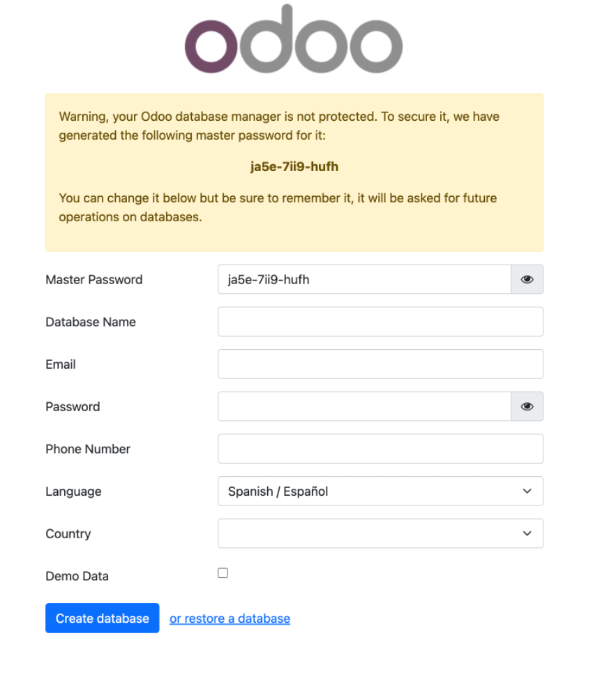

# **Instalación**

Los pasos para [**instalar Odoo**](https://www.odoo.com/documentation/16.0/administration/install/install.html) en un sistema varían según el sistema operativo que se utilice. A continuación, se describen los **requisitos mínimos** del sistema y los **componentes necesarios** para el correcto funcionamiento de Odoo.

## **Requisitos mínimos**

Antes de realizar la instalación de Odoo, es necesario tener presente los **requisitos mínimos** de hardware para su instalación:

- Procesador de 2 GHz o superior.

- 4 GB de RAM.

- Espacio en disco duro: 20 GB.

- Sistema operativo compatible: Debian, Ubuntu, Windows o MacOS, etc.

- Python 3.7 o superior.

- PostgreSQL 10 o superior.

- Librerías y paquetes necesarios (se pueden instalar automáticamente durante la instalación de Odoo).

## **Componentes**

A partir de los requisitos mínimos, podemos extraer la necesidad de dos componentes básicos:

- La **base de datos**: Odoo utiliza [**PostgreSQL**](https://www.postgresql.org/) como base de datos para almacenar toda la información.

- Un **intéprete de Python**: Odoo está escrito en [**Python**](https://www.python.org/), por lo que se requiere Python y algunos módulos de Python para ejecutar la aplicación.

## **Opciones de instalación**

Según la documentación oficial de Odoo, existen varias formas de instalar Odoo, que se describen a continuación:

- Instalación mediante **paquetes de sistema**. Esta es la forma más común de instalar Odoo en sistemas operativos Linux, ya que permite la gestión de Odoo como cualquier otro paquete del sistema operativo. Se pueden utilizar herramientas como `apt-get` en Debian/Ubuntu o `yum` en CentOS/Fedora.

- Instalación mediante **Docker**. Odoo puede ser instalado y ejecutado dentro de un contenedor de Docker. Esto permite la creación de entornos aislados y la fácil migración de Odoo entre diferentes sistemas.

- Instalación mediante descarga del **código fuente**. Si se desea una instalación personalizada, se puede descargar el código fuente de Odoo desde el repositorio oficial y compilarlo e instalarlo en el sistema.

Es importante tener en cuenta que cada método de instalación tiene sus propias ventajas y desventajas, y que la elección del método de instalación adecuado dependerá de los requisitos específicos del sistema y de la experiencia del usuario en la administración de sistemas y en el uso de Odoo.

# **Docker**

Docker es una plataforma de software libre que permite **crear, desplegar y ejecutar aplicaciones** en contenedores.

Un **contenedor** es una unidad de software que incluye todo lo necesario para que una aplicación se ejecute de manera aislada en cualquier sistema operativo. Esto permite que una aplicación se pueda ejecutar en cualquier entorno sin tener que preocuparse por la configuración del sistema operativo o de las dependencias del software.

## **Imágenes y contenedores en Docker**

Los contenedores se obtienen a partir de una imagen. Una **imagen** es una plantilla de solo lectura que contiene un sistema de archivos con todos los componentes necesarios para ejecutar una aplicación, como bibliotecas, dependencias, código y configuración. Una imagen se utiliza como base para crear uno o varios contenedores que se ejecutan de manera aislada, cada uno con su propia copia del sistema de archivos de la imagen.

Cada imagen de Docker tiene un **identificador único** que se utiliza para referirse a ella y descargarla de un repositorio central de Docker, como [**Docker Hub**](https://hub.docker.com).

Un **contenedor**, por otro lado, es una instancia en ejecución de una imagen de Docker. Los contenedores proporcionan un ambiente aislado para ejecutar aplicaciones y permiten que las aplicaciones se ejecuten de manera consistente en diferentes entornos de infraestructura. Cada contenedor tiene su propio sistema de archivos y recursos aislados, incluyendo CPU, memoria y almacenamiento.

Las imágenes y los contenedores son dos conceptos fundamentales en Docker, y ambos son esenciales para ejecutar aplicaciones en entornos aislados y portátiles. Por ello, es necesario tener claro lo siguiente:

- Una **imagen** de Docker es la plantilla que se utiliza para crear **uno o varios contenedores** que se ejecutan de manera aislada.

- Cada **contenedor** es una instancia en ejecución de una imagen.

- Cada **contenedor** tiene su propio sistema de archivos y recursos aislados.

## **Instalación de Odoo Community con Docker**

En este apartado se indica, paso a paso, como configurar Docker para tener una instancia de **Odoo Community** totalmente funcional.

### **Requisitos: lo indispensable**

Antes de empezar, solo necesitas dos cosas:

1. **Sistema operativo:** Da igual si usas Windows, macOS o Linux. Docker Desktop funciona en todos.

1. **Docker Desktop instalado:** Si aún no lo tienes, descárgalo e instálalo desde la web oficial de Docker. Sigue los pasos de instalación que te indique para tu sistema operativo.

Una vez que tengas Docker Desktop funcionando, estarás listo para el siguiente paso.

> **📌 Nota para usuarios de Windows**
> 

> Durante la instalación, es posible que Docker te pida activar o instalar la característica **WSL 2**. No te preocupes: es un componente estándar de Windows necesario para que Docker funcione. Simplemente acepta y sigue las instrucciones.

### **Paso 1: Crea la carpeta de tu proyecto**

Abre tu terminal (o cmd/PowerShell en Windows) y crea una carpeta para tu proyecto Odoo.

Por ejemplo, en tu carpeta de usuario:

```html
mkdir -p ~/mis_proyectos_odoo/CataDAW/addons
cd ~/mis_proyectos_odoo/CataDAW
```

Esta carpeta CataDAW será la base de tu proyecto Odoo local, y addons es donde podrás añadir módulos personalizados más adelante si te animas a explorar.

### **Paso 2: Crea la receta y los contenedores acorazados para tus datos**

Antes de escribir la receta de nuestro Odoo, vamos a crear los contenedores donde guardaremos nuestros datos más preciados: la base de datos y los archivos adjuntos. Al crearlos de esta forma, nos aseguramos de que estén totalmente a salvo, incluso de nosotros mismos.

- 

Crea los volúmenes persistentes
En tu terminal, ejecuta estos dos comandos. Esto solo necesitas hacerlo una vez:

```html
docker volume create catadaw-db-data
docker volume create catadaw-web-data
```

Con esto, hemos creado dos "cajas fuertes" para nuestros datos que son independientes de nuestro proyecto. Ahora, le diremos a docker compose que las use.

- 

Crea el archivo docker-compose.yml
Este archivo es la receta que Docker usará para construir tu Odoo y conectarlo a estos contenedores acorazados.
Dentro de la carpeta odoo1rDAW, crea el archivo docker-compose.yml con tu editor de texto favorito:

```html
nano docker-compose.yml
```

Ahora, copia y pega el siguiente contenido:
docker-compose.yml

```html
services:
  web:
    image: odoo:19.0
    depends_on:
      - db
    ports:
      - "8069:8069"
    volumes:
      - catadaw-web-data:/var/lib/odoo
      - ./addons:/mnt/extra-addons
    environment:
      - HOST=db
      - USER=odoo
      - PASSWORD=tu_contraseña_segura

  db:
    image: postgres:15
    environment:
      - POSTGRES_DB=postgres
      - POSTGRES_PASSWORD=tu_contraseña_segura
      - POSTGRES_USER=odoo
      - PGDATA=/var/lib/postgresql/data/pgdata
    volumes:
      - catadaw-db-data:/var/lib/postgresql/data/pgdata

volumes:
  catadaw-web-data:
    external: true
  catadaw-db-data:
    external: true
```

- Sobre los volúmenes (la clave de la persistencia):
El volumen catadaw-web-data guarda archivos internos de Odoo (como documentos o adjuntos), mientras que catadaw-db-data almacena toda la información crítica de tu negocio.

Hemos declarado estos volúmenes como external: true. Esto significa que Docker Compose solo los toma prestados, pero no es su dueño. Gracias a esto, incluso si por error ejecutas el comando docker compose down -v, tus datos permanecerán intactos y a salvo. Es la forma profesional de proteger la información crítica de tu negocio.

Guarda el archivo (Ctrl + O y luego Enter en nano, o "Guardar" en tu editor).

> **📌 Tip**
> 

> Cambia tu_contraseña_segura por una contraseña robusta y única.

### **Paso 3: Inicia Odoo con un solo comando**

Ahora sí, ¡a lanzar Odoo! Gracias a la configuración anterior (o si usas Docker Desktop en Mac/Windows), ya no necesitas sudo. Simplemente ejecuta:

```html
docker compose up -d
```

Este comando hará la magia:
*   Descargará las imágenes de Odoo 19 y PostgreSQL 15 (solo la primera vez).
*   Creará y configurará los "contenedores" (las cajas mágicas) donde Odoo y su base de datos funcionarán.
*   Los dejará corriendo en segundo plano (-d de "detached").

Puedes verificar que todo está funcionando con:

```html
docker compose ps
```

### **Acceso inicial a tu Odoo y primeros pasos**

¡Felicidades! Si todo ha ido bien, tu instancia de Odoo ya está corriendo en tu ordenador.
Abrir el navegador web yescribe la siguiente dirección:
http://localhost:8069

Se abrirá la pantalla de inicio tal y como muestra la siguiente imagen:



En esta pantalla se deberá:

- Crear una nueva base de datos: Eligir un nombre para la base (ej. cataDAW), un usuario administrador (admin) y una contraseña segura.

- Seleccionar el idioma: Castellano (o el que prefieras).

- ¡Muy importante! No marcar "Demo Data", así contaremos con una base de datos totalmente limpia.

Tras unos segundos, Odoo creará la base de datos y Odoo será totalmente funcional.
