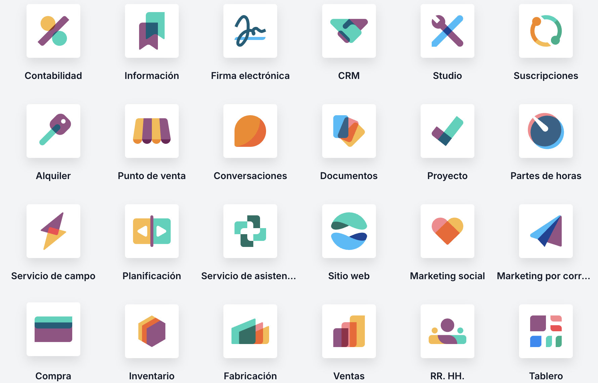

# Mòduls

  

    🏆 <strong>Progrés d'aquesta secció:</strong> 0 de 4 superats (0%)
    ⭐ <strong>0 punts</strong>
  

  

    

  

Odoo és un **programari modular**, el que significa que està compost per diversos **mòduls** que es poden **activar o desactivar** segons les necessitats de cada empresa o usuari.

Alguns dels mòduls de Odoo són:

- **Vendes** (*sales*): permet gestionar el procés de venda des de la cotizació fins a la facturació, incloent la gestió de clients, productes i preus.

- **Compres** (*purchase*): permet gestionar el procés de compra des de la solicitud de pressupostos fins a la recepció de factures, incloent la gestió de proveïdors, productes i preus.

- **Inventari** (*inventory*): permet gestionar l'inventari de productes, incloent el seguiment de les existencias, les entrades i eixides de productes, la valoració d'inventari i la gestió d'ubicacions.

- **Contabilitat** (*accounting*): permet gestionar la contabilitat financera i analítica, incloent la gestió de comptes, asientos contables, impostos i pressupostos.

- **Recursos humans** (*human resources*): permet gestionar els recursos humans, incloent la gestió d'empleats, contratos, nóminas, ausencias i evaluacions.

- **Projectes** (*project*): permet gestionar projectes i tasques, incloent la planificació, assignació de tasques, seguiment de temps i facturació.

- **CRM**: permet gestionar la relació amb els clients, incloent la gestió d'oportunitats de venda, seguiment de clients potencials i automatització de campanyes de marketing.

- **Punt de venda** (*point of ix*): permet gestionar la venda en botigues físiques, incloent la gestió de caixes, vendes, devolucions i pagaments.

Cada mòdul de Odoo proporciona funcionalitats específiques que es poden utilitzar per a automatitzar processos de negoci i millorar l'eficiència de l'empresa. A més, els mòduls de Odoo estan dissenyats per a treballar juntos de forma integrada, el que permet gestionar la majoria dels processos de negoci d'una empresa amb una sola plataforma.

---

## 🎮 Reptes Interactius d'Autoavaluació (+100 XP)

Comprova el teu domini sobre **9.3.3 Mòduls** superant aquests 4 reptes gamificats (+25 punts cadascun):

  
🎯 <strong>Repte 1 (+25 pts):</strong> Quina diferència principal hi ha entre un sistema ERP (com Odoo) i un sistema CMS (com WordPress)?

  

    <button type="button" class="btn-mcq-opt" data-opt="A">A) L'ERP integra la gestió empresarial interna (facturació, inventari, RRHH, compres, CRM), mentre que el CMS està orientat a la creació i publicació de contingut web.</button>
    <button type="button" class="btn-mcq-opt" data-opt="B">B) WordPress és un sistema operatiu de consola i Odoo és un cable de xarxa.</button>
    <button type="button" class="btn-mcq-opt" data-opt="C">C) Els ERP no utilitzen cap base de dades per a guardar la informació.</button>
    <button type="button" class="btn-mcq-opt" data-opt="D">D) Els CMS només funcionen sense connexió a Internet.</button>
  

  

  
🎯 <strong>Repte 2 (+25 pts):</strong> En l'arquitectura tècnica d'Odoo, quin Sistema Gestor de Bases de Dades relacional s'utilitza com a motor d'emmagatzematge per defecte?

  

    <button type="button" class="btn-mcq-opt" data-opt="A">A) PostgreSQL</button>
    <button type="button" class="btn-mcq-opt" data-opt="B">B) Microsoft Access 97</button>
    <button type="button" class="btn-mcq-opt" data-opt="C">C) Fitxers TXT sense format</button>
    <button type="button" class="btn-mcq-opt" data-opt="D">D) Redis en memòria volàtil únicament</button>
  

  

  
✅ <strong>Repte 3 (Vertader o Fals · +25 pts):</strong> Els sistemes de Business Intelligence (BI) permeten transformar les dades operatives d'un ERP en quadres de comandament, informes i gràfics per a la presa de decisions.

  

    <button type="button" class="btn-vf" data-opt="V">Vertader (V)</button>
    <button type="button" class="btn-vf" data-opt="F">Fals (F)</button>
  

  

  
⌨️ <strong>Repte 4 (+25 pts):</strong> Quines són les sigles en anglès dels Sistemes de Planificació de Recursos Empresarials (com Odoo, SAP o Microsoft Dynamics)?

  

    <input type="text" class="quiz-input" placeholder="Escriu la resposta..." />
    <button type="button" class="btn-quiz-check">Comprovar</button>
  

  

### 📋 Llista de Comprovació i Rúbrica d'Assoliment

Marca cada criteri a mesura que completes l'estudi o la resolució pràctica d'aquesta pàgina (**9.3.3 Mòduls**):

- [ ] He llegit detingudament la teoria o l'enunciat d'aquesta secció i he anotat els conceptes clau.
- [ ] He revisat els esquemes, taules o blocs de codi i he verificat que sé aplicar-los a l'entorn de treball.
- [ ] He resolt correctament els **4 reptes interactius** superiors obtenint els **100 punts XP**.
- [ ] He descarregat el comprovant oficial en PDF per a adjuntar-lo a la tasca d'**Aules**.

  <h3>📤 Comprovant de Lliurament per a Aules</h3>
  
Quan hages completat els reptes interactius i la llista d'autoavaluació d'aquesta pàgina, introdueix el teu nom i descarrega el teu certificat oficial en PDF per a adjuntar-lo a la tasca d'<strong>Aules</strong>.

  

    <label for="aules-student-name">👤 Nom i Cognoms de l'Alumne/a:</label>
    <input type="text" id="aules-student-name" class="aules-student-name" placeholder="Ex: Joan Garcia Pérez" />
  

  

    0/4 reptes completats (0%) · 0 punts · 0/4 criteris d'autoavaluació
  

  

    <button type="button" class="btn-aules-dl" data-module="LMSGI" data-unit="UD09" data-activity="ut0933">📥 Descarregar Comprovant PDF</button>
    <button type="button" class="btn-aules-copy">📋 Copiar Resum al Porta-retalls</button>
  

  

